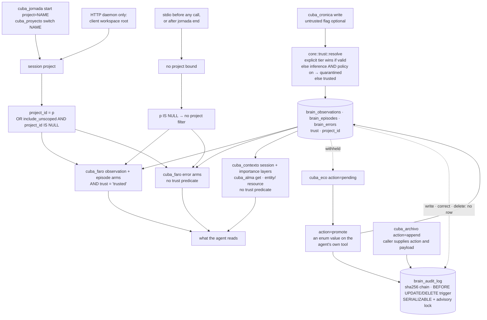

## 1. Executive Summary

MemoryIndustry is an MCP memory server in Rust over PostgreSQL and pgvector,
giving a coding agent a searchable knowledge graph across sessions. Its best
idea is the quarantine tier: text the agent did not vouch for is stored with
`trust = 'quarantined'`, the search arms admit rows with `AND trust =
'trusted'` — an allow-list, not an exclusion — and the tests pin both
directions. Its weak side is that every boundary is written per query, so the
reads that omit a predicate are the ones that leak.

It was called cuba-memorys, and the `cuba_*` tool names carry that. It runs on
stdio, one process per client, or as one HTTP daemon shared by every editor
window, with paired accounts for machines on a LAN.

**Two marks:** `trust_state` and `negative_eval`. A quarantined memory must not
surface in search, *and* an ordinary write must stay retrievable, so a filter
that excluded everything could not pass; a project-isolation case and an
unscoped-rows case carry their controls the same way.

**`scope_enforced` is not carried.** Every search arm reads
`$p::uuid IS NULL OR project_id = $p`, and the project is session state the
agent sets with its own arguments — `cuba_jornada start project=NAME` or
`cuba_proyecto switch`. On the stdio transport nothing binds one until the agent
does, so by default every read spans every project, and a `cuba_faro` flag
admits the rows that belong to no project.

Two mechanisms that look like marks are withheld. The `brain_audit_log` is a
hash-chained, trigger-enforced append-only table — and the only memory
mutations that write it are promote and quarantine; writes, corrections and
deletions append nothing. `brain_facts` carries `valid_from`, `valid_to` and
`observed_at` behind CHECK constraints, every write stamps validity from record
time, and no read asks a validity question.

Section 10 is the reason to read the page: the README carries a heading reading
*"Measured — and the benchmark that was lying"*, retracts its own published
retrieval score, and withdraws the two conclusions that rested on it.

## 2. Mental Model

Everything written is trusted unless something says otherwise, and "otherwise"
has two sources: a caller that marks the text untrusted, and a policy that
quarantines LLM inference. A quarantined row is stored, listable through
`cuba_eco action=pending`, and kept out of `cuba_faro` until a promotion moves
it.

A session may carry a project. The agent names it when it starts a session or
switches, and the HTTP daemon also adopts the client's workspace root as one.
When a project is bound, each search arm keeps to it; when none is, the arms
apply no project filter at all. Row-level security sits underneath with the
same rule, so it narrows nothing an unbound session can reach.

The diagram follows the read side, because that is where the marks are decided:
which reads carry which predicate.

## 3. Architecture

One Rust binary serves MCP on stdio or, under `serve`, over loopback HTTP to
every client at once, keyed per client by an `Mcp-Client-Id` header and an MCP
session id (`rust/src/session.rs:136-150`). The same binary carries the CLI —
`search`, `save`, `delete`, `recall` for session-start injection, `sync`,
`doctor` — and a LAN mode: a host announces itself over UDP, a client pairs with
a one-time code, and an account credential travels beside the client identity
without replacing it (`session.rs:39-63`).

The store is PostgreSQL with pgvector. The runtime connects with the URL it is
given, migrates, and then reconnects as the non-superuser `cuba_app` role when
that role can log in (`rust/src/db.rs:295-338`), which is the condition under
which row-level security and the audit trigger bite. The project's `doctor`
says so in its own words: a superuser ignores RLS and can alter the audit log
(`rust/src/doctor.rs:699-709`).

## 4. Essential Implementation Paths

**The tier** — `rust/src/core/trust.rs:11-25`. `resolve(source, explicit,
policy_quarantines_inference)` returns the caller's `explicit` value when it is
one of the two legal strings, else `QUARANTINED` when the source is `inference`
*and* the policy is on, else `TRUSTED`. The policy is
`CUBA_QUARANTINE_INFERENCE`, unset by default, so out of the box nothing is
quarantined automatically.

**The read predicates** — `rust/src/search/bm25.rs:24-25` and
`rust/src/handlers/faro.rs:359-360`:
`AND o.trust = 'trusted'` beside
`AND ($3::uuid IS NULL OR o.project_id = $3 OR ($4::bool AND o.project_id IS NULL))`.
The trust clause names the state it admits, so adding a third tier would hide
those rows rather than expose them. The project clause is the same text in every
arm, and its first disjunct is the one that matters: when the session has no
project, `$3` is null and the clause is true.

**The project binding** — `rust/src/project.rs:23-28` resolves the project as
`session::project_id().or_else(session::client_root_project)`. The session value
is written by `cuba_jornada start` from its `project` argument
(`rust/src/handlers/jornada.rs:23-26`, `:65`) and by `cuba_proyecto switch`
(`rust/src/handlers/proyecto.rs:108-126`); both upsert any name they are given.
The root fallback is adopted only by the HTTP daemon, from the client's MCP
roots (`rust/src/http.rs:1274-1281`).

**The untrusted door** — `rust/src/constants.rs:376`, the tool schema. *"Set
when the text came from somewhere you do not control (a fetched page, a pasted
document, a third party). Everything extracted lands quarantined — stored and
inspectable via `cuba_eco action=pending`, but withheld from `cuba_faro` until
promoted."*

**The chain** — `rust/src/handlers/archivo.rs:142-210`. Each append opens a
transaction at `SERIALIZABLE` *"to keep the hash chain linear"*, takes
`pg_advisory_xact_lock` on a fixed key, reads the newest `current_hash`, and
inserts the next link — an HMAC when an audit key is configured, a plain
SHA-256 otherwise — retrying up to five times on a serialization failure.
Migration `0016_audit_log.up.sql` puts `BEFORE UPDATE` and `BEFORE DELETE`
triggers on the table that raise unless the role is `cuba_admin`, kept *"for
legal data deletion under GDPR"*, and `0041` revokes both verbs from `cuba_app`.

## 5. Memory Data Model

Three content tables — observations, episodes, errors — each with `trust`
(constrained to the two tiers by `0043_episode_error_trust.up.sql` for episodes
and errors) and `project_id`. Entity names are unique per project (`0064`). A
correction keeps up to 20 prior versions in a `previous_versions` JSON array on
the row, trimmed by `brain_append_version` (`0048_version_history.up.sql:17-38`).

Facts are mirrored apart into `brain_facts` as subject/predicate/object with
`valid_from`, `valid_to`, `observed_at`, `confidence` and `is_current`. Every
observation write appends one through `append_observation_fact`
(`rust/src/core/bitemporal.rs:98-122`, called from `cronica.rs:183` and `:546`)
unless `CUBA_BITEMPORAL` turns it off.

Migration `0029_bitemporal_check.up.sql` is worth reading for its candour. It
adds two CHECK constraints and explains that the original schema *"allowed
states that contradict its own model: `valid_from > valid_to` (a fact valid in
negative time); `is_current = TRUE` together with a `valid_to` already in the
past. Nothing prevented them."* It records that the existing rows violated
neither, and says a future violation should make *"the migration fail loudly
instead of corrupting silently — which is the point."*

## 6. Retrieval Mechanics

`cuba_faro` in `hybrid` mode fans out to a text arm, a BM25 arm and a pgvector
arm per table, fuses them, and optionally reranks with a cross-encoder. On a
multi-hop query it adds observations of entities named in the query
(`faro.rs:991-1043`), and with `associative=true` it expands through
graph-connected entities (`faro.rs:1688-1794`).

The observation and episode arms carry both predicates. The two error arms —
BM25 at `search/bm25.rs:91-100` and text at `faro.rs:1445-1460` — carry the
project predicate and no trust predicate, though `brain_errors` has the column
and `cuba_expediente` filters on it (`expediente.rs:56`, `:72`). With the
FalkorDB graph backend configured, a multi-hop query also appends observations
of PageRank-adjacent entities through `observations_for_entities`
(`faro.rs:1045-1056`, called at `:811`), which keeps the trust predicate and has
no project predicate.

Row-level security sits underneath. `0017_rls_policies.up.sql` enables *and*
`FORCE`s it on the graph tables under a `tenant_isolation` policy, `0055`
extends it to snapshots, working memory, chunks, procedures and judgments, and
`0063` relaxes the session table's write policy so a session can change its own
project. The policy admits every row when `app.current_project` is empty, and
the pool sets it from `project::rls_scope()` on acquire (`db.rs:246-251`), which
is empty while no project is bound to the session.

The project's `doctor` names the other limit rather than leaving it implied — a
superuser ignores RLS and can alter the audit log, so project isolation and
traceability both rest on nobody connecting as one.

## 7. Write Mechanics

A write resolves its tier before the insert and mirrors the observation into
`brain_facts`. A correction (`cuba_eco action=correct`, `eco.rs:398-445`)
checks the observation is in scope, pushes the old content onto
`previous_versions` and rewrites the row. `cuba_cronica` deletes an observation
by id with no project check (`cronica.rs:319`), and `cuba_forget` cascades a
hard delete through an entity's references.

A fact is closed only by a sync import, which sets `is_current = FALSE` and
`valid_to` together to the newer fact's `observed_at`
(`rust/src/handlers/sync.rs:2383-2408`) — exactly what the second CHECK
constraint requires. `supersede_fact` in `core/bitemporal.rs:147` would do the
same locally and has no caller.

Every delete fires a trigger that writes `(table_name, row_id)` into
`brain_tombstones` (`0045_tombstones.up.sql:18-24`), so a delete on one machine
reaches the other. It *"carries no content by design"*.

## 8. Agent Integration

Thirty memory tools under `cuba_*`, plus `cuba_tools` and `cuba_call`, which let
a lean profile load schemas on demand (`rust/src/constants.rs`). Promotion out
of quarantine is `cuba_eco action=promote`, one value of an action enum that
also carries `positive`, `negative`, `correct`, `quarantine` and `pending`
(`constants.rs:162`).

`cuba_contexto` assembles the agent's visible context — working memory, notes
addressed to this client, the artifact index, and a recall layer of the
session's recent writes, entities mentioned in working memory, and the 15
most important observations in the project (`rust/src/handlers/contexto.rs`).
The `recall` CLI, wired as a session-start hook, is a separate assembler that
takes the project from the working directory and does filter on trust
(`rust/src/recall_cli.rs:36-44`, `:109-141`).

## 9. Reliability, Safety, and Trust

**`trust_state`.** Two discrete states, and `quarantined` withholds an
observation or an episode from every `cuba_faro` arm and an error from
`cuba_expediente`. The tier is a field rather than a score, and the ranking
signals — confidence, decay — are separate from it.

Because the predicate is written at each read site, the reads that omit it
serve quarantined text: the two error arms of `cuba_faro`; `cuba_contexto`'s
session layer (`contexto.rs:67-80`) and importance layer (`:124-130`), which
also skips the `superseded` filter; `cuba_alma action=get`, which lists every
non-superseded observation of the entity (`alma.rs:164-168`); the `entity/`
MCP resource (`rust/src/protocol.rs:1416-1421`); and the pre-compact snapshot's
key observations (`pre_compact.rs:36-44`). The context assembler is where this
matters most, because it returns prose rather than records.

**`scope_enforced` is not carried.** The `project_id` predicate is in every
search arm, but it is a predicate on an optional value the agent controls. On
stdio no project is bound until the agent passes one to `cuba_jornada start` or
`cuba_proyecto switch`, `cuba_jornada end` clears it, and while none is bound
every arm reads `$p IS NULL` as true. `include_unscoped=true` on `cuba_faro`
admits the rows that belong to no project. Only the HTTP daemon derives a
default, from the client's workspace root.

Row-level security does not close this, since its policy admits every row when
no project is bound. Two more reads carry no project predicate at all: the
FalkorDB expansion and the `entity/` resource. A process-wide
`CUBA_PROJECT_FILTER=off` lifts the filter for everyone and is documented as
such (`README.md:377`).

**`negative_eval`.** Read-path must-not assertions with their controls beside
them — section 10.

**`audit_log` is withheld.** The table is a well-built tamper-evident ledger
with one writer on a memory path, and it covers one kind of mutation.
`set_trust` appends `memory.promote` or `memory.quarantine` after flipping the
tier (`eco.rs:144-162`) and discards a failed append with `.ok()`. Account
events are appended the same way (`accounts_db.rs:124`). The `append` action
of `cuba_archivo` takes the action string and the payload from its caller, so
agent-written rows share the chain. An observation written, corrected or
deleted, an entity erased by `cuba_forget`, and a fact closed by sync append
nothing.

**`bitemporal` is withheld.** Both axes exist as columns and both are stamped
from record time: `valid_from` is `Utc::now()` in `FactBuilder::new`
(`core/bitemporal.rs:50`), the one builder production code uses, and a sync
import copies the peer's value and closes `valid_to` at the newer fact's
`observed_at`. `was_valid_at` is the only function that would ask a validity
question and has no caller outside its own tests. The query that touches the
window is an integrity check in `doctor` for `valid_to <= valid_from`.

**`human_review` is withheld.** Quarantine holds a memory in a state until
something resolves it, but `promote` is one value of the `action` enum on
`cuba_eco`, a tool the writing agent already holds. The producer can clear its
own queue.

**`tombstone` is withheld.** `brain_tombstones` is keyed on
`(table_name, row_id)` and exists so a delete propagates through sync;
supersession flips a column on a row; feedback records an outcome per memory.
Nothing keys a rejection on the value, so the same claim arriving again is a new
row.

## 10. Tests, Evals, and Benchmarks

Test files are named for the version and the invariant they defend —
`v016_quarantine.rs`, `v021_import_quarantine_all_kinds.rs`,
`v033_untrusted_extraction_does_not_touch_the_graph.rs`, `v041_isolation.rs` —
and the assertion messages carry the claim:

- *"a quarantined memory must not surface in search"* (`v016_quarantine.rs:67`),
  paired at `:151` with *"an ordinary agent write must stay retrievable — the
  gate must not change default behaviour."* The control is the harder half: a
  predicate that excluded everything would satisfy the first assertion alone.
- *"a quarantined episode must not come back from `cuba_faro`, or the quarantine
  is a column nobody reads"* (`v021:174`). Its error-table half is asserted
  through `cuba_expediente` (`:188`), the read that filters, rather than through
  `cuba_faro`'s error arms, which do not.
- *"quarantined text must not reach faro"* beside *"trusted twin must surface so
  a miss is not a dead search"* (`v041_isolation.rs:552-559`).
- *"Project B search leaked Project A entity"* (`v08_project_scoping.rs:145-148`),
  and *"an active project must not see leftover NULL rows unless asked"* beside
  *"include_unscoped is the escape hatch"* (`v041_isolation.rs:311-333`). Both
  bind a project before reading, so neither exercises the unbound session.

The database cases are `#[ignore]`, and the CI job discovers every file under
`rust/tests` and runs it with `--ignored` against a PostgreSQL service, its
comment recording that a hand-kept list had drifted to running a fraction of the
files (`.github/workflows/ci.yml:171-214`). The NLI cases in
`rust/tests/nli_entailment.rs` need a downloaded model and are excluded there,
and the helper refuses the usual escape: *"Soft-skip is forbidden."* I ran none
of these.

**The benchmark.** The README's own section, *"Measured — and the benchmark that
was lying"* (`README.md:520`), records that until v0.12 the file claimed every
number was measured and every number was wrong, in three ways. It had ten
queries, so *"the smallest effect it could detect was ~0.25 nDCG"*. Relevance
was judged by substring match, which *"measures keyword presence, not
retrieval, and it tilts the whole benchmark toward the lexical branch"*. And
nDCG was normalised against what was retrieved rather than what exists, so a
system that missed 60% of the answer scored 1.0. An `R@10 = 3.125` had shipped — *"Recall is a proportion."*

The corrected figure is nDCG@10 = 0.50, 95% CI 0.44–0.56, over 221 id-scored
queries, against a published 0.894. The sentence that follows is the one worth
quoting: *"The system did not get worse. It was never 0.894."*

Two conclusions were withdrawn with it. One held that the cross-encoder reranker
earned nothing; it had never run — three bugs in series, an error dropped by
`if let Ok(..)`, `token_type_ids` fed to a model that is XLM-RoBERTa and has
none, and `f16` logits read as `f32`. The other held that associative retrieval
degrades results, which a paired bootstrap on the new dataset confirms at
[−0.051, −0.018] — *"The decision was right; the reasoning was not."* Nothing
was run for this reading, so these figures are the project's own account of its
own correction rather than a re-measurement.

## 11. For Your Own Build

### Steal

- **Write the trust predicate as an allow-list.** `trust = 'trusted'` fails
  closed when a tier is added; `trust != 'quarantined'` fails open.
- **Pair every must-not with its control.** `v016_quarantine.rs` asserts the
  quarantined row is absent and the ordinary row is present, in the same file.
- **Put the invariant in the database and say what it was protecting against.**
  Migration 0029's comment names the two illegal states the schema had permitted
  and reports what the existing rows held.
- **Take a lock to keep a hash chain linear.** `SERIALIZABLE` plus an advisory
  lock plus bounded retries is the honest way to append to a chain concurrently.
- **Retract your own number in the file that published it.** The heading is
  *"the benchmark that was lying"*, not a changelog line.

### Avoid

- **A scope that is true when absent.** `$p IS NULL OR project_id = $p` makes
  the unbound session the widest one; a read with no scope should return nothing
  or refuse.
- **A predicate repeated per query.** The trust clause is right in the arms that
  carry it and missing from the error arms and the context assembler, which is
  where a hand-written filter goes missing.
- **A ledger that records one verb.** Hash chain, triggers, serializable appends
  — and a memory can be written, corrected or deleted without a row appearing.
- **Two time axes both stamped from the clock.** A validity window whose ends
  come from record time answers the same question the record time does.
- **Promotion as a value on the writer's own tool.** If the same agent can
  quarantine and promote, the tier records provenance rather than review.

### Fit

Take this if you want a Postgres-backed agent memory with a real quarantine tier
for one person's projects, and are willing to run the promotion step yourself
and bind a project before every session. Do not rely on it to keep two
projects apart, and read section 10 before taking any retrieval number from any
project, including this one.

## 12. Open Questions

- `CUBA_QUARANTINE_INFERENCE` is off by default, so nothing is quarantined
  automatically unless a caller sets `untrusted`. Is the default meant to change?
- The error arms of `cuba_faro` read `brain_errors` without the trust predicate
  that `cuba_expediente` applies to the same table. Is that deliberate?
- Is an unbound session meant to read every project, or should the stdio server
  bind one from the working directory the way the `recall` hook does?
- `brain_audit_log` records promote and quarantine. Was it meant to be written by
  the write, correct and delete handlers too?
- `was_valid_at` and `supersede_fact` have no caller. Is a validity-filtered read
  planned, and would `valid_from` then become caller-supplied?

## Appendix: File Index

| Path | What it holds |
| --- | --- |
| `rust/src/core/trust.rs` | the two tiers and the resolution rule, with its own unit tests |
| `rust/src/search/bm25.rs` | the allow-list trust predicate and the project predicate on observations; the error arm without trust |
| `rust/src/handlers/faro.rs` | every `cuba_faro` arm, the `include_unscoped` flag, the FalkorDB expansion |
| `rust/src/project.rs` | project resolution, the RLS scope and the unscoped-row backfill |
| `rust/src/handlers/jornada.rs`, `rust/src/handlers/proyecto.rs` | the two calls that bind a project to the session |
| `rust/src/handlers/contexto.rs` | the context assembler and its three recall layers |
| `rust/src/handlers/eco.rs` | promotion, quarantine, correction, and the audit append for trust transitions |
| `rust/src/handlers/archivo.rs` | the hash chain, the advisory lock, and the audit insert |
| `rust/src/core/bitemporal.rs` | the `Fact` builder, the observation mirror, and the uncalled `was_valid_at` and `supersede_fact` |
| `rust/migrations/0016_audit_log.up.sql` | the chain definition and the append-only triggers |
| `rust/migrations/0017_rls_policies.up.sql` | `ENABLE` plus `FORCE ROW LEVEL SECURITY` and `tenant_isolation` |
| `rust/migrations/0029_bitemporal_check.up.sql` | the two CHECK constraints and what they were added against |
| `rust/tests/v016_quarantine.rs`, `rust/tests/v041_isolation.rs` | the must-nots and their controls |
| `README.md` | the retraction, the corrected figure and the two withdrawn conclusions |

### Recorded searches

Run at the tree root of the pinned checkout with `git grep`.

- `git grep -n -E 'archivo::handle\(|INSERT INTO brain_audit_log' -- rust/src` — `accounts_db.rs:124`, `archivo.rs:173`, `eco.rs:149` and the dispatcher at `handlers/mod.rs:148`; no write, correct or delete handler.
- `git grep -n -i -E '(UPDATE|DELETE FROM|TRUNCATE)[[:space:]]+(TABLE[[:space:]]+)?brain_audit_log' -- rust/src rust/migrations` — no match; the only updates and deletes are in `rust/tests`.
- `git grep -n -c -E '\$[0-9]::uuid IS NULL OR (o\.|ep\.)?project_id = \$[0-9]' -- rust/src/handlers/faro.rs rust/src/search/bm25.rs` — 14 and 3; every project predicate on the search path is true when no project is bound.
- `git grep -n -E 'adopt_client_root\(|remember_client_root\(' -- rust/src ':!rust/src/session.rs'` — `http.rs:1274`, `:1280`, `:2181` and a test in `project.rs`; no stdio path derives a project.
- `git grep -n 'session::set(' -- rust/src` — `jornada.rs:65` and `proyecto.rs:125` on the server, `codegraph_cli.rs:88` in the indexer CLI, and the rest inside test modules.
- `git grep -n -E 'is_current = FALSE' -- rust/src` — `sync.rs:2383` and `:2396`, the import, and the uncalled `supersede_fact` at `core/bitemporal.rs:154`.
- read `rust/src/handlers/faro.rs:1045-1056` and `rust/src/protocol.rs:1407-1421` — the first query keeps `o.trust = 'trusted'` and names no project; the second names neither.
- `git grep -n -i -E 'reject|blocklist|denylist' -- rust/migrations` — two comments, neither a rejection table; no value-keyed record.
- `git grep -n -E "trust[[:space:]]*(!=|<>)[[:space:]]*'quarantined'" -- rust/src` — no match; every trust predicate is the allow-list form.
- `git grep -n -c "trust = 'trusted'" -- rust/src` — contexto 1, expediente 3, faro 12, ingesta 3, recall_cli 2, bm25 1, calibrate 2; none in the bm25 or faro error arms, `alma.rs`, `pre_compact.rs` or `protocol.rs`.
- `git grep -n was_valid_at -- rust/src` — its definition and two assertions in its own test module.
- `git grep -n supersede_fact -- rust/src` — its definition only.
- `git grep -n -E 'valid_(from|to)[[:space:]]*(<=|>=|<|>|BETWEEN)' -- rust/src` — `was_valid_at` and `doctor.rs:1405`, an integrity check; no read path filters on the window.
- `git grep -n -E 'brain_tombstones' -- rust/src` — sync export, the merge driver and the sync import, each by `table_name` and `row_id`.
- `git grep -n -E '"enum": \["positive"' -- rust/src/constants.rs` — line 162; `promote` and `quarantine` are values of the `action` enum on `cuba_eco`.
- `git grep -n -i -E 'arxiv|bibtex|@article|@misc|doi\.org' -- README.md` — no match; no paper.
- `git grep -n -i -E 'anthropic|machine learning|not (be )?used (for|to)' -- LICENSE` — no match; stock Apache 2.0.

## History

**2026-10-15** — [`b110ac22d5a0532f2eed02652be8078a6747da90`](https://github.com/LeandroPG19/Memorys/commit/b110ac22d5a0532f2eed02652be8078a6747da90) — 285 commits on, crate 0.25.0 to 0.30.0. Screened first: two auto-run surfaces (`server.json`, and `.cursor/rules/`, added since the previous pin), one build-time execution point, one unpinned surface and four manifests inside the cooldown; nothing installed or run. Changed upstream: rows with no project are hidden while one is bound unless `cuba_faro include_unscoped=true` ([`11cdc57362cb5d15a836b6fad7709466059cf7c0`](https://github.com/LeandroPG19/Memorys/commit/11cdc57362cb5d15a836b6fad7709466059cf7c0)), sessions are per client, and a LAN daemon with paired accounts arrived. `scope_enforced` is withdrawn: the project predicate is true when no project is bound, which the agent controls ([section 9](#9-reliability-safety-and-trust)). Three claims were wrong at the old pin and are listed under known limitations. Tool count re-measured.

**2026-09-20** — [`2f45dcb729426b4b5bfca45981d52a39d3f09d0b`](https://github.com/LeandroPG19/Memorys/commit/2f45dcb729426b4b5bfca45981d52a39d3f09d0b) — first reading, at 402 files. Screened before reading: one auto-run surface, one build-time execution point, one unpinned surface and nothing inside the seven-day cooldown; the screen also flagged an `AGENTS.md` carrying instructions addressed to a reading agent, which was treated as data. Nothing was installed and nothing was run, so the benchmark figures in section 10 are the project's own account of its own correction rather than a re-measurement. Apache 2.0. Three marks: `trust_state`, `scope_enforced`, `negative_eval`. `audit_log` and `bitemporal` are both withheld over well-built machinery with no live path into it, and each withholding rests on a search recorded in the appendix. The project was called cuba-memorys and the `cuba_*` tool names still carry that; the atlas had no report under either name before this one.
