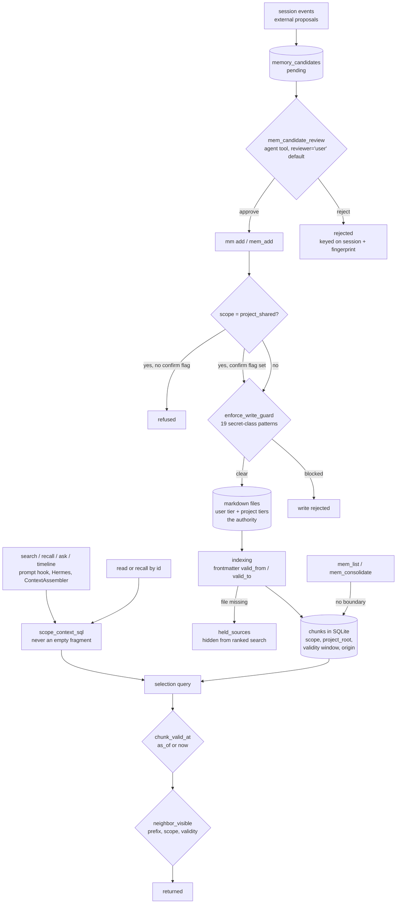

## 1. Executive Summary

memtomem is long-term memory for coding agents built on markdown files the
user keeps, with SQLite as an index over them, and its project scope is a SQL
fragment that never comes back empty. Every retrieval path composes it, id
lookups included, so naming another project's chunk returns nothing. The weak
side is the maintenance and review surface: `mem_consolidate` previews every
project's chunks to any caller, and the agent can approve its own memory
candidates.

The README states the design as "your files stay yours, and core usage is
hook-free by default". The 0.x line is labelled alpha.

**The boundary is a fragment the caller narrows.** Memory lives in three tiers,
`user`, `project_shared` and `project_local`. `scope_context_sql` documents
that it "is non-empty in every case — never returns `("", [])` — so callers
cannot accidentally drop the context rule by treating an empty fragment as 'no
filter'". With no project context it pins `scope = 'user'`; inside a project it
admits user rows and that project's rows. A caller's `ScopeFilter` narrows
that, or explicitly asks for a cross-project read from outside any project
(`storage/sqlite_scope.py:29-100`).

**The fragment reaches every retrieval path.** `bm25_search`, `dense_search`
and `recall_chunks` compose it unconditionally. Id-addressed reads resolve
through `resolve_visible_chunk`, and `neighbor_visible` re-checks scope, system
namespaces and validity on a chunk reached by adjacency. Both context
assemblers sit on top of those calls: the pinned-context composer and the
Claude Code prompt hook ([section 6](#6-retrieval-mechanics)).

**Two listings and the export sit outside it.** `get_source_files_with_counts`
and `list_chunks_by_source` take no boundary. `mem_list` uses the first to name
every project's files. `mem_consolidate`, reachable through `mem_do` in the
default tool mode, uses both and returns 80-character previews and ids of
another project's chunks (`server/tools/consolidation.py:48`, `:68`, `:77`).
The ids buy nothing further, since `mem_read` answers them as missing, but the
previews are content. `mem_export` writes every project to a path the caller
names, by design.

**A review queue exists and the agent can clear it.** Session events matching
a kind pattern, and external proposals, become `pending` candidates.
`mem_candidate_review` approves or rejects them, writes through `mem_add` on
approval, and records every transition with actor and reason. It is a tool the
agent holds, and its `reviewer` defaults to `"user"`
(`server/tools/formation.py:221-224`). `human_review` is withheld on that.

The limits are written beside the guarantees. The registry test for scope
vocabulary says what a green run does not prove. The git-tracked write consent
says its audit line means "a human (or an agent acting for one)". The
self-export marker says it proves local provenance, "NOT that every chunk
passed redaction".

Three marks: `scope_enforced`, `bitemporal`, `negative_eval`.

## 2. Mental Model

A **chunk** is a slice of a markdown file with its heading hierarchy, a
namespace, tags, a scope tier, a project root, and optionally a validity
window declared in the file's frontmatter. The file is the belief; the chunk
is its index entry. A chunk carries no status. It is corrected by editing the
file and removed by deleting it.

A **scope** is `user`, `project_shared` or `project_local`. The first is shared
across projects. The other two belong to the project named by an absolute
`project_root`, so one user-local database can hold several worktrees without
colliding.

A **context boundary** is the always-on rule. Out-of-project reads see `user`
only; in-project reads see `user` plus that project's tiers. It is the floor a
caller's filter narrows, not a default it overrides.

An **as-of instant** gates `valid_from_unix` and `valid_to_unix`, which come
from the file, not from the indexer. A search without one uses the current
instant.

A **held source** is a file the indexer cannot find. Its chunks stay in the
store, hidden from ranked search, entity search and maintenance discovery, and
reappear if the file returns. The hold is about availability, not belief, and
id-addressed reads reach the chunks until a purge (`storage/sqlite_visibility.py:41-60`).

A **candidate** is a proposed memory outside the index. It is `pending` until
approved, rejected or expired after 30 days; approval writes it through
`mem_add` as an ordinary chunk tagged `formation-approved`. A rejection is keyed
on `(session_id, fingerprint)`, so the same content from a later session is
queued again.

## 3. Architecture

| Area | Role |
| --- | --- |
| `storage/sqlite_scope.py` | `scope_context_sql`, the always-on boundary |
| `search/visibility.py` | `chunk_valid_at`, `neighbor_visible`, `chunk_in_scope_boundary`, `resolve_visible_chunk` |
| `storage/sqlite_visibility.py` | The held-source predicate and the SQL twin of the adjacency rule |
| `models.py` | `ChunkMetadata`, `NamespaceFilter`, `ScopeFilter` |
| `memory_scope.py` | The scope-tier to canonical-directory resolver shared by CLI and server |
| `privacy.py` | The redaction guard, its pattern provenance and the consent audit |
| `provenance.py` | The HMAC self-export marker and its threat model |
| `formation.py`, `storage/mixins/formation.py` | Candidate extraction, the review queue, and an assertion table with no caller |
| `tools/consolidation_engine.py` | Summary-path ownership and the refusal to consolidate over foreign chunks |
| `pinned.py` | Pinned context blocks and `ContextAssembler` |
| `server/tools/` | The MCP surface; nine core tools, everything else behind `mem_do` |
| `quality/` | Experiment, replay, gate and fingerprint harness for retrieval quality |
| `packages/memtomem-*` | Claude Code plugins, Kimi skills, OpenCode, a Hermes plugin and a Hermes memory provider |

### Deployment and ergonomics

Everything is local: a directory of markdown files and one SQLite database
with FTS5 and sqlite-vec. Dense retrieval needs an embedding model, fetched
through FastEmbed or ONNX; a BM25-only store runs without one. The MCP server
starts as `mm serve`, and the registry record in `server.json` launches the
PyPI package through `uvx`. The store is repairable by hand because the files
are the authority and the index can be rebuilt from them.

## 4. Essential Implementation Paths

- `storage/sqlite_scope.py:29-100` — the fragment and its three cases.
- `storage/sqlite_backend.py:2939-2965`, `:3090-3137`, `:3947-3999` — BM25,
  dense and recall each composing it.
- `search/visibility.py:50-145` — validity, adjacency, and the id resolver.
- `search/pipeline.py:1377-1379` — the validity filter at `as_of` or now.
- `pinned.py:377-413` — the context assembler passing the store's project root.
- `server/tools/memory_crud.py:739-790` — Gate B, then Gate A.
- `server/tools/formation.py:218-348` — candidate review and approval.
- `server/tools/consolidation.py:21-110` — the unscoped candidate listing.
- `tools/consolidation_engine.py:375-405` — the ownership refusal.
- `provenance.py:1-40` — what the marker proves and what it does not.

## 5. Memory Data Model

A chunk carries retrieval structure (headings, overlap, parent and file
context), classification (namespace, tags, chunk type), scope (tier plus
project root), a validity window, and provenance (`origin`,
`source_span_hash`, `redaction_count`, `source_read_only`). There is no status
column on `chunks`. Correction happens in the file, and the index follows.

`origin` decides ownership of the virtual summary path, and the comment gives
the reason: it is used "rather than on a namespace/tag combination a user chunk
can reproduce" (`models.py:64-69`). The consolidation engine is its only
writer, and a foreign import bundle is decoded with `origin=None`
(`tools/export_import.py:612`).

Three groups of tables sit beside the chunks. `held_sources` and
`pending_source_checks` hold a missing file's chunks out of ranked search.
`memory_candidates` is the review queue, with `memory_candidate_transitions`
recording each status change with actor and reason. `memory_assertions`
declares a subject, predicate and object with `recorded_at`, `valid_from`,
`valid_to` and an `active` or `superseded` status, and `query_assertions`
filters on `status='active'`. No production code calls `add_assertion`,
`link_assertions` or `query_assertions`, and ADR-0034 says so: the store "has
zero production callers — tests only".

## 6. Retrieval Mechanics

Hybrid BM25 and dense search over the indexed chunks, with the scope fragment
and namespace filter inside the FTS candidate selection rather than after a
`LIMIT`. Results then pass the validity gate, decay, access and importance
boosts, and an adjacency expansion that applies `neighbor_visible` to every
neighbour. Chunks whose source is held are excluded by the same SQL.

`validate_scope_vocabulary` runs on every read surface in the registry
`VALIDATED_SCOPE_SURFACES`: `mem_search`, `mm search`, `GET /api/search`,
`mem_recall`, `mm recall`, `mem_timeline`, `mem_entity_search` and `mem_ask`,
with `run_search` repeating it for in-process callers. That gate refuses a
misspelled tier the same way on every surface. The boundary itself lives in
storage, so a surface that skipped the gate would get the fragment anyway.

The context paths reach the same storage calls. `ContextAssembler.compose`
searches with `project_context_root=self.store.project_root`. The Claude Code
automation plugin's `UserPromptSubmit` hook shells out to
`mm search <prompt> --top-k 3 --format context`, and `mm search` resolves the
project from the working directory. The Hermes provider issues one `mem_search`
per turn.

## 7. Write Mechanics

Two gates in a fixed order. Gate B requires `confirm_project_shared=True`
before a write into a git-tracked directory and records that consent with the
surface that obtained it. Gate A is the content chokepoint: the redaction scan
covers the whole content, "a secret pasted past any byte offset still trips
it", and it hard-refuses `force_unsafe=True` when the scope is
`project_shared`. Writes into excluded paths and read-only roots are refused
before anything is appended.

The candidate path is separate. `scan_session_candidates` classifies session
events with keyword patterns in English and Korean, skips anything the
redaction scan flags, and queues the rest as `pending` with a 30-day expiry.
`mem_candidate_propose` queues an external proposal keyed on source and
idempotency key. Approval claims the candidate, writes a pinned block or calls
`_mem_add_core`, and finalizes; a concurrent recovery after the write
quarantines it as `write_uncertain`.

## 8. Agent Integration

The MCP server exposes nine core tools in its default mode — `mem_search`,
`mem_add`, `mem_index`, `mem_recall`, `mem_status`, `mem_stats`, `mem_list`,
`mem_read` and `mem_do` — and `mem_do` dispatches every other registered
action by name. The candidate, consolidation and export tools are therefore on
the agent's surface in every mode. Beside it sit a CLI, an HTTP API with a
dashboard, two Claude Code plugins, Kimi skills, an OpenCode integration, a
Hermes plugin and a recall-only Hermes memory provider.

Core usage needs no hook. The automation plugin is the opt-in exception: it
injects up to three search hits on each prompt over 20 characters and queues
changed files for indexing after `Write` and `Edit`.

## 9. Reliability, Safety, and Trust

Each guarantee carries its limits in the file that implements it. The
redaction module records the sibling commit its 19 patterns match and which
side may lead. The provenance module says a valid marker proves a self-export,
and lists the rows that can slip past redaction: legacy pre-guard rows, prior
`force_unsafe` writes, and folder-indexed content from before that path had a
gate. The consent emitter says its line means a human "or an agent acting for
one" authorised the write.

**The scope gap is in maintenance, not retrieval.** `mem_consolidate` builds
its groups from every indexed source and prints up to five previews per group
with chunk id prefixes, before any scope check. `mem_consolidate_apply` refuses
a group whose chunks span scopes, which protects the write and not the listing
that precedes it. `mem_export` writes every project's chunks to a path the
caller names, and the web export route does the same.

**`human_review` is withheld.** The candidate queue fails the producer test:
`mem_formation_scan`, `mem_candidate_propose` and `mem_candidate_review` are
all on the agent's tool surface, and the reviewer is a string the caller
supplies. The git-tracked write consent fails it too, as a boolean parameter.

**`audit_log` is withheld.** `memory_candidate_transitions` records the queue,
not chunk mutations. Write provenance goes to `session_events` only while a
session is open, and `cleanup_old_sessions` deletes ended sessions older than
90 days with their events and candidates. `maintenance_runs` is pruned by age.

**`tombstone` and `trust_state` are withheld.** A rejected candidate blocks
re-extraction only through `UNIQUE(session_id, fingerprint)`, so the same text
from another session is queued again. The candidate status lives on a staging
queue no retrieval reads, the held-source state is availability, and the
assertion status has no caller.

## 10. Tests, Evals, and Benchmarks

The core package carries 4,936 test functions in 569 files, roughly twice the
source in lines, plus a `quality/` package with experiments, replay,
fingerprints and gates for retrieval quality. I ran none of them.

`test_search_scope_filter.py` pairs SQL-fragment unit cases with end-to-end
recalls that assert exact content sets. The id-addressed case stores three rows
across two projects and asserts the in-scope pair exactly before asserting the
third absent. `test_temporal_validity.py` covers frontmatter parsing, chunker
propagation, search round-trips and the inclusive window boundaries.

The architectural guard registers every function that parses or forwards a
scope string and fails on an unclassified one. Its docstring states its limit:
a green run "does not mean 'no unvalidated read surface can exist'", since an
indirectly bound search, a splat or a non-forwarding wrapper is invisible to it
(`tests/test_scope_vocabulary_architectural_guard.py:50-62`). It guards the
vocabulary gate. No test in `packages/memtomem/tests` asserts that
`mem_consolidate` or `mem_list` stay inside a project.

## 11. For Your Own Build

### Steal

- **Make the scope fragment impossible to drop.** A builder that returns a
  non-empty SQL fragment in every case, and says in the docstring why, removes
  the failure where a caller reads "no filter" as "no restriction".
- **Resolve every id through the boundary, and answer out-of-scope as
  missing.** An id lookup that distinguishes "not yours" from "not there"
  leaks existence; one resolver for every id-addressed surface closes it.
- **Re-check visibility on the adjacency path, and let an explicit filter only
  widen it.** The difference between a visibility rule and a second selection
  query is the one most graph retrievers blur.
- **Decide ownership on a field a user write cannot reproduce.** An `origin`
  set by one writer, and cleared on foreign import, beats any namespace or tag
  convention.
- **Document what each guarantee does not prove.** The provenance module's
  account of which rows can slip past redaction is the model.

### Avoid

- **Exempting maintenance tools from the read boundary.** A listing written for
  an operator becomes a cross-project read once it is on the agent's tool
  surface; give it the same `project_context_root` as search.
- **A reviewer field the producer fills in.** A `reviewer="user"` default on an
  agent-held approve verb records an approval nobody gave.

### Fit

Reach for this if you want memory that stays in your own markdown, with real
per-project separation on retrieval and a write path that refuses secrets.
Look elsewhere if the agent must be kept from reading other projects through
every tool it holds, or if the store itself must model belief, supersession or
forgetting rather than delegating them to your repository's history.

## 12. Open Questions

- Is `mem_consolidate`'s cross-project listing intended for an operator, and
  would passing the caller's boundary to `get_source_files_with_counts` break a
  workflow that depends on it?
- Is there a path to a consent or review signal an agent cannot set for itself
  — a terminal prompt or a host-side approval — for `project_shared` writes and
  candidate approval?
- The self-export exemption skips the redaction re-scan on bundles that may
  contain pre-guard rows. Is a per-chunk redaction provenance planned?
- Is the assertion store, with its own valid and record times, meant to be
  wired to entity extraction, or kept as a schema?

## Appendix: File Index

| Path | What to read it for |
| --- | --- |
| `storage/sqlite_scope.py:29-100` | The always-on boundary and its three cases |
| `storage/sqlite_backend.py:2939`, `:3090`, `:3947`, `:4093` | Search and recall composing the fragment; the unscoped source listing |
| `search/visibility.py:50-145` | Validity, the adjacency fence and the id resolver |
| `storage/sqlite_visibility.py:41-60` | Held-source visibility |
| `pinned.py:377-413` | The context assembler |
| `server/tools/consolidation.py:21-110` | The candidate listing that previews every project |
| `server/tools/formation.py:218-348` | Candidate review on the agent surface |
| `storage/sqlite_schema.py:851-912` | The candidate and transition tables |
| `storage/mixins/formation.py:449-562` | The assertion store with no caller |
| `privacy.py` | The redaction guard and its cross-project sync rule |
| `provenance.py` | The HMAC marker and its threat model |
| `tools/consolidation_engine.py:375-405` | Summary-path ownership |
| `tests/test_scope_vocabulary_architectural_guard.py` | The vocabulary registry and its stated limit |
| `tests/test_search_scope_filter.py:195-234` | The boundary on an id-addressed recall |
| `tests/test_temporal_validity.py` | Frontmatter validity end to end |

Paths are under `packages/memtomem/src/memtomem/` unless they begin with
`tests/`, which is `packages/memtomem/tests/`.

### Recorded searches

Run at the tree root of the pinned checkout with `git grep`.

- `git grep -nE 'scope_context_sql\(|chunk_in_scope_boundary\(' -- 'packages/memtomem/src/*.py'` — 18 hits: BM25, dense, recall, coverage, tag counts, entities, relations, analytics, and the id, mutation and tag paths.
- `git grep -nE 'get_source_files_with_counts\(' -- 'packages/memtomem/src/*.py'` — the indexing engine, the MCP sources resource, `mem_list`, `mem_consolidate` and three web routes; the method takes no boundary argument.
- `git grep -nE 'boundary|project_context_root|scope_context' -- packages/memtomem/src/memtomem/server/tools/export_import.py packages/memtomem/src/memtomem/tools/export_import.py` — two comments about the import trust boundary and one about UTC; no scope on export.
- `git grep -nE 'mem_consolidate\(|mem_list\(' -- packages/memtomem/tests` — four calls, two in `test_source_holds.py` about held sources and two in `test_validation_error_messages.py` about argument bounds; none sets a project. The scope tests on consolidation, in `test_memory_write_scope.py`, cover `mem_consolidate_apply`.
- `git grep -nE 'valid_(from|to)_unix\s*=' -- 'packages/memtomem/src/*.py'` — the chunker, the budget migration, the row decoder and the web schema; no default to the write clock.
- `git grep -nE '\.(add_assertion|link_assertions|query_assertions)\(' -- packages/memtomem/src` — no match.
- `git grep -nE 'reviewer: str = "user"' -- packages/memtomem/src` — `server/tools/formation.py:224`.
- `git grep -nE 'UNIQUE\(session_id, fingerprint\)' -- packages/memtomem/src` — `storage/sqlite_schema.py:872`, the only uniqueness on candidates besides the id.
- `git grep -nE 'DELETE FROM (sessions|maintenance_runs)' -- 'packages/memtomem/src/*.py'` — `storage/mixins/sessions.py:416` and `storage/mixins/maintenance_runs.py:142`.
- `git grep -niE 'arxiv|bibtex|@article|@misc|doi\.org' -- README.md docs` — no match; no paper.
- `git grep -niE 'anthropic|machine learning|not (be )?used (for|to)' -- LICENSE` — no match; the Apache-2.0 text carries no rider.

## History

**2026-10-15** — [`d844f08ce66ecd5da28995f885980fe33a6bf42c`](https://github.com/memtomem/memtomem/commit/d844f08ce66ecd5da28995f885980fe33a6bf42c) — 155 commits on, version 0.6.2 to 0.6.8. The scope, validity and test files did not change, and the three marks hold at both pins. Overtaken: held sources, read-only roots, `mm serve` and the two Hermes packages. Wrong at the first pin: the fragment did not reach every chunk query, since `mem_consolidate` previews every project ([section 9](#9-reliability-safety-and-trust)); the registry test guards vocabulary rather than the boundary ([section 10](#10-tests-evals-and-benchmarks)); and an agent-cleared candidate queue went unreported ([section 2](#2-mental-model)). The first commit is dated 10 April 2026. Screened from a full clone: nineteen files, two auto-run surfaces (`.claude-plugin/` and `server.json`), two build-time execution points, two unpinned surfaces, five dependency files inside the cooldown, `CLAUDE.md` read as data. Nothing was installed, built or run.

**2026-09-16** — [`95baf6286f0eb779e6850a41a59b771daca9ccf5`](https://github.com/memtomem/memtomem/commit/95baf6286f0eb779e6850a41a59b771daca9ccf5) — first reading, at a commit dated 16 September 2026. Screened before opening, from a shallow clone: seventeen files, one auto-run surface (a `.claude-plugin/` directory), two build-time execution points, two unpinned surfaces, seven dependency files inside the cooldown, and `CLAUDE.md` read as data. Nothing was installed, built or run.
