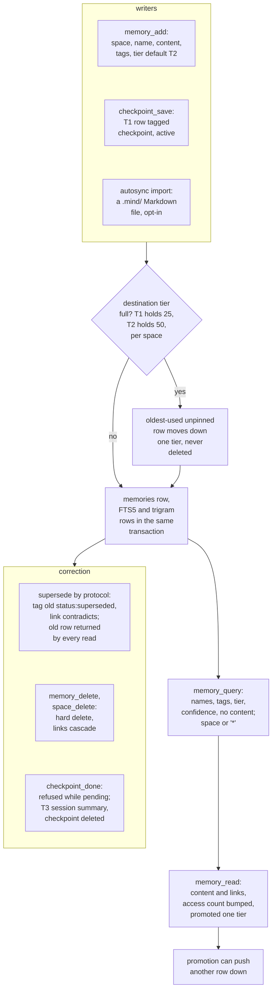

## 1. Executive Summary

Mind is a local memory server for coding agents, written in TypeScript on Bun.
The agent saves named memories into spaces such as `projects/<repo>`, links
them, keeps a checkpoint of unfinished work, and searches them later through an
MCP server; a CLI and a web app open the same SQLite file. What is notable is
the tier rule and the search pipeline. Every space has a capped hot tier and a
capped warm tier, a read promotes, an overflow demotes the least recently used
row, and nothing is ever evicted to deletion. The search fuses seven lexical
channels and an optional embedding channel into a score with a confidence
bucket. What is weak is correction: superseding a decision is a tag every read
ignores, an update overwrites with no prior version, and the only mutation
record is pruned after seven days.

The design is skill-driven. `mind setup` installs a `mind-management` skill and
a protocol into each supported agent and registers the MCP server at user
scope, and the protocol tells the model when to orient, recall, learn, link,
checkpoint and hand off (`src/resources/protocols/mind-cognitive-protocol.md`).
No hook injects memory content. Every memory reaches the model because the
model asked for it.

Four findings shape the rest of this report.

- **The model chooses the boundary.** Every read takes a `space` argument the
  model supplies, and `memory_query` maps `space: "*"` to no filter at all
  (`src/mcp/handlers/memories/query-memories.ts:86`). The protocol teaches the
  wildcard for cross-project recall, and a test pins it
  (`test/mcp-tools.spec.ts:1220-1231`).
- **Supersession is a label.** The protocol's correction is to tag the old
  decision `status:superseded` and link the new one with `contradicts`. No read
  path filters on any `status:*` tag, and the space orientation the agent loads
  at session start previews superseded rows beside current ones.
- **A read is a write.** `memory_read` bumps the access count and promotes the
  memory one tier, which can demote another memory out of the hot tier
  (`src/store/repositories/memory-repository.ts:571-590`).
- **The record of change does not last.** The `logs` table captures every MCP,
  CLI and API call with its arguments, and the process deletes rows older than
  seven days on start and every hour (`src/mind.ts:18-29`).

One mark, `negative_eval`. Section 9 names the six withheld.

## 2. Mental Model

A memory is a row the agent wrote. It becomes a belief when `memory_add`
commits: there is no extraction, no model call and no candidate state. Its
identity is the pair of space and name, unique per space
(`src/store/schema.ts`, `UNIQUE(space_id, name)`), and its meaning is
whatever free text the agent put in `content`, conventionally **What**,
**Why**, **Where** and **Learned** sections. It stops being a belief only when
someone deletes it. Every other transition changes where it sits, not whether
it is believed.

**Tier is a place, and use moves it.** A new memory lands in tier 2 unless the
caller names another. Tiers 1 and 2 are capped per space at 25 and 50
non-pinned rows (`src/config.ts:42-45`); tier 3 is unlimited. When a write or a
promotion would overfill a tier, `ensureCapacity` picks the unpinned row with
the oldest `COALESCE(last_accessed_at, created_at)` and moves it down one tier
(`memory-repository.ts:126-169`). A non-pinned `memory_read` promotes the
memory one tier when the destination has room or a victim
(`memory-repository.ts:571-590`). Pinning exempts a row from both. The tier
decides what the default list and the orientation previews show; it does not
enter the search score.

**Status is a convention the store does not know.** The protocol lists
`status:proposed`, `status:validated`, `status:failed`, `status:superseded`,
`status:obsolete`, `status:final` and `status:living` as tags
(`mind-cognitive-protocol.md:355-358`). The store treats them like any tag.
One read selects on one of them: the orientation's references block requires
`type:reference` and `status:living` (`search-repository.ts:1274-1280`). That
selects which rows appear as references; it withholds nothing from search,
list, read or the tier previews.

**Correction keeps the old row live.** The protocol says *"Do not overwrite the
historical memory"*: add the replacement, re-send the old memory's tags plus
`status:superseded`, and link the pair with `contradicts`
(`mind-cognitive-protocol.md:181-210`). The old memory remains in every
result, carrying its tag, and its content is unchanged. `memory_update` with
`content` overwrites in place, and `memory_delete` removes the row and its
links.

**Checkpoints are memories with a lifecycle.** `checkpoint_save` writes a
tier-1 memory tagged `checkpoint` and `active` holding JSON goal, pending and
notes fields, or patches the active one (`src/checkpoint/checkpoint-save.ts:85-160`).
`checkpoint_done` refuses while `pending` is non-empty, then in one transaction
writes a tier-3 `session-*` summary tagged `type:session` and `cat:summary`,
copies every link in both directions, and deletes the checkpoint
(`src/checkpoint/checkpoint-done.ts:58-99`, `memory-repository.ts:492-568`).

## 3. Architecture

Mind is a Bun program behind a shell launcher, `mind`, that finds a `bun`
binary and runs `src/mind.ts`. Each invocation opens the store, runs the log
cleanup, and dispatches one command. `mind mcp` keeps the process alive as an
MCP server over stdio, `mind mcp start --http` serves Streamable HTTP on port
7438, and `mind serve` runs the web app and REST API on port 30303
(`src/mcp/server.ts:144-269`, `src/api/server.ts:65-93`).

**Persistence.** One SQLite file, `data/mind.db` under the install directory
unless `MIND_DATA_DIR` or `MIND_DB_PATH` says otherwise (`src/config.ts:4-13`),
opened in WAL mode with foreign keys on (`src/store/schema.ts`,
`initializeDatabase`). The schema is version 10: `spaces`, `memories`,
`memory_tags`, `links`, `logs`, an FTS5 table with the `porter unicode61`
tokenizer, and a contentless trigram FTS5 table with diacritics removed. Both
FTS tables are synced by hand in the same transaction as the row, because, as
the schema comment says, `bun:sqlite` mishandles content-sync triggers. A
startup check rebuilds the search indexes when they drift from the rows
(`src/store/sqlite-store.ts:34-100`).

**Search stack.** Everything lexical is SQLite. The optional semantic channel
is enabled by `MIND_RAG=true` and a provider, OpenAI or OpenRouter
`text-embedding-3-small`. Embeddings are stored as a BLOB on the row and
scored by cosine over every candidate row in the filtered set
(`src/helpers/rag.ts`, `search-repository.ts:613-661`). A provider failure
opens a five-minute breaker, after which search runs lexical only.

**Autosync** (experimental, opt-in per space) mirrors a space to
`.mind/spaces/<hash>/*.md` with YAML frontmatter after each mutation, and a file
watcher imports edited files back (`src/sync/`). A file deleted on disk does
not delete the memory (`src/sync/auto-sync-service.ts:157-159`).

### Deployment and ergonomics

The documented install is `curl … | bash`, which installs Bun if absent and
puts the checkout under user-local paths. `mind setup` then writes MCP
registrations, the skill and a managed instruction block into each supported
agent's configuration, including agents that are not installed. Nothing else
has to run: no API key is needed to store or search, and the store is an
ordinary SQLite file a person can open with `sqlite3`, apart from embedding
BLOBs. The web app on port 30303 lists, edits and deletes memories, draws a
per-space link graph, and shows the call log. Running from source needs
`bun install`, whose `prepare` script runs `husky install`.

## 4. Essential Implementation Paths

**Capture.** `memory_add` validates with `MemoryAddSchema`, resolves any
`links_to` references, and calls `MindStore.addMemory`
(`src/mcp/handlers/memories/add-memory.ts`). `addMemory` refuses a duplicate
name in the space, then runs `insertMemoryRowSync` in one transaction:
`ensureCapacity` for the target tier, the row, both FTS rows, normalized tags
and `related` links (`memory-repository.ts:179-273`). With RAG on, the
embedding is requested after commit and written by a second `UPDATE`.

**Retrieval.** `memory_query` with `search` calls `store.search`, which runs
`searchMemories` (`search-repository.ts:672-969`); without `search` it calls
`queryMemories`, ordered by `changed_at` (`:1081-1139`). The MCP response
strips `id`, `content`, rank and timestamps from every row
(`query-memories.ts:39-66`), so the agent sees names, tags, tier, pinned and a
confidence bucket, and must call `memory_read` for content.

**Context assembly.** There is no automatic assembly. `space_get` is the
orientation the protocol tells the model to call at session start and after
compaction. It returns overview counts, up to five non-checkpoint rows per
tier, pinned first and then most recently changed, up to five living
references, and every active checkpoint
(`src/mcp/handlers/spaces/get-space.ts`, `search-repository.ts:1195-1281`).
`checkpoint_load` returns one checkpoint's fields and its linked memories'
names, tags and tiers (`src/mcp/handlers/checkpoint/load-checkpoint.ts`).

**Update, delete, forget.** `memory_update` builds one patch for rename,
content, pinned, a one-step tier transition and a tag diff, applied in one
transaction by `patchMemory` (`memory-repository.ts:638-772`). `memory_delete`
calls `deleteMemoryByName`, which deletes the FTS rows and the memory; links
and tags go by `ON DELETE CASCADE` (`:485-490`). `space_delete` cascades a
whole space. Log pruning is `cleanupOldLogs` (`log-repository.ts:212-219`).

**Schema.** `src/store/schema.ts` holds the v10 tables and the nine migrations
from v1, including the v8 move to UUID keys and the v9 and v10 trigram index.

**Integration.** `createMcpServer` registers six tool groups and wraps every
call in a log entry with the resolved agent identity
(`src/mcp/server.ts:29-140`). Agent setup is `src/cli/setup.ts` and
`src/setup/`.

## 5. Memory Data Model

| Table | Holds | Notes |
| --- | --- | --- |
| `spaces` | UUID `id`, unique `name`, description, `hidden` | `hidden` filters `space_list` and bare-name resolution only |
| `space_tags` | space name, tag | at least one tag on create |
| `memories` | UUID `id`, `fts_id`, `space_id`, `name`, `content`, `tier` 1–3, `pinned`, `access_count`, `last_accessed_at`, `embedding`, `created_at`, `updated_at`, `changed_at` | unique on space and name |
| `memory_tags` | memory id, tag | at least one per memory |
| `links` | source, target, `label`, `created_at` | one link per directed pair; the label is free text |
| `logs` | source, operation, level, input and output JSON, error, caller info, duration, timestamp | pruned after seven days |

**Scope** is the space. A memory belongs to exactly one, and names are unique
within it. Links may cross spaces. The convention is `projects/<repo>`,
`user/preferences` and `global/config`, and the model types the name.

**Provenance** on a memory is absent: no author, source, session or agent
column. The agent identity resolved from `MIND_AGENT` and the MCP client name
goes into `logs.caller_info` only (`src/helpers/agent-identity.ts`). Session
summaries carry a `provenance` object naming their checkpoint inside the JSON
content (`checkpoint-done.ts:68-80`).

**Time** is record time throughout. `changed_at` moves on content, rename, pin
and explicit tier changes, not on access promotion, and the `from` and `to`
filters on `memory_query` read it.

**Versioning** is none. An update overwrites `content`, and the protocol's
temporal fallback says so in its own words: `changed_at` *"does not preserve
intermediate versions or all tag/link changes"*
(`mind-cognitive-protocol.md:104-106`). The log row of the update holds the new
arguments, not the old content, for seven days.

## 6. Retrieval Mechanics

`searchMemories` parses the query into phrases, terms, `AND`, `OR`, `NOT` and
trailing-`*` prefixes; only uppercase operators count
(`src/store/shared/query-parser.ts`). A query with no informative term after
stopword removal is an error rather than an empty result. Then every channel
runs independently against the same space, tier and tag filter:

- **phrase, all, any** — three FTS5 `MATCH` rungs over the porter index; the
  any-term rung must cover a minimum share of the query tokens.
- **trigram** — substring matching for tokens of three or more characters.
- **fuzzy** — banded optimal-string-alignment distance of at most 2 against a
  cached vocabulary of every folded term in the database, then an FTS match on
  the expansions (`search-repository.ts:224-273`, `:535-560`).
- **like** — `LIKE` for tokens shorter than three characters.
- **semantic** — cosine over stored embeddings when RAG is on, the top 50
  above a 0.3 floor (`search-repository.ts:73-75`).
- **token_set** — a coverage score over the lexical candidates only.

`NOT` terms are matched once and removed from every channel. Fusion normalizes
each channel and combines them with fixed weights — phrase 1.0, all 0.9,
semantic 0.8, trigram 0.6, any 0.55, like 0.5, fuzzy 0.4, token_set 0.3 — plus
an agreement bonus capped at 0.15 (`src/store/shared/search-fusion.ts:55-69`).
A semantic hit enters the result on its own only at cosine 0.6 or above, and
only for plain natural-language queries
(`src/store/shared/semantic-admission.ts:24`). The confidence bucket is `high`
when a strong lexical channel matched and the relative score clears 0.6.

The ranking does not consult tier, pinned, access count, recency or tags. A
superseded memory with the same words as its replacement ranks beside it,
distinguishable by its tags.

**Token budget.** The MCP response omits content, so a query costs names and
tags, 25 rows by default and at most 500. Content arrives one `memory_read` at
a time. `space_get` returns at most five rows per tier and five references,
with no content.

**Failure modes.** Over-recall from the fuzzy and any-term rungs is guarded by
coverage floors. The fuzzy vocabulary is global, so a term that exists only in
another space can produce an expansion; the expanded match is filtered by space
before any row is returned.

## 7. Write Mechanics

The agent writes explicitly, by tool call, following the protocol's LEARN
section: check for a near-duplicate *"when duplication is reasonably
possible"*, then add one atomic memory with at least one tag. There is no
extraction, no deduplication beyond the unique name, and no filter on content.
The protocol separates durable memories from checkpoints and session
summaries. The store enforces none of the distinction, except that
`checkpoint_done` refuses a memory without the `checkpoint` tag.

Three writers sit outside the model's tool calls:

- **The OpenCode plugin**, installed by default for OpenCode, runs
  `mind add <space> <name> <json> --tags type:session,cat:summary --tier 3` when
  a session is deleted, at most once per four minutes per session
  (`src/setup/opencode-automation-plugin.ts:258-285`). The content is the
  repository name, session id, event type and a timestamp, not anything the
  session did. Its compaction hooks inject fixed instructions, because
  `recoverCheckpointContext` returns `null` unconditionally (`:225-228`).
- **The Claude Code Stop hook**, opt-in through
  `MIND_SETUP_CLAUDE_ENABLE_HOOKS=true`, runs
  `mind checkpoint set "$PROJECT_SPACE" "Session close" "Review summary and persist key learnings"`
  (`src/cli/setup.ts:526-545`). `saveCheckpoint` updates the active
  checkpoint when one exists. On a configured `MIND_PROJECT_SPACE`, this hook
  therefore replaces the active checkpoint's goal and pending text with those
  strings. The Cursor hook script beside it is a deliberate no-op whose comment
  gives the reason: a hook *"can never clobber a real active checkpoint's goal
  or pending work"* (`setup.ts:547-570`).
- **Autosync import** writes whatever a Markdown file in `.mind/` says, by
  name, into the configured space (`src/sync/importer.ts:28-80`).

### Operational cost

Writes are synchronous and cheap: one SQLite transaction with no model call.
With RAG on, `addMemory` awaits one embedding request after the commit, so the
tool call blocks on the provider and returns with the vector stored. With RAG
off, a memory is searchable as soon as the call returns. No background pass
reads or rewrites memory content. The fuzzy vocabulary cache is rebuilt from
every row when the store changes, which is a scan of the whole store on the
first search after any write (`search-repository.ts:535-560`). The server
injects nothing per turn; the cost on the read path is whatever the model
chooses to fetch.

## 8. Agent Integration

Eighteen MCP tools: `space_create`, `space_list`, `space_get`, `space_update`,
`space_delete`; `memory_add`, `memory_update`, `memory_delete`, `memory_read`,
`memory_query`; `link_create`, `link_delete`; `checkpoint_save`,
`checkpoint_done`, `checkpoint_load`, `checkpoint_query`; `status`; and
`system_instructions`, which returns the full protocol when the skill cannot
load. The server declares tools only, no resources or prompts
(`src/mcp/server.ts:37-40`). The `initialize` instructions are a short
activation text telling the model to load the `mind-management` skill first
(`src/cli/skill-activation.ts`).

The model has every verb, including `space_delete` over a whole space, and
chooses the space on every call. The protocol asks it to keep project
knowledge in `projects/<repo>` *"using the actual repository name"*, so two
repositories with the same name share a space. The database is shared by every
project, because Claude Code's registration is `--scope user`
(`setup.ts:101-116`).

Compaction is handled by instruction: ORIENT says to call `checkpoint_query`
and `space_get` after a reset, and the OpenCode plugin repeats that in the
compaction context. `buildRecoveryPack`, a fuller recovery bundle with
capability profile and context hits, is called only from tests
(`src/checkpoint/recovery-pack.ts`).

Adapting it to another agent means an MCP registration and a copy of the
skill. `mind setup compatibility` prints which integrations were validated and
which were only written.

## 9. Reliability, Safety, and Trust

**Scope is enforced when the model asks for it.** Every read that names a space
applies `s.name = ?` in SQL: every search channel, the list and count
queries, get-by-name, the orientation previews and the graph
(`search-repository.ts:444-447`, `:1093-1096`, `:1195-1203`). The model names
the space, and three reads cross. `memory_query` takes `*`; `memory_read` and
`checkpoint_load` open any space the model names; and reference resolution
falls back to scanning every non-hidden space for a bare name
(`src/helpers/memory-ref-resolver.ts:25-32`). The `hidden` flag hides a space
from `space_list` and that fallback, and from nothing else.

**Correction is advisory.** A `status:superseded` memory is returned by search,
list, read and the tier previews, and the protocol's anti-pattern list names
deleting history as the mistake. Old and new values coexist with only a tag
and a link to tell them apart. That works for a model that reads tags and
fails silently for one that does not.

**Provenance and injection.** No memory records who or what wrote it, and
nothing screens content. A web page the agent read can become a memory with
the same standing as a user's decision.

**The local surfaces are open.** `Bun.serve` is called with a port and no
`hostname` for both the web API and the HTTP MCP server
(`src/api/server.ts:79-89`, `src/mcp/server.ts:189`); Bun's documented default
binds every interface. The router has no authentication and no `Origin` check
(`src/api/router.ts`), and `POST /api/memories` parses the body with
`request.json()` regardless of content type. I infer, without running it, that
another host on the network, or a page in the user's browser sending a simple
cross-origin POST, can write memories.

**Concurrency.** WAL with a five-second busy timeout; writes are single
transactions. The fuzzy cache detects another process's write through SQLite's
`data_version`, which a test exercises with a child process.

**Privacy.** Delete is a hard delete of the row, its FTS rows and its links.
The deleted content survives in `logs.input_data` of the original `memory_add`
for up to seven days, in autosync Markdown history if the space was mirrored
into git, and in SQLite free pages until a `VACUUM`.

Capability marks:

- `negative_eval` — awarded; evidence in section 10.
- `scope_enforced` — withheld. The space predicate is real and applied on every
  read path that names a space. The space is a model-supplied argument that
  widens to every space with `*`, a documented and tested surface on the
  agent's own MCP server.
- `audit_log` — withheld. `logs` records every call with its arguments, which
  covers every mutation through MCP, CLI and API. It is pruned to seven days on
  start and hourly, truncated at 64 KB per field, and cleared in full by
  `DELETE /api/logs` from the web app (`log-repository.ts:78-119`, `:212-224`,
  `src/api/routes/logs.ts:5-13`). Autosync imports write no row, and a failed
  insert is swallowed.
- `trust_state` — withheld. `status:*` tags have a writer, the model, and no
  read that excludes on them; the one tag-required read, living references,
  selects a category rather than withholding a belief.
- `tombstone` — withheld. Deletion leaves nothing behind in the store. The
  autosync manifest's `deleted` and `tombstone_at_utc` fields are keyed on the
  memory id and only stop the exporter re-pruning a file
  (`src/sync/file-sync-service.ts:219-233`).
- `bitemporal` — withheld. `created_at`, `updated_at` and `changed_at` are all
  record time, and the date filters read `changed_at`.
- `human_review` — withheld. No memory waits in any state; a person can edit or
  delete through the web app after the write, which is authoring.

## 10. Tests, Evals, and Benchmarks

I installed and ran nothing. The suite is 1,793 `bun test` cases in 122 spec
files, all against a temporary SQLite store with no skipped case, run by CI on
every push and pull request (`.github/workflows/main.yml:3-38`).

**The negative cases.** `test/mind-store.spec.ts:701-711` stores identical
content in `proj-a` and `proj-b`, searches `proj-a`, and asserts exactly one
result whose space is `proj-a`; the length and the space name are the positive
control. `:874-884` asserts `authentication NOT jwt` returns `auth-only` and
not `auth-jwt`. `test/fuzzy-cache.spec.ts:263-283` finds `proc-del` by a fuzzy
query, deletes it from a child process, and asserts the next search omits it
and rebuilt the vocabulary; the post-delete result has no control of its own.
The space case runs on the store, below the MCP handler, whose `*` crossing is
itself pinned by a test (`test/mcp-tools.spec.ts:1220-1231`).

**The correction contract** is tested as storage, not retrieval.
`test/supersession-contract.spec.ts:27-82` runs the protocol's supersede steps
through the MCP handlers. It asserts the old memory keeps its content and gains
the tag, the `contradicts` link points from new to old, and the default list
contains both. No case asserts how search or `space_get` treats the superseded
row.

**Search quality** has a fixture evaluation (`test/search-eval/`) with typed
cases, including negatives whose expected result is empty, and baseline metric
fixtures the suite compares against. An expected-empty negative passes on a
retriever that returns nothing, so the scope and NOT cases above carry the
mark, not these. Checkpoint atomicity, partial updates, schema migrations and
the setup writers each have their own spec files.

**The agent benchmark.** `benchmarks/agent-memory/` drives OpenCode against
LoCoMo `conv-26` with a fresh Mind database per condition. Two runs are
committed, 24 October 2026, model `deepseek/deepseek-v4.1-flash`, 30 questions
by 3 repetitions, condition `mind-current` only. From the per-question rows I
recompute 13 correct answers with RAG off and 14 with RAG on (14.4% and 15.6%),
with 29 and 34 abstentions, matching the committed summaries. Evidence recall at 10
on categories 1–4 is 0.457 and 0.522. No baseline condition is in either run.
`ANALYSIS.md` reports an earlier run, not committed as rows, in which an older
Mind scored 21 correct answers (23.3%) against none for `no-memory`.

**The headline.** The README's 86.67% on OmniMemEval LongMemEval-S is a
120-question stratified subset answered and judged by one model, and its
evidence is an Actions run, not a committed file
(`benchmarks/omnimemeval/README.md`). Through the GitHub API, run
`40320556252` shows the RAG-off job succeeded and the RAG-on job failed at its
QA stage, which matches the README's account. The score sits in a 19 MB
artifact I did not download. No paper or citation file is in the tree.

## 11. For Your Own Build

### Steal

- **Cap the hot tiers and demote, never delete, on overflow.** A fixed count per
  scope with least-recently-used demotion gives a bounded orientation view with
  no forgetting policy to get wrong.
- **Return names and tags from search, content from a separate read.** It keeps
  a recall query cheap and makes the model choose what to open.
- **Complete a checkpoint atomically, and refuse while work is pending.** One
  transaction that writes the summary, moves every link and deletes the
  checkpoint leaves nothing half-done to recover from.
- **Sync derived indexes in the row's transaction and check them on start.**
  The drift check and in-place rebuild make a contentless index safe to use.
- **Ship a no-op hook with its reason.** The Cursor script records why a
  lifecycle hook must not write.

### Avoid

- **A scope argument with a wildcard on the agent's own surface.** If
  cross-scope recall is a feature, make it a separate tool a deployment can
  withhold.
- **Correction by tag with no reader.** A status the protocol defines and no
  query filters reads as a lifecycle and behaves as a comment.
- **A read that mutates placement.** Promotion on read couples inspection to
  ranking; the `noPromote` flag only helps a model that remembers to pass it.
- **Pruning the only record of change.** A seven-day call log answers "what
  happened today" and not "why does the store believe this".
- **A hook that overwrites agent-authored state with a fixed string.**

### Fit

Mind suits one developer who works across several coding agents on one
machine, wants decisions and fixes to carry between sessions without an API
key, and trusts the agent to follow a written protocol. The store is
inspectable, the search is solid without embeddings, and the core is a
weekend's read. It does not suit anyone who needs projects kept apart from the
model, a team sharing memory over the network, or a record of what a memory
said before it changed. Those need the space fixed by the host, an
authenticated API, and version rows: three changes to the design, not
settings.

## 12. Open Questions

- Is `memory_query` with `*` intended to stay on the agent surface, or is a
  host-fixed space planned for multi-project setups?
- Should search or `space_get` demote or hide `status:superseded` and
  `status:obsolete` rows, or is the tag meant only for the model to read?
- Is `recoverCheckpointContext` in the OpenCode plugin a placeholder for a
  recovery snapshot, and is `buildRecoveryPack` meant to feed it?
- Is the Claude Code Stop hook meant to overwrite an active checkpoint's goal
  and pending fields, given the Cursor script's stated rule?
- What does the 86.67% run's artifact contain per question, and does it
  recompute?

## Appendix: File Index

- **Schema and storage:** `src/store/schema.ts`, `src/store/sqlite-store.ts`,
  `src/store/repositories/memory-repository.ts`,
  `src/store/repositories/space-repository.ts`,
  `src/store/repositories/link-repository.ts`,
  `src/store/repositories/log-repository.ts`, `src/config.ts`, `src/types.ts`.
- **Retrieval:** `src/store/repositories/search-repository.ts`,
  `src/store/shared/search-fusion.ts`, `src/store/shared/query-parser.ts`,
  `src/store/shared/semantic-admission.ts`, `src/helpers/rag.ts`.
- **MCP surface:** `src/mcp/server.ts`, `src/mcp/tools/*.ts`,
  `src/mcp/handlers/**`, `src/mcp/schemas/**`,
  `src/mcp/helpers/space-orientation.ts`, `src/helpers/memory-ref-resolver.ts`.
- **Checkpoints:** `src/checkpoint/checkpoint-save.ts`,
  `src/checkpoint/checkpoint-done.ts`, `src/checkpoint/checkpoint-lookup.ts`,
  `src/checkpoint/recovery-pack.ts`, `src/helpers/session-summary.ts`.
- **Agent setup and protocol:** `src/cli/setup.ts`,
  `src/setup/opencode-automation-plugin.ts`, `src/setup/skill-installation.ts`,
  `src/resources/protocols/mind-cognitive-protocol.md`,
  `src/cli/skill-activation.ts`, `src/helpers/agent-identity.ts`.
- **HTTP and autosync:** `src/api/server.ts`, `src/api/router.ts`,
  `src/api/routes/*.ts`, `src/sync/file-sync-service.ts`,
  `src/sync/auto-sync-service.ts`, `src/sync/importer.ts`, `src/sync/types.ts`.
- **Tests and benchmarks:** `test/mind-store.spec.ts`,
  `test/fuzzy-cache.spec.ts`, `test/mcp-tools.spec.ts`,
  `test/supersession-contract.spec.ts`, `test/search-eval/`,
  `benchmarks/agent-memory/results/run-ragoff-20261024-2110/`,
  `benchmarks/agent-memory/results/run-ragon-20261024-2110/`,
  `benchmarks/agent-memory/ANALYSIS.md`, `benchmarks/omnimemeval/README.md`,
  `.github/workflows/main.yml`.

### Recorded searches

Checked against the checkout at the pinned revision, from the tree root.

- `git grep -n -E "superseded|obsolete|status:living|type:reference" -- 'src/*.ts' web/src` — one read, `search-repository.ts:1277`, the living-references block, and a migration comment in `schema.ts`; no filter on any other `status:*` tag.
- `git grep -n -E "parsed.space === '[*]'" -- src/mcp` — `query-memories.ts:86` maps `*` to no space filter.
- `git grep -n -E 'hidden' -- src` — written by `updateSpace` and read as a predicate only by `listSpaces` (`space-repository.ts:90`); no search or query path.
- `git grep -n -E 'DELETE FROM logs|cleanupOldLogs|clearAllLogs' -- src web/src` — the hourly prune in `src/mind.ts`, the web clear route, and the repository.
- `git grep -n -E "addLog|logEntry\(" -- src` — writers in `src/mcp/server.ts`, `src/api/router.ts`, `src/cli/command-executor.ts`, and `src/sync/sync-coordinator.ts` for exports; none in `src/sync/importer.ts` or `src/sync/auto-sync-service.ts`, the import path.
- `git grep -n -i -E 'tombstone|reject|blocklist|denylist' -- src` — the autosync manifest fields and diagnostics, a protocol example and a doc comment; nothing on a memory write or read path.
- `git grep -n -i -E 'valid_from|valid_to|valid_until|validFrom|valid_at|as_of|asOf|event_time|occurred_at' -- src` — no match.
- `git grep -n -i -E 'approve|pending_review|quarantine' -- 'src/*.ts'` — no match.
- `git grep -n -i -E 'authorization|bearer|api[_-]?key|token|hostname|cors|Access-Control' -- src/api src/mcp/server.ts` — no match.
- `git grep -n -E 'test\.skip|describe\.skip|skipIf|test\.if|test\.todo|it\.skip' -- test web/test` — no match.
- `git grep -n -E 'recovery-pack|buildRecoveryPack' -- src test web` — callers in `test/session-summary-migration.spec.ts` only.
- `git grep -n -E 'tier|pinned|access_count|changed_at' -- src/store/shared/search-fusion.ts` — no match; ranking ignores them.
- `git grep -l -i -E 'arxiv|bibtex|@article|@misc|doi\.org|CITATION' -- . ':!bun.lock' ':!benchmarks/agent-memory/bun.lock'` — no match, and no `CITATION.cff`.

## History

**2026-10-28** — [`4e9a41e9432810269553e7a369d05d0bd1f36852`](https://github.com/GabrielMartinMoran/mind/commit/4e9a41e9432810269553e7a369d05d0bd1f36852) — first reading, at the head of `main`, the v1.7.0 release commit of 26 October 2026, from a shallow clone (`--depth 1`); history from the GitHub API. One mark, `negative_eval`. Screened before reading: no auto-run surface; two build-time execution points, the `Makefile` and a `prepare: husky install` script; 14 dependency surfaces inside the cooldown, inflated because the shallow clone dates every file to the tip; two unpinned surfaces with `bun.lock` present, 17 floating ranges at the root and 2 in the benchmark; `AGENTS.md` and its `CLAUDE.md` symlink read as data. The hosted benchmark run was checked through the API and its artifact not downloaded. Nothing was installed, built or run.
