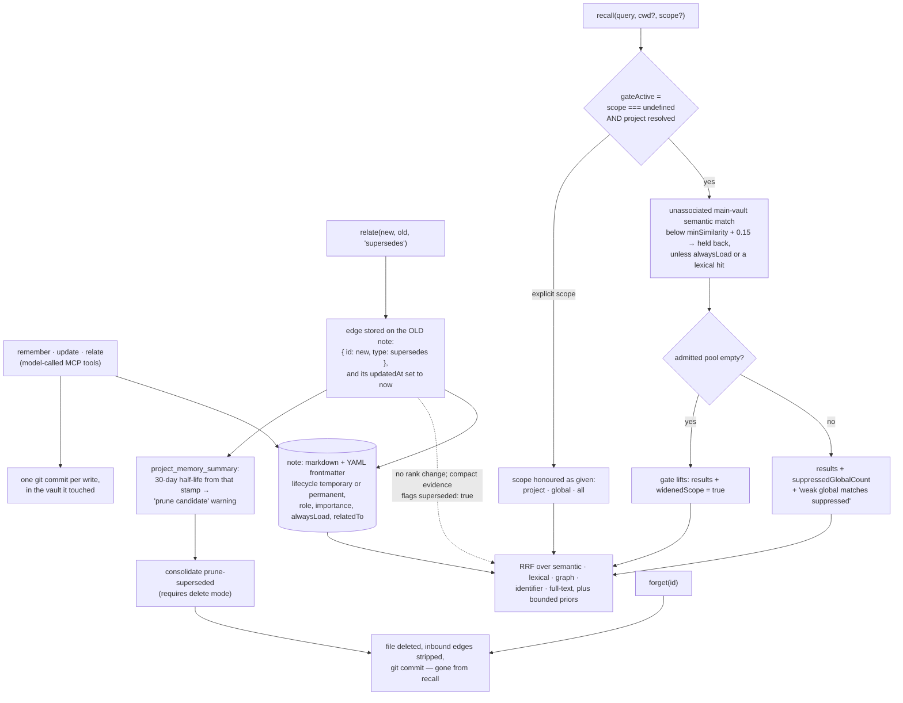

## 1. Executive Summary

mnemonic is a local MCP memory server that stores notes as markdown with YAML
frontmatter in git-backed vaults and commits every write. Its recall reports how
many weak global matches it held back and whether it had to widen, and tests
assert both directions. Nothing in it is epistemic. Marking a note superseded
does not lower its rank and stamps it as freshly updated, and the evidence line
printed on it says the opposite of what its structured flag says.

**The recall reports what it held back.** Alongside the ranked matches it returns
`suppressedGlobalCount`, the weak global matches the project gate withheld, and
`widenedScope`, set when the gate lifted because the admitted pool came back
empty. The text says it too: "weak global matches suppressed — pass scope: 'all'
to include them" (`src/tools/recall.ts:781-794`). A retrieval that silently drops
candidates below a threshold leaves its reader unable to tell *nothing matched*
from *something matched and was held back*. Two fields the filter already knew
remove that ambiguity.

**The scope argument runs the opposite way from the obvious one.** The gate is
`const gateActive = scope === undefined && project !== undefined;`, under the
comment "Explicit scopes run fully ungated" (`src/tools/recall.ts:215-219`).
Omitting `scope` is the stricter path. Passing `project` filters to the current
project and attached vaults, `global` to the main vault, and `all` returns
everything. The model supplies both `scope` and `cwd`, and the main vault is
appended to every search order (`src/vault.ts:239-263`), so this is relevance,
not isolation.

**Supersession is a graph fact that does not lower recall rank.** `relate(fromId,
toId, "supersedes")` writes the edge on the superseded note
(`src/tools/relate.ts:46-50`). Recall ranks that note through the same channels
as any other, and the edge spreads activation with the same 0.8 multiplier as
`related-to` (`src/recall.ts:657-672`). The thirty-day half-life a superseded
note receives in `provenance.ts` is read by `project_memory_summary`, to suggest
pruning, and by consolidation evidence — not by recall. Writing the edge also sets
the old note's `updatedAt` to the current time (`src/tools/relate.ts:418-423`,
`src/tools/consolidate-helpers.ts:323-327`), so its decay clock restarts and its
recency term rises at the moment it is superseded. It leaves recall when someone
deletes it, through `forget` or `consolidate` with `prune-superseded` in delete
mode.

One mark, `negative_eval`. Lifecycle is `temporary | permanent`, a retention
genre; importance is a ranking prior; confidence is computed for display after
the results are chosen. The write record is git history, outside the store, and
`forget` deletes the file from the working tree.

The exit story is stated as a feature and the format makes it true: "[i]f you
stop using mnemonic, your notes remain plain markdown with YAML frontmatter."

## 2. Mental Model

A **note** is a markdown file in a vault: the project vault inside the repository,
or the main vault for global notes. It is ground truth as written; nothing marks
it as candidate, inferred or verified.

The **project** comes from the git remote of the `cwd` the caller passes,
normalised to a slug such as `github-com-acme-myapp`. It decides where recall
starts and which global notes must clear a higher bar.

A note has no status. Its lifecycle says how long it is expected to matter, its
role says what kind of artefact it is, and `importance` and `alwaysLoad` raise
its rank. None of these withholds it.

**Superseded** is an edge stored on the old note, written with a fresh
`updatedAt`. It changes three things: a compact-evidence flag on the old note's
recall result, a thirty-day half-life that puts the note on a prune list in
`project_memory_summary` thirty days after that stamp, and eligibility for
`prune-superseded`. It does not lower rank.

A note **dies** by deletion only. `forget` removes the file and the inbound
edges; delete-mode consolidation removes merged sources; `prune-superseded`
removes notes carrying a `supersedes` edge. Each is a git commit, so the text
survives in history and not in the store.

## 3. Architecture

| File | Role |
| --- | --- |
| `src/tools/recall.ts` | The recall tool: vault order, the derived gate, channel collection, the lift, diagnostics and rendering |
| `src/recall.ts` | Gate predicate, metadata priors, hybrid score, graph spreading, result selection |
| `src/tools/recall-helpers.ts` | Lexical, identifier and full-text candidate collection; coverage diagnostics |
| `src/provenance.ts` | Signal strength, confidence tiers and decay half-lives, every constant named |
| `src/storage.ts`, `src/vault.ts` | Note files, frontmatter, vault discovery and search order |
| `src/tools/relate.ts`, `src/tools/forget.ts`, `src/tools/consolidate*.ts` | Edges, deletion, merge and prune |
| `src/document-sync.ts`, `src/document-recall.ts` | Read-only document sources from other repositories |
| `src/toolset.ts`, `src/server-instructions.ts` | The `full` and `core` toolsets and the instructions sent at initialize |

### Deployment and ergonomics

One Node process speaking MCP over stdio, installed from npm as
`@danielmarbach/mnemonic-mcp` or from a Homebrew formula. Nothing else must run
to store a note. Embeddings default to Ollama with `nomic-embed-text-v2-moe` on a
localhost or private-network URL, with OpenAI and Gemini as configured
alternatives (`src/embeddings.ts:87-89`, `:111-125`). When the query embedding
fails, recall skips the semantic channel and keeps the lexical, identifier,
full-text and document channels (`src/tools/recall.ts:221-226`).

The store is human-readable and repairable by hand: one markdown file per note,
with embeddings and projections in gitignored directories that rebuild. A project
vault's `.gitignore` is committed so collaborators ignore embeddings too
(`src/vault.ts:463-470`).

## 4. Essential Implementation Paths

**Write.** `remember` (`src/tools/remember.ts`) resolves the project from `cwd`,
checks the saved write-scope policy, writes the file with `updatedAt: now`, embeds
it, commits, and may push. A policy conflict elicits a choice from the user on
clients that support it, and `scopePolicyOverride: true` skips the guard.

**Retrieval.** `src/tools/recall.ts:227` takes the vault order, scores semantic
candidates per vault (`:394-496`), applies the explicit scope filter (`:428-436`)
and the derived gate (`:438-446`), runs lexical reranking and graph spreading
(`:551-561`), merges the independent lexical channel (`:620-651`), partitions
gated candidates (`:662-664`) and lifts on an empty pool (`:755-761`).

**Scoring.** `computeHybridScore` sums reciprocal-rank contributions from five
channels with `RRF_K = 60`, then adds clamped priors for semantic confidence,
project, recency, metadata and canonical notes (`src/recall.ts:312-362`).

**Delete and prune.** `forget` (`src/tools/forget.ts:123-137`);
`handleDeleteMode` (`src/tools/consolidate-helpers.ts:285-301`);
`pruneSuperseded`, refused unless the mode is `delete`
(`src/tools/consolidate-helpers.ts:1208-1257`, `:1404`).

**Tests.** `tests/recall-scope-gating.integration.test.ts:42-273`;
`tests/recall-eval.integration.test.ts:16-35` with
`tests/fixtures/recall-eval/queries.json`.

## 5. Memory Data Model

`NoteMetadata` carries `id`, `title`, `tags`, `lifecycle`, `role`,
`importance`, `alwaysLoad`, `project`, `projectName`, `relatedTo`, `createdAt`,
`updatedAt` and `memoryVersion` (`src/storage.ts:75-92`). Roles are `summary`,
`decision`, `plan`, `research`, `review`, `context` and `reference`;
importance is `high | normal | low` (`src/storage.ts:39-42`).

Relationships are a closed set of six: `related-to`, `explains`, `example-of`,
`supersedes`, `derives-from`, `follows`. Direction is stored differently by type.
`related-to` is symmetric, the other forward types live on `fromId`, and
`supersedes` is passive, stored on the superseded note (`src/tools/relate.ts:37-51`).

Both timestamps are the write clock. `relate` also sets `updatedAt: now` on the
note it edits (`src/tools/relate.ts:418-423`), so adding an edge refreshes the
recency that signal strength, the temporal-query boost and the freshness band
read. For `supersedes` the edited note is the superseded one.

Project identity is a slug of the git remote. Pre-1.0 vaults stored HTTPS remotes
as `https-github-com-…`; the `normalize-project-ids` migration rewrites those, and
reads accept both forms before it runs.

## 6. Retrieval Mechanics

Five channels fuse by reciprocal rank: semantic similarity over stored
embeddings, a lexical channel over compact projections, graph spreading from the
top five entry points along typed edges, an exact-identifier channel that matches
`camelCase`, `SCREAMING_SNAKE` and `kebab-case` spellings of one name, and a
full-text channel that ranks notes containing nearly all distinctive query words
anywhere in the body (`src/recall.ts:312-362`).

The derived gate applies only to semantic candidates from the main vault that
belong to no current project and are not `alwaysLoad`. Its bar is
`minSimilarity + GLOBAL_BAR_DELTA`, 0.45 at the default, below the 0.5
spreading gate, so at the default a held-back note cannot seed graph expansion
(`src/recall.ts:124-150`). A lexical or identifier hit clears the bar
(`src/tools/recall.ts:646-647`).

`detail: "brief"`, the default, shows each note's summary and the passage that
best matches the query, and lists the ids to pass to `get` for full bodies. With
`evidence: "compact"` each result carries its channels, rank band, freshness band,
supersession flag and a score decomposition into RRF and each prior
(`src/tools/recall.ts:954-1000`).

## 7. Write Mechanics

`remember`, `update`, `relate`, `unrelate`, `consolidate`, `move_memory` and
`forget` each commit in the vault they touched, and may push. A write to a
protected branch is blocked, elicited, or allowed per project policy;
`allowProtectedBranch: true` is a one-time override on the tool call.

Because the store is a working tree, a write is visible in `git diff` before it
is committed and in `git log` after. That history lives outside the store: a
`forget` removes the file, and the text survives only in commits.

## 8. Agent Integration

A local MCP server registering up to twenty-eight tools. `MNEMONIC_TOOLSET=core`
narrows it to nine: `recall`, `get`, `remember`, `update`, `relate`, `list`,
`sync`, `project_memory_summary` and `consolidate` (`src/toolset.ts:5-15`).
The instructions sent at initialize tell the model to pass `cwd`, to recall before
writing, and to call `get` before quoting (`src/server-instructions.ts`).

Document sources index another repository's markdown read-only alongside the
notes. `sync` re-indexes one when the attached branch's commit, or the
extractor, chunker or embedding identity, differs from the manifest
(`src/document-sync.ts:79-103`, `src/tools/sync.ts:241`). Recall reloads the last
persisted generation at its indexed commit and does not re-index (`src/document-lazy-load.ts:234-330`).

Screening flags three auto-run surfaces: a devcontainer whose
`postCreateCommand` pipes the Ollama installer to `sh` and runs `npm ci`, Copilot
instructions, and an OpenCode bundle that registers a local MCP server.

## 9. Reliability, Safety, and Trust

The disclosure of suppression is the trust mechanism, aimed at the party that
needs it: whoever reads the results and otherwise cannot tell a gate from an
empty store.

The supersession disclosure is inverted in text. On a superseded note the
structured evidence is `superseded: true` with `supersededBy` set
(`src/tools/recall.ts:951-983`). The text formatter renders the same flag as
"supersedes 1 note" (`src/helpers/index.ts:126-134`), which tells a model the
obsolete note is the replacement. No test asserts that string.

Confidence is display, not ranking. `computeSignalStrength` adds a role weight, a
log-scaled relationship count capped at 0.15, a permanence bonus and a recency
term over ninety days from frontmatter `updatedAt` (`src/provenance.ts:153-173`).
Git contributes only `recentlyChanged`, a five-day flag. Both are computed inside
the rendering loop over results already selected (`src/tools/recall.ts:850-887`).

What is absent is any epistemic state. Nothing separates what a person decided
from what a model summarised, and no note state withholds a note from recall;
only deletion removes one.

## 10. Tests, Evals, and Benchmarks

The mark rests on `tests/recall-scope-gating.integration.test.ts`, which drives
the real MCP tools against a fake embedding server. The derived-default case
asserts the in-project note present and the off-topic global note absent on the
next line, the suppression text, `suppressedGlobalCount > 0` and `widenedScope`
undefined (`:87-94`). The lift case asserts the inverse (`:262-268`), and an
explicit `scope: "all"` case asserts the global note returns ungated
(`:172-219`).

`tests/recall-eval.integration.test.ts` runs forty-seven fixture queries through
recall and fails on any per-kind drop below `baseline.json` in MRR@10, S@1 or
S@5. Its one `supersession` query asserts only that the replacement outranks the
v1 note (`tests/fixtures/recall-eval/queries.json:284-290`,
`scripts/eval-recall.mjs:217-220`). The superseded note may appear, and the
check passes if it is absent.

Nothing was installed or run for this reading.

## 11. For Your Own Build

### Steal

Return the count of what you suppressed and whether you widened. Two fields turn
an ambiguous result into a legible one, and they cost nothing because the filter
already knew.

Name every constant in a score, and expose the decomposition. A ranking a
caller can take apart is one a maintainer can tune.

### Avoid

A supersession signal rendered as a sentence that reverses its own flag. If the
edge is passive, generate the text from the structured field and test the string.

A decay curve that never reaches the ranker, restarted by the write that marks
the note obsolete. Either apply it in recall, or date it from the supersession
without refreshing `updatedAt`.

### Fit

A single developer or a small team who want memory committed beside the code,
readable without the tool, with a recall that explains itself. It is not a fit
where an old answer must stop being returned before someone deletes it, or where
one caller must not read another's notes.

## 12. Open Questions

How the gate behaves for notes in the main vault that carry this project's id.
They count as current-project and are exempt; whether that is the intended reach
of "global" was not traced through `move_memory`.

What a model does with the inverted "supersedes 1 note" line in practice. The
structured field is right; the text is what most clients show.

## Appendix: File Index

| Path | What to read it for |
| --- | --- |
| `src/tools/recall.ts:215-219` | A gate that an explicit argument turns off |
| `src/tools/recall.ts:755-794` | The lift, the notices, and the suppression count |
| `src/recall.ts:124-166` | The global bar and the partition |
| `src/recall.ts:312-362` | Five-channel RRF with clamped priors |
| `src/provenance.ts:8-40`, `:153-275` | Signal strength, confidence and decay, constants named |
| `src/tools/project-memory-summary.ts:105-151` | The only recall-adjacent reader of the superseded half-life |
| `src/helpers/index.ts:126-134` | The evidence line that inverts supersession |
| `src/tools/relate.ts:37-51` | The passive `supersedes` convention |
| `src/tools/forget.ts:123-137` | Deletion and edge cleanup |
| `src/tools/consolidate-helpers.ts:1208-1257` | Prune-superseded, delete mode only |
| `src/vault.ts:239-263` | The search order, main vault always last |
| `tests/recall-scope-gating.integration.test.ts:42-99` | Absence, its control, and the disclosure |

### Recorded searches

Run from the clone at the pin, with `P=dbac069d3a346075457ec8b090bee5c548adbce6`.

- Readers of the decay half-life, none in recall:
  `git grep -n -E 'computeDecayInfo' "${P}" -- src`
- Every supersede reference outside the schema:
  `git grep -n -i -E 'supersed' "${P}" -- src | grep -v structured-content.ts`
- Decay or freshness on the ranking path:
  `git grep -n -i -E 'decay|halfLife|freshness|staleness' "${P}" -- src/recall.ts src/tools/recall-helpers.ts src/tools/recall.ts`
- Value-keyed rejection, none:
  `git grep -n -i -E 'tombstone|blocklist|denylist|rejected[_ -]?value|do[_ -]not[_ -](store|remember)' "${P}" -- src`
- A second clock, none:
  `git grep -n -E 'validFrom|valid_from|validAt|validUntil|validTo|effectiveFrom|occurredAt|eventTime|asOf|as_of' "${P}" -- src`
  (the only hits are `validAttachments` in `src/config.ts`)
- An in-store mutation log, none:
  `git grep -n -i -E 'audit|appendFile|\.jsonl|journal|event[_ -]?log' "${P}" -- src`
- A status field on a note, none:
  `git grep -n -E '(status|verified|disputed|retracted|quarantin|unverified|contested)[[:space:]]*[:?]' "${P}" -- src/storage.ts src/structured-content.ts`
  (the hits are the embedding write status `written | skipped`)
- A review queue: `git grep -n -i -E 'approv|pending[_ -]?review|review[_ -]?queue|elicit' "${P}" -- src`
  (elicitation covers write scope, vault choice and protected-branch consent only)
- A test of the supersede hint string, none:
  `git grep -n -E 'supersedes [0-9]+ note' "${P}" -- tests`

## History

**2026-10-15** — [`dbac069d3a346075457ec8b090bee5c548adbce6`](https://github.com/danielmarbach/mnemonic/commit/dbac069d3a346075457ec8b090bee5c548adbce6) — 79 commits on, version 0.45.0 to 1.0.0-rc.1. Overtaken: identifier and full-text fusion channels, brief recall output, a `core` toolset, canonical project ids, a recall-quality eval ([section 6](#6-retrieval-mechanics)). Wrong at the first pin and unchanged since: supersession was said to rank a note lower until it decays, when the half-life reaches no ranker ([section 2](#2-mental-model)); confidence was said to come from git history, when it reads frontmatter after selection ([section 9](#9-reliability-safety-and-trust)); `forget` and `prune-superseded` went unnamed. The inverted supersede hint was present then too. The earlier test-case figure did not reproduce. Marks unchanged. Screened from a full clone: nine files, three auto-run surfaces, one build-time execution point, one unpinned surface, two inside the cooldown; `AGENT.md` and `CLAUDE.md` read as data. Nothing was installed, built or run.

**2026-09-16** — [`5fc9a5f5be70d25304b45c1af0b83b50d20b4590`](https://github.com/danielmarbach/mnemonic/commit/5fc9a5f5be70d25304b45c1af0b83b50d20b4590) — first reading, at a commit dated 16 September 2026. Screened before opening, from a shallow clone: nine files scanned, three auto-run surfaces, one build-time execution point, one unpinned surface and two dependency files inside the seven-day cooldown. Nothing was installed, built or run.
