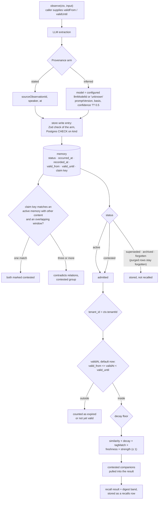

## 1. Executive Summary

mnemora is a memory library meant to sit beneath an agent framework, between the
agent loop and Postgres, where a memory's origin is the tag of a discriminated
union rather than a flag and a disputed memory is surfaced rather than resolved
away. The read side is disciplined: status, validity window and tenant are SQL
predicates on every recall stage, and the conformance kit asserts the negatives.
The weak side is identity, since the tenant is an unauthenticated string and the
provenance model field is whatever the caller configured.

It describes its aim as giving LLM applications *remembering* rather than
*saving*, and it does not want to replace LangGraph, Mastra or a hand-written
agent. The documentation is in Japanese. The development model is visible in the
tree: `docs/autonomy.md` is addressed to agents working without asking the
owner, and decision records state when an agent session wrote them.

**Provenance is the tag of a discriminated union.** The module's header, in
translation, says the distinction between the AI's inference and what the user
stated is expressed by the value of `kind` itself, not by an additional flag
(`packages/core/src/provenance.ts:3-7`). Each arm carries what that kind must
name: `stated` a source observation id and a time, `inferred` a model, a prompt
version, a `basis` of memory and observation ids, and a confidence (`:20-43`).
The store checks the arm against the Zod schema at its write entry
(`packages/core/src/new-memory-check.ts:49-60`), and Postgres refuses an unknown
kind or a stated or inferred memory without a source observation
(`packages/postgres/migrations/0001_init.sql:65-68`).

The arm's evidence is a filled slot, not an observed fact. `model` is the
runtime's configured `llmModelId`, `"unknown"` when the caller sets none
(`packages/core/src/runtime.ts:170`, `:2337`), and `confidence` is `0.5` when
the extraction candidate gives none (`packages/core/src/extraction.ts:580`).

**A contested memory is recalled with its counterpart.** `MemoryStatus` is
`active | superseded | contested | archived | forgotten`
(`packages/core/src/memory.ts:16-25`), and recall admits two of them at every
candidate stage (`packages/core/src/recall-runtime.ts:866`, `:909`, `:1451`).
A contested memory brings its pair, or its whole contradiction group, into the
result as a `mandatory_companion` (`:112`). It is the stance of
[yacmemo](../yacmemo/)'s warning marker, reached through a status value.

**Three time concepts are kept apart.** `occurred_at` is when the thing happened,
`recorded_at` when the store learned it, and `valid_from`/`valid_until` the
interval the fact holds (`packages/core/src/memory.ts:142-165`). Recall gates on
a `validAt` that defaults to now (`packages/core/src/recall-runtime.ts:505-506`),
and the aggregate counts expired and not-yet-valid rows as separate reasons
(`packages/postgres/src/memory-store.ts:2136-2141`).

**There is no tenancy to authenticate, and the code says so where a reader
looks.** `Ctx` states that mnemora keeps no ledger of tenants and that `tenantId`
is an opaque caller string with no existence check and no authentication
(`packages/core/src/ctx.ts:9-10`). Every read applies it, so a correct caller is
isolated and a careless one is not. The same file separates the tenant, the
isolation boundary, from the subject, the unit of organisation within it.
[Anda DB](../anda-db/) makes the same separation between a Space and a Domain.

## 2. Mental Model

A **memory** is an extracted claim that knows what kind of thing it is:
something said, inferred, merged, reflected on, or imported.

**Contested** is a reason to show both sides, not to hide either.

**Happened**, **recorded** and **valid between** are three clocks, and only the
third decides whether a memory is still true.

**Forgetting** is a status; **purging** overwrites the words and keeps the row.

The state machine, from `docs/memory-model.md` §11 and the runtime methods that
implement it:

- `active → superseded` when re-extraction or consolidation replaces it, or when
  a contested pair is resolved against it; `restoreSuperseded` reverses the group.
- `active → contested` when the caller marks a pair, or when a new memory's claim
  key matches exactly one active memory with different content and an
  overlapping window; three or more become a group in `memory_relations` when
  a relation store is wired, and are logged as an unresolved conflict otherwise.
- `active → archived` when the decay sweep finds strength below its floor;
  `restoreArchived` reverses it.
- any non-forgotten state `→ forgotten` by `forget`, compare-and-set on the
  observed status; `purge` then overwrites content and digest and sets
  `purgedAt`, and is refused for any other status.

Who moves it: extraction and the claim-key detector are background and
model-driven; marking, resolving, forgetting, purging and restoring are calls the
embedding application makes. Nothing in the tree is an agent tool.

## 3. Architecture

| Package | Role |
| --- | --- |
| `core` | The model, the runtime, recall, provenance, the outbox contract, strategies |
| `postgres` | The store adapters, their SQL, migrations and a CLI |
| `testkit` | Conformance suites every adapter must pass, and an in-memory store |
| `openai`, `anthropic`, `local-embedding` | Model and embedding adapters |
| `bullmq` | A driver that runs `tick()` from a BullMQ queue |

Postgres holds `observations`, `memories`, one embedding table per vector space,
`memory_events`, `recalls`, `recall_usages`, `outbox`, `labels`,
`memory_relations` and per-tenant settings, all keyed by `tenant_id`
(`packages/postgres/migrations/`).

### Deployment and ergonomics

The operator stands up Postgres with pgvector and runs the migrations. Background
work is not a daemon: the application calls `tick()` or wires the BullMQ driver.
Retention purge and tenant erasure are exported functions the operator calls;
`tick()` handles only extract, embed, consolidate and reflect jobs
(`packages/core/src/runtime.ts:206`).

## 4. Essential Implementation Paths

`packages/core/src/provenance.ts:1-116` — the union, its schema, and the arms.

`packages/core/src/new-memory-check.ts:21-61` — the write-entry check that
re-uses the read schema field by field.

`packages/core/src/recall-runtime.ts:505-506`, `:865-909`, `:1450-1451` — the
validity default and the tenant and status the runtime hands every store.

`packages/postgres/src/memory-store.ts:2090-2349` — the scope aggregate: subject
and attribute filters, the period and validity predicates, the digest band.

`packages/core/src/ctx.ts:1-73` — what the tenant is and is not.

## 5. Memory Data Model

Content, `contentHash`, digest, provenance, status, `supersededById` and
`contestedWithId`, tags, the three time fields, an optional `claimKey` of subject
and predicate, strength and half-life on a wall clock and an optional activity
clock, `purgedAt`, and caller `attributes`
(`packages/core/src/memory.ts:88-266`). Creation is idempotent on tenant, source
observation, extractor version and content hash
(`packages/postgres/migrations/0001_init.sql:105-108`).

`memory_events` records `created`, `updated`, `superseded`, `archived`,
`forgotten`, `purged` and their reversals, each with an `actor` the caller
declares as human, system or clone, a digest snapshot, and a reason in `meta`
(`packages/postgres/migrations/0001_init.sql:145-158`). It does not copy content.

## 6. Retrieval Mechanics

`total = similarity × decay × tagMatch × freshness × strength`, documented in
`docs/recall.md` §7, with every factor bounded and `MAX_STRENGTH = 1` exported
(`packages/core/src/memory.ts:35`). Candidates come from the vector store and a
lexical store, each filtered in SQL by tenant, status, period, validity and
decay floor (`packages/postgres/src/vector-store.ts:120-210`,
`packages/postgres/src/lexical-store.ts:76-120`).

The tenant predicate is on every read the runtime makes. The runtime passes
`ctx.tenantId` as the filter tenant (`packages/core/src/recall-runtime.ts:865`,
`:908`, `:1450`), and the stores also apply the ctx tenant, so a filter naming
another tenant returns nothing (`packages/postgres/src/vector-store.ts:207-208`,
`packages/postgres/src/lexical-store.ts:81-83`). `get`, `getMany` and
`getRecall` filter by tenant (`packages/postgres/src/memory-store.ts:1059-1080`,
`:2586-2595`). The subject narrows within the tenant when the caller sets it, and
an omitted subject reads the whole tenant (`packages/core/src/ctx.ts:65`).

A contested hit pulls its counterpart, and a group pulls its members through
`contradicts` relations (`packages/core/src/recall-runtime.ts:1159-1226`). A
digest band lists compact digests of in-scope memories beyond the main results.
Each recall is stored as a `recalls` row with the returned ids and scores
(`:2393`), and a later `memory_usage` observation names the recalled memories the
application used, which reinforces them.

## 7. Write Mechanics

Observations are extracted into memories; embedding, consolidation and
reflection run through the outbox. An extraction may carry a claim key; when one
active memory shares it with different content and an overlapping window, the
pair is marked contested. When the extraction has no subject candidate list, the
subject the model returns is discarded unless the caller sets
`acceptLlmSubjectIdWithoutCandidates` (`packages/core/src/runtime.ts:155-166`),
so text in an observation cannot file a memory under another subject by default.

Forget is a status change, compare-and-set against the observed status
(`packages/core/src/runtime.ts:4354-4358`). Re-extraction of an observation that
has a forgotten, contested or correction-lost memory writes nothing, and
consolidation and reflection abort if a source was forgotten while the model ran.
Those checks are keyed on the observation and the source ids
(`packages/core/src/runtime.ts:3023-3035`, `:5501`). A new observation
with the same content is extracted as a new active memory: the only content-hash
lookups are idempotency re-reads that also match the source observation
(`packages/postgres/src/memory-store.ts:801`, `:852`, `:1346`).

## 8. Agent Integration

None of its own. The library registers no MCP server and no tool; an agent
reaches memory only through whatever the embedding application exposes, and the
model calls it makes are its own extraction, consolidation and reflection
prompts. `examples/chat` is a demonstration application with benchmark logs.

## 9. Reliability, Safety, and Trust

The typed provenance is the trust mechanism, checked at the store's write entry
and in Postgres. Its limit is the model field, which records configuration
rather than the call that produced the inference.

Status transitions are guarded and logged. The runtime's supersede, restore and
forget calls pass an expected status (`packages/core/src/runtime.ts:3328`,
`:4108`, `:4358`), the archive sweep locks only active rows
(`packages/postgres/src/memory-store.ts:4250-4256`), and each transition writes
an event with the digest and the declared actor. The log is not append-only.
`purgeExpiredEventsByRetention` deletes events older than a tenant's retention
setting and leaves an `events_purged` row with the count and range
(`packages/postgres/src/memory-store.ts:1476-1560`, `:1581`), and `eraseTenant` deletes
a tenant's rows table by table (`:3988-4044`).

The tenant boundary is enforced and unauthenticated by design. A
cross-tenant reference detector scans the whole database for memories that point
at another tenant's rows (`packages/postgres/src/cross-tenant-reference-detection.ts`);
it is an operator diagnostic and reads across tenants on purpose.

Within a tenant, the subject is not a boundary. `tick()` claims outbox jobs by
tenant only (`packages/postgres/src/outbox-store.ts:61-90`), so background
consolidation and reflection set the context subject from the seed memory before
searching for neighbours (`packages/core/src/runtime.ts:3738-3739`,
`:3754-3755`). A seed with no subject keeps the tick's context, which for a
tenant-wide tick is the whole tenant. The project's
ADR 0310 records the cross-subject merge rate it measured before that change;
this reading did not run it.

## 10. Tests, Evals, and Benchmarks

The conformance kit is the interesting part: store behaviour is specified once
and every adapter is held to it. The negative cases sit beside positive controls
on the same store: a cross-tenant `get` is null and the owner's `get` returns the
row (`packages/testkit/src/memory-store-conformance.ts:705-721`); a tenant
spelled in another case sees nothing and its own spelling sees the memory; a
ctx/filter tenant mismatch returns nothing and the matching pair returns exactly
one id (`packages/testkit/src/lexical-store-conformance.ts:251-298`).

At the runtime, a memory recalled before `forget` is absent after it, with an
exact omission count (`packages/core/src/__tests__/forget.test.ts:409-431`).
`examples/chat/bench-results/` holds the project's own measurement logs, which
this reading did not reproduce. Nothing was installed or run.

## 11. For Your Own Build

### Steal

Make provenance the tag, not a flag, and check the arm where the store accepts a
write. A union whose arms demand different evidence turns a missing origin into
a rejected write rather than a null column.

Let contested stay in recall and bring its counterpart. Surfacing both halves
leaves the decision with the reader who can see both.

Apply the tenant twice when a filter object and a context both carry it. A
mismatch then returns nothing instead of the filter's tenant.

Discard a model-proposed subject unless the caller gave the candidates. Text in
an observation should not choose whose memory it becomes.

### Avoid

Recording a configured model name as the producer of an inference. The field
reads like evidence and is a setting; capture the model from the provider call.

Calling a log with a retention purge an audit trail. A count of what was purged
records that history existed, not what it said.

### Fit

A fit for a team embedding memory in its own multi-tenant application, which
authenticates its users and wants a library that will not invent an identity
model. It assumes Postgres with pgvector, an operator who schedules `tick()` and
retention, and a reader of Japanese design records. A product that needs the
memory layer itself to hold the security boundary, or a rejected value to stay
rejected across new observations, should look elsewhere.

## 12. Open Questions

Whether any application sets `includeOutsideValidity` or `includeFullyDecayed` by
default; both lift a recall gate and are caller options.

How often the claim-key detector fires in practice. The key is model-proposed and
opt-in per observation, and its precision was not measured here.

Whether `memory_usage` reinforcement can be driven by an application that echoes
every recalled id back as used; the observation carries ids the caller supplies.

## Appendix: File Index

| Path | What to read it for |
| --- | --- |
| `packages/core/src/provenance.ts:1-116` | Provenance as a union, and each arm's evidence |
| `packages/core/src/new-memory-check.ts:21-61` | The write-entry check of the provenance arm |
| `packages/core/src/memory.ts:16-51` | Five statuses, and a strength ceiling with its reasoning |
| `packages/core/src/ctx.ts:1-73` | An isolation boundary that declines to authenticate |
| `packages/core/src/recall-runtime.ts:505-506`, `:865-909`, `:1450-1451` | Validity default, tenant and status at each candidate stage |
| `packages/postgres/src/memory-store.ts:2090-2349` | The scope aggregate and its predicates |
| `packages/postgres/src/vector-store.ts:120-260` | Vector candidates under tenant, status and validity |
| `packages/postgres/src/memory-store.ts:1476-1560` | The event retention purge and its `events_purged` row |
| `packages/postgres/migrations/0001_init.sql:60-160` | Memories, provenance checks, idempotency index, events |
| `packages/testkit/src/memory-store-conformance.ts:705-760` | Cross-tenant negatives with positive controls |
| `packages/testkit/src/lexical-store-conformance.ts:236-298` | Tenant-case and ctx/filter mismatch negatives |
| `packages/core/src/__tests__/forget.test.ts:409-431` | Recalled before forget, absent after |

### Recorded searches

Run at the tree root of the pinned checkout with `git grep`.

- `git grep -nE 'status: \["active", "contested"\]' -- packages/core/src/recall-runtime.ts` — three hits, `:866`, `:909`, `:1451`, one per candidate stage.
- `git grep -nE 'tenantId: ctx\.tenantId' -- packages/core/src/recall-runtime.ts` — four hits, `:865`, `:908`, `:1450`, `:2394`.
- `git grep -niE 'modelcontextprotocol|McpServer|registerTool' -- packages examples` — no match; no agent tool surface.
- `git grep -nE 'DELETE FROM memory_events|UPDATE memory_events' -- packages ':!*__tests__*'` — one hit, the retention purge at `packages/postgres/src/memory-store.ts:1517`; `eraseTenant` deletes through `sql.identifier` at `:4044`.
- `git grep -nE 'content_hash = ' -- packages/postgres/src ':!*__tests__*'` — `memory-store.ts:801`, `:852`, `:1346`, each also matching `source_observation_id`.
- `git grep -nE 'validFrom: |validUntil: ' -- packages/core/src ':!*__tests__*'` — producers are the observation (`runtime.ts:3464-3465`, `extraction.ts:629-630`), the memory copied on re-extraction, and the intersection for consolidation; none is the write clock.
- `git grep -nE 'DEFAULT_LLM_MODEL_ID =' -- packages/core/src` — `runtime.ts:170`, `"unknown"`.
- `git grep -niE 'approve|approval|pending_review|awaiting_review' -- packages/core/src packages/postgres/src packages/postgres/migrations ':!*__tests__*'` — no match; no review state.
- `git grep -niE 'arxiv|bibtex|@article|@misc|doi\.org' -- README.md docs` — no match; no paper.
- `git grep -niE 'anthropic|machine learning|not (be )?used (for|to)' -- LICENSE` — no match; the MIT text carries no rider.

## History

**2026-10-15** — [`472ea321c6d9f6ffdcc685bacf152f67a6f79a48`](https://github.com/takecchi/mnemora/commit/472ea321c6d9f6ffdcc685bacf152f67a6f79a48) — 1,181 commits on, from release v0.5.0 to 195 commits past v1.3.0. `scope_enforced` gained, earned at the previous pin: every read applied the ctx tenant ([section 6](#6-retrieval-mechanics)). Claim keys, contested groups, purge, tenant erasure and the provenance write check arrived ([section 2](#2-mental-model)). Seven further claims were wrong then: the version, the recall footprint, an event log said not to exist, guarded transitions called unconditional, the validity gate drawn as opt-in, provenance that could not be left unestablished, and anchors carried from the first reading; the earlier entry's sha is corrected. Screened from a full clone: 21 files, no auto-run or build-time execution, four unpinned surfaces, `AGENTS.md` and `CLAUDE.md` read as data. Nothing was installed, built or run.

**2026-09-19** — [`509f4e739ca1ad017876a5b661062d23c2ead773`](https://github.com/takecchi/mnemora/commit/509f4e739ca1ad017876a5b661062d23c2ead773) — `trust_state` re-tested. The mark holds and the vocabulary anchor was exact (`packages/core/src/memory.ts:5-13`, a union and a Zod enum declared together). The recall anchors were not: `:1044` and `:1050` are dead, and the predicate `WHERE status IN ('active', 'contested')` now appears six times — the scan, its count, and the embedding-state variants beside them (`packages/postgres/src/memory-store.ts:1132`, `:1138`, `:1155`, `:1160`, `:1163`, `:1166`). One qualification the record omitted, and the project states it plainly in its own doc comment: the `expectedStatus` compare-and-set is opt-in. Passing it adds `AND status = …` to the UPDATE; when it is absent *nothing changes from today*, because most callers — the transitions to archived and forgotten — are meant to stay unconditional. The same comment is honest about a race the mechanism cannot close: when the conditional update matches no row, a second SELECT tells a missing id from a status mismatch, and because that re-read happens after the rejection the reported observed status is not the value at the moment of rejection. Recording the limit of a guard beside the guard is the habit this atlas looks for; the record now carries it. Screened again first; nothing was installed and no suite was run.

**2026-09-16** — [`3676311e73ad95ca650957d44ccb46a627cc74da`](https://github.com/takecchi/mnemora/commit/3676311e73ad95ca650957d44ccb46a627cc74da) — first reading, at a commit dated 16 September 2026. Screened before opening, from a shallow clone: nineteen files scanned, no auto-run surfaces, no build-time execution points, three unpinned surfaces and nine dependency files inside the seven-day cooldown. Nothing was installed, built or run.
