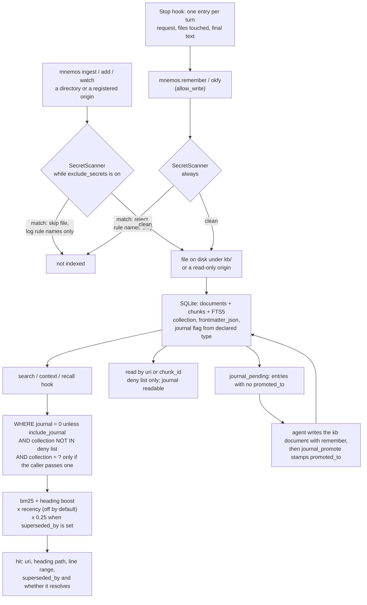

## 1. Executive Summary

mnemos gives a coding agent a local, cited memory of a project's ADRs, design
docs, runbooks and source: one cgo-free Go binary indexes the files into SQLite
and returns BM25 hits that land on a `file#section` and a line range. Its
strongest parts are a retrieval evaluation that cannot be won by leakage and a
secret scanner whose finding cannot carry the secret. Its weak side is scope:
the collection that partitions the index is a filter the calling model may
omit.

**The evaluation is a package of the system, `internal/eval`, with the leakage
control most self-built retrieval evals miss.** Its contract is to build a
held-out copy of the corpus *"with those queries stripped from their host
chunks"*, ingest it into an ephemeral database, and compare against a versioned
baseline (`internal/eval/holdout.go:1-5`). A question generated from a document
sits inside the chunk that answers it, so a lexical retriever scores
near-perfectly for a reason unrelated to retrieval. Stripping it first is the
fix, and the AST that strips it is the ingest pipeline's own configuration
(`holdout.go:19-22`).

**The secret scanner keeps the match on an unexported field**, *"so it cannot
leak through serialization or an external caller"*
(`internal/security/secrets.go:8-12`). A scanner that reports the key it found
has moved the secret into the context window it was protecting; Go's
visibility rules make that impossible rather than discouraged. The scan runs on
`remember` and `okfy` (`internal/memory/write.go:86`,
`internal/ingest/okfy.go:89`) and on directory ingest while
`[security].exclude_secrets` is on, which is the default
(`internal/cli/encoding.go:24-26`, `internal/ingest/process.go:313-333`).

**One mark, `negative_eval`.** A server-side deny list removes named
collections from search, context, list, related and read, and committed tests
assert a denied collection never surfaces from a populated store beside a
visible one that must ([section 10](#10-tests-evals-and-benchmarks)).
`scope_enforced` is not awarded: `collection` is an optional argument on
`mnemos.search`, an omitted one searches every collection, and `mnemos.read`
takes a uri with no collection at all ([section 6](#6-retrieval-mechanics)).

## 2. Mental Model

A memory is a file. Whatever is on disk under the workspace's `kb/` root, or
under an external tree registered read-only, is chunked into the index and
returned as a citation; the agent reads the cited section rather than a
summary. There is no extraction, no model in the write path and no belief
state: an indexed document is retrievable, and the only questions are how high
it ranks and whether a filter removes it.

Four things move a document's standing.

- **Supersession demotes.** A `superseded_by: <uri>` frontmatter key multiplies
  the document's score by 0.25 and attaches the replacement uri to every hit,
  resolved one hop and reported as unresolved when the target is not indexed
  (`internal/search/engine.go:182-199`, `internal/search/bm25.go:149-169`).
  ADR-0010 chose *"demote, never hide"*, so a superseded ADR returns and cites
  like any other. The key is plain frontmatter, and an agent that can write the
  file can write it.
- **The journal is a class excluded from ranked retrieval.** A document whose
  declared type is `journal` is stamped `journal = 1` at ingest and filtered out
  of search, context and graph expansion; only `mnemos.search` and the CLI can
  opt back in with `include_journal` (`internal/storage/migrations/0006_journal.sql:15`,
  `bm25.go:118-120`). It stays readable by uri. A journal entry leaves review
  when `promoted_to` is stamped with the kb document that absorbed it, or with
  `none` (`internal/memory/journal.go:101`).
- **The deny list hides.** Collections named in `[security].visibility.deny`
  are removed from every read surface, and a uri or chunk id in one returns the
  same not-found as an absent one (`internal/memory/service.go:83-92`,
  `internal/memory/read.go:68-74`).
- **Deletion is a file operation.** `forget` removes the file and its index
  row; a directory ingest, `reindex --content` and the watcher evict documents
  whose file is gone (`internal/ingest/reconcile.go`).

The model holds most of the verbs. With `[mcp].allow_write` on it can
`remember` into any confined path, including over an authored document, and it
holds `journal_promote`; with `allow_delete` it holds `forget` and `move`
(`internal/mcp/server.go:92-106`). Nothing it writes is held for anyone else to
admit.

## 3. Architecture

`internal/` holds 24 packages, from `ingest`, `chunk`, `parse`, `storage`,
`search` and `embed` through `memory`, `mcp`, `cli`, `eval`, `security`,
`doctor` and `tui`. `memory` is the verb layer that the CLI and the MCP server
both call, so gating and option construction cannot drift between surfaces
(`internal/memory/service.go:1-11`).

**The distribution claim is the design constraint.** The README promises *"No
vector database. No Ollama. No Python or Node service. Just one cgo-free Go
binary"*. The default build is lexical only: `internal/embed` compiles a no-op
embedder unless the binary is built with `-tags embed`, which pulls in a
pure-Go ONNX stack for all-MiniLM-L6-v2 and keeps `CGO_ENABLED=0`
(`internal/embed/noop.go`, `docs/adr/0001-embeddings-cgo-free.md`). Vector
search is then a brute-force scan over an `embeddings` table, fused with BM25
by reciprocal rank (`internal/search/hybrid.go:58`, `:239`).

**One workspace, one database.** `internal/workspace` resolves a single
`MNEMOS_DIR` by precedence: `--config`, `--mnemos-dir`, `$MNEMOS_DIR`,
`$CLAUDE_PROJECT_DIR`, the nearest `./.mnemos` walking up to the git root, and
finally `~/.mnemos` (`internal/workspace/workspace.go:88-185`). Under
`$CLAUDE_PROJECT_DIR` it fails closed rather than fall through to the global
store. Config, `kb/`, the index database and models are fixed subpaths of the
anchor. A second project is a second database; the global default is one
database in which collections stand for projects.

**Registered origins** index an external tree in place under an
operator-chosen prefix, recorded in an `origins` table, and every write verb
refuses a uri under a registered prefix before the path guard runs
(`internal/storage/migrations/0007_origins.sql`,
`docs/adr/0013-registered-external-origins.md`).

SQLite runs through `modernc.org/sqlite` with WAL, `foreign_keys` on every
pooled connection and a single writer (`internal/storage/sqlite.go`,
`docs/adr/0012-write-transaction-locking.md`).

### Deployment and ergonomics

Nothing has to be running. `make install` puts one binary in `$GOBIN`, `mnemos
init` creates `.mnemos/` with `mnemos.toml`, `kb/`, the database and a models
directory, and `mnemos add docs --collection myproject` copies and indexes a
directory. No API key is needed to store or retrieve anything. The store is
markdown a person can open, diff and repair, and the index is rebuildable from
it, apart from the origin registrations, which `origin list --json` exports.
`mnemos doctor` reports broken links, chunkless documents and missing files.

## 4. Essential Implementation Paths

**Capture and write.** `internal/memory/write.go:62` (`Remember`: the
`allow_write` gate `:66`, the secret scan `:86`, path confinement and
`PrepareOKF`), `internal/memory/journal_entry.go:62` (`WriteJournalEntry`,
through `Remember`), `internal/cli/hook.go` and `hook_transcript.go` (the Stop
hook reads only the last turn), `internal/ingest/pipeline.go` and `process.go`
(`scanSecrets` `:313-333`, the `ingested` event `:194`),
`internal/ingest/reconcile.go` (eviction of documents whose file is gone).

**Retrieve.** `internal/search/bm25.go:101-129` (`filterClause`: collection,
path prefix, file type, modified-since, journal and deny list),
`bm25.go:143-177` (the FTS statement and the one-hop `superseded_by` join),
`internal/search/engine.go:104-105` (the score composition) and `:182-199`
(the 0.25 demotion), `internal/search/graph.go` (link expansion, which honours
the deny list and the journal flag), `internal/search/hybrid.go` (vector arm and
RRF).

**Assemble context.** `internal/memory/service.go:149`
(`ContextWithOptions`: group by document, relevance cliff, char and token
budgets), `internal/cli/hook.go:156` (`writeWorkingSet`, the session-start
injection of open tasks and recent decisions) and `:261` (`hookRecall`, a
lexical search on prompts that carry a recall cue or end in a question mark).

**Read by address.** `internal/memory/read.go:79` (`ReadChunk`), `:128`
(`ReadDocumentOpts`), each checking `hiddenCollection` (`:68-74`);
`internal/memory/related.go:56`.

**Journal review.** `internal/memory/journal.go:52` (`ListPendingJournal`),
`:101` (`PromoteJournal`, refusing a second stamp and a target that is not an
indexed, visible, non-journal document), `:222` (`PruneJournal`, CLI only,
`--apply` behind `allow_delete`).

**Evaluate.** `internal/eval/holdout.go`, `eval.go`, `metrics.go:6-14`,
`baseline.go:12-28`, `internal/cli/eval.go`.

## 5. Memory Data Model

`documents` carries `id`, `uri`, `collection`, `content_hash`, `title`,
`mime_type`, `size_bytes`, `modified_at`, `indexed_at`, the raw
`frontmatter_json` and the `journal` flag; `chunks` carries the heading path,
line range, tags and doc type, mirrored into an FTS5 table; `links` holds
document-level edges; `embeddings` holds vectors keyed by chunk and model
(`internal/storage/migrations/0001_init.sql`, `0002_embeddings.sql`,
`0006_journal.sql`).

**Frontmatter is schemaless except where code reads it.** The keys a read path
consults are `superseded_by` (ranking and the hit payload), `type` (the journal
flag at ingest), a task `status` enum of backlog, todo, in_progress, done and
cancelled (the list filter and the session-start working set), and a journal
entry's `promoted_to` and `captured_at` (`internal/okfschema/okfschema.go:45`,
`:60`, `internal/storage/documents.go:237`). None of them is an epistemic
status: no key says a document is believed, disputed or rejected.

**Temporal fields are file times.** `modified_at` comes from the file, and
`indexed_at` is the index write; recency ranking reads the first. Nothing
records when the content became true.

**The `events` table is not an audit trail.** Its one producer appends an
`ingested` row per document write (`internal/ingest/process.go:194`), and
`document_id` references `documents(id) ON DELETE CASCADE`
(`internal/storage/migrations/0003_events_document_id.sql:6`). Forgetting a
document, or re-ingesting a uri under a new collection, deletes its events
with it (`internal/storage/documents.go:69-73`, `:124-126`).

**ADR-0008 proposes a trust model and states the gap in the project's own
words.** mnemos *"commits an agent-authored memory as ground truth the instant
an agent asserts it"*, and *"the consequence is recall pollution"*. The ADR's
status is `Proposed`, and no confidence, enforcement, provenance or reviewer
key is read in `internal/parse`, `internal/memory`, `internal/okfschema` or
`internal/storage`. ADR-0010's supersession pointer is the part of that
direction that shipped.

## 6. Retrieval Mechanics

BM25 over chunks with column weights favouring heading path (2.0) and tags
(1.5), plus a flat heading boost when a query term appears in the heading path
(`internal/search/bm25.go:15-26`). Queries are tokenised into quoted barewords
joined by implicit AND, which never raises an FTS5 syntax error and means a
natural-language question with stopwords can return nothing
(`bm25.go:40-52`). The score is then multiplied by a recency factor, off by
default, and by 0.25 when `superseded_by` is set (`engine.go:104-105`).

**The collection is a caller's filter, not a boundary.** `filterClause` appends
`d.collection = ?` only when the query carries one (`bm25.go:102-105`).
`mnemos.search`, `mnemos.context` and `mnemos.list` each take `collection` as
an optional argument from the model, and `mnemos.read` and `mnemos.related`
take a uri or chunk id with no collection (`internal/mcp/tools_search.go:19`,
`tools_read.go:16-17`, `tools_related.go:14`). `mnemos serve` binds none
(`internal/cli/serve.go`). The recall hook and the session-start working set
pass none either, and in the global `~/.mnemos` workspace the working set
labels each line by collection because it spans projects
(`internal/cli/hook.go:156-161`, `:439-441`). So the stored key partitions the
index for a caller that asks, and confines no reader to a partition.

**The deny list is the filter the caller cannot lift.** `Service.Search`
overwrites `ExcludeCollections` from config on every query
(`internal/memory/service.go:85`), the read verbs return the not-found shape
for a denied uri or chunk (`read.go:92`, `:144`), and list, related, graph
expansion, `journal_pending`, the working set and similar-documents apply the
same list (`internal/memory/list.go:38`, `related.go:67`, `:123`,
`internal/search/graph.go:74-75`, `internal/memory/edit.go:149`). It hides a
collection from every reader of the workspace, which is visibility rather than
scope.

**Supersession reaches the lexical and graph arms, not the vector arm.** The lexical engine and graph
expansion read `superseded_by` and apply the demotion
(`engine.go:105`, `graph.go:189-214`). The vector arm's hydrate query selects
no frontmatter (`internal/search/hybrid.go:164-168`), so in a semantic build a
superseded document found by its vector carries no pointer and no demotion
into the fusion; it loses only its lexical rank's share of the RRF score.

**Context is bounded.** `mnemos.context` groups to the best chunk per
document, trims the low-relevance tail with a relevance cliff, and caps each
block by characters or tokens (`internal/memory/service.go:110-134`). The
recall hook injects at most three cited hits by default for prompts that carry
a recall cue or end in a question mark, skipping prompts over 2,000
characters (`internal/cli/hook.go:128`).

## 7. Write Mechanics

Writes are files. `mnemos ingest` and `add` index a directory into a named
collection; `watch` reindexes on change; `remember` writes an OKF markdown file
under `kb/capture/` or a confined caller-chosen path and indexes it
synchronously unless capture is deferred to a watcher; `okfy` converts an
existing text file. There is no extraction and no model call on any write
path.

**Secret screening covers every write path, with one switch.** `remember` and
`okfy` scan unconditionally and refuse with rule names only. Directory ingest,
`add`, `watch`, `reindex` and `migrate` scan when `exclude_secrets` is on and
skip a matching file with a warning naming the rules
(`internal/cli/encoding.go:19-29`). The same flag governs the path globs that
keep `.env`, keys and `secrets/` out of the scan, so turning it off disables
both at once, which the code comment states as the intent.

**The journal is automatic capture with a narrow door.** The Stop hook writes
one entry per turn, copying the request, the files touched and the final
assistant text verbatim, the request and the outcome each capped at 2,000
runes, through
`Remember`, so the write gate and the secret scan apply
(`internal/memory/journal_entry.go:19-30`, `:62`). A rerun for the same turn
updates the entry, and an entry carrying `promoted_to` is left untouched.
Journal content reaches citable retrieval only when the agent writes a kb
document with `remember` and stamps the entry with `journal_promote`; nothing
promotes automatically.

**Deletion is reconciliation.** A directory ingest and `reindex --content`
reconcile the index against disk under a segment-aware uri prefix, so a deleted
file stops being cited; the watcher prefix-evicts a removed directory
(`internal/ingest/reconcile.go`, `internal/ingest/watcher.go`).

### Operational cost

The write path is synchronous and local: a `remember` call scans, writes and
indexes before returning. Nothing rereads the whole store on a schedule; the
eval and `reindex` are commands. The recall hook runs the lexical engine only,
so the prompt-submit path never loads the ONNX model, and its injection is
capped by a token budget.

## 8. Agent Integration

An MCP server over stdio and a CLI from the same binary. Read tools are always
registered: `search`, `read`, `context`, `list`, `related` and
`journal_pending`. `remember`, `okfy` and `journal_promote` register only with
`allow_write`, and `forget` and `move` only with `allow_delete`, so a disabled
tool is absent from `tools/list` (`internal/mcp/server.go:63-106`).

`make install-skill` copies the `mnemos-okf` skill and merges three hooks into
`~/.claude/settings.json`: `SessionStart` injects open tasks and recent
decisions, `UserPromptSubmit` runs `mnemos hook recall`, and `Stop` runs `mnemos
hook stop` (`skills/mnemos-okf/hooks/settings.example.json`). The README
documents opencode and remote access over SSH as well.

## 9. Reliability, Safety, and Trust

**One mark: `negative_eval`**, per section 10.

**`scope_enforced` — no.** The collection reaches the query as a WHERE clause,
and the caller decides whether it does: omitted on `mnemos.search`, the search
spans every collection, and the read tools never take one
([section 6](#6-retrieval-mechanics)). Project separation is real and is a
different mechanism, a database file per resolved workspace, with the global
fallback joining projects in one index.

**Trust state, tombstone, bitemporal, audit log, human review — no.**
Supersession demotes and is designed never to filter, and the journal flag is a
write-time class that the caller may lift with `include_journal`, so neither is
a status that withholds a memory. `forget` deletes the file and the row, and
nothing records the rejected content to refuse it later. `modified_at` is the
file clock. The `ingested` events cascade away with their document. The
journal's review state is `promoted_to`, and the agent stamps it with its own
`journal_promote` tool.

**Provenance is the system's answer to trust**, and it is a real one: every hit
is a file and a line range a person can open. Its limit is the one the README
opens on, an agent that *"forgets why you rejected an architecture"*. A rejected
ADR without a `superseded_by` key cites as cleanly as an accepted one.

**The write boundary is tested.** `internal/security/paths.go` confines every
caller-supplied path, with `paths_test.go` beside it, and registered origins
are refused by an explicit check in front of that guard, which is more than
[DiffMem](../diffmem/)'s comparable sandbox manages.

**The deny list covers the operator surfaces too.** The edit family and
`doctor` honour it from
[`43bcf145b2c85a67f86dd3293d94830e9cc678f4`](https://github.com/arhuman/mnemos/commit/43bcf145b2c85a67f86dd3293d94830e9cc678f4),
with `TestOpenForEditHidesDeniedCollection`,
`TestEditFrontmatterHidesDeniedCollection` and
`TestDiagnoseHidesDeniedCollection` (`internal/memory/visibility_test.go:164`,
`:178`, `:205`). Before that commit those verbs, reached from the TUI and
`mnemos doctor` rather than from MCP, read denied documents.

**ADR-0008's rejected alternatives are the part to read whatever you build.** A
hand-set `confidence: 0.0-1.0` is refused as *"fake precision no human or agent
can calibrate"*. A human-approval gate in front of writes is refused because
*"it produces an unbounded review backlog that gets abandoned"*, with the
position *"Trust is enforced at recall, not at capture."* Auto-promoting
confidence on re-assertion is refused because *"it launders a repeated
hallucination into a trusted fact"*.

## 10. Tests, Evals, and Benchmarks

**The negative cases are on a populated store, with a control.**
`newVisibilityFixture` ingests one *provisioning* document into each of two
collections. `TestSearchHidesDeniedCollection` asserts no hit carries the
denied collection and that the visible one ranks first;
`TestSearchDenyIgnoresCallerCollection` asserts an empty result when the
caller names the denied collection; `TestEmptyDenyShowsEverything` asserts both
surface with an empty list (`internal/memory/visibility_test.go:48-60`,
`:64-70`, `:94-104`). Context, list, read by uri and read by chunk id carry the
same shape, the read cases asserting the refusal is byte-identical to an
absent identifier. `TestJournalExcludedByDefault` asserts a journal
entry matching the query stays out while the ADR is returned, and
`TestJournalNotLaunderedThroughGraphExpansion` that link expansion does not
bring it back (`internal/search/engine_test.go:559-570`, `:624`).

`TestSupersededDocumentIsDemotedNotHidden` pins the opposite decision: a
superseded document must be returned, with a score above zero and below
the current one (`engine_test.go:406-420`).

**The held-out evaluation does four things right.**

- **Leakage control.** The query text is stripped from its host chunk before
  the held-out corpus is indexed.
- **The production parser.** The goldmark instance *"mirrors the parser
  configuration used by the ingest pipeline"* (`holdout.go:19-22`); an eval
  that chunks differently measures a different system.
- **An ephemeral database**, so the evaluation cannot read the developer's
  index.
- **A baseline whose absence is not an error.** `loadBaseline` returns `(nil,
  nil)` on a missing file and callers print without deltas
  (`internal/eval/baseline.go:12-19`).

`ExactChunk` sits beside the doc-level `HitAt1`, `RecallAtK` and `MRRAtK`
(`metrics.go:6-14`). Retrieving the right document and the right section are
different successes, and a citation product needs the second.

**The numbers are published, with their sample sizes.** For the shipped
`examples/git-recipes` bundle the README gives lexical Hit@1, Recall@12 and
MRR@12 all at 0.83, against 1.00 for semantic and hybrid. For `examples/onpage-seo`,
whose held-out answers are JSON-LD and sitemap blocks sharing no keywords with
their prose, lexical scores 0.00 and `--semantic` recovers Hit@1 0.57 and
Recall@12 0.86. The reproduce block states *"N is 6 and 7 respectively — smoke
signals, not benchmarks."*

**The baseline the README calls committed is not in the tree.** The README
says `mnemos eval` reports *"against a committed baseline"*; `mnemos eval`
reads `<bundle>/baseline.json` by default (`internal/cli/eval.go:68-71`), and
`git ls-files` lists no baseline file under any bundle. The figures can be
reproduced, and a regression cannot be caught by the mechanism built for it.

**A graph mode measures what link expansion buys.** `mnemos eval <bundle>
--graph` reads a `cases.json` and compares link-neighbourhood inclusion and
`GraphRetriever` hit@K against plain lexical search, with `--graph-expansion`
as a non-regression gate. The `examples/graph-answerability` bundle is built so
the lexical hit is a hub document and the answer sits one link away *"written
with different vocabulary"*. No figures are published for it.

`internal/search/bench_test.go` benchmarks the vector scan unfiltered and
collection-filtered over corpus sizes around 10,000 chunks (`:93-96`).

I ran nothing.

## 11. For Your Own Build

### Steal

- **Strip the query from its host chunk before indexing a held-out corpus.**
  Questions generated from your documents otherwise sit inside their answers.
- **Run the evaluation through the production parser and an ephemeral
  database**, so it measures the system you ship and never touches the real
  index.
- **Measure exact-chunk beside doc-level hit rate** when the product is a
  citation.
- **Hold a scanner's match on an unexported field.** The finding reports the
  rule; the secret cannot be serialised to the agent or the log.
- **Make a hidden item indistinguishable from an absent one.** The deny list
  returns the not-found shape for a denied uri, so read is no existence
  oracle, and a test pins the byte-identical error.
- **Key a retrieval exclusion on a stored class, not a path.** The journal flag
  is set from the declared type, so a rename or a move cannot leak transcripts
  into cited results, and a test pins graph expansion to the same rule.
- **Carry the replacement with the stale hit.** A superseded document that
  returns with the pointer to what replaced it in the same payload lets the
  agent correct itself without a second query.

### Avoid

- **Do not call a caller's filter a scope.** A collection the model may omit
  partitions nothing; bind the reader's partition on the server, the way the
  deny list is bound.
- **Do not let one retrieval arm skip a ranking rule the others apply.** A
  demotion read in the lexical SQL and absent from the vector hydrate is a
  difference only a semantic build exposes.
- **Do not cascade an event log with the row it describes.** An event that
  disappears with its document cannot answer what was there.
- **Do not document a baseline you do not commit.**

### Fit

The right choice when the memory is a project's documents and you want
an agent that quotes them with a line range: one binary, a TOML file, markdown a
person can edit, and no service to run. It is the wrong choice when the store
must separate readers, or when agent-asserted facts need a status before they
are trusted; the project's own ADR-0008 names that gap and proposes, rather than
ships, the answer.

## 12. Open Questions

- **Will a baseline file be committed for the shipped bundles?** The delta
  machinery reads `<bundle>/baseline.json` and the tree holds none.
- **What does graph expansion score on its own bundle?** The mode, the gate and
  the cases are committed; no figure is.
- **Will the vector arm read `superseded_by`?** ADR-0010 requires the demotion
  on the graph path and says nothing of the vector path.
- **Will ADR-0008 ship beyond supersession?** Its `review` and `enforcement`
  keys appear in no read path.
- **How large does a journal grow before pruning matters?** One entry per turn,
  capped per section, with pruning manual and gated on `allow_delete`.

## Appendix: File Index

| Path | What to read it for |
| --- | --- |
| `internal/eval/holdout.go:1-22` | The held-out contract and the shared goldmark instance |
| `internal/eval/baseline.go:12-28` | The missing-baseline decision |
| `internal/eval/metrics.go:6-14` | `Metrics`, including `ExactChunk` |
| `internal/security/secrets.go:1-12` | The package contract and the unexported match |
| `internal/cli/encoding.go:19-29` | The ingest secret scan and the switch it shares |
| `internal/ingest/process.go:194`, `:313-333` | The ingested event and `scanSecrets` |
| `internal/search/bm25.go:101-177` | Every filter, and the one-hop supersession join |
| `internal/search/engine.go:104-105`, `:182-199` | Score composition and the 0.25 demotion |
| `internal/search/hybrid.go:58-200` | The vector arm, which reads no frontmatter |
| `internal/memory/service.go:83-92` | The deny list applied on every search |
| `internal/memory/read.go:68-160` | Read by uri and chunk id, and the not-found shape |
| `internal/mcp/tools_search.go:17-27`, `tools_read.go:15-24` | The model's collection and address arguments |
| `internal/mcp/server.go:63-106` | Tool registration and the two gates |
| `internal/cli/hook.go:137-300` | The working set and the recall hook |
| `internal/memory/journal_entry.go:62`, `journal.go:101`, `:222` | Journal capture, promotion and pruning |
| `internal/storage/migrations/0003_events_document_id.sql` | The cascading event rows |
| `internal/memory/visibility_test.go:48-104` | The must-not-surface cases and their control |
| `internal/search/engine_test.go:406-420`, `:559-660` | Demotion pinned as not-hiding; the journal exclusions |
| `docs/adr/0008-memory-trust-model.md`, `0010`, `0011` | The proposed trust model, supersession and the journal tier |

### Recorded searches

Run at the tree root of the pinned checkout with `git grep`.

- `git grep -n -E 'collection,omitempty' -- internal/mcp ':!*_test.go'` — search, context, list, okfy, remember and the related output; every collection argument is optional.
- `git grep -n -i 'collection' -- internal/cli/serve.go` — no match; serve binds no collection.
- `git grep -n -i -E '\b(confidence|enforcement|provenance|reviewer|trust)\b' -- internal/parse internal/memory internal/okfschema internal/storage ':!*_test.go'` — no match, here and at 6e7b14f.
- `git grep -n -i -E 'tombstone|suppress|blocklist' -- '*.go' '*.sql' ':!*_test.go'` — no match.
- `git grep -n -i -E 'valid_from|valid_to|valid_until|effective_(from|at)|event_time|as_of|asof' -- '*.go' '*.sql' ':!*_test.go'` — no match.
- `git grep -n -E 'AppendEvent\(' -- '*.go' ':!*_test.go'` — the definition and one caller, `internal/ingest/process.go:194`, type `ingested`.
- `git grep -n -i 'supersed' -- internal/search/hybrid.go internal/search/rerank.go` — no match.
- `git ls-files | grep -i baseline` — `internal/eval/baseline.go` only.
- `git grep -n -E 'IncludeJournal' -- '*.go' ':!*_test.go'` — the CLI flag, the `mnemos.search` argument, the filter and graph expansion; `mnemos.context` has no such argument.
- `git grep -n -E 'Scan\(' 6e7b14f45bf18210196f0d8728f80c5e46929ac3 -- internal/ingest ':!*_test.go'` — `internal/ingest/okfy.go:89` only; the ingest pipeline did not scan at that commit.
- `git grep -n -i -E 'arxiv|bibtex|@article|@misc|doi\.org' -- README.md docs` — no match; no paper.
- `git grep -n -i -E 'anthropic|machine learning|not (be )?used (for|to)' -- LICENSE` — no match; the MIT text carries no rider.

## History

**2026-10-15** — [`8d8d65c6dfb5e74293770163fb3e868521e40610`](https://github.com/arhuman/mnemos/commit/8d8d65c6dfb5e74293770163fb3e868521e40610) — 60 commits on, past v0.3.0. Marks move from `scope_enforced` to `negative_eval`, both wrong at 6e7b14f: the collection was an omittable model argument and read took none ([section 6](#6-retrieval-mechanics)), and deny-list must-not-surface tests with a control were committed ([section 10](#10-tests-evals-and-benchmarks)). Also wrong then: ingest secret-scanning, re-ingest eviction, "no status field", the census. Overtaken: supersession demotion, the journal tier, ingest scanning, reconcile on ingest, registered origins, the deny list on edit and doctor ([section 2](#2-mental-model)). Screened from a full clone: no auto-run surface, one build-time execution path in the `Makefile`, `go.mod` inside the cooldown, `go.sum` present; MIT with a third-party note and no rider. Nothing was installed, built or run.

**2026-09-17** — [`6e7b14f45bf18210196f0d8728f80c5e46929ac3`](https://github.com/arhuman/mnemos/commit/6e7b14f45bf18210196f0d8728f80c5e46929ac3) — re-pinned after 4 commits. All four anchored files are byte-identical at both commits — the BM25 module, the document store, and both cited test files — so the mark stands on unchanged code. Nothing was installed, built or run.

**2026-09-10** — [`6e7b14f45bf18210196f0d8728f80c5e46929ac3`](https://github.com/arhuman/mnemos/commit/6e7b14f45bf18210196f0d8728f80c5e46929ac3) — read again, 40 commits and 138 files past the previous pin. The single mark holds and one published claim did not. Section 10 said a reader could not see what mnemos scores on its own evaluation, and the README carries doc-level figures for two shipped bundles — `git-recipes` at Hit@1 0.83 lexical against 1.00 semantic-hybrid, and `onpage-seo` at 0.00 lexical against Hit@1 0.57 semantic — with each metric defined, the sample sizes stated and the word benchmark refused. The versioned baseline JSON the delta mechanism reads is still absent from the tree, so that half of the claim stands and the open question was narrowed to it.

A third eval mode arrived, `--graph` with a `--graph-expansion` non-regression gate, over a committed `graph-answerability` bundle built so the lexical hit is a hub document and the answer lives one link away in different vocabulary; the bundle states its own limitation, that keyword-style queries are required because the retriever ANDs quoted tokens. ADR 0008 proposes a trust model and names the recall-pollution problem in the project's own words, with no confidence, enforcement, provenance or reviewer field anywhere in `internal/parse` or `internal/memory` — a proposal, not a mechanism, and no mark follows. Test files went from 84 to 115, and the tree from 19,800 lines to 28,764 of Go. Screened before reading: no auto-run surface, two dependency manifests inside the seven-day cooldown, one build-time execution path in the `Makefile`, and no unpinned surface against a `go.sum`; nothing was installed, built or run.

**2026-08-09** — [`27df4b569cc26b25e75356322db72f6461939a66`](https://github.com/arhuman/mnemos/commit/27df4b569cc26b25e75356322db72f6461939a66) — first reading. Screened before reading; the tree was read, never built, and no evaluation was run.
