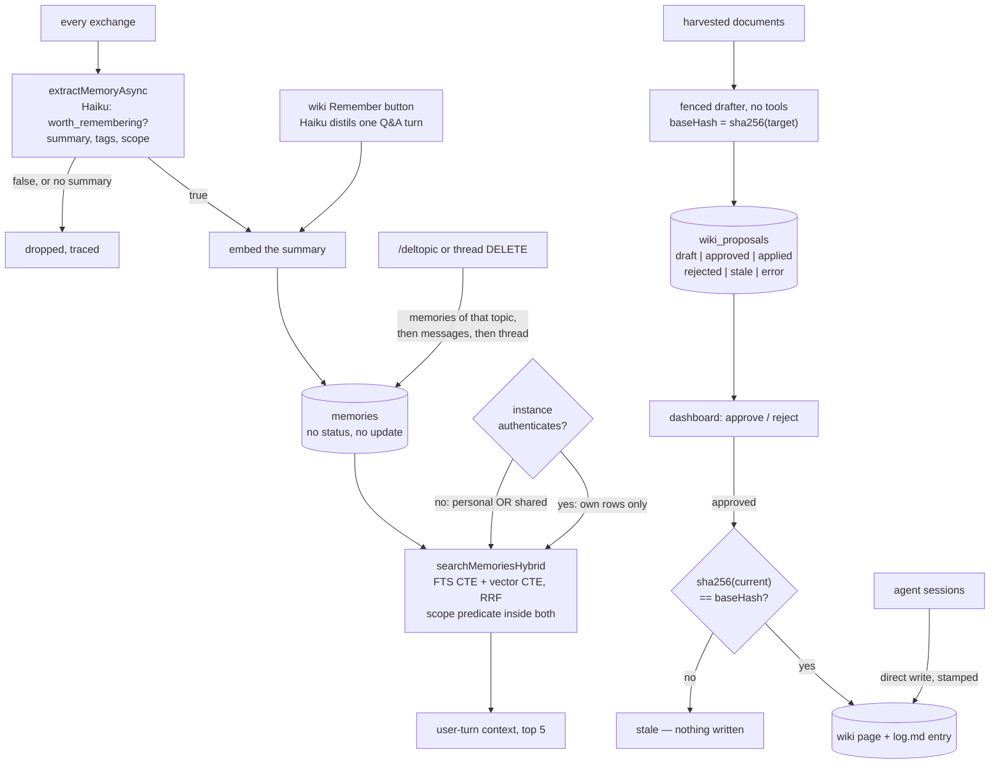

## 1. Executive Summary

Muninn is a self-hosted assistant platform that keeps durable knowledge in two
tiers built to opposite standards. Extracted memories are written by a
background model call with no review, cannot be edited or rescoped, and leave
only when the whole conversation topic they came from is deleted. Drafted wiki
pages wait in an approval queue, and applying one is a compare-and-swap against
a hash of the file the draft was written from.

Several bots run in one Node process, each with its own persona, MCP tools and
conversation history, reachable from Telegram, Slack and a web chat, backed by
one Postgres database with pgvector. There is no paper and no citation file.

The **memory tier** is automatic. After every exchange, `extractMemoryAsync`
fires a background Haiku call with a fixed prompt that asks it to *"decide if it
contains information worth remembering for future conversations"*. It returns
`worth_remembering`, a one-sentence summary, tags, and a scope of `personal` or
`shared`. If the flag is true and a summary came back, the summary is embedded
and the row is inserted. There is no queue, no confirmation, no status field and
no threshold. `src/db/memories.ts` contains no `DELETE` and no `UPDATE` of
content or scope.

The **wiki tier** is deliberate for the pages the gardener drafts. It harvests
documents, clusters them, drafts a full Markdown page, and writes it to
`wiki_proposals` with a status of `draft`. A person approves or rejects it in
the dashboard. Applying it refuses with `stale` unless
`sha256(current) === proposal.baseHash`, and every apply appends an entry to the
wiki's own `log.md`.

**Muninn measures its own retrieval.** `src/benchmarks/retrieval.ts` computes
hit@k, recall@k and reciprocal rank per query and aggregates them across three
targets, and `benchmark_retrieval_runs` persists each run with the per-query
breakdown, *"so a regression can be traced back to the individual query that
moved."* The memory target is three synthetic rows, which section 10 weighs.

The risk is the asymmetry. The tier a model writes without asking has no review
and no correction; the tier a model drafts and a person reads has a state
machine, a queue and a concurrency check. A drafted page is visible before it
lands, while an extracted memory is not visible until it has been injected into
a prompt.

## 2. Mental Model

A durable claim becomes a belief along one of two paths, and they have different
numbers of gates.

Down the memory path there is one gate and a model holds it. The extraction
prompt draws the line in prose, from *"Worth remembering: facts about the user,
preferences, decisions, project details…"* to *"NOT worth remembering:
greetings, thanks, simple factual lookups, small talk"*.

The same call assigns the scope that decides who can retrieve the result. It
defines `shared` as *"General knowledge useful to anyone — company processes,
team decisions, technical standards, organizational facts."* Anything the model does not label
`shared` exactly is stored `personal` (`src/memory/extractor.ts:92`), so a
malformed answer fails narrow.

Nothing re-examines that classification and no state records that it was ever
provisional. A memory stops being a belief one way: a user deletes a non-main
conversation topic, and `cascadeDeleteThread` deletes every memory whose source
message sat in it, then the messages, then the thread (`src/db/threads.ts:349`).
That is deletion by provenance, not correction. One wrong memory cannot be
removed without the conversation around it. A memory from the main topic, or one
saved with no source message, has no path out.

What `shared` means depends on the instance. On an `off` instance a `shared` row
reaches every user of that bot. On an instance that authenticates
(`MUNINN_AUTH=local` or `entra`), `sharedMemoryReadsAllowed()` returns false and
both search functions narrow to the reader's own rows, so a colleague's
`shared` memory never enters another colleague's prompt (`src/auth/policy.ts:122`).

Down the wiki path there are three gates for a drafted page, and two of them are
not the model's. The drafter proposes; a person approves or rejects; and the
filesystem gets a veto at apply time, because a target file that changed since
drafting sends the proposal to `stale` rather than overwriting the change. The
third gate asks whether the world the draft was written against still exists.
The wiki also takes pages that agent sessions write directly, stamped with the
session ids that produced them, and those never pass the queue.

## 3. Architecture

One Node process runs every bot. Postgres with pgvector is the only datastore:
`memories`, `messages`, `threads`, `goals`, `scheduled_tasks`, `watchers`,
`traces`, `prompt_snapshots`, `wiki_proposals`, `wiki_answers` and about two
dozen more, over 75 migration files with an `init.sql` for fresh deploys and a
schema-drift guard between them. Embeddings are local — Transformers.js at 384
dimensions — so the vector arm costs no API call. Extraction and goal detection
use Haiku through a shared `runHaikuExtraction` wrapper that traces every call
and records cost in `haiku_usage`.

Standing this up means Postgres with the `vector` extension, a model credential
per bot, and whatever channel tokens you want. The gardener wants a document
source to harvest and a directory to write the wiki into. `MUNINN_AUTH` selects
`off`, `local` (one pinned identity behind a shared secret) or `entra`
(per-request token introspection with a default-deny route zone model), and the
choice changes who may read a `shared` memory.

Memory is on the critical path of every turn: `prompt-builder.ts` awaits
`searchMemoriesHybrid` after the parallel history and embedding fetches, and
logs the split — `db`, `embed`, `search` — on every build.

## 4. Essential Implementation Paths

**Extraction** — `src/memory/extractor.ts`. One prompt, one Haiku call, fire and
forget. The result gate carries a fixed defect in a comment: *"A memory worth
keeping must have a summary, but tags are optional — gating on `!result.tags`
silently dropped keepable memories whenever Haiku omitted the field."* A missing
embedding does not block the write; it warns that the row *"will not appear in
semantic search"* and saves anyway.

**Storage** — `db/init.sql`. `memories` carries `search_vector TSVECTOR` and
`embedding vector(384)`, a GIN index on the first and an HNSW cosine index on the
second, plus a trigger that rebuilds the tsvector from
`summary || content || tags` on every insert or update, so the lexical index
cannot drift from the row.

**Retrieval** — `src/db/memories.ts`, `searchMemoriesHybrid`. One statement: an
`fts` CTE ranked by `ts_rank` and a `vec` CTE ranked by `embedding <=> $3`, each
capped at 30, joined `FULL OUTER` on id and scored
`1.0/(60 + f.rank) + 1.0/(60 + v.rank)`, with the scope predicate in both CTEs.

**Injection** — `src/ai/prompt-builder.ts`. The top five memories, with active
goals, scheduled tasks and recent alerts, go into a `<context>` block in the
user turn after the history. The system prompt holds only what is stable per
user and bot, so the per-turn context does not invalidate the cached prefix.

**Deletion** — `src/db/threads.ts`, `cascadeDeleteThread`. Memories first,
because the foreign key from `memories.source_message_id` to `messages` has no
`ON DELETE` clause, then messages, then the thread. It is reached from
`/deltopic` on Telegram and Slack and from the thread `DELETE` routes on the web
chat and the dashboard, and refuses the `main` topic.

**Drafting and applying** — `src/gardener/`. `harvest`, `cluster`, `draft`,
`triage`, `wire`, `retire`, `apply`, each with a test file beside it.
`runner.ts` computes `baseHash` only when the target exists, *"or apply would
always report it stale."*

**Measuring** — `src/benchmarks/retrieval.ts` and `retrieval-fixtures.ts`, run by
`scripts/retrieval-eval.ts`, persisted by migration 053.

## 5. Memory Data Model

A memory is `id, user_id, bot_name, content, summary, tags[], search_vector,
embedding, source_message_id, scope, created_at`. `content` is the raw exchange —
`User: …\nAssistant: …` — and `summary` is the model's one-sentence distillation;
both feed the tsvector, only the summary is embedded. `source_message_id`
references `messages(id)`, so a memory can be traced to the turn that produced
it, and that reference is what the topic delete follows.

`scope` is `CHECK (scope IN ('personal', 'shared'))` and it is the only
classification on the row. There is no confidence, no status, no validity
interval, no `updated_at` and no `deleted_at`. `created_at` is record time and
event time at once, which is why `bitemporal` is withheld: there is one axis,
and no read path accepts an as-of parameter.

A wiki proposal is the richer record: `topic_key` as a stable slug for dedup
across runs, `kind` of concept, entity, source, synthesis or lint, `mode` of
create or update, `target_path`, `base_hash`, the full `draft` body, `source_docs`
as JSONB, a `rationale`, a `group_key` that ties together the rows of one lint
finding, and `status` with `resolved_at`. A drafted page carries what produced
it, what it would replace, and what the world looked like when it was written.
The extracted memory carries a foreign key and a timestamp.

## 6. Retrieval Mechanics

Reciprocal-rank fusion with `k = 60`, both arms capped at 30 candidates, the
fused list cut to the caller's limit — 5 for a chat turn and for wiki saved
notes, 8 for a scheduled briefing. An optional `tags && $n::text[]` overlap
filter is spliced into both CTEs; when omitted *"the SQL is byte-identical to the
pre-tags query"*.

**The scope predicate is inside each arm rather than wrapped around the join.**
A filter applied after a fusion would let one arm spend its 30 candidate slots
on rows the other arm may not return, shrinking recall for the caller who is
allowed to see least. Written into both CTEs, each arm's budget is spent inside
the boundary.

The auth-mode branch is applied in both search functions, and the file says why.
`searchMemories` is the no-embedding fallback that `searchMemoriesHybrid`
delegates to, *"so a fix applied to only one of them is inert on exactly the path
that happens to be taken. That split is this repo's documented recurring failure
class."* The fallback has no tags parameter, so a tag-filtered caller loses its
tag filter there. The wiki saved-notes lookup returns nothing on a null
embedding rather than inject untagged chat memories under its label
(`src/dashboard/routes/wiki-routes.ts:754-775`).

The lexical arm uses `plainto_tsquery`, which is AND-semantics: every content word
in a query must match. The eval fixtures say so — the golden queries are worded
so every content word *"must stem-match the fixture's summary/content/tags
text"*, a constraint on the benchmark that comes from a constraint on the
retriever.

A row saved without an embedding is excluded from the `vec` CTE by
`embedding IS NOT NULL` and is reachable through FTS;
`getMemoriesWithoutEmbeddings` finds such rows for `scripts/backfill-embeddings.ts`.
The system degrades to one arm rather than to none.

## 7. Write Mechanics

**Writes do not block the reply.** `extractMemoryAsync` returns `void` and the
Haiku call resolves later. The lag before a memory is retrievable is one
background model call plus one embedding, and there is no batching, no debounce
and no consolidation pass. Nothing rewrites the store.

**A second writer is a person's button.** `POST /api/wiki/remember` distils a
wiki Ask or Explain turn into one fact through Haiku, tags it `wiki-note` and
the wiki's name, and saves it `personal` for the wiki's synthesis bot's mapped
default user, refusing with 409 when no mapping exists
(`src/dashboard/routes/wiki-routes.ts:3137-3240`). It saves no
`source_message_id`, so no topic delete reaches it.

**The memory tier has no per-row correction.** No update of content or scope, no
supersession pointer, no expiry and no archival; the module that owns the table
exposes save, search, list, count and an embedding backfill. A fact the model got
wrong stays in the index until its topic is deleted. Extraction runs on every
exchange with no dedup against what is stored, so a subject the user returns to
accumulates near-duplicate rows that compete for the same five slots.

Deleting a topic does not reach every copy. Every chat turn's assembled prompt
is saved to `prompt_snapshots` (`src/core/prompt-assembly.ts:71`), including the
`<context>` block the memories were rendered into. That table is cleared by a
retention sweeper on a configurable chat window, not by the cascade
(`cleanupOldSnapshots`, `src/db/prompt-snapshots.ts:170`).

**The wiki write is the governed one**, and its guard is a compare-and-swap
rather than a lock: draft, record `sha256(target)`, and refuse at apply time if
the file moved. `apply.ts` degrades deliberately — a failed `log.md` append is a
warning, not a rollback, because a log-write hiccup must not undo the page write,
*"the page is the source of truth."* That makes the log lossy by design.

A lint group applies several rows inside one write section and stops at the first
row that is not applied. Rows written before the stop stay written, with no
rollback, and the route reports the boundary for the reviewer.

## 8. Agent Integration

Memory reaches the model as text in the user turn, not as a tool. There is no
`remember` tool and no memory MCP server, so a model cannot query the store
mid-turn, cannot decline a memory it thinks is wrong, and cannot record that it
was wrong. The three MCP servers in the tree are a research tool, a peer-messaging
server and a Serena proxy.

The retrieval is per bot *and* per user: `bot_name` is a first-class column on
`memories` with its own composite indexes, so two bots in the same process
sharing one database do not share personal memory, and `shared` scope is scoped
to a bot as well. `bot_default_user` and `role_overrides` handle the identity
edges.

The dashboard displays memory — a recent list, a per-user breakdown with personal
and shared counts, and a search — and changes it in two ways: the wiki Remember
button and the thread delete. The gardener queue is the place a person decides
what the wiki believes.

### Choosing the scope key, and writing down why

`src/db/user-identities.ts` maps an Entra session onto a `users` row and states
which claim is safe to key on. `oid` is used because it is *"the only claim
immutable for a person within a tenant."* `NAVident` is refused as a key because
it is re-issued when someone leaves and a new hire takes it, and is kept as a
mutable column used only to mint a readable id. `tenant` is *"provenance, never a
check"*.

The `scope_enforced` mark certifies that a stored key reaches the query; it says
nothing about whether the key identifies who it claims to. A boundary keyed on a
recycled employee number is enforced as diligently as one keyed on an immutable
subject id, and leaks one resignation at a time. This file records the choice.

### A dashboard read path, scoped by argument

`dashboardSearchMemories` takes `botName` and `scope` as optional parameters,
threading them into `buildSearchFilters`. `getMemoriesByUser(botName?)` and
`getRecentMemories(limit, botName?)` have the same shape: with a bot name they
filter `bot_name`, without one they do not. The routes in
`src/dashboard/routes/memsearch-routes.ts:33` and `data-routes.ts:121-142` pass
both through from the request.

`searchMemories` takes `userId` as a mandatory first positional argument, so the
per-user predicate cannot be omitted by forgetting a parameter; the operator
paths' predicates can be. Under `entra` those collection routes are outside the
user zone and need an admin role, while `/api/memories/user/:userId` is in it
and passes `requireOwnUser` first. Under `off` they answer any request that
reaches the port.

## 9. Reliability, Safety, and Trust

**Scope — awarded.** The predicate runs on all four read paths that put memory
in front of a model, inside both fusion arms, and narrows by auth mode in both
search functions (section 6).

**Human review — awarded, on the wiki tier.** A drafted page waits as `draft`
until a person approves or rejects it, and only the dashboard routes call the
approve functions. The drafters run with no tools, the shipped bot's harness
settings allow no shell, and no MCP tool or skill names a proposal. Reject is
*"deliberately NOT guarded — it flips a DB status and mutates no wiki"*, while
approve is a compare-and-swap with a comment naming the regression it pins:
*"approve 403s, row stuck in `approved` forever"*. The guarded direction is the
one that touches the filesystem.

Who the reviewer is depends on the mode. Under `entra` the gardener routes fall
outside the user zone and need an admin role. Under `off` the dashboard is an
*"auth-less loopback"* whose own comment calls its bounds *"containment of
accidents, not defence against a hostile author"*. An origin guard refuses
cross-site side effects in every mode, and the gate's write verbs answer 415 to
anything that is not JSON. The queue covers the gardener's drafts; pages agent
sessions write into the wiki directly do not pass it.

The approval card's *"Wiring on approve"* preview reads mode before it promises
an index line, because `runWireStage` writes one only on `create`
(`indexSkipFor`, `src/dashboard/routes/wiki-gardener-routes.ts:860`, applied at
`:1366`). A preview computed independently of the action it previews is a second
implementation of that action and drifts from the first; here both are in the
repository and both are tested.

**Provenance on the wiki tier has one writer by design.** A stamped page carries
four frontmatter keys — the agent sessions that produced it, a backfill date,
Jira keys and pull requests — and `src/wiki/provenance.ts` states that *"muninn
never WRITES these keys"*. The one line-upsert lives in a sibling project, and
muninn shells out to it rather than grow a second writer, because two writers of
one frontmatter line lose each other's appends. Each repository pins its own copy
of the stamp's shape.

**Trust state — awarded, on the same tier and no other.** `draft → approved →
applied`, with `rejected` and `stale` as terminal states and `resolved_at`
recording the transition, is candidate, verified and rejected with an extra
state for "the world moved". The `memories` table has no status column, which is
the finding: the mark describes the tier where a human was already in the loop.

**Tombstone — withheld, with a near miss.** A rejected proposal's `topic_key`
joins a skip set the gardener's clusterer consults, but only for seven days
(`getRecentlyRejectedTopicKeys`, `src/db/wiki-proposals.ts:497`;
`rejectedSkipDays: 7`). Older rejections reach the cluster prompt as a hint and
the topic becomes re-proposable. It is keyed on a model-chosen topic label rather
than on the rejected content, and it expires by design: *"A rejection is a
verdict on one draft, not a permanent verdict on the topic."* Nothing rejects a
memory value.

**Bi-temporal, audit log — withheld.** `created_at` is one axis. `activity_log`
is a feed whose `type` is CHECK-constrained to `message_in`, `message_out`,
`error`, `system` and `slack_channel_post`; the Remember route and the `entra`
admin-access audit push `system` rows to it, and the extractor and the topic
delete push none. The nearest record of durable knowledge is the wiki's `log.md`,
a Markdown file the apply step treats as droppable.

**The privacy shape follows from the extraction prompt.** A model classifies each
exchange as `personal` or `shared`, and on an `off` instance a `shared`
classification makes the row retrievable by every user of that bot. The decision
is made once, by a model, with no confirmation, and no command rescopes it. A
misclassified personal fact is visible to every user of the bot until its topic
is deleted. On an authenticating instance the read is narrowed to the owner,
which closes the cross-user path by giving up shared memory between colleagues.

## 10. Tests, Evals, and Benchmarks

No paper and no citation file. I ran nothing: no install, no Postgres, no suite.

**The retrieval eval is the part that distinguishes this repository.**
`computeQueryMetrics` produces `hitAtK`, `recallAtK = matched/expected` and
`reciprocalRank = 1/firstRank` per query; `aggregateMetrics` means them into
hit-rate, recall@k and MRR, overall and per target. `runRetrievalEval` runs three
targets — a knowledge base, `memories`, and research citations — and migration
053 persists every run with timestamps, a status enum, the target filter, the
query count, the aggregate `metrics` JSONB and the `per_query` JSONB. The
migration states its own status: *"Migration-only is the whole truth for this
table."*

Three fixture decisions carry over to any golden set. The memory fixtures carry
**fixed UUIDs** because `saveMemory` mints random ones and the golden set must
name them as `expected_doc_ids`. Seeding **refuses a non-`*_test` database**
unless `--allow-live-seed` is passed. And when the fixtures are absent the memory
target is **skipped rather than scored as a miss** (`hasSeededMemoryFixtures`),
so a setup failure does not report as a retrieval failure.

**The limits, which the repository half states itself.** The memory target is
three synthetic fixtures and three golden queries, written so every content word
stem-matches the fixture text because the FTS arm is AND-semantics. A golden set
built to satisfy the retriever it tests measures that the plumbing is connected,
not that recall is good. The knowledge-base and research targets point at docs
that *"already live in the running knowledge base"*, so those rows are not
reproducible outside the author's deployment, and no committed result exists for
any target.

The memory unit tests carry the mark. `acceptance 11 - shared memories do not
cross identities` (`src/db/memories.test.ts:120-171`) seeds one `shared` row
owned by another user and asserts, on the same seed, that an `off` instance
returns it and an authenticating one does not. The negative half runs through
both search functions and through the vector arm, which ranks every row and so
is the arm a missing predicate would leak through. The older personal-scope test
at `:71` asserts with `every` and would pass on an empty result.

## 11. For Your Own Build

### Steal

**Put the scope predicate inside every arm of a fused query, not around the
join.** Two CTEs each capped at 30 and filtered independently means the candidate
budget is spent inside the boundary.

**Apply an access fix in every function the read can reach, and test each one.**
The no-embedding fallback is a second implementation of the search, and the
acceptance 11 cases assert the narrowing through both functions and both arms.

**Score your retrieval against a named golden set and persist the per-query
breakdown.** Aggregates tell you something regressed; the per-query JSONB tells
you which query moved. Migration 053 is forty lines.

**Skip a target whose fixtures are missing rather than scoring it zero, and
refuse to seed fixtures into a database whose name does not end in `_test`.**
Two small checks, each closing a way an eval starts reporting the harness.

**Compare-and-swap against a hash of the file you drafted from.** `baseHash` at
draft time, `sha256(current)` at apply time, `stale` when they differ. Any agent
that proposes an edit to something a human can also edit needs this.

**Guard the direction that mutates and leave the other alone.** Approve is a CAS;
reject *"flips a DB status and mutates no wiki"* and is unguarded.

**Log the per-turn memory latency split.** `db`, `embed`, `search`, on every
prompt build, in the normal log line.

### Avoid

**Do not let one model call be the only gate on a durable write about a person.**
`worth_remembering` and the personal/shared classification are decided together,
once, by a small model, and neither can be appealed. The scope half is an
access-control decision.

**Do not make deletion a side effect of deleting a conversation.** The topic
delete is the only exit, so removing one wrong memory costs the topic, and a
memory from the main topic or from the Remember button has no exit at all.

**Do not extract on every exchange without deduplicating.** Nothing compares a
candidate against what is stored, and the injection budget is five rows.

**Do not read a golden set's metrics as recall quality when the queries were
written to match.** Three queries move the metric in thirds, and what it measures
is that the pipeline is wired.

**Do not leave the eval's tables out of a fresh deploy.** `benchmark_retrieval_runs`
is migration-only and outside the drift guard, so a fresh deploy cannot run the
eval the repository's best measurement lives in.

### Fit

This suits one person or a small team self-hosting an assistant they trust, on
hardware they own, who want hybrid retrieval that works without an embedding API
and will correct the store with `psql`. It is a large, carefully wired system —
three chat platforms, four model connectors, watchers, scheduling, goals, a wiki
gardener and a dashboard.

It fits badly wherever a memory about a person has to be correctable by that
person, and on an unauthenticated multi-user instance wherever `shared` means
what it says. The wiki tier shows the governance engineering exists; it was built
for the tier a human was already watching. Borrow the fusion SQL, the eval
scaffold and the gardener's apply contract; do not borrow the memory lifecycle,
and treat "add delete and rescope to the memory tier" as the first patch.

## 12. Open Questions

- Why did the review machinery stop at the wiki? The proposal table, the status
  enum and the dashboard queue would transfer to extracted memories with little
  change, and the extraction path is the one with no human in it.
- What does the retrieval eval score on a live store? No run output is
  committed, so the numbers exist only in whatever database the author runs.
- Does anything reconcile a `shared` memory that was misclassified on an `off`
  instance? No path was found, and the column has no update anywhere in the tree.
- Is the main topic's permanence intended? `deleteThread` refuses `main`, and a
  user who never switches topic accumulates memories nothing in the tree removes.

## Appendix: File Index

| Path | What to read it for |
| --- | --- |
| `src/memory/extractor.ts` | The extraction prompt, the `worth_remembering` gate, the tags-optional fix, the narrow scope default |
| `src/db/memories.ts:49-185` | Both search functions, the RRF statement, the auth-mode branch in each |
| `src/db/memories.test.ts:120-171` | The cross-identity negative cases and their positive control on one seed |
| `src/auth/policy.ts:105-124` | `sharedMemoryReadsAllowed` and why the read narrows |
| `src/db/threads.ts:345-421` | The topic delete and its memories-first cascade |
| `src/core/topic-commands.ts:54-75` | `/deltopic`, shared by Telegram and Slack |
| `src/dashboard/routes/wiki-routes.ts:754-775`, `:3137-3240` | The wiki saved-notes read and the Remember write |
| `src/ai/prompt-builder.ts` | Top-5 injection into the user turn and the latency split |
| `db/init.sql` | `memories`, `wiki_proposals`, `activity_log`, `prompt_snapshots`, the tsvector trigger |
| `db/migrations/053-benchmark-retrieval-runs.sql` | Per-run metrics and per-query breakdown, and why the table is migration-only |
| `src/benchmarks/retrieval.ts`, `retrieval-fixtures.ts` | The metrics, fixed-id fixtures, the test-database guard, skip-when-absent |
| `src/gardener/apply.ts` | The `baseHash` compare-and-swap, the group apply and the `log.md` degradation |
| `src/gardener/runner.ts` | Where `baseHash` is computed, and the rejected-topic skip set in use |
| `src/db/wiki-proposals.ts` | The status enum, the CAS transitions, the rejection skip set |
| `src/dashboard/routes/wiki-gardener-routes.ts` | The approve/reject surface, the guarded-versus-unguarded asymmetry, the wiring preview |
| `src/auth/zones.ts` | The default-deny route zones that put the gardener gate behind an admin role |

### Recorded searches

Run at the tree root of the pinned checkout with `/usr/bin/git grep`, and at
`b95d5044b7acc585773390142bec2b59b2785c39` for comparison.

- `git grep -nE 'DELETE FROM memories|UPDATE memories' -- . ':!*.test.ts' ':!*.md'` — `src/db/threads.ts:358` (the topic cascade), `src/db/memories.ts:194` (embedding only) and `src/benchmarks/retrieval-fixtures.ts:124` (fixture reseed); the same at both pins.
- `git grep -nE 'cascadeDeleteThread|deleteThread(ById)?\(' -- . ':!*.test.ts'` — the cascade, `src/core/topic-commands.ts:68`, `src/chat/routes.ts:498`, `src/dashboard/routes/data-routes.ts:241`.
- `git grep -nE '\bsaveMemory\(' -- src ':!*.test.ts'` — `src/memory/extractor.ts:84` and `src/dashboard/routes/wiki-routes.ts:3210`.
- `git grep -nE 'searchMemories|searchMemoriesHybrid|getMemoriesForUser|getRecentMemories|getMemoriesByUser|dashboardSearchMemories' -- src scripts ':!*.test.ts' ':!src/db/memories.ts'` — the four model-facing readers, the eval, the backfill script and the dashboard routes.
- `git grep -nE 'new McpServer' -- . ':!*.test.ts'` — `src/research`, `src/hivemind`, `src/serena`; none registers a proposal verb.
- `git grep -nE 'approveWikiProposal(Group)?\(' -- . ':!*.test.ts'` — the two route bindings in `wiki-gardener-routes.ts` and the definitions.
- `git grep -niE 'approve|wiki/proposals' -- .claude bots` — no match.
- `git grep -nE "status: \"(approved|applied)\"" -- src scripts ':!*.test.ts'` — route result shapes only; every insert passes `draft` or omits status.
- `git grep -niE 'valid_from|valid_until|validFrom|as_of' -- src db ':!*.test.ts'` — no match.
- `git grep -nE "status = 'rejected'" -- src ':!*.test.ts' ':!*.md'` — the reject writers and the three skip-set reads in `wiki-proposals.ts`.
- `git grep -niE 'arxiv|bibtex|@article|@misc|doi\.org' -- README.md docs` — no match; no paper.
- `git grep -niE 'anthropic|machine learning|not (be )?used (for|to)' -- LICENSE` — no match; the MIT text carries no rider.

## History

**2026-10-15** — [`34c9e0b52ed1fe4559dce4867e2aaeeac87db408`](https://github.com/RuneLind/muninn/commit/34c9e0b52ed1fe4559dce4867e2aaeeac87db408) — 124 commits on; `src/db/memories.ts`, the extractor and the memory tests are byte-identical. All four marks hold at both pins. Wrong at the previous pin: memories were deletable through the topic cascade ([section 7](#7-write-mechanics)); `shared` reads were narrowed on authenticating instances ([section 2](#2-mental-model)); the dashboard wrote memories through Remember; the `negative_eval` record cited a test that passes on an empty result, where acceptance 11 holds the paired cases ([section 10](#10-tests-evals-and-benchmarks)); and the review gate needed an admin role under `entra`. Overtaken: memory context moved from the system prompt to the user turn, write verbs refuse cross-site and non-JSON requests, drafters run with no tools, and lint fixes join the queue. Screened from a full clone: one auto-run hook, `package.json` inside the cooldown, fourteen floating ranges under a lockfile. Nothing was installed or run.

**2026-09-19** — re-pinned to [`b95d5044b7acc585773390142bec2b59b2785c39`](https://github.com/RuneLind/muninn/commit/b95d5044b7acc585773390142bec2b59b2785c39). All four marks stand. `human_review` was producer-tested rather than carried forward and holds on the wiki-proposal half: the MCP server registers exactly one tool, `research_knowledge`, a read, so nothing on the agent's surface approves; and the hold is real, because `markWikiProposalApplied` only fires `WHERE status = 'approved'`, so a draft cannot reach the wiki without one. The record now carries both limits rather than one. The first it already had — `memories` rows have no equivalent surface. The second is that the dashboard is an auth-less loopback by design, which its own comment states as *"containment of accidents, not defence against a hostile author"*, so the actor boundary is whoever can reach the port rather than an authenticated principal. Screened again first; nothing was installed and no suite was run.

**2026-09-16** — [`17c7e58651e0a4c0220c1873d52018a64c410693`](https://github.com/RuneLind/muninn/commit/17c7e58651e0a4c0220c1873d52018a64c410693) — re-read after 8 commits. Six of the seven anchored files were byte-identical at both commits, including the schema, the proposal store, the apply stage, `src/db/memories.ts` and both test files, so `trust_state`, `scope_enforced` and `negative_eval` needed no re-derivation. All four marks hold. The report's standing finding is unchanged: `src/db/memories.ts` still exposes no delete of any kind, so the extracted tier is still written by a model with no review and no way to remove a row.

The one anchor that moved is the gardener route, and the change there is written up in section 9 — the approval card's preview promised an index line on updates that the apply step never writes. A new wiki-provenance layer landed beside it, also in section 9. Re-screened at this commit: one auto-run surface, no build-time execution, one floating version, one manifest inside the cooldown. Nothing was installed, no Postgres was started and no test was run.

**2026-09-13** — [`d30b087c728d6b1cd1fb1c9f8b3dbd2dd509a736`](https://github.com/RuneLind/muninn/commit/d30b087c728d6b1cd1fb1c9f8b3dbd2dd509a736) — 90 commits and about 128,000 added lines, most of it a YouTube summarizer unrelated to memory. All four marks re-verified. The report's finding holds unchanged: `src/db/memories.ts` still exposes no delete of any kind — `saveMemory`, four read paths, an embedding backfill and statistics — so the extracted tier is still written by a model with no review and no way to remove a row, beside a wiki tier where every draft is proposed and applied under review.

Two additions are recorded above: `src/db/user-identities.ts`, which keys identity on `oid` alone and writes down why a re-issued employee number is unsafe as a key, and a dashboard search path whose bot and scope predicates are optional arguments where `searchMemories` takes its user id as a mandatory positional. The screen reports a new `RUNS` finding that was not present at the previous pin: `.claude/settings.json` registers a `PreToolUse` hook running `bash -c` against the proposed tool command. Nothing was installed and no hook was registered; the dependency manifest changed three days before the pin, inside the cooldown, and carries fifteen floating ranges with no lockfile beside it.

**2026-08-20** — [`6cc58ebdf2f82707488a8ed7f021b20987bef925`](https://github.com/RuneLind/muninn/commit/6cc58ebdf2f82707488a8ed7f021b20987bef925) — first reading. Screened before anything was read: one auto-run surface (`.claude/settings.json`), no build-time execution, one unpinned surface, one file inside the seven-day cooldown; nothing was installed, no database was started and no test was run. `db/init.sql` and all 65 migrations were read before any absence claim about storage was written, which is how the `wiki_proposals` state machine and the `benchmark_retrieval_runs` table were found. Marks: `scope_enforced` and `negative_eval` on the memory tier, `trust_state` and `human_review` on the wiki tier — the split is the report's central finding rather than an accounting detail.
