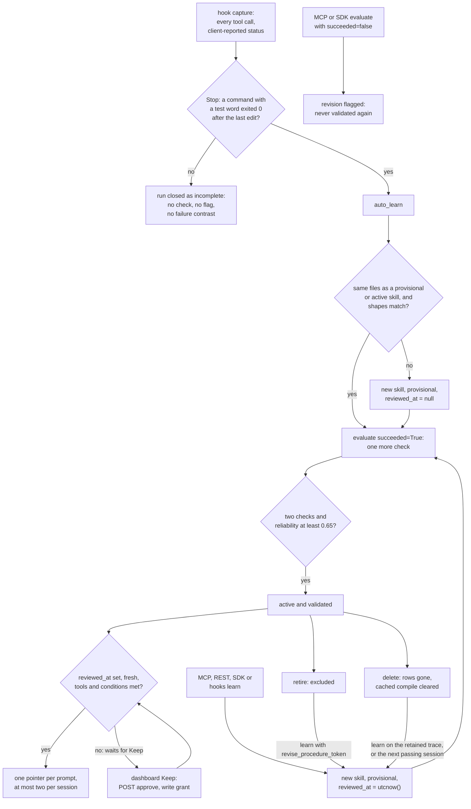

## 1. Executive Summary

MuscleMemory is procedural memory for coding agents. Hooks in Claude Code, Codex
and Cursor record every tool call. When a session ends with a test command
passing after the last code change, the service compiles the session into a
skill — files to change, the test that proved it, what to avoid — and later
hands an agent a short pointer to it. What is notable is the promotion rule: a
skill reaches a prompt only after two further sessions, not the one it came
from, pass while doing the same thing, and one failed check takes it out for
good. What is weak is everything that decides "passed". The evidence is
whatever the capture reports, the test gate is a word list, the default hook
path never records a failure, and the agent's own MCP tools can learn and
validate a skill with no person involved.

The system is one FastAPI service with a REST API, a five-tool MCP endpoint and
a React dashboard, over SQLite by default or PostgreSQL with pgvector. Retrieval
fuses exact file-path matches, BM25 and local MiniLM embeddings, then refuses
any candidate that is not active, validated, approved, fresh and runnable with
the agent's own tools. The README frames the result as learning from what
worked and what failed.

Five findings shape the rest of this report.

- **The approval queue covers one producer.** Hook-learned skills wait with
  `reviewed_at` null until someone presses Keep. Any `learn` through MCP, REST,
  an SDK or `hooks learn` passes `auto=False` and lands approved
  (`packages/musclememory/service.py:476-483`). A committed MCP test takes a
  skill from three self-reported traces to a recall hit with no approve call
  (`tests/test_mcp.py:33-109`).
- **The default path never learns from failure.** The only in-product caller of
  `evaluate` is `auto_learn`, which passes `succeeded: True`
  (`service.py:1225-1240`). A hook session whose tests fail closes as
  `incomplete`, not `failure` (`service.py:327-332`), so it neither flags the
  skill it used nor feeds a failure contrast.
- **"Tests passed" means a word.** A command whose words include `test`,
  `check`, `go`, `cargo` or `pytest` and exits 0 after the last edit closes the
  session as verified (`packages/musclememory/artifacts.py:17-18`, `:120-130`).
- **Removal does not hold.** Delete clears the cached compile so the retained
  trace can be learned again, and a committed test asserts that it can
  (`tests/test_failure_learning.py:275-298`). A revision through
  `revise_procedure_token` sets a retired procedure back to `provisional`.
- **One namespace per machine.** `musclememory connect` gives every agent in
  every project the same tenant and namespace
  (`packages/musclememory/local.py:151-162`). Paths are stored relative to each
  project root, so `app/rounding.py` in one repository matches
  `app/rounding.py` in another.

Four marks: `trust_state`, `scope_enforced`, `audit_log` and `negative_eval`.

## 2. Mental Model

A memory is a **procedure**: a stable token with numbered revisions. A revision
is a step graph compiled deterministically from one closed trace whose
completion event says `success` (`packages/musclememory/compiler.py:71-235`).
Failed steps, steps depending on them, read-only detours and unverified checks
are pruned. The revision also carries the files read and written, the commands
run, the test command, applicability conditions, and plain-English avoid and
recovery notes derived from the trace's own failures and from failure
contrasts.

**The trace, not the agent, is the witness.** The compiler never asks a model
what happened; it reads the recorded tool calls. But each event's `status`,
`outcome_verified` and `capture_complete` arrive from the client, and the
contract defaults the last two to `True` (`packages/musclememory/core.py:36-38`).
The compiler says so on every revision: *"Completion evidence is
caller-attested; structural validation is not task verification"*
(`compiler.py:212`).

**Two statuses and a timestamp decide whether a skill is believed.** A
revision is `provisional`, `validated` or `flagged`; a procedure is
`provisional`, `active`, `flagged` or `retired`; `reviewed_at` is null until a
person approves an automatically learned procedure. `evaluate` counts a check
only from a run other than the training run (`service.py:692-695`). The run
must have executed the revision's required capabilities and matching action
shapes (`:704-776`), and its reported metrics must match the trace (`:786-800`).

| Event | revision status | procedure lifecycle | read path |
| --- | --- | --- | --- |
| `learn` (new) | provisional | provisional | excluded |
| `learn` with `revise_procedure_token` | new revision, provisional | provisional, even from retired | excluded |
| second passing check, reliability ≥ 0.65 | validated | active | included if `reviewed_at` is set |
| any failed check | flagged, never cleared | flagged | excluded |
| `retire` | unchanged | retired | excluded |
| `delete` | rows removed | rows removed | gone; trace re-learnable |

The read predicates are `retrieval.py:228-230` and `:409-410`; the writers are
`service.py:473`, `:827-848` and `:1297`.

**What "learns from failure" does.** Three mechanisms, and the first two write
text into the skill. Failed steps and retries inside the successful trace
become avoid and recovery notes (`packages/musclememory/boundaries.py:88-118`).
At learn time, failed runs in the same namespace with an identical capability
sequence are diffed against the success by argument shape — key names and
types, never values. The diff is stored as a `contrasts` row keyed on the pair
of runs (`service.py:414-461`, `packages/musclememory/shapes.py:168`). Third, a
failed check flags the revision. Only the third withholds anything, and none is
keyed on a value that later writes consult.

**Against the other procedural memories here.** [Voyager](../voyager/)
writes a skill only when a critic confirms success and keeps no failures.
MuscleMemory adds what Voyager lacks, a reuse count before admission and a
record of failed runs, and drops execution, since a skill is advice the agent
re-derives. [Acontext](../acontext/) queues distillation on any terminal task
status, failed included; MuscleMemory learns only from a pass.
[SESA](../sesa/) and [autoharness](../autoharness/) prune by measured use and
can regenerate what they evicted, and a deleted MuscleMemory skill comes back
from its retained trace the same way. [ALTK-Evolve](../altk-evolve/) distils
guidelines from every trajectory with a model; here no generative model runs
unless a note refiner is configured.

## 3. Architecture

One Python process serves everything. `musclememory serve` runs uvicorn over a
FastAPI app that mounts the REST API under `/v1`, the MCP Streamable HTTP
endpoint at `/mcp`, and the built dashboard at `/dashboard`
(`packages/musclememory/api.py:133-378`). A pure-ASGI middleware authenticates
every `/v1` and `/mcp` request against a SHA-256 digest of the bearer key and
rate-limits per key (`api.py:45-130`). The same middleware rejects unknown
hosts and origins and caps bodies at 2 MiB. `MemoryService` holds all logic,
one SQLAlchemy transaction per call (`service.py:76-1448`).

**Persistence.** Twelve tables across eight Alembic migrations: credentials,
runs and their events, procedures and revisions, evaluations, artifact
postings, contrasts, session usage, sign-in codes, rate windows
and `audit_log` (`packages/musclememory/storage.py`). Events cascade from runs,
and revisions, evaluations and postings cascade from procedures. Migrations are
explicit; startup only checks that the credentials table answers.

**Search stack.** On PostgreSQL, keyword candidates come from `to_tsvector`
full-text search and vector candidates from a partial HNSW index per embedding
dimension (`packages/musclememory/retrieval.py:236-251`, `:440-450`). SQLite
has neither, so each process keeps one normalised NumPy matrix and BM25
postings per tenant, namespace and embedding space (`retrieval.py:266-335`).
The cache is rebuilt when the revisions table's row count or max rowid changes.
Final BM25 is computed in Python on both backends over the candidate union, so
the two backends rank identically (`retrieval.py:170-192`).

**Hooks are their own process.** Each hook call runs
`python -m musclememory hooks receive`, appends to a private SQLite queue under
`~/.musclememory/hooks/<agent>-state`, and delivers unacknowledged events over
HTTP (`packages/musclememory/client_hooks.py:513-546`). A stopped server leaves
the queue for `musclememory hooks flush`. Shell commands are bracketed by
`git status --porcelain` snapshots, so a file changed by a script counts as an
edit (`packages/musclememory/workspace.py:71-80`).

### Deployment and ergonomics

`pipx install thewariend-musclememory`, then `musclememory init` creates
`~/.musclememory` at mode 0700, migrates the SQLite file and downloads
`all-MiniLM-L6-v2` (about 90 MB) through fastembed (`local.py:56-90`).
`musclememory start` runs the server in the background on `127.0.0.1:8080`.
`musclememory connect claude` issues a per-agent key into a 0600 env file and
merges hooks into the project's `.claude/settings.json`, backing up the old
file (`local.py:151-217`, `client_hooks.py:896-953`).

No API key for any model is needed; the only outbound calls are an optional
remote embedder and an optional HTTPS note refiner. The team path is
`compose.yaml` with `pgvector/pgvector:pg17` and a read-only, capability-dropped
backend container. The store is ordinary SQL, inspectable with `sqlite3`;
skill definitions are JSON columns.

## 4. Essential Implementation Paths

**Capture.** `run_hook` loads the agent's config, hands the redacted payload to
`HookQueue.handle`, and delivers (`client_hooks.py:815-893`). `handle` opens a
run on `UserPromptSubmit` and records a tool event on each `PostToolUse` with
the mapped capability and effect (`client_hooks.py:223-464`). It marks a gap
for unmapped tools, parallel calls or missing exit codes, and on `Stop` runs
`_tests_passed` (`:466-502`). Codex's Bash output is parsed for
`Process exited with code`, and a test runner's summary line settles a piped
run.

**Write.** On `verified`, the hook calls `POST /v1/runs/{token}/auto-learn` with
the skill injected at the prompt as a hint (`client_hooks.py:838-845`).
`auto_learn` collects passing test events, gathers provisional or active
procedures whose current revision wrote any of the same files, and calls
`evaluate` for each (`service.py:1160-1243`). The first that does not raise
counts as checked. Otherwise it calls `learn(..., auto=True)` and rewrites the
new revision's provenance with `auto: True` (`:1244-1265`). `learn` validates
the proof, compiles, builds failure contrasts, derives notes, embeds the
semantic document and writes the revision and its postings
(`service.py:386-529`).

**Retrieval.** `recall` embeds the intent, calls `hybrid_candidates` and
`rank_candidates`, adds one-hop related skills, and renders a pointer
(`service.py:531-645`). An intent sequenced with "then" or "followed by" is
split into at most four segments and composed into a plan. The hook's
`recall_once` caps each session at two injections and one per skill version
(`client_hooks.py:617-669`).

**Correction.** `evaluate` (`service.py:680-860`), `retire` (`:1294-1300`),
`delete_memory` (`:1125-1147`) and `approve` (`:1149-1158`). Retire, delete and
approve are REST routes the dashboard calls (`api.py:288-316`,
`apps/dashboard/src/api.ts:98-101`); `evaluate` is on REST and MCP.

**Agent surface.** `build_mcp` registers `musclememory_recall`, `_observe`,
`_learn`, `_evaluate` and `_inspect`, authenticated by the same key the REST
API takes (`packages/musclememory/mcp_server.py:96-193`). MCP recall strips the
definition and notes from the candidate and returns only the pointer.

**Tests.** `tests/test_failure_learning.py`, `tests/test_engine.py`,
`tests/test_client_hooks.py` and `tests/test_mcp.py` carry the memory
behaviour; [section 10](#10-tests-evals-and-benchmarks) covers them.

## 5. Memory Data Model

`procedures` holds the token, tenant, namespace, `current_version`, `lifecycle`,
`reviewed_at` and timestamps. `revisions` is keyed on `(procedure_token,
version)` and holds the definition JSON, a search document, the embedding with
its space and dimension, success and failure counts, `validation_status` and
`validated_at` (`storage.py:83-140`). `evaluations` is one immutable row per
`(procedure, version, run)`; a re-sent evaluation with different content raises
`evaluation_conflict` (`service.py:801-826`).

**Scope.** Every row carries `tenant`; procedures, runs, postings and contrasts
carry `namespace`. The tenant comes from the credential, never from the
request. The namespace is the request's `visibility_scope`, checked against the
key's grants by `Principal.require` (`packages/musclememory/security.py:65-67`).
Grants are `read`, `write`, `delete` and `admin` per namespace. No column names
a project, repository or agent.

**Provenance.** A definition's `provenance` holds `source_run`, the completion
proof, the compiler version, the removed-event count, the contrast ids and, for
hook-learned skills, `auto`. Runs keep the agent name in `runtime`, so
`inspect` can say which agent learned a skill and which checked it
(`service.py:948-984`).

**Time.** `created_at`, `updated_at` and `validated_at` are record times.
Freshness falls linearly from the last validation to zero at 90 days
(`retrieval.py:213-233`). Nothing records when a procedure was true of the code
it describes.

**Retention.** Runs expire after 30 days, enforced on access with a 410 and
removed by `musclememory purge` (`service.py:159-160`, `:1302-1306`). Skills
and evaluations stay until deleted. Contrasts cascade from runs, so they go
with the failed or successful trace, not with the procedure.

## 6. Retrieval Mechanics

Four candidate pools, each limited to 80: exact matches of a path or command
from the task against artifact postings; BM25 (FTS on PostgreSQL); vector
neighbours; and the most recently updated eligible procedures
(`retrieval.py:395-461`). Every pool is drawn from one statement that
requires tenant, namespace, `lifecycle == "active"` and
`validation_status == "validated"`.

`rank_candidates` scores the union. Lexical, semantic and exact-target rankings
are fused by RRF with k = 60, normalised by the three-list maximum. A candidate
is then dropped unless `compatibility_freshness` passes (`retrieval.py:211-233`).
That needs every required capability bindable by the agent, every required
permission and environment value present, and fewer than 90 days since
validation. It also needs at least two successes, reliability at least 0.65,
and a validated, active, reviewed record. Every applicability condition must
be a known kind and satisfied (`shapes.py:144-163`), so free-form conditions
fail closed. The survivor needs relevance 0.25, and the score is
`0.75 × max(exact, fused) + 0.20 × reliability + 0.05 × freshness`
(`retrieval.py:515-535`).

Retrieval is automatic in the hook path and tool-mediated in MCP. No model
runs at recall; the embedding is local.

**The pointer.** `render_pointer` emits compact JSON
(`packages/musclememory/delivery.py:26-112`). It carries a notice that the
result is untrusted, the procedure and version, title, up to six changed files
and the test command. It adds up to four before-and-after edit snippets,
inputs, preconditions, one avoid note, permissions and the inspect tool name.
Over budget, it drops whole optional fields, then edit snippets, and abstains
rather than cut the notice or permission list. The default budget is 350 tokens
by `tiktoken` `o200k_base`.

**Failure modes.** Over-recall across projects is the one the data model
invites: with one namespace per machine, a path-exact match from another
repository scores 1.0 on the exact arm. Stale hits are bounded by the 90-day
window. A skill whose steps match a new task by file but not by intent can be
counted as a check without being the right skill. `auto_learn` matches on
written files and action shapes, not on the task text.

## 7. Write Mechanics

**Hot path or deferred.** Every hook call is synchronous with a 10-second
timeout, and delivery happens inside it. The `Stop` hook delivers the remaining
events and calls `auto-learn`, which compiles, embeds and commits before the
hook returns. Hook failures print a one-line notice and fail open.

**Lag.** A new skill is not retrievable until two further passing sessions have
checked it and, for a hook-learned skill, a person has pressed Keep. The lag is
measured in sessions, not seconds.

**Deduplication.** A passing session that touches the files of an existing
provisional or active skill and matches its action shapes becomes a check, not
a new skill. One that does not match becomes a new skill, so two ways of doing
the same task are two procedures. Nothing merges them.

**Update.** Append-only by revision: a revise adds version N+1 and resets the
procedure to `provisional`. Two writes rewrite in place. `auto_learn` replaces
the new revision's `definition` to add `auto: True` (`service.py:1258-1264`),
and `reindex` replaces search text and embeddings (`:647-678`).

**Agent-generated content.** `learning_policy.title`, `preconditions` and
`expected_outcomes` are free text from the caller and reach the pointer
(`core.py:88-94`, `delivery.py:45-50`). Redaction strips values under
secret-like keys and token patterns before storage and before any boundary
refinement (`security.py:11-50`).

### Operational cost

Each tool call costs one hook process start and, normally, one HTTP round trip.
Recall costs one local embedding per intent and one per segment, plus SQL; `docs/benchmarks.md`
reports about 60 ms at 10,000 skills on SQLite, measured with
`benchmarks/scale.py`; no result file for it is committed.
Injection is at most two pointers of at most 350 tokens per session. They
arrive as hook `additionalContext` on the user prompt, which leaves the system
prompt and earlier turns' cache untouched. No background pass reads the whole
store.

## 8. Agent Integration

`musclememory connect <agent>` is the main path: hooks only, no MCP server, and
the agent never calls a memory tool. It sees one JSON pointer at its next
prompt when something matches. Cursor has no prompt-context output, so the
pointer rides on the first tool result's `additional_context`
(`client_hooks.py:867-890`). CleanSlate is wired through a TypeScript host
adapter whose `finishIfVerified` mirrors the Stop logic
(`packages/sdk-typescript/src/cleanslate.ts:168-176`).

MCP gives an agent the whole loop: observe its own events, learn, evaluate,
recall and inspect. The Python and TypeScript SDKs give application code the
same verbs plus `auto_learn`. `musclememory export <token> --to claude` writes a
Ready skill into the agent's user skills folder as `SKILL.md`
(`packages/musclememory/skill_export.py:26-34`, `service.py:986-1018`), after
which it lives outside the store.

Agency is low on the hook path and total on MCP. A skill learned by Codex is
handed to Claude Code and Cursor, because file edits map to one capability
family across agents (`shapes.py:128-141`).

## 9. Reliability, Safety, and Trust

**The verifier is a vocabulary.** `TESTERS` and `TEST_WORDS` hold `pytest`,
`unittest`, `jest`, `vitest`, `cargo`, `go`, `tox`, `nox`, `test`, `tests` and
`check`, and any command containing one is a `verify` operation
(`artifacts.py:17-18`, `:120-130`). `cargo build`, `go vet`, `ruff check` and
`echo test` all qualify. The roadmap names the piped-test and shell-change
limits; it does not name this one. A session therefore teaches whenever the
last edit is followed by any such command exiting 0.

**Failures are not captured where capture is automatic.** A hook session that
ends without a passing test closes as `incomplete` on Codex and stays
`recording` on Claude Code (`client_hooks.py:291-314`, `:558-571`). Only a
completion with `capture_complete` true and status `failure` sets
`runs.status = 'failure'` (`service.py:327-332`). That comes from
`hooks attest` without `--succeeded`, from receipt reconciliation, or from an
SDK or CleanSlate caller passing `succeeded=False`. In a default install the
failure-contrast query at `service.py:417-428` therefore finds nothing, and an
injected skill that preceded a failed session is never flagged.

**The review gate.** For hook-learned skills, `reviewed_at` is the gate and
`retrieval.py:230` enforces it. The approve route needs `write`
(`service.py:1152`), the grant every agent key carries (`local.py:156-159`);
the dashboard key adds `delete` and `admin`. Neither the hook config nor the
MCP tool list exposes approve, so on the declared tool surface a hook-learned
skill waits for a person.

But `learn` through MCP lands with `reviewed_at` set, and the integration guide
says so: *"Skills you learn on purpose through the SDK, MCP or `hooks learn`
count as approved"* (`docs/integrations.md:83-86`). A revision inherits the
procedure's approval, so new content under an approved token is never
reviewed. `human_review` is withheld on these grounds.

**Correction that does not stick.** Retire is undone by any revise, which sets
`lifecycle = "provisional"` without consulting the old value
(`service.py:464-474`). Delete removes the procedure but clears
`learned_result` on its source run, so `learn` on the same retained trace
compiles it again (`service.py:1133-1143`). The next passing session on the
same files also re-learns it into the review queue. There is no record of a
rejected skill, and `tombstone` is withheld.

**Scope.** Every read carries tenant and namespace, the tenant cannot be
supplied by a caller, and the read grant is checked before the query
(`service.py:532`, `:150-183`). The weak part is the default: one install, one
tenant `local`, one namespace `default`, shared by every agent and every
project on the machine. Cross-project recall is a property of the local
install, not a leak in the code.

**Prompt injection.** Free text a caller supplies through `learning_policy`
reaches the pointer. The pointer opens with a notice that the result is
untrusted and that normal permissions apply, and MuscleMemory executes nothing.
Captured tool arguments, including edit snippets, become the pointer's `edits`,
so a planted edit in a passing session is replayed as guidance.

**Concurrency.** Writes take row locks with `with_for_update`, and events are
idempotent by id and refuse changed contents (`service.py:150-161`,
`:260-270`). Evaluations are immutable, and a re-sent learn with a different
request digest raises `learning_conflict` (`:393-398`). The hook queue
serialises separate hook processes through SQLite transactions.

**Audit.** `audit_log` gets one row per mutation in the same transaction and is
never updated or deleted in the tree. It records operation, reference and key,
not content. Its one reader is the usage endpoint's count by operation
(`service.py:1308-1315`).

**Delete semantics.** A deleted skill's rows go with it by cascade. Its source
trace stays until it expires, its contrasts stay with their runs, its audit
rows stay, and any exported `SKILL.md` stays in the agent's skills folder.

## 10. Tests, Evals, and Benchmarks

**What the suite asserts.** 112 pytest functions in 22 files run in CI against
SQLite and a `pgvector/pgvector:pg17` service (`.github/workflows/verify.yml`).
The PostgreSQL cases skip without `MM_TEST_POSTGRES_URL`, which CI sets. A
`conftest.py` fixture forces the lexical-hash embedder, so the suite never
exercises MiniLM ranking. I ran nothing; these are read from the files.

**Negative retrieval, with controls.** Three cases assert that a skill is not
recalled, each beside a positive recall on the same query:

- `test_validation_and_regression_gate` asserts `no_match` after one check, a
  hit after two, and `no_match` after a failed third
  (`tests/test_failure_learning.py:242-272`).
- `test_versioning_independent_validation_and_regression` asserts a hit on
  validated revision 2 and `no_match` after it fails
  (`tests/test_engine.py:235-249`).
- `test_passing_sessions_learn_then_wait_for_approval` drives Codex-shaped hook
  payloads to an active skill, then asserts `no_match` before approval and a
  hit after (`tests/test_client_hooks.py:537-563`).

Scope has a foreign-tenant miss on SQLite (`tests/test_engine.py:79-83`) and on
PostgreSQL with a positive recall first (`tests/test_migrations.py:83-96`).
Fail-closed conditions are parametrised over five shapes
(`tests/test_failure_learning.py:132-145`).

**What no test asserts.** That a retired skill is excluded: the only retire
case checks the status code (`tests/test_api.py:79`). That a deleted skill
stays gone: the suite asserts the opposite
(`tests/test_failure_learning.py:275-298`). That an MCP-learned skill waits for
anyone: `protocol_workflow` passes with no approve (`tests/test_mcp.py:33-109`).
That a failing hook session flags the skill it was handed:
`test_failing_tests_teach_nothing` checks only that no skill was learned
(`tests/test_client_hooks.py:566-569`).

**The benchmarks measure efficiency on repeat tasks.** Three runs are committed
with harness, per-session rows and a `SHA256.json` manifest. `codex/luna-03`
is nine paired Codex sessions on three planted-bug tasks; `claude/sonnet-01`
is four Claude Code pairs on skills Codex learned; `codex/django-forms-01` is
one SWE-bench Verified issue, three repeats per arm. I recomputed luna-03's
totals from `results.json` with my own script: 981,734 against 731,549 input
tokens, 56 against 39 tool calls, nine passes per arm, matching the README.
Every file in all three manifests matched its digest. The manifests are the
author's, so they show the files are unchanged since fingerprinting, not who
produced them.

The luna-03 report records one rule change mid-run, with the harness digests
before and after. Every memory-off session also passed, so the run measures
cost, not success. No benchmark measures what a wrong or flagged skill does to
a session, and none measures cross-project recall. There is no paper;
`docs/whitepaper.md` is a design document citing Voyager, AWM, ExpeL and Memp
as related work.

## 11. For Your Own Build

### Steal

- **Exclude the training run from its own validation.** A procedure learned
  from a session cannot be checked by that session; require two independent
  runs that executed the same required capabilities.
- **Fail closed on applicability.** Store conditions in a closed vocabulary
  (`capability:`, `permission:`, `environment:`) and drop any candidate with an
  unknown or unmet one, including free text.
- **Compare failures by shape.** Diffing a failed and a successful run on key
  names and types finds the step that mattered without storing or transmitting
  values.
- **Bound the pointer by whole fields.** Drop optional fields and whole edit
  hunks to meet a token budget, and abstain rather than cut the safety notice.

### Avoid

- **A review gate with a side door.** If the human queue applies to one write
  path, any other path that writes the same table is the producer's way around
  it. Put the gate on the record, not on the caller.
- **A verifier that is a word list.** "A command named like a test exited 0" is
  a claim the agent can satisfy without testing anything.
- **Learning from failure only when someone reports it.** If the automatic
  capture records only successes, every failure mechanism downstream is dead
  in the default install.
- **Delete that re-arms.** Clearing a cache so the same evidence compiles again
  turns a person's Delete into a postponement.

### Fit

MuscleMemory suits one developer who repeats similar repair tasks in a few
repositories with real test suites, wants measurable token savings, and will
look at the dashboard's queue. It runs locally on one SQLite file and a 90 MB
model. A team sharing a PostgreSQL namespace should first split namespaces per
repository and decide whether MCP-learned skills may skip review. Walk away if
the agent's work is not gated by tests that mean something, if a removed skill
must stay removed, or if the memory must be defended against the agent that
writes it.

## 12. Open Questions

- How often the word-list verifier admits a session whose command was not a
  test, on real histories; answering it needs the hooks run over recorded
  sessions.
- Whether the maintainers intend `hooks attest` or a future hook to report
  failed sessions, which would make flagging and contrasts reachable by default.
- How the SQLite index behaves when several server processes share one file,
  since its fingerprint is a whole-table count and max rowid.
- Whether the hosted mode on the roadmap will give namespaces per repository.
- What the CleanSlate host does with `finish(false)`, outside this tree.

## Appendix: File Index

- **Schema and storage:** `packages/musclememory/storage.py`,
  `packages/musclememory/migrations/versions/*.py`, `scripts/database_backup.py`.
- **Write:** `packages/musclememory/service.py` (`learn`, `auto_learn`,
  `evaluate`, `observe`), `packages/musclememory/compiler.py`,
  `packages/musclememory/boundaries.py`, `packages/musclememory/shapes.py`,
  `packages/musclememory/artifacts.py`.
- **Retrieval and context:** `packages/musclememory/retrieval.py`,
  `packages/musclememory/planning.py`, `packages/musclememory/delivery.py`.
- **Capture and hooks:** `packages/musclememory/client_hooks.py`,
  `packages/musclememory/workspace.py`, `packages/musclememory/spool.py`,
  `packages/musclememory/observer.py`, `packages/sdk-typescript/src/*.ts`.
- **Surfaces:** `packages/musclememory/api.py`,
  `packages/musclememory/mcp_server.py`, `packages/musclememory/gateway.py`,
  `packages/musclememory/cli.py`, `packages/musclememory/local.py`,
  `packages/musclememory/skill_export.py`, `apps/dashboard/src/api.ts`.
- **Security:** `packages/musclememory/security.py`,
  `packages/musclememory/config.py`.
- **Tests and benchmarks:** `tests/test_failure_learning.py`,
  `tests/test_engine.py`, `tests/test_client_hooks.py`, `tests/test_mcp.py`,
  `tests/test_migrations.py`, `tests/conftest.py`, `benchmarks/reproduce.py`,
  `benchmarks/results/*/*/results.json`, `benchmarks/results/*/*/SHA256.json`,
  `.github/workflows/verify.yml`.
- **Docs read as claims:** `README.md`, `docs/how-it-works.md`,
  `docs/integrations.md`, `docs/whitepaper.md`, `docs/roadmap.md`,
  `docs/benchmarks.md`.

### Recorded searches

Checked against the checkout at the pinned revision, from the tree root.

- `git grep -n -E 'reviewed_at' -- packages` — set at `service.py:481` (null only when `auto`) and `:1154`, read at `retrieval.py:230`, `service.py:912` and `:1080`; the migration backfills `created_at`.
- `git grep -n -E 'lifecycle *=|lifecycle ==|lifecycle\.in_|lifecycle !=' -- packages` — writers at `service.py:473`, `:843` and `:1297`; filters at `planning.py:40`, `retrieval.py:229` and `:409`.
- `git grep -n -E 'validation_status *=|validation_status ==|validation_status !=' -- packages` — `flagged` set at `service.py:830` and checked at `:834`; no writer clears it.
- `git grep -n -E '\bAudit\b|audit_log' -- packages apps scripts` — construction at `service.py:135`, an aggregate select at `:1312-1314`, the model, the migration and the backup's table list; no update or delete.
- `git grep -n -E 'evaluate\(|musclememory_evaluate|/v1/evaluate' -- ':!tests' ':!docs'` — product callers are `service.py:1226` (always `succeeded: True`) and the REST, MCP, gateway and SDK forwards; the rest are benchmarks and examples.
- `git grep -n -E '"succeeded": False|succeeded=False' -- packages` — no match.
- `git grep -n -i -E 'tombstone|rejected_|blocklist|denylist|suppress' -- packages` — only `rejected_event_count` on the observe response.
- `git grep -n -i -E 'valid_from|valid_to|valid_until|invalid_at|as_of' -- packages` — one false positive, `invalid_tool_metadata` in `observer.ts`.
- `git grep -n -i -E 'project|repository|repo_' -- packages/musclememory/retrieval.py packages/musclememory/service.py packages/musclememory/core.py` — comments only; no project column or predicate.
- `git grep -n -E 'retire' -- tests packages/sdk-typescript/tests` — one hit, the status-code assertion at `tests/test_api.py:79`.
- `git grep -n -E 'rmtree|unlink|remove\(' -- packages/musclememory/skill_export.py packages/musclememory/service.py` — staging cleanup only; nothing removes an exported skill.
- `git ls-files benchmarks/results | cut -d/ -f3-4 | sort -u` — `claude/sonnet-01`, `codex/django-forms-01` and `codex/luna-03`; no scale result is committed.
- `git grep -n -i -E 'arxiv|bibtex|@article|@misc|citation|doi\.org'` — related-work citations in `docs/whitepaper.md:378-397`; no `CITATION.cff` and no paper for this system.

## History

**2026-10-14** — [`4c7b01b49fa5f3866c483fedb66109a7cc04a33d`](https://github.com/TheWariend/MuscleMemory/commit/4c7b01b49fa5f3866c483fedb66109a7cc04a33d) — first reading, at the head of `main`, a commit of 13 October 2026. Four marks: `trust_state`, `scope_enforced`, `audit_log`, `negative_eval`. Screened before reading from a full clone: no auto-run surface, one build-time execution point (`tests/conftest.py`), five dependency files inside the seven-day cooldown, and two floating-range manifests without a lockfile beside them (`apps/dashboard/package.json`, `packages/sdk-typescript/package.json`). Apache-2.0 with a `NOTICE` and no rider. Nothing was installed, built or run; benchmark totals were recomputed from committed JSON with a separate script.
