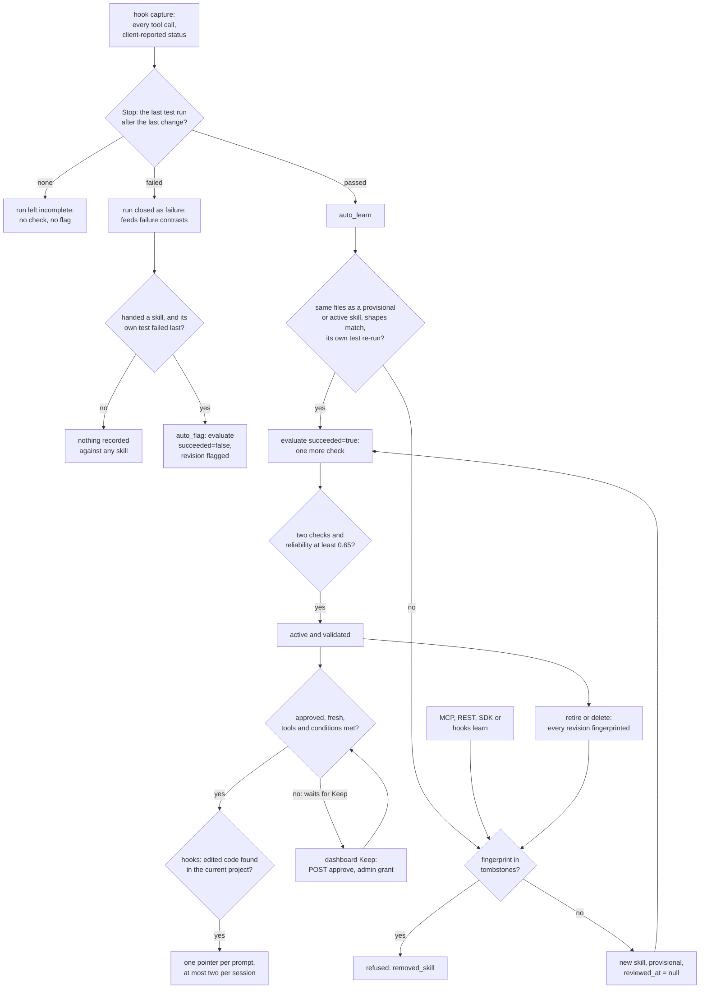

## 1. Executive Summary

MuscleMemory is procedural memory for coding agents. Hooks in Claude Code, Codex
and Cursor record every tool call. When a session ends with a test run passing
after the last code change, the service compiles the session into a skill —
files to change, the test that proved it, what to avoid — and later hands an
agent a short pointer to it. What is notable is the admission rule: a skill
reaches a prompt only after a person approves it and two further sessions, not
the one it came from, re-run its own test and pass. One failed check takes it
out for good, and a deleted skill is refused if the same work is learned again.
What is weak is the evidence underneath: every outcome is what the capture or
the caller reports, and the hooks flag a skill only in one narrow case.

The system is one FastAPI service with a REST API, a five-tool MCP endpoint and
a React dashboard, over SQLite by default or PostgreSQL with pgvector. Retrieval
fuses exact file-path matches, BM25 and local MiniLM embeddings, then refuses
any candidate that is not active, validated, approved, fresh and runnable with
the agent's own tools.

Five findings shape the rest of this report.

- **Every skill waits for a person, and an agent's key cannot approve.** `learn`
  sets `reviewed_at` to null for every caller and again on every revision
  (`packages/musclememory/service.py:502-527`). `approve` requires the `admin`
  grant (`:1224`), and `musclememory connect` issues agent keys with `read` and
  `write` (`packages/musclememory/local.py:151-162`). The limit is where admin
  keys come from: CLI commands that open `~/.musclememory` directly, which a
  coding agent's shell can run as the same user.
- **Failure reaches the store from the hooks, narrowly.** A Stop whose last test
  after the last change failed closes the run as `failure`, which feeds failure
  contrasts (`packages/musclememory/client_hooks.py:315-331`). If the session was
  handed a skill and that test is the skill's own, `auto_flag` records a failed
  check and flags it (`service.py:1232-1289`). A session that fails another test
  flags nothing, and the CleanSlate adapter's automatic path reports successes
  only.
- **A test is a runner invocation, and a check re-runs the skill's own test.**
  `test_run` recognises runner names and test subcommands
  (`packages/musclememory/artifacts.py:18-77`), so `cargo build`, `ruff check`
  and `echo test` do not count. `evaluate` admits a passing check only when the
  skill's stored test ran after the last change (`service.py:815-827`). Whether
  it passed is the client's report of an exit code.
- **Removal holds for the exact skill.** Retire and delete store a SHA-256
  fingerprint of what each revision taught, and `learn` refuses a compile that
  matches one (`service.py:66-91`, `:493-501`). A session that differs by one
  file read or one edit snippet compiles a different fingerprint, and a flagged
  skill is never fingerprinted.
- **One namespace per machine by default.** `musclememory connect` gives every
  agent in every project the same tenant and namespace (`local.py:151-217`); a
  per-project namespace takes a hand-made key and hook config. The hooks' file
  check refuses a skill whose edited code is absent from the current project
  (`packages/musclememory/hook_files.py:46-127`), on the hook path only.

Six marks: `tombstone`, `trust_state`, `scope_enforced`, `audit_log`,
`human_review` and `negative_eval`.

## 2. Mental Model

A memory is a **procedure**: a stable token with numbered revisions. A revision
is a step graph compiled deterministically from one closed trace whose
completion event says `success` (`packages/musclememory/compiler.py:71-235`).
Failed steps, steps depending on them, read-only detours and unverified checks
are pruned. The revision also carries the files read and written, the commands
run, the test command, applicability conditions, and plain-English avoid and
recovery notes derived from the trace's own failures and from failure
contrasts.

**The trace, not the agent, is the witness.** The compiler never asks a model
what happened; it reads the recorded tool calls. But each event's `status`,
`outcome_verified` and `capture_complete` arrive from the client, and the
contract defaults the last two to `True` (`packages/musclememory/core.py:36-38`).
The compiler says so on every revision: *"Completion evidence is
caller-attested; structural validation is not task verification"*
(`compiler.py:212`).

**Two statuses and a timestamp decide whether a skill is believed.** A
revision is `provisional`, `validated` or `flagged`; a procedure is
`provisional`, `active`, `flagged` or `retired`; `reviewed_at` is null until a
person approves the procedure. `evaluate` counts a check only from a run other
than the training run (`service.py:735-738`). A passing run must have executed
the revision's required capabilities and matching action shapes, must have run
the skill's stored test after its last change (`:750-845`), and must report
metrics that match the trace (`:854-868`).

| Event | revision status | procedure lifecycle | `reviewed_at` | read path |
| --- | --- | --- | --- | --- |
| `learn` (new, any caller) | provisional | provisional | null | excluded |
| `learn` with `revise_procedure_token` | new revision, provisional | provisional; refused if retired | reset to null | excluded |
| second passing check, reliability ≥ 0.65 | validated | active | unchanged | included once approved |
| `approve`, admin grant | unchanged | unchanged | set | included if validated and active |
| any failed check | flagged, never cleared | flagged | unchanged | excluded |
| `retire` | unchanged | retired, no writer leaves it | unchanged | excluded; fingerprints stored |
| `delete` | rows removed | rows removed | rows removed | gone; fingerprints stored |

The read predicates are `retrieval.py:228-230` and `:409-410`; the writers are
`service.py:515-524`, `:895-915`, `:1226` and `:1435`.

**What "learns from failure" does.** Three mechanisms, and the first two write
text into the skill. Failed steps and retries inside the successful trace
become avoid and recovery notes (`packages/musclememory/boundaries.py:88-118`).
At learn time, failed runs in the same namespace with an identical capability
sequence are diffed against the success by argument shape — key names and
types, never values. The diff is stored as a `contrasts` row keyed on the pair
of runs (`service.py:441-489`, `packages/musclememory/shapes.py:168`). Third, a
failed check flags the revision. The hooks supply failed runs for the second
mechanism whenever a session's last test fails, and failed checks for the third
only through `auto_flag`.

**Against the other procedural memories here.** [Voyager](../voyager/)
writes a skill only when a critic confirms success and keeps no failures.
MuscleMemory adds what Voyager lacks, a reuse count before admission and a
record of failed runs, and drops execution, since a skill is advice the agent
re-derives. [Acontext](../acontext/) queues distillation on any terminal task
status, failed included; MuscleMemory learns only from a pass.
[SESA](../sesa/) and [autoharness](../autoharness/) prune by measured use and
can regenerate what they evicted; MuscleMemory keeps a fingerprint of what a
person removed and refuses to compile it again.
[ALTK-Evolve](../altk-evolve/) distils guidelines from every trajectory with a
model; here no generative model runs unless a note refiner is configured.

## 3. Architecture

One Python process serves everything. `musclememory serve` runs uvicorn over a
FastAPI app that mounts the REST API under `/v1`, the MCP Streamable HTTP
endpoint at `/mcp`, and the built dashboard at `/dashboard`
(`packages/musclememory/api.py:133-382`). A pure-ASGI middleware authenticates
every `/v1` and `/mcp` request against a SHA-256 digest of the bearer key and
rate-limits per key (`api.py:45-130`). The same middleware rejects unknown
hosts and origins and caps bodies at 2 MiB. `MemoryService` holds all logic,
one SQLAlchemy transaction per call (`service.py:105-1588`).

**Persistence.** Thirteen tables across nine Alembic migrations: credentials,
runs and their events, procedures and revisions, evaluations, artifact
postings, contrasts, session usage, sign-in codes, rate windows, tombstones
and `audit_log` (`packages/musclememory/storage.py`). Events cascade from runs,
and revisions, evaluations and postings cascade from procedures. Tombstones
carry no foreign key and survive the procedure they describe. Migrations are
explicit; startup only checks that the credentials table answers.

**Search stack.** On PostgreSQL, keyword candidates come from `to_tsvector`
full-text search and vector candidates from a partial HNSW index per embedding
dimension (`packages/musclememory/retrieval.py:236-251`, `:440-450`). SQLite
has neither, so each process keeps one normalised NumPy matrix and BM25
postings per tenant, namespace and embedding space (`retrieval.py:266-335`).
The cache is rebuilt when the revisions table's row count or max rowid changes.
Final BM25 is computed in Python on both backends over the candidate union, so
the two backends rank identically (`retrieval.py:170-192`).

**Hooks are their own process.** Each hook call runs
`python -m musclememory hooks receive`, appends to a private SQLite queue under
`~/.musclememory/hooks/<agent>-state`, and delivers unacknowledged events over
HTTP (`packages/musclememory/client_hooks.py:539-582`). A stopped server leaves
the queue for `musclememory hooks flush`. Shell commands are bracketed by
`git status --porcelain` snapshots, so a file changed by a script counts as an
edit (`packages/musclememory/workspace.py:68-108`).

### Deployment and ergonomics

`pipx install thewariend-musclememory`, then `musclememory init` creates
`~/.musclememory` at mode 0700, migrates the SQLite file and downloads
`all-MiniLM-L6-v2` (about 90 MB) through fastembed (`local.py:56-90`).
`musclememory start` runs the server in the background on `127.0.0.1:8080`.
`musclememory connect claude` issues a per-agent key into a 0600 env file and
merges hooks into the project's `.claude/settings.json`, backing up the old
file (`local.py:151-217`, `client_hooks.py:960-1017`). `musclememory dashboard`
mints a five-minute, one-use sign-in code carrying every grant and opens the
dashboard with it (`local.py:220-233`).

No API key for any model is needed; the only outbound calls are an optional
remote embedder and an optional HTTPS note refiner. The team path is
`compose.yaml` with `pgvector/pgvector:pg17` and a read-only, capability-dropped
backend container. The store is ordinary SQL, inspectable with `sqlite3`;
skill definitions are JSON columns.

## 4. Essential Implementation Paths

**Capture.** `run_hook` loads the agent's config, hands the redacted payload to
`HookQueue.handle`, and delivers (`client_hooks.py:866-958`). `handle` opens a
run on `UserPromptSubmit` and records a tool event on each `PostToolUse` with
the mapped capability and effect (`client_hooks.py:227-484`). It marks a gap
for unmapped tools, parallel calls or missing exit codes. On `Stop`,
`_final_test` finds the last test run after the last code change, and the run
closes as `success` if it passed and `failure` if it failed (`:295-331`,
`:496-528`). Codex's Bash output is parsed for `Process exited with code`, and
a test runner's summary line settles a piped run.

**Write.** On a passing Stop, the hook calls `POST /v1/runs/{token}/auto-learn`
with the skill injected at the prompt as a hint (`client_hooks.py:889-897`).
`auto_learn` collects passing test events, gathers provisional or active
procedures whose current revision wrote any of the same files, and calls
`evaluate` for each with the session's full tool-call count
(`service.py:1291-1384`). The first that does not raise counts as checked.
Otherwise it calls `learn(..., auto=True)`, treats a `removed_skill` refusal as
no action, and rewrites the new revision's provenance with `auto: True`
(`:1385-1403`). `learn` validates the proof, compiles, builds failure
contrasts, derives notes, checks the tombstones, embeds the semantic document
and writes the revision and its postings (`service.py:415-572`).

**Failure.** On a failing Stop where the session was handed a skill, the hook
calls `POST /v1/runs/{token}/auto-flag` (`client_hooks.py:898-906`).
`auto_flag` requires the run to be `failure`, finds the last test after the
last change, and calls `evaluate` with `succeeded: False` only if that test
failed, was verified, and equals the skill's own stored test
(`service.py:1232-1289`).

**Retrieval.** `recall` embeds the intent, calls `hybrid_candidates` and
`rank_candidates`, adds one-hop related skills, and renders a pointer
(`service.py:574-688`). An intent sequenced with "then" or "followed by" is
split into at most four segments and composed into a plan. The hook's
`recall_once` caps each session at two injections and one per skill version,
drops the plan and related skills, and runs `check_files` on the top candidate
before rendering it (`client_hooks.py:643-708`).

**Correction.** `evaluate` (`service.py:723-928`), `retire` (`:1432-1439`),
`delete_memory` (`:1193-1216`) and `approve` (`:1218-1230`). Retire, delete and
approve are REST routes the dashboard calls (`api.py:288-321`,
`apps/dashboard/src/api.ts:98-101`); `evaluate` is on REST and MCP.

**Agent surface.** `build_mcp` registers `musclememory_recall`, `_observe`,
`_learn`, `_evaluate` and `_inspect`, authenticated by the same key the REST
API takes (`packages/musclememory/mcp_server.py:96-195`). MCP recall strips the
definition and notes from the candidate and returns only the pointer.

**Tests.** `tests/test_failure_learning.py`, `tests/test_engine.py`,
`tests/test_client_hooks.py`, `tests/test_check_evidence.py`,
`tests/test_test_detection.py`, `tests/test_hook_files.py` and
`tests/test_mcp.py` carry the memory behaviour;
[section 10](#10-tests-evals-and-benchmarks) covers them.

## 5. Memory Data Model

`procedures` holds the token, tenant, namespace, `current_version`, `lifecycle`,
`reviewed_at` and timestamps. `revisions` is keyed on `(procedure_token,
version)` and holds the definition JSON, a search document, the embedding with
its space and dimension, success and failure counts, `validation_status` and
`validated_at` (`storage.py:83-140`). `evaluations` is one immutable row per
`(procedure, version, run)`; a re-sent evaluation with different content raises
`evaluation_conflict` (`service.py:869-895`). `tombstones` is keyed on
`(tenant, namespace, fingerprint)` with a reason, `deleted` or `retired`, and a
time (`storage.py:235-243`).

**The fingerprint.** `skill_fingerprint` hashes, with sorted keys, the files a
skill changed and read, its edit snippets (up to sixteen, each at most eight
lines and 600 characters a side), its last test command and its set of
capabilities (`service.py:66-78`, `artifacts.py:243-271`). It stores no content
and cannot be reversed into any. It is the skill's identity across re-learning,
and nothing else reads it.

**Scope.** Every row carries `tenant`; procedures, runs, postings, contrasts
and tombstones carry `namespace`. The tenant comes from the credential, never
from the request. The namespace is the request's `visibility_scope`, checked
against the key's grants by `Principal.require`
(`packages/musclememory/security.py:62-73`). Grants are `read`, `write`,
`delete` and `admin` per namespace. No column names a project, repository or
agent.

**Provenance.** A definition's `provenance` holds `source_run`, the completion
proof, the compiler version, the removed-event count, the contrast ids and, for
hook-learned skills, `auto`. Runs keep the agent name in `runtime`, so
`inspect` can say which agent learned a skill and which checked it
(`service.py:1016-1052`).

**Time.** `created_at`, `updated_at` and `validated_at` are record times.
Freshness falls linearly from the last validation to zero at 90 days
(`retrieval.py:211-233`). Nothing records when a procedure was true of the code
it describes.

**Retention.** Runs expire after 30 days, enforced on access with a 410 and
removed by `musclememory purge` (`service.py:188-189`, `:1441-1445`). Skills,
evaluations and tombstones stay until deleted, and no code path deletes a
tombstone. Contrasts cascade from runs, so they go with the failed or
successful trace, not with the procedure.

## 6. Retrieval Mechanics

Four candidate pools, each limited to 80: exact matches of a path or command
from the task against artifact postings; BM25 (FTS on PostgreSQL); vector
neighbours; and the most recently updated eligible procedures
(`retrieval.py:395-461`). Every pool is drawn from one statement that
requires tenant, namespace, `lifecycle == "active"` and
`validation_status == "validated"`.

`rank_candidates` scores the union. Lexical, semantic and exact-target rankings
are fused by RRF with k = 60, normalised by the three-list maximum. A candidate
is then dropped unless `compatibility_freshness` passes (`retrieval.py:211-233`).
That needs every required capability bindable by the agent, every required
permission and environment value present, and fewer than 90 days since
validation. It also needs at least two successes, reliability at least 0.65,
and a validated, active, approved record. Every applicability condition must
be a known kind and satisfied (`shapes.py:144-163`), so free-form conditions
fail closed. The survivor needs relevance 0.25, and the score is
`0.75 × max(exact, fused) + 0.20 × reliability + 0.05 × freshness`
(`retrieval.py:515-535`).

Retrieval is automatic in the hook path and tool-mediated in MCP. No model
runs at recall; the embedding is local.

**The hook's file check.** Before the hooks hand a skill over, `check_files`
opens the files it touched beneath the project root without following
symlinks, at most 32 files and 1 MiB each (`hook_files.py:21-127`). Files the
skill found in place must exist; files it created may not. If the skill stored
edit snippets for existing files, at least one snippet's before or after text
must appear in the current file, and partial matches carry a warning naming the
files that differ. A skill with no edits to compare is delivered when its files
exist. Skip reasons stay in the local queue (`client_hooks.py:709-720`). Server
and MCP recall do no file check.

**The pointer.** `render_pointer` emits compact JSON
(`packages/musclememory/delivery.py:26-116`). It carries a notice that the
result is untrusted, the procedure and version, title, up to six changed files
and the test command. It adds up to four before-and-after edit snippets,
inputs, preconditions, one avoid note, permissions, the file warning and the
inspect tool name. Over budget, it drops whole optional fields, then edit
snippets, and abstains rather than cut the notice, permission list or warning.
The default budget is 350 tokens by `tiktoken` `o200k_base`.

**Failure modes.** Over-recall across projects is the one the data model
invites: with one namespace per machine, a path-exact match from another
repository scores 1.0 on the exact arm. On the hook path the file check stops
that match unless the other repository's file holds the same edited text; MCP
and SDK recall have no such check. Stale hits are bounded by the 90-day window.
A skill whose steps match a new task by file but not by intent can be counted
as a check, provided the session re-ran the skill's own test.

## 7. Write Mechanics

**Hot path or deferred.** Every hook call is synchronous with a 10-second
timeout, and delivery happens inside it. The `Stop` hook delivers the remaining
events and calls `auto-learn` or `auto-flag`, which commit before the hook
returns. Hook failures print a one-line notice and fail open.

**Lag.** A new skill is not retrievable until two further passing sessions have
checked it and a person has pressed Keep. The lag is measured in sessions, not
seconds.

**Deduplication.** A passing session that touches the files of an existing
provisional or active skill, matches its action shapes and re-runs its test
becomes a check, not a new skill. Failed tool calls before the fix count
toward the session's metrics as `evaluate` expects (`service.py:1343-1350`), so
a fail, fix and pass session is a check. One that does not match becomes a new
skill, so two ways of doing the same task are two procedures. A flagged
procedure is outside the candidate set (`:1338`), and its content is never
fingerprinted, so the same work learned again is a new procedure in the review
queue. Nothing merges procedures.

**Update.** Append-only by revision: a revise adds version N+1, resets the
procedure to `provisional` and clears its approval. Two writes rewrite in
place. `auto_learn` replaces the new revision's `definition` to add
`auto: True` (`service.py:1396-1401`), and `reindex` replaces search text and
embeddings (`:690-721`).

**Agent-generated content.** `learning_policy.title`, `preconditions` and
`expected_outcomes` are free text from the caller and reach the pointer
(`core.py:88-94`, `delivery.py:47-52`). Redaction strips values under
secret-like keys and token patterns before storage and before any boundary
refinement (`security.py:11-50`).

### Operational cost

Each tool call costs one hook process start and, normally, one HTTP round trip.
The prompt hook adds a bounded local read of the skill's files. Recall costs
one local embedding per intent and one per segment, plus SQL;
`docs/benchmarks.md` reports about 60 ms at 10,000 skills on SQLite, measured
with `benchmarks/scale.py`; no result file for it is committed. Injection is
at most two pointers of at most 350 tokens per session. They arrive as hook
`additionalContext` on the user prompt, which leaves the system prompt and
earlier turns' cache untouched. No background pass reads the whole store.

## 8. Agent Integration

`musclememory connect <agent>` is the main path: hooks only, no MCP server, and
the agent never calls a memory tool. It sees one JSON pointer at its next
prompt when something matches. Cursor has no prompt-context output, so the
pointer rides on the first tool result's `additional_context`
(`client_hooks.py:926-953`). CleanSlate is wired through a TypeScript host
adapter whose `finishIfVerified` mirrors the passing Stop and has no failing
counterpart (`packages/sdk-typescript/src/cleanslate.ts:168-183`).

MCP gives an agent the loop short of approval: observe its own events, learn,
evaluate, recall and inspect. The Python and TypeScript SDKs give application
code the same verbs plus `auto_learn`, `auto_flag` in Python, and `approve`,
which succeeds only with an admin key. `musclememory export <token> --to
claude` writes a Ready skill into the agent's user skills folder as `SKILL.md`
(`packages/musclememory/skill_export.py:26-34`, `service.py:1054-1086`), after
which it lives outside the store.

Agency is low on the hook path and high on MCP, which can write and check but
not approve. A skill learned by Codex is handed to Claude Code and Cursor,
because file edits map to one capability family across agents
(`shapes.py:128-141`).

## 9. Reliability, Safety, and Trust

**The verifier is a runner list.** `test_run` strips launchers such as `uv run`,
`npx`, `timeout` and environment assignments, then accepts a known runner
(`pytest`, `jest`, `vitest`, `tox`, `runtests.py` and others), `python -m
pytest` or `unittest`, `manage.py test`, or a tool's test subcommand such as
`go test`, `cargo test`, `npm test` or `make check` (`artifacts.py:18-77`).
`test_command` keeps only that piece of a compound shell command
(`:133-180`). A command counts as a test by its name, and `make check` or an
`npm test` script that tests nothing both qualify; whether it passed is the
exit status or runner summary the client captured.

**A check must re-run the skill's own test.** For each verify step,
`evaluate` keeps only events whose normalised test command equals the
skill's stored one, appear in the reported evidence, and come after the last
non-documentation change (`service.py:775-827`). A session that edits the
skill's files and passes some other test is not a check.

**Failure capture is automatic but narrow.** A hook session whose last test
after the last change failed appends a `failure` completion and closes
(`client_hooks.py:315-331`); the server records the run as `failure`
(`service.py:356-361`), and the failure-contrast query at `service.py:446-456`
can then find it. `auto_flag` turns such a session into a failed check only
when the session was handed a skill and its own stored test ran last and failed
(`service.py:1232-1289`). The test in
`tests/test_client_hooks.py:861-910` drives exactly that pair: the skill's own
test failing flags it, another test failing does not. A skill whose test is the
whole suite is flagged by any later failure of the suite, whatever caused it.
A session that ends without a test after its change records nothing.

**The review gate.** Every caller of `learn` produces a procedure with
`reviewed_at` null, and a revision sets it back to null
(`service.py:515-527`). `retrieval.py:230` refuses an unapproved procedure for
search, plan composition and related links alike, and `export_skill` refuses
one (`service.py:1065-1070`). `approve` requires `admin` (`:1224`). Agent keys
from `connect` carry `read` and `write` (`local.py:151-162`), the default for
`musclememory key` is the same (`cli.py:63`), and the five MCP tools carry no
approve verb or argument, which `tests/test_mcp.py:12-36` pins. The
committed case `test_every_skill_waits_for_a_person_and_agents_cannot_approve`
makes a read-write key's approve raise (`tests/test_engine.py:291-303`).
`human_review` is awarded on that shape.

What the mark does not cover. Admin keys come from `musclememory dashboard`,
whose sign-in code carries every grant, and from `musclememory key
--permissions`, and both open the database directly (`local.py:220-233`,
`cli.py:149-158`). A coding agent with a shell running as the user can run
either, or write the SQLite file itself. The install guide's permission table
says `write` may *"keep or turn off skills"* (`docs/install.md:157`), where the
code requires `admin` to keep. `inspect` by token and the REST listing return
an unapproved skill's content to a caller holding `read`
(`service.py:930-1014`, `:1088-1180`). And the tombstone migration resets no
`reviewed_at`, so a skill approved on learn by version 0.1.1 or before keeps
its approval after an upgrade (`migrations/versions/d4b7e1c9a3f2_tombstones.py`).

**Correction that sticks.** `retire` sets `lifecycle = "retired"`, which no
writer leaves: a revise of a retired procedure raises `removed_skill`
(`service.py:510-513`), and `evaluate` leaves its lifecycle alone (`:909`).
Retire and delete both call `bury`, which stores the fingerprint of every
revision the procedure has (`:81-91`, `:1212`, `:1436`). `learn` checks the
fingerprint before creating or revising anything (`:493-501`). Every producer
— hooks through `auto_learn`, MCP, REST, both SDKs and `hooks learn` — reaches
the store through that function, and it is the only constructor of procedure
and revision rows. `tombstone` is awarded.

Its limits. The key is the exact hash, so the same fix learned from a session
that also read one more file, or edited one more line, compiles a different
fingerprint and enters the review queue as a new skill. A fingerprint has no
reader other than `learn` and no remover, so a mistaken retire is permanent for
that content. Retire needs only `write`, the grant every agent key carries
(`:1434`). Flagging stores no fingerprint.

**Scope.** Every read carries tenant and namespace, the tenant cannot be
supplied by a caller, and the grant is checked before the query
(`service.py:575`, `:179-212`). A model-supplied `visibility_scope` on an MCP
tool selects among the namespaces the key is granted and cannot widen past
them. The weak part is the default: one install, one tenant `local`, one
namespace `default`, shared by every agent and every project on the machine.
The guide documents a per-project namespace as a hand-made key and hook config
(`docs/install.md:76-135`); `connect` has no option for one. Cross-project
recall is a property of the local install, not a leak in the code.

**Prompt injection.** Free text a caller supplies through `learning_policy`
reaches the pointer. The pointer opens with a notice that the result is
untrusted and that normal permissions apply, and MuscleMemory executes nothing.
Captured tool arguments, including edit snippets, become the pointer's `edits`,
so a planted edit in a passing session is replayed as guidance once a person
has approved the skill.

**Concurrency.** Writes take row locks with `with_for_update`, and events are
idempotent by id and refuse changed contents (`service.py:179-212`,
`:289-297`). Evaluations are immutable, and a re-sent learn with a different
request digest raises `learning_conflict` (`:417-427`). The hook queue
serialises separate hook processes through SQLite transactions.

**Audit.** `audit_log` gets one row per mutation in the same transaction and is
never updated or deleted in the tree. It records operation, reference and key,
not content. Tombstone rows ride on the retire or delete row. Its one reader is
the usage endpoint's count by operation (`service.py:1447-1454`).

**Delete semantics.** A deleted skill's rows go with it by cascade, and its
fingerprints stay. Its source trace stays until it expires, its contrasts stay
with their runs, its audit rows stay, and any exported `SKILL.md` stays in the
agent's skills folder.

## 10. Tests, Evals, and Benchmarks

**What the suite asserts.** 137 pytest functions in 25 files run in CI against
SQLite and a `pgvector/pgvector:pg17` service (`.github/workflows/verify.yml`).
The PostgreSQL cases skip without `MM_TEST_POSTGRES_URL`, which CI sets. A
`conftest.py` fixture forces the lexical-hash embedder, so the suite never
exercises MiniLM ranking, and its `learned` helper approves by default with an
admin key (`tests/conftest.py:38-39`, `:133-150`). I ran nothing; these are read
from the files.

**Negative retrieval, with controls.** Five cases assert that a skill is not
recalled, each beside a positive recall on the same query:

- `test_validation_and_regression_gate` asserts `no_match` after one check, a
  hit after two, and `no_match` after a failed third
  (`tests/test_failure_learning.py:244-275`).
- `test_versioning_independent_validation_and_regression` asserts a hit on
  validated revision 2 and `no_match` after it fails
  (`tests/test_engine.py:235-251`).
- `test_every_skill_waits_for_a_person_and_agents_cannot_approve` asserts
  `no_match` on a twice-checked, unapproved skill and a hit after approve
  (`tests/test_engine.py:291-303`).
- `test_passing_sessions_learn_then_wait_for_approval` drives Codex-shaped hook
  payloads to an active skill, then asserts `no_match` before approval and a
  hit after (`tests/test_client_hooks.py:540-566`).
- `protocol_workflow` asserts MCP recall misses a validated skill until an
  approve outside MCP, then hits (`tests/test_mcp.py:96-101`).

`test_a_retired_skill_stays_retired` asserts `no_match` after retire with no
positive recall in that test (`tests/test_engine.py:305-309`). Scope has a
foreign-tenant miss on SQLite (`tests/test_engine.py:79-83`) and on PostgreSQL
with a positive recall first (`tests/test_migrations.py:83-96`). Fail-closed
conditions are parametrised over five shapes
(`tests/test_failure_learning.py:132-145`).

**Removal, failure and test detection.** `test_a_deleted_skill_is_not_learned_again`
asserts that after delete both the same trace and a fresh session of the same
work are refused, and that no procedure remains
(`tests/test_failure_learning.py:278-305`). `tests/test_test_detection.py:6-56`
lists thirteen commands that must count as test runs and eleven that must not,
including `cargo build`, `ruff check .` and `echo test`.
`tests/test_check_evidence.py:86-165` asserts that a check needs the stored
test as its final proof after the last edit, and that a failing test before the
fix leaves a check.

**What no test asserts.** That an admin key cannot be minted by the agent's own
process: no test exercises the sign-in code or `musclememory key` at all. That a
near-identical re-learn of a removed skill is refused: both removal cases reuse
the same events. That a failing hook session with no injected skill leaves
every skill alone, beyond `test_failing_tests_teach_nothing`, which checks only
that no skill was learned (`tests/test_client_hooks.py:569-572`).

**The benchmarks measure efficiency on repeat tasks.** Three runs are committed
with harness, per-session rows and a `SHA256.json` manifest, and no file under
`benchmarks/` differs between this pin and
[`4c7b01b49fa5f3866c483fedb66109a7cc04a33d`](https://github.com/TheWariend/MuscleMemory/commit/4c7b01b49fa5f3866c483fedb66109a7cc04a33d).
`codex/luna-03` is nine paired Codex sessions on three planted-bug tasks;
`claude/sonnet-01` is four Claude Code pairs on skills Codex learned;
`codex/django-forms-01` is one SWE-bench Verified issue, three repeats per arm.
I recomputed luna-03's totals from `results.json` with my own script: 981,734
against 731,549 input tokens, 56 against 39 tool calls, nine passes per arm,
matching the README. Every file in all three manifests matched its digest. The
manifests are the author's, so they show the files are unchanged since
fingerprinting, not who produced them.

The luna-03 report records one rule change mid-run, with the harness digests
before and after. Every memory-off session also passed, so the run measures
cost, not success. The runs predate the approval, flag and tombstone rules. No
benchmark measures what a wrong or flagged skill does to a session, and none
measures cross-project recall. There is no paper; `docs/whitepaper.md` is a
design document citing Voyager, AWM, ExpeL and Memp as related work.

## 11. For Your Own Build

### Steal

- **Exclude the training run from its own validation, and make the check re-run
  the skill's test.** A procedure learned from a session cannot be checked by
  that session, and a later session counts only if it ran the same test after
  its last change.
- **Put the approval on the record and the approver on a grant.** Every write
  path lands unapproved, a revision clears the approval, and the approve route
  needs a grant the agent's credential lacks.
- **Fingerprint what was removed, not the row.** Hashing what a skill taught —
  files, edits, test — and checking it in the one function that creates skills
  keeps a person's Delete from becoming a postponement.
- **Fail closed on applicability.** Store conditions in a closed vocabulary
  (`capability:`, `permission:`, `environment:`) and drop any candidate with an
  unknown or unmet one, including free text.
- **Compare failures by shape.** Diffing a failed and a successful run on key
  names and types finds the step that mattered without storing values.

### Avoid

- **An approver credential minted by a command the agent can run.** A grant
  check on the route holds only as far as the process that issues the grant
  checks who is asking; a CLI that opens the database directly checks nothing.
- **A fingerprint that is the whole compile.** An exact hash over read files and
  edit text refuses a replay and admits the same fix done slightly differently.
- **Blaming the skill for the suite.** Flagging on "the skill's test failed
  last" is sound for a narrow test and indiscriminate for `pytest -q`.

### Fit

MuscleMemory suits one developer who repeats similar repair tasks in a few
repositories with real test suites, wants measurable token savings, and will
work the dashboard's queue. It runs locally on one SQLite file and a 90 MB
model. A team sharing a PostgreSQL namespace should split namespaces per
repository first and keep admin keys away from agent hosts. Walk away if the
agent's work is not gated by tests that mean something, or if the memory must
be defended against an agent that has a shell on the same account.

## 12. Open Questions

- How often a name-recognised test command passes without testing the change,
  on real histories; answering it needs the hooks run over recorded sessions.
- What the agent-facing setup text at `thewariend.com/musclememory/llms.txt`
  tells an agent to run, which is outside this tree; the README points agents
  there, and the documented setup ends with `musclememory dashboard`.
- How the SQLite index behaves when several server processes share one file,
  since its fingerprint is a whole-table count and max rowid.
- Whether the hosted mode on the roadmap will give namespaces per repository.
- What the CleanSlate host does with `finish(false)`, outside this tree.

## Appendix: File Index

- **Schema and storage:** `packages/musclememory/storage.py`,
  `packages/musclememory/migrations/versions/*.py`, `scripts/database_backup.py`.
- **Write:** `packages/musclememory/service.py` (`learn`, `auto_learn`,
  `auto_flag`, `evaluate`, `observe`, `skill_fingerprint`, `bury`),
  `packages/musclememory/compiler.py`, `packages/musclememory/boundaries.py`,
  `packages/musclememory/shapes.py`, `packages/musclememory/artifacts.py`.
- **Retrieval and context:** `packages/musclememory/retrieval.py`,
  `packages/musclememory/planning.py`, `packages/musclememory/delivery.py`,
  `packages/musclememory/hook_files.py`.
- **Capture and hooks:** `packages/musclememory/client_hooks.py`,
  `packages/musclememory/workspace.py`, `packages/musclememory/spool.py`,
  `packages/musclememory/observer.py`, `packages/sdk-typescript/src/*.ts`.
- **Surfaces:** `packages/musclememory/api.py`,
  `packages/musclememory/mcp_server.py`, `packages/musclememory/gateway.py`,
  `packages/musclememory/cli.py`, `packages/musclememory/local.py`,
  `packages/musclememory/sdk.py`, `packages/musclememory/skill_export.py`,
  `apps/dashboard/src/api.ts`.
- **Security:** `packages/musclememory/security.py`,
  `packages/musclememory/config.py`.
- **Tests and benchmarks:** `tests/test_failure_learning.py`,
  `tests/test_engine.py`, `tests/test_client_hooks.py`, `tests/test_mcp.py`,
  `tests/test_check_evidence.py`, `tests/test_test_detection.py`,
  `tests/test_hook_files.py`, `tests/test_migrations.py`, `tests/conftest.py`,
  `benchmarks/reproduce.py`, `benchmarks/results/*/*/results.json`,
  `benchmarks/results/*/*/SHA256.json`, `.github/workflows/verify.yml`.
- **Docs read as claims:** `README.md`, `docs/how-it-works.md`,
  `docs/install.md`, `docs/integrations.md`, `docs/whitepaper.md`,
  `docs/roadmap.md`, `docs/benchmarks.md`, `docs/error-recall-design.md`.

### Recorded searches

Checked with `git grep` against the checkout at the pinned revision, from the tree root.

- `git grep -n -E 'reviewed_at' -- packages` — set to null at `service.py:516` (revise) and `:524` (create), set at `:1226` (approve), read at `retrieval.py:230`, `service.py:980` and `:1148`; the reviews migration `f3b8d1e6a2c4` backfills `created_at`.
- `git grep -n -E 'approve' -- packages apps integrations examples ':!*.md'` — the REST route `api.py:288-290`, `service.py:1218-1230`, the Python and TypeScript SDK methods, the dashboard's Keep, two examples, and CleanSlate's unrelated `approvePlan`; no MCP tool.
- `git grep -n -E '"admin"|admin' -- packages/musclememory` — required by approve (`service.py:1224`), export, reindex, key listing and revocation; granted by `local.py:230` (dashboard sign-in code) and `:250` (export's in-process principal), and by `cli.py:63` only when `--permissions` names it.
- `git grep -n -E 'lifecycle *=|lifecycle ==|lifecycle\.in_|lifecycle !=' -- packages` — writers at `service.py:515`, `:911` (guarded by `:909`) and `:1435`; the revise refusal at `:510`; filters at `planning.py:40`, `retrieval.py:229` and `:409`; candidates at `service.py:1338`.
- `git grep -n -E 'validation_status *=|validation_status ==|validation_status !=' -- packages` — `flagged` set at `service.py:898` and checked at `:902`; no writer clears it.
- `git grep -n -E 'Tombstone|tombstone|bury\(|skill_fingerprint' -- packages scripts` — the model, the migration, `bury` at `service.py:81-91` with callers `:1212` and `:1436`, and the one reader at `:498`; no delete.
- `git grep -n -E 'Procedure\(|Revision\(' -- packages/musclememory ':!*/migrations/*'` — constructors only at `service.py:520` and `:530`, inside `learn`.
- `git grep -n -i -E 'auto[-_]?flag|autoFlag' -- packages apps integrations` — the REST route, the Python SDK, `service.py:1232` and the one hook caller at `client_hooks.py:904`; none in the TypeScript SDK or the CleanSlate adapter.
- `git grep -n -E '"succeeded": False|succeeded=False' -- packages` — one match, `service.py:1277` in `auto_flag`.
- `git grep -n -E '\bAudit\b|audit_log' -- packages apps scripts` — construction at `service.py:164`, an aggregate select at `:1451-1453`, the model, the migration and the backup's table list; no update or delete.
- `git grep -n -i -E 'valid_from|valid_to|valid_until|invalid_at|as_of' -- packages` — one false positive, `invalid_tool_metadata` in `observer.ts`.
- `git grep -n -i -E 'project|repository|repo_' -- packages/musclememory/retrieval.py packages/musclememory/service.py packages/musclememory/core.py` — comments only; no project column or predicate.
- `git grep -n -E 'retire' -- tests packages/sdk-typescript/tests` — the status-code assertion at `tests/test_api.py:80` and `test_a_retired_skill_stays_retired` at `tests/test_engine.py:305-324`.
- `git grep -n -E 'rmtree|unlink|remove\(' -- packages/musclememory/skill_export.py packages/musclememory/service.py` — staging cleanup and `write_skill`'s replace of its own target; nothing removes an exported skill on delete.
- `git grep -n -E 'audit_log|Audit\b' -- tests` — no match; the `audit` hits in `tests/test_codex_evaluation.py` are about Codex receipts.
- `git grep -n -E 'sign.in|SignIn|local\.dashboard' -- tests` — no match; the tests issue keys only through `service.issue_key`.
- `git grep -n -i -E 'merge' -- packages/musclememory` — one hit, the hook installer's config merge at `client_hooks.py:961`; nothing merges procedures.
- `git ls-files benchmarks/results | cut -d/ -f3-4 | sort -u` — `claude/sonnet-01`, `codex/django-forms-01` and `codex/luna-03`; no scale result is committed.
- `git diff --stat 4c7b01b49fa5f3866c483fedb66109a7cc04a33d..51946bd800813881a1348d92b71e04cdeeedc415 -- benchmarks` — empty.
- `git grep -n -i -E 'arxiv|bibtex|@article|@misc|citation|doi\.org'` — related-work citations in `docs/whitepaper.md:401-419`; no `CITATION.cff` and no paper for this system.

## History

**2026-10-16** — [`51946bd800813881a1348d92b71e04cdeeedc415`](https://github.com/TheWariend/MuscleMemory/commit/51946bd800813881a1348d92b71e04cdeeedc415) — re-read at the head of `main`, with [`d6fb50518c611eb176f6ace2dc97e847a4a147d6`](https://github.com/TheWariend/MuscleMemory/commit/d6fb50518c611eb176f6ace2dc97e847a4a147d6) carrying the memory changes. Two marks added, `human_review` and `tombstone` ([section 9](#9-reliability-safety-and-trust)). Overtaken: MCP, REST and SDK learns landing approved; approve on the `write` grant; the word-list verifier; hooks never reporting a failure; a revise reopening a retired skill; delete re-arming the trace. Wrong at the previous pin: a passing session with any failed tool call never counted as a check, because `auto_learn` sent a success-only call count that `evaluate` refused, so it became a duplicate skill ([section 7](#7-write-mechanics)). Screened before reading: no auto-run surface, one build-time execution point, five dependency files inside the cooldown, two floating-range manifests. Nothing was installed, built or run.

**2026-10-14** — [`4c7b01b49fa5f3866c483fedb66109a7cc04a33d`](https://github.com/TheWariend/MuscleMemory/commit/4c7b01b49fa5f3866c483fedb66109a7cc04a33d) — first reading, at the head of `main`, a commit of 13 October 2026. Four marks: `trust_state`, `scope_enforced`, `audit_log`, `negative_eval`. Screened before reading from a full clone: no auto-run surface, one build-time execution point (`tests/conftest.py`), five dependency files inside the seven-day cooldown, and two floating-range manifests without a lockfile beside them (`apps/dashboard/package.json`, `packages/sdk-typescript/package.json`). Nothing was installed, built or run; benchmark totals were recomputed from committed JSON with a separate script.
