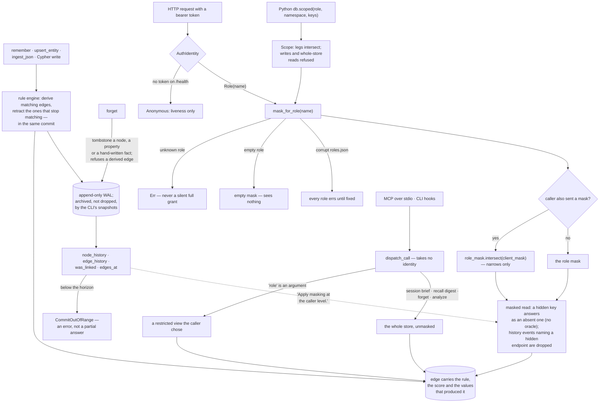

## 1. Executive Summary

mushroomdb is an embedded Rust graph database in which a relationship is a
schema rule: declared once, it derives its matching edges on every later write,
retracts them in the commit that makes them untrue, and leaves each edge
carrying the rule, the score and the values that produced it. Its access
control is a node mask resolved from a role that a caller's own mask can only
narrow, with a hidden node answering exactly like an absent one, history reads
included. The weak side is where that control stops: the stdio MCP server
takes no identity, so a role there is an argument, and its memory tools —
`remember`, `recall`, `forget` — run unscoped.

It describes itself as "[t]he graph that stays true — and knows who's allowed
to see it", dual-licensed MIT or Apache-2.0, explicitly pre-1.0 alpha, and
reachable as a Rust library, a Python module, an HTTP server or an MCP server
over stdio. Version 0.7.0 recast it as agent memory: `remember` writes a note,
the entities it names and the facts among them in one commit, and `recall`
answers ordinary-language topics from a full-text index.

A deleted rule takes exactly its own edges with it — "[r]emove the rule and
exactly its owned edges" (`crates/core-rules/src/engine.rs:3547`) — and a rule
that stops matching retracts inside the same commit, so a stale derivation does
not wait for a sweep. That is the failure mode of most systems that derive
edges from a model pass, and here there is no model in the write path at all.

The never-widen rule is three sentences at the top of `roles.rs`:

> "Empty role (no keys, no labels) = empty mask = sees nothing. Unknown role on a
> request = `Err` (never silently grant full access). Corrupt `roles.json` at
> open = roles poisoned … returns `Err` for any role name until the file is fixed
> and the DB re-opened."

Each resolves to deny. `NodeMask::intersect` exists "to enforce the never-widen
rule when a role token also supplies a client mask: `effective =
role_mask.intersect(&client_mask)`", and the MCP namespace argument carries the
same contract in its description: it "[i]ntersects with 'role' and 'mask' — it
can only narrow what they already allow".

Two details show the thinking went past the happy path. A hidden key returns
the same 404 as a key that does not exist, under a comment saying why: "Hidden
keys must respond identically to absent keys (no oracle)." And the history
handler filters edge events whose other endpoint is hidden, because "[a] role
token must not learn about hidden nodes via edge history events" — history
being where masking is usually forgotten, and where the core warns it must be
added: "Apply masking at the caller level."

The engine carries that contract itself. `Scope` composes a role, a namespace
and a key list by intersection, and the `*_scoped` read methods check the
subject first, so "a key outside the scope is indistinguishable from a key
that does not exist". The Python binding's `scoped()` handle is built on it,
refuses every write, and refuses the reads it cannot narrow — `recall`,
`schema_report`, `suggest_rules`, the graph algorithms — rather than answer
them over hidden nodes.

Even the file-format version is an access decision. A `roles.json` using
`visible_where` or `namespaces` is deliberately not loadable by an older binary,
because such a binary "would resolve a narrowed role to its full label set, so
an unrecognised version poisons instead, which denies rather than over-grants".

**The enforcement and the advertised surface are not the same surface.** The MCP
server is JSON-RPC over newline-delimited stdio, and `dispatch_call` takes no
identity — `role` is an argument the caller passes, described in `tool_query`
as one of "[t]wo ways to ask the same restricted question". For a local
subprocess holding the database directory that is coherent: there is nothing
to authenticate against, and the process could read the files anyway. It means
the tagline's second clause describes the HTTP deployment with role-bound
tokens and the scoped Python handle. The changelog says it for `forget`: "Like
every other MCP write tool, it is not an authorisation boundary."

The third mark is for the negative tests, which pair every masked read with the
unmasked run of the same read so the emptiness is attributable to the mask.
What is not here is anything epistemic: an edge has a score and a rule, not a
status, a provenance class or a validity window, and time travel is over commit
order, with a wall-clock time recorded per commit.

## 2. Mental Model

A **rule** is the relationship. Edges are its output.

**Retraction** is not deletion; it is the rule no longer holding. Deleting the
rule removes exactly the edges it owns.

A **note** is what a caller said; an **entity** is what it was about. An entity
named before it is described is a provisional stub until a describing write
clears the mark. The mark is not a verdict: `recall` does not filter on it.

**Forgetting** is a tombstone, not a redaction. "History still holds what was
forgotten until the log is pruned, and a note that stated a forgotten fact
still says it" (`crates/core-api/src/memory/forget.rs:9-11`).

A **mask** is a set of nodes. It only ever gets smaller.

A **hidden node** and a **missing node** answer identically, on purpose.

## 3. Architecture

| Crate | Role |
| --- | --- |
| `core-api` | The public database, roles, masks and scopes, history, the memory calls (78,301 lines) |
| `server` | HTTP with role tokens, and the stdio MCP surface (26,527) |
| `cli` | Install, doctor, brief, recall, ingest-git, the skill and hooks (27,073) |
| `core-rules` | Rule evaluation, firing and retraction with provenance (18,976) |
| `core-query` | Query planning, traversal, the masked view (17,108) |
| `core-storage` | WAL, snapshots, the overlay-over-base views, full-text (12,043) |
| `code-extract`, `arrow-bridge` | Source extraction for `ingest-git`, Arrow export |
| `sim-harness`, `core-bench` | Simulation and benchmarks |

### Deployment and ergonomics

Nothing has to run: the store is a directory, opened in process. `mushroomdb
serve` adds the HTTP server, which is where role-bound tokens exist.
`npx mushroomdb install` writes a skill, an MCP server entry and two Claude Code
hooks — `SessionStart` runs `mushroomdb brief`, `UserPromptSubmit` runs
`mushroomdb recall` — and the npm launcher downloads the native binary in a
`postinstall`. No API key is needed for anything; there is no embedder in the
tree.

## 4. Essential Implementation Paths

`crates/core-api/src/roles.rs:1-36` — the never-widen rule and the version
bargain, in one header.

`crates/core-api/src/mask.rs:98-111`, `:264-363` — the intersection that cannot
widen, and `Scope`, which resolves every leg and intersects them per read.

`crates/server/src/http.rs:1205-1272` — the `/query` role branch: role mask,
client mask, intersection.

`crates/server/src/http.rs:2460-2499` — masking a history read, including the
part most systems forget.

`crates/core-api/src/memory/brief.rs:204`, `crates/core-api/src/memory/recall.rs:314`
— the session-start brief and the recall digest, neither taking a mask.

`crates/core-rules/src/engine.rs:83-106`, `:1043-1046`, `:3547-3548` — a fire or
a retract captured during a commit, the diff scoped to one source, and rule
deletion.

`crates/core-api/tests/mask.rs:15-175` and `bindings/python/tests/test_scope_leaks.py`
— negative tests with their controls.

## 5. Memory Data Model

Entities with properties, notes, and edges that are mostly derived. Every entity
carries an `aliases` list the store recomputes from its key and current name on
each describing write; aliases a caller declares go in `alias_keys`. Optional
identity rules (`schema apply --memory-identity`) link entities whose aliases
overlap as `SAME_AS`. A node's namespace, stored as a property, is immutable and
is one of the legs a role or scope can bind.

The storage view is overlay over base: a snapshot's archived columns and CSR
topology are read zero-copy from the mmap, post-snapshot changes accumulate in
an overlay, and "[t]ombstones in the overlay mask deleted-from-base entries" — a
storage-level tombstone, not a memory-level one. Commit times live in a
`commit_times.bin` sidecar, and `record_commits_at` lets an importer stamp
backfilled commits with the source's own instant. That replaces the record time
rather than adding a second axis.

## 6. Retrieval Mechanics

Cypher-shaped queries, vector, full-text and hybrid search, variable-length
expansion and shortest path, all running against a `GraphView` whose `mask` is
an `Option` — `None` meaning every node is visible
(`crates/core-query/src/view.rs:25-30`). On the HTTP path the mask arrives from
the token. The mask tests pin what happens at the edges: an empty mask hides
everything, and unknown keys inside a mask are ignored rather than widening it.
Hybrid search filters both legs before reciprocal-rank fusion, so ranks are
ranks within the visible corpus.

`recall` cuts a topic to at most 24 content words, ORs them against the
full-text index, ranks hits by how many terms each matched, and names at most
six; the hook prefixes the digest with a line framing it as untrusted data. It
reads the whole store; it has no mask parameter. The session brief is the same:
counts, labels, rules and worked calls for the store as a whole.

## 7. Write Mechanics

A write fires the rules, and the rule engine diff-applies the desired edge set
against provenance for one source at a time. A comment guards the case that
makes this subtle: it compares only triples where the node is the source, "so
that (*, src) triples — where src is a dst for some other source — are not
mistakenly retracted" (`crates/core-rules/src/engine.rs:1043-1045`).

`remember` writes the entities a caller recognised, the note, its `ABOUT` edges
and the facts among the entities in one `GraphDb::batch` commit. A subject it
has not seen is stubbed as a provisional `Entity`, at most twenty per call.
`forget` names the rule that derived an edge it refuses, and lists the notes
that still state what was forgotten. There is no model call on any write path.

## 8. Agent Integration

The install writes the skill, the MCP entry and the two hooks; the README's
quick start is `remember`, `recall`, `suggest_rules`, `create_rule` with the
proposal's own arguments, then `explain_association`. The default tool listing
is twenty-three tools. The code-graph tools and the edit hooks of the 0.6 line
were removed in 0.7.0, and `ingest-git` remains as a data source whose store
gets the same tools.

## 9. Reliability, Safety, and Trust

The RBAC guarantees described here are properties of two surfaces: the HTTP
server with role-bound tokens, and the scoped Python handle. Embedded as a
library without a scope, or driven over stdio, the caller holds the whole
graph, and every mask is advisory. The two context assemblers an agent sees
first — the session brief and the per-prompt recall digest — are on the second
kind of surface and read everything.

Before 0.6.12, `/health` returned node and edge counts to any caller,
credentialed or not, while `/stats` and `/metrics` refused the same counters to
a role token. It answers `{"ok": true}` alone unless the caller holds the full
token (`crates/server/src/http.rs:758-780`). Identity linking is global: the
preset's rules carry no namespace, so `remember`'s reply can name keys from
other namespaces. On HTTP a role's mask hides those endpoints.

## 10. Tests, Evals, and Benchmarks

2,674 Rust test functions under `crates/` and 543 Python test functions,
including `mask.rs`, `rbac.rs`, `scoped_reads.rs`, `write_scopes.rs`, an
adversarial RBAC-writes suite mapping ten checklist items to ten tests, and
`test_scope_leaks.py`, whose header states its rule: "Each read test also pins
the *unscoped* answer, so a test can never pass because the fixture had nothing
to leak." Benchmarks and a simulation harness sit beside them. Nothing was
built or run for this reading.

## 11. For Your Own Build

### Steal

Make every failure of the permission lookup deny. Unknown role, empty role,
corrupt file — three different bugs, one outcome, written at the top of the
module so nobody has to infer it.

Make hidden and absent indistinguishable, per surface. A history read that
answers empty for an unknown key must answer empty for a hidden one; raising
there is "the existence oracle the contract exists to prevent".

Refuse what you cannot narrow. A centrality score computed over hidden topology
leaks it even when the hidden rows are filtered, so the scoped handle refuses
those reads outright.

Let the derivation retract itself, in the commit that invalidates it.

### Avoid

A scope argument on a surface with no identity. It reads like a control in a
tool listing and is a preview.

A context assembler outside the scope contract. The read path can be exemplary
while the session brief and the recall hook read the whole store.

### Fit

A strong base for a single agent's memory on one machine, where the stdio
surface's lack of identity costs nothing, or for a multi-reader service behind
the HTTP server with role tokens. It is a poor fit for several agents sharing
one store through MCP and expecting isolation: nothing on that surface
provides it.

## 12. Open Questions

Whether the history masks hold for a role with a `visible_where` predicate,
where a node's visibility depends on a property whose past values history
returns. The mask is resolved against the current graph; that case was not
traced.

How the TypeScript client and the LangChain and LlamaIndex integrations reach a
store, and whether any of them carries a role.

## Appendix: File Index

| Path | What to read it for |
| --- | --- |
| `crates/core-api/src/roles.rs:1-36` | Three failures, one outcome, and a version that refuses |
| `crates/core-api/src/mask.rs:98-111`, `:264-363` | The intersection that cannot widen, and the scope that resolves per read |
| `crates/server/src/http.rs:798-870` | Token to identity, `/health` as anonymous, WebSocket routes refused to roles |
| `crates/server/src/http.rs:2460-2620` | No oracle, and a masked history |
| `crates/server/src/mcp.rs:189-260` | A dispatch with no identity in it |
| `bindings/python/src/lib.rs:104-136`, `:1298-1317`, `:2153-2157` | The scoped handle, its history filter, and the refused recall |
| `crates/core-api/src/memory/remember.rs:1-21`, `forget.rs:1-11` | The memory write path and what forgetting leaves |
| `crates/core-rules/src/engine.rs:83-106`, `:1043-1046`, `:3547` | Fire, retract, the per-source diff, and rule deletion |
| `crates/core-api/tests/mask.rs:15-175`, `scoped_reads.rs`, `bindings/python/tests/test_scope_leaks.py` | Negative assertions with their controls |

### Recorded searches

Run at the tree root of the pinned checkout with `git grep`.

- `git grep -n -E 'AuthIdentity::Role' -- crates/server/src/http.rs` — 27 hits; every read handler's role branch either masks or returns `forbidden`.
- `git grep -n -E '\.route\(' -- crates/server/src/http.rs` — no route for `recall`, `brief`, `remember` or `forget`.
- `git grep -n -i -E 'mask|role|scope' -- crates/core-api/src/memory/recall.rs` — no match; the digest takes no mask.
- `git grep -n -E 'refuse_read_if_scoped\("recall"\)' -- bindings/python/src/lib.rs` — one hit, `:2154`.
- `git grep -n -E 'fn dispatch_call' -- crates/server/src/mcp.rs` — `:189`, signature `(db, db_dir, params)`, no identity.
- `git grep -n -i -E 'openai|ollama|anthropic|reqwest|ureq' -- 'crates/*.rs' 'crates/**/Cargo.toml'` — one hit, `reqwest` under `[dev-dependencies]` in `crates/server/Cargo.toml`; no model call.
- `git grep -n -i -E 'suppress(ed|ion)|blocklist|denylist|re-?assert' -- crates bindings/python/src ':!*/tests/*'` — query, replay and warning suppression only; no value-keyed tombstone.
- `git grep -n -i -E 'valid_(from|to|at|until)|event_time|occurred_at' -- crates bindings/python/src ':!*/tests/*'` — commit-index alias intervals only; no validity axis.
- `git grep -n -E '"(verified|disputed|candidate|unverified|trusted|contested)"' -- crates/core-api/src crates/server/src` — no match.
- `git grep -n -i -E 'provisional' -- crates/core-api/src/memory/recall.rs` — no match; recall does not filter stubs.
- `git grep -n -E 'archive_wal' -- 'crates/*.rs' ':!*/tests/*'` — `true` only in the CLI's `AUTOMATIC_SNAPSHOT` and a worker binary.
- `git grep -n -i -E 'anthropic|machine learning|not (be )?used (for|to)' -- LICENSE-MIT LICENSE-APACHE` — no match; no rider.

## History

**2026-10-12** — [`3c4719867d0d14ad02c33766994cf81084142b37`](https://github.com/MatthewSherlin/mushroomdb/commit/3c4719867d0d14ad02c33766994cf81084142b37) — 286 commits on, 0.6.8 to 0.7.1 plus documentation. No mark moved. The scope contract moved into the engine as `Scope` and a read-only Python `scoped()` handle, and 0.7.0 added `remember`, `recall` and `forget` on the unscoped stdio surface ([section 1](#1-executive-summary)); the code-graph tools were removed, and `/health` stopped disclosing counts in 0.6.12. Wrong at the first pin: a quotation attributed to rule deletion described a via-hop hazard, the diff-apply comment was misread, and the matrix implied a model call no code makes ([section 7](#7-write-mechanics)). Screened from a full clone: two auto-run surfaces, two build-time execution points, four unpinned surfaces, nothing inside the cooldown, no agent instruction files. Nothing was installed, built or run.

**2026-09-16** — [`4896a895fc2a7b6d11c80196a5c227e535611754`](https://github.com/MatthewSherlin/mushroomdb/commit/4896a895fc2a7b6d11c80196a5c227e535611754) — first reading, at a commit dated 16 September 2026. Screened before opening, from a shallow clone: thirty-four files scanned, two auto-run surfaces, two build-time execution points, four unpinned surfaces and twenty-four dependency files inside the seven-day cooldown. Nothing was installed, built or run.
