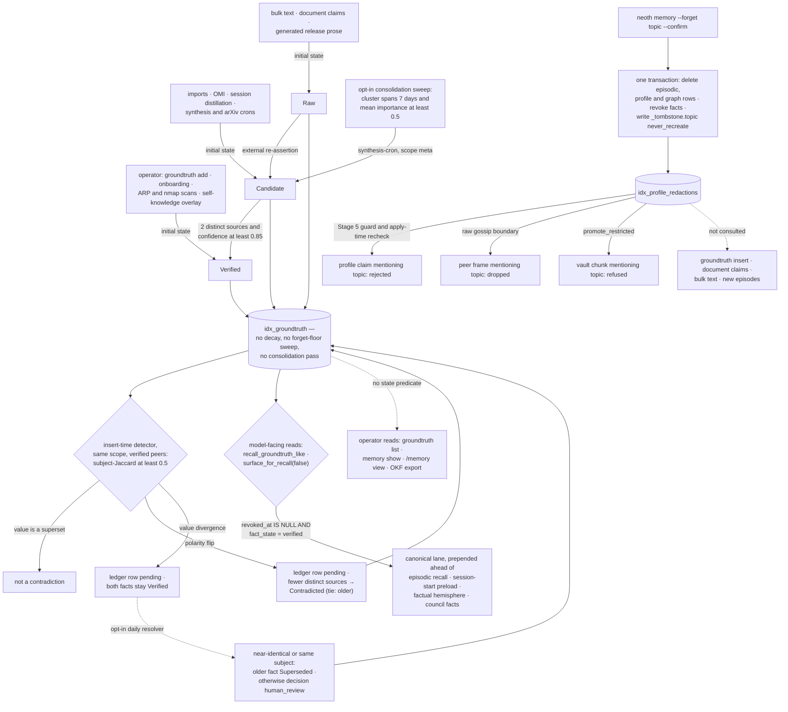

## 1. Executive Summary

NEOTH is a local-first personal AI daemon in Rust whose ground-truth module is
built against a failure it names: an importance score mistaken for a fact.
Operator facts live in their own table with a six-value state, and every read
that reaches a model admits only verified, unrevoked rows. A forgotten topic
leaves a sentinel that later profile extraction checks before it writes. Two
things around the table are looser than its header says: a candidate becomes
verified when distinct sources agree, with no command, and the contradiction
detector hides a fact only when the two statements differ in polarity.

It calls itself "[y]our private AI buddy" — "[o]ne memory. Three brain paths.
Five memory tiers + your vault." — dual-licensed MIT and Apache-2.0, with a
GUI, channel bridges, a plugin SDK with a WASM sandbox, sub-agent personas and
a migration tool. The memory module this report reads is under five per cent
of the daemon crate.

**Ground truth is a table, not a threshold.** The module header:

> "Sliding 'if importance ≥ 0.95 treat as fact' is the failure mode this module
> exists to prevent."

Facts live in `idx_groundtruth` with their own scoring path — "no Hebbian decay,
no FORGET_FLOOR sweep, no consolidation pass" — and are surfaced "in every recall
hit BEFORE any episodic row so a stale Hebbian-decayed memory cannot overwrite
an operator ground truth." An importance score is continuous and drifts with
reinforcement; a separate table with a lifecycle gives "the operator said so" a
place to live.

**Where a fact starts depends on who wrote it.** `Source::initial_fact_state`
makes operator-attested sources — onboarding, `neoth groundtruth add`, the ARP
and nmap scans the operator runs, the curated self-knowledge overlay — verified
on sight. Imports from other agents, OMI transcripts, session distillations and
the synthesis and arXiv crons start as candidates. Bulk-text extraction and
generated release prose start raw.

Re-asserting the same statement in the same scope merges the source into a
`{source: count}` map and pulls confidence halfway to 1.0. A raw or candidate
fact becomes verified once two distinct sources have asserted it and confidence
reaches 0.85, which the third assertion supplies
(`SRC/neothd/src/memory/groundtruth.rs:401-505`). The header's "Promotion is
always explicit" describes the operator's path; corroboration promotes without
one.

**The threshold reaches the table, and the state stops it.** The opt-in
consolidation sweep clusters episodes by embedding and writes any cluster
spanning at least seven days with mean importance of at least 0.5 into ground
truth, as a `synthesis-cron` candidate in scope `meta` with episode backlinks
(`SRC/neothd/src/memory/consolidation_sweep.rs:408-440`). That is an importance
rule writing into the fact table. What keeps the result out of recall is the
fact state, which is the stronger of the module's two defences.

**Contradiction demotes only on a polarity flip.** The detector splits each
statement at the first copula into a subject and a value part, requires
subject-Jaccard of at least 0.5, and then fires on either a polarity difference —
bilingual English and German negation markers — or diverging value tokens, with
a superset excluded: "a superset like 'nas at X' vs 'nas at X primary' is NOT
flagged". Every pair goes into `idx_contradictions` as `pending`.

Only a polarity flip ("the vpn is up" against "the vpn is not up") flags the
lower-credibility side `Contradicted`, by distinct-source count, with ties going
to the older row. A value divergence is "RECORDED in the ledger for the operator
but the loser is NOT silently hidden", because it "could be a legitimately
multi-valued attribute (two meetings, two servers)"
(`SRC/neothd/src/memory/contradiction.rs:422-427`). The module header and the
CLI help both say the lower-credibility side of every pair is flagged; the code
and its test `value_divergence_is_recorded_but_never_auto_hides_a_fact` say
otherwise.

**A forgotten topic leaves a key.** `neoth memory --forget <topic> --confirm`
deletes matching rows across the episodic, profile and graph tiers, revokes
matching facts, and in the same transaction writes `_tombstone.<topic>` into the
profile redaction registry with `never_recreate = 1`. Profile extraction rejects
any later claim whose field or value mentions the topic, before and again inside
the apply transaction. Peer gossip and vault promotion consult the same sentinel.

What to weigh. The approval gate on profile extraction is configured on by
default and never called outside tests. The forget sentinel does not reach the
ground-truth insert, document claims or new episodes. `scope` is a column that
keys corroboration and filters no recall read. And ground-truth changes write
no log frame, so "who changed this fact" is answered by `asserted_at`,
`revoked_at`, the source map and the contradiction ledger.

## 2. Mental Model

A **fact** is a row in its own table, and the state on the row decides whether
any model sees it.

A **source** decides the starting state: the operator's word is verified, an
import or a cron is a candidate, extracted prose is raw. **Agreement** between
distinct sources is the only automatic way up.

A **contradiction** is recorded every time; a fact is hidden automatically only
when the other statement negates it.

A **forgotten topic** is a key that profile extraction, peer gossip and vault
promotion check before they write.

## 3. Architecture

| Area | Role |
| --- | --- |
| `memory/groundtruth.rs` | The fact table, sources, states, corroboration, the recall read and the restricted-vault promotion |
| `cli/recall.rs` | The three-lane recall: verified facts, routed episodes, pending contradictions |
| `memory/contradiction.rs` | Subject/value split, polarity, the ledger, demotion and the opt-in resolver |
| `memory/forget.rs` | Topic erasure across tiers and the anti-resurrection sentinel |
| `profile/` | Profile extraction: claim guard, approval gate, apply |
| `memory/consolidation_sweep.rs`, `decay_task.rs`, `consolidate.rs` | The episodic lifecycle, one of whose outputs is a candidate fact |
| `wal/writer.rs`, `wal/events.rs` | Durability, and the event-code registry |
| `consent.rs` | Origin-bound grants before any outbound route |

### Deployment and ergonomics

A single-operator daemon with a chat CLI, a GUI and channel bridges. The
consolidation sweep, the synthesis and arXiv crons and the contradiction
resolver are each off by default and enabled in `freedom.yaml`
(`SRC/neothd/src/config/automation.rs:1470-1480`,
`SRC/neothd/src/daemon/contradiction_resolve_cron.rs:51-58`). Ground truth is
managed at the CLI: `add`, `revoke`, `state`, `contradictions`,
`resolve-contradiction`, `import-text`, `import-agent` and `import-infra`.

## 4. Essential Implementation Paths

`SRC/neothd/src/memory/groundtruth.rs:1-14` — the failure mode, named, and the
structural answer.

`SRC/neothd/src/memory/groundtruth.rs:111-145`, `:401-505` — starting states by
source, and promotion by distinct-source corroboration.

`SRC/neothd/src/cli/recall.rs:1497-1511` — the verified, unrevoked read every
recall lane uses.

`SRC/neothd/src/memory/contradiction.rs:404-485` — a pair is always recorded,
and only a polarity flip hides a fact.

`SRC/neothd/src/memory/forget.rs:369-383`, `:704-752` — the sentinel, written in
the erasure transaction, and the matchers that read it.

`SRC/neothd/src/profile/runner.rs:344-366`, `:394-427` — the claim guard that
honours the sentinel, and the approval gate no production caller enables.

## 5. Memory Data Model

Five tiers plus a vault. A ground-truth row carries a statement; a source "constrained to this set at
insert time so the audit trail stays clean"; a scope (`global`, `host:<name>`,
`session:<id>` or a custom tag); `asserted_at` and `revoked_at`; and
`fact_state`. It also holds `source_weight`, a JSON map of source to count; a
confidence starting at 0.5; `evidence`, up to fifty episode ids validated
against the three episodic tiers; a maturity label; and a confirmed count.

The source map is what corroboration counts and what contradiction ranks by.
Both timestamps are the write clock: there is no time at which a fact became
true separate from when it was recorded.

The profile is a separate store of claims, each a dotted field and a JSON value
with a confidence, extracted from conversation by a model. Its redaction
registry `idx_profile_redactions` holds exact-field redactions and the
`_tombstone.<topic>` sentinels, both with `never_recreate`.

## 6. Retrieval Mechanics

Recall runs three lanes per prompt (`SRC/neothd/src/cli/recall.rs:1651-1700`).
The canonical lane is `recall_groundtruth_like`: a case-insensitive substring
match over verified, unrevoked statements, newest first, returned as rows of
tier `groundtruth` and prepended rather than fused. The episodic lane is
region-routed recall with late fusion across semantic and episodic results. The
contradiction lane joins pending ledger rows touching the prompt to both
statements, at most three.

The same verified read feeds the session-start preload
(`SRC/neothd/src/memory/session_start_recall.rs:521`), the factual hemisphere's
memory fragment (`SRC/neothd/src/cli/chat.rs:12374`) and the council's factual
assertions, through `surface_for_recall(..., false)`
(`SRC/neothd/src/cli/chat.rs:15691`).

The reads without a state predicate are operator-facing. `neoth groundtruth
list` and `neoth memory show` call `surface_for_recall` widened unless asked to
narrow, the OKF export widens it to a hundred thousand rows, and `/memory view`
unions all four tiers with `revoked_at IS NULL` only
(`SRC/neothd/src/slash/action_dispatch.rs:871-886`). No recall read applies
`scope`.

## 7. Write Mechanics

`groundtruth::insert` either creates a row in its source's starting state or
corroborates an active row with the same statement and scope. Corroboration
merges the source, bumps confidence by `(c + 1) / 2`, increments the confirmed
count, and promotes a raw or candidate fact when the asserting source is
operator-attested, or when two distinct sources and a post-bump confidence of
0.85 are both reached. A fact the operator moved to a terminal state keeps it.
An insert that leaves the row verified ends with a best-effort contradiction
scan against verified peers in the same scope, capped at five hundred newest.

`insert_with_evidence` wraps the same call and the episode backlinks in one
savepoint; it is "the required write path for synthesis or consolidation output
derived from episodic memory", and both use it.

`set_fact_state` and `revoke` are the operator's transitions. Dismissing a
contradiction re-promotes either fact of the pair that is `Contradicted`, though
the CLI help for `resolve-contradiction` says it "Does NOT change either fact's
state" (`SRC/neothd/src/cli/groundtruth.rs:79`,
`SRC/neothd/src/memory/contradiction.rs:918-950`).

**Forget writes a key that outlives the rows.** `forget_by_topic` escapes LIKE
wildcards, opens one transaction, writes the sentinel first, then deletes
matching rows across the hot, warm and cold episodic tiers, raw transcript
turns, embeddings, profile claims and their pending and outbox rows, the graph,
and the foreign gossip ledger, and revokes matching facts
(`SRC/neothd/src/memory/forget.rs:339-615`). The sentinel is the topic,
lowercased and trimmed; the matcher is a Unicode-lowercased substring test.

Profile extraction loads every active never-recreate field before its Stage 5
guard (`SRC/neothd/src/profile/runner.rs:344-366`), and the guard rejects a
delta whose claim names the topic in its field or anywhere in its value:
"forgetting 'Berlin' cannot reappear under a different field"
(`SRC/neothd/src/profile/claim_guard.rs:466-485`). `apply_delta` repeats the
check inside the apply transaction and emits a `PROFILE_REDACT_BLOCKED` frame
(`SRC/neothd/src/profile/apply.rs:180-205`). Lifting the sentinel is an operator
act, `neoth profile unredact --id <id>`.

The comment over `tombstoned_topic_in_text` says "EVERY ingest that can put text
back into live recall" must consult it. The callers are profile extraction, the
two gossip boundaries and `promote_restricted`. `groundtruth::insert`, document
claims, bulk-text import, the Obsidian vault cron and episodic ingest write
without it, so `neoth groundtruth add` of a sentence naming a forgotten topic
lands verified.

## 8. Agent Integration

A daemon with chat, channel bridges, a GUI and a WASM plugin sandbox. No tool on
the slash-action, MCP or sub-agent surfaces writes ground truth or changes a
fact's state; those verbs are CLI subcommands. Sub-agent personas list a
`groundtruth_list` tool in their allowlists, and no handler of that name exists
in the tree.

Consent gates every remote provider route: "endpoint A never authorizes endpoint
B", loopback Ollama is local while LAN and public endpoints need the same
origin-bound grant, and the grants are marker files that "survive `neoth init`
reconfigure passes that rewrite `freedom.yaml`" and let the operator "audit
consent state with `ls ~/.neoth/consent/`".

## 9. Reliability, Safety, and Trust

The trust story is the state on the fact: every read that reaches a model
filters it, and the writers of each withholding value sit on reachable paths.

**The review gate on profile claims is configured and not wired.** The approval
gate parks an extracted profile delta in `idx_profile_pending` until the operator
runs `neoth profile approve` or `decline`, or answers a terminal prompt.
`require_approval` defaults to true (`SRC/neothd/src/config/ops.rs:1604-1610`)
and the init wizard tells the operator "Profile-claim approval gate is ON by
default." `run_pipeline` routes through the gate only when given a gate context,
and every production caller passes `None`: the chat post-reply pipeline, both
channel pipeline branches and `neoth profile run`
(`SRC/neothd/src/cli/chat.rs:9115`, `SRC/neothd/src/cli/serve_pipeline.rs:5999`,
`SRC/neothd/src/cli/profile.rs:3136`). The only constructions of the context are
in the runner's test module. Profile claims are applied without review, and
`human_review` is withheld.

**The contradiction resolver's review queue removes the warning.** The opt-in
daily resolver supersedes the older fact when two statements are near-identical
or share a subject, and otherwise closes the pair as `human_review`. The
contradiction recall lane reads `decision = 'pending'`, so a conflict routed to
review leaves the prompt's caution lane while both facts stay verified. The
`--list --human-review` command the resolver's comment names is not a CLI flag;
the rows appear under `contradictions --resolved`.

**No mutation record for facts.** The WAL is a durability mechanism — single
writer, `O_APPEND`, `fdatasync` per flush, mode 0600, HMAC compaction markers,
rotation at 16 MiB or 24 hours. Event codes `GROUNDTRUTH_ADDED`,
`GROUNDTRUTH_REVOKED` and `GROUNDTRUTH_IMPORTED` are registered
(`SRC/neothd/src/wal/events.rs:2196-2201`) and described by `neoth undo`, and
the only code that emits them is the test module of `cli/cluster.rs`.
`set_fact_state` writes no frame, and contradiction detections go to `tracing`.
`--physical` forget rewrites sealed segments to zero matching payloads, so the
log is also not immutable. `audit_log` is withheld.

**Scope tags.** `scope` decides which facts corroborate each other and which are
compared for contradiction, and no recall read filters on it; for one operator's
daemon that is coherent. The one account-scoped store in the tree,
`context_graph`, says its account-context issuance "is deliberately unavailable",
and no code outside the module names the type.

**Validity is the write clock.** `asserted_at` and `revoked_at` are both set at
write time, and a graph relation is closed by stamping `valid_to` with the
processing time (`SRC/neothd/src/memory/entities.rs:222-245`). `bitemporal` is
withheld.

## 10. Tests, Evals, and Benchmarks

18,249 test functions in the daemon crate, 993 under `src/memory`, and an
evaluation harness inside the memory module. I read the suites below; I built
and ran nothing.

`query_three_lanes_excludes_unverified_facts_and_resolved_contradictions` is the
negative evaluation (`SRC/neothd/src/cli/recall.rs:3288-3330`). It seeds a
candidate fact ("the widget color is teal"), two verified facts on the same
subject, and a dismissed contradiction between them, then runs the three-lane
recall. It asserts the candidate is absent from the canonical lane, that a
verified fact is present, and that the dismissed pair is absent from the
contradiction lane. The positive assertion reads the same lane, so an empty
retriever fails.

`external_source_starts_candidate_and_is_held_back_from_recall`
(`SRC/neothd/src/memory/groundtruth.rs:1120-1138`) asserts an OMI fact is not
surfaced by the default read and is returned by the inspection read.
`end_to_end_negation_contradiction_auto_flags_loser_and_dismiss_restores`
(`SRC/neothd/src/memory/contradiction.rs:1225-1274`) asserts the loser of a
polarity flip leaves recall and returns when the operator dismisses the pair.
`value_divergence_is_recorded_but_never_auto_hides_a_fact` (`:1419-1457`)
asserts the opposite case: both standup times stay in recall.

For the sentinel, `forget_topic_sentinel_rejects_topic_in_any_claim_value`
rejects a claim whose nested value holds "BERLIN" under `_tombstone.berlin`, and
`empty_or_unrelated_tombstone_does_not_block_claims` is its control
(`SRC/neothd/src/profile/claim_guard.rs:835-870`);
`apply_time_recheck_honours_forget_topic_sentinel`
(`SRC/neothd/src/profile/apply.rs:783`) covers the second check. The approval
gate's sixteen unit tests call it directly; none reaches it from a production
caller, which is the gap section 9 describes.

## 11. For Your Own Build

### Steal

Do not let a threshold promote a memory into a fact. Give "the operator said so"
a table, a lifecycle and a place in the ordering, and exempt it from the sweeps
explicitly.

Let the writer set the starting state. Verified for the operator, candidate for
an import or a cron, raw for extracted prose, with distinct-source agreement as
the only automatic way up, is a small table that answers "why is this trusted".

Hide automatically only what is unambiguous. A negation is a contradiction; two
values for one attribute may both be true, so record the pair and leave both
visible. Test both cases, as `value_divergence_is_recorded_but_never_auto_hides_a_fact`
does.

Write the forget key in the erasure transaction, and check it twice on the
extraction path — once before the model's output is accepted and once inside the
transaction that applies it.

### Avoid

Shipping a gate that no production caller constructs. A default of
`require_approval: true`, a wizard announcement and sixteen unit tests read as a
review step; passing `None` at every call site makes it decoration.

Routing a genuine conflict to a review queue by removing it from the only read
that warns the model about it.

Writing a forget key and consulting it on some ingests. The comment names the
rule; the ground-truth insert is the path that breaks it.

### Fit

This suits one operator's long-running assistant, where facts the operator
states must outrank everything the system infers, and where the operator is at
the CLI to resolve what the system will not. Walk away if you need several
users isolated from each other, a change record for facts, or extracted profile
claims held for review before they apply.

## 12. Open Questions

Whether the profile approval gate is meant to be wired in a later phase; the
call sites say so in comments, and the configuration defaults it on.

Whether the forget sentinel is meant to reach `groundtruth::insert`. The
module's comment says every ingest must consult it.

What the other four tiers do with a contradicted subject. The state gate read
here is ground truth's; episodic rows that repeat a contradicted statement were
not traced.

Whether the semantic lift changes the contradiction rate. It is optional over
the Jaccard core on the on-demand scan, and the insert-time path is Jaccard-only.

## Appendix: File Index

| Path | What to read it for |
| --- | --- |
| `SRC/neothd/src/memory/groundtruth.rs:1-14`, `:158-196` | A named failure mode and a six-value state |
| `SRC/neothd/src/memory/groundtruth.rs:111-145`, `:401-505` | Starting states by source; corroboration and promotion |
| `SRC/neothd/src/memory/groundtruth.rs:631-658`, `:893-910` | The gated read; promotion refused for a forgotten topic |
| `SRC/neothd/src/cli/recall.rs:1497-1511`, `:1651-1700` | The verified read and the three lanes |
| `SRC/neothd/src/cli/recall.rs:3288-3330` | The must-not-retrieve case with its control |
| `SRC/neothd/src/memory/contradiction.rs:1-37`, `:404-485` | What counts as a disagreement, and which ones hide a fact |
| `SRC/neothd/src/memory/contradiction.rs:721-840` | The opt-in resolver: supersede the older, or close as human_review |
| `SRC/neothd/src/memory/consolidation_sweep.rs:408-440` | An importance rule that writes a candidate fact |
| `SRC/neothd/src/memory/forget.rs:339-615`, `:620-752` | The erasure cascade, the sentinel and its matchers |
| `SRC/neothd/src/profile/claim_guard.rs:466-485`, `SRC/neothd/src/profile/apply.rs:180-205` | The two checks profile extraction makes |
| `SRC/neothd/src/profile/approval_gate.rs:1-36`, `SRC/neothd/src/profile/runner.rs:394-427` | The review gate, and the condition no production caller meets |
| `SRC/neothd/src/consent.rs:1-18` | Grants as files an operator can audit with `ls` |

### Recorded searches

Run at the tree root of the pinned checkout with `git grep`; old-pin results
were run against `6a37557357b8758f5f826a9f7e655ddca0823110` in the same clone.

- `git grep -nE 'surface_for_recall\(' -- SRC` — production callers `cli/chat.rs:15691` (false), `cli/groundtruth.rs:523`, `cli/memory.rs:418`, `cli/okf.rs:239` and `memory/contradiction.rs:619` (widened or operator-selected); the rest are tests.
- `git grep -nE 'FROM[[:space:]]+idx_groundtruth' -- SRC ':!SRC/vendor'` — 30 files; the model-facing reads are `cli/recall.rs:1505` (verified) and `slash/action_dispatch.rs:882`, an operator display.
- `git grep -nE 'run_pipeline[(]' -- SRC/neothd/src ':!SRC/neothd/src/profile/runner.rs'` — four callers in `cli/chat.rs`, `cli/profile.rs` and `cli/serve_pipeline.rs`, each passing `None` for the gate context; the same four at the old pin.
- `git grep -nE 'ApprovalGateContext *\{' -- SRC/neothd/src` — `profile/runner.rs:1074`, `:1135`, `:1181`, `:1233`, all after `mod tests` at `:603`.
- `git grep -nE '(tombstoned_topic_in_text|redaction_blocks_claim|active_tombstone_topics)[(]' -- SRC/neothd/src ':!SRC/neothd/src/memory/forget.rs'` — `cluster/durable_sync.rs:2798`, `cluster/wal_sync.rs:879`, `memory/groundtruth.rs:901`, `profile/apply.rs:193`, `profile/claim_guard.rs:471`.
- `git grep -nE 'EVENT_TYPE_GROUNDTRUTH_(ADDED|REVOKED|IMPORTED)' -- SRC/neothd/src` — emitters only in the test module of `cli/cluster.rs`; readers in `cli/undo.rs`, `cluster/foreign_indexer.rs` and `cluster/wal_sync.rs`.
- `git grep -nE 'groundtruth_list' -- .` — the persona allowlists in `sub_agents/` and planning documents; no handler.
- `git grep -niE 'valid_from|valid_to|valid_at|invalid_at|valid_until' -- SRC/neothd/src` — `memory/entities.rs` relation closure by processing time, skills, cluster membership and unrelated configuration; no fact validity time.
- `git grep -nE '(channel|sender_id|operator_id|scope|account_id)[[:space:]]*(=|IS)[[:space:]]*\?' -- SRC/neothd/src/cli/recall.rs SRC/neothd/src/memory/regions.rs SRC/neothd/src/memory/region_router.rs SRC/neothd/src/memory/session_start_recall.rs` — no match.
- `git grep -nE '^[[:space:]]*#\[(tokio::)?test' -- SRC/neothd | wc -l` — 18,249; 15,663 at the old pin.
- `git grep -niE 'anthropic|machine learning|not (be )?used (for|to)' -- LICENSE-MIT LICENSE-APACHE` — no match; no rider.

## History

**2026-10-15** — [`efdeaad9825789575cc793a18bc78be43de1e92c`](https://github.com/The-Geek-Freaks/NEOTH/commit/efdeaad9825789575cc793a18bc78be43de1e92c) — 1,132 commits on; the ground-truth, contradiction, forget and profile-guard files are byte-identical to the previous pin. Two marks gained, both earned there: `negative_eval`, on a canonical-lane case with a verified control ([section 10](#10-tests-evals-and-benchmarks)), and `tombstone`, on the forget sentinel profile extraction consults ([section 7](#7-write-mechanics)). Also wrong then: promotion was not only explicit, and a value divergence never hid a fact ([section 1](#1-executive-summary)). Overtaken: the line and test counts, a document-claims writer, and per-domain consolidation. Screened from a full clone: 47 files, no auto-run surfaces, three build scripts, no unpinned surfaces, eight dependency files inside the cooldown. Nothing was installed, built or run.

**2026-09-19** — [`6a37557357b8758f5f826a9f7e655ddca0823110`](https://github.com/The-Geek-Freaks/NEOTH/commit/6a37557357b8758f5f826a9f7e655ddca0823110) — `trust_state` re-tested against the narrowed line and every anchor held. `FactState` is still the six values at `SRC/neothd/src/memory/groundtruth.rs:158-165`, and `surface_for_recall` (`:631-658`) still composes `WHERE revoked_at IS NULL` and appends `AND fact_state = 'verified'` only when the caller has not asked to widen. Two things are added to the record. The doc comment above that function names what the widening argument is *for* — the operator inspection path that also returns candidates — so a reader does not have to infer it from the parameter name, and there is a second, separate read at `:598-607` that deliberately returns all trust states for one scope under the same revocation condition. Having the narrow default and the wide inspection as two named functions rather than one function and a boolean is the clearer arrangement, and this system has both. Revocation stays a separate condition on the same query, so a revoked fact is out whatever its state. Screened again first; nothing was installed and no suite was run.

**2026-09-16** — [`6a37557357b8758f5f826a9f7e655ddca0823110`](https://github.com/The-Geek-Freaks/NEOTH/commit/6a37557357b8758f5f826a9f7e655ddca0823110) — first reading, at a commit dated 16 September 2026. Screened before opening, from a shallow clone: thirty-four files scanned, no auto-run surfaces, two build-time execution points, no unpinned surfaces and twenty-eight dependency files inside the seven-day cooldown. Nothing was installed, built or run.
