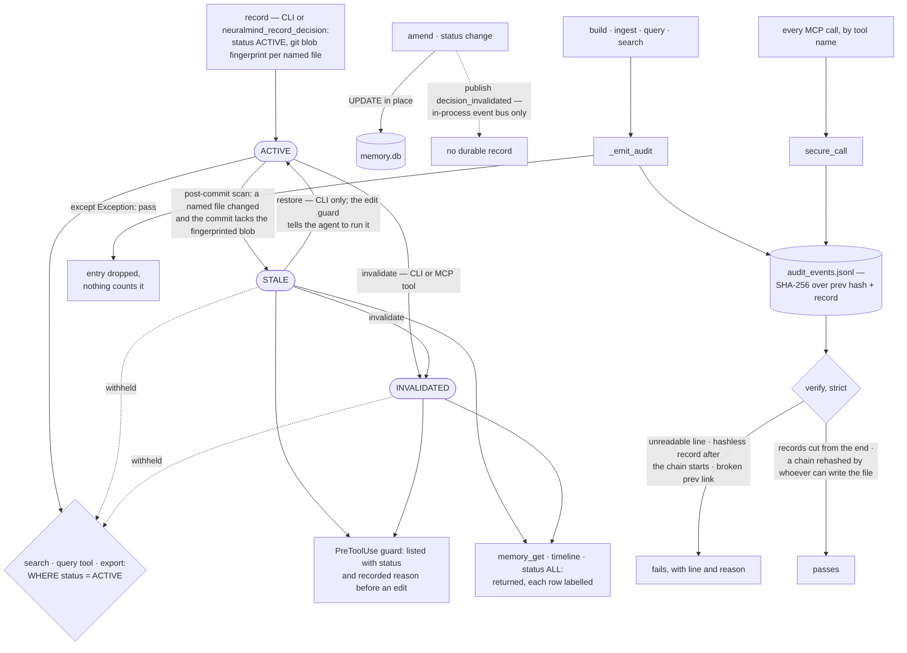

## 1. Executive Summary

NeuralMind is persistent memory and context compression for coding agents: a
code graph with synapse weights learned from use, and a store of architectural
decisions that a post-commit scan marks STALE when a commit changes the files a
decision describes. The scan is what to take from it, because staleness comes
from the repository's own blobs rather than from a clock. The weak side is the
edge of each mechanism: the audit chain drops an entry silently when an append
fails, the chain records a decision change only as the name of the MCP tool
that made it, and the maintenance view called "stale" never lists a decision
whose status is STALE.

The repository is open-core. Everything is MIT except `neuralmind/tier2/`,
which is source-available under a Commercial Modules License, and the boundary
is stated without hedging: "every release up to and including v2.0.1 was
published entirely under MIT and remains MIT permanently. The boundary takes
effect with v3.0.0." The commercial modules stay in the tree and readable —
"source-available, not closed" — and a one-seat licence auto-issues with no
signup and no expiry.

**The decision store.** A decision carries a title, a rationale, the commit it
was recorded at, the files it concerns and a status of `ACTIVE`, `STALE` or
`INVALIDATED`. Recording one also stores the git blob id of each named file.
After every commit, the hook `neuralmind init-hook` installs runs `decisions
scan`, which marks STALE each
decision naming a changed file unless the commit holds exactly the blobs that
decision saw — "edit `auth.py`, record why, commit — the decision survives …
edit `auth.py` again before or after committing and it goes STALE"
(`neuralmind/memory/invalidate.py:7-14`). Search returns ACTIVE decisions only,
and a PreToolUse hook lists the non-ACTIVE ones that govern a file, with the
recorded reason, before the agent edits it (`neuralmind/hooks.py:1065`).

**The audit chain.** `AuditTrail` appends JSONL records whose SHA-256 covers the
previous hash and a sorted serialization, and `verify` reads the file strictly:
an unreadable line, a record without a hash after the chain has started, and a
`prev_sha256` that does not match the record before it each fail with the line
number. What it cannot see is pinned as a test, under the docstring "Known
limit, kept as a test so the docs never claim otherwise": records cut from the
end verify clean (`tests/test_audit_new.py:262-267`). A second, independent
chain in `tier2/audit.py` carries governance events with its own genesis hash.

**The site-claims test.** `tests/test_site_claims.py` guards the marketing site
against untrue numbers, and its docstring lists the drift that shipped before
it existed:

> "a transcription error of that figure (`63.6×` for `65.6×`) sitting one card
> away from the original, a query-latency number with no measurement behind it
> anywhere in the repo"

Every `N×` ratio on a high-traffic page must be listed in `site/claims.json`
"with a source and a reproduction command"; names on a
`private_names_never_publish` manifest must not appear under `site/`; and the
docs guard's absolute-privacy patterns apply to the site. Further tests refuse
a ratio the manifest records as superseded, a ratio quoted beside a repository
size it was not measured on, and copy that calls a field report "CI-gated".
`test_guards_actually_trip_on_known_bad_copy` proves the guards fire on the
copy that shipped.

## 2. Mental Model

The system holds three kinds of memory, and they end differently.

A **content node** is a piece of the repository in a code graph. A build
regenerates the graph, so a node is never corrected, only re-derived.

A **synapse** is a learned association between nodes, written by usage hooks
into a namespace — `personal`, `shared`, or `branch:<name>` on a feature branch
— and read as a weighted merge of the active namespace with `personal` and
`shared`. Synapses decay at session start, edges below a threshold are deleted,
and `neuralmind memory reset` clears one namespace.

A **decision** is a stated belief about why the code is shaped as it is, and the
only memory here with an epistemic state. It is ACTIVE when recorded. A commit
that changes one of its files without carrying the fingerprinted blob makes it
STALE: on record, withheld from search, shown before an edit. A person, or the
agent from a shell, re-anchors it to HEAD with `restore` or retires it with
`invalidate`. Nothing deletes one: `DecisionStore.delete` has no caller.

An **audit record** is a link in a hash chain. It says that a build, an
ingestion or an MCP call happened, and who the caller says made it; it does not
say what a decision changed from or to.

## 3. Architecture

| Area | Role |
| --- | --- |
| `neuralmind/memory/store.py` | The decision store: SQLite, FTS5, cached vectors, blob fingerprints, status |
| `neuralmind/memory/invalidate.py` | The post-commit scan and the carried-by-commit exemption |
| `neuralmind/memory/mcp_tools.py` | Seven decision tools: query, audit, record, invalidate, and a three-layer search, timeline and get |
| `neuralmind/memory/eval.py`, `semantic.py` | A maintenance-replay harness, a gold query-set scorer, local MiniLM ranking |
| `neuralmind/audit.py` | The MIT hash-chained trail, its strict verifier and its rotation |
| `neuralmind/tier2/audit.py` | The source-available governance chain |
| `neuralmind/core.py` | Build, ingest, query and search, and the single audit emitter |
| `neuralmind/synapses.py`, `namespaces.py` | Learned associations and the branch namespace they are written to |
| `neuralmind/team_memory.py`, `peer_review.py` | Team bundle import, the review band, the pending queue |
| `neuralmind/mcp_security.py` | Role policy, identity binding, rate limit, MCP audit |
| `tests/test_site_claims.py`, `test_docs_claims.py` | The project's own numbers, gated |

### Deployment and ergonomics

Everything runs locally: SQLite files and JSONL under the project's
`.neuralmind/`, a local embedding model that `neuralmind build` downloads once,
and an optional daemon. No API key is needed to store anything. Decision search
"never downloads the model" (`neuralmind/memory/semantic.py:20`); without it,
hybrid search falls back to keyword results with a notice. The decision store
is one SQLite file, readable with any client, and `neuralmind decisions export`
renders the ACTIVE decisions as Markdown. With
`security.require_encrypted_storage: true`, the store refuses to open unless the
OS reports full-disk encryption (`neuralmind/storage_guard.py:1-19`).

## 4. Essential Implementation Paths

**Recording a decision.** `DecisionStore.record` (`neuralmind/memory/store.py:497`)
inserts an ACTIVE row and calls `_capture_fingerprints` (`:782`), which stores
the git blob id of each named file as `git add` would compute it. The MCP tool
passes `commit_sha` as the caller gives it, defaulting to the empty string
(`neuralmind/memory/mcp_tools.py:700-713`); the CLI resolves HEAD
(`neuralmind/cli.py:3360-3390`).

**Going stale.** The post-commit hook runs `decisions scan . --quiet`
(`neuralmind/cli.py:6503`). `InvalidationEngine.scan`
(`neuralmind/memory/invalidate.py:336`) lists the files HEAD changed against its
first parent and finds decisions naming any of them by relative or absolute
path. It skips one whose fingerprints equal the committed blobs (`:522-543`) and
calls `mark_stale` on the rest, which sets the status and appends the reason to
the decision's evidence list (`neuralmind/memory/store.py:692-719`).

**Reading.** `search` (`neuralmind/memory/store.py:956`) defaults to ACTIVE and
dispatches to `_query_fts` (`:1180`), `_query_like` (`:1233`) or
`_semantic_search` (`:1059`), each with the status in its WHERE clause, and
hybrid mode fuses the first and third by reciprocal rank. The edit guard reads
by file through `find_by_files(..., include_invalidated=True)` and keeps the
non-ACTIVE rows (`neuralmind/hooks.py:1089-1098`).

**Leaving STALE.** `restore` (`neuralmind/memory/store.py:721`) resets the
status to ACTIVE, re-anchors the commit and re-fingerprints; it is reached only
from `neuralmind decisions restore` (`neuralmind/cli.py:3511`). `invalidate`
(`neuralmind/memory/store.py:657`) is reached from the CLI and from the MCP tool.

**Auditing.** `_emit_audit` (`neuralmind/core.py:599-623`) calls
`AuditTrail.append_event` (`neuralmind/audit.py:139`) inside a bare
`except Exception: pass`. `verify` (`:208-299`) walks the file through
`_read_lines_strict` (`:301`), and `neuralmind audit verify` runs it on demand
(`neuralmind/cli.py:3017`).

## 5. Memory Data Model

The `decisions` table holds `id`, `title`, `rationale`, `commit_sha`,
`files_affected`, `decision_type`, `confidence`, `status`, `author`,
`created_at`, `updated_at`, `evidence`, `rejected_alternatives`,
`dependency_constraints` and `tags` (`neuralmind/memory/store.py:172-193`).
`decision_fingerprints` keys a blob id on decision and path; `decision_vectors`
caches one embedding per decision against a content hash and model id, and a
delete trigger removes it with its decision.

The status is the trust state, and the evidence list is its provenance: every
transition out of ACTIVE appends a line — "Marked STALE: commit 1a2b3c4 changed
…" or "Invalidated: …" — and the edit guard reads the newest such line back as
the reason. `confidence` is printed by the guard and the export; `search`
takes a `min_score` floor on it that no shipped caller passes.

Two declared fields have no writer. Neither the CLI nor the MCP tool passes
`author` or `dependency_constraints`; the one assignment of either is the eval
harness's fixture (`neuralmind/memory/eval.py:430-433`). `cascade_invalidation`
finds dependents through `dependency_constraints`
(`neuralmind/memory/store.py:896-924`), so in a store written through the
shipped surfaces it finds none.

Decisions are scoped by file location only: one `memory.db` per project
directory. Synapse rows carry a `namespace`, and a read merges the active
namespace, `personal` and `shared` at fixed weights
(`neuralmind/synapses.py:590-600`). A feature branch's learning is invisible
from another feature branch, and everything learned on the default branch is
visible from all of them. There is no valid-time field anywhere: `created_at`
and `updated_at` are write clocks, and `commit_sha` anchors a decision to a
tree, not to a period.

## 6. Retrieval Mechanics

Code retrieval is BM25 and embeddings with a context selector and compressors,
graph-aware, tuned by a CI tuner and measured by committed eval harnesses under
`evals/` — an actual book under `evals/book_retrieval/`, a baseline under
`evals/quality/` — so the numbers can be reproduced by someone who is not the
author.

Decision retrieval has three modes. Keyword search drops stopwords and matches
any remaining term as a prefix in FTS5, ranked by `bm25()`; a LIKE scan stands
in on SQLite builds without FTS5. Semantic search ranks by cosine similarity
against cached MiniLM vectors, re-embedding any whose text or model changed.
Hybrid, the default, fuses the two by reciprocal rank over a deeper pool than
the caller asked for.

The MCP surface splits retrieval into three layers to bound tokens.
`neuralmind_memory_search` returns compact rows of id, title, status, type,
commit, date and file count; `neuralmind_memory_timeline` returns neighbours by
creation time around an anchor; `neuralmind_memory_get` returns full records,
capped at 20 ids per call (`neuralmind/memory/mcp_tools.py:200-362`). Only the
first applies a status filter, and only it lets the model widen that filter;
every row the other two return carries its status.

The maintenance view uses "stale" in a second sense. `audit(stale_only=True)`
returns ACTIVE decisions whose `updated_at` is older than 90 days
(`neuralmind/memory/store.py:1371-1387`), and the orphan check returns ACTIVE
decisions whose commit is not in `git rev-list --all` (`:1389-1432`). A decision
the commit scan marked STALE matches neither, so `neuralmind decisions audit
--stale` and `neuralmind_audit_decisions` with `stale_only` never list one,
though the docstring promises "only STALE decisions".

## 7. Write Mechanics

Builds and ingestion write the code graph; usage hooks write synapses; a person
or the agent writes decisions, through `neuralmind decisions record` or
`neuralmind_record_decision`. A decision is not deduplicated: recording the same
title twice yields two rows, and nothing compares a new decision with an
INVALIDATED one.

An amend overwrites the rationale in place and appends to the evidence and
rejected-alternatives lists (`neuralmind/cli.py:3439-3455`); the previous
rationale is not kept. Status changes are UPDATEs. Writes fail open: `record`
and `update` log and return when SQLite fails, while `invalidate` and `restore`,
as explicit user actions, raise.

### Operational cost

The decision write is synchronous and cheap: one INSERT and one `git
hash-object` over the named files. The scan runs once per commit in the
post-commit hook — one diff against the first parent, one `ls-tree` for the
changed paths, and a lookup chunked under SQLite's parameter limit — and always
exits 0, so it never fails the commit it follows. Semantic search embeds only
decisions whose vector is missing or out of date. Nothing re-reads the whole
store in the background.

## 8. Agent Integration

The MCP server exposes the seven decision tools beside the code-graph tools.
The default role policy gives `builder` all seven and `reader` the five reads
(`neuralmind/mcp_security.py:25-89`). Under `security.identity: declared`, the
default, the server "believes the call's own `actor` and `role`"
(`:196-206`), so the role gate holds only against a client that declares a
narrower one. `security.identity: os` takes the role from the OS account over
stdio and records any mismatch.

Every MCP call carries a `project_path`, and any existing directory is accepted.
The decision store opened is the one under that path, so the project boundary
is the caller's choice.

The PreToolUse hook injects the stale-decision guard before an edit, ending
with an instruction to the agent: "If a STALE decision still holds after you
check the code, `neuralmind decisions restore <id>` re-anchors it to HEAD"
(`neuralmind/hooks.py:1129-1133`). The agent records decisions as ACTIVE through
its own tool. A Hermes plugin gives Hermes the same per-turn code context and
session recap that the Claude Code hooks give Claude Code.

## 9. Reliability, Safety, and Trust

**The audit chain detects alteration and admits three kinds of absence.** The
verifier is strict about what is in the file. It cannot see an entry that was
never written: `_emit_audit` swallows every exception under the comment "Audit
logging must never block primary query/build/search flows"
(`neuralmind/core.py:621-623`), and no counter records the drop. It cannot see
records cut from the end, and a test says so. And it accepts records before the
first hash as written before the chain existed, counted in `unchained`, so a log
stripped of every hash passes as an unchained log
(`neuralmind/audit.py:255-266`). The hash has no key, so anyone who can write
the file can rehash it; the release notes recommend an exported copy off the
host for that reason.

**Rotation verifies and does not run.** `rotate` hashes its continuation marker
the way `append_event` does, and `verify` checks the marker against the
archive's last hash while the archive exists (`neuralmind/audit.py:338-359`,
`:389-452`). No CLI command or production path calls it, and when it does run
it deletes archives older than 90 days.

**The chain names the tool, not the change.** An MCP record or invalidate call
leaves an `mcp_call` event naming the tool and the role; the decision id, the
old status and the old rationale are not in it, and a CLI change leaves
nothing. `_emit_local_audit` in the CLI has no caller.

**Human review: a queue whose admission the producer sets.** Imported team
synapse edges that score inside a review band wait in `team_pending_review`
until `neuralmind memory review-approve` promotes them to `shared`, and no MCP
tool reaches that verb (`neuralmind/team_memory.py:592-640`,
`neuralmind/cli.py:3273-3296`). The score, though, is computed from the
bundle's own `activation_count` and `last_activated`
(`neuralmind/contribution_scoring.py:160-168`), so a bundle that states high
values auto-promotes past the queue. For decisions, the agent writes ACTIVE
directly and is told to run `restore` itself.

**Scope.** The project boundary is a model-supplied path, and the synapse
namespace partitions ranking weights rather than readers, so no retrieval path
here enforces a stored scope against its caller.

## 10. Tests, Evals, and Benchmarks

3,866 test functions in 223 files, 237 of them under `tests/memory`. Nothing was
run for this reading.

The decision store's must-not case is `TestLayer1StatusFilter`
(`tests/memory/test_progressive_retrieval.py:81-136`): three decisions match the
query, one STALE and one INVALIDATED, and the default search must return exactly
the ACTIVE one, while `status="all"` on the same store returns all three. The
audit tests cover each verifier failure mode, the rotation link, and the pinned
tail-deletion limit (`tests/test_audit_new.py:180-403`). The synapse test
`test_branch_namespaces_are_isolated_from_each_other`
(`tests/test_synapse_namespaces.py:197`) asserts that one branch's edges are
absent from another's, through a namespace list the test supplies rather than a
production read.

`neuralmind decisions eval` runs `MaintenanceEval`, five synthetic tasks that
each seed ACTIVE and STALE decisions and report `stale_influence_rate` beside
recall and precision, and `QuerySetEval`, which scores recall@k and MRR per
search mode against `tests/memory/fixtures/decision_queries.json`. Both report
metrics; neither is an assertion.

The site-claims guards are the unusual part. Most projects treat their README
as marketing and their tests as engineering. This one treats a published number
as an assertion that can be false, gives it a source and a reproduction command,
and fails the build when a new one appears without them.

## 11. For Your Own Build

### Steal

Derive staleness from the artifact the memory describes. Fingerprint the files a
decision is about when it is recorded, and mark it stale on the first commit
that changes them without carrying exactly those bytes. That exempts the commit
that lands the decision and catches every later edit, with no diff analysis and
no clock.

Show a doubted belief at the moment it matters, labelled, instead of hiding it.
The edit guard puts a stale decision and the reason it went stale in front of
the agent before it touches the file the decision governs.

Pin your known limits as tests. A test asserting that the verifier passes a log
with its tail cut off stops the documentation from claiming otherwise.

Test your own claims: a manifest of published numbers, each with a source and a
reproduction command, and a CI guard with a negative control built from the copy
that shipped.

### Avoid

Two meanings for one status word. A filter called "stale" that returns aged
ACTIVE rows, beside a status called STALE that it never returns, makes the
maintenance view miss exactly the decisions the scan flagged.

A silent `pass` around an audit append. "Must never block the primary flow" is
a correct requirement; a counter surfaced by the verifier meets it without
turning a failed append into an invisible one.

A dependency graph with no writer. A cascade that walks `dependency_constraints`
is dead code until some surface lets a caller name a dependency.

### Fit

This suits a single developer or a small team who want an agent to remember why
the code is shaped as it is, and who will let a post-commit hook run. The
decision store is the part to evaluate; the code graph is a context compressor
with a memory attached. It does not suit memory that must be attributable or
reversible decision by decision: amendments overwrite, the audit chain records
tool names rather than changes, and the project boundary is whatever path the
caller sends.

## 12. Open Questions

How often the scan marks a decision STALE that still holds. The policy is
"[b]etter to lose a valid memory than serve a stale one", and only running it on
a repository with history would say what that costs.

How many audit entries are lost in practice. The swallowed exception makes the
answer unknowable from the log itself.

Whether anyone drains the team review queue. It fills at session start from a
committed bundle, and its only drain is a CLI command.

## Appendix: File Index

| Path | What to read it for |
| --- | --- |
| `neuralmind/memory/invalidate.py:1-50`, `:336-433` | The scan, the carried-by-commit exemption, the event bus |
| `neuralmind/memory/store.py:657-780` | Invalidate, mark stale, restore, and the delete nothing calls |
| `neuralmind/memory/store.py:956-1283` | Search: three ranking paths, each filtering on status |
| `neuralmind/memory/store.py:1285-1432` | The maintenance view and its second meaning of stale |
| `neuralmind/memory/mcp_tools.py:200-362` | The three-layer search, timeline and get |
| `neuralmind/hooks.py:1065-1135` | The stale-decision guard and its instruction to the agent |
| `neuralmind/audit.py:139-359` | Append, the strict verifier, the rotation marker check |
| `neuralmind/core.py:599-623` | The single emitter, and the exception it swallows |
| `neuralmind/mcp_security.py:196-340` | Declared versus OS identity, and the per-call audit |
| `neuralmind/team_memory.py:550-640`, `neuralmind/contribution_scoring.py:101-170` | The review band and the bundle-supplied score |
| `tests/memory/test_progressive_retrieval.py:81-136` | The must-not case and its positive control |
| `tests/test_audit_new.py:180-403` | Verifier failure modes and the pinned limit |
| `tests/test_site_claims.py` | The drift that shipped, and the guards that followed |
| `LICENSING.md` | One directory, two licences, forward-only |

### Recorded searches

Run at the tree root of the pinned checkout with `/usr/bin/git grep`.

- `git grep -n -E '[.]delete[(]' -- neuralmind integrations skills scripts editors` — `embedder.py:706` (a Chroma collection) and editor and web caches; no caller of `DecisionStore.delete`.
- `git grep -n -E 'dependency_constraints|author=' -- neuralmind ':!neuralmind/memory/store.py' ':!neuralmind/memory/invalidate.py'` — `neuralmind/memory/eval.py:430`, `:433` only, the harness fixture.
- `git grep -n -E '[.]rotate[(]' -- neuralmind scripts` — `neuralmind/metrics_pipeline.py:141`, the metrics collector's own method; no caller of `AuditTrail.rotate`.
- `git grep -n -E 'append_event[(]|AuditTrail|get_audit_trail' -- neuralmind/memory` — no match; the decision store does not write the audit chain.
- `git grep -n -E 'publish[(]"decision_invalidated"' -- neuralmind` — `neuralmind/memory/invalidate.py:554`, the event bus.
- `git grep -n '_emit_local_audit'` — the definition at `neuralmind/cli.py:2968` only.
- `git grep -n -E '_emit_audit|append_event' -- neuralmind/cli.py` — `:2978` only, inside the uncalled `_emit_local_audit`; no `decisions` command writes the audit chain.
- `git grep -n -E 'min_score' -- neuralmind ':!neuralmind/memory/store.py'` — no match.
- `git grep -n -E 'WHERE status = .ACTIVE.' -- neuralmind/memory/store.py` — `:1383` (aged ACTIVE), `:1422` (orphaned ACTIVE), `:1470` (export); the stale filter never selects status STALE.
- `git grep -n -i -E 'tombstone|rejected_value|suppress' -- neuralmind/memory` — one hit, the eval docstring's "suppressing stale ones"; `record` consults no earlier decision.
- `git grep -n -i -E 'valid_from|valid_to|valid_at|effective_(from|at)|as_of|bitemporal' -- neuralmind` — no match.
- `git grep -n -E 'review-approve|review_approve|restore' -- neuralmind/mcp_server.py neuralmind/memory/mcp_tools.py` — one unrelated hit, `mcp_server.py:1308`; no approve or restore verb on the MCP surface.
- `git grep -n -i -E 'arxiv|bibtex|@article|@misc|doi\.org' -- README.md CITATION.cff` — no match; `CITATION.cff` cites the software.
- `git grep -n -i -E 'anthropic' -- LICENSE LICENSE-COMMERCIAL.md LICENSING.md neuralmind/tier2/LICENSE` — no match; no rider on analysis.

## History

**2026-10-15** — [`434efc6912c82539785f5010274db0ad79193401`](https://github.com/dfrostar/neuralmind/commit/434efc6912c82539785f5010274db0ad79193401) — 338 commits on, version 3.11.3 to 4.15.1. A decision store arrived on 17 September 2026; its status filter earns `trust_state` and its default-search case earns `negative_eval` ([section 10](#10-tests-evals-and-benchmarks)). `verify` became strict on 5 October in [`454904f4bbf62bdab4692942d2642ea7c9eced28`](https://github.com/dfrostar/neuralmind/commit/454904f4bbf62bdab4692942d2642ea7c9eced28). Wrong at the first pin: rotation chained its marker to zeros and failed `verify`, unreadable lines were dropped rather than seen as legacy, and synapse memory had reset and decay deletes ([section 9](#9-reliability-safety-and-trust)). Overtaken: the recall figure the site-claims docstring quotes. Screened from a full clone: sixteen files, no auto-run surfaces, one build-time execution point, three unpinned surfaces, `pyproject.toml` inside the cooldown, `CLAUDE.md` read as data. Nothing was installed, built or run.

**2026-09-16** — [`38c74096f5e8e82c79feb037ece7395461fab4f8`](https://github.com/dfrostar/neuralmind/commit/38c74096f5e8e82c79feb037ece7395461fab4f8) — first reading, at a commit dated 16 September 2026. The repository is open-core: MIT except `neuralmind/tier2/`, which is source-available under a Commercial Modules License and was read as source. Screened before opening, from a shallow clone: fifteen files scanned, no auto-run surfaces, one build-time execution point, three unpinned surfaces, eight dependency files inside the seven-day cooldown, and the `CLAUDE.md` read as data. Nothing was installed, built or run.
