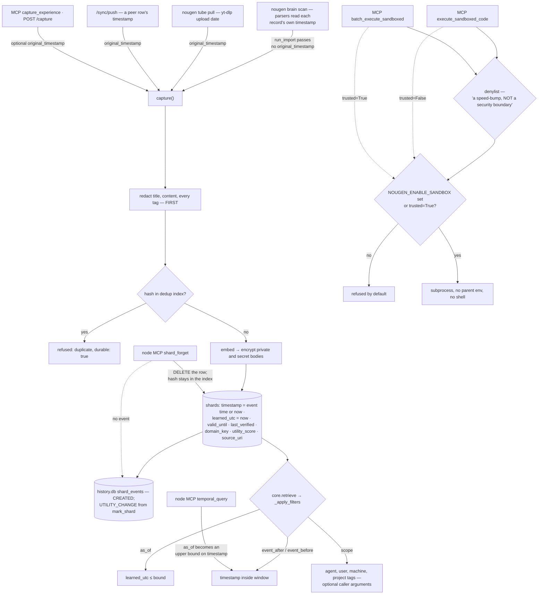

## 1. Executive Summary

NouGenShards is "[p]ersistent local memory for coding agents" that starts by
harvesting what already exists: `nougen brain scan` walks the machine for the
traces Claude, Gemini, Cursor and Codex left behind and imports them into local
SQLite. Its two guards say in their own docstrings what they are not, it redacts
before it embeds, and it keeps two clocks. Python, built by Who Visions; the
name is Haitian Creole, "Nou Gen" meaning "we have".

The licence is source-available and not open source. "[V]iew the source code
for inspection and learning purposes" and running it locally for personal,
non-commercial and educational use are granted. Commercial use needs a
subscription or written permission. Redistribution for a fee, competing hosted
services, and using the software "to train, develop, or improve competing AI
memory or retrieval products" are prohibited.

**Both of its guards say what they are not.** The command gate:

> "This is a defense-in-depth speed-bump, NOT a security boundary. It is a
> best-effort denylist meant to catch obvious destructive commands and slow down
> accidents; it can be trivially bypassed by obfuscation (encoding, indirection,
> aliases, etc.) and must never be relied upon as the sole protection against
> malicious input."

And the sandbox:

> "this is process-level isolation (no parent env, no shell), NOT a full security
> sandbox. Untrusted callers (MCP tools, `nougen ctx execute`) are refused unless
> the operator opts in with NOUGEN_ENABLE_SANDBOX=1."

The gate normalises whitespace and case before matching, so `rm   -rf` and
`RM -RF` are caught. It does the job it claims and claims only that job.

**The sandbox docstring promises more than one MCP tool delivers.** The local
MCP server registers two execution tools. `execute_sandboxed_code` passes
neither flag and is refused without the opt-in. `batch_execute_sandboxed` hands
its commands to a helper that calls `execute_sandboxed(..., trusted=True,
bypass_gatekeeper=False)` for each one, so agent-supplied code runs whether or
not the operator opted in, behind the denylist alone. The test file that covers
it enables the opt-in in an autouse fixture for every test, so the batch path
has never run in the suite with the variable unset.

**Redaction runs before the embedding, which is the ordering that matters.**
Capture redacts credential-shaped text from the title, content and every tag
first, and the comment says why:

> "A shard is a durable publication surface. Redact credential-shaped text before
> hashing, embedding, indexing, or encryption so neither SQLite nor an embedding
> blob preserves a recoverable copy of a leaked credential."

An embedding computed over a secret is a lossy but recoverable copy of it.
Redacting after embedding leaves that copy in the vector column.

**Encryption states its own edge.** A shard's `sensitivity` is `normal`,
`private` or `secret`. Private and secret bodies are AES-256-GCM encrypted
before they reach SQLite, "so personal-scope material (finances, health,
identity documents) is not readable from the DB file". And immediately:
"[t]itles and tags stay plaintext: they are the only handle recall has on an
encrypted shard, so keep identifying detail out of them." Federation keeps the
same edge: `/sync/pull` exports encrypted bodies as ciphertext beside plaintext
titles, and `/sync/push` decrypts with the shared lane key before re-encrypting
on the receiving machine.

**The bitemporal mark is for two clocks, and the import that motivates it uses
one.** The migration that added the second clock declares it:

> "Bi-temporal (memmesh move, schema v4): `timestamp` is EVENT time (when it
> happened; original_timestamp wins), learned_utc is when THIS node stored it.
> retrieve(as_of=) filters on learned_utc; legacy rows are NULL and fall back to
> timestamp, their best available estimate."

`_apply_filters` takes `as_of`, `event_after` and `event_before` independently,
and a committed test asserts that a shard dated 2020 and learned during the run
is invisible `as_of` 2021 and visible `event_before` 2021. Event time reaches the
store from four reachable producers: the YouTube importer's upload date, a
peer's row on `/sync/push`, and the caller of either MCP `capture_experience`
tool or `POST /capture`. The brain scan is not among them. Its parsers read each
record's own timestamp into `NormalizedRecord.timestamp`, and `run_import`
calls `capture` without it, so every scanned trace is stamped at import time on
both axes.

**There is a mutation log, and it covers two verbs.** `history.db` holds
`shard_events`, a table no statement in the tree updates or deletes. Every
capture appends CREATED and every outcome mark appends UTILITY_CHANGE with the
old and new score. Amend, retract and forget on the network node, utility
decay and verification write nothing to it.

What is not here: `domain_key` organises rather than isolates, nothing is
epistemic, and deleting a shard leaves its hash behind. A single database that
has ingested every AI tool's history off one machine is a concentration of
material that was previously scattered, which is the product's value and its
risk profile.

## 2. Mental Model

A **shard** is one unit of experience, deduplicated by its content hash.

**When it happened** and **when this node learned it** are different columns
and different filters — when a caller supplies the first.

A **guard** here is a speed bump, and says so; one tool steps around the
sandbox's opt-in.

**Redaction** comes first, because everything downstream keeps a copy.

A **history event** records that a shard was created or that its usefulness
moved, and nothing else that happens to it.

## 3. Architecture

| Area | Role |
| --- | --- |
| `src/nougen_shards/core.py` | The schema, capture, dedup, retrieval and the filters |
| `src/nougen_shards/history.py` | `shard_events` and the stats read from it |
| `src/nougen_shards/gatekeeper.py` | The command denylist, and its disclaimer |
| `src/nougen_shards/nougen_sandbox.py` | Execution, the opt-in, and the batch helper |
| `src/nougen_shards/private_vault.py` | AES-256-GCM for private and secret bodies |
| `src/nougen_shards/brain_scan/` | Harvesting other tools' traces, and redaction |
| `src/nougen_shards/mcp.py`, `cli.py` | The local agent and human surfaces |
| `app.py`, `src/nougen_shards/tenants.py` | The network node: HTTP, a second MCP surface, tenant vaults, sync |
| `src/nougen_shards/handoff.py`, `nougenmsg.py` | Messaging between nodes |

The package carries many modules no product path imports. `unlearning.py`
writes a `temporal_status` column the schema never creates and has no caller
outside its tests. `TemporalFabric` in `temporal_fabric.py`, with its own
bitemporal event table and append-only triggers, is instantiated only in tests.
`reconstructive_recall_v2.py` and `evidence_gate.py` have no importer outside
tests. None of them is credited here.

## 4. Essential Implementation Paths

`src/nougen_shards/core.py:508-511` — two clocks, declared where the second was
added.

`src/nougen_shards/core.py:1070-1097` — the sensitivity contract and the
redaction ordering.

`src/nougen_shards/brain_scan/importer.py:63-90` — the import that drops the
record's timestamp.

`src/nougen_shards/core.py:2585-2609` — the three filters.

`src/nougen_shards/history.py:99-139` — the event writer.

`src/nougen_shards/gatekeeper.py:7-26` — a denylist arguing against its own
sufficiency.

`src/nougen_shards/nougen_sandbox.py:14-33`, `:123-134` — the opt-in, and the
batch helper that passes `trusted=True`.

## 5. Memory Data Model

A shard carries its event time, an event type, a title, content, tags, a
utility prior seeded by the publisher, an access count, a `file_hash` with a
UNIQUE constraint, a `domain_key` defaulting to `global`, a sensitivity, an
embedding, a `source_uri`, the writing host, `learned_utc`, and the
`valid_until` and `last_verified` pair.

Deduplication happens twice. `dedup_index.db` maps every stored hash to the
grid database that holds it, and `capture` answers from it before touching a
grid file; the UNIQUE constraint backs it inside each database. A brain-scan
import is marked by `event_type="IMPORT"` and the tags `brain_scan`,
`tool:<name>` and `kind:<kind>`; no read path treats those differently from an
authored shard.

`valid_until` and `last_verified` have one writer outside `capture`'s insert,
`mark_verified`, and no product path calls it or passes `valid_until` to
`capture`. `last_verified` is the insert time and `valid_until` is empty on
every row a product path writes. `_mark_expired` sorts expired candidates below
live ones in the same title tier, so the ranking is built and never fires.

## 6. Retrieval Mechanics

`core.retrieve` fuses keyword, embedding and title lanes, plus distilled atom
and graph lanes once a distillation sidecar exists, by reciprocal rank, and
blends the utility prior. The filters run after fusion over an enlarged
candidate pool.

Scope is three different things. A domain resolved from the reader's working
directory only boosts in-domain results; the comment says such a domain "may
only BOOST ranking, never GATE recall". An explicit `domain_key` is exclusive
until it matches nothing, and then the same call sweeps every domain. The local
MCP `recall_memory` takes optional `agent`, `user`, `machine` and `project`
arguments matched against tags, and calls `retrieve` with `domain_key="*"`.

The network node binds each authenticated tenant to its own vault directory for
the length of a request. That is a physical partition rather than a predicate on
a stored key. Its `temporal_query` MCP tool, documented as a "[b]i-temporal
memory query", passes `until=event_before or as_of` to a window search over
`timestamp`, so on that surface "what had the node learned by then" is answered
as "what happened before then".

## 7. Write Mechanics

Redact, hash, check the dedup index, embed, encrypt, insert — stated as an
ordering rather than left to the call sequence. An unparseable original
timestamp logs a warning and falls back to now, which "never crashes a write".
`learned_utc` is the write clock unconditionally.

Opt-in write-time consolidation (`NOUGEN_CONSOLIDATE=1`) asks a local model
whether a new fact supersedes, conflicts with or duplicates a neighbour and adds
a tag. It never blocks or alters the write.

The network node adds three verbs on its MCP surface. `shard_amend` appends a
dated note to the content in place. `shard_retract` prefixes the title with
`[RETRACTED]`, appends the reason, adds a `retracted` tag and sets utility to
zero; no read path filters on the tag, so a retracted shard is demoted rather
than withheld. `shard_forget` deletes the row and states "there is no undo and
no tombstone". It leaves the hash in `dedup_index.db`, so the same content
captured again is refused as a duplicate with `durable: true`, naming no
existing row.

## 8. Agent Integration

A CLI; a local MCP server with a compatibility shim for both the pre- and
post-rename `mcp` package spellings; a network node in `app.py` that serves HTTP
and a second MCP surface behind tenant tokens; hooks; a Tauri desktop app; and a
Docker image. Screening flags two auto-run surfaces — the committed `.mcp.json`,
which launches this server and fetches `ollama-mcp` with `npx -y`, and the two
git hooks — and two build-time execution points.

## 9. Reliability, Safety, and Trust

Covered above: redaction first, encryption by sensitivity with its limit
stated, and two guards that describe themselves accurately, one of which a
second MCP tool steps around.

`shard_events` is the mutation record, and it is narrow. It records that a
shard was created and every feedback-driven change to its utility prior, with
both scores. It has no record of an amendment, a retraction, a deletion, a
decay pass or a verification, and the writer swallows its own failures because
"telemetry must never raise into callers". It answers "how did this shard's
usefulness move", not "what happened to this shard".

The absence is epistemic rather than operational. `sensitivity` changes how a
body is stored, not whether it is returned; `utility_score` is a weight; a
retraction is a demotion; no status withholds a shard from recall.

## 10. Tests, Evals, and Benchmarks

2,996 test functions across 349 files under `tests/`, including suites for the
gatekeeper, the sandbox, federation tiering and the message envelope. Nothing
was installed, built or run for this reading.

The negative retrieval cases sit in `tests/test_distill.py`. The bitemporal
case asserts that `as_of="2021-01-01"` returns nothing for a shard learned
during the run, and brackets it: the same query `as_of="2999-01-01"` returns the
shard. The scope case asserts the exact title list for two tag scopes over two
shards that both match the query. `tests/test_shards.py:181-194` asserts one
result per explicit domain, where both domains hold a match, so the fallback to
every domain on an empty explicit domain is never exercised.

`tests/test_history_engine.py` drives a capture and a `mark_shard` through the
event log and asserts nothing. `tests/test_shards.py:424-434` exercises
`mark_verified` directly. `tests/test_nougen_context.py` sets
`NOUGEN_ENABLE_SANDBOX=1` in an autouse fixture; its two opt-in tests unset it
for the single-command path, and the batch test runs with it set.

## 11. For Your Own Build

### Steal

Redact before you embed. The order is the whole protection: an embedding of a
secret is a recoverable copy, and redaction bolted on afterwards leaves it.

Say what your guard is not. A denylist that documents its own bypassability is
more useful than one presented as a boundary, because the next person to build
on it will not mistake it for one.

Keep event time apart from learned time, and test both with a bracketed case: a
date that must hide the record and a wider one that must show it.

And if a title is the only handle on an encrypted body, tell the user that
before they write the title.

### Avoid

Building the event axis and leaving the bulk importer off it. The scanner that
motivated it reads every record's date and discards it at the call.

Setting `trusted=True` inside a helper that an agent-facing tool calls. The
flag was meant for code the system wrote itself; a batch wrapper turned it into
a way around the opt-in, and a fixture that enables the opt-in for every test
hid it.

Deleting a row and leaving its hash in the dedup index. The next capture of the
same content is refused and reported as durable.

Mapping `as_of` onto the event axis on one surface while the other honours the
distinction.

### Fit

This suits one person's local memory across several AI tools, where the main
risk is a credential leaking into a store and the operator reads the licence's
non-commercial terms as compatible with the use. Walk away if domains must not
see each other's material, if deletion must stick against re-import, if agents
may reach the MCP server without an operator trusting them to run code, or if
the history being imported is valuable for when it happened.

## 12. Open Questions

Whether `last_verified` and `valid_until` are meant to be driven from a
surface. `mark_verified` is complete and tested directly, and nothing calls it.

Whether the empty-domain fallback is intended to cross an explicit domain. The
comment calls an explicit domain "a caller's deliberate scope", and the code
below it sweeps every domain when that scope is empty.

Whether the batch tool's `trusted=True` is deliberate. The commit that added it
describes a batch sandbox and says nothing about the opt-in.

## Appendix: File Index

| Path | What to read it for |
| --- | --- |
| `src/nougen_shards/core.py:508-511` | Two clocks, and which one `as_of` filters |
| `src/nougen_shards/core.py:1070-1097` | Sensitivity, and redaction before everything |
| `src/nougen_shards/core.py:1150-1207` | The dedup index answer, including `durable: true` |
| `src/nougen_shards/core.py:1224-1238`, `:1277-1280` | Event time from the caller or now; `learned_utc` always now |
| `src/nougen_shards/core.py:2525-2560` | `_mark_expired`, the ranking `valid_until` would drive |
| `src/nougen_shards/core.py:2585-2609`, `:2642-2717` | The filters, and the three meanings of domain |
| `src/nougen_shards/history.py:43-139` | `shard_events` and its writer |
| `src/nougen_shards/brain_scan/importer.py:63-90` | The import call without the record's timestamp |
| `src/nougen_shards/brain_scan/sqlite_sources.py:170-185` | A parser reading the record's own time |
| `src/nougen_shards/mcp.py:82-129` | Capture with an event time; recall with `as_of` and tag scope |
| `src/nougen_shards/mcp.py:390-399`, `src/nougen_shards/nougen_sandbox.py:123-134` | The batch tool and its `trusted=True` |
| `src/nougen_shards/gatekeeper.py:7-26` | A guard that argues against relying on it |
| `src/nougen_shards/nougen_sandbox.py:14-33` | The opt-in and its disclaimer |
| `app.py:633-723` | Amend, retract and forget on the node |
| `app.py:330-393`, `:2788-2797` | The window search, and `temporal_query` passing `as_of` to it |
| `app.py:1878-1911` | Sync push: ciphertext unwrapped, event time carried |
| `tests/test_distill.py:103-127` | The bracketed temporal case and the tag-scope case |

### Recorded searches

Run at the tree root of the pinned checkout with `git grep`.

- `git grep -nE 'original_timestamp\s*=' -- '*.py' ':!tests'` — `src/nougen_shards/tube.py:432`, `src/nougen_shards/mcp.py:97`, `app.py:301`, `:1846`, `:1911`, the standalone scripts `tools/nougentube.py` and `tools/nougentranscribe.py`, and two docstrings; nothing under `brain_scan/` or in `cli.py`.
- `git grep -nE 'valid_until\s*=|mark_verified\(' -- '*.py' ':!tests'` — `mark_verified`'s definition at `core.py:1345` only; no caller and no `valid_until=` argument.
- `git grep -nE 'event_(after|before)\s*=' -- '*.py' ':!tests'` — no match; nothing passes either filter to `core.retrieve`.
- `git grep -nE 'history\.log_events?\(' -- '*.py' ':!tests'` — CREATED, UTILITY_CHANGE, ACCESSED, SEARCH_FALLBACK, DB_DEGRADED and DB_QUARANTINED; none in `app.py`'s amend, retract or forget.
- `git grep -niE '(DELETE +FROM|UPDATE) +shard_events'` — no match.
- `git grep -nE 'temporal_status' -- '*.py' ':!tests'` — `unlearning.py` only; no schema column and no reader.
- `git grep -nE 'execute_sandboxed\(|trusted\s*=\s*True' -- '*.py' ':!tests'` — `nougen_sandbox.py:134` inside the batch helper, `mcp.py:334` with neither flag, and CLI, evolution and skill callers.
- `git grep -niE 'DELETE FROM hashes'` — three maintenance scripts under `tools/`; not `app.py`'s `shard_forget`.
- `git grep -niE "retracted" -- '*.py' ':!tests' ':!src/nougen_shards/unlearning.py'` — the writer in `app.py` and modules with no product importer; no read filter.
- `git grep -nE "['\"]IMPORT['\"]" -- '*.py' ':!tests'` — the importer's write and a handler template under `tools/`; no reader.
- `git grep -niE 'arxiv|bibtex|@article|@misc|doi\.org' -- README.md` — no match; no paper.
- `git grep -niE 'anthropic' -- LICENSE.md NOTICE.md` — no match.

## History

**2026-10-12** — [`b570cf2fe4d0c8788ec66bb28ab6d05c6ec2635a`](https://github.com/Who-Visions/NouGenShards/commit/b570cf2fe4d0c8788ec66bb28ab6d05c6ec2635a) — 329 commits on, version unchanged at 1.3.1. Screened before reading from a full clone: twenty-nine files, two auto-run surfaces, two build-time execution points, four unpinned surfaces and four dependency files inside the seven-day cooldown. Nothing was installed, built or run. `audit_log` and `negative_eval` gained, both earned at the old pin; bitemporal kept with its producers named, the brain scan not among them. Since `093c294cd0f0c740d158f1f2eb8601bde1452737` the MCP tool `batch_execute_sandboxed` runs code with `trusted=True`, outside the opt-in ([§1](#1-executive-summary)).

**2026-09-16** — [`73078c05b5a36ad04a2d63b9dd6d42fa7f912bd3`](https://github.com/Who-Visions/NouGenShards/commit/73078c05b5a36ad04a2d63b9dd6d42fa7f912bd3) — first reading, at a commit dated 16 September 2026. Screened before opening, from a shallow clone: twenty-two files scanned, two auto-run surfaces, two build-time execution points, four unpinned surfaces and nine dependency files inside the seven-day cooldown. Nothing was installed, built or run.
