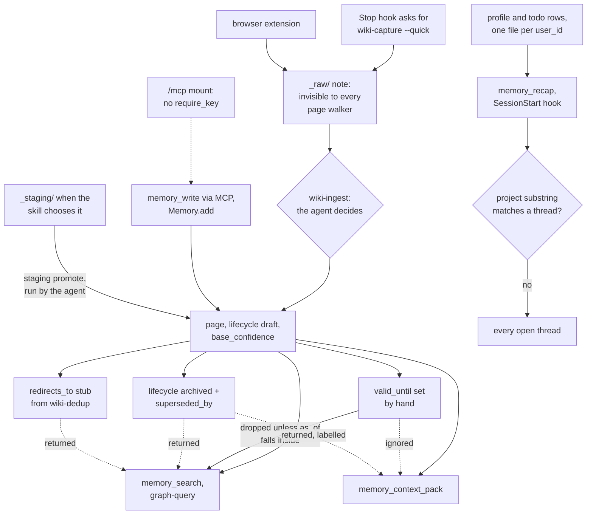

## 1. Executive Summary

obsidian-wiki turns an Obsidian vault into a knowledge base a coding agent
compiles. Forty Markdown skills tell the agent how to ingest documents, chat
history and the current session into interlinked pages, and a dependency-free
Python package owns the parts with one correct answer: the log, the index, a
word-capped snapshot, a profile and todo table, and a lexical graph query. What
is notable is the writer and the event-time filter: every memory file goes
through one lock and an atomic replace, and search drops a page whose
`valid_until` has passed while pointing at its successor. What is weak is that
the trust vocabulary is decoration. A page's `lifecycle` can be `disputed` or
`archived` and every code read path returns it regardless, and the agent can
promote its own staged writes.

The design premise is stated in `obsidian_wiki/client.py`: the caller has
an LLM, so the storage layer has none. `Memory.add`, `remember` and `todo`
route knowledge, facts about a person and open threads to three different
files, and the vault stays readable, greppable and diffable. Distillation,
deduplication and contradiction handling are skill prose the agent executes
with its own file tools, which makes most of the epistemic machinery a
convention rather than a mechanism.

Four findings shape the rest of this report.

- **The MCP mount has no key check.** Every REST route depends on
  `require_key` (`obsidian_wiki/server.py:156-162`), but `app.mount("/mcp",
  _mcp_app)` attaches none (`:318`), and the deployment docs say the bearer
  token is required on `/mcp`. In mcp 2.2.0, the lockfile's version, the
  MCP app adds bearer middleware only when it is given auth settings, and
  `MCPServer("obsidian-wiki")` is given none. No test sends a request to
  `/mcp`.
- **Lifecycle is a label.** `draft`, `reviewed`, `verified`, `disputed` and
  `archived` are validated (`obsidian_wiki/trust.py:32-43`), printed in the
  context pack (`context_pack.py:309-310`) and listed under contradictions in
  `hot.md` (`memory.py:1119-1121`). `graphrag.query` never reads the field.
- **Two read paths filter on two different axes.** Search honours the
  validity window and ignores visibility tags; the context pack honours
  `public_only` and ignores the window (`context_pack.py:197-207`).
- **The recap's project scope falls open.** `build_recap` keeps threads whose
  origin or text contains the project name as a substring, and returns every
  thread when none matches (`memory.py:1259-1264`).

## 2. Mental Model

A memory is a file a person or an agent wrote. There are three kinds, routed
by the caller: a knowledge page under a category folder, a durable fact about
a person as a row of `_meta/profile.md`, and an open thread as a row of
`_meta/todos.md`. Nothing is extracted by code. The epistemic work is done by
the model following skill text, and the package checks shape, not truth.

**The real gate is a directory.** `wiki-capture --quick`, which the Stop hook
asks for, writes notes into `_raw/`, and so does the browser extension.
`_raw`, `_staging` and the archive folders are in `vault.SKIP_DIRS`
(`obsidian_wiki/vault.py:19-22`), which every page walker uses, so a captured
note is invisible to search, the context pack, the index and the recap until
`wiki-ingest` compiles it into a page and moves the source to `_raw/_archived/`.
The ingest is the agent's own judgement; no person sits between `_raw` and
the live vault unless staged writes are on.

**A page is born `draft` and stays retrievable in every state.** The schema in
`.skills/llm-wiki/SKILL.md:387-474` gives every page `base_confidence`,
`lifecycle` and `lifecycle_changed`, and says only ingest sets `draft` and
only a human edit sets `reviewed`, `verified` or `disputed`. That rule is
prose. Lint reports two transition classes as illegal — any fall back to
`draft` and any exit from `archived` — and only for pages with an entry in
the trust ledger (`trust.py:739-788`). An agent writing `verified` into
frontmatter raises nothing.

How each read path treats the fields that look like they should withhold a
page:

| Field | search (`graphrag.query`) | context pack | recap | `hot.md` |
| --- | --- | --- | --- | --- |
| `valid_until` passed | dropped unless `--include-historical` | returned | n/a | n/a |
| `lifecycle: archived` | returned, no label | returned, labelled | n/a | n/a |
| `lifecycle: disputed` | returned, no label | returned, labelled | n/a | listed as a contradiction |
| `visibility/pii` tag | returned | dropped only with `public_only` | n/a | n/a |
| `redirects_to` stub | returned | returned | n/a | n/a |

The search predicate is `current_pages` (`graphrag.py:232-241`, applied at
`:631`); the context-pack loader is `load_pages` (`context_pack.py:197-207`).
`wiki-query` adds a third reader: it reads `hot.md` and `index.md` first and
falls back to `Grep` over the vault, and neither sees the window.

**Correction has three spellings and one of them filters.** The ingest skill
supersedes a page by setting `lifecycle: archived` and `superseded_by`; that
filters nothing. `valid_until` drops a page from search, but no skill tells
the agent to write it. `wiki-dedup` replaces the losing page with a
`redirects_to` stub and says the page walker skips it, so its index entry
disappears. No module in `obsidian_wiki/` reads `redirects_to`, and
`rebuild_index` lists the stub as a page. A profile fact dies by `forget`, which
deletes the row, and a page dies by deleting the file.

## 3. Architecture

The package is a library and a CLI over a directory; nothing runs between
calls. `obsidian_wiki/memory.py` owns the five memory files, `graphrag.py` and
`graph_analysis.py` the link graph and search, `context_pack.py` the budgeted
pack, `trust.py` the review ledger, `staging.py` promotion, `temporal.py` the
validity window, and `cli.py` exposes all of it as `obsidian-wiki`. The
`dependencies = []` claim holds for the core; the server needs the `[server]`
extra (FastAPI, uvicorn, `mcp>=2.0`).

**Persistence.** Pages are Markdown with YAML frontmatter, parsed by
hand-written readers rather than a YAML library — three of them, in
`memory.parse_frontmatter`, `context_pack._frontmatter_values` and the
regexes in `graphrag.build_index`. Every write to `log.md`, `index.md`,
`hot.md` and the two `_meta` tables takes `.memory.lock` (`memory.py:132-140`)
and lands by temp file and `os.replace` (`:143-156`). The lock is an
`O_CREAT|O_EXCL` lockfile stolen once it is older than 60 seconds, whether or
not its holder is alive (`cache.py:95-130`). Page writes are not under it:
`Memory.add` writes atomically and then syncs, and the server's `write_page`
uses a plain `write_text` before taking the lock to log (`server.py:127-133`).

**Search.** `graphrag.build_index` reads every page on every query; there is no
persistent index except a betweenness cache for the `bridges` intent. A vault
of a few thousand pages is the scale the docs measure.

**Session brain.** `sessions-build` indexes Claude, Codex and other agent
transcripts with a pure-stdlib TF-IDF and clusters them into a sidecar under
`~/.claude/session-brain/`. It never writes to the vault and stores no belief;
it is a finder for transcripts.

**Server.** `python -m obsidian_wiki.server` is one process, one vault, one API
key, binding loopback by default; the Docker image sets `WIKI_HOST=0.0.0.0`.
REST routes under `/v1/` depend on `require_key`, and the console at `/ui`
carries no data itself. The MCP app is mounted at `/mcp` without that
dependency (`server.py:306-318`). Reading the mcp 2.2.0 source at its tag,
`streamable_http_app` wraps the endpoint in `RequireAuthMiddleware` only when
a token verifier exists, which requires auth settings the server never
passes. The same function enables DNS-rebinding protection for a loopback
`host` argument, which restricts the Host header to loopback names. A
non-browser client that sends one reaches all eight tools, `memory_write`
and `memory_profile` included, without the key. This is a reading of code; I
did not run the server.

### Deployment and ergonomics

`pip install obsidian-wiki` and `obsidian-wiki setup --vault ~/brain` scaffold
the vault and register both hooks in `~/.claude/settings.json`; the Claude Code
plugin route ships the skills without the CLI or the hooks. No API key, no
model and no network service are needed to store or search. The store is a
folder a person can open in Obsidian, edit, grep and push to a private
repository, and the generated files are rebuilt from the pages rather than
trusted. A vault whose `index.md` or `hot.md` predates the writer is refused
until `memory migrate --apply` backs it up to `_archives/`
(`memory.py:1377-1430`). Semantic search is delegated to an external QMD
collection that the query skill uses when configured; the package has no
vector arm.

## 4. Essential Implementation Paths

**Capture.** The Stop hook (`.claude/hooks/wiki-stop-capture.sh`) classifies
the transcript's tool calls as read-only or mutating and, after any file edit
or four shell calls with one mutation, exits 2 with a request to run
`/wiki-capture --quick` (`:561`). The quick mode writes `_raw/<date>-<slug>.md`
and nothing else. The full mode also proposes profile facts and threads,
written with `obsidian-wiki memory profile set` and `memory todo add`
(`.skills/wiki-capture/SKILL.md:278-306`).

**Compile.** `wiki-ingest` is prose. It distils sources into category pages
with `lifecycle: draft`, a computed `base_confidence`, typed `relationships`
and inline `^[inferred]` or `^[ambiguous]` markers, moves each promoted raw
file to `_raw/_archived/`, records the snapshot with `obsidian-wiki snapshots
set` and the manifest with `cache-update`, then runs `memory sync`.

**Code writes.** `Memory.add` (`client.py:186-240`) renders a page with a
deterministic title and the first sentence as `summary`, keeps the original
`created` on a rewrite, writes atomically and calls `sync("MEMORY_ADD")`.
`server.write_page` (`server.py:92-134`) does the same through
`memory_write`, with folded YAML scalars. `set_fact` and `forget_fact`
(`memory.py:821-874`) rewrite the profile table under the lock; `add_todo`
touches an existing open thread of the same text instead of duplicating it
(`:955-980`).

**Sync.** `memory sync VERB key=value` appends one log line, reconciles
`index.md` against the pages on disk, keeping any non-category section
verbatim, and regenerates `hot.md`, all under one lock (`client.py:349-371`,
`server.py:273-291`). `build_hot` drops activity, then contradictions, then
threads, and truncates `## Key Takeaways` last to fit the 500-word cap
(`memory.py:1129-1206`).

**Search.** `graphrag.query` (`graphrag.py:597-722`) builds the index, classifies
the question into an intent, filters to current pages, and ranks with
`_score` (`:202-229`): 10 for an exact slug or title, 6 for a title prefix
match, 4 for a tag, 2 for the summary, plus up to 2 for link degree, times a
tier weight. It returns candidates, a `should_read` list of at most three
pages, and `index_only` when one candidate clearly leads.

**Context pack.** `build_context_pack` (`context_pack.py:362-432`) loads pages,
scores topic terms over title, aliases, tags, summary, path and body
(`:214-225`), and binary-searches each page's compressed body into the
remaining budget under an "UNTRUSTED REFERENCE DATA" header.

**Session start.** `wiki-session-recap.sh` resolves the vault, runs `memory
recap --project <git repo name>`, drops the output if it is the empty-vault
line, and prints it framed as recorded data, not instructions.
`build_recap` (`memory.py:1236-1300`) emits profile facts above
`min_confidence`, open threads with a stale mark after 30 days, and the last
five log lines, cut to 350 words.

**Review.** `staging.promote` (`staging.py:167-217`) renames a staged file onto
its live path after checking both content hashes against what the reviewer
saw, and refuses a `.patch.md`. `trust-record` writes the ledger of approved
confidence values and material fingerprints (`trust.py:281-470`).

## 5. Memory Data Model

**Pages.** Frontmatter carries `title`, `category`, `tags`, `summary`,
`sources`, `created`, `updated`, `tier` (`core`, `supporting`, `peripheral`),
`base_confidence`, `lifecycle`, `lifecycle_changed`, optional
`lifecycle_reason` and `superseded_by`, optional `valid_from` and
`valid_until`, typed `relationships`, `snapshots` and `provenance` fractions.
`created` and `updated` are dates the writer stamps; `updated` overwrites. The
trust fingerprint hashes the page with the volatile trust fields stripped, so
a lifecycle change does not mark a page stale but a body change does
(`trust.py:206-238`).

**Profile and todos.** Five and six columns of a Markdown table respectively,
parsed with an escaped-pipe splitter so hand edits round-trip
(`memory.py:756-790`). A fact is keyed case-insensitively on its key and
replaced on re-set. A todo has an id, `open`, `done` or `dropped`, an origin,
and created and touched dates.

**Scoping.** `check_scope` validates a `user_id` against
`^[A-Za-z0-9][A-Za-z0-9_.-]{0,63}$` because it becomes a filename
(`memory.py:236-251`), and `profile_path` and `todos_path` select
`_meta/profile.<scope>.md` (`:254-261`). That is a physical partition: no
record carries the key and no query applies it. Pages have no scope, and the
docs call `user_id` "a namespace, not an authorization boundary".

**Log.** `- [TS] VERB key=value` lines, appended with `O_APPEND` under the lock
(`memory.py:327-358`). The verb and fields are whatever the caller passes, and
read-only skills are told to log `QUERY` lines.

## 6. Retrieval Mechanics

Three code readers serve the model. `memory_search` is the graph query over
title, tags and summary; body text is not scored, so a fact past a page's
first sentence is findable only if the summary or tags carry its words. The
context pack scores body text at a weight of 1 and budgets by a
characters-over-four estimate. The recap is not retrieval but injection: a
fixed block at session start.

The query skill adds two uncoded readers: `hot.md` and `index.md` are read
first, and `Grep` over the vault is the fallback. Neither applies the validity
window, so a historical page reaches the model through either of them.

**Ranking is lexical and term-prefix based.** `_score` compiles `\b{term}` per
term, so `tag` matches `tags` and `ich` does not match inside `tatsächlich`.
The documented benchmark run reports recall@5 of 0.950 and
`should_read_precision` of 0.444 on the bundled vault, and the gold set
carries paraphrase cases that score zero by design (`docs/cli.md:262-285`).

**Temporal filtering.** `--as-of DATE` and `--include-historical` change which
pages are rankable; the structural intents (`impact`, `bridges`, `hubs`,
`clusters`) deliberately see the whole graph, because deleting a page
breaks historical pages that link to it (`graphrag.py:232-241`). A candidate
that carries `superseded_by` returns it, so the model can follow the pointer.
A malformed date counts as current, so a typo never hides a page.

## 7. Write Mechanics

Every write is explicit and synchronous: a file is on disk when the call
returns, and the next query rebuilds the index from disk, so the lag before a
page is searchable is zero. The cost moves to reads and syncs. Each query
reads every page, and each `memory sync` rescans every page to reconcile
`index.md` and rebuild `hot.md`, so both scale with the vault rather than
with the change.

Model work happens only inside skills. `wiki-ingest`, `wiki-update` and the
history ingests run in the agent's own turn and spend its tokens; `wiki-rebuild`
archives the live vault and recompiles it from sources, which is the one
whole-store rewrite and is a skill the user invokes. The manifest records
content hashes so a second ingest of the same library processes the delta.

**Deduplication.** `add_todo` dedups open threads on case-folded text. Pages
dedup only through `wiki-dedup`, which merges and leaves a redirect stub.
`Memory.add` with an existing title overwrites that page's body, keeping
`created`.

**Hostile input.** The recap and the context pack are framed as untrusted
reference data. Page content written through `memory_write` is not filtered,
and an unauthenticated MCP caller can write it (section 3).

### Operational cost

The agent blocks on nothing but file I/O in code paths; ingest blocks the
agent for as long as the skill runs, because the agent is doing the
extraction. The recap injects at most 350 words once per session at the top
of context, so it does not move within a session's prompt prefix. `hot.md`
is capped at 500 words and read on demand by the query skill.

## 8. Agent Integration

Skills are the primary interface. `setup.sh` and `obsidian-wiki setup` symlink
one `.skills/` directory into each supported agent's skill folder, and
`test_skill_mirrors.py` checks the mirrors. The agent is expected to call
`graph-query`, read `should_read` pages, write pages with its own Write tool,
and end every writing skill with `memory sync`.

Two hooks bracket a Claude Code session, registered by `hooks.py` into
`~/.claude/settings.json`. Both exit 0 silently on every failure, so a missing
install is invisible from inside a session; `hooks status` and `doctor` exist
to surface it. `WIKI_SESSION_RECAP=false` and `WIKI_STOP_CAPTURE=false` turn
them off.

For other runtimes, `from obsidian_wiki import Memory` gives the three verbs,
search, context and recap in-process, and the server gives the same over REST
and MCP with a `user_id` on the person-shaped tools. The agent has full write
reach on every surface: `memory_write`, `memory_profile set|forget`,
`memory_todo` and `memory_sync` are all on the MCP tool list.

## 9. Reliability, Safety, and Trust

**Concurrency** is the strongest part. Before `memory.py`, fifteen-odd skills
rewrote the memory files without a lock and dropped each other's updates, a
history the module docstring records. One lock across log, index and hot
prevents a snapshot describing a vault state that never existed, and the
migration guard refuses to regenerate a hand-curated file.

**Review is advisory.** Staged writes exist only when a skill chooses
`_staging/`; no module reads `WIKI_STAGED_WRITES`, and `memory_write` and
`Memory.add` write live. Promotion is `obsidian-wiki staging promote`, which
`wiki-stage-commit` tells the agent to run, `--all` included
(`.skills/wiki-stage-commit/SKILL.md:21`, `:108-128`). The trust ledger's
`--approved` flag is, in the skill's own words, "a workflow assertion, not a
cryptographic signature" (`.skills/wiki-lint/SKILL.md:274-275`). The revision
pinning in `promote` is real protection against a concurrent agent write
during review, and it protects a person who is reviewing, not a gate that
requires one.

**Audit.** `log.md` is an activity log rather than a mutation record. The
caller chooses the verb, profile and todo mutations write no line, quick
captures write none, and `memory timezone --apply` rewrites the log's stamps
in place after backing it up. Git history, when sync is configured, is the
record of what changed.

**Auth.** REST requires the bearer key and compares it with
`hmac.compare_digest`; `/mcp` does not (section 3). The path check in
`staging.resolve_in_vault` resolves symlinks before comparing, and
`test_server.py` covers traversal on the REST routes.

**Uncertainty.** A page can say `disputed` and an inline `^[ambiguous]`, and a
profile fact carries the writer's own confidence, which the recap can
threshold. None of these keeps a page out of a code read path.

## 10. Tests, Evals, and Benchmarks

The suite is large and specific: 1,165 test functions over 64 files. Memory
behaviour is covered in `test_memory.py`, `test_client.py`,
`test_temporal.py`, `test_context_pack.py`, `test_staging.py`, `test_trust.py`
and `test_timezone_migration.py`, including lock contention, migration
backups and hand-edit round trips.

**Must-not cases with controls.** `test_query_as_of_returns_the_page_that_was_true_then`
asserts an exact one-page candidate list at each date and the excluded count
(`tests/test_temporal.py:109-129`). `test_public_only_filters_before_ranking`
asserts the loader returns exactly the public page from three
(`tests/test_context_pack.py:116-121`). `test_recap_scopes_threads_to_a_project`
pairs a present thread with an absent one (`tests/test_memory.py:792-798`).
None covers the recap's fall-open branch, and
`test_user_id_isolates_todos_and_recap` asserts the other user's thread is
absent from a recap without asserting the user's own is present
(`tests/test_client.py:211-218`).

**The server suite does not run in CI.** `test_server.py` opens with
`pytest.importorskip("fastapi")` and `importorskip("mcp")`, and
`.github/workflows/tests.yml` installs only `pytest`. No test in the tree
sends a request to `/mcp`.

**Retrieval benchmark.** `obsidian-wiki eval` scores recall@k, MRR, intent
accuracy and `should_read` precision against a JSONL gold set.
`tests/fixtures/bench/` holds a 15-page vault and 26 cases, one of them an
`as_of` case, and `test_bench_vault_meets_baseline` fails below recall@1 0.80,
recall@5 0.90, MRR 0.85 and intent accuracy 1.00
(`tests/test_evaluate.py:28-33`, `:217-225`).

**The README's agent study is not in the tree.** "Does it actually help?"
reports 81 s against 19 s and 44% against 83% accuracy over four structural
questions, two repetitions each, on a 38-page vault, and says its full data
and per-run logs are in PR #175. That pull request's body carries the same
summary tables, and its eleven changed files are code, docs and tests; I found
no run logs in it. The questions measure graph navigation, not recall of a
stored memory. No paper accompanies the project; the README credits Andrej
Karpathy's LLM Wiki gist for the pattern.

## 11. For Your Own Build

### Steal

- **Reconcile generated files instead of overwriting them.** Regenerate only
  the sections you own, keep every other heading verbatim, and refuse to
  touch a file without your marker until a backed-up migration has run.
- **One lock for a logical update that spans files.** A log line, an index and
  a snapshot that describe one change should land together or not at all.
- **Event time with a successor pointer.** A historical claim that drops out
  of default search and names what replaced it is a small amount of code and
  answers "which gateway do we run" without losing the answer for an earlier
  date.
- **Pin what the reviewer saw.** Promotion that compares both content hashes
  against the reviewed revision, and treats "no live page" as a revision,
  refuses the race where an agent writes during review.

### Avoid

- **A status vocabulary with no filtering reader.** Five lifecycle values and a
  transition lint read as a trust model; if no query excludes `archived` or
  `disputed`, the field is a label, and the docs should say so.
- **Filters split across read paths.** When search honours one predicate and the
  context assembler another, the model sees whichever path the agent chose.
  Put every withholding predicate in one loader both paths share.
- **A scope filter that falls back to everything.** Returning all threads when
  the project matches none turns an empty scope into a leak; return nothing
  and say so.
- **Mounting a second protocol beside an authenticated one.** A dependency on
  the REST routes does not reach a mounted sub-application, and a test of the
  REST 401 does not prove the mount is closed.

### Fit

This suits one person, or a small trusted team, who wants an agent to build a
knowledge base they can read and fix by hand, and who will review the vault
in Git rather than in a queue. It costs nothing to run and nothing to leave.
It does not suit a deployment where the agent's writes must be checked before
they count, or where several principals share a server: the review steps are
instructions to the same agent, pages have no scope, and the MCP surface
takes writes without the key. Teams that need semantic recall over paraphrase
should plan on the external QMD collection or another index; the bundled
search finds words that are in titles, tags and summaries.

## 12. Open Questions

- Is the `/mcp` mount meant to sit behind a reverse proxy that enforces the
  key, or should `require_key` wrap it as the deployment docs describe?
- Should `graphrag.query` and `load_pages` share one predicate set, so
  `public_only` reaches search and the validity window reaches the pack?
- Is `lifecycle: archived` meant to filter like `valid_until`, given that the
  ingest skill uses it as the supersession move?
- Which component is meant to honour `redirects_to`, which the dedup skill
  says the page walker skips?
- Where are the per-run logs behind the README's agent study?

## Appendix: File Index

- **Memory surface:** `obsidian_wiki/memory.py`, `obsidian_wiki/clock.py`,
  `obsidian_wiki/cache.py` (`advisory_lock`), `obsidian_wiki/vault.py`.
- **Search and pack:** `obsidian_wiki/graphrag.py`,
  `obsidian_wiki/graph_analysis.py`, `obsidian_wiki/temporal.py`,
  `obsidian_wiki/context_pack.py`, `obsidian_wiki/evaluate.py`.
- **Trust and review:** `obsidian_wiki/trust.py`, `obsidian_wiki/staging.py`,
  `obsidian_wiki/lint.py`, `obsidian_wiki/provenance.py`.
- **Surfaces:** `obsidian_wiki/client.py`, `obsidian_wiki/server.py`,
  `obsidian_wiki/cli.py`, `obsidian_wiki/hooks.py`,
  `.claude/hooks/wiki-session-recap.sh`, `.claude/hooks/wiki-stop-capture.sh`,
  `extensions/brain/background.js`.
- **Skills:** `.skills/llm-wiki/SKILL.md`, `.skills/wiki-ingest/SKILL.md`,
  `.skills/wiki-capture/SKILL.md`, `.skills/wiki-query/SKILL.md`,
  `.skills/wiki-stage-commit/SKILL.md`, `.skills/wiki-dedup/SKILL.md`,
  `.skills/wiki-lint/SKILL.md`.
- **Session brain:** `obsidian_wiki/session_index.py`,
  `obsidian_wiki/session_graph.py`, `obsidian_wiki/session_query.py`.
- **Tests:** `tests/test_memory.py`, `tests/test_client.py`,
  `tests/test_temporal.py`, `tests/test_context_pack.py`,
  `tests/test_server.py`, `tests/test_evaluate.py`,
  `tests/fixtures/bench/`, `.github/workflows/tests.yml`.
- **Dependency read for the auth finding:** `src/mcp/server/mcpserver/server.py`
  and `src/mcp/server/lowlevel/server.py` in modelcontextprotocol/python-sdk at
  tag v2.2.0.

### Recorded searches

Checked against the checkout at the pinned revision, from the tree root.

- `git grep -n -E 'lifecycle' -- obsidian_wiki/graphrag.py obsidian_wiki/client.py obsidian_wiki/server.py obsidian_wiki/session_query.py` — no match; search never reads the field.
- `git grep -n -E 'lifecycle' -- obsidian_wiki` — readers in `trust.py`, `lint.py`, `cli.py`, the label at `context_pack.py:309` and the contradiction line at `memory.py:1119`.
- `git grep -n -E 'is_current|current_pages|valid_until' -- obsidian_wiki/context_pack.py obsidian_wiki/memory.py` — no match; the pack and the recap ignore the window.
- `git grep -n -E 'valid_from|valid_until' -- .skills | grep -v -E 'wiki-lint|wiki-query'` — no match; no writing skill names either field.
- `git grep -n -E 'valid_from|valid_until' -- obsidian_wiki ':!obsidian_wiki/temporal.py' ':!obsidian_wiki/graphrag.py' ':!obsidian_wiki/lint.py' ':!obsidian_wiki/cli.py'` — no match; no write path in code sets them.
- `git grep -n -E 'redirects_to' -- obsidian_wiki` — no match.
- `git grep -n -E 'WIKI_STAGED_WRITES' -- obsidian_wiki` — a help string at `cli.py:3118` and the docstring at `staging.py:3`; nothing reads the variable.
- `git grep -n -E 'append_log\(' -- obsidian_wiki` — callers in `cli.py` (`memory log`, `memory sync`), `client.py`, `server.py`, `memory.py` (timezone migration) and `staging.py`; none in `set_fact`, `forget_fact`, `add_todo` or `set_todo_status`.
- `git grep -n -E 'visibility/' -- obsidian_wiki/graphrag.py obsidian_wiki/memory.py` — one hit, `graphrag.py:562`, excluding visibility tags from cluster labels; no filter.
- `git grep -n -E 'require_key|Depends' -- obsidian_wiki/server.py` — the REST decorators only; the `app.mount("/mcp", ...)` line carries no dependency.
- `git grep -n -E '"/mcp|/mcp/' -- tests` — no match.
- `git grep -n -E 'importorskip' -- tests` and `/usr/bin/grep -n 'pip install' .github/workflows/tests.yml` — the server suite skips without FastAPI and mcp, and CI installs only pytest.
- `git grep -n -E '\^\[inferred|speculat' -- obsidian_wiki` — one hit, a docstring in `graphrag.py:23`; the speculation check is skill prose.
- `git grep -l -i -E 'arxiv|bibtex|@article|@misc|doi\.org|CITATION' -- . ':!uv.lock'` — skill prose about ingesting papers and the plugin description; no citation block and no `CITATION.cff`.
- `gh api repos/Ar9av/obsidian-wiki/pulls/175/files --jq '.[].filename'` — eleven files of code, docs and tests; no run logs.

## History

**2026-10-15** — [`7a3d143eb854840caf620dc91435ed87f1deb820`](https://github.com/Ar9av/obsidian-wiki/commit/7a3d143eb854840caf620dc91435ed87f1deb820) — first reading, at the head of `main`, a commit of 12 October 2026 twelve commits past v2026.10.2. Two marks, `bitemporal` and `negative_eval`. Screened before reading from a full clone: five auto-run surfaces (`.claude/settings.json` with SessionStart and Stop hooks running the two `.claude/hooks/` scripts, a `.claude-plugin/` manifest, `.cursor/rules/`, `.github/copilot-instructions.md`), each read and found to touch only the local vault and transcript. One build-time execution point (`tests/conftest.py`), nothing inside the cooldown and no unpinned surface, with `uv.lock` unchanged for 33 days; `CLAUDE.md`, `AGENTS.md` and `GEMINI.md` treated as data. MIT with no rider. Read with `git grep` and `sed`; the mcp 2.2.0 source was read, not installed; nothing installed, built or run.
