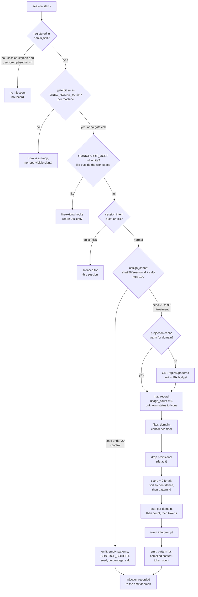

## 1. Executive Summary

OmniClaude is the delivery half of a two-repository memory loop, and the only system in this atlas that runs a standing randomized trial on whether its memory helps. `assign_cohort` hashes an identity with a salt, takes the result mod 100, and sends the bottom 20% to a control cohort that receives no injection. The control session still emits a record — an empty pattern list, `source = CONTROL_COHORT`, the seed, and the percentage and salt that produced the assignment — so the arms stay comparable months later.

[OmniIntelligence](../omniintelligence/) learns patterns from session events and grades them. This repository is a Claude Code plugin that fetches the survivors, injects them through hooks, records what it injected, and reports outcomes back. It stores no memory of its own.

**The trial's arms are not independent.** `assign_cohort` takes `user_id` and `repo_path` for exactly this reason — its docstring calls the property "sticky identity" and orders the fallbacks — and the single production caller passes neither. Identity is therefore the session id, so the same person is redrawn every session, and their control sessions run against a store their treated sessions keep teaching.

**What a treated session receives is not what the scoring code describes.** The mapper that turns an API or cache record into a pattern sets `usage_count=0` on every record, and the effective score multiplies by `log1p(usage_count)`, so every pattern scores zero. The production call passes no evidence resolver either. Selection therefore reduces to confidence, then pattern id. Provisional patterns are excluded unless an environment variable admits them, so the half-weight dampening is dormant by default.

**The injection hooks are not registered.** The manifest says every context-injection hook the measurement baseline unregistered *"stays DISABLED unless a carve-out re-registers it"*, and none of its 56 registrations is an injector. A typed inventory declares what is supposed to run. It also records three further switches that turn a registered hook off — a per-machine mask bit, a mode that defaults to `lite` outside the operator's workspace, and a session intent — none of which a repository gate can see.

**And the plugin a customer installs contains none of it.** The consumer marketplace sources `plugins/onex-delegate`, one delegation skill with zero hooks and zero agents, asserted by a committed test. The hook tree lives in `plugins/onex` behind a separate internal-dev marketplace.

There is no store, no correction and no scope key here — those live next door. The one capability mark, `negative_eval`, is on the fetch path's must-not-admit case (section 10).

## 2. Mental Model

Nothing here becomes a belief. A pattern arrives already graded, is filtered and ordered, is placed in a prompt, and the placement is recorded.

The scoring module describes a composite rank:

```text
score = confidence · clamp(success_rate) · min(1, log1p(usage)/k)
        · provisional_dampening        (0.5 when lifecycle_state == "provisional")
        · evidence_modifier            (1.3 on gate pass, 0.6 on gate fail, 1.0 otherwise)
```

Three producer facts decide what that formula does on the one production call, `handler_context_injection.py:556`, which is `select_patterns_for_injection(patterns, limits)`:

- **`usage` has one writer and it is a constant.** `_map_raw_pattern_dict` serves both the projection cache and the HTTP fallback and sets `usage_count=0` (`:733`). The scoring function's own docstring says what follows: *"Patterns with usage_count=0 will always receive a score of 0"*. Every candidate ties at zero.
- **`gate_result` has no writer on this path.** It comes only from an `evidence_resolver` argument the caller does not pass, so the evidence modifier never applies, and `evidence_policy` falls back to pass-through with a logged warning.
- **Admission is decided before scoring.** `include_provisional` defaults to `False` (`injection_limits.py:455`), and the filter at `:774` drops every `provisional` pattern before a score is computed. Dampening applies only when an operator sets `OMNICLAUDE_INJECTION_LIMITS_INCLUDE_PROVISIONAL`.

So the order a session sees is the sort's secondary and tertiary keys: confidence descending, then pattern id ascending. Admission and weighting are kept as separate settings, which is the right separation; the weighting half is the one that does not reach a prompt.

The mapper also folds the lifecycle status. Any `status` other than `validated` or `provisional` becomes `None` (`:723`), and the record's docstring says *"None is treated as validated"*. A withholding state the server might send — `deprecated`, say — would arrive here as a validated pattern at full weight. Withholding rests entirely on what the endpoint chooses to return.

The state that matters to a session is which arm it landed in, and whether any hook ran at all:



Identity for the hash is chosen by a documented priority — `user_id`, then `repo_path`, then `session_id` — and the caller supplies only the last.

## 3. Architecture

A Claude Code plugin plus Python hook handlers and consumers.

- **`plugins/onex/hooks/hooks.json`** — the plugin's registration surface. 56 commands across 28 distinct scripts; the all-events capture hook, `claude_hook_capture.sh`, accounts for 29 registrations, one per harness event it covers. 127 files sit in `plugins/onex/hooks/scripts/`, helpers included.
- **`plugins/onex/hooks/contracts/hook_inventory.yaml`** (1,960 lines) — the typed inventory: 56 `expected_hooks` entries matching the registrations, and 37 `disabled_hooks` entries, every one with an owner, a reason, a `review_by` date and a typed restoration.
- **`src/omniclaude/hooks/handler_context_injection.py`** (1,523 lines) — cohort assignment, pattern sources, filtering, compilation, the injection record.
- **`src/omniclaude/hooks/cohort_assignment.py`** (359 lines) — the trial.
- **`src/omniclaude/hooks/injection_limits.py`** (975 lines) — scoring, admission and the three caps.
- **`src/omniclaude/hook_measurement/`** — the hooks-off versus hooks-on harness.
- **`scripts/install-delegation.sh`** — a customer installer for the delegation feature, and a second registration surface (below).

The memory store is another service. Everything durable this repository writes about itself is telemetry: a `cost_records` SQLite table under `$ONEX_STATE_DIR/hooks/cost_accounting.db`, JSONL hook logs, and events handed to an emit daemon.

### Deployment and ergonomics

The loop needs OmniIntelligence, its Postgres and its Kafka running somewhere reachable. Without them the hook degrades rather than failing: a timeout or a connection error returns an empty pattern list with a warning string (`omniintelligence_api_unavailable`), and the session proceeds unmemoried. That is the right direction for this failure to point.

An operator turning the loop on edits `hooks.json`, which the manifest calls *"a pure config change"* since the scripts remain on disk. An operator wanting to know whether it helped runs the measurement CLI over two windows whose boundary they recorded by hand.

A customer installing the plugin gets neither. The root marketplace points at `plugins/onex-delegate`, whose whole surface is `delegate`; `plugins/onex-dev-marketplace` holds the hook tree and describes itself as *"INTERNAL DEV ONLY"*. The scoping is physical rather than a filter, because the manifest schema has no per-skill allowlist.

**`hooks.json` is not the only registration path in the repository.** `CLAUDE.md` says *"Plugin hook registration lives exclusively in `plugins/onex/hooks/hooks.json`"*. `scripts/install-delegation.sh`, a customer installer, rewrites `plugins/onex/hooks/hooks-delegation.v1.json` and merges it into `~/.claude/settings.json` (`:454`), registering a copied `session-start.sh` at SessionStart. `tests/scripts/test_install_delegation.sh:175` asserts that the merge happens. The baseline contract describes the same file as *"not loaded by Claude Code"* (`contracts/OMN-13244.yaml:13`), which is true of the plugin loader and not of the user's settings.

That installed copy cannot reach the injector. The installer copies five scripts and nothing else (`:421`). The copy sources `onex-paths.sh` from its own directory and exits 1 when that fails (`session-start.sh:191`), and nothing installs that file beside it. This is a reading of the two scripts; neither was run.

## 4. Essential Implementation Paths

### The trial — `cohort_assignment.py`

```python
seed_input = f"{identity}:{config.salt}"
hash_bytes = hashlib.sha256(seed_input.encode("utf-8")).digest()
assignment_seed = int.from_bytes(hash_bytes[:8], byteorder="big") % 100
cohort = EnumCohort.CONTROL if assignment_seed < config.control_percentage else EnumCohort.TREATMENT
```

Deterministic, salted, and configured from `src/omniclaude/hooks/contracts/contract_experiment_cohort.yaml` with environment overrides. Hardcoded fallbacks are used only when the contract cannot be loaded, and that path logs a warning rather than substituting silently. Default 20% control.

Three details are better than they need to be. The **seed is recorded on the injection row**, so an assignment can be recomputed and audited. The **effective control percentage and salt are recorded too**, so a later change to either does not retroactively mislabel earlier sessions. And the **control arm emits a record**, which is what makes the arms comparable — a trial whose control sessions leave no trace can only be analysed by absence.

The gap is the identity. The one production call site, `handler_context_injection.py:409`, is `assign_cohort(session_id, config=cfg.cohort)`. `tests/hooks/test_cohort_assignment.py` passes `user_id` and `repo_path` at five call sites and exercises their precedence, including blank and whitespace-only values. They are tested and unwired, which is worse than dead: the capability works and nothing reaches it. For a within-session effect that is defensible; for a shared store the treated sessions keep teaching, it is not.

A smaller one sits above it: assignment is inside `if session_id:` (`:408`), so a session with no id skips assignment and proceeds to injection. Sessions that cannot be assigned are silently treatment.

### Pattern sources — `handler_context_injection.py`

`_load_patterns_from_database` is named for a database it does not read. It tries an in-process projection cache keyed by domain, fed by a Kafka consumer it starts on first call, and falls back to `GET /api/v1/patterns` when the cache is cold, stale or empty for that domain. The fallback over-fetches:

```python
fetch_limit = max(limits.max_patterns_per_injection * 10, 50)
```

with the reasoning stated — the chained filters *"each of which can eliminate the majority of candidates"* run after the fetch. Its docstring says *"scoping is handled server-side"* because the API exposes no project parameter (`:913`); the request carries `limit`, `min_confidence` and an optional `domain`, so the server has no key to scope on.

Two further sources are additive and off by default. A memory-fabric query (`:567`, `OMNICLAUDE_CONTEXT_MEMORY_FABRIC_ENABLED`) posts the basename of the project root as `repo` and appends "Agent Learnings" to the block; the request cannot distinguish two repositories that share a directory name. A session-resume query reads the last snapshot for `ONEX_AGENT_ID`.

### Selection — `injection_limits.py`

Domain and confidence filters run in the handler. `select_patterns_for_injection` then drops provisional patterns by default, scores, sorts by `(-score, -confidence, pattern_id)`, and applies caps in a named order: `max_per_domain → max_patterns → max_tokens`. Per-domain first stops one domain monopolising the budget before the global cap has anything to do. As section 2 shows, the score is zero for every candidate, so the sort's secondary keys decide.

The token budget is counted with `cl100k_base` and discounted:

> *"The two tokenizers can differ by ~10-15%, so we apply a 90% safety margin to the configured token budget to avoid over-injection."*

A `budget.cap.hit` event exists for the case where the cap binds. It is emitted only when the caller passes a `run_id` (`:939`, *"caller opts in to telemetry"*), and the production call passes none, so truncation on this path is silent.

### Recording — `injection.recorded`

Every attempt emits a record, including control and error cases, with the `injection_id` generated before any work. `_emit_injection_record` validates a `ModelInjectionRecord` and hands it to the emit daemon as `injection.recorded`. The `pattern_injections` table that receives it lives in OmniIntelligence's schema, with a `contribution_heuristic JSONB` carrying its own `heuristic_method` and `heuristic_confidence`. A failed emit is a logged warning and a missing row. Naming the attribution method and its confidence beside the attribution lets a reader tell a measured contribution from a guessed one.

### The baseline — `hooks.json`

The manifest's description is 4,038 characters. It names the carve-outs by ticket and states that *"every context-injection/measurement hook the OMN-13244 baseline unregistered stays DISABLED unless a carve-out re-registers it"*. It hands authority to the inventory: *"The reasoning behind each carve-out lives in its inventory entry, in the registered script's own header and in its ticket, not in this string."* Two stopgap carve-outs keep their four-field records in the description as well.

Two registrations put durable state in front of the model. `session_start_goal_surface.sh` prints the `state_as_of` of a `GOAL.md` in a separate knowledge-base clone, its age and the goal rows, and prints the re-baseline command when the goal is missing or older than 12 hours. `session_start_workspace_sync.sh` is its sibling for clone and venv drift. Neither is the pattern injector, and both arms of the trial receive them equally.

The 29 `claude_hook_capture.sh` registrations are an observer by its header's account: it hands the raw payload to a Python mapper that scrubs and hashes content fields and journals one `hook.event` record, and it is written to print nothing on stdout and exit 0 on every path.

### The inventory — `hook_inventory.yaml`

The inventory exists because the baseline disable carried *"no inventory of what went dark"*. Its header gives the consequence: `pre_tool_use_overseer_foreground_block.sh` sat on disk, unregistered, while the rule it enforces was corrected by hand roughly 61 times — *"Nobody noticed, because nothing in the repo could answer the question 'which hooks are supposed to be on?'"*

Per hook it declares the script, event, matcher and order; owner, ticket and purpose; whether the hook can refuse or rewrite a tool call; a canary or a `no_canary_reason`; the `mask.gate_call` and whether that bit is defined in `hook_bits.sh`; and `lite_mode_exit`. Three properties are worth copying outright:

- **The mechanical half is generated and the semantic half is authored.** `validate_hook_inventory.py --generate` writes script, event, matcher and order from the live manifest; owner, ticket, purpose, enforcement and canary are written by a person. An undeclared registration fails the gate, *"by design: an undeclared hook is how an inventory rots."*
- **The same parity runs twice with opposite failure modes, and the split is argued.** `hook-inventory-gate` in CI fails closed. `session_start_hook_parity.sh` adds the live mask and warns only, because a mismatch that made the machine unusable would be the larger outage. The mask is never checked in CI: *"a check that passes because its input is absent is worse than no check."*
- **A gate that cannot fire is recorded as such.** A `gate_call` naming an undefined bit is declared `bit_defined: false` rather than rounded to "ungated".

**The inventory does not name the hooks this report is about.** `session-start.sh` and `user-prompt-submit.sh` are the scripts that call `context_injection_wrapper.py`. Both are on disk, unregistered, and absent from both halves of the file. The gate's third direction (`hook_inventory.py:858`) flags only scripts that can refuse a tool call and that nothing registered reaches, so an injector that only adds context is outside its population by construction. 62 scripts in the directory are declared nowhere; most are sourced helpers, which is why the check was narrowed.

**Its own prose has drifted further than its records.** The header says *"Four registered hooks are in that state"* about undefined gate bits; the entries declare 33 such registrations across five scripts. It says *"nine registered hooks exit 0 silently"* in lite mode and names the Done-flip gate among the three enforcement guards. The entries declare 43 lite-exiting registrations across 15 scripts, and the three enforcement guards among them are lane-liveness, secret-redaction and the actor-line guard. The per-record fields a gate re-derives agree with the scripts, and the summary sentences beside them do not: **a count that restates the records next to it drifts unless something recomputes it.** The baseline test's docstring calls OMN-17006 *"the final exception"* (`tests/hooks/test_hooks_baseline_omn_13244.py:54`) above a list of later carve-outs.

`src/omniclaude/hook_measurement/` is the analysis surface. It reads existing telemetry rather than adding a collection path, labels each tool-call record `HOOKS_OFF` or `HOOKS_ON` by comparing `recorded_at` against a boundary **the operator supplies by hand**, and marks each cost record `MEASURED`, `ESTIMATED` or `UNKNOWN`. That is two experiments of different quality in one repository: the cohort split is randomized and per-session; the hooks-off/on comparison is a before-and-after with a manual boundary.

## 5. Memory Data Model

There is no memory schema here. What this repository defines are the shapes of records *about* memory: the injection record, the cost record with its token provenance, and `ModelPatternRecord` — pattern id, domain, title, description, confidence, usage count, success rate, lifecycle state and evidence tier. On the production path, usage count is always zero, success rate comes from the API's `quality_score`, and evidence tier is never set.

No scope key is stored or sent with the pattern query. `domain` is a topical taxonomy, not a boundary, so a session in one repository is served patterns learned in every repository the platform has seen.

## 6. Retrieval Mechanics

Delegated, then filtered locally: projection cache or API, then domain, confidence and provisional filters, then the three caps. No vector search, no reranking and no query rewriting; the query is a domain and a confidence floor.

Two failure modes follow from the split. **The store's ordering is discarded and not replaced.** Up to 10× the budget is pulled and re-sorted by a score that is zero for every candidate, so the evidence tiers that decide promotion upstream do not reach the order at all. And **the filters that decide what an agent sees run on the far side of an HTTP boundary from the data that justifies them**, so a change to either side's notion of "good enough" is invisible to the other — including a new status value, which the mapper would treat as validated.

## 7. Write Mechanics

No memory is written. Injection and cost records are written after the fact, off the reply path; a failure to emit degrades to a warning rather than blocking the session.

### Operational cost

- **Injection is on the critical path of the turn**, which is what the measurement harness exists to price. The API call carries a configured timeout with an asyncio deadline one second beyond it, and every failure returns an empty pattern list with a warning string.
- **The injected block is bounded** by patterns per domain, patterns per injection, and a token budget discounted 10% for tokenizer mismatch — silently, since the cap event needs a `run_id` this caller does not pass.
- **It is a prompt prefix**, injected at `SessionStart`, `UserPromptSubmit`, `PreToolUse` or `SubagentStart`. A per-prompt injection whose content changes between turns invalidates a provider's cached prefix from that point on, and nothing here reasons about that.
- **No background pass rewrites anything**, because there is nothing local to rewrite.

## 8. Agent Integration

A Claude Code plugin. Hooks are declared in `hooks.json` under `${CLAUDE_PLUGIN_ROOT}`, and `CLAUDE.md` warns against adding them to `~/.claude/settings.json` as well: *"Duplicate entries fire every event twice"*. The delegation installer writes a hook block there anyway, as section 3 describes.

In the injection loop the model has no agency: it receives a block it did not ask for, and its behaviour is the signal. The internal plugin also carries prompt skills that hand the model memory verbs against other services. `/recall` tells it to query an agent-learning retrieval node and a knowledge federation node over HTTP, with `--repo` and `--type` filters. `/decision-store record`, by its `SKILL.md`, writes an architectural decision through a node in another package and routes high-severity conflicts to a Slack gate. Both are instructions plus a thin orchestrator shell here; the stores, and any enforcement, live elsewhere. `plugins/onex/hooks/lib/memory_fabric_client.py` says it is *"Used by context injection … and the /recall skill"*; its only importer is a unit test.

## 9. Reliability, Safety, and Trust

Strengths:

- **A randomized control arm that leaves a record**, carrying the seed and the parameters that produced it.
- **Contract-first configuration** with environment overrides and a warning when the contract cannot be loaded.
- **Admission separate from weighting**, with provisional patterns excluded by default and a dampening of zero rejected.
- **Ordered caps** — per domain, then count, then tokens — and **a tokenizer safety margin** with the discrepancy stated.
- **Every failure on the fetch path degrades to no memory**, never to a raised exception in the agent's session.
- **Attribution method and confidence recorded beside the attribution**, and **token provenance marked** `MEASURED` / `ESTIMATED` / `UNKNOWN`.
- **A typed inventory of what is registered and what is deliberately dark**, generated where it can be and authored where it cannot, with an undeclared registration failing a merge gate and every disable carrying a `review_by` date the gate enforces.
- **The same parity check fail-closed in CI and warn-only at session start**, both choices argued from the outage each would cause.
- **A committed test that the consumer plugin ships one skill and zero hooks**, so the internal tree cannot reach a customer install through the marketplace by accident.

Gaps:

- **The trial's identity is the session**, so arms are redrawn per session over a store both arms are teaching; and **a session with no id is silently treatment.**
- **The ranking formula does not run as written.** `usage_count` is a constant zero on both sources and no evidence resolver is passed, so success rate, dampening and gate results never reach the order.
- **Unknown lifecycle statuses become validated** in the mapper, so withholding depends on the server's query.
- **Truncation at the token cap is silent** on the production call.
- **The hooks-off/on comparison is not randomized** and its window boundary is recorded by hand.
- **No scope of any kind** on the pattern read, beside a docstring that says scoping happens server-side.
- **Registration is the only dark-hook switch a repository gate can see**; the mask bit, the mode and the session intent are per-machine or per-session facts. Lite mode is the default outside the operator's workspace.
- **The injector is declared in neither half of the inventory**, because the undeclared-script check looks only for scripts that can refuse.
- **A customer installer registers a SessionStart hook that exits 1** before it reaches its own injection branch, against a contract that calls the source file unloaded.
- **The inventory header's roll-up counts and its named enforcement trio have drifted** from the records beneath them.

## 10. Tests, Evals, and Benchmarks

**I ran nothing.** The screen found one auto-run surface (`.claude-plugin/marketplace.json`, the consumer plugin entry — read; it declares one delegation skill and no hooks), 13 `conftest.py` execution surfaces, three uninstalled git-hook payloads under `scripts/`, no unpinned manifest, and `pyproject.toml` and `uv.lock` both changed inside the seven-day cooldown. Nothing was installed and nothing was executed.

The test tree is larger than the implementation. `tests/hooks/test_injection_tracking.py` covers the trial with pre-computed session ids that deterministically hash into each arm — testing a hash-based assignment by choosing inputs with known outputs rather than by mocking the hash. It asserts that a control session returns `pattern_count == 0` and `source == "control_cohort"`, and that both arms emit a record.

That control assertion is a **near-miss**, not the mark. The control path returns before retrieval is attempted, and the fixture sets `db_enabled=False`, so `pattern_count == 0` would hold for a treatment session in the same test.

**`negative_eval` is earned on the fetch path.** `tests/hooks/test_context_injection_api_source.py` mocks `urllib.request.urlopen`, feeds the real `_load_patterns_from_api` a page holding one well-formed pattern and one missing its `id`, and asserts what came back:

```python
assert len(result.patterns) == 1
assert result.patterns[0].pattern_id == "PAT-VALID"
```

The exclusion is asserted by the identity of the survivor, and the same call proves the arrangement can return something. Three sibling cases exclude a pattern missing its id, its signature or its confidence. On `handle()`, `test_no_filter_warning_when_some_patterns_pass` supplies patterns at 0.90 and 0.10 against a 0.7 floor and asserts one survives. `test_includes_patterns_when_api_returns_them` is the positive control, written against a named regression — *"OMN-2059 regression: API returned patterns but context has none"*.

The weaker half is in the evidence line. The `handle()` cases patch `_load_patterns_from_api` itself and supply hand-built `ModelPatternRecord`s, so no committed case runs the production mapper and the selector together. A case that did would show every pattern tying at a score of zero.

`tests/hooks/test_graduated_injection.py` pins the dampening — validated undampened, provisional multiplied, zero rejected, lifecycle frozen on the record. `tests/hooks/test_injection_limits.py` pins the evidence-boost bounds. Both exercise the formula with non-zero usage counts, which the production mapper never produces.

`plugins/onex-delegate/tests/test_delegate_only_surface.py` asserts that the consumer plugin ships exactly one skill, zero hooks and zero agents — a must-not about a distribution manifest, not a retrieval result.

What is missing is the trial's result. Every mechanism for running the experiment is here — assignment, recording, the comparison harness — and no analysis, notebook or committed figure appears in the repository.

**No paper, arXiv reference or citation file exists in this repository.**

## 11. For Your Own Build

### Steal

- **Hold out a control cohort and make it leave a record.** A deterministic salted hash and an early return is most of the fix, and the empty record is what makes the arms comparable.
- **Record the experiment's parameters on the assignment**, not only in config. The seed, the percentage and the salt on the row mean a later change does not relabel old sessions.
- **Separate admission from weighting**, and default the admission to the cautious side. "Exclude provisional" and "include provisional at half weight" should be two settings.
- **Apply caps in a stated order**, per-scope before global.
- **Discount your token budget for tokenizer mismatch** and write down the percentage and the reason.
- **Mark the provenance of your own measurements.** `MEASURED` versus `ESTIMATED` on a cost record stops an analysis from averaging the two.
- **Keep an inventory of what is deliberately off**, with a review date a gate enforces.

### Avoid

- **A stickiness parameter no caller passes.** The experiment then answers a different question than the one designed, and the docstring describes the intended one.
- **A scoring formula whose inputs have no producer.** Test the selector against what the production mapper emits, not against hand-built records; a constant zero in one field made every term after it decorative.
- **Folding unknown states into the trusted one.** An unrecognised lifecycle status should be excluded or rejected, not treated as validated.
- **Telemetry the caller must opt into** for the one event that says a budget truncated the context.
- **An undeclared-script check scoped to refusers.** An injector that only adds context is the hook whose absence matters most to a memory loop.
- **Over-fetching and re-ranking on the client.** It discards the store's ordering and moves the decision about what an agent sees away from the evidence that justifies it.

### Fit

Take the experiment, not the system. This repository has no memory of its own to adopt, and its injection path is specific to Claude Code hooks and one HTTP contract. What generalises is roughly 400 lines — the cohort assignment, the record it writes, and the harness that compares two windows — and those answer the question almost nobody in this corpus is set up to ask.

Adopt the whole loop only if you are running the other half, and read the manifest before concluding anything about what the loop does in practice: at this commit the injector is switched off on purpose and absent from the customer plugin.

## 12. Open Questions

- Has the trial produced a result? Every mechanism to run it is committed and no analysis is.
- Was the session-id fallback for cohort identity a deliberate choice for within-session effects, or the parameters simply never threaded through?
- Is `usage_count=0` in the mapper a placeholder for a field the API does not return, and does any deployed run set `include_provisional`?
- Does the pattern endpoint ever return a status other than `validated` or `provisional`, which the client would score as validated?
- Should the undeclared-script check cover context injectors, given that the injector is the hook whose dark state the baseline exists to measure?
- What refreshes an operator's memory that the boundary between measurement windows has to be recorded by hand?
- Is the delegation installer's SessionStart registration meant to run `session-start.sh` at all, given that the copy cannot find its own path helper?
- Will the inventory header's roll-up counts acquire a generated line? Both counts that drifted are recomputable from records the gate reads.

## Appendix: File Index

- The trial: `src/omniclaude/hooks/cohort_assignment.py`, `src/omniclaude/hooks/contracts/contract_experiment_cohort.yaml` (the repository also has an unrelated top-level `contracts/`).
- Injection: `src/omniclaude/hooks/handler_context_injection.py`, `src/omniclaude/hooks/injection_limits.py`, `src/omniclaude/hooks/context_config.py`, `src/omniclaude/hooks/models_injection_tracking.py`, `plugins/onex/hooks/lib/context_injection_wrapper.py`, `plugins/onex/hooks/lib/pattern_cache.py`.
- The dark injectors: `plugins/onex/hooks/scripts/session-start.sh`, `plugins/onex/hooks/scripts/user-prompt-submit.sh`.
- Hook registration and its inventory: `plugins/onex/hooks/hooks.json`, `plugins/onex/hooks/contracts/hook_inventory.yaml`, `plugins/onex/hooks/lib/hook_inventory.py`, `scripts/validation/validate_hook_inventory.py`, `plugins/onex/hooks/scripts/session_start_hook_parity.sh`, `plugins/onex/hooks/scripts/claude_hook_capture.sh`, `plugins/onex/lib/mode.sh`, `plugins/onex/hooks/scripts/common.sh`, `contracts/OMN-13244.yaml`, `CLAUDE.md`.
- The second registration path: `scripts/install-delegation.sh`, `plugins/onex/hooks/hooks-delegation.v1.json`, `tests/scripts/test_install_delegation.sh`.
- Durable state surfaced into a session: `plugins/onex/hooks/scripts/session_start_goal_surface.sh`, `plugins/onex/hooks/scripts/session_start_workspace_sync.sh`.
- Model-facing memory skills: `plugins/onex/skills/recall/SKILL.md`, `plugins/onex/skills/decision_store/`, `plugins/onex/hooks/lib/memory_fabric_client.py`.
- Distribution: `.claude-plugin/marketplace.json`, `plugins/onex-dev-marketplace/.claude-plugin/marketplace.json`, `plugins/onex-delegate/`.
- Measurement: `src/omniclaude/hook_measurement/` — `enums.py`, `metrics.py`, `models.py`, `trajectory.py`, `cli.py`.
- Tests cited: `tests/hooks/test_context_injection_api_source.py` (the mark), `tests/hooks/test_injection_tracking.py`, `tests/hooks/test_cohort_assignment.py`, `tests/hooks/test_graduated_injection.py`, `tests/hooks/test_injection_limits.py`, `tests/hooks/test_hooks_baseline_omn_13244.py`, `plugins/onex-delegate/tests/test_delegate_only_surface.py`.
- The store this depends on: [OmniIntelligence](../omniintelligence/), `GET /api/v1/patterns`.

### Recorded searches

Run with `git grep` from the root of the checkout at the pinned commit.

| Claim | Command | Result at this pin |
| --- | --- | --- |
| The production call passes neither identity | `git grep -n -E 'assign_cohort\(' -- src plugins` | The definition, three docstring examples, and one call, `handler_context_injection.py:409`, `assign_cohort(session_id, config=cfg.cohort)` |
| The tests pass both identity parameters | `git grep -n -E 'user_id=\|repo_path=' -- tests/hooks/test_cohort_assignment.py` | 16 lines, covering both parameters, their precedence, and blank values |
| One production call to the selector, with no resolver and no `run_id` | `git grep -n -E 'select_patterns_for_injection\(' -- src plugins` | `handler_context_injection.py:556`, two positional arguments; the other hits are the definition and a docstring |
| The mapper writes usage as a constant | `git grep -n 'usage_count=0,' -- src` | One hit, `handler_context_injection.py:733` |
| Provisional is excluded by default | `git grep -n -A1 'include_provisional: bool' -- src` | `injection_limits.py:454-455`, `default=False`; `git grep -n 'INCLUDE_PROVISIONAL'` finds one setter, a test's `monkeypatch.setenv` at `tests/hooks/test_graduated_injection.py:820`, and no config, contract or script |
| No injector is registered or declared | `git grep -n -E 'context_injection\|session-start\.sh\|user-prompt-submit\.sh' -- plugins/onex/hooks/hooks.json plugins/onex/hooks/contracts/hook_inventory.yaml` | Nothing |
| The installer registers SessionStart and copies no path helper | `git grep -n -E 'session-start\.sh\|onex-paths' -- scripts/install-delegation.sh` | `:421` copies `session-start.sh` among five scripts; no `onex-paths` hit |
| The memory-fabric client has no production importer | `git grep -n 'memory_fabric_client' -- src plugins tests` | One import, `tests/unit/hooks/lib/test_memory_fabric_client.py:18`; the other hit is a docstring |

## History

**2026-10-15** — [`ad7861d77053d701cdac37f764bcc00d5845bb87`](https://github.com/OmniNode-ai/omniclaude/commit/ad7861d77053d701cdac37f764bcc00d5845bb87) — 527 commits along `dev`. Screened first: one auto-run surface (the consumer marketplace manifest, read), 13 `conftest.py` surfaces, and both dependency manifests inside the cooldown; nothing was installed or run. The injection loop and its tests are byte-identical, and `negative_eval` holds on the same blob. `hooks.json` grew to 56 registrations, 29 of them a new capture hook, and its description shrank from 31,000 characters to 4,038 as carve-out reasoning moved into an inventory holding 37 disabled entries. The consumer plugin dropped `cloud_delegate`. Four claims were wrong at the earlier pin and are corrected in [section 2](#2-mental-model) and [section 4](#4-essential-implementation-paths): provisional patterns are excluded by default, every mapped pattern scores zero, the budget event never fires from the production caller, and the internal plugin gives the model recall skills.

**2026-09-20** — audited at the same pin. One sentence in section 6 said `user_id` and `repo_path` are *"never passed anywhere in the repository"*. They are passed at five call sites in `tests/hooks/test_cohort_assignment.py`, which exercises the precedence between them and the handling of blank values; what is true, and what the finding rests on, is that the single production call site passes neither. The sentence now says that, and the report gains a Recorded Searches appendix — it had none, which is how an absence claim nobody could re-run reached the site.

**2026-09-17** — [`6f062cd55e9141360d2fa7cda151df040874522a`](https://github.com/OmniNode-ai/omniclaude/commit/6f062cd55e9141360d2fa7cda151df040874522a) — third reading, 84 commits along the default `dev` branch. The trial itself did not move: `cohort_assignment.py`, `handler_context_injection.py`, `injection_limits.py`, `models_injection_tracking.py` and the three test files the appendix named are byte-identical to the last pin, and the single production caller at `handler_context_injection.py:409` still passes only the session id, so the sticky-identity criticism holds for the third time. Screened at this pin: one auto-run surface (the consumer plugin's marketplace manifest, read), 11 build-time execution paths, no unpinned manifest, and both `pyproject.toml` and `uv.lock` inside the seven-day cooldown, so nothing was installed and nothing was run.

**A mark is added and a withholding is corrected.** `negative_eval` is earned on `tests/hooks/test_context_injection_api_source.py`, whose `test_mixed_valid_and_invalid_patterns` mocks the transport, runs the real `_load_patterns_from_api` over a page holding one well-formed pattern and one missing its `id`, and asserts the survivor by identity — with a positive control in the same file written against a named regression. That file is byte-identical at all three pins, so the mark was earnable at the first reading and at the second. Both readings reasoned from the three test files this appendix listed, found the control-cohort near-miss in one of them, and published a withholding that was true about those tests and wrong about the repository. The near-miss analysis was also too generous to itself: the control test runs under a fixture with `db_enabled=False`, so its `pattern_count == 0` would hold for a treatment session too.

**The reading's finding is that registration was never the only switch.** The manifest's *"Every context-injection/measurement hook stays DISABLED"* still stands, with the re-registered carve-outs grown from sixteen to 28 commands, and a new 1,293-line `hook_inventory.yaml` now declares per hook what it gates on, whether that bit exists, whether it exits under `lite` mode, and whether it can refuse a tool call — with a canary required of every one that can. Building that file found `WORKTREE_GUARD` cleared in the operator's own live `ONEX_HOOKS_MASK`, so a guard registered under a named carve-out was dark in practice; and `OMNICLAUDE_MODE` resolves to `lite` — twelve registered hooks exiting silently, three of them enforcement guards — by default in every repository that is not the operator's workspace.

Two of the four ways a hook goes dark are per-machine facts, a third is per-session, and only the first is visible to a repository gate. The same file's parity check is deliberately fail-closed in CI and warn-only at session start, with the reason given both ways round: a manifest mismatch that made the machine unusable would be the larger outage, and a CI check over a per-machine file *"passes because its input is absent"*.

Two registered hooks now put durable state in front of the model — a session-goal surface and a workspace-sync sibling — so the SessionStart baseline is no longer empty, though both arms receive it equally. And the injector has moved further away from a reader than "switched off": the consumer marketplace ships `plugins/onex-delegate`, two skills with zero hooks, asserted by a committed test, while the hook tree sits behind an internal-dev marketplace whose own description says it is not published to consumers.

Two numbers in the new inventory's header have drifted from the records below it — *"nine registered hooks"* against twelve entries declaring `lite_mode_exit: true` — while the two claims in the same paragraph that a gate re-derives stayed exactly right, and the baseline test's docstring still calls OMN-17006 *"the final exception"* six carve-outs later. Counted here rather than left as an impression: six of the thirteen carve-outs carry the four-field owner/reason/expiry/restoration record their own standing rule requires, and two of those six are pinned by a test whose record locator is the first of six identical markers in a 31,000-character string. This appendix also gave the cohort contract's path as `contracts/contract_experiment_cohort.yaml` through two readings; it is `src/omniclaude/hooks/contracts/contract_experiment_cohort.yaml`, and the repository has an unrelated top-level `contracts/` that made the wrong path look plausible.

**2026-09-09** — [`59b3c0ec3524b029abd4bc9f89e7d43d89be4abe`](https://github.com/OmniNode-ai/omniclaude/commit/59b3c0ec3524b029abd4bc9f89e7d43d89be4abe) — second reading, 128 commits along the default `dev` branch: 460 files, 53,331 insertions, of which 117 files and 26,880 insertions land inside the paths this report's appendix names. Screened before reading; nothing was installed and no suite was run.

Both criticisms hold, and neither has been narrowed. `assign_cohort` still takes `user_id` and `repo_path` for sticky identity, and the single production caller at `handler_context_injection.py:409` still passes neither — `assign_cohort(session_id, config=cfg.cohort)` — so the arms are still re-drawn per session. The injection hooks are still unregistered: the manifest still opens with *"Every context-injection/measurement hook stays DISABLED"*, and the number of narrowly-scoped guards re-registered beside that sentence has grown from four to sixteen.

The growth in that manifest is the reading's finding. Each carve-out now carries a required record — owner, reason, expiry, restoration — under a standing rule the file states in its own words: *"A disable with no expiry and no re-enable ticket is how OMN-13244 left enforcement dark for months while the rule it enforced was corrected by hand ~61 times."*

Two of the newer guards were added after measuring exactly that failure shape at a tool seam no repository gate can see: a background-model guard after 41 workflow dispatches in one session inherited a banned model, and a ticket-creation gate after roughly 1,500 tickets were minted in a fortnight against a rule that existed only as prose. The rule this repository derives from its own history — that a control living in prose or in memory fails silently and at scale — is the same claim the atlas makes about memory systems generally, arrived at from the other direction.

No mark moves; this repository still stores nothing of its own. The scoring formula is unchanged, with `provisional_dampening` still a multiplier rather than an admission decision.

**2026-08-11** — [`9604842857f74ecdba5b063c67bf142a7649502e`](https://github.com/OmniNode-ai/omniclaude/commit/9604842857f74ecdba5b063c67bf142a7649502e) — first reading, on the `dev` default branch. Screened before reading: 0 auto-run surfaces, 11 build-time exec surfaces (`conftest.py`), three uninstalled git-hook payloads under `scripts/git-hooks/`, 0 unpinned manifests, and a `uv.lock` unchanged for 9 days; nothing was installed and nothing was executed. Read as the injection half of a loop whose store is [OmniIntelligence](../omniintelligence/); the shared `omnibase-*` git dependencies were not publicly readable at this reading.
