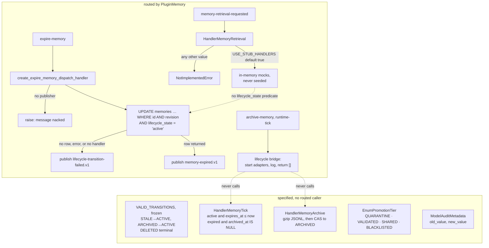

## 1. Executive Summary

OmniMemory is the memory domain package of the ONEX platform: typed models,
Kafka-dispatched nodes and storage adapters behind a kernel plugin. What is
notable is a test file that tests its own checker, and an expire path that
reports an outcome for every command. What is weak is that the routed retrieval
node can only serve in-memory test doubles nothing seeds, so the running system
returns nothing from memory.

**The thing to read first is a test file.**

`tests/gates/test_consumer_group_name_authorization.py` enforces that no Kafka
consumer-group name in `src/` is a string literal. It is a default-deny AST
walk: every `group_id=` / `consumer_group=` / `kafka_group_id=` keyword and
every default on a matching field "must be a call to (or a local binding of)
one of the canonical derivation helpers. A newly added string literal FAILS by
default -- that is the whole point of the gate."

Then it tests the checker:

> "A default-deny gate whose discrimination is never exercised is
> indistinguishable from a gate that always passes; these prove it catches
> literals, f-strings, and laundering while admitting real derivations."

Five `test_checker_*` cases run positive and negative controls over the AST
walk against inline fixtures. The module docstring records why they exist: they
were "added in the OMN-15639 round-2 remediation after a verifier demonstrated
the `apply_instance_discriminator` laundering hole live."

`test_unauthorized_env_token_is_not_authorized` asserts, in executable form,
what the suite does **not** prove. The kernel's default environment token is
`local`, `local.omnimemory.*` is not in the IAM-granted pattern set, and
therefore "a green suite here … does NOT prove the deployed name is
authorized; the deployment must set the env token to `onex-dev`." The test's
subject is the boundary of the suite's own evidence.

**The second mechanism is a compare-and-set on lifecycle, wired to outcome
events.** `HandlerMemoryExpire` transitions a memory with a WHERE clause
carrying both the expected revision *and* the expected source state, and
reports zero affected rows as a conflict (`handler_memory_expire.py:381-391`).
`create_expire_memory_dispatch_handler` routes every `expire-memory` command to
it and publishes exactly one event: `memory-expired.v1` on success,
`lifecycle-transition-failed.v1` on refusal, malformed command, missing
database or conflict. With no publisher wired it raises before touching the
database, so the message is nacked rather than acknowledged in silence
(`runtime/dispatch_handlers.py:927-1082`).

**The finding that governs the report is on the read side.** The retrieval
dispatcher builds `HandlerMemoryRetrieval` from `build_retrieval_config_from_env()`.
`OMNIMEMORY_USE_STUB_HANDLERS` defaults to `"true"`, which selects in-memory
mocks that nothing in `src` seeds; any other value reaches
`raise NotImplementedError("Production handlers not yet implemented. Set
use_stub_handlers=True")` at initialisation
(`handler_memory_retrieval.py:151-170`). `HandlerQdrant` exists, is tested, and
has no constructor in `src`.

The other two lifecycle commands are acknowledged without acting.
`archive-memory` reaches a bridge that logs "archive-memory command not yet
implemented … acknowledging as no-op", and `runtime-tick` reaches the same
bridge, which starts adapters and returns.

## 2. Mental Model

There are two OmniMemories in this repository, and they meet at one point.

**The specified one** is careful: typed enums, a frozen transition map, a
compare-and-set handler with a conflict result and a retry helper, and an archive
handler that writes gzip JSONL atomically before it updates the row. It also
specifies a promotion tier with a QUARANTINE state "not included in context assembly by
default", an audit metadata model with `old_value`/`new_value`, and a gate
suite that tests itself.

**The running one** routes `expire-memory` to the compare-and-set and reports
the outcome. It routes `archive-memory` and `runtime-tick` to a bridge that does
not call the archive or tick handlers. Its retrieval serves unseeded test
doubles. It never constructs the audit model, never writes a promotion tier, and
never consults the transition map.

A memory is a `memories` row with a `lifecycle_state`. It stops being current in
exactly one routed way: an external service sends `expire-memory` naming the row
and the revision it last saw, and the row moves ACTIVE → EXPIRED if both still
match. Nothing in this repository inserts a `memories` row, nothing moves one to
STALE, ARCHIVED or DELETED on a routed path, and nothing on any read path asks
what state a row is in.

## 3. Architecture

ONEX-compliant nodes, each with a `contract.yaml`, dispatched from Kafka topics
derived by helper functions rather than literals. `PluginMemory` registers at
the `onex.domain_plugins` entry point, builds a `MessageDispatchEngine` in
`create_memory_dispatch_engine`, and subscribes to the topics the contracts
declare. The lifecycle orchestrator's `contract.yaml` routes `tick`, `expire`
and `archive` operations to `HandlerMemoryTick`, `HandlerMemoryExpire` and
`HandlerMemoryArchive`, but its package is not in
`_OMNIMEMORY_HANDLER_NODE_PACKAGES` (`runtime/wiring.py:44-51`), and in this
repository only the expire handler is constructed, by
`PluginMemory._build_expire_handler` (`runtime/plugin.py:466-519`).

The README lists node handlers as "contract-carrying nodes in
`src/omnimemory/nodes/`, migrating to `omnimarket`", and names PostgreSQL and
Kafka as owned by `omnibase_infra`. The boundary document it links lives in a
separate knowledge-base repository.

### Deployment and ergonomics

`docker-compose.yml` owns Qdrant, Memgraph, Valkey and a Kreuzberg parser.
PostgreSQL and Kafka come from the platform. The expire handler needs
`OMNIMEMORY_DB_URL`; unset or unreachable, the plugin logs a warning and every
expire command is answered with `lifecycle-transition-failed`. There is no
single-process mode and nothing an agent installs directly.

## 4. Essential Implementation Paths

**Expire** — `runtime/plugin.py:711` builds the handler; `runtime/dispatch_handlers.py:927`
`create_expire_memory_dispatch_handler` validates the payload as
`ModelExpireMemoryCommand` in lax mode after dropping the envelope keys
`correlation_id`, `requested_by` and `timestamp`, calls `HandlerMemoryExpire.handle`
once, and publishes one event. `handle_with_retry` is not on this path.

**Transition** —
`nodes/node_memory_lifecycle_orchestrator/handlers/handler_memory_expire.py`
(`_EXPIRE_SQL` `:381`, `_READ_STATE_SQL` `:394`, `_VALID_FROM_STATES` `:404`,
`handle` `:565`). A Postgres error is caught and returned as
`success=False, error_message="Database error: …"`, which the dispatcher turns
into a failure event.

**Validate** — `validators/validator_lifecycle_transition.py`
(`VALID_TRANSITIONS` as a `MappingProxyType` of frozensets, `:63-96`). No module
outside the validators package imports it.

**Archive and sweep** — `handlers/handler_memory_archive.py` and
`handlers/handler_memory_tick.py` (`lifecycle_state = 'active' AND expires_at IS
NOT NULL AND expires_at <= :now`, then `lifecycle_state = 'expired' AND
archived_at IS NULL`). Their only constructors in `src` are docstring examples
and the two adapters in `adapters/`, which nothing constructs.

**Lifecycle bridge** — `runtime/dispatch_handlers.py:825`
`_create_lifecycle_bridge_handler`: reads `payload["command"]`, starts
`HandlerMemoryLifecycle` if needed, calls `handle_shutdown()` only for
`"shutdown"`, logs and acknowledges `"archive-memory"`.

**Retrieve** — `runtime/dispatch_handlers.py:467` `build_retrieval_config_from_env`,
`:515` `create_memory_retrieval_dispatch_handler`, then
`nodes/node_memory_retrieval_effect/handlers/handler_memory_retrieval.py`
(`initialize` `:151-170`, `_execute_hybrid` `:347`).

## 5. Memory Data Model

`deployment/database/migrations/002_create_memories_table.sql` creates
`memories` with `content`, `content_type`, `lifecycle_state` (CHECK over five
values, default `active`), `expires_at`, `archived_at`, `lifecycle_revision`,
`archive_path`, `metadata`, `created_at` and `updated_at`. It has no
`expired_at` column. `_EXPIRE_SQL` sets `expired_at = $2`, and
`HandlerMemoryArchive._read_memory` selects it. Against a table built from this
migration the UPDATE names a column that does not exist; the handler would
return the Postgres error and the dispatcher would publish
`lifecycle-transition-failed`. The README places PostgreSQL ownership in
`omnibase_infra`, so whether the deployed table has the column is outside this
tree.

`EnumLifecycleState` is five states with the transitions written down: STALE can
return to ACTIVE ("refreshed / promoted"), ARCHIVED can return to ACTIVE
("promoted / restored"), and DELETED has an empty frozenset, described as "soft
delete marker for audit trail". Revival paths named explicitly is the right way
to write a lifecycle; no routed code performs any of them.

`EnumTrustLevel` looks like a trust state and is not one. Its six levels are
defined by score ranges — "UNTRUSTED: Score below 0.2, data should not be used"
— and `model_trust_score.py` derives the level from the float in
`_score_to_level()` (`:161`). It is a confidence number with labels printed on
it.

`EnumPromotionTier` is closer. It is a stored tier "in PostgreSQL and Qdrant
payload" with QUARANTINE ("Not included in context assembly by default"),
VALIDATED, SHARED and BLACKLISTED ("permanently excluded"), and
`ModelContextPolicyConfig.include_quarantine` defaults to `False`. The
docstring names `ContextSelectorNode` as the reader. No module in this
repository defines that node, reads `include_quarantine`, or constructs
`ModelPromotionDecision`; the tier has no writer and no reader here.

## 6. Retrieval Mechanics

The routed retrieval node serves in-memory test doubles. `build_retrieval_config_from_env()`
reads `OMNIMEMORY_USE_STUB_HANDLERS` with default `"true"` and, for any other
value, builds a `ModelHandlerQdrantConfig`. `HandlerMemoryRetrieval.initialize()`
then initialises `HandlerQdrantMock`, `HandlerDbMock` and `HandlerGraphMock` in
the stub case and raises `NotImplementedError` in every other case. The mocks
start empty; `seed_snapshots` has no caller in `src` outside docstrings. A
deployment that leaves the default retrieves nothing, and one that sets it to
`"false"` fails on the first request.

`HandlerQdrant` is a working vector search: it embeds the query and calls
`qdrant_client.search` with `limit` and `score_threshold` and no filter
(`handler_qdrant.py:230-278`). Its tests construct it; nothing in `src` does.

`lifecycle_state` appears in no file under the retrieval node or `runtime/`. An
EXPIRED or ARCHIVED memory would not be filtered out by any read path found
here.

### The composed read path

`_execute_hybrid` fans out to a semantic leg and a full-text leg and fuses
their *rankings* rather than their scores, with the reason written down:
fusing first "would let a leg that matched" on a stray term carry a document
into the answer on one leg's strength alone. `fuse_rrf_scores` is
reciprocal-rank fusion at `RRF_K_DEFAULT = 60` (`handler_fusion.py:53`),
weighted rather than plain, because on a paraphrase query the lexical leg can
match a stray token and unweighted RRF would promote it.

`handler_decay.py` then modulates the fused score multiplicatively —
`A(t) = A_0 * exp(-lambda * dt)` with `DECAY_LAMBDA_PER_DAY = 0.015` — and the
ordering is deliberate: decay is applied **after** fusion, "not as a third
ranked list inside the fusion."

The freshness input degrades **per instance** rather than per model: the plan
specifies `max(created_at, last_accessed_at)`, but the retrieval path returns a
frozen `ModelMemorySnapshot` from a shared core package that carries only
`created_at`, so `freshest_timestamp` (`:83`) falls back per record. The
docstring states the policy that follows — whether the `created_at`-only path
costs ranking quality "is a question to answer with the fixture harness, not by
assumption."

`STALE_ACTIVATION_THRESHOLD = 0.3` (`:73`) is exported with the stated reason
that "ranking and the lifecycle orchestrator must agree on what 'stale' means".
`is_stale` appears in `src` only at its definition and in the module's
`__all__`; six committed cases are its only callers. Staleness is a defined,
tested predicate that nothing filters or expires on.

All of this runs over the mocks. The fusion and decay code is real and tested;
the backends it fuses in a deployment are the empty doubles above.

No memory-level scope key — tenant, user, project or agent — is applied as a
read filter. `AdapterPostgresPersona.get_latest` selects by `user_id` and the
subscription handler by `agent_id`; neither reads memories.

## 7. Write Mechanics

Nothing in this repository inserts into `memories`. The memory storage node
writes snapshots as JSON files through a filesystem adapter, navigation history
writes to `navigation_sessions` and Qdrant `navigation_paths`, and persona
snapshots are inserted into `user_persona_snapshots`.

Lifecycle changes go through the compare-and-set, which is a lost-update guard:
the WHERE clause carries the expected revision and the expected state, and
zero affected rows is reported as `conflict` rather than swallowed. The expire
command supplies `expected_revision`; the dispatcher makes one attempt and
reports a conflict as a failure event with `conflict: true` and the state it
found. `_VALID_FROM_STATES = frozenset({EnumLifecycleState.ACTIVE})` carries the
comment that keeps it narrow: "Including EXPIRED here would cause
`handle_with_retry()` to keep retrying on already-expired memories."

### Operational cost

One UPDATE per expire command, plus one SELECT when it affects no rows. The
pool is five connections. Nothing rewrites the store in the background, because
the tick handler is not routed.

## 8. Agent Integration

Not an agent-facing memory in the usual sense: no MCP server in `src` (the `mcp`
dependency in `pyproject.toml` is commented as Archon connectivity), no CLI for
a coding agent. It is a domain package inside a distributed platform, consumed
by other ONEX services over Kafka.

## 9. Reliability, Safety, and Trust

**No marks.**

**Trust state — withheld.** `EnumTrustLevel` is a binning of a float.
`EnumPromotionTier` has the right shape — a QUARANTINE state withheld from
context assembly by default — and no producer or consumer in this tree.
`EnumLifecycleState` is a lifecycle, not an epistemic status, and no read path
consults it.

**Audit log — withheld.** `models/foundation/model_audit_metadata.py` defines
`AuditEventDetails` with `operation_type`, `resource_id`, `old_value`,
`new_value`, `request_parameters`, `response_status`, `error_details`,
`ip_address` and `user_agent`, plus `ResourceUsageMetadata` and
`SecurityAuditDetails`. Only `tests/models/test_frozen_boundary_models.py`
constructs any of them. The `memory-expired.v1` event is a bus message, not a
record in the system's own store, and no migration here creates an event or
history table.

**Scope, bitemporal, tombstone, human review, negative eval — no.** The nearest
negative retrieval case, `test_search_no_results`, asserts an empty mock store
returns nothing; `test_select_relevant_preserves_rank_order_and_drops_below_floor`
asserts a score floor on synthetic entries. Neither asserts that particular
stored material must stay out.

**The outcome contract is the strongest property.** An expire command produces
an event or a nack; the fix commit says so and
`tests/unit/runtime/test_expire_memory_dispatch.py` pins it through
`create_dispatch_callback`, the runtime's own entry point. That test file runs
`HandlerMemoryExpire` over `_FakePool`, whose `fetchrow` replays scripted rows
regardless of the SQL, so the suite cannot see the `expired_at` column gap.

**The archive acknowledgement is the risk to name.** An upstream service that
sends `archive-memory` receives the same acknowledgement as a success, and the
warning lives in a log line.

## 10. Tests, Evals, and Benchmarks

**No paper. No retrieval benchmark with a live backend.** mypy strict, ruff,
pre-commit.

`tests/gates/test_consumer_group_name_authorization.py`, ten tests:

- `test_no_unmigrated_group_literals_in_src` — the default-deny AST walk.
- `test_legacy_unmigrated_allowlist_is_empty` — the escape hatch, asserted empty,
  so the exemption list cannot quietly grow.
- Five `test_checker_*` cases proving the walk "catches literals, f-strings, and
  laundering while admitting real derivations", including
  `test_checker_rejects_laundered_literal` and
  `test_checker_rejects_rebound_derived_name`.
- `test_derived_memory_group_is_iam_authorized` — positive *and* negative control
  against a pinned IAM pattern set vendored from Terraform, because "without the
  negative half a permissive translator would pass".
- `test_seam_scope_field_name_is_ephemeral_tag` — pins a field name across a
  package boundary the seam table does not cover, "so a core-lane rename fails
  here loudly instead of surfacing as a runtime `TypeError` while both lanes'
  own suites stay green".
- `test_unauthorized_env_token_is_not_authorized` — the test that states the
  suite's own limit.

`tests/unit/runtime/test_expire_memory_dispatch.py` drives a raw bus message
through the engine and asserts one success event for an ACTIVE row and one
failure event, and no success event, for a non-ACTIVE row, an unknown row, a
revision conflict, a missing handler and a malformed command. Two more assert a
publish failure and a missing publisher each raise. A last one asserts the
lifecycle bridge does not read `expire-memory` as shutdown.

`tests/unit/nodes/test_hybrid_retrieval_fusion.py` scores fusion against a
committed 32-query corpus by nDCG and asserts that unweighted RRF *does*
regress paraphrase queries, so a change that removes the weighting fails.

I ran nothing.

## 11. For Your Own Build

### Steal

- **Test the checker, not just the thing checked.** "A default-deny gate whose
  discrimination is never exercised is indistinguishable from a gate that always
  passes." Every invariant you assert deserves a fixture proving it fails when
  violated.
- **Write a test for what your tests do not prove.** Naming the residual in
  executable form — here, that a green suite says nothing about the deployed
  environment token — outlasts a paragraph in a PR body, because the paragraph
  is not run.
- **Assert the escape hatch is empty.** `_LEGACY_UNMIGRATED` "MUST stay empty at
  end state", enforced by its own test. An allowlist nobody checks grows.
- **Put both the revision and the source state in the WHERE clause.** `WHERE id
  = ? AND lifecycle_revision = ? AND lifecycle_state = 'active'`, with zero rows
  surfaced as a conflict, gives you optimistic concurrency and an
  illegal-transition guard in the same statement.
- **Answer every command with exactly one outcome, or refuse to take it.** The
  expire dispatcher publishes success or failure for each command and raises
  when it has nowhere to publish, so the bus redelivers instead of losing the
  answer.
- **Name the revival paths in the transition map.** STALE→ACTIVE and
  ARCHIVED→ACTIVE spelled out, DELETED with an empty frozenset. Someone reading
  the map learns the policy.

### Avoid

- **Do not acknowledge a command you did not perform.** `archive-memory` is
  logged as "not yet implemented" and acknowledged; the upstream sender cannot
  tell that from success. The expire dispatcher in the same file shows the
  alternative.
- **Do not let a config switch select between test doubles and an exception.**
  A retrieval node whose default is an unseeded mock and whose alternative is
  `NotImplementedError` cannot be configured into working; the failure mode of
  the default is a memory that silently returns nothing.
- **Do not test SQL against a pool that ignores the SQL.** A fake whose
  `fetchrow` replays rows will pass an UPDATE naming a column the migration
  never created.
- **Do not let a score wear a state's clothes.** Six labels derived from a float
  by threshold are a float. If UNTRUSTED means "should not be used", something
  on the read path has to refuse it.
- **Do not ship an audit schema with no writer.** `old_value`, `new_value`,
  `ip_address` and `user_agent`, fully specified and never constructed, reads to
  a reviewer as an audit trail that exists.

### Fit

This is a platform component, not a library to adopt. If you are not building on
ONEX there is nothing here to install, and if you are, the read side is not
finished in this repository.

Read the gate file anyway. Its central claim — that an unexercised gate and an
absent gate are the same gate — applies to every invariant a memory system
asserts, and the expire dispatcher next to it is a compact example of a command
handler that cannot fail silently.

## 12. Open Questions

- **Is the lifecycle wired anywhere outside this repository?** The README lists
  node handlers as migrating to `omnimarket`, which was not read; the lifecycle
  orchestrator's `contract.yaml` declares tick, expire and archive routing that
  a runtime there might consume.
- **Who creates the `memories` table in a deployment, and does it have
  `expired_at`?** PostgreSQL is listed as owned by `omnibase_infra`, which was
  not read.
- **Who sends `expire-memory`, and from where does it learn
  `expected_revision`?** No producer is in this tree.
- **What does OMN-2437 say?** The ticket that turned a fail-fast lifecycle
  handler into the logged no-op that `create_lifecycle_dispatch_handler`
  returns is referenced and not public; that factory has no caller outside
  tests.
- **Is `ModelAuditMetadata` written, or `EnumPromotionTier` read, by a sibling
  package?** Neither has a writer or reader here; `omnibase_core` and the
  undefined `ContextSelectorNode` were not read.

## Appendix: File Index

| Path | What to read it for |
| --- | --- |
| `tests/gates/test_consumer_group_name_authorization.py:1-58` | The rationale for each test, including the residual |
| `tests/gates/test_consumer_group_name_authorization.py:263-389` | The AST walk, the empty-allowlist assertion and the five checker controls |
| `tests/gates/test_consumer_group_name_authorization.py:446`, `:472` | The seam pin and the residual test |
| `src/omnimemory/runtime/dispatch_handlers.py:927-1082` | The expire dispatcher and its one-outcome contract |
| `src/omnimemory/runtime/dispatch_handlers.py:825-887` | The lifecycle bridge that acknowledges archive and tick |
| `src/omnimemory/runtime/dispatch_handlers.py:467-512` | `build_retrieval_config_from_env` and the stub default |
| `src/omnimemory/runtime/plugin.py:466-519`, `:711` | Building the expire handler on `OMNIMEMORY_DB_URL` |
| `src/omnimemory/nodes/node_memory_lifecycle_orchestrator/handlers/handler_memory_expire.py:381-404`, `:565-768` | The compare-and-set and its result mapping |
| `src/omnimemory/nodes/node_memory_lifecycle_orchestrator/validators/validator_lifecycle_transition.py:63-96` | The frozen transition map |
| `src/omnimemory/nodes/node_memory_retrieval_effect/handlers/handler_memory_retrieval.py:151-170`, `:347` | Stub-or-raise initialisation; the hybrid path |
| `src/omnimemory/nodes/node_memory_retrieval_effect/handlers/handler_decay.py`, `handler_fusion.py` | Rank fusion, post-fusion decay, the unwired stale predicate |
| `src/omnimemory/enums/enum_promotion_tier.py`, `models/scoring/model_context_policy_config.py` | The unwired quarantine tier |
| `src/omnimemory/enums/enum_trust_level.py`, `models/foundation/model_trust_score.py:161` | The float-derived trust level |
| `src/omnimemory/models/foundation/model_audit_metadata.py` | The audit model with no writer |
| `deployment/database/migrations/002_create_memories_table.sql` | The memories schema, without `expired_at` |
| `tests/unit/runtime/test_expire_memory_dispatch.py` | The outcome contract, over `_FakePool` |

### Recorded searches

Run at the tree root of the pinned checkout with `/usr/bin/git grep`.

- `git grep -n 'lifecycle_state' -- src/omnimemory/nodes/node_memory_retrieval_effect src/omnimemory/runtime` — no match; no read path consults lifecycle.
- `git grep -nE 'HandlerQdrant\(' -- src` — no match; the Qdrant retrieval handler is never constructed.
- `git grep -n 'Production handlers not yet implemented' -- src` — `handler_memory_retrieval.py:169`, the non-stub branch.
- `git grep -n 'seed_snapshots(' -- src` — docstrings and the handlers' own methods only.
- `git grep -nE '(HandlerMemoryArchive|HandlerMemoryTick|HandlerMemoryExpire|AdapterRuntimeTickMemory|AdapterPostgresDeactivateMemory)\(' -- src` — docstring examples, the two unconstructed adapters, and `runtime/plugin.py:517`, the one production constructor.
- `git grep -nE 'validate_transition|VALID_TRANSITIONS' -- src ':!src/omnimemory/nodes/node_memory_lifecycle_orchestrator/validators'` — no match.
- `git grep -n 'expired_at' -- '*.sql'` — no match; the migration lacks the column the expire UPDATE writes.
- `git grep -niE 'insert into memories' -- .` — no match.
- `git grep -nE '(AuditMetadata|AuditEventDetails|SecurityAuditDetails|ResourceUsageMetadata)\(' -- . ':!src/omnimemory/models/foundation/model_audit_metadata.py'` — four hits, all in `tests/models/test_frozen_boundary_models.py`.
- `git grep -nE 'TrustScore\(' -- src` — the class definition only.
- `git grep -nw is_stale -- src` — the definition and `__all__`.
- `git grep -nw -e include_quarantine -e ContextSelectorNode -- src` — the field and a docstring.
- `git grep -nE 'ModelPromotionDecision\(' -- src` — the class definition only.
- `git grep -nE '(WHERE|AND).{0,80}(user_id|tenant_id|agent_id|project_id|session_id|owner_id|namespace|workspace|scope)' -- . ':!uv.lock'` — subscriptions by `agent_id`, persona by `user_id`, and test SQL on `navigation_sessions`.
- `git grep -nE 'query_filter|FieldCondition|MatchValue' -- src` — no match; no Qdrant payload filter.
- `git grep -niE 'tombstone|rejected_value|do_not_(store|remember)' -- src deployment tests` — no match.
- `git grep -nE 'valid_from|valid_to|valid_until|invalid_at|event_time|effective_(from|at)' -- src deployment` — `valid_from_states` only.
- `git grep -niE 'pending_review|needs_review|review_status|approv(e|al|ed)' -- src deployment` — no match.
- `git grep -nliE 'FastMCP|mcp\.tool|mcp\.server|from mcp' -- src` — no match.
- `git grep -niE 'arxiv|bibtex|@article|@misc|doi\.org' -- README.md CLAUDE.md CHANGELOG.md` — no match; no paper.
- `git grep -niE 'anthropic|machine learning|not (be )?used (for|to)' -- LICENSE` — no match; the MIT text carries no rider.

## History

**2026-10-12** — [`7be7aa9ea56a498ec6c10fe366927e7ec2fc0650`](https://github.com/OmniNode-ai/omnimemory/commit/7be7aa9ea56a498ec6c10fe366927e7ec2fc0650) — 96 commits on. `7be7aa9` routes `expire-memory` to `HandlerMemoryExpire` with one outcome event per command ([section 4](#4-essential-implementation-paths)); the compare-and-set has a production caller. Marks unchanged at none. Four claims were wrong at the previous pin, the first three at every pin: the routed lifecycle handler was a bridge, not the no-op factory; retrieval stubs were the only initialisable path, not a default ([section 6](#6-retrieval-mechanics)); the checker controls number five; the migration-boundary quotation and `docs/migrations/` path were gone by 1 September 2026. Newly described: the unwired promotion tier and the missing `expired_at` column ([section 5](#5-memory-data-model)). Screened from a full clone: no auto-run surfaces, four pytest `conftest.py` files, `pyproject.toml` and `uv.lock` inside the cooldown, `CLAUDE.md` read as data. Nothing was installed or run.

**2026-09-17** — [`59874e5b3359972d7313b4eb6266ca241111ed15`](https://github.com/OmniNode-ai/omnimemory/commit/59874e5b3359972d7313b4eb6266ca241111ed15) — re-read twenty commits on and the memory subsystem did not move. Marks unchanged at none. Every file this report anchors is byte-identical by blob sha: both enums, `model_audit_metadata.py`, `model_trust_score.py`, `contract_topics.py`, `dispatch_handlers.py` and `plugin.py`. What changed is twelve files of dependency bumps, a `commit-msg` hook, a CI-alignment test and a lock refresh by a bot; the three source files it touched — `handler_subscription.py`, `adapter_filesystem.py` and `introspection.py` — are none of the ones the findings rest on.

All three absence claims were re-run rather than carried forward, and all three hold. `AuditMetadata(` has no constructor anywhere in `src`, so the audit model is still never written. `TrustScore(` has none either. And `lifecycle_state` still appears in no retrieval query: its only SQL sites are the lifecycle orchestrator's own expire and tick sweeps, and `handler_memory_retrieval.py` does not mention it — so an expired or archived memory is still not filtered out on the read path. That is the report's central finding and it is unchanged at this pin. Screened again before reading: no auto-run surface, four build-time execution surfaces, no unpinned surface, one dependency file inside the seven-day cooldown. Nothing was installed and nothing was run.

**2026-09-09** — [`6d340f89715abea95021f8eeef4280adef0d2dee`](https://github.com/OmniNode-ai/omnimemory/commit/6d340f89715abea95021f8eeef4280adef0d2dee) — second reading, 54 commits along the default `dev` branch. Screened before reading; nothing was installed and no suite was run.

Every path this report's appendix names is byte-identical to the previous pin — `git diff --stat <old>..HEAD --` over the gate, the lifecycle node and the runtime returns nothing, and every cited line anchor still resolves to the symbol it named. The commit subjects are dependency bumps, sibling-lock refreshes, CI gates and doc scrubbing.

An empty appendix diff is weak evidence that nothing happened, and here it was wrong. Three handlers arrived beside the paths the appendix lists — `handler_memory_retrieval.py`, `handler_fusion.py` and `handler_decay.py`, 437 lines together — carrying a composed read path the report did not describe: rank-level reciprocal-rank fusion at `k = 60`, weighted so a stray lexical match cannot carry a document alone, then a multiplicative activation decay at `lambda = 0.015` per day applied after fusion rather than as a third ranked list. Section 6 now covers it.

The most useful thing in it is a refusal. The freshness input degrades per *instance* rather than per model, because the retrieval path returns a frozen snapshot from a shared core package that carries only `created_at`, and the module says why it declines to change that model: whether the fallback costs ranking quality "is a question to answer with the fixture harness, not by assumption."

No mark moves, and one near-miss is worth stating. `STALE_ACTIVATION_THRESHOLD = 0.3` is exported so that "ranking and the lifecycle orchestrator must agree on what 'stale' means", and `is_stale` has six committed cases — but `rg -n "is_stale" src/` finds the name only in its own `__all__`. It is a defined, tested predicate with no caller, so nothing filters or expires on it and `trust_state` stays withheld.

Tests grew by roughly 1,700 lines across activation decay, decay ranking, hybrid retrieval fusion with a committed corpus fixture, and a PII detector adapter with live-call-path coverage.

**2026-08-09** — [`5dacb73c3319fad338870916bfb30025af5cf39c`](https://github.com/OmniNode-ai/omnimemory/commit/5dacb73c3319fad338870916bfb30025af5cf39c) — first reading. Screened before reading; the tree was read, never installed, and no test was run.
