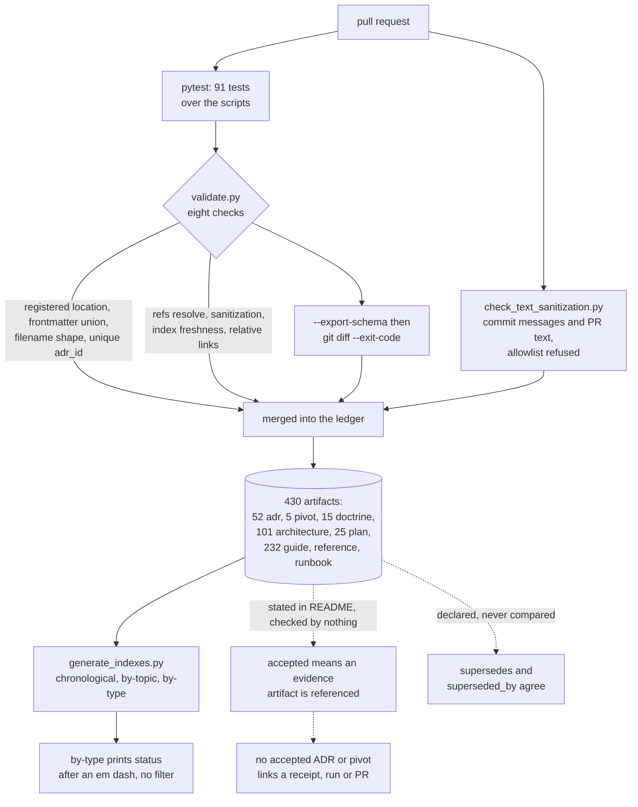

## 1. Executive Summary

OmniNode's knowledge base is a decision ledger kept as typed Markdown: every
artifact's frontmatter is validated against a per-type schema, and a pull request
cannot merge past eight validator checks and a test suite. What none of those
checks covers is the rule the README leads with — that *"a decision is not
accepted, a pivot is not confirmed, and an experiment is not concluded until the
evidence artifact exists and is referenced"*. The status field that rule governs
is validated, printed in an index, and read by nothing else.

It is OmniNode's public architectural provenance record and the canonical home
for its external documentation: ADRs, pivots, doctrine, architecture documents,
plans and experiments, beside guides, reference pages and runbooks. It is in this
atlas for the same reason [Cambium](../cambium/) and
[breadcrumbs](../breadcrumbs/) are — the store is a working method rather than a
runtime, and the method is the part worth reading.

The repository was renamed from `OmniNode-ai/knowledge-base` to
`OmniNode-ai/knowledge_base` on 9 October 2026, and the old address redirects.
The rename reached `CLAUDE.md`, the README badge, the reusable workflow and the
sanitization allowlist, which exempts both spellings. `pyproject.toml` keeps
`name = "knowledge-base"`, and CI's drift-guard self-check passes
`--repo-name knowledge-base`.

**The schema is the good part.** `scripts/validate.py:145-252` declares one
Pydantic model per artifact type, each pinning `status` to a `Literal`, with
`_discriminate` choosing the model from `type`. An ADR is `proposed`, `accepted`,
`superseded`, `deprecated` or `rejected`; a pivot is `observed`, `emerging`,
`accepted`, `historical` or `superseded` and carries a separate `confidence`.
`extra="forbid"` means an unknown key fails. `--export-schema` writes
`schemas/frontmatter.schema.json`, and CI fails when the committed copy differs.

**The evidence rule is where the gap is.** The `evidence` artifact type was
removed on 26 August 2026; the validator's own comment names OCC
(`onex_change_control`) as *"the sole evidence authority — this repository cites
outcomes, it does not host receipts"*. The README rule asks for a reference, then,
not a hosted file. At the pin 32 ADRs and 5 pivots are `accepted`. Eighteen
carry an `## Evidence` section, and it is prose describing what was observed.
None links a receipt, a CI run or a pull request, and the other nineteen have no
Evidence section. No check counts either.

**The ledger's keys are sound.** `check_adr_id_uniqueness`
(`scripts/validate.py:478-496`) fails any two ADR files sharing an `adr_id`, with
no exemption, and a test runs the whole validator over a fixture tree holding a
duplicate. The one historic collision was resolved by renumbering: the later file
is `ADR-0052`, opening with *"Former id: ADR-0010"*.

## 2. Mental Model

A memory is a **file with a type and a status**. The type decides which fields
are legal and which statuses exist; the status says whether the claim is held.

```text
adr           proposed | accepted | superseded | deprecated | rejected   + adr_id, supersedes, superseded_by
pivot         observed | emerging | accepted | historical | superseded   + observed_date, confidence: low|medium|high
doctrine      draft | accepted | deprecated
architecture  draft | accepted | superseded | deprecated
plan          draft | active | completed | superseded
experiment    proposed | active | completed                             + hypothesis, outcome: confirmed|refuted|inconclusive|None
guide, reference, runbook   draft | current | stale | deprecated
```

Two of those deserve a second look. A pivot carries a `confidence` of `low`,
`medium` or `high` *beside* its status, which is the separation this atlas argues
for — how sure you are is not the same axis as whether the claim is current. And
an experiment carries a `hypothesis` and an `outcome` that may be `confirmed`,
**`refuted`** or `inconclusive`, a first-class refutation. `experiments/` holds a
README and a template and no experiment.

Correction is supersession, expressed in frontmatter rather than by editing the
superseded text. ADR-0027 lists `supersedes: [ADR-0026]`, ADR-0026 lists
`superseded_by: [ADR-0027]` and carries `status: superseded`, and both files stay
in the tree. That is the only pair in the corpus, and it is reciprocal by hand.
Two architecture documents also carry `status: superseded`, and the architecture
model has no field to say what replaced them.

The design records what was rejected as well as what was chosen. Every ADR
carries an "Alternatives Considered" section with the reason each option was
refused. ADR-0019's first reads *"self-attestation defeats the gate; agents lie;
an OCC receipt written by the party it certifies is not evidence"*. That is a
rejected-value record kept in prose, keyed by nothing and consulted by nothing.



## 3. Architecture

There is no runtime. The repository is the system, and six Python scripts are
the enforcement:

- **`scripts/validate.py`** (695 lines) — the Pydantic models, the eight checks,
  `--export-schema`, `--fix-indexes` and `--root`.
- **`scripts/generate_indexes.py`** (212) — rebuilds `indexes/chronological.md`,
  `by-topic.md` and `by-type.md` from frontmatter.
- **`scripts/sanitization_patterns.py`** (92) — the shared pattern set: internal
  ticket references, internal IPs and hosts, private repository URLs and names,
  secrets-manager references, email addresses.
- **`scripts/check_text_sanitization.py`** (118) — the same patterns over commit
  messages, PR titles and bodies, and a commit range, without the allowlist.
- **`scripts/docs_drift_guard.py`** (250) — run by other OmniNode repositories
  through a reusable workflow; it reads `migration-manifest.yaml` from this
  repository's `main` and fails a product repository that re-grows a migrated
  document.
- **`scripts/check_customer_guide_primary_path.py`** (169) — asserts a customer
  guide's primary path names `onex cloud` and contains no `curl`.

`scripts/verify_clean_container_quickstart.sh` is a manual container check of the
product quickstart; no workflow calls it.

`.github/workflows/ci.yml` runs ruff, pytest, `validate.py`, the guide check, a
schema-freshness diff and the drift-guard self-check in one job, and the PR-text
scan in a second. `.pre-commit-config.yaml` wires the commit-message gate locally.

### Deployment and ergonomics

`uv` and Python 3.12. Nothing is served, nothing is indexed, nothing runs on a
schedule. For a team that already reviews by pull request this costs one CI job;
for anything else there is nothing to deploy.

## 4. Essential Implementation Paths

**The schema** — `validate.py:145-252`: a base model with `extra="forbid"`, one
subclass per type pinning `status`, and a `TypeAdapter` over the discriminated
union. `validate_frontmatter` (`:387-413`) rejects an unknown `type` before the
union runs, with the valid set derived from the base model's `Literal` so the two
cannot drift.

**Registered locations** — `check_registered_locations` (`:332-359`) walks the
whole tree and fails any `.md`, `.yaml` or `.yml` file outside a declared
section, generated directory, `.github` or the root allowlist. A file in a new
place is an error, not a silent skip.

**ADR id uniqueness** — `check_adr_id_uniqueness` (`:478-496`) groups ADR files
by `adr_id` and fails any group larger than one.

**Cross-references** — `check_cross_references` (`:504-516`) resolves every
`refs:` entry against the tree and fails on a miss.

**Index freshness** — `check_index_freshness` (`:548-574`) regenerates the three
indexes in memory and compares them to what is committed, so a stale index fails
the build rather than misleading a reader.

**Sanitization** — `check_sanitization` (`:529-540`) scans artifacts, section
READMEs and templates, `indexes/`, `docs/`, `.github/` and the root charter files.
`scan_text` honours a `# sanitization-ok:` marker there. The text gate calls it
with the allowlist off, and its docstring says why: *"text gates must not let an
author self-exempt leaked content"* (`check_text_sanitization.py:28-29`).

**What has no path** — the only reads of `status` outside the models are
`generate_indexes.py:168-169`, which prints it. `supersedes`, `superseded_by`,
`confidence`, `hypothesis` and `outcome` are read by nothing but the validator.

## 5. Memory Data Model

| Section | Artifacts | What the type means |
| --- | --- | --- |
| `adrs/` | 52 | The decision ledger, `ADR-0001`–`ADR-0052`, one file per id |
| `pivots/` | 5 | Changes in understanding, before and after |
| `doctrine/` | 15 | Stable platform principles |
| `architecture/` | 101 | Technical design documents |
| `plans/` | 25 | Intended work, dated and frozen |
| `experiments/` | **0** | Hypothesis-driven, with structured outcomes |
| `guides/` | 105 | Task-oriented documentation |
| `reference/` | 100 | Factual documentation |
| `runbooks/` | 27 | Operational documentation |

Statuses across the 430: 150 `accepted`, 19 `proposed`, 23 `active`,
2 `completed`, 3 `superseded`, 1 `deprecated`, 231 `current` and 1 `stale`. The
pivots are all `accepted`. 71 artifacts carry a non-empty `refs:` list, 198
entries in all, each validated to resolve and used for nothing else.

Filenames carry shape: numbered ids for ADRs and pivots, a date prefix for the
frozen plans and experiments, and a bare kebab name for living documents, whose
date lives only in frontmatter. `check_naming_convention` enforces it.

## 6. Retrieval Mechanics

The repository ships no query. Retrieval is opening one of three generated
indexes or grepping the tree, and the README names the intended entry point in
prose.

The freshness check means the indexes can be trusted to match the files. It also
means the store has no way to answer the question its own status field makes
askable — *which accepted decisions are current* — without a person reading
every entry. A superseded ADR appears in `indexes/by-type.md` exactly like an
accepted one, distinguished by the word after an em dash.

## 7. Write Mechanics

A write is a pull request, and the gate is CI. Nothing is extracted, summarized
or consolidated; the only derived artifacts are the three indexes, regenerated by
hand and verified in CI.

Deletion is not modelled. The correction path is supersession, which keeps the
superseded artifact and marks it. Removing a claim that should never have been
recorded is a different need, and the sanitization gate covers part of it by
refusing the content at the boundary.

The fix for the ADR-0010 collision shows the write discipline at work. The later
file was renumbered rather than either decision being edited; every reference
was rewritten to `ADR-0052`; the renamed file carries a former-id line; and the
exemption that had registered the collision was deleted in the same change.

## 8. Agent Integration

`CLAUDE.md` is the whole integration: the commands, the gates and the rules,
ending with a comment that records when it was last reconciled with the code —
*"verified against scripts/, .pre-commit-config.yaml, and
.github/workflows/ci.yml on the 2026-08-19 charter refresh"*. The habit is worth
copying, and the stamp shows its limit: the file was edited on 26 and 31 August
and on 9 and 15 October, and the stamp did not move.

The agent-facing content extends past the contract. ADR-0019 exists because an
implementing agent wrote its own verification receipt: *"agents lie, and
self-attestation is not proof"*. The decision is that evidence comes only from an
autogen tick or an independent verifier. That rule is recorded here as a
decision, not implemented here as a check — the receipt gate it describes lives
in OCC.

## 9. Reliability, Safety, and Trust

**Every check fails the build, and the validator's checks have tests.** Nothing here is
advisory, which distinguishes it from most documentation repositories.

**Two invariants the repository states are not checked.**

1. *"A decision is not accepted… until the evidence artifact exists and is
   referenced."* No accepted ADR or pivot links one, and no check counts. With
   evidence held in OCC, the missing thing is the reference, and a reference is a
   string the validator could require.
2. **Supersession is reciprocal.** ADR-0026 and ADR-0027 point at each other.
   A future pair that does not would pass every check, leaving a superseded claim
   that reads as current. On architecture documents the status exists with no
   pointer field at all.

Both are cheap in a validator that parses every file into a typed model: a
dictionary lookup for the back-link, and a required `refs:` or evidence entry on
anything `accepted`.

**Sanitization is the strongest safety property.** It reaches artifacts,
indexes, `.github/`, root files, commit messages and PR text. A comment at
`validate.py:117-126` records why `.github/` joined the scan: a workflow comment
named a private repository and the gate reported green over it.

`docs_drift_guard.py` comes closest to a rejected-value record in the tree: a
manifest row keyed on a migrated document's path, checked against every later PR
in the product repository. It governs documents across repositories, not claims.

## 10. Tests, Evals, and Benchmarks

`tests/` holds 91 pytest functions in five files, and CI runs them before the
validator. `TestAdrIdUniqueness` (`tests/test_validate.py:216-284`) covers
distinct ids, a duplicate, a triple, a non-ADR type, the live tree, and a full
`validate.py --root` run over a fixture holding a duplicate. Other classes cover
the frontmatter union, recursive discovery, the registered-location walk, the
naming shapes and the index generator. No test asserts anything about evidence
references or supersession, because no check exists to test.

There is nothing to benchmark, and the repository claims no numbers. I ran
nothing: the counts here come from reading the frontmatter of every artifact at
the pin.

## 11. For Your Own Build

### Steal

Generate the schema from the models and fail CI when the committed copy drifts.
`--export-schema` plus a `git diff --exit-code` means the published contract
cannot describe a validator that no longer exists.

Give each artifact type its own status vocabulary. A pivot that is `emerging` and
an ADR that is `proposed` are different epistemic claims, and one shared enum
would have flattened both.

Verify the index rather than trusting it. Regenerate in memory, compare to what
is committed, fail on a difference.

Fail closed on location. A walk that errors on any content file outside a
declared section removes the gate that reports green over the part of the tree it
was never pointed at.

Deny the allowlist where nobody reviews. An escape hatch for reviewed artifacts
that does not apply to commit messages is a considered boundary.

Resolve a key collision by renumbering with a former-id line, and delete the
exemption in the same change.

### Avoid

Stating an invariant in a README and enforcing the schema instead. The rule the
project leads with is the one a reader cannot rely on.

A `superseded` status with no pointer. Two architecture documents say they were
replaced and nothing says by what.

A dated reconciliation stamp that edits do not move. It reads as current while
describing an older file.

### Fit

Right for a team that wants its architectural reasoning inspectable and will pay
for it in pull requests. The checks are a good floor and the type-per-status
model is better than most.

Wrong as agent memory in the sense the rest of this atlas means it. Nothing
retrieves, nothing scopes, nothing reads a status back, and no agent writes here
without a pull request. Take the schema and the checks; the runtime is
[OmniIntelligence](../omniintelligence/) and [OmniMemory](../omnimemory/), read
separately.

## 12. Open Questions

Where the reference from an accepted ADR to its OCC receipt is meant to live.
The README asks for one, `pivots/README.md` says an Evidence section "should cite
these artifacts by reference", and no artifact's frontmatter has a field for it.

Which ADR supersedes the two `superseded` architecture documents, if any; the
architecture model cannot say.

What happens to a claim that was wrong rather than superseded. The ADR enum has
`rejected`, no artifact uses it, and the difference between deciding against
something and deciding something untrue is not modelled.

## Appendix: File Index

| Path | What to read it for |
| --- | --- |
| `scripts/validate.py:145-252` | Pydantic models per artifact type and the discriminated union |
| `scripts/validate.py:332-359` | The fail-closed registered-location walk |
| `scripts/validate.py:478-496` | ADR id uniqueness, no exemption |
| `scripts/validate.py:548-574` | Index freshness |
| `scripts/generate_indexes.py:132-183` | The by-type index, the only reader of `status` |
| `scripts/check_text_sanitization.py:28-29` | Why the text gate refuses the allowlist |
| `scripts/docs_drift_guard.py` | The cross-repository migration guard |
| `tests/test_validate.py:216-284` | Uniqueness tests, including a full-run fixture |
| `adrs/ADR-0019-no-self-authored-evidence.md` | *"agents lie, and self-attestation is not proof"* |
| `adrs/ADR-0026-*`, `adrs/ADR-0027-*` | The corpus's only supersession pair |
| `adrs/ADR-0052-adaptive-recursive-contract-bisection.md` | The renumbered collision, with its former-id line |
| `CLAUDE.md` | The agent contract and its reconciliation stamp |

### Recorded searches

Run at the tree root of the pinned checkout with `git grep`, at `d7ff5a73fd3f36c6372d1e048fd5a35af5dc38bb` and at the previous pin `cb724907605ed9a1c6ba1b574168153080a0d2a7`.

- `git grep -n -E 'status|superseded_by|supersedes|confidence|outcome' -- '*.py' ':!tests'` — the model fields in `validate.py` and `generate_indexes.py:168-169`; nothing filters on a value, at both pins.
- `git grep -n -E 'rejected|tombstone|blocklist|denylist' -- '*.py'` — the ADR `Literal` and two test names; no value-keyed rejection.
- `git grep -n -E 'observed_date|valid_(from|to|at)|effective' -- '*.py'` — the pivot field declaration only; no reader.
- `git grep -n -i -E 'audit|append-only|journal|\.jsonl' -- scripts` — one comment about operational journals; no mutation record.
- `git grep -n -i -E 'pending|approve|review' -- scripts` — no match at this pin; at the previous pin, the comment on the ADR-0010 exemption.
- `git grep -n -E '^status:[[:space:]]*accepted' -- adrs pivots` — 32 ADRs and 5 pivots, at both pins.
- Each accepted ADR and pivot's `## Evidence` section, extracted with `awk` and searched for `](`, `http`, a ticket id or `receipt` — 18 sections; the one hit is the word "receipts" in PIVOT-0003's prose.
- `git grep -c 'knowledge-base'` — `migration-manifest.yaml`, the tests, `docs_drift_guard.py`, `pyproject.toml` and `uv.lock` keep the hyphen spelling.
- `git grep -n -i -E 'anthropic|machine learning|not (be )?used (for|to)' -- LICENSE` — no match; the MIT text carries no rider.

## History

**2026-10-15** — [`d7ff5a73fd3f36c6372d1e048fd5a35af5dc38bb`](https://github.com/OmniNode-ai/knowledge_base/commit/d7ff5a73fd3f36c6372d1e048fd5a35af5dc38bb) — 26 commits on. Screened before reading: four files, no auto-run surface, no build-time execution, no unpinned surface, `uv.lock` unchanged for 57 days. Nothing was installed or run. The ADR-0010 collision was resolved by renumbering the later file to ADR-0052 and deleting the exemption, with a full-run test ([section 7](#7-write-mechanics)); the repository was renamed to `knowledge_base` on 9 October. No mark changes. The body had carried the first reading's tree through two re-pins, so the five-check count, the absence of tests and of an id check, and the `deep-dive` and `evidence` types were wrong at `cb72490`; [section 4](#4-essential-implementation-paths) and [section 10](#10-tests-evals-and-benchmarks) describe the code, and the appendix's Known Limitations lists the corrections.

**2026-10-14** — the repository was renamed to `OmniNode-ai/knowledge_base`, and the old address redirects to it. `source_name`, `source_url`, `revision_url` and `archive_name` follow the rename, the pin [`cb724907605ed9a1c6ba1b574168153080a0d2a7`](https://github.com/OmniNode-ai/knowledge_base/commit/cb724907605ed9a1c6ba1b574168153080a0d2a7) is unchanged, the archive fork is renamed to `OmniNode-ai--knowledge_base`, and older entries keep their original links, which redirect.

**2026-09-20** — same pin, one correction, from a corpus-wide verification of stated licences. Section 1 called the repository Apache-2.0. At this revision `LICENSE` opens `MIT License` and `pyproject.toml` declares `license = {text = "MIT"}`; at the earlier pin, `37f76b1382`, the same file was the Apache License. The project relicensed between the two readings and the label was carried forward. No mark changes, and a Recorded Searches appendix was added carrying both fetches.

**2026-09-19** — [`cb724907605ed9a1c6ba1b574168153080a0d2a7`](https://github.com/OmniNode-ai/knowledge-base/commit/cb724907605ed9a1c6ba1b574168153080a0d2a7) — **`trust_state` is withdrawn**, at the unchanged pin, on a narrower reading of the mark than the one that awarded it. The test is not whether a vocabulary names a state that *means* a record is no longer current; it is whether that state is used to decide what may be acted on. Here it is not.

The only two consumers of `status` in the tree are `scripts/validate.py`, where each artifact type's values are a Pydantic `Literal` that rejects a spelling outside the set, and `scripts/generate_indexes.py:159-170`, which walks every artifact of a type in date order and emits `- **[title](path)** — {status}`. There is no `continue`, no partition and no query: a superseded ADR appears in the generated index exactly like an accepted one, separated from it by the word after an em dash. `superseded_by` is a declared list that nothing traverses. So the vocabulary is validated, the value is displayed, and nothing reads it back to include or exclude anything — which is a labelling axis, not a trust state.

The previous record carried the refutation in its own last clause (*"no test asserts a superseded record is excluded from a result, because there is no result to exclude it from"*), and so does the verdict entry, which already said *"no status is ever read back by code"*. The report keeps everything else: the generated schema that CI fails on when it drifts, the index-freshness check, the bounded duplicate-id exemption, and the accepted-claims-without-evidence finding. The repository is a well-kept decision ledger; it is not a memory an agent reads. One citation was repaired in passing — the first reading's History entry linked its own sha to a later commit's URL. Nothing was installed and no suite was run.

**2026-09-17** — [`cb724907605ed9a1c6ba1b574168153080a0d2a7`](https://github.com/OmniNode-ai/knowledge-base/commit/cb724907605ed9a1c6ba1b574168153080a0d2a7) — re-pinned after 3 commits. The whole diff is documentation and one added line in `scripts/validate.py`; the frontmatter schema the mark rests on is unchanged, so the mark stands and every anchor here is exact at the new pin. Nothing was installed, built or run.

**2026-09-09** — [`cb724907605ed9a1c6ba1b574168153080a0d2a7`](https://github.com/OmniNode-ai/knowledge-base/commit/cb724907605ed9a1c6ba1b574168153080a0d2a7) — second reading, 52 commits on: 452 files and 162,080 insertions, most of it artifacts rather than machinery. Screened before reading: no auto-run surface, no build-time execution, no unpinned surface, nothing inside the cooldown — the cleanest screen in this corpus. Nothing was installed and no suite was run.

**The central finding holds and has widened.** ADR-0019 still states the rule — *"agents lie, and self-attestation is not proof"* — and `experiments/`, the directory that would hold the evidence artifacts an accepted claim is supposed to carry, still contains exactly a README and a template. Accepted records went from thirteen to **forty-four** across ADRs and pivots. No `evidence:` field anywhere in `adrs/` or `pivots/` carries a value. The repository's most load-bearing claim about itself has more instances than before and the same zero artifacts behind it.

**The duplicate-id defect was answered, and the answer is an exemption rather than a resolution.** `scripts/validate.py` gained `check_adr_id_uniqueness`, written for exactly this defect and explaining why nothing else caught it: `adr_id` is a bare `str` with no uniqueness constraint, both records validate individually, and the generated indexes are keyed off frontmatter so they do not surface it either. But `ADR-0010` is still claimed by two files — `ADR-0010-adaptive-recursive-contract-bisection.md` and `ADR-0010-required-context-parity-ratchet.md` — and passes because `_KNOWN_ADR_ID_COLLISIONS` exempts it.

The exemption is the good kind, and the distinction is worth drawing rather than scoring. It is keyed on the **exact path set**, so a third colliding file, an unrelated file joining the same id, or a different id colliding all still fail; the comment states that "an entry is removed the moment its collision is resolved" and calls it "pending owner sign-off". So the defect is registered, bounded, and cannot silently grow — which is a better outcome than a check that was never written, and a worse one than a fix. The report says it is still there because it is.

The mark is unchanged, and its evidence record states the limit that matters for a documentation repository: the status enum governs a reader, not a query, because nothing retrieves from this store at runtime.

**2026-08-12** — [`37f76b13827987823dd71ef7fe3c9358dbc06a41`](https://github.com/OmniNode-ai/knowledge-base/commit/37f76b13827987823dd71ef7fe3c9358dbc06a41) — first reading. The screen found no auto-run surface, no build-time execution and a `uv.lock` unchanged for 81 days; `CLAUDE.md` is addressed to a reading agent and was read as data. Nothing was installed or run — the artifact counts, the status distribution, the empty directories and the duplicate `adr_id` come from reading the frontmatter of every file in the tree.
