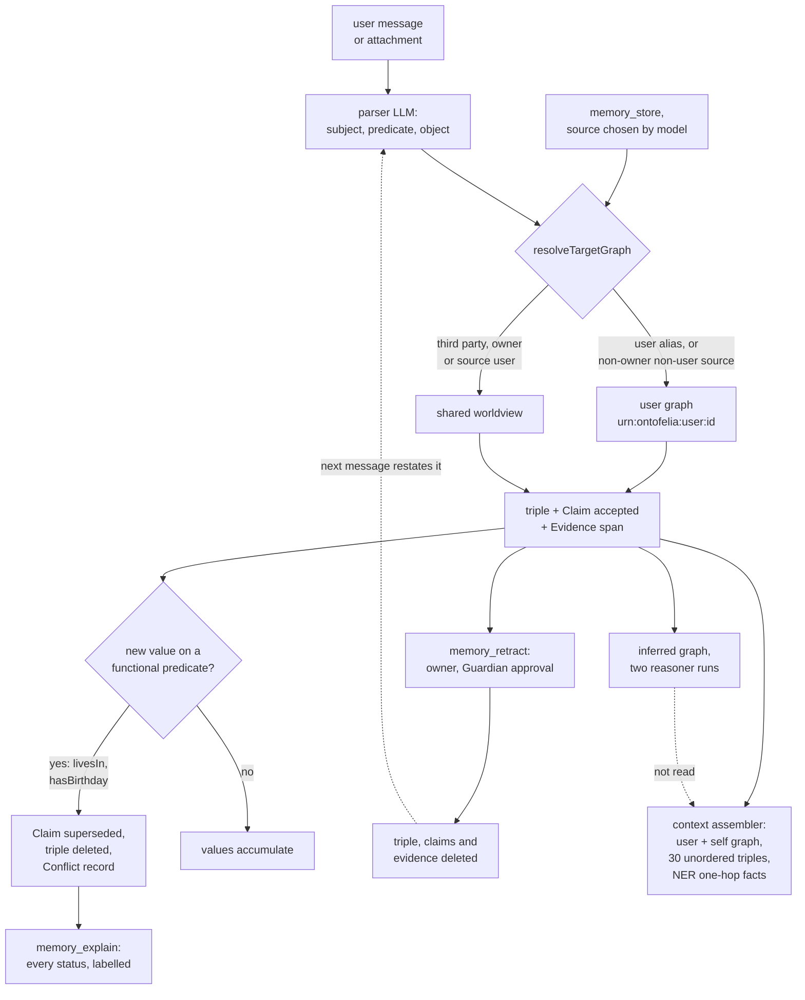

## 1. Executive Summary

Ontofelia is a self-hosted agent gateway in TypeScript whose long-term memory
is an RDF dataset. Every non-trivial user message passes through a parser LLM
before the answer model runs, and each extracted fact lands as a triple in a
named graph chosen by who said it and what it is about, beside a provenance
claim and the source span. What is notable is the boundary: the graph IRI is
the scope key on every quad, every read the runtime assembles names its graphs,
and model-written SPARQL is parsed and refused unless each pattern sits inside
an allowed `GRAPH`. What is weak is correction: supersession fires on two
predicates in the shipped ontology, a forget is a hard delete that leaves
nothing to stop the next message re-asserting the value, and the README's
forget result comes from an eval-only delete path.

The project calls itself a neuro-symbolic research preview at v0.0.1. Its
hypothesis is that a governed, reasoning graph can forget when told and flag
contradictions where a vector store cannot, and the README reports a pilot
against a vector-RAG baseline in its own harness. It also states that the
code was written by Claude Code, Codex and Gemini under human direction. The
memory core is `packages/semantic-memory`, wrapped by a Fastify gateway, an
agent runtime, chat channels and a web UI.

Five findings shape the rest of this report.

- **The evaluated forget is not the shipped forget.** The eval backend's
  `retractFact` deletes every value of a subject and predicate from every fact
  graph and sets the claims to `retracted`, a status no product path writes
  (`packages/eval/src/backends/SemanticBackend.ts:486-524`). The product's
  `memory_retract` deletes the matching triple from one graph and hard-deletes
  its claims. The same backend declares 20 predicates functional where the
  shipped ontology declares 2, ingests pre-parsed facts, and surfaces
  `[CONFLICT]` markers the runtime prompt never carries.
- **Forgetting keeps no memory of itself.** `memory_retract` removes the
  triple, its claims and evidence without trace, so a later message restating
  the value is extracted and accepted again. The original sentence stays in the
  episodic graph's payload and the JSONL transcript.
- **The reasoner's output reaches no automatic read.** `storeFact` runs two
  full OWL 2 RL materialisations per fact before replying and writes the
  difference to an inferred graph. The recall graphs deliberately exclude the
  inferred graphs (`KnowledgeEngine.ts:561-570`), so only model-written SPARQL
  and the graph browser read them.
- **The shared worldview is writable from a non-owner session.** A non-owner's
  third-party fact reaches the worldview every user reads when `sourceKind` is
  `user`, and `memory_store` takes that value from the model.
- **Recent facts are not recent.** `getRecentFacts` selects 30 triples with
  `LIMIT 30` and no `ORDER BY` (`KnowledgeEngine.ts:665-708`), and that block
  goes into every prompt.

## 2. Mental Model

A memory is a triple the system believes, plus a claim saying why. The parser
turns a message into `{subject, predicate, object}` candidates, and
`SemanticIngestionService.ingest` stores every non-question as `accepted`
(`ingestion/SemanticIngestionService.ts:75-97`). Confidence is recorded on the
claim and gates nothing; the service's own comment says contradictions are
handled later by belief revision rather than a proposal stage. A fact is
therefore true from the moment it is parsed.

**Where a fact lands is the scope decision.** `resolveTargetGraph` sends a
fact whose subject is a user alias, or a user's request of the agent, to
`urn:ontofelia:user:<senderId>`, and everything else to the shared
`urn:ontofelia:worldview` (`KnowledgeEngine.ts:1073-1095`). For a non-owner,
a fact with any `sourceKind` other than `user` stays private. The self graph
holding the persona is never a write target.

**A fact stops being believed in one of two ways.** A new value on a predicate
declared `owl:FunctionalProperty` supersedes the accepted claim on the same
subject and predicate in the same graph. `retireSupersededClaim` flips its
status to `superseded`, stamps `supersededAt` and `supersededBy`, deletes the
base triple, removes the inferences only that triple supported, and writes a
`core:Conflict` record (`KnowledgeEngine.ts:1214-1353`). The old claim stays,
so `memory_explain` can answer what replaced a value and when. A predicate
that is not functional accumulates values, which is deliberate: `worksAt` and
`hasRole` are multi-valued so a career history survives.

The second way is `memory_retract`, which removes the triple, its claims and
its evidence with no residue (`packages/tools/src/memory/memory_retract.ts:103-150`).
The system prompt tells the model to call it whenever a user asks to forget
(`apps/gateway/src/index.ts:173-179`). Nothing records that the value was
refused.

| Status | Written by | Base triple | Read as true by |
| --- | --- | --- | --- |
| `accepted` | `storeFact`, every parsed or tool-stored fact | present | every read |
| `superseded` | `retireSupersededClaim`, on a functional predicate | deleted | `memory_explain` only, labelled |
| `rejected` | no product writer | never inserted | nothing |
| `retracted` | the eval backend only | deleted | nothing |
| hard-deleted | `memory_retract` | deleted | nothing, and nothing remembers it |

The reads that withhold a superseded claim do it two ways. The context
assembler reads fact graphs, where the triple is gone. The claim reads —
`findConflictingClaims`, the `recent_facts` and `facts_by_confidence`
templates and the `claim_clash` scan — select `status "accepted"`. Nothing
holds a fact in doubt: there is no candidate state, and conflicts the detector
stores as `unresolved` have no resolver.

## 3. Architecture

The runtime is one Node process. `apps/gateway` starts Fastify, the channel
adapters, the triplestore and one `AgentRuntime`; `packages/agent-runtime`
builds the prompt and runs the tool loop; `packages/semantic-memory` owns the
graph. The default backend is embedded Oxigraph, the WASM build of the Rust
store, held in memory (`packages/config/src/schema.ts:186`). Apache Jena
Fuseki is a second backend, and an in-memory adapter is a stub.

Oxigraph persistence is a full rewrite. `OxigraphAdapter.flush` serialises the
whole dataset to N-Quads and replaces `dataset.nq` by temp file and rename
after every update (`adapters/OxigraphAdapter.ts:69-76`). A `storeFact` issues
several updates, so it rewrites the file several times. Boot reloads the file.

Reasoning runs in `packages/reasoner`, a napi wrapper over the `reasonable`
crate, which CONTRIBUTING.md and `docs/known-limitations.md` describe as an
OWL 2 RL forward chainer. The README advertises OWL-DL reasoning with
consistency checking. `ReasonableEngine.materialize` reasons over the TBox plus
the context graphs twice, with and without the new triple, and keeps the
difference (`reasoning/ReasonableEngine.ts:26-80`). The reasoner is created
only for the Oxigraph backend.

The core ontology is loaded into `urn:shared:ontology` at gateway start
(`apps/gateway/src/services/triplestore.ts:63-71`), and `bootstrap/*.ttl`
seeds the self, meta and setup graphs. Sessions are JSONL transcripts with a
SQLite index in `packages/session-store`. A cognitive layer — episodic,
procedural and working memory, a goal stack, metacognition — writes further
`cog:` graphs, and its cycle path runs only when `cog.flagCycleManager` is set
(`packages/agent-runtime/src/cognitive/CognitiveConfig.ts:1-37`).

### Deployment and ergonomics

- What has to run: the gateway process and an LLM provider. No database
  server on the default backend; Fuseki needs Java.
- Offline: the store, reasoner and retrieval are local; the parser and answer
  models are whatever provider is configured, with
  `google/gemma-3-27b-it:free` as the parser's default model id
  (`ingestion/SemanticParser.ts:44-48`).
- An API key is needed to store anything automatically, because extraction is
  an LLM call; `memory_store` writes without one.
- Install is `install.sh` or `install.ps1` and a pnpm build, including a Rust
  build of the reasoner binding where no prebuilt binary matches.
- The store is human-readable N-Quads, and a full wipe through
  `DELETE /api/knowledge` writes a Turtle backup first. Repair by hand means
  editing quads or SPARQL updates.

The committed scaling benchmark prices the design. At 10,000 facts a steady
`storeFact` takes 2.2 s, at 60,000 it takes 26.6 s, and boot at 60,000 facts
spends three minutes loading the file (`bench/BENCHMARK_RESULTS.md`, table A).
Its breakdown at about 270,000 triples attributes 3.4 s to the two reasoner
runs and about 600 ms to each full flush.

## 4. Essential Implementation Paths

**Capture.** `AgentRuntime` handles a message in
`packages/agent-runtime/src/index.ts`. It extracts attachment text, then calls
`semanticParser.parse` on the message plus that text (`:727-735`) and
`ingestionService.ingest` with the sender id and `isOwner` (`:748-758`). The
stored facts are echoed into the prompt as "Just-Stored Facts" (`:765-771`).

**Store.** `KnowledgeEngine.storeFact` (`KnowledgeEngine.ts:1453-1699`):
validate any source URI; `isDuplicate` against the target graph; pick the
graph; resolve the subject through `canonicalSubjectUri`, which pins user
aliases to `entity:user:<id>` and agent self-references to the agent entity;
resolve the predicate, registering a new one in the agent schema graph; resolve
the object with type-aware label matching. Then supersede, materialise, insert
the triple, link `owl:sameAs` when the user states their own name, insert the
inferences, and write evidence and claim through `ClaimProvenanceService`.

**Supersede.** `isFunctionalProperty` asks the TBox and schema graphs
(`:1190-1203`); `findConflictingClaims` selects accepted claims on the same
subject and predicate whose `assertedInGraph` equals the target graph
(`:1129-1182`); `retireSupersededClaim` validates every stored term before the
first write, then runs four separate updates (`:1214-1353`). None of the steps
of `storeFact` share a transaction.

**Retrieve for the prompt.** `index.ts:658-720` appends, in order, the graph
registry from `urn:shared:meta`, `getSystemPromptContext` (self graph and the
sender's user graph, plus onboarding gaps), `getRecentFacts(agentId, 30,
senderId)`, and `getFactsAbout` for entities that `EntityMatcher` finds in the
message. Binding directives from the self graph go last (`:858-876`).

**Retrieve by tool.** `memory_ask` runs four fixed templates
(`packages/tools/src/memory/memory_ask.ts`); `memory_reflect` dumps the
worldview and sender graph; `memory_explain` returns claim
provenance with supersession (`memory_explain.ts`); `memory_sparql` runs
SELECT or ASK and `memory_query` SELECT or CONSTRUCT, both behind
`checkSparqlScope` (`packages/semantic-memory/src/sparql/scopeGuard.ts`).
`memory_query` is in the gateway's default deny list
(`apps/gateway/src/services/tools.ts:65`).

**Forget.** `memory_retract` validates the graph against the registry and the
caller's two allowed graphs, deletes the triple, deletes matching claims and
their evidence, and rebuilds or clears the matching inferred graph
(`memory_retract.ts:55-150`). It is `hostOnly`, so `ToolPolicyEngine` refuses
it to a non-owner on a person channel and requires approval otherwise
(`packages/security/src/ToolPolicy.ts:59-89`).

**Detect.** `ConflictDetector.detectConflicts` finds disjoint-class and range
violations and accepted-claim clashes, and `storeConflicts` writes them as
`unresolved` (`reasoning/ConflictDetector.ts:36-178`). It runs from
`GET /api/reasoning/conflicts` and `POST /api/reasoning/reflect`; the
`memory_reflect` tool only reads the worldview and the sender graph.

## 5. Memory Data Model

A stored fact is three things. The base triple sits in its target graph with
an entity URI of the form `urn:ontofelia:entity:<Name>` and a predicate in
`urn:ontofelia:core#`. The claim sits in `urn:ontofelia:claims` with
`claimSubject`, `claimPredicate`, `claimObject`, `status`, `confidence`,
`confidenceLabel`, `sourceKind`, `ingestionRunId`, `learnedAt`, and either
`assertedInGraph` plus `acceptedAt` or, for a non-accepted claim,
`targetGraph` (`provenance/ClaimProvenanceService.ts:101-184`). The evidence
sits in `urn:ontofelia:evidence` with `evidenceType`, `capturedAt`, the raw
span, message id, session, channel, and for documents a `sourceUri` and
`contentHash`.

**Scope is the graph.** `GraphUriResolver` names every graph from the agent
id: `self`, `skills`, `setup`, `worldview`, `schema`, `claims`, `evidence`,
`conflicts`, `inferred`, `user:<id>`, `inferred:user:<id>`,
`session:<id>`, and the `cog:` family. `GraphRegistry.assertWritable` refuses
a write to an unregistered pattern, so a hallucinated graph IRI never reaches
the store. Claims, evidence and conflicts are agent-wide and carry the scope
as `assertedInGraph`.

**Time is record time only.** `learnedAt`, `acceptedAt`, `capturedAt`,
`supersededAt` and `detectedAt` are all written from the clock at the moment
of the write. No field records when a fact held in the world, and a
supersession says when the system changed its mind, not when the person
moved.

**Confidence is metadata.** The parser's `high`, `medium` or `low` maps to
0.95, 0.6 or 0.3 on the claim, and `memory_store` defaults to `high`. The
`facts_by_confidence` template filters on the label when the model asks for
it; nothing else reads either value.

Declared and unread: the gateway's `memoryPolicy` sets
`autoFlushBeforeCompaction`, `defaultConfidence` and
`trustUntrustedContent: false` (`apps/gateway/src/index.ts:180`), and no code
outside the type definition reads any of the three.

## 6. Retrieval Mechanics

Retrieval is graph lookup and string matching; there is no embedding on any
product path. Each turn injects three memory blocks, unbounded in tokens
except by their SPARQL limits.

**The identity and user block.** `getSystemPromptContext` reads the whole self
graph and the whole sender graph and renders them as bullets under "What I
Know About the User", telling the model not to ask again
(`KnowledgeEngine.ts:1842-1934`). A user graph grows without a cap, and so
does this block.

**The recent-facts block.** `getRecentFacts` selects `?s ?p ?o` across the
worldview and the sender graph, filters out typing and label predicates, and
takes `LIMIT 30` with no ordering. Despite its docstring, which promises the
most recent facts, the block is whichever 30 triples Oxigraph returns first.
Once the worldview holds more than 30 facts, a new fact may never appear in it.

**The entity block.** `EntityMatcher.extractEntities` matches message text
against labels from `listKnownEntities`, which takes `LIMIT 500` labels, also
unordered (`KnowledgeEngine.ts:519-542`). `getFactsAbout` then returns up to
20 one-hop triples in either direction for the matched entities
(`:603-655`). Matching is by entity URI built from the name, so an entity
minted under a disambiguated URI such as `Paris_Place` is not reached by the
plain name. The label list is cached for 60 seconds on the one matcher the
runtime holds, keyed on nothing (`ner/EntityMatcher.ts:19-45`). For that
minute, the labels loaded for one sender drive entity matching for the next.
The facts query that follows is scoped, so the effect is missed recall
rather than a leak of facts, though another user's private labels sit in the
matcher's memory.

**What retrieval does not see.** The inferred graphs are excluded on purpose,
with the comment that "recall does not surface inferences yet"
(`KnowledgeEngine.ts:561-565`). Claims are not read on the prompt path, so
the model learns of a supersession or a stored conflict only if it calls
`memory_explain`. The episodic retrieval that the cognitive cycle performs
writes into a per-cycle working-memory graph whose only reader is the
inspector UI (`cognitive/CycleManager.ts:897-923`, `CogInspector.ts:192-194`).

## 7. Write Mechanics

Writes are automatic. The parser prompt classifies each statement as a fact,
a question or uncertain, and returns ontology proposals beside it
(`ingestion/SemanticParser.ts:53-195`). A `TrivialMessageDetector` skips
greetings and acknowledgements. The ingestion service stores every non-question
as accepted, whatever its confidence; the docstring above it, which says low
confidence becomes a proposal, describes a removed stage.

**Deduplication is exact.** `isDuplicate` asks whether the same subject,
predicate and object triple exists in the target graph, after the same
canonicalisation the write uses (`KnowledgeEngine.ts:724-759`). Near-duplicates
with a different predicate spelling are folded only when `findPropertyByLabel`
matches an existing label.

**Entity resolution is label-based and type-aware.** A same-label entity is
reused when it carries the target class or no class, and a differently typed
one forces a disambiguated URI, so a person and a city named Paris stay
apart (`:247-327`). User aliases collapse onto one node per sender, and a user
stating their own name adds a symmetric `owl:sameAs` to the named entity
(`:1596-1640`).

**Attachments are parsed as facts.** Document text is concatenated to the
message before parsing (`index.ts:731-733`), and the result is accepted like
anything the user typed. Nothing distinguishes a fact from a forwarded CV from
a fact the owner asserted.

### Operational cost

The write blocks the reply. Parsing is an LLM call, and each fact then pays two
reasoner runs over the TBox and its context graphs plus several full-file
flushes before the answer model is called. The committed benchmark puts a
steady `storeFact` at 111 ms with 500 facts in the store and 2.2 s at 10,000,
per fact, so a message with five facts at that size waits about eleven seconds
for memory. A stored fact is retrievable on the same turn, and the turn's own
facts are echoed into its prompt.

No background pass rewrites the store on the default path. The reflection
route rescans worldview conflicts on request and appends a fresh set of
`unresolved` records each time, with no dedup against earlier runs. On the
read side, the injected blocks are bounded only by the user graph's size and
the two SPARQL limits, and they precede the transcript in the system prompt,
which changes whenever a fact is stored and so invalidates a provider's
prefix cache from that point.

## 8. Agent Integration

The agent reaches memory three ways. The prompt carries the assembled blocks
every turn. The tool surface registers `memory_store`, `memory_query`,
`memory_ask`, `memory_sparql`, `memory_explain`, `ontology_inspect`,
`ontology_propose`, `memory_reflect` and `memory_retract`
(`apps/gateway/src/services/tools.ts:32-56`). The self graph's directive
tells the model that ordinary facts are captured by the pipeline and that
`memory_store` is for deliberate writes (`bootstrap/self.ttl:144`).

**Agency is wide on write and narrow on delete.** `memory_store` is open to
every sender and lets the model choose `source` among `user`, `agent` and
`tool` (`memory_store.ts:27`). `memory_retract`, `memory_query` and
`ontology_propose` are host tools: a non-owner on a person channel never gets
them, and the owner's call waits for a Guardian approval in the UI or an
inline keyboard unless the tool is on the allow list
(`ToolPolicy.ts:14-18`, `:59-89`). A non-owner who asks the agent to forget
something about themselves cannot have it done.

**Ontology proposals are a file queue nothing consumes.** `ontology_propose`
writes a proposal JSON and, when the model passes `autoApprove: true`,
approves it in the same call (`ontology_propose.ts:13-16`, `:37-40`).
Approval writes a new versioned Turtle file and an `active.json`; no code
outside `OntologyManager` reads either, and the triplestore's TBox is loaded
from the packaged ontology at boot. The gateway's approve and reject routes
act on the same files.

Channels are WebChat, Telegram, Discord and WebSocket nodes, and the session
policy is per channel peer. The integration is specific to this gateway: the
memory package exports `KnowledgeEngine` and the tools, and adopting it in
another agent means supplying the sender identity and owner flag that its
routing depends on.

## 9. Reliability, Safety, and Trust

**Provenance is the strongest part.** Every accepted fact has a claim with the
span, session and source kind, and document evidence carries a SHA-256 content
hash that `hasEvidence` uses to skip unchanged re-imports
(`KnowledgeEngine.ts:1403-1416`). On the supersession path every
store-derived term is re-validated before it is rendered into an update, and
a term that cannot be rendered safely makes supersession skip that claim
rather than half-apply.

**Injection lands as accepted truth.** A sentence in a pasted document or a
forwarded message is extracted and accepted with the same status as the
owner's own statement. `sourceKind` is not set by the ingestion service, and
confidence filters nothing. For the owner, a third-party fact from an
attachment goes to the shared worldview that every user's prompt reads.

**The worldview is a shared write surface.** The routing comment states the
intent: for a non-owner, a model-chosen source must never open a path into the
worldview (`KnowledgeEngine.ts:1056-1067`). The code keeps that only for
`agent`, `tool` and a missing source, and `memory_store` hands the model the
`user` value. The test file pins the open case as deliberate
(`__tests__/NonOwnerFactRouting.test.ts:129-135`). A paired Telegram user can
therefore have a claim about a third person written where the owner reads it.

**Deletion does not reach the source.** `memory_retract` covers the triple,
claims and evidence. The message that stated the fact is kept as an episode's
`payload` and as a line in the session JSONL, and other claims extracted from
the same message keep their own spans. The episodic retention sweep that would
drop payloads after 30 days is a no-op unless its flag is set
(`cognitive/EpisodicMemory.ts:328-410`). A full wipe through
`DELETE /api/knowledge` writes a Turtle backup of everything, then reloads the
core ontology into `urn:ontofelia:tbox` (`apps/gateway/src/routes/memory.ts:186-193`),
a graph `isFunctionalProperty` and the reasoner never read, so supersession is
off until the next restart reloads `urn:shared:ontology`.

**Writes are not atomic.** A `storeFact` is a sequence of SPARQL updates —
supersession, triple, `sameAs`, inferences, evidence, claim — each flushed on
its own, so a crash between them leaves a triple without a claim or a retired
claim without its replacement. The audit log of tool calls is a hash-chained
JSONL file whose chain head lives in process memory and whose files are deleted
after 90 days (`packages/tools/src/audit/AuditLog.ts:9`, `:50-65`); the
parser's writes do not pass through it.

**Identity is the channel's.** The user graph key is the sender id the channel
reports. The gateway's single bearer token admits `POST /api/chat`, whose body
sets `senderId` and derives `isOwner` from it being `owner`
(`apps/gateway/src/routes/agent.ts:17-31`), so the token holder acts as any
user.

Marks withheld:

- `tombstone` — nothing durable is keyed on a rejected value. The `rejected`
  status has no product writer, and neither `isDuplicate` nor `storeFact`
  consults rejected or retracted claims before accepting.
- `bitemporal` — every time field is the write clock.
- `audit_log` — the conflicts graph appends one record per supersession and
  covers no insert or retraction; claims are mutated in place and deleted by
  `memory_retract`; the tool audit file misses the parser path and expires.
- `human_review` — no fact waits in a state for a person. Guardian approval
  gates a deletion or a proposal as a tool call, `ontology_propose` takes
  `autoApprove` from the model, and approved ontology versions are read by
  nothing.

## 10. Tests, Evals, and Benchmarks

I did not run the suite. The tree holds 129 Vitest files, and the
semantic-memory cases mostly open a real embedded `OxigraphAdapter` in a temp
directory, which makes their assertions about stored quads rather than mocks.
The privacy cases are the best of them: `PrivacyGraphIsolation`,
`CrossUserGraphScoping` and `NonOwnerFactRouting` assert absence beside a
present control, and `PrivacyGraphIsolation` adds a validity case that the
data is there under `GRAPH ?g`.

**Correction is tested by mechanism, not outcome.** `supersedes functional
property values (hasBirthday)` stores two birthdays and asserts only that an
`ASK` mentioning `FunctionalProperty` was issued
(`__tests__/SupersessionMultiValue.test.ts:167-201`). `ClaimSupersededBy`
checks the claim chain on a real store. The `memory_retract` tests count the
SPARQL strings sent to a mock adapter (`packages/tools/src/memory/__tests__/memory_graphs.test.ts:103-162`).
No committed case stores a fact, retracts or supersedes it, and asserts it is
absent from `getRecentFacts` or `getFactsAbout`.

**The eval harness measures a different system.** `packages/eval` runs
synthetic personas through three backends behind one answer model and scores
H0–H6 with McNemar and Wilcoxon tests. `SemanticBackend` ingests the
scenario's pre-parsed facts through the real `storeFact`, which is the shared
part. It seeds 20 predicates as functional, including `worksAt` and `hasRole`
which the product keeps multi-valued (`SemanticBackend.ts:48-69`, `:159-168`).
It retrieves through its own composition of entity queries, provenance and
`[CONFLICT]` markers for the probe's declared entities (`:197-265`), and it
forgets through its own `retractFact` (`:486-524`). The README's H6 forgetting
and H3 contradiction results therefore describe the engine under eval-local
retrieval and deletion, not the runtime a user talks to.

**The headline does not recompute from the tree.** The pilot outputs go to
`packages/eval/out/`, which `.gitignore` excludes, so the README's table has no
committed artifact behind it. The README is candid about scale: 127 probes per
model, three models, synthetic personas, no human-adjudicated agreement. No
paper accompanies the project.

**The scaling benchmark is committed and useful.** `bench/BENCHMARK_RESULTS.md`
reports per-operation timings with the scripts beside it, measured on one
Windows machine.

Tests I would want first: a retracted value restated in the next message must
not return to `getRecentFacts`; a superseded value must be absent from every
prompt block with its replacement present; a non-owner's `memory_store` with
`source: user` must not reach the owner's prompt; and the eval's H6 rerun
through `memory_retract`.

## 11. For Your Own Build

### Steal

- **Make the scope key part of every record's identity and name it on every
  read.** A named graph per user turns isolation into a query predicate the
  store applies, and reads that list their graphs in a `VALUES` clause cannot
  forget the user.
- **Parse model-written queries and allowlist what they touch.** Walking the
  SPARQL AST and refusing variable graphs, `SERVICE` and graph-less patterns
  closes the hole that a free-form query tool opens in any partitioned store.
- **Retire a superseded claim forward.** Keep the old claim with a pointer to
  its replacement and a time, delete only the asserted value, and history
  stays answerable without the old value reaching a prompt.
- **Retract derivations by difference.** Re-materialising the retired triple
  alone against the remaining store yields exactly the inferences it caused,
  so nothing independently derivable is removed.

### Avoid

- **Evaluating a path the product does not ship.** A benchmark backend with its
  own delete, its own retrieval and a different schema measures the
  benchmark; run the eval through the tools the agent calls.
- **Hard delete as the forget verb.** Without a record keyed on the refused
  value, the extractor that wrote it once writes it again from the next
  mention.
- **A "recent" read with a limit and no order.** It returns a stable-looking
  sample of the oldest rows and hides every new one.
- **Paying for inference nothing reads.** If the recall path excludes the
  derived graph, the reasoner is a per-write cost with no consumer.

### Fit

This suits one owner running a personal assistant across a few chat channels,
who wants to inspect and query what the agent believes about named people and
places, and who will stay below a few thousand facts. The write cost grows
with the store and sits in front of every reply, and the persistence model
rewrites the whole dataset per update, so a busy or long-lived deployment hits
the benchmark's tens of seconds. Walk away if several untrusted users share
one agent, since the worldview is a common write surface, or if "forget"
must survive the next conversation. The reasoning layer is the project's
research subject and is not yet on the read path.

## 12. Open Questions

- Was the README's H6 result run before or after the product's
  `memory_retract` was made executable, and would it hold through that tool?
- Is the `user` value on `memory_store`'s `source` meant to be available to a
  model serving a non-owner?
- Should `getRecentFacts` order by the claim's `learnedAt`, as `memory_ask`'s
  `recent_facts` template does?
- Which component is meant to read approved ontology versions, and is
  `autoApprove` meant to survive on the agent's tool?
- Is the inferred graph planned for the recall path, and at what cost per turn?

## Appendix: File Index

- **Engine and model:** `packages/semantic-memory/src/KnowledgeEngine.ts`,
  `provenance/ClaimProvenanceService.ts`, `utils/GraphUriResolver.ts`,
  `utils/GraphRegistry.ts`, `types.ts`, `ontologies/ontofelia-core.ttl`,
  `bootstrap/meta.ttl`, `bootstrap/self.ttl`.
- **Write path:** `ingestion/SemanticParser.ts`,
  `ingestion/SemanticIngestionService.ts`, `ingestion/TrivialMessageDetector.ts`,
  `packages/tools/src/memory/memory_store.ts`.
- **Retrieval and context:** `packages/agent-runtime/src/index.ts`,
  `ner/EntityMatcher.ts`, `packages/tools/src/memory/memory_ask.ts`,
  `memory_explain.ts`, `memory_sparql.ts`, `memory_query.ts`,
  `sparql/scopeGuard.ts`.
- **Correction:** `memory_retract.ts`, `reasoning/ConflictDetector.ts`,
  `reasoning/ReasonableEngine.ts`, `reflection/ReflectionRunner.ts`,
  `packages/reasoner/src/lib.rs`, `ontology/OntologyManager.ts`,
  `packages/tools/src/memory/ontology_propose.ts`.
- **Storage and policy:** `adapters/OxigraphAdapter.ts`,
  `apps/gateway/src/services/triplestore.ts`, `apps/gateway/src/services/tools.ts`,
  `apps/gateway/src/routes/memory.ts`, `packages/security/src/ToolPolicy.ts`,
  `packages/tools/src/audit/AuditLog.ts`, `packages/session-store/src/index.ts`.
- **Cognitive layer:** `cognitive/EpisodicMemory.ts`,
  `packages/agent-runtime/src/cognitive/CycleManager.ts`,
  `cognitive/CognitiveConfig.ts`, `cognitive/CogInspector.ts`.
- **Tests and evals:** `__tests__/NonOwnerFactRouting.test.ts`,
  `__tests__/CrossUserGraphScoping.test.ts`, `__tests__/PrivacyGraphIsolation.test.ts`,
  `__tests__/SupersessionMultiValue.test.ts`, `__tests__/ClaimSupersededBy.test.ts`,
  `packages/tools/src/memory/__tests__/memory_graphs.test.ts`,
  `packages/eval/src/backends/SemanticBackend.ts`, `bench/BENCHMARK_RESULTS.md`.

### Recorded searches

Checked against the checkout at the pinned revision, from the tree root.

- `git grep -n -E "\"(retracted|rejected)\"|'(retracted|rejected)'" -- '*.ts' ':!**/__tests__/**' ':!*.test.ts'` — `retracted` is written only in `packages/eval/src/backends/SemanticBackend.ts:512`; `rejected` on claims appears only in the type and the `storeFact` branch, with no caller passing it.
- `git grep -n -E "status\s*:" -- packages/semantic-memory/src/ingestion packages/tools/src/memory` — the ingestion service and vault mapper pass `accepted`; `memory_store` passes no status.
- `git grep -n -E "FunctionalProperty" -- ':!**/__tests__/**' ':!*.test.ts' ':!packages/eval/**'` — `livesIn` and `hasBirthday` in `ontofelia-core.ttl`; the rest are docs, examples and the engine's own check.
- `git grep -n -E "getInferredGraph|getReadableInferredGraphs|getUserInferredGraph|:inferred" -- '*.ts' ':!**/__tests__/**' ':!*.test.ts'` — readers are `scopeGuard.ts` and the gateway graph browser; no prompt path.
- `/usr/bin/grep -n -E "ORDER BY|LIMIT" packages/semantic-memory/src/KnowledgeEngine.ts` — `getRecentFacts` and `listKnownEntities` carry `LIMIT` with no `ORDER BY`.
- `git grep -n -E "getActiveVersion|activeFile|createVersion" -- '*.ts' ':!**/__tests__/**' ':!*.test.ts'` — every hit is inside `OntologyManager.ts`.
- `git grep -n -E "trustUntrustedContent|autoFlushBeforeCompaction|defaultConfidence" -- '*.ts' ':!**/__tests__/**' ':!*.test.ts'` — the gateway literal and the type only.
- `git grep -n -E "valid(From|To|Until|Time|At)|validity|effectiveFrom" -- '*.ts' '*.ttl'` — no temporal-validity field.
- `git grep -n -i -E "shacl|sh:NodeShape|validateShape" -- '*.ts'` — no match; SHACL appears in `bootstrap/meta.ttl` and docs only.
- `git grep -n -E "wm\.(read|list|snapshot)|readBuffer" -- packages/agent-runtime/src ':!**/__tests__/**' ':!*.test.ts'` — only `CogInspector.ts` reads working memory.
- `git grep -n -E "retentionTick\(" -- '*.ts' ':!**/__tests__/**' ':!*.test.ts'` — one caller, gated on `isRetentionEnabled`.
- `/usr/bin/grep -n -E "CACHE_TTL_MS|refreshEntities|userId" packages/semantic-memory/src/ner/EntityMatcher.ts` — the cache check compares only the time and list length; `userId` is passed to the loader and not stored.
- `git grep -n -E "unresolved" -- '*.ts' ':!**/__tests__/**' ':!*.test.ts'` — written in `ConflictDetector.ts:167`; no reader moves it.
- `git grep -n -i -E "arxiv|bibtex|@article|@misc|doi\.org|zenodo" -- '*.md' '*.cff'` — no match, and no `CITATION.cff`.
- `git grep -n -l "pilot-2026"` and `/usr/bin/grep -n "eval/out" .gitignore` — the README only; `packages/eval/out/` is ignored.

## History

**2026-10-15** — [`a9313c0fcc43a459fde9dd74918ea0ee7a23560e`](https://github.com/semantification-org/Ontofelia/commit/a9313c0fcc43a459fde9dd74918ea0ee7a23560e) — first reading, at the head of `main`, a merge of 14 October 2026. Three marks: `scope_enforced`, `trust_state`, `negative_eval`. Screened before reading from a full clone: no auto-run surface, one build-time execution point (`packages/reasoner/build.rs`), nothing inside the cooldown, and 23 unpinned surfaces, most of them workspace package manifests resolved by the root `pnpm-lock.yaml`, unchanged for 8 days. Apache-2.0 with no rider. Read with `git grep` and `sed`; nothing was installed, built or run.
