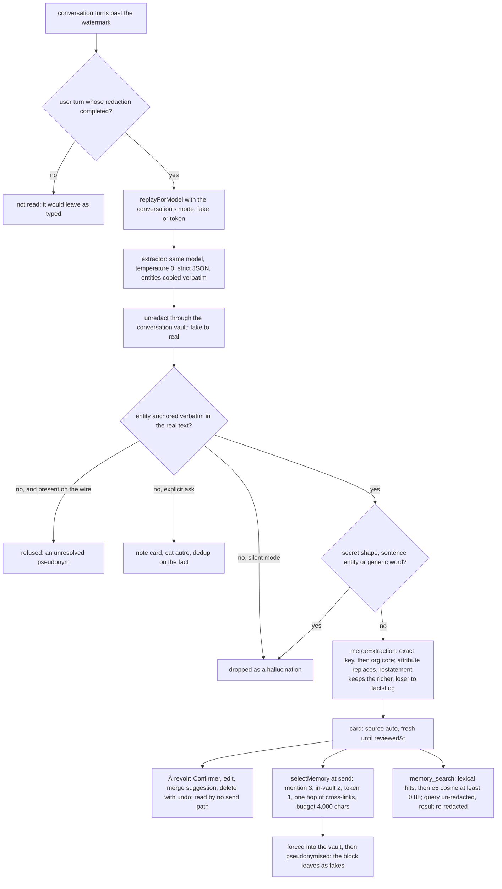

## 1. Executive Summary

OpenMasq is a multi-model desktop chat client whose premise is that the model
never sees real data: an on-device NER engine replaces names, organisations
and numbers with believable fakes before any network call, and a
per-conversation vault restores them in the reply. Its memory, the
**Mémoire**, is the one feature that has to hold real values durably, and
this report is about how a redacting product does that without opening a
second channel out of the machine. The answer is careful about egress and
thin about belief: every card in scope reaches the prompt whatever its state.

The project ships from a pnpm monorepo on a `dev` default branch: a signed
desktop app, a local redacting proxy for other tools (`apps/proxy`, which
imports the redaction engine and never the Mémoire), and a `FEATURES.md`
index whose memory chapter, `features/06-memory.md`, names the file behind
each feature. The memory lives in `packages/ui/src/memory/`, `state/memory/`
and `pages/Memory/` and in the desktop main process's `embed/` and
`memory_embeddings` modules.

Three decisions define it, and each is stated in a comment beside the code
that carries it. Extraction reads the **wire** — the conversation replayed
through the same substitution the send applied — and answers in fakes, which
are un-redacted locally through the conversation's vault. The vault doubles
as the hallucination filter, because an entity the model invented resolves to
nothing in the real text and is dropped (`memory/extract.ts:24-33`). Only user
turns whose redaction completed are replayed (`send/replayable.ts`), so a
turn refused before its values reached the vault never goes to the extractor.

Selection happens **client-side on real values**, because the model holds
only fakes, which a per-conversation salt keeps from being stable across
conversations (`memory/select.ts:22-36`). The selected entities are forced
into the vault before the user's message is redacted, so the same name maps
to the same fake in the block and in the text even under the regex engine.

And a card **updates rather than stacks**: a fact carrying a deadline, a
budget or a contact replaces the sentence with the old one, and a
restatement keeps the richer wording. What was removed goes into a
three-deep history a person can restore, because *"a consolidation that overwrites its evidence
in silence is the measured failure mode of agent memories"*
(`memory/memoryTypes.ts:21-30`).

It is strongest as a study in where the leaks are. The forced list is
filtered for common-lexicon words, because forcing a note titled « dossiers »
would redact that word across a whole conversation, and for notorious brands,
because a forced « google » alias would rewrite *Google Drive* across the
prompt. The pseudonym guard's test records the case that produced it: a vault
that had not hydrated stored the fake for *gouvernement français* as a card,
with the real value as its alias.

It is weakest as an epistemic system: a card
has one provenance flag and one timestamp, the review inbox is advisory, and
nothing on a read path consults either — which is why the one mark here is
`negative_eval`. The product's own feature index calls the Mémoire *"the
product's most delicate feature where confidentiality is concerned"*, and the
design spends its care on egress rather than on belief.

## 2. Mental Model

A memory is a **card about one entity**, and the entity's real name is the
key. The extractor is told to copy names *exactly as written* so the anchor
check can find them; `normalizeMem` lowercases, strips accents and
separators, keeps dots only inside emails and preserves CJK scripts, so
casing and spacing variants of one name hit one card. A card is born one of
two ways: the user writes it — from the Mémoire page, a text selection's
« Retenir », or the slash command — and carries no `source`; or the
extraction writes it and stamps `source: "auto"`. The profile is a separate,
always-injected paragraph for what the user says about themselves; a
preference with no entity is routed there rather than to a card, and the
cleanup pass migrates the note cards an older extractor minted for such
preferences.

The state a card can hold is thin on purpose. It is **fresh** while a machine
write is newer than `reviewedAt` and within seven days — the inbox — and
**treated** once a person confirms or edits it from the panel; nothing reads
that distinction except the inbox and the page's badge, so an unreviewed card
injects exactly like a reviewed one. It has a **history**: each merge that
replaces an attribute sentence or evicts one at saturation pushes the loser
onto `factsLog`, bounded at three, and `restoreFact` swaps an entry back with
the displaced sentence taking its place, so a restore is itself restorable.

It can be **merged**: two same-category cards sharing a key or a token subset, or
two whose e5 vectors sit above 0.95 and whose name tokens are not disjoint,
are proposed as a pair the person confirms, and the surviving card keeps the
other's surfaces as aliases so recall by the old name works. It **dies** only
by deletion, with a six-second undo that reinserts it verbatim; there is no
archive, no expiry and no record that a deleted fact was refused.

Memory is therefore user-controlled with a machine writer, and treated as
**ground truth** once stored: the injected block is framed as *"contexte
durable, à utiliser sans le réciter tel quel"*. It is also dated: every
injected line carries the card's last update as `noté le DD/MM/YYYY`, because
*"temporal reasoning is models' measured weak point on long-term memory, and
a card with no date reads as eternally true"* (`memory/select.ts:145-148`).

## 3. Architecture

The renderer owns the memory. `packages/ui/src/memory/` is pure TypeScript
with no React: `memory.ts` (normalisation, keys, tokens, the homograph
deny-list, the inbox predicate), `compaction.ts` (restatement, attribute
replacement, saturation, `factsLog`, restore), `dedupe.ts` (suggestions and
the self-healing `autoCleanMemory`), `extract.ts`, `extractParse.ts`,
`extractExplicit.ts`, `extractSweep.ts` and `mergeExtraction.ts` (the
extraction contract end to end), `select.ts` (injection), `search.ts` (the
tool), `cluster.ts`, `graph.ts` and `force.ts` (the graph view), `profile.ts`
and `usage.ts`. `state/memory/` holds the hooks: `useMemory.ts` is the CRUD
over `settings.memoire`, `useMemoryExtraction.ts` the timers and
`memoryExtractionRun.ts` one extraction pass, `useMemoryIndex.ts` the bridge
to the desktop's embedder. `pages/Memory/` is the screen: a force-directed
graph first, a list second, a node panel with the history, and
`useMemoryReview.ts` for the inbox. The send path that injects the block is
`send/sendOrchestrator/redactionPasses.ts`; the agent loop that serves the
tool is `agent/mcpAgent/`.

Persistence is the settings object, keyed by account.
`storePersistence.ts:64-87` strips `memoire`, the coffre and the prompt
templates from the `localStorage` copy whenever a host database exists, on
the stated ground that the memory is *"REAL cross-conversation PII"* under the
*"same at-rest regime as the coffre"*. The desktop opens one libSQL file
per signed-in account (`apps/desktop/src/main/db/connection.ts:53-76`),
encrypted at rest only in a packaged build where Electron `safeStorage` can
protect the key (`apps/desktop/src/main/store/dbCrypto.ts:7-25`), plaintext
under `pnpm dev`. The browser preview and mobile keep `localStorage` under an
account-suffixed key as their only store, falling back to the unscoped key
while signed out (`storePersistence.ts:31-41`).

The desktop main process also runs `embed/`, a bundled, sha256-verified,
QUInt8-quantised export of `intfloat/multilingual-e5-small` on ONNX, loaded
offline with no download path. Beside it, a `memory_embeddings` table holds
card id, model tag, text hash and vector, kept in step by diffing hashes and
pruned when a card is deleted, since *"a deleted card must not leave a vector
of its PII behind"*. The `@openmasq/sync` package carries each card as an allow-listed
record — id, entity, aliases, category, facts, `source` and the two
timestamps — in its end-to-end encrypted user-data scope
(`packages/sync/src/userdata.ts:77-86`). `factsLog` and `reviewedAt` are not
in that shape, so the restorable history and the review state stay on the
device that wrote them.

`ci.yml` runs on pull requests and pushes through the shared `verify.yml`,
which runs `pnpm test` (vitest) and gates releases; `scan.yml` runs static
checks. The memory tests run in jsdom against a mock model; the live variant,
`memoryLife.eval.ts`, is skipped without a key.

### Deployment and ergonomics

It is a desktop app, so the memory costs nothing to stand up beyond the app:
no service, no daemon, no separate store. A provider API key is needed to
extract — the extraction uses the conversation's own model, or the free
default under the Auto route — but not to store, inject or search; the
lexical tier and the whole selection cascade run without any model, and the
semantic tier degrades to nothing when the e5 bundle is absent. Fully local
and offline is the design for everything except the model call itself. The
store is human-readable in the sense that the page shows it and a plain-text
diagnostic export in Réglages → Journal dumps every card with its links and
the thresholds that produced them; it is not repairable by hand outside the
app, since it is a JSON field inside an encrypted settings row on the desktop.

## 4. Essential Implementation Paths

**Capture.** `useMemoryExtraction.ts` arms a 120-second idle timer after a
completed turn on the active conversation, flushes on window blur or on
switching away, and sweeps up to three conversations updated within seven
days 45 seconds after startup; an explicit ask fires 800 ms after the turn
settles. `runMemoryExtraction` (`state/memory/memoryExtractionRun.ts:81-300`)
returns early unless the ask is explicit or both `settings.memoryAuto` is on
and the conversation's `memoryOff` is clear, and unless the slice past the
`memoryWatermark` passes `worthExtracting` — at least 400 new characters of
user text with a NER-detected name or company, or an explicit phrasing in one
of twelve languages. At line 106 it keeps only `replayable` messages: a user
turn qualifies once a redaction pass has written its `redactions` count
(`send/replayable.ts`).

It then builds the wire with `wireSlice` or `wireTurns`, both of which call
`replayForModel` with the conversation's pinned mode (`memory/extract.ts:184-203`,
`memoryExtractionRun.ts:150-151`). That function is the substitution
`pseudonymize` itself applies — exact pass, tolerant variant pass, and in
token mode a pass for a known person's standalone surname
(`packages/redact/src/model/pseudonymize/replay.ts`). Silent mode reads user
turns only, because extracting from the assistant's replies, which embed the
injected memory, is *"the self-reinforcement loop"*; an explicit ask includes
the assistant. The model is called with `extractionPrompt` at temperature 0
under a 60-second timeout, retried once on an unreadable reply, and the pass
goes to `sweepExtraction` — one call in silent mode, up to four on an explicit
ask with the captured entities as an exclusion list (`memory/extractSweep.ts`).

`resolveExtraction` (`memory/extract.ts:75-179`) un-redacts every field and
strips a leading article or « chez » when the bare form also anchors (never
for a person, whose particle is part of the name). It drops secret shapes,
sentence-shaped entities and generic words, refuses an alias that is generic,
a single-word homograph or present only on the wire, and keeps a fact only
when its entity anchors in the real text — or, on an explicit ask, turns it
into a note. Self-preferences go to the profile. `mergeExtraction`
(`memory/mergeExtraction.ts`) finds the card by exact key and then by
organisation core with legal affixes stripped, same category only; a known
fact is a no-op, a new one goes through `mergeFactsDetailed`, an unknown
entity becomes a card with a pre-minted id so the caption can deep-link and
undo it. The watermark advances whether or not anything was learned, except
on an unreachable model.

**Compaction.** `mergeFactsDetailed` (`memory/compaction.ts:135-175`) first
asks whether an existing sentence `restates` the fact. Two sentences restate
each other when, after glue and framing are removed, their content words
differ by at most one mundane word each side over a shared core of three,
with inflections tolerated and any uncovered number or month breaking the
match. If one does, keep the richer one and log nothing; else if the fact
carries one of the attribute words (`deadline`, `budget`, `email`,
`travaille chez`, …) and a sentence already does, replace it and log the
old; else append; then `clampSentences` evicts whole sentences oldest first
above 600 characters, protecting the one just written.

**Injection.** `send/sendOrchestrator/redactionPasses.ts:70-103` runs
`selectMemory` before the attachment and user-message passes. It scores 3
for a whole-key mention in the typed text, 2 for a key present among the
conversation's vault originals and NER kinds and 1 for a distinctive token.
It then follows one hop along `crossLinks` from score-3 seeds only, at most three neighbours,
filled by score then `updatedAt` under 4,000 characters with an oversized card
skipped rather than stopping the queue. `formatMemoryBlock` writes the French
block; `memoryForcedForBlock` lists the selected entities and aliases, plus
any card entity that appears in the profile, as forced redactions, minus
lexicon words, sentence fragments and brands the level's notoriety policy
spares; `pseudonymize` then runs over the block with that list.

Fail-closed means skip: a redaction error drops the block rather than sending
it. The user turn records `memoryUsed` ids, only when the block went out, and
`memorySkipped` diagnoses — budget, or a homograph typed alone
(`send/sendOrchestrator/persistUserTurn.ts:40-44`) — and `MemoryCaption.tsx`
renders one line from them.

**Tool.** `agent/mcpAgent/interceptedMeta.ts:36-62` handles `memory_search`:
the query arrives in fakes and is un-redacted; `searchMemoryHybrid`
(`memory/search.ts`) scores each card by the number of query content words in
its entity, aliases and facts, sorts by score then recency, takes four, and
tops up from `host.memoryIndex.query` above cosine 0.88. The result is
re-redacted through the same vault before it reaches the model, and masked
outright when no redactor is wired; an empty store is answered with a
sentence rather than an error. The tool is offered only when the store is
non-empty and `memoryOff` is clear (`send/sendOrchestrator/agentTurn.ts:105-116`,
`agent/mcpAgent/setup.ts:89`).

**Review.** `useMemoryReview.ts`: `freshCardIds` plus `duplicateSuggestions`
make the inbox count; Confirmer patches `reviewedAt` pinned to the same
instant as `updatedAt`; delete keeps the card aside for the toast's six
seconds. `MemoryNodePanel.tsx:155` calls `restoreFact`. `useMemory.ts:39-48`
runs `autoCleanMemory` on every change and applies the result if anything
moved.

**Index.** `useMemoryIndex.ts` debounces 800 ms and sends every card's
embeddable text to `memoryIndexSync`, which hashes, embeds the stale ones in
batches of sixteen with the `passage:` prefix, upserts and prunes, and returns
the three nearest neighbours per card as cosine edges. `cluster.ts` keeps
edges at or above 0.92, or 0.95 between two people, and unions them with
mention links into groups the graph draws.

**Tests.** `memory/*.test.ts`, `state/memory/*.test.ts`,
`pages/Memory/*.test.ts*`, `evals/memoryFlow.test.ts`,
`evals/memoryLife.test.ts` with `memoryScenarios.ts` and
`memoryScenarios2.ts`, `apps/desktop/src/main/embed/knn.test.ts` and
`db/memoryEmbeddings.test.ts`.

## 5. Memory Data Model

`MemoryCard` (`memory/memoryTypes.ts`): `id`, `entity`, `aliases?` (at most
six), `cat` in `personne | organisation | projet | autre`, `facts` (at most
600 characters), `factsLog?: { at, prev }[]` (at most three, most recent
first), `source?: "auto"`, `reviewedAt?`, `createdAt`, `updatedAt`.
`MemoryData` is `{ profile?: string; cards: MemoryCard[] }` with the profile
at most 1,200 characters. The whole thing is the `memoire` field of
`Settings` (`types.ts:171-179`), beside `memoryAuto` and `memoryProposalSeen`;
a conversation carries `memoryWatermark`, `memoryOff` and the `redactionMode`
the replay follows (`packages/schema/src/conversation.ts:41-46`); a message
carries `memoryUsed`, `memorySkipped`, `memoryNoted`, `memoryNotedIds`,
`memoryUpdatedIds`, `memoryNotedFailed` and `memoryNotedPending`
(`packages/schema/src/message.ts:111-132`), ids and codes only.

Scope is the signed-in account, by partition rather than by key: the desktop
selects the account's database file and the preview the account's storage
key before any card is read, and no card carries a scope. Provenance is the
`source` flag and, for an explicit ask, the ids pinned on the reply. Time is
`createdAt`, `updatedAt` and the history entries' `at`; there is no validity
field, no expiry and no version number — the history is the version chain,
bounded at three. Episodic material has no home here: the conversation store
keeps the transcript and a separate, conversation-bound context-compaction
summary (`useContextCompaction.ts`) that is explicitly *not* memory, since its
fakes mean different people elsewhere.

An organisation can close **access** to the Mémoire for its members remotely,
and the code is explicit that this hides the screen, its navigation entry,
its ⌘K result and its deep link while the memory keeps injecting into every
send, answering the tool and extracting silently
(`state/billing/featureAccess.ts:21-32`, pinned by `featureAccess.test.ts`).
The desktop's `memory_embeddings` row is `card_id, model, text_hash,
embedding, updated_at` (`apps/desktop/src/main/db/schema.ts:172-183`).

## 6. Retrieval Mechanics

Two paths over one store, split on purpose because *"pulling on demand and
choosing what to inject are two different questions"* (`memory/search.ts:11-16`).

Injection is a cascade, not a search. Tier 3 is `mentions`: a normalised
key of at least three characters, or two CJK glyphs, present at word
boundaries in the typed text. Tier 2 is the same test against the
conversation's known real values joined on a hard separator. Tier 1 is
`mentionsToken`, a single distinctive token of the entity, excluding digits,
dotted fragments, stopwords, generic terms and a curated list of name-noun
homographs in French and English. Everything else is never injected and is
left to the tool.

From certain mentions only, one hop follows `crossLinks`,
which pairs cards whose facts or aliases name another card's key, ranked by
recency and capped at three. The budget is character-based with a fixed
per-line overhead of 40 characters, direct hits before neighbours, and a
skipped direct hit is recorded as a diagnosis. The block is French regardless
of the interface language, because the model reads it and the system prompt
is French.

The tool is lexical first: `searchMemoryStore` counts query content words of
three or more characters that are not stopwords against each card's text and
returns the top four lines with a date. `searchMemoryHybrid` fills the
remaining slots from the e5 index above 0.88, a floor deliberately below the
0.92 clustering threshold because a query is shorter than a card and *"the
error leans toward recall"*. The comments record the e5 baseline (about 0.85
between unrelated texts) and the calibration corpus, and warn that the
clustering margin is about ±0.006 and export-specific.

Failure modes are the ones the code names and tests. A lone first name that
is also a noun does not recall — on purpose, and the caption says so. A
2-glyph CJK name matches across a word boundary in unsegmented text, pinned
as an accepted false positive; a note's generic title can be a card but never
a matchable surface; a cross-category homonym is two cards and a fact
addressed to one must not slide to the other. Over-recall is bounded by the
budget; under-recall of a description that names nothing is the semantic
tier's job and exists only on the desktop.

## 7. Write Mechanics

Writes are deferred and gated. Silent extraction is **off by default**
(`useMemoryExtraction.ts:12`), proposed once in the chat, and lives in
Settings → Confidentialité as « Extraction automatique de la mémoire » rather
than on the memory page; an explicit ask is its own consent and runs anyway.

The prompt (`memory/extractParse.ts:31-73`) asks for durable facts only —
never the topic of the day — with `entite` copied exactly, an `alias`, a
category and one short sentence. A `profil` is allowed only for an explicit
self-description whose named people and organisations must also appear as
facts; the ceiling is six facts in silent mode and 25 on an explicit ask, with
no passwords, keys, IBANs or card numbers, and two homonyms kept as two facts.
An explicit ask adds the instruction to find *what* in the previous turns,
the assistant's included, and to invent a short title only when no proper
noun fits.

The parser scans for every balanced top-level object, reads them
last first past `<think>` blocks, and distinguishes *unreadable* (retry
once, then advance the watermark) from *empty*.

**Egress.** What the extractor reads is bounded by two rules that live
outside the memory directory. A user turn is replayed only when a redaction
pass has written its `redactions` count; a turn refused because detection
failed, or stopped before its redaction finished, keeps its real text on
screen and never reaches the extractor, the history or the context summary
(`send/replayable.ts`). And every replay of a past text runs `replayForModel`,
the send-time substitution, so a value masked when typed only by the tolerant
pass (*"DUPONT"* for a vaulted *"Dupont"*) is masked in the extraction wire
too. Both rules came in
[`6c50a470da18957e9138a6995c04a18339a1caa6`](https://github.com/openmasq/openmasq/commit/6c50a470da18957e9138a6995c04a18339a1caa6) on
26 September 2026, whose replay module records that *"A replay with
`applyVault` alone was the gap"*, and `extract.test.ts` asserts the first one
for silent and explicit passes.

Deduplication happens three times: on the fact (containment against the
card's normalised facts), on the entity (exact key, then organisation core,
same category), and for a note, on the fact against the profile and every
card. Updates are replacements with a history; there is no append-only
mode. Deletion is a filter on the array. Conflict is decided by the attribute
list: a new deadline wins over the old one, and a date that differs is never
folded as a restatement. Agent-generated facts do not exist as a class — the
extractor reads what the user typed, and only on an explicit ask what the
assistant said, and the anchor makes the model's own knowledge inadmissible.
Noise is filtered by the char floor and the NER signal before any call, by
the secret and sentence and generic-word checks after it, and by the
homograph rules on aliases.

### Operational cost

Nothing blocks the send. Extraction runs off the critical path on timers with
one model call per pass — the same model as the conversation, so its price is
the conversation's — bounded at 60 seconds, at most four calls on an explicit
sweep, and zero calls when the gate says the slice is not worth one. The lag
before a fact is usable is the idle timer plus the call: at least 120 seconds
in silent mode, under a second of scheduling plus the call on an explicit
ask, with the caption showing « Mise en mémoire… » meanwhile.

No pass
re-reads the store; `autoCleanMemory` is a pure fixpoint over the card array
on every change, and the embedder touches only cards whose text hash moved.
On the read path the block is bounded at 4,000 characters, sits inside the
system content, and changes whenever the typed text mentions a different
entity, so a provider's prompt-prefix cache is invalidated by design on every
send that recalls something new.

## 8. Agent Integration

The model has one affordance, `memory_search`, and no write tool; the tool's
own description tells it that writing to memory is not its job, because the
application records on its own when the user asks. Nothing the model says
becomes a memory unless the user asks for it to be remembered, and even then
the entity has to appear in the text. Injection is automatic and invisible to
the model except as a French paragraph it is told not to recite.

The user has more: the page, the selection gesture, the slash command, and the
per-conversation switch in the redaction rules modal, which cuts the
injection and the tool together so the model cannot fetch through one what
the other withholds (`agentTurn.ts:105-106`). There is also a dot on the rail
icon when something was noted elsewhere, and a caption under each message
that names what rode the send and explains a surprising non-recall.

There is no compaction-boundary handling because there is no session
boundary to handle: memory is cross-conversation by definition and the
conversation's own compaction is a separate mechanism that never writes here.
Adapting the memory to another client would mean adopting the redaction
engine with it; every interesting decision assumes a vault. The repository's
proxy for other tools carries the redaction engine and not the Mémoire.

## 9. Reliability, Safety, and Trust

**Egress.** The extractor reads redacted turns replayed through the send-time
substitution; the un-redaction is local; the block and the tool result are
pseudonymised through the conversation's engine, with the remembered entities
forced so protection never depends on detection; and the forced list is
filtered for lexicon words, sentence fragments and spared brands.
`memoryFlow.test.ts` asserts a remembered name never appears in the wire even
under the pure regex engine.

**Hallucination.** The anchor is the mechanism: an entity must be in the
real text, an alias must anchor separately, and a value present on the wire
but absent from the real text is an unresolved pseudonym and is refused
(`memory/extract.ts:96-100`, `pseudonymGuard.test.ts`). The explicit path
loosens this to a titled note and says so.

**Provenance and uncertainty.** One flag, `source: "auto"`, and a date. There
is no confidence, no verification and no state that withholds a card; the
inbox is a to-do list, and a card that never gets confirmed is injected all
the same. The near-miss for a trust state is exactly this: `reviewedAt`
exists, the inbox reads it, and nothing on the read path does.

**Why no review mark.** `reviewedAt` has two writers, both click handlers —
`confirmCard` at `pages/Memory/useMemoryReview.ts:43` and the panel's patch
at `pages/Memory/MemoryNodePanel.tsx:57` — and one reader, `freshCardIds`
(`memory/memory.ts:219-234`), used only by the Memory page and its badge.
`selectMemory`, the cascade that decides what is injected, and
`searchMemoryStore` never mention `reviewedAt` or `source`. A person opening
a card and rewriting it is authoring after the write has landed, which is a
real and useful affordance and the opposite of a gate; and the queue's state
is consulted by no read path. The merge suggestions are the closest thing to
a wait, and only for the uncertain tier: `autoCleanMemory` runs as a render
effect on every change (`state/memory/useMemory.ts:45-48`) and merges
same-category cards that share a key with nobody asked.

**At rest.** Stored in the clear locally by design, since a fake is not
stable across conversations; encrypted at rest through the desktop database
only in packaged builds with a keychain, and in plaintext `localStorage` on
the browser preview and mobile — a trade the persistence code accepts
explicitly. The e5 vectors carry the card's meaning and live in the same
database.

**Sync.** Cards travel as end-to-end encrypted user-data records, merged per
card id three ways against a per-device ledger: a change on one side only is
applied, a change on both sides keeps the local one and re-emits it, and an
edit beats a delete in either direction (`packages/sync/src/userdata.ts:1-23`,
`:166-243`). Deleting a card emits a `userdataTombstone` keyed on its id;
that is a delete-sync marker, not a refusal of the value. Same-entity
duplicates under two ids are left to `autoCleanMemory`.

**Loss and races.** Every store change is a settings patch through one
`setSettings`; the extraction merges twice, once for the caption against a
snapshot and once inside the updater, and relies on pre-minted ids and pure
functions to make the two agree. A hung `host.complete` once locked a
conversation's extraction for the life of the app; the 60-second bound is the
fix and the comment beside it records the bug.

**Deletion.** Immediate, with a six-second undo. No value-keyed tombstone: a
deleted fact can be re-extracted on the next pass if the conversation says it
again, and the explicit sweep's exclusion list covers only entities currently
in memory. Dismissing a merge suggestion is session-only.

## 10. Tests, Evals, and Benchmarks

239 cases in 25 files, run in CI. The pure modules are tested case by case
and most cases carry the bug that produced them in their name.

The extractor cases cover the gate, the parser under thinking-model prose, un-redaction,
the hallucination drop, the secret drop, alias rules, note routing, the
explicit ask in every supported language, the watermark under each failure
mode, and a turn whose redaction never completed kept out of both passes.
Selection covers each tier, the short-key rule, the generic token, the
homograph, the CJK accepted false positive, the budget's skip-not-stop, the
forced list's lexicon and notoriety filters, and six cases for links. Dedupe
covers surface and semantic suggestions, the distinct-identity rule, the
data-preserving merge and the idempotent cleanup that never touches a
user-authored card; compaction covers restatement, attribute replacement, a
changed month never folded, whole-sentence eviction and symmetric restore.
The sweep, the profile, usage and the graph frame have their own files.

Two suites run the product's pipeline rather than a module.
`memoryFlow.test.ts` drives `runWorkflow` in jsdom with a mock model and
asserts the injected block is redacted under the regex engine, that a greeting
injects the profile and leaves the first card's fact out, that an empty store
offers no tool, and that `memory_search` matches real values against a fake
query and returns re-redacted. The greeting case asserts nothing about the
second card's text.

`memoryLife.test.ts` runs the scenarios in `memoryScenarios.ts` and
`memoryScenarios2.ts`, eight and ten phases, where each phase is a real
conversation whose extraction seeds the next. They cover retention,
dedup, an explicit note, direct and token recall, silence, the tool, a memory
grown by forty unrelated cards whose noise must stay out and whose injected
lines must fit the budget, then homonyms precise and ambiguous, a homograph
trap, an attribute update that contradicts, a company affix, an ambiguous
search and a final coherence check.

The same scenarios run against a live model in `memoryLife.eval.ts` when a
key is present and write a dated report; `evals-reports/` in the tree holds
only the README describing the two benches, so no live result is committed.

The thresholds — 0.92, 0.95 and 0.88 — were calibrated on a scratchpad
corpus the comments describe and the tree does not contain. There is no
retrieval-quality benchmark beyond the scenarios, no measurement of
extraction precision on a real corpus, and no sync test that seeds the same
card edited on two devices; `packages/sync/src/userdata.test.ts` seeds one
memory card. The tests one would want are a precision and recall figure for
the anchor filter on a multilingual transcript set, and a case for what
happens to a card both devices rewrote.

## 11. For Your Own Build

### Steal

- **Extract from what the model already saw, and replay it with the same
  function the send used.** If your system redacts, run the memory extractor
  over the redacted replay and resolve its answer locally; the egress
  question shrinks to whether the replay equals the send, and the resolution
  step becomes a hallucination filter for free.
- **Replay only turns whose redaction completed.** A refused or interrupted
  turn keeps its real text locally, and every later reader — history,
  summary, extractor — has to skip it.
- **Anchor every extracted entity verbatim, and treat a value present only
  on the wire as a pseudonym to refuse,** not a note to keep.
- **Select on real values client-side and force the selected names into the
  redactor** rather than trusting detection to catch a free-form name.
- **Attribute replacement with a bounded, restorable history.** Decide which
  words make two sentences compete, replace rather than accumulate, and keep
  the loser where a person can put it back; log nothing for a pure
  restatement so real updates are not pushed out.
- **Explain the non-recall.** A budget skip or a deliberate homograph deny is
  worth one line under the message; ordinary silence is not.
- **Write the measurement next to the threshold** — the baseline, the corpus,
  the margin and the pair that set the bar.

### Avoid

- **An inbox that nothing waits for.** If review is the trust mechanism, at
  least one read path should treat an unreviewed card differently, or the
  inbox is a badge. This is why the report carries no review mark: the state
  exists, one screen reads it, and the selection cascade does not.
- **A card's timestamp as its only time.** Injecting `noté le` helps a model
  doubt a stale deadline; it does not say when the fact stopped being true.
- **Deletion without a refusal record** in a system that re-extracts from
  the same conversations on a timer.
- **A history and a review state that do not sync** beside cards that do: a
  restore available on one device is absent on the other.
- **Language-keyed attribute and glue lists** in a product that extracts in
  twelve languages; the compaction rules here read French.

### Fit

This is a memory for a single person using a redacting chat client, sized to
tens or hundreds of cards, running on their own machine, with a maintainer
who will keep the attribute lists, the homograph list and the thresholds
current by hand. It suits a builder who already has a vault and wants
cross-conversation memory that cannot add an egress path, and who accepts
that the epistemics are a review inbox and a date. It does not suit anything
multi-user beyond one store per account, anything that needs a fact to
expire or be superseded on the record, anything where the model should write
memory, or a corpus large enough that an exact O(n²) kNN over every vector is
a cost; the design says so about the last of these itself.

Walk away if you
need scope within an account, trust states or an audit of what changed; take
the extraction and the injection cascade if you need a redacted product to
remember.

## 12. Open Questions

- What the extractor's precision is on real transcripts across the twelve
  languages the explicit-ask detector covers; the anchor drops
  hallucinations but nothing in the tree measures what it keeps.
- What a card both devices rewrote converges to under the sync's
  local-wins-and-re-emits rule, and whether two re-emitting devices settle;
  the code states the rule and no test exercises it for a memory card.
- Whether the semantic tier changes recall in practice; it exists only on
  the desktop with the bundle baked, and the scenarios run without it.
- Whether the history's depth of three is enough once attribute updates
  arrive from several conversations in a week.

## Appendix: File Index

- Data model and store: `packages/ui/src/memory/memoryTypes.ts`,
  `packages/ui/src/types.ts:171-179`, `packages/schema/src/message.ts:111-132`,
  `packages/schema/src/conversation.ts:41-46`,
  `packages/ui/src/state/memory/useMemory.ts`,
  `packages/ui/src/state/storePersistence.ts:20-87`,
  `apps/desktop/src/main/db/connection.ts:53-76`,
  `apps/desktop/src/main/store/dbCrypto.ts`,
  `apps/desktop/src/main/db/schema.ts:172-183`,
  `apps/desktop/src/main/db/memoryEmbeddings.ts`,
  `packages/sync/src/userdataTypes.ts:53-150`, `packages/sync/src/userdata.ts`.
- Write path: `packages/ui/src/state/memory/useMemoryExtraction.ts`,
  `packages/ui/src/state/memory/memoryExtractionRun.ts`,
  `packages/ui/src/state/memory/memoryNote.ts`,
  `packages/ui/src/memory/extract.ts`, `extractParse.ts`, `extractExplicit.ts`,
  `extractSweep.ts`, `mergeExtraction.ts`, `compaction.ts`, `profile.ts`,
  `packages/ui/src/send/replayable.ts`,
  `packages/redact/src/model/pseudonymize/replay.ts`.
- Retrieval and injection: `packages/ui/src/memory/memory.ts`, `select.ts`,
  `search.ts`, `graph.ts:50-63`,
  `packages/ui/src/send/sendOrchestrator/redactionPasses.ts:70-103`,
  `persistUserTurn.ts:40-44`, `agentTurn.ts:105-116`,
  `packages/ui/src/agent/mcpAgent/interceptedMeta.ts:36-62`, `setup.ts:89`,
  `packages/ui/src/agent/interceptedTools.ts:33-50`,
  `packages/ui/src/components/message/MemoryCaption.tsx`.
- Review and cleanup: `packages/ui/src/pages/Memory/useMemoryReview.ts`,
  `MemoryNodePanel.tsx`, `MemoryView.tsx`, `packages/ui/src/memory/dedupe.ts`,
  `usage.ts`, `memoryExport.ts`,
  `packages/ui/src/containers/modals/redaction/RedactionRulesModal.tsx:37-100`,
  `packages/ui/src/pages/Settings/privacy/PrivacyTab.tsx`,
  `packages/ui/src/state/billing/featureAccess.ts:21-32`.
- Index and clustering: `packages/ui/src/state/memory/useMemoryIndex.ts`,
  `packages/ui/src/memory/cluster.ts`, `apps/desktop/src/main/embed/index.ts`,
  `model.ts`, `knn.ts`.
- Tests and evals: the 25 files named in section 4; `packages/ui/src/evals/memoryLife.ts`,
  `memoryLife.eval.ts`, `memoryScenarios.ts`, `memoryScenarios2.ts`,
  `packages/sync/src/userdata.test.ts`.
- Documentation: `FEATURES.md`, `features/06-memory.md`, `RELEASE_NOTES.md`, `README.md`.

### Recorded searches

Run at the tree root of the pinned checkout with `git grep`, and at
`a8d9a9ee3214305bbe0f79e3679d848ae23a7af8` with the same result unless noted.

- `git grep -n -E 'reviewedAt' -- ':!*.test.*' ':!*.md'` — the type, the
  `freshCardIds` predicate in `memory/memory.ts`, the two writers in
  `useMemoryReview.ts` and `MemoryNodePanel.tsx`, and the timestamp pinning
  in `useMemory.ts`; none in `select.ts`, `search.ts`, `send/` or `agent/`.
- `git grep -n -w -E 'reviewedAt|source' -- packages/ui/src/memory/select.ts packages/ui/src/memory/search.ts` —
  one comment in each about the block's source language; no field read.
- `git grep -n -E '\.source[[:space:]]*(===|!==)[[:space:]]*"auto"' -- packages ':!*.test.*'` —
  `dedupe.ts:184` and `:202` (cleanup), `memory.ts:229` (inbox),
  `MemoryList.tsx:117`, `MemoryNodePanel.tsx:136` and
  `MobileMemorySheets.tsx:102` (badges), and the sync's serialiser at
  `userdata.ts:85`; no read path.
- `git grep -n -i -w -E 'validFrom|valid_from|validTo|valid_to|validUntil|expires|expiresAt|ttl|asOf|effectiveFrom' -- packages/ui/src/memory packages/ui/src/state/memory packages/ui/src/pages/Memory` — no match.
- `git grep -n -i -E 'tombstone|rejected|dismissed' -- packages/ui/src/memory packages/ui/src/state/memory packages/ui/src/pages/Memory ':!*.test.*'` —
  only the session-scoped `dismissed` set in `useMemoryReview.ts`.
- `git grep -n -E 'userdataTombstone' -- packages/sync/src ':!*.test.*'` —
  emitted per deleted entity key in `userdata.ts`; keyed on the card id.
- `git grep -n -E 'factsLog|reviewedAt' -- packages/sync/src` — no match;
  neither is synced.
- `git grep -n -E '"memory_(write|add|save|remember|delete|update|approve|confirm|forget)"' -- packages apps` — no match; the model has no memory verb.
- `git grep -n -i -E 'journal|auditLog|audit_log|event_log' -- packages/ui/src/memory packages/ui/src/state/memory packages/ui/src/pages/Memory ':!*.test.*'` —
  the diagnostic export's location and comments on the debug ring buffer,
  which is bounded and off unless debug mode is on; no mutation log.
- `git grep -n -E 'featureAccess|featureUsage' -- packages/ui/src/memory packages/ui/src/state/memory` — no match; the remote flag does not reach extraction or selection.
- `git grep -n -E 'replayable\(|replayForModel' -- packages/ui/src/state/memory packages/ui/src/memory` —
  `memoryExtractionRun.ts:106` and `extract.ts:185`, `:202`; at
  `a8d9a9ee3214305bbe0f79e3679d848ae23a7af8` no match, and `wireSlice` called
  `applyVault` alone.
- `ls evals-reports` — `README.md` only.
- `git grep -n -i -E 'arxiv|bibtex|@article|@misc|doi\.org' -- '*.md' '*.cff'` — no match; no paper.
- `git grep -n -i -E 'anthropic|machine learning|not (be )?used (for|to)' -- LICENSE NOTICE` — no match; no rider.

## History

**2026-10-15** — [`2e401b6f5a81b1e872bebfaf9a792aadca8e2149`](https://github.com/openmasq/openmasq/commit/2e401b6f5a81b1e872bebfaf9a792aadca8e2149) — 374 commits on, desktop 0.11.1 to 0.16.0. The memory files changed little; the send orchestrator and agent loop were split into directories and the anchors follow them. [`6c50a470da18957e9138a6995c04a18339a1caa6`](https://github.com/openmasq/openmasq/commit/6c50a470da18957e9138a6995c04a18339a1caa6) closed an extraction egress gap: a user turn whose redaction never completed is no longer read, and the replay is the send-time substitution ([section 7](#7-write-mechanics)). `negative_eval` holds at both pins on unchanged test files; the six withheld marks stay withheld after whole-tree searches. Six claims wrong at the previous pin are corrected: egress neutrality, the organisation flag, the store's scope, the sync merge, the greeting case and the census. Screened first: 46 files, one auto-run surface (an uninstalled `.githooks/`), two build-time execution points, ten dependency files inside the cooldown, 19 unpinned surfaces. Nothing installed or run.

**2026-09-19** — re-read at the same pin [`a8d9a9ee3214305bbe0f79e3679d848ae23a7af8`](https://github.com/openmasq/openmasq/commit/a8d9a9ee3214305bbe0f79e3679d848ae23a7af8), still the tip of `dev`. **`human_review` is withdrawn; one mark stands.** Nothing upstream moved, so this is a correction to the first reading — and the argument was already written into it: *"the inbox is a to-do list, and a card that never gets confirmed is injected all the same."*

Under the producer test the mark needs a memory that waits, and nothing here does. `reviewedAt` has two writers, both click handlers, and one reader, `freshCardIds`, used only by the Memory page; `selectMemory`, the cascade that decides what reaches the prompt, never consults it or `source`. A person editing a stored card is authoring after the write has landed. Corrected with it: *"never an automatic merge"* holds only for the near-duplicate suggestions — `autoCleanMemory` runs as a render effect on every change and merges same-category cards sharing a key with nobody asked.

`negative_eval` re-verified: the injection and recall cases still carry their positive control in the same case. The review surface keeps its description in sections 4 and 5, and the *"inbox that nothing waits for"* bullet in section 11 now says plainly why no mark follows from it. Screened again first: forty-four files, one auto-run surface, two build-time execution points, twenty-two dependency files inside the cooldown, eighteen unpinned surfaces. Nothing installed or run.

**2026-09-16** — [`a8d9a9ee3214305bbe0f79e3679d848ae23a7af8`](https://github.com/openmasq/openmasq/commit/a8d9a9ee3214305bbe0f79e3679d848ae23a7af8) — re-read at a commit dated 2026-09-14, 71 commits past the previous pin. Each of the eight anchored files has the same blob at both commits, so every mark stands where it was tested and no line number moved. Screened before reading, from a full clone: one auto-run surface, two build-time execution points, 18 unpinned dependency surfaces and three dependency files inside the seven-day cooldown. Nothing was installed, built or run.

**2026-09-06** — [`874608ec6835787a73176723812b29eb41bc1088`](https://github.com/openmasq/openmasq/commit/874608ec6835787a73176723812b29eb41bc1088) — first reading, at the head of the `dev` default branch, 197 commits in. The screen found a `.githooks/` directory and nineteen manifests inside the seven-day cooldown; nothing was installed or run. Two marks: `human_review` for the inbox, the merge suggestions and the restorable history, `negative_eval` for the injection and recall cases whose positive control sits in the same case. `trust_state` withheld: `reviewedAt` and `source: "auto"` are read by the inbox and by nothing on a read path. `tombstone`, `bitemporal`, `scope_enforced` and `audit_log` withheld: deletion leaves no record, the only time is the last update, the store has no scope key, and `factsLog` is a three-deep history of replaced text rather than a mutation log.
