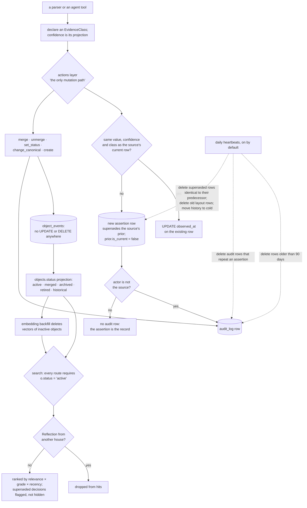

## 1. Executive Summary

Osiris is an event-sourced entity graph that agents use as shared memory, in
which a fact's confidence is derived from how it was obtained and a lifecycle
status keeps merged and retired objects out of every search route. Its write
path is one actions layer that records identity and lifecycle changes as
events. Its weak side is the distance between the stated rule and the
housekeeping: the module header promises append-only tables, and a daily job
deletes audit rows and redundant assertion rows.

The project describes itself as "a self-hosted memory and coordination graph
for AI agents", one Postgres-backed service "reachable from any harness over
the Model Context Protocol". Its tool surface coordinates a fleet of agents —
mail, seats, threads, decisions, handoffs — over the same graph that holds
what they learned.

**Parsers declare how they knew.** The evidence module opens with the defect:

> "Before this module, every parser invented its own confidence number (0.4 →
> 0.99) with no shared meaning, so 'noise' was baked into the graph as
> fake-precise facts and nothing downstream could reason about *why* a node was
> believed."

Five classes a parser may declare each project a base confidence, and
`confidence` is "a *projection* of the class, not a guess"
(`src/parsers/evidence.py:21-31`). The sixth, CORROBORATED, "is never assigned
by a parser — it is computed at read time when ≥2 independent sources agree".
The crawl frontier computes it from distinct source ids
(`src/orchestrator/frontier.py:105-144`). The agent's `search` does not: its
grade weights carry a `corroborated` branch that no stored row reaches.

**The status filters.** `objects.status` is a projection of the
`object_events` log, moved by merge, unmerge and `set_status`. Every route of
`_fn_search` requires `o.status = 'active'`, and the embedding backfill deletes
the vectors of an object that left active
(`src/orchestrator/compositions.py:421-722`, `src/orchestrator/semantics.py:215-217`).
A merged object stays in the graph and does not come back through `search`.

**One write path, with events.** The actions layer calls itself "the *only*
mutation path into the ontology", and every identity and lifecycle change
appends an `object_events` row in the same transaction as the projection it
moves. No production statement updates or deletes that table.

**The rule and the housekeeping disagree.** The header says "old rows are
never mutated" and the README says every change "appends an event, never
overwrites or deletes". A repeated observation moves the existing row's
`observed_at` in place. A daily heartbeat deletes audit rows older than 90
days. A second deletes audit rows that repeat an assertion, superseded
assertions identical to the row they replaced, and old layout assertions. The
fold module argues its case — "nothing the graph knows is lost" — and the
deletions do not pass through the actions layer.

**Reflections are house-scoped; the rest is shared by design.** Decisions,
threads and canon are "fleet-readable; cross-repo recall is the product". A
reflection is readable within its own house and by the operator on search, the
provenance lens, select and the screen-focus tool, and committed tests assert
that another house gets no hit. `dossier` and `list_assertions` do not apply
that check, and the search function takes its reader from an argument a saved
composition can set.

## 2. Mental Model

An **object** is a typed node with a canonical name; its type comes from a
reviewed catalog. An **assertion** is one source's claim about one property,
graded by an evidence class. A new claim from the same source supersedes that
source's current row; claims from other sources stand beside it as a
multi-source set.

A belief has two separate standings. The **evidence class** says how a claim
was obtained; it ranks search hits and decides which crawl nodes may expand,
and search withholds nothing by it. The **lifecycle status** says whether the
object takes part at all: `active`, or `merged`, `archived`, `retired`,
`historical`. Search returns only active objects.

The status moves only by event. `merge_objects` writes a merge event and sets
`merged`; `unmerge_objects` writes an unmerge event and restores `active`,
leaving the merge event and its `same_as` link "as witnesses of the era"
(`src/actions/core.py:709-753`). `set_status` writes a `status_change` or
`archive` event with a required justification before it updates the
projection (`:818-846`). A mined object a re-mine no longer produces is
archived, and reactivated when the source produces it again
(`src/ingest/mined.py:104-118`).

Two signals label and do not withhold. A decision another decision supersedes
is returned with a `superseded` flag naming its successor, and a refuted
practice is returned with a `refuted` flag (`compositions.py:536-560`). The
open-thread wall that `orient` renders does withhold: a thread with no
self-declared assertion, either a question or older than a freshness window,
goes into a counted echo pile instead of the list (`compositions.py:3514`).

Nothing an agent writes waits for anyone. The miner's guesses about forgotten
loose ends are active objects from their first write; `candidates` and
`dispose` let a project's own seat adopt or drop them, and an unjudged guess
is searchable meanwhile.

## 3. Architecture

| Area | Role |
| --- | --- |
| `src/actions/core.py` | The actions layer: assertions, links, objects, merges, status, renames |
| `src/parsers/evidence.py` | The evidence-class taxonomy, base confidences and strength order |
| `src/ontology/` | The declared type catalog and entity resolution |
| `src/orchestrator/compositions.py` | Search, the reflection ACL, the provenance lens, the op-tree evaluator |
| `src/orchestrator/semantics.py` | Local static embeddings and the vector index |
| `src/orchestrator/retention.py`, `assertion_fold.py`, `migration_0064.py` | Pruning, folding and hot/cold tiering |
| `src/workers/arq_worker.py` | Cron heartbeats |
| `src/mcp_server.py` | The agent surface |
| `src/cli.py`, `src/api/app.py` | The operator surfaces |

### Deployment and ergonomics

The service is PostgreSQL 16 with `pg_trgm`, Redis 7, an MCP server on port
8790 over streamable HTTP, and an arq worker; `docker-compose.yml` stands up
the first two. Embeddings come from model2vec's `potion-base-8M`, a static
lookup model run on CPU and stored as `real[]` with no vector extension. The
first load reaches Hugging Face, and a failed load closes the semantic route
while the lexical routes keep answering (`src/orchestrator/semantics.py:1-25`).

The repository's own `.claude/settings.json` wires prompt, tool and compaction
hooks to absolute paths under the author's home directory, and `.mcp.json`
points at a local server, so the committed hook set is the author's
installation rather than a template.

## 4. Essential Implementation Paths

**Assert.** `Actions.assert_property` takes a transaction-scoped advisory lock
on the object, property and source, reads the source's current row, and
returns it with `observed_at` moved forward when value, confidence and class
match (`src/actions/core.py:229-289`). Otherwise it inserts a row that
supersedes the prior, flips the prior's `is_current`, writes an audit row only
when the actor is not the source, and queues an outbox event (`:290-333`).

**Merge, unmerge, status, rename.** `merge_objects` (`:641`),
`unmerge_objects` (`:709`), `set_status` (`:818`) and `change_canonical`
(`:848`) each insert an `object_events` row, update the projection, write an
audit row and queue an outbox event in one transaction. A rename appends the
retired canonical to `object_aliases`; for a `SoftwareProject`, object
creation resolves that alias to the migrated object instead of minting a twin
(`:134-147`).

**Search.** The `search` tool runs `_fn_search` with the caller's agent id
(`src/mcp_server.py:1528-1550`). An id-prefix route, strict full text, an
OR-relaxed bag, trigram and the semantic route each require an active object,
fuse by reciprocal rank, weight by grade and recency, drop other houses'
reflections, and flag superseded decisions
(`src/orchestrator/compositions.py:384-560`).

**Housekeeping.** `retention_heartbeat` deletes published outbox rows past 30
days and audit rows past 90 (`src/workers/arq_worker.py:1234-1301`).
`storage_housekeeping_heartbeat` retires duplicate audit rows, deletes layout
assertions, folds no-op re-assertions and moves week-old superseded history to
the cold table, each step on a time budget (`:1314-1411`).

## 5. Memory Data Model

Objects of declared types, with properties as assertions and relations as
links; every assertion and link carries a source, an evidence class, a
confidence, an evidence URI and hash, and a case. A property's current view is
one row per source, and the winner is chosen at read time by confidence and
then `observed_at`, so disagreement between sources is visible rather than
resolved on write.

Assertions live in two physical tables. Week-old superseded history moves from
`assertions_hot` to `assertions_cold` by copy, verify and delete
(`src/orchestrator/migration_0064.py`). `observed_at` is the time the claim
was last confirmed: a repeated observation moves it on the existing row, and a
fold carries the later time onto the surviving row
(`src/orchestrator/assertion_fold.py:7-19`). Links carry `first_seen`,
`last_seen` and `valid_until`. Nothing records the time a value began to hold
apart from the time it was observed.

## 6. Retrieval Mechanics

One search engine with five routes. A hex token is looked up as an object id
or canonical hash. Text runs as strict web-search syntax, relaxes to any-term
when the strict form finds nothing, then falls back to trigram similarity.
Beside these the semantic route cosines the query against an in-process
vector cache. Routes fuse by reciprocal rank, and each hit carries the field,
source, grade, time and snippet that matched
(`src/orchestrator/compositions.py:384-560`). Every query lands in
`search_log` with the routes that answered.

Grade weighs and does not gate. The SQL weight table maps self-declared to
1.0, authoritative API to 0.95, corroborated to 0.9, direct observation to
0.8, derived to 0.5 and anything else to 0.35 (`compositions.py:230-233`).
That ordering differs from the evidence module's, where corroborated ranks
first; no writer stores the corroborated class, so the branch is never taken.

`trace_evidence`, the provenance lens, returns one object's assertions,
links and events in observed order, merged and retired objects included when
named by id (`compositions.py:1327`).

## 7. Write Mechanics

The actions layer serialises a source's writes to one property with the
advisory lock, so concurrent writers cannot fork a supersession chain. A bound
`Actions` pins its pool to the transaction's own connection, so a helper
inside the transaction cannot draw a second pooled connection while holding
the first (`src/actions/core.py:37-50`).

The housekeeping deletions are deliberate and reasoned in their docstrings.
Retention exists because the outbox and audit tables grew by tens of
thousands of rows a day (`src/orchestrator/retention.py:1-19`). The fold
deletes a superseded row only when it matches its predecessor on value,
confidence, class, evidence URI, hash, case and helper run, and only when
older than seven days (`assertion_fold.py:7-19`). Each runs as raw SQL against
the pool rather than through the actions layer the header calls the only
mutation path.

## 8. Agent Integration

The MCP server registers tools for search, provenance, dossiers, mail, seats,
threads, decisions, merges, retirements and compositions. Claude Code hooks
inject context on prompt submit, refuse most tool calls once the context
passes a threshold until a settle lands, and write a handoff marker before
compaction. A bridge under `dsh-plugin/` mounts a DeepSeek Harness session.
Screening flags three auto-run surfaces and a test `conftest.py` that executes
on collection.

The agent's surface carries the verbs that move status: `merge`, `unmerge`,
`retire_object`, `retire_assertion` and `retire_link`. Nothing an agent writes
waits for a person.

## 9. Reliability, Safety, and Trust

The status filter is the reliable part. It is applied by every search route
and by the vector index's maintenance, and a test asserts that an object
leaving active is dropped from the index (`tests/test_semantics.py:158-183`).

The audit is two records with different lifetimes. `object_events` is
untouched by any update or delete and records who moved an object's identity
or status and why. `audit_log` covers the other actions for 90 days, and a
source's own assertions are recorded in the assertions table instead.

The reflection boundary covers four reads. `_hide_foreign_reflections` runs on
search and `_visible_reflections` on the provenance lens, select and the
screen-focus tool (`src/orchestrator/compositions.py:271-345`,
`src/mcp_server.py:2254-2261`). `dossier` returns every current property of
any object it can resolve (`src/orchestrator/dossier.py:127-132`), and
`list_assertions` returns any property's rows, with no house check.
`_fn_search` and `_fn_lap` read their reader from `args["caller"]` before the
context variable (`compositions.py:403`, `:1350`).
`composition(action='save')` stores a spec as given, so a saved function call
can name `operator` as its reader and see every house.

## 10. Tests, Evals, and Benchmarks

7,735 test functions run against Postgres and Redis test containers. The ones
that bear on the marks:

- `tests/test_reflection_acl.py` — seven cases. A foreign house and an
  anonymous caller get no Reflection hit where a housemate and the operator
  do, and the id route, select and provenance lens are held the same way.
- `tests/test_semantics.py:158-183` — an object moved to `merged` loses its
  vector on the next backfill.
- `tests/test_search.py:241` — a superseded decision is returned with a flag
  naming its successor.
- `tests/test_actions.py:457-477` — unmerge restores active and keeps the
  merge event and its `same_as` link.
- `tests/test_assert_property_one_write.py` — which assertions leave an audit
  row, and a static check that no code reads the retired audit rows.

No test asserts that a merged or retired object is absent from search
results; the index test counts dropped vectors. Nothing was installed or run
for this reading.

## 11. For Your Own Build

### Steal

Grade the fact by how you got it and derive the number. A parser that writes
0.72 is guessing; one that writes "co-occurrence" is reporting, and the number
becomes an ordering everyone downstream shares.

Put the lifecycle predicate in every route and in index maintenance. A filter
in the SQL routes and not in the vector cache returns a merged object through
the semantic route; deleting its vector closes that.

Make status transitions events with a required reason, and undo them with a
compensating event that leaves the original in place.

Scope supersession to the source, so one source's correction cannot erase
another source's disagreement.

### Avoid

Stating "never mutated" over a table a housekeeping job prunes. The deletions
here are argued in their docstrings; the module header and the README make
the stronger claim, and the deletions bypass the one layer said to own every
mutation.

A boundary that reads its subject from an argument. A reader identity a
caller can supply, through any door, is a filter the caller sets.

A grade weight for a class nothing stores. The `corroborated` branch in
search's weights reads as read-time corroboration and is never taken.

### Fit

This suits one operator running a fleet of agents who should share work
knowledge, where provenance and reversible identity changes matter and an
audit horizon of 90 days is acceptable. Walk away if one agent's memory must
be unreadable to another, if the audit trail must outlive a retention window,
or if a weak claim must be kept out of the answer rather than ranked down.

## 12. Open Questions

Whether the 90-day audit window is meant to apply to merge and status audit
rows, whose facts survive in `object_events` regardless.

Whether the reflection boundary is meant to cover `dossier` and
`list_assertions`, and whether a saved composition is meant to set its own
reader.

How the base confidences and search's separate grade weights were chosen; both
are constants with an ordering and no stated derivation, and they disagree on
where corroboration sits.

## Appendix: File Index

| Path | What to read it for |
| --- | --- |
| `src/parsers/evidence.py:1-53` | Numbers replaced by classes, the strength order, and the class no parser may store |
| `src/actions/core.py:1-13` | The stated contract of the only mutation path |
| `src/actions/core.py:205-333` | Assertion: the lock, the no-op guard, supersession, the conditional audit row |
| `src/actions/core.py:709-753` | Unmerge: a compensating event with its witnesses |
| `src/actions/core.py:818-846` | `set_status`: event first, then the projection |
| `src/orchestrator/compositions.py:271-345` | The reflection ACL and its operator exemption |
| `src/orchestrator/compositions.py:384-560` | Search: five routes, the status predicate, flags |
| `src/orchestrator/semantics.py:164-220` | Embedding backfill and the inactive-object purge |
| `src/orchestrator/retention.py` | Audit and outbox retention, duplicate retirement, layout deletion |
| `src/orchestrator/assertion_fold.py:1-34` | The fold, and its argument against "never delete" |
| `src/workers/arq_worker.py:1234-1411` | The two daily heartbeats that run them |
| `src/ontology/schema.py:1-21` | A catalog, not a framework |
| `tests/test_reflection_acl.py` | The house boundary's negative cases |

### Recorded searches

Run at the tree root of the pinned checkout with `git grep`.

- `git grep -n -i -E '(UPDATE|DELETE FROM|TRUNCATE)[[:space:]]+(TABLE[[:space:]]+)?(ONLY[[:space:]]+)?object_events' -- ':!tests'` — no match.
- `git grep -n -E 'DELETE FROM (audit_log|\{table\})' -- src` — `retention.py:76` (outbox or audit_log by allowlist), `:190` (duplicate audit rows), `:253` (layout assertions) and `assertion_fold.py:110` (folded assertions).
- `git grep -n -E 'UPDATE assertions[a-z_]* SET' -- src` — `actions/core.py:288` (`observed_at`), `:316`, `:404`, `:488`, `:515` (`is_current`).
- `git grep -n -E "o\.status ?= ?'active'" -- src/orchestrator/compositions.py` — the search routes at `:421`, `:471`, `:665`, `:696`, `:722`, among others.
- `git grep -n -E '_visible_reflections|_hide_foreign_reflections' -- src` — `compositions.py` and `mcp_server.py:2258` only; no hit in `dossier.py` or `retirement.py`.
- `git grep -n -E 'args\.get\("caller"\)' -- src` — `compositions.py:403` and `:1350`.
- `git grep -n -E 'EvidenceClass\.CORROBORATED' -- src helpers scripts` — `parsers/evidence.py:27` and `:41` only; no writer stores the class.
- `git grep -n -E 'evidence_class: str' -- src/mcp_server.py` — no match; no agent tool takes an evidence class.
- `git grep -n -E "evidence_class ?(<>|!=|NOT IN|= ?'|IN ?\()" -- src` — partitions and counts on `self_declared` (the wall and echo pile, closure, janitor, sessions); none inside `_fn_search`.
- `git grep -n -i 'tombstone' -- src` — `settings.py`, `pit_watch.py` and `trigger.py`, all about message delivery; no rejected-value record.
- `git grep -n -E 'valid_from' -- src alembic` — no match.
- `git grep -n -i -E 'arxiv|bibtex|@article|@misc|doi\.org|CITATION' -- README.md ARCHITECTURE.md docs` — no match; no paper.
- `git grep -n -i -E 'anthropic|machine learning|not (be )?used (for|to)' -- LICENSE` — no match; the AGPL-3.0 text carries no rider.

## History

**2026-10-12** — [`4c781169fe7e6dfb3ec4b302e2ba7dfa1cda10d7`](https://github.com/asuramaya/osiris/commit/4c781169fe7e6dfb3ec4b302e2ba7dfa1cda10d7) — 373 commits on. Overtaken: a source's own assertion writes no audit row, and a daily job deletes duplicate audit rows, no-op re-assertions and layout rows ([section 7](#7-write-mechanics)); renames became events with aliases. `negative_eval` gained, earned at the old pin by the reflection tests ([section 10](#10-tests-evals-and-benchmarks)). Also wrong then: "no isolation boundary" missed the reflection ACL; "never withhold" missed the open-thread wall; assertions were updated in place; the 90-day audit prune and the semantic route went unmentioned; three trust anchors pointed at unrelated lines. Screened from a full clone: eleven files, three auto-run surfaces, one build-time execution point, no unpinned surfaces, none inside the cooldown; `CLAUDE.md` read as data. Nothing was installed, built or run.

**2026-09-19** — [`561d5697a4c52057fee9d49bf3c62a0472537590`](https://github.com/asuramaya/osiris/commit/561d5697a4c52057fee9d49bf3c62a0472537590) — `trust_state` re-tested. The mark holds and the model statement is where it was (`src/actions/core.py:7-12`): merges are event-sourced, `object_events` is the source of truth, `objects.status` and `merged_into` are a projection. The scale of the predicate is worth stating rather than illustrating — `status = 'active'` appears at over three hundred sites and `merged_into IS NULL` at thirty-six, so this is a store where the filter is the habit rather than a rule kept in one helper. `merge_objects` is now at `:610`.

Two things are added. `set_status` (`:789-812`) takes a `justification` and an `actor` as required arguments and writes them into an append-only `object_events` row before touching the projection, so a lifecycle transition cannot be made without recording why — though the actor is a supplied string rather than a resolved principal, which is why it bears on `human_review` and not on this mark. And the unmerge docstring is the kind of thing this atlas looks for: it cites the constitution — *heal with events, never delete* — says the original merge event and its `same_as` link stay as *witnesses of the era*, and names the direction defect it was first used for. A compensating action that carries the incident that produced it. Screened again first; nothing was installed and no suite was run.

**2026-09-16** — [`561d5697a4c52057fee9d49bf3c62a0472537590`](https://github.com/asuramaya/osiris/commit/561d5697a4c52057fee9d49bf3c62a0472537590) — first reading, at a commit dated 16 September 2026. Screened before opening, from a shallow clone: eleven files scanned, three auto-run surfaces, one build-time execution point, no unpinned surfaces and three dependency files inside the seven-day cooldown. Nothing was installed, built or run.
