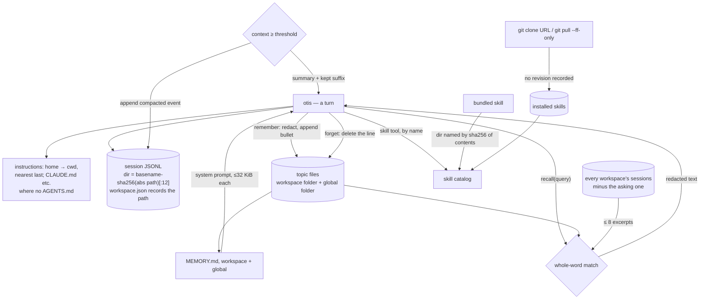

## 1. Executive Summary

Otis is a local coding agent whose memory is three stores: an append-only
session log, a Markdown fact store the agent writes with `remember` and reads
with `recall`, and skills fetched from git. The fact store is small, legible
and redacted; `recall` reaches every workspace's transcripts by design. The
skills are the weak point: a skill is cloned from a URL with no revision
recorded, in a codebase that checksums its own binary, its inference runtime,
its model weights and its one bundled skill.

The **fact store** arrived on 27 September 2026 and follows a layout the code
calls the Agent Memory Repo: a `MEMORY.md` index linking topic files, one fact
per bullet, with the session it came from and the day. There are two scopes —
a folder per workspace and one global folder — and only the two indexes enter
the system prompt; the agent reads a topic, or searches facts and past sessions,
through `recall` (`src/memory/memory.ts:193`, `:310`).

**Recall crosses workspaces on purpose.** Facts come from the asking workspace
and the global scope, and up to eight transcript excerpts come from every
workspace's sessions except the asking one. The test suite asserts it, and the
README says the result goes to whichever model is answering, hosted or local
(`tests/memory/memory.test.ts:220-263`, `README.md:284-296`).

**The skills are unpinned.** Installing one is `git clone` of the URL, with
`--branch <ref>` when the URL names a `/tree/<ref>/` folder; updating is
`git pull --ff-only`. The manifest records `id`, `url`, `path`, `installedAt`,
the skill list and a declared plugin identity, and no commit or hash
(`src/skills/manager.ts:126-132`, `:201`, `src/skills/catalog.ts:247-257`).

The contrast is inside the same tree. The release archive is refused on a
SHA-256 mismatch (`src/cli/update.ts:158-161`). The llama.cpp runtime archives
carry 38 hard-coded digests and every GGUF file is verified before it is
published into the cache. And the bundled `documents` skill is materialised
into a directory named for a SHA-256 of its contents, with a modified cached
resource refused (`src/skills/bundled.ts:19`, `:61-67`). The one skill the
project ships is content-addressed; a skill a user installs is a moving
branch. `skills-lock.json` carries a `computedHash` that appears once in the
tree and that nothing reads.

## 2. Mental Model

Three durable surfaces, none of which holds a belief.

**A session** is a stream of events — prompts, responses, tool activity, usage,
compaction — appended to one JSONL file per session. It is resumed whole, by id
or by recency, and searched by word.

**A fact** is one Markdown bullet in a topic file, with optional
`[source: …; added: YYYY-MM-DD]` metadata. It is born by `remember` (the
agent's tool, the `/memory` command, the desktop settings page or an import of
another agent's memory). It dies by `forget`, which deletes the line. There is
no state between: a fact is live until it is removed, and nothing records that
it was.

**A skill** is procedural memory with an install step. It is fetched, catalogued
with any skill in `.agents/skills` or another agent's skill folder, and read on
demand. The catalog entry is a name, a description, two paths, two invocation
switches and a bundled flag, with no score or expiry (`src/skills/catalog.ts:207-218`).

**Instructions** are assembled per invocation from the home directory down to
the working directory, nearest last, reading `CLAUDE.md`, `GEMINI.md`, Copilot
or Cursor files where a folder has no `AGENTS.md` (`src/core/context.ts:61-110`).

Compaction is the one place something is decided about context, and it decides
generously:

```text
context reaches the threshold: min(250_000, window minus a reserve)
        │
        ▼
summary + kept suffix replace the messages in the model's context
        │
        └── session log appends { type: "compacted", summary,
                                  messages = kept suffix,
                                  turn = the in-flight segment, if mid-turn }
            earlier turn events are never rewritten
```

The model forgets and the store does not. The replaced turns stay on disk as the
events that recorded them, and an in-turn checkpoint archives the active turn's
segment in the event itself, so session search finds a word written before a
compaction (`src/storage/session.ts:144-182`,
`tests/storage/session-search.test.ts:38-58`).



## 3. Architecture

- **`src/core/`** — `agent.ts` runs the turn loop and places the memory indexes
  in the prompt (`:299`); `compaction.ts` holds the threshold and the cut;
  `context.ts` walks for instruction files.
- **`src/memory/memory.ts`** — the fact store: `remember`, `rememberAll`,
  `forget`, `listMemory`, `memoryIndex`, `recall`, `redactPrivate`, and the
  optional git commit.
- **`src/storage/`** — `session.ts`, `session-events.ts`, `session-index.ts`
  (a per-file digest cache and the searchable texts), `session-files.ts`,
  `session-lock.ts`, `workspace-registry.ts`.
- **`src/skills/`** — `manager.ts` installs, updates and removes, with its
  manifest parser and lock; `catalog.ts` lists and serves resources;
  `bundled.ts` materialises the shipped skill.
- **`src/app/other-agents.ts`** — lists and imports Claude Code, Codex and
  Gemini CLI instructions and memory.
- **`src/tools/`** — nineteen tools; `recall`, `remember` and `forget` are the
  memory-facing ones beside `skill`.
- **`src/inference/`**, **`src/desktop/`**, **`src/cli/`** — model runtimes,
  the Electron app, the terminal UI, the headless CLI and `otis serve`.

### Deployment and ergonomics

A single binary from a release archive, a desktop app, or `bun run` from source.
Inference can be fully local through a managed llama.cpp server, Ollama, LM
Studio or any OpenAI-compatible server; hosted inference needs a provider key,
and web search and page reading go to Parallel. No database, no service of the project's
own. Every store is plain files a person can read and repair, and the fact
store is Markdown a person can edit directly.

The screen at this pin reported a `postinstall` that marks a `node-pty` helper
executable, `package.json` changed on 15 October 2026 and `bun.lock` on
8 October, both inside the seven-day cooldown, and 42 floating ranges resolved
by the committed `bun.lock`.

## 4. Essential Implementation Paths

**The fact write** — `rememberAll` (`src/memory/memory.ts:240-261`) collapses
whitespace, runs `redactPrivate`, appends `- text [source: …; added: …]` to the
topic file with `appendFile`, links the topic from `MEMORY.md` if absent, and
calls `commitMemory`, which commits only when the memory folder itself holds a
`.git` (`:172-186`).

**The forget** — `forget` (`:264-302`) scans every topic file, prefers an exact
lower-cased match, falls back to substring, refuses unless exactly one line
matches, and rewrites the file without it; an emptied topic file and its index
link are removed.

**The recall** — `recall` (`:310-339`): `searchNeedles(query, true)` turns each
word of three or more letters into a whole-word regex, facts are scored by how
many needles hit `topic + text`, and `searchAllSessions(query, { seeds: [cwd],
words: true })` supplies transcript hits, filtered by `hit.id !== session` and
cut to eight. The whole output passes `redactPrivate`.

**The session partition** — `defaultSessionDirectory`
(`src/storage/session-files.ts:16-24`):

```ts
const hash = createHash("sha256").update(workspace).digest("hex").slice(0, 12)
return join(sessionRootDirectory(), `${slug || "workspace"}-${hash}`)
```

`registerWorkspacePath` writes `workspace.json` with the absolute path beside
the sessions (`src/storage/workspace-registry.ts:19-29`).

**The skill install** — `SkillManager.install` (`src/skills/manager.ts:88-175`):
`git clone [--branch ref] -- repository dir`, discovery, symlinks into
`~/.agents/skills`, and a manifest entry without a commit. **The update**
(`:177-268`) resolves `rev-parse HEAD` into `previousCommit`, pulls, and uses
`previousCommit` only for `git reset --hard` if a later step fails (`:256`).

**The containment** — `readSkillResource` (`src/skills/catalog.ts:163-205`):
`assertInside(skill.root, requested)` before `realpath`, `assertInside(root,
canonical)` after it, and `TextDecoder("utf-8", { fatal: true })`.

**The checksums** — `src/cli/update.ts:158-161` for the release archive,
`src/inference/llama-runtime.ts:1008` for the runtime archive,
`src/inference/gguf-cache.ts:415` for weights, `src/skills/bundled.ts:61-67`
for the shipped skill.

## 5. Memory Data Model

A fact is `{ scope, topic, date?, text }` parsed from a bullet by one regex,
`/^- (.+?)(?: \[((?:source|added): [^\]]*)\])?$/u` (`src/memory/memory.ts:31`).
`source` is the session id or the importing agent's id; `added` is the write
day. There is no id, no status, no confidence and no validity interval. A
hand-written bullet without metadata is a fact like any other.

The workspace memory folder is `memory/` inside the workspace's session
directory, so a fact's scope is where its file lives; the global folder is
`memory/` under the data directory (`:82-101`). Earlier single-file layouts —
`memory.md` beside the sessions, and in 0.2.6 the project's `.otis/memory.md` —
are migrated on first use and the old files deleted.

The session event union keeps `{ type: "compacted"; summary; messages;
throughSeq?; promptId?; steeringCount?; turn? }`, where `messages` is the kept
suffix and `turn` the archived in-flight segment
(`src/storage/session-events.ts:91-99`).

Files are private by construction — memory and session directories created
`0o700`, facts, indexes and session files written `0o600`, the skill manifest
written to a temporary path and `rename`d into place. A skill's origin is its
source id and URL; which commit produced the text on disk is not recorded.

## 6. Retrieval Mechanics

Two indexes are always in context. `memoryIndex` reads each scope's `MEMORY.md`
as it is on disk, and `buildSystemPrompt` places them in a `<memory>` block,
each truncated at 32 KiB, with the instruction to read a topic through `recall`
before relying on it (`src/inference/system-prompt.ts:123-130`). Hand-written
lines in an index reach the prompt untouched, which the suite asserts
(`tests/memory/memory.test.ts:297-306`).

Everything else is tool-mediated and lexical. A fact matches when any whole
query word appears in its topic name or text, and facts with more matching
words rank first; there is no embedding, no stemming and no recency. Session
hits rank title matches above content matches, then by matched-word count, then
by recency, with a snippet around the first hit
(`src/storage/session.ts:406-435`). Tool outputs and compaction summaries are
excluded from the searchable text (`src/storage/session-index.ts:157-163`).

The session half of `recall` reads every workspace directory under the data
root (`digestAllSessions`, `src/storage/session.ts:383`), excluding only the
asking session's id. The `recall` tool description says so: *"excerpts from
past sessions in every workspace"*. A project's transcripts are therefore
retrievable from any other project, through redaction that removes credential
shapes, emails and phone, card and national-id numbers and nothing else.

## 7. Write Mechanics

Writes are synchronous and model-free: no extractor decides what to keep, and
no background pass consolidates. A fact is retrievable as soon as `appendFile`
returns; a session event as soon as its line is synced.

The agent writes facts on its own initiative through `remember`, guided by a
tool description that asks for one durable sentence about the project or the
user's tooling and never about people. `remember` and `forget` are in
`RESTRICTED_BY_DEFAULT`, and the interactive default mode is `auto`, under
which a restricted tool is allowed without asking; `ask` prompts and
`dontAsk` denies (`src/permissions/policy.ts:12`, `:48-57`, `:83-84`). The
headless CLI defaults to `dontAsk`, so a headless run denies `remember` unless
started with `--auto`.

`--ephemeral` refuses to create a session and cannot be combined with
`--session` or `--continue` (`src/cli/headless-cli.ts:395-396`). It governs the
session log only.

`forget` deletes the line and leaves no record of the value. The import page
marks another agent's fact as imported by exact text match against live facts
(`src/app/other-agents.ts:45-74`), so a fact forgotten in Otis is offered as
new on the next import. When the memory folder is a git repository, the deleted
line survives in that repository's history, which is the user's.

Session deletion is per session and total, artifacts first. A skill is
corrected by pulling its remote, which is the same operation as being changed
without asking.

## 8. Agent Integration

The agent is the product, so integration is the tool list and the permission
layer. The memory-facing tools are `recall` (also available to subagents,
`src/core/agent.ts:115-123`), `remember`, `forget` and `skill`.

Otis reads other agents' material in place when `otherAgents` is on, which is
the default: skills from `.claude/skills`, `.cursor/skills`, `.gemini/skills`
and `.github/skills` at every ancestor and at home, and those agents'
instruction files where a folder has no `AGENTS.md`
(`src/skills/catalog.ts:16-45`). Installed skills are activated as symlinks in
the shared `~/.agents/skills` folder, which the catalog's own comment says
Codex also reads, so a skill installed through Otis is visible outside it. The desktop import copies Claude Code's per-project
memory into the workspace scope and Codex's and Gemini CLI's into the global
scope (`src/app/other-agents.ts:94-122`).

The README suggests cloning a shared memory repository into a memory folder's
place. Its `MEMORY.md` then enters the system prompt as written, from whatever
that remote held when it was cloned.

## 9. Reliability, Safety, and Trust

**The unpinned skill is the finding.** A skill is instructions the model reads
and follows. Installing takes the default branch or a named ref, `update`
takes whatever that branch holds at the time, and the manifest has nowhere to
record what was reviewed. The project's own `bundled.ts` is the worked example
of the alternative: the cache directory is named for a SHA-256 of the skill's
contents and a modified resource is refused. Recording the resolved commit at
install and showing a diff on update would close the gap; `#updateSource`
resolves that commit for rollback and discards it.

**Recall is a cross-project read.** Workspace facts stay in their workspace,
but transcript excerpts do not, and the read is not behind a permission: the
`recall` tool is unrestricted. Redaction is a fixed list of shapes, so a
project-specific secret that matches none of them reaches another project's
context and, with a hosted model, the provider.

**The fact store has no doubt state.** A wrong fact is live until it is
forgotten, and a forgotten one leaves nothing that would stop it being
remembered again. The prompt's precedence rule — the repository and the user's
instructions win — is advice to the model, not a filter.

**The care elsewhere is real.** `--` before a URL and a refusal of URLs
starting with `-`, `--ff-only`, a scrubbed child environment, containment on
both sides of `realpath`, a fatal UTF-8 decode, `..` and absolute-path
rejection in the manifest parser, atomic manifest writes, and a PID-plus-token
lock that treats a partial lock file as live for 30 seconds.

**Compaction does not destroy evidence**, because the log is never rewritten.

**A move resets the workspace view.** The session directory hashes the absolute
path, so after a move `--continue` and workspace facts start empty.
`workspace.json` records the old path, and the desktop's global history lists
the old sessions, so the material is findable from there and through `recall`;
the workspace facts are not.

## 10. Tests, Evals, and Benchmarks

The suite runs under vitest with a CI badge; `tests/memory/memory.test.ts`
covers the fact store across 11 cases: layout and indexing, ambiguous and
missing `forget`, migration of the earlier layouts, git commits only inside a
memory repository, a refused commit that keeps the fact, redaction, recall
ranking and the tool round trip.

**Three assertions are the ones this atlas counts.**
`tests/storage/session-search.test.ts:101-122` writes a session holding one
ordinary turn and one compaction-summary turn containing *"discussed the zephyr
budget"*, then requires `searchSessions` for `"zephyr"` to resolve to `[]`; an
empty query returning the session, and the case at `:38-58` finding a word
written before a compaction, are the controls. `tests/memory/memory.test.ts:253-261`
requires `recall("limiter", cwd, "s-current")` to include a matching session
from another workspace directory and to exclude the asking session's title.
And `:279-283` requires `recall("me")` not to return a fact containing
"memory" while `recall("memory")` and `recall("layout")` do. That is
`negative_eval`.

What is not asserted: no case remembers a workspace fact in one folder and
recalls from another, so the directory partition of facts is untested; every
memory test uses one working directory. No skill test asserts a recorded
revision, because the manifest has none; `tests/skills/manager.test.ts:107-115`
asserts the rollback commit only.

There is no benchmark and the project claims none. Nothing was run for this
reading: two dependency files changed inside the seven-day cooldown and a
`postinstall` is declared.

## 11. For Your Own Build

### Steal

- **Never rewrite the session log, and archive the in-flight segment at a
  mid-turn checkpoint.** The context shrinks and the record does not.
- **Index in the prompt, bodies on demand.** Two short `MEMORY.md` files cost a
  few lines per turn, and the model fetches a topic when it needs it.
- **Redact on both sides.** `remember` redacts before writing and `recall`
  redacts before returning, so a secret that reached a transcript does not
  come back through memory in a credential shape.
- **Content-address what you ship.** A cache directory named for the hash of
  its contents, and a refusal when a cached file differs, is a few lines.
- **Assert containment on both sides of `realpath`.**

### Avoid

- **Procedural memory pinned to a URL.** Record the revision that was reviewed.
- **A hash field nothing computes.** `computedHash` in `skills-lock.json` reads
  as an integrity check and is read by nothing.
- **A cross-project read with no permission gate.** If recall must span
  projects, make the span an argument the user grants, not the default.
- **Deletion that forgets it happened** when an import or a model can write the
  same value again.

### Fit

Right for someone who wants a local coding agent on open weights with readable
history and a fact store they can edit in a text editor. Wrong as a memory
system to lift for anything multi-project or shared: workspace isolation is a
directory, the transcript half of recall ignores it, and there is no
correction state. Adopt the skill manager only with a revision field added.

## 12. Open Questions

- **Was `skills-lock.json` once enforced?** It carries a `sourceType` and a
  `computedHash` the runtime manifest has no concept of; whether it is a
  development record or a lapsed check was not determined.
- **What does `update` do for a skill installed at a tag?** `--branch <tag>`
  leaves a detached checkout, where `git pull --ff-only` should fail; the
  manager's message for that case was not traced.
- **How often does the agent call `remember` unprompted?** The session logs
  record every call; the rate was not measured for this reading.
- **Is cross-workspace recall wanted by users of shared machines?** The
  desktop settings expose memory editing but no switch for the session half of
  recall.

## Appendix: File Index

| Path | What it holds |
| --- | --- |
| `src/memory/memory.ts` | The fact store: write, forget, index, recall, redaction, git commit |
| `src/tools/schema.ts` | `recall`, `remember`, `forget` and `skill` tool definitions |
| `src/permissions/policy.ts` | Restricted tools and the `auto` default |
| `src/storage/session.ts` | Session store, `compact`, `compactTurn`, per-workspace and all-workspace search |
| `src/storage/session-index.ts` | Digest cache and searchable texts |
| `src/storage/session-files.ts` | Per-workspace directory naming and private modes |
| `src/storage/workspace-registry.ts` | `workspace.json`, the path behind each hashed directory |
| `src/core/compaction.ts` | Threshold, cut point and summary validation |
| `src/core/context.ts` | Instruction files, home first and cwd last, other agents' names |
| `src/skills/manager.ts` | Install, update, remove, manifest parser, lock |
| `src/skills/catalog.ts` | Skill discovery, other agents' skill folders, containment |
| `src/skills/bundled.ts` | The content-addressed bundled skill |
| `src/app/other-agents.ts` | Import of Claude Code, Codex and Gemini CLI memory |
| `src/cli/update.ts` | The release-archive checksum |
| `tests/memory/memory.test.ts` | Fact store and recall cases |
| `tests/storage/session-search.test.ts` | The compaction-summary exclusion case |
| `skills-lock.json` | A `computedHash` that appears once in the tree |

### Recorded searches

Run in a full clone at `b8b8aabae1e4674778ad2545fcf71ceabd6b0515` (`HEAD`) and,
where marked, at `879397c8ec9fd2488c69b742891f6b6c28c2af23` (`OLD`), with
`/usr/bin/git`.

- `computedHash` is read by nothing: `git grep -n computedHash HEAD -- .` and
  the same at `OLD` each return one line, `skills-lock.json`.
- No revision in the skill manifest: `git grep -n -E 'commit|revision|sha|hash' HEAD -- src/skills/catalog.ts`
  returns one comment line and no field; the manifest's other writer is
  `src/skills/manager.ts:154-161`.
- No tombstone: `git grep -n -i -E 'tombstone|suppress(ed|ion)' HEAD -- src`
  and at `OLD` return only French UI strings in `src/desktop/renderer/i18n/messages/fr.ts`.
- No trust state: `git grep -n -i -E '\b(trust_state|epistemic|unverified|quarantin|contested|confidence)\b' HEAD -- src`
  and at `OLD` return nothing.
- No valid time: `git grep -n -i -E 'valid_?(from|to|until)\b|validFrom|validTo|validUntil|bitemporal|valid[ _]time|\basOf\b' HEAD -- src`
  and at `OLD` return nothing.
- Recall's session read is unscoped: `git grep -n -E 'searchAllSessions\(' HEAD -- src`
  returns `src/app/global-sessions.ts:75`, `src/memory/memory.ts:326` and the
  definition.
- Every writer of the `compacted` event passes the kept suffix:
  `git grep -n -E '\.compact\(|\.compactTurn\(|keptMessages' HEAD -- src` and
  at `OLD`.
- Memory tools run under the default mode: `git grep -n -E 'DEFAULT_PERMISSION_MODE|RESTRICTED_BY_DEFAULT' HEAD -- src`.
- No cross-folder fact case: `git grep -n -E 'remember\(|recall\(' HEAD -- tests`
  returns calls in three files, each case using one working directory.
- No revision assertion in the skill tests: `git grep -n -E 'installedAt|revision|previousCommit' HEAD -- tests/skills/manager.test.ts`
  returns the rollback check at `:107`, `:115` and `installedAt: expect.any(String)` at `:235`.
- Cloned skill files keep git's modes: `git grep -n chmod HEAD -- src/skills`
  returns the manifest temp file and `ensurePrivateDirectory` only.
- Lockfile history: `git log --diff-filter=A --format='%h %ci' -- bun.lock`
  returns the repository's first commit, 16 July 2026.
- No paper: `git grep -n -i -E 'arxiv|bibtex|@article|@misc|doi\.org' HEAD -- README.md docs`
  returns nothing.
- The session log is appended, not rewritten: `git grep -n -E 'writeFile|truncate|rename\(|\brm\(' HEAD -- src/storage/session.ts src/storage/session-files.ts src/storage/session-events.ts src/storage/session-index.ts`
  returns the append in `appendJsonLine` (`session-files.ts:47`), the two
  `rm` calls of `deleteSession` (`session.ts:308-309`) and a field check.
- Fact recall has no embedding or stemming: `git grep -n -i -E 'embedding|vector|stemm' HEAD -- src/memory src/storage`
  returns nothing.
- Every fact writer: `git grep -n -E '\b(remember|rememberAll)\(' HEAD -- src`
  returns the tool (`src/tools/index.ts:103`), the `/memory` command, the
  desktop runtime (`:1237`; `:289` and `:295` are an unrelated local function
  for serve settings) and the import (`src/app/other-agents.ts:106`).
- No database: `git grep -n -i -E 'sqlite|postgres|lancedb|qdrant|chroma' HEAD -- package.json src`
  returns nothing.
- No benchmark: `git ls-files | grep -i -E 'bench|eval'` returns nothing.

## History

**2026-10-15** — [`b8b8aabae1e4674778ad2545fcf71ceabd6b0515`](https://github.com/TrianglLabs/otis/commit/b8b8aabae1e4674778ad2545fcf71ceabd6b0515) — 136 commits on, v0.1.48 to v0.2.38. `negative_eval` holds at both pins and gains two recall cases; no other mark moves. A fact store with `recall`, `remember` and `forget` arrived on 27 September 2026 ([section 5](#5-memory-data-model)); recall reads transcripts from every workspace ([section 6](#6-retrieval-mechanics)); other agents' skills, instructions and memory are read or imported ([section 8](#8-agent-integration)). The skill manifest gained a path and an install time and no revision. Five claims were wrong at the previous pin — the compaction event's contents, the lockfile, the path mapping, skill file modes and a carried-forward census — and are corrected in the body and in Known Limitations. Screened before reading: no auto-run surface, a new `postinstall`, two dependency files inside the cooldown, one unpinned surface, `AGENTS.md` read as data. Nothing was installed or run.

**2026-09-17** — [`879397c8ec9fd2488c69b742891f6b6c28c2af23`](https://github.com/TrianglLabs/otis/commit/879397c8ec9fd2488c69b742891f6b6c28c2af23) — re-read 27 commits on, 183 files and +18,853/-1,634 across releases up to v0.1.48. **Marks move from none to `negative_eval`.** Most of the growth is desktop surface — a macOS status tray, an on-demand Mermaid canvas, multilingual UI, a resizable side panel — but three storage suites arrived with it, and one holds the assertion this atlas counts.

`tests/storage/session-search.test.ts` writes a session with one ordinary turn and one compaction summary containing *"discussed the zephyr budget"*, then requires `searchSessions` for `"zephyr"` to resolve to `[]`. The word appears nowhere else in the store, so the assertion is keyed on a value only the summary holds. The comment states the property instead of leaving it implied: *"The word only appears inside the compaction summary, which is not searchable."* An empty query resolving to exactly one result sits beside it, which is what stops the assertion passing on a search that returns nothing at all, and a third case asserts a genuinely absent phrase returns nothing either.

It is the strict form of the mark — the query is called and the result is what is asserted about — and it lands on the property this report already called the system's best: compaction is lossy for the model and lossless for the store. The summary's text stays in the event that replaced the messages and is held out of the search index, and now a committed case says so. The unpinned-skill finding is unchanged; `skills-lock.json`'s `computedHash` still appears exactly once in the tree. Screened again before reading: no auto-run surface, no build-time execution surface, one unpinned surface, one dependency file inside the seven-day cooldown; `AGENTS.md` was treated as data. Nothing was installed and nothing was run.

**2026-09-09** — [`0f4025cb9ea5fa3a386b31237ec5dd811bc4d7ee`](https://github.com/TrianglLabs/otis/commit/0f4025cb9ea5fa3a386b31237ec5dd811bc4d7ee) — second reading, at `v0.1.36`. The previous pin is no longer in the branch: `main` is 62 commits ahead of it and carries 24 the pin does not, so the history was rewritten underneath it. GitHub still serves `39e98023104d` by SHA and a fresh clone cannot reach it, which is why the previous reading's line anchors are not re-checkable from a checkout. Screened before reading: no auto-run surface, no build-time execution, one manifest inside the seven-day cooldown with twenty-two floating ranges and no lockfile; nothing was installed and no suite was run.

The central finding is unchanged and the contrast around it is sharper. Installing a skill is still `git clone -- <url> <dir>` with no revision, the manifest is still `{ id, url, skills }` with nowhere to record one, and `skills-lock.json` still carries a `computedHash` that nothing in `src/`, `scripts/` or `tests/` reads. Beside it the project now verifies a SHA-256 in three places rather than one: its own release archive, the six llama.cpp binaries it may download, and every GGUF weight file — the last with resume validation and publish-only-after-verify.

One thing that looks like a fix is not one. `#updateSource` resolves `rev-parse HEAD` into a `previousCommit` before `git pull --ff-only`, and `tests/skills/manager.test.ts` covers it. It is a rollback handle, restoring the checkout when a later step fails, and it is never written to the manifest.

The tree roughly doubled — 11,531 lines to 23,700 — and most of the growth is context rather than memory: a local inference stack under `src/inference/` with a model catalogue, hardware probe, GGUF cache and managed llama.cpp runtime, an Electron shell under `src/desktop/`, and a tenth tool, `agent`. Tests went from 42 files across ten directories to 82 files and 18,051 lines across thirteen. No mark moves: sessions still carry no scope key applied as a filter, no epistemic state exists anywhere, compaction still keeps the messages it replaces inside the event that replaces them, and no committed case asserts that anything must not be retrieved.

**2026-08-13** — [`39e98023104d89a22e89b9cb534f7f681229cc1e`](https://github.com/TrianglLabs/otis/commit/39e98023104d89a22e89b9cb534f7f681229cc1e) — first reading, at release v0.1.20. The screen reported a `package.json` changed the day before with eight floating ranges and no lockfile beside it, and an `AGENTS.md` addressed to a reading agent, read as data; nothing was installed and no test was run. The claim that `computedHash` is unused was checked by grepping the whole tree for that string and for `createHash`, `sha256` and `digest(`.
