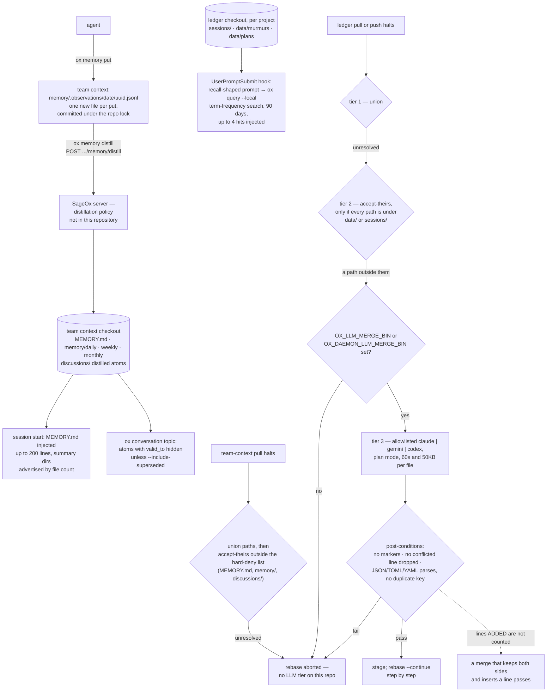

## 1. Executive Summary

SageOx CLI keeps a team's memory in git repositories the SageOx server
provisions and fills, and it is careful about the one place where two writers
can collide: a rebase that halts. Its accept-theirs rule is confined to
artifacts it can regenerate, and the comment justifying that rule carries its
own evidence. Its last-resort LLM merge must keep
every line from both sides or be refused. The team's memory never reaches that
merge, because it is written so that it cannot conflict.

There are two repositories, and the difference matters. The **team context**,
one per team, holds `MEMORY.md`, the summary directories `memory/daily/`,
`memory/weekly/` and `memory/monthly/`, the pending observations, and recorded
discussions. The **ledger**, one per project repository, holds session records,
murmurs and plans. Agents write observations; the server distils them into the
summaries; agents read `MEMORY.md` at session start and the summary
directories on demand.

Three mechanisms are worth the visit.

Priming injects `MEMORY.md` and then advertises the rest — "Recent:
memory/daily/ (12 files — what happened recently)" — under a heading called
Progressive Disclosure, leaving the agent to open what it wants with ordinary
file tools.

On a prompt that reads like a recall question, a hook runs a local search over
the ledger and injects up to four hits, inside a 100-millisecond budget, and a
lint test pins that hook to the local path for privacy reasons the comment
spells out.

And the LLM merge tier checks content, not only syntax. It counts every
non-blank line of each conflict side, refuses a merge that loses one, and
parses JSON, TOML and YAML output for duplicate keys. A conflict where both
sides rewrote the same line cannot pass, and the code says that is deliberate:
"the conflict is left for a person rather than resolved by discarding
someone's record."

What it cannot show is the memory policy itself. The summaries an agent reads
are written by `POST /api/v1/teams/{id}/memory/distill`, and the discussion
distillations by a server pipeline; this repository is the client of both.

## 2. Mental Model

An **observation** is what an agent records in the moment: `{"content": "..."}`,
capped at 20,480 bytes. Each put, single or batch, writes its observations as
`Fact` lines into a new file of its own.

A **summary** is what the server distils from observations: `MEMORY.md` and
the files under `memory/daily`, `weekly` and `monthly`. Nothing in this
repository writes one.

A **discussion atom** is one claim the server extracted from a recorded
conversation, with a confidence, a quote, citation URIs and a validity
interval. The CLI folds a sidecar of edits over the atoms and hides the ones a
rejection closed.

A **ledger record** is a session, a murmur, a plan or a plan's review
feedback. These are what the per-prompt recall searches.

A **sync** is `git pull --rebase` on each checkout, and when it halts, the
tiers decide what survives.

## 3. Architecture

| Area | Role |
| --- | --- |
| `internal/ledger/` | The project ledger: clone, sparse checkout, resolve rules, push |
| `internal/ledger/automerge/` | The three conflict tiers, the binary allowlist and the content post-conditions |
| `internal/manifest/auto_resolve.go` | Resolve rules for team contexts and the hard-deny list |
| `internal/daemon/` | Pulls both checkouts; wires the LLM tier into the ledger pull only |
| `internal/ledgersearch/` | Local term-frequency search over sessions, murmurs, plans and feedback |
| `cmd/ox/agent_hook_recall.go` | The per-prompt recall injection |
| `internal/conversation/` | Read-only access to recorded discussions and their distilled atoms |
| `internal/plan/` | Plans, their lifecycle event log and prior-art search |
| `internal/facts/` | The `Fact` schema and its JSONL reader and writer |
| `cmd/ox/memory_put.go`, `memory_distill.go` | Observation capture and the call to the server's distillation |
| `cmd/ox/agent_prime.go` | What an agent is told about memory at session start |

## 4. Essential Implementation Paths

`internal/ledger/ledger.go:36-67`. Read the comment, not just the rule.

Then `internal/ledger/automerge/llm.go:86-223` for the merge and its three
post-conditions, and `llm_test.go:199` for the table that pins them, including
the cases that must be refused.

Then the wiring that decides which repository the tier serves:
`internal/daemon/sync.go:1449-1461` passes `LLMResolver` to the ledger pull and
`internal/daemon/sync_team.go:673` passes none to the team-context pull.

Then `cmd/ox/agent_hook.go:510-517` and `agent_hook_recall.go:72-104` for the
recall injection, and `internal/ledgersearch/ledgersearch.go:117-178` for what
it searches.

## 5. Memory Data Model

The `Fact` is shaped for citation: `SourceRef` is "the stable canonical
identifier", `SourceURL` is "the human-clickable URL for drill-down" and
`SourceTitle` is "a short human label for citations". A file header records a
schema version, a source type, a recorded-at, an optional source hash and a
query window. `Category` lists eight genres, from `decision` to
`direction_change`, and nothing in this repository sets it: the one writer,
`writeObservation`, fills `Headline`, `SourceType` and `Timestamp`, with the
timestamp taken from the write clock.

No fact carries an epistemic state, and nothing in this repository rewrites
one. Each `ox memory put` and each session-end auto-observation creates a new
file named by a UUIDv7, written whole inside `.git/` and renamed into place.

Discussion atoms are the richer unit, and the CLI only reads them. An atom has
a kind, a signal, text, a quote, citation URIs, a confidence, and
`valid_from`, `valid_to` and `superseded_by`. An `edits.jsonl` sidecar
can edit, add or reject atoms; `Project` folds it in, and a reject sets
`valid_to` to the edit's timestamp. `ox conversation topic` hides atoms with a
`valid_to` unless `--include-superseded` is passed, and `ox conversation
topics` counts only current ones. Nothing in this repository writes the base
file or the sidecars — the edit fold's comments name an editor whose
"production sidecars" it has observed — and the projection comment states that "[d]raft and finalized are served identically
— status is point-in-time metadata, with no gating."

Plans carry a status (`approved`, `superseded`, `abandoned`, `realized` and
others) and an `events.jsonl` that `AppendEvent` extends under a file lock.
The events record lifecycle and provenance, not content: a revision overwrites
`plan.md` and appends an event naming the revision. `ox plan approve` takes
"the same action a reviewer's Approve button" takes, from any shell, and no
read path waits for it.

## 6. Retrieval Mechanics

Three read paths reach an agent.

**Session start.** `loadTeamMemory` reads `MEMORY.md` from the team context
with `ReadFirstLines(..., MaxInlineContextLines)`, which is 200, despite the
function comment's "always fully inlined". `SOUL.md`, `TEAM.md` and the
observation guide are given as paths. The summary directories are given as
file counts. For a team whose agents have file tools, this costs a line of
prompt per directory and leaves the choice to the agent.

**Each prompt.** `handlePrompt` calls `emitLocalRecallPreamble` before
anything else. If the prompt is at least 20 characters, does not start with
an action verb, and matches a recall pattern such as "how did we" or "has
anyone", it shells out to `ox query --local` and writes up to four hits inside
a `<system-reminder>`. The search is `ledgersearch.Search`: AND-matched terms,
a density-normalised term-frequency score, ties broken by recency, over
sessions and plans from the last 90 days and murmurs from the last seven. It
reads the ledger, not the team context, so the distilled summaries are not
among the candidates. The comment on the shell-out is marked load-bearing and
a lint test pins it: a remote query here "would transit every keystroke the
user typed into their agent."

**On request.** `ox query` sends the query to the server's search, scoped by
team and repository ids taken from project config unless `--team` or `--repo`
is passed. `ox conversation` reads discussions from the local checkout after a
membership check. Plan prior-art search reuses `ledgersearch`.

None of these read paths consults a plan's lifecycle status. `scanPlans` reads
`plan.md` and `meta.json` for text and dates, and `internal/plan/priorart.go`
has no status reference, so a plan marked `superseded` by `ox plan supersede`
resurfaces as prior art beside the plan that replaced it.

## 7. Write Mechanics

`ox memory put` accepts a JSON object or a JSONL batch, caps each observation
at 20,480 bytes ("~5000 tokens"), writes it to
`memory/.observations/<date>/<uuid>.jsonl` in the team context, and commits
under the repo lock that the daemon's pull and `ox import` also hold. A put that
finds the lock busy leaves the file for the next put's commit. Priming tells
the agent to do this unprompted: "Proactively record observations throughout
this session".

`ox memory distill` refuses to run for a human, and for an agent posts the
pending observations and their date range to the API. Nothing local writes the
summaries; they arrive in the team context by the daemon's pull. The local pipeline that once did this work is
gone: `docs/specs/team-memory-journal.md` is headed "**Superseded —
2026-09-09:**".

No path in this repository writes `MEMORY.md` or the summary directories. The
hard-deny list's comment says agents write them "via `ox remember`", and no
such command is registered.

## 8. Agent Integration

Hooks for Claude Code, Gemini CLI, OpenCode, Codex, Cursor and others call
`ox agent hook <event>`; the Claude plugin and `.claude/settings.json` wire
SessionStart, UserPromptSubmit, PreCompact, PostToolUse, Stop and SessionEnd.
PreCompact re-primes. The daemon pulls the team context and the ledger on
their own intervals and, when configured, resolves ledger conflicts with the
LLM tier in the background rather than in front of whoever caused them.

## 9. Reliability, Safety, and Trust

**Where conflicts can happen.** Observations cannot conflict, because each put
writes a new path; `internal/kb/mergeattrs.go` says so for "session, history,
murmur, or memory entry paths". `MEMORY.md`, `memory/` and `discussions/` sit
on the team-context hard-deny list, so no manifest rule can make them
accept-theirs. And the team-context pull is given no LLM resolver. A conflict
there aborts the rebase and is surfaced.

**The ledger's tiers.** The ledger auto-resolves `data/` and `sessions/`, with
the reasoning written out beside the rule: `meta.json` is written by the cloud
summariser and the CLI, so with no rule "the next attempt fails identically —
a deterministic wedge that never escalates and never self-heals. One ledger
sat 341 ahead / 1055 behind for 13 days with 281 such conflicts." Accept-theirs
fires only when every remaining path is under a safe prefix, after a
pointer-wins guard the SAFETY note forbids weakening.

**The LLM tier.** It runs only when `OX_LLM_MERGE_BIN` or
`OX_DAEMON_LLM_MERGE_BIN` names a binary. The binary is `claude`, `gemini` or
`codex` by bare name, or an absolute path — "relative paths with a slash are
refused outright" — because a config-sourced name could "redirect to
/tmp/evil". `claude` runs in plan mode so a prompt-injected conflict body
cannot execute tools. The prompt's delimiters carry a per-call nonce. Symlinks
are refused, files over 50KB are refused, and each file has 60 seconds.

**The post-conditions.** After the marker scan, `requiredLines` counts every
normalised non-blank line outside the hunks and, per hunk, the larger of each
side's count; `droppedLines` refuses output missing any of them. A diff3 base
section may be dropped. `validateStructured` parses `.json`, `.toml` and
`.yaml` output and `rejectDuplicateJSONKeys` refuses a JSON union holding both
values of one key. The comment states the intent plainly: "a merge that
silently drops or paraphrases one side's lines is refused instead of
committed."

The check is a multiset of lines kept. It does not bound what is added, so a
merge that keeps both sides and inserts a line neither side wrote — a
reconciling sentence, a wrong date — is staged. Normalisation strips
whitespace and a trailing comma, which is what lets a JSON union pass; it also
means a line whose meaning lives in its indentation can move between YAML
parents unnoticed whenever the result parses.

## 10. Tests, Evals, and Benchmarks

The automerge package has a test file for the allowlist alone and a
twenty-one-case table, `TestMergeOneWithLLM_ContentPreservation`, whose header
names the failure it prevents: "a model keeps one side (or paraphrases both)
and the lossy result is staged". It asserts that dropping either side,
paraphrasing both, rewriting one line on both sides, collapsing a repeated
line, dropping context outside the hunk and keeping both values of a key are
refused, and that reordering, a JSON comma and a discarded diff3 base pass.

`ledgersearch` has AND-semantics, ranking, limit and age-cutoff tests.
`TestSearch_AgeCutoff` and `TestSearch_PlanAgeCutoff` assert that an old record
is not returned, from a store holding only that record.
`TestAgentPrime_BulletinPostBodyNeverReachesPrime` asserts a bulletin post's
body never appears in prime output while its pointer does. That is a
must-not-appear case about an assembled preamble, not a retrieval result.

`ci.yml` runs on push and pull request, and `evals.yml` runs agent-behaviour
evals daily and on dispatch. I ran nothing.

## 11. For Your Own Build

### Steal

Write the comment the way `DefaultResolveRules` is written. Name the failure,
quantify it, justify the scope one artifact at a time by naming each one's
canonical source, state the trade, mark the safety constraint, and say what
you deliberately did not do.

Give an LLM merge a content post-condition. Counting lines per conflict side,
keeping the larger count per hunk, is a few dozen lines and turns the prompt's
"preserve both sides" into a refusal. Make the unmergeable case fail loudly:
two rewrites of one line go to a person.

Write memory so it cannot conflict. A new file per write, named by a
time-ordered UUID, removes the merge problem for the part of memory agents
write most often.

Keep a per-prompt recall local, and pin the reason in a test.

### Avoid

Checking only what a merge kept. Count what it added too, or bound the output
length against the inputs; a reconciling sentence nobody wrote is the
plausible failure of a model asked to merge two records.

A lifecycle status that the retriever never reads. `superseded` and
`abandoned` exist on plans and gate only re-saving; prior art returns them.

Comments that describe the code they sit above incorrectly. "Always fully
inlined" above a 200-line cap, and `ox remember` in a list of writers, are
the claims a reader takes from the file.

### Fit

This suits a team that lives in git and wants agents to share a
record without a database, and is willing to let a hosted service write the
summaries. Walk away if the consolidation policy must be inspectable or
self-hosted, or if a superseded plan must stop surfacing.

## 12. Open Questions

What the server's distillation does with contradictory observations from two
agents. The request carries only observation text, timestamps and a date
range.

Whether the line-preservation check ever refuses in practice, and what happens
to the ledger then; the code logs `automerge.llm.dropped_content` and aborts,
which on a shared artifact is the wedge the resolve-rules comment describes.

Who writes discussion `edits.jsonl` and `finalize.jsonl`, and under what
authority. The comment names an editor UI; the actor field is a free string,
and finalizing does not gate what is served.

## Appendix: File Index

| Path | What to read it for |
| --- | --- |
| `internal/ledger/ledger.go:36-67` | The documented resolve rule, with its evidence |
| `internal/ledger/automerge/automerge.go:1-20`, `:148-200` | The tiers, step by step |
| `internal/ledger/automerge/llm.go:86-260` | The merge, the line count and the structured-output checks |
| `internal/ledger/automerge/llm_test.go:199` | The content-preservation table |
| `internal/daemon/sync.go:1449-1461`, `sync_team.go:673-684` | Which pull gets the LLM tier |
| `internal/daemon/llm_resolver.go:28-33` | The environment variables that enable it |
| `internal/manifest/auto_resolve.go:20-48` | The hard-deny list and its stale `ox remember` |
| `internal/kb/mergeattrs.go:40-73` | Union paths, and why memory entries need none |
| `cmd/ox/agent_hook_recall.go:72-104`, `:160-230` | The recall injection and its local-only rationale |
| `internal/ledgersearch/ledgersearch.go:1-26`, `:117-178` | What the recall searches and how it ranks |
| `internal/conversation/format/projection.go:17-160` | The edit fold, the valid_to filter, and no status gating |
| `internal/plan/events.go:1-160` | The plan lifecycle log |
| `cmd/ox/memory_put.go:125-201` | One file per observation, committed under the lock |
| `cmd/ox/agent_prime.go:2633-2655`, `:2919-2933` | MEMORY.md inlined to 200 lines; progressive disclosure |
| `internal/facts/types.go` | A citation-shaped fact with no state |

### Recorded searches

Run with `git grep` at the tree root, at both `02f4f406a4b973fa4adda9df62725904cc1859d9` and `304ab68a822b561e5ec96c41f74acd17444160a4`; results are the same at both except where noted.

- `git grep -n 'LLMResolver:' -- '*.go' ':!*_test.go'` — one hit, the ledger pull in `internal/daemon/sync.go` (line 1361 at the first pin, 1459 at the second); the team-context pull sets none.
- `git grep -n 'automerge.New(' -- '*.go' ':!*_test.go'` — `cmd/ox/session_upload.go` (the ledger push hook) and `internal/daemon/llm_resolver.go`, plus a comment.
- `git grep -n 'droppedLines\|validateStructured' -- internal/ledger/automerge` — no match at the first pin; the definitions and calls in `llm.go` at the second.
- `git grep -n -E 'EditsFileName|FinalizeFileName' -- '*.go' ':!*_test.go'` — only the declarations and loaders in `internal/conversation/format/distillation.go`; no writer.
- `git grep -n -E 'ValidFrom[[:space:]]*=' -- '*.go' ':!*_test.go'` — `projection.go:123-125`, set from the edit's timestamp, and a view copy in `read/topic.go:134`.
- `git grep -n -i -E 'status|supersed|retract|disput|withdraw' -- internal/facts ':!*_test.go'` — no match.
- `git grep -n -E 'Category:' -- '*.go' ':!*_test.go'` — only settings categories in `cmd/ox/config_settings.go`; no fact category is set.
- `git grep -n -i 'status' -- internal/ledgersearch/ledgersearch.go internal/plan/priorart.go` — only a plan-feedback item's status, read as search text.
- `git grep -n -i -E 'blocklist|denylist|suppress|rejected_?values?|forget' -- internal/facts internal/ledgersearch internal/conversation cmd/ox/memory_put.go cmd/ox/memory_distill.go ':!*_test.go'` — no match; no value-keyed rejection.
- `git grep -n -E 'Use:[[:space:]]+"remember' -- '*.go'` — no match; `ox remember` appears only in the hard-deny comment.
- `git grep -n -E 'MEMORY\.md' -- '*.go' ':!*_test.go'` — readers, validators and the deny list; no writer.
- `git grep -n -i -E '(must not|should not|must never|never) (be )?(appear|surface|return|leak|retriev|include|show)' -- '*_test.go'` — prime, session-capture and redaction cases; none asserts a ledger search or recall result excludes a record from a store that also returns another.
- `git grep -n -i -E 'anthropic|machine learning|not (be )?used (for|to)' -- LICENSE` — no match; the MIT text carries no rider.

## History

**2026-10-15** — [`304ab68a822b561e5ec96c41f74acd17444160a4`](https://github.com/sageox/ox/commit/304ab68a822b561e5ec96c41f74acd17444160a4) — 242 commits on, v0.15.0 to v0.23.0. Overtaken: [`a02dec578f445d250510136b7ecb8f129fc7f883`](https://github.com/sageox/ox/commit/a02dec578f445d250510136b7ecb8f129fc7f883) made the LLM merge refuse output that drops a conflicted line or duplicates a key ([section 9](#9-reliability-safety-and-trust)), and observations commit under the repo lock. Wrong at the first pin: memory lived in the team context, not the ledger, and the LLM tier never served it; retrieval existed ([section 6](#6-retrieval-mechanics)); CI ran. No marks change. Screened from a full clone: 27 files, four auto-run surfaces, one build-time execution point, one unpinned surface, seven dependency files inside the cooldown, `AGENTS.md` and `CLAUDE.md` read as data. Nothing was installed, built or run.

**2026-09-16** — [`02f4f406a4b973fa4adda9df62725904cc1859d9`](https://github.com/sageox/ox/commit/02f4f406a4b973fa4adda9df62725904cc1859d9) — first reading, at a commit dated 15 September 2026. Screened before opening, from a shallow clone: twenty files scanned, three auto-run surfaces, one build-time execution point, one unpinned surface, five dependency files inside the seven-day cooldown, and the `CLAUDE.md` and `AGENTS.md` read as data. Nothing was installed, built or run.
