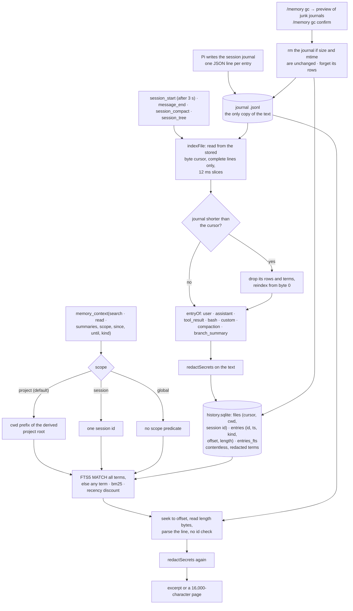

## 1. Executive Summary

pi-memory keeps no memory of its own. It indexes the session journals Pi
already writes, storing search terms in a contentless SQLite FTS5 table and a
byte pointer into each journal line, and it rereads and redacts the text from
the journal every time it returns one. The index can be thrown away and
rebuilt. The weak side is the boundary: the default project scope is one
argument away from `global`, a read by entry id ignores scope, and the read
does not check that the line it lands on carries the id it asked for.

**Until 14 October 2026 it was a curated temporal-fact store.** Commit
[`a6bc833c5a8473dceaf6adaddaff5f982875e5bc`](https://github.com/prjct-app/pi-memory/commit/a6bc833c5a8473dceaf6adaddaff5f982875e5bc),
released as 1.0.0, removed "curated facts, memory_record, curation, the daemon,
retention, handoff masking, embeddings and the child view". The changelog gives
measured reasons: a rule stated once "was gone from the summary by compaction
21", and of the curated store "85% of lookups came back empty, 46% of writes
failed". Old databases are left untouched. The fact store, with its validity
interval and its refusal to reopen a closed one, is described in
[section 9](#the-fact-store-it-replaced) against its last tree.

The README states the problem the rewrite answers. Long sessions compact many
times, each compaction replaces older turns with a summary, and Pi keeps every
entry in the journal anyway. So the agent needs a way to find what was
compacted away, or what happened in an earlier session of the same project,
and to read it verbatim. That is the whole product.

There is one tool, `memory_context`, with three actions: `search`, `read` and
`summaries`. "Nothing is injected: no recall, no rewritten context, no retired
turns." The model calls it when it decides it needs something from the past,
and a committed test asserts that the extension registers no hook on
`context`, `before_agent_start`, `before_provider_request`, `agent_end` or
`turn_end`.

Search is BM25 over all terms first and any term second, and the result says
which (`match: "any"`, with a hint). Newer entries rank higher among equally
relevant ones. FTS syntax in a query is quoted into literal terms, so an
unbalanced quote or a stray `OR` is text, not an error.

## 2. Mental Model

A **journal** is a Pi session file, one JSON object per line. It is the only
source of truth.

An **entry** is one line the index understands: a user, assistant, tool-result,
bash, custom, compaction or branch-summary message. Encrypted reasoning and
metadata lines are left in the journal and not indexed, and an image leaves only
an `[image]` marker.

The **index** is derived. It knows where each entry's line starts, how long it
is, and which redacted words it contains. It does not hold the text.

A **scope** is a filter chosen per call. `project` is the outermost folder
above the cwd that has sessions of its own, below a direct child of home;
`session` is one journal; `global` is everything.

## 3. Architecture

| Area | Role |
| --- | --- |
| `src/index.ts` | The extension: event subscriptions, the `memory_context` tool, the `/memory` command, the backfill lease |
| `src/history/entry.ts` | Which journal lines become entries, and the visible text of each |
| `src/history/indexer.ts` | Incremental indexing by byte offset, redaction, backfill of other journals |
| `src/history/store.ts` | The SQLite schema, the scope and date predicates, FTS search, forget, the lease |
| `src/history/query.ts` | Request handling: date boundaries, scope resolution, reranking, reading from the journal |
| `src/history/project.ts` | The project-root heuristic behind the default scope |
| `src/history/gc.ts` | Junk-journal criteria, preview and exact deletion |
| `src/security/redact.ts` | Pattern-based secret redaction |

## 4. Essential Implementation Paths

`src/history/store.ts:35-51` — the schema, including the contentless FTS5
table with `contentless_delete=1`.

`src/history/indexer.ts:42-88` — the incremental reader: cursor, the shrink
check at `:46`, complete lines only, redaction before the row is appended.

`src/history/query.ts:47-60` — `entryText`, the read that goes back to the
journal and redacts.

`src/history/query.ts:73-85` and `src/history/store.ts:58-68` — how a scope
becomes a predicate, and where `global` drops it.

`src/history/gc.ts:25-60` — what counts as junk, and the deletion that refuses
a file that changed since the preview.

## 5. Memory Data Model

Three tables and a virtual one. `files` holds one row per journal path with its
session id, cwd, start time and the byte cursor indexing has reached. `entries`
holds one row per indexed line: the journal's own entry id and parent id, the
line's timestamp, kind, role, tool name, character count, byte offset and
length, and `tokensBefore` for compaction summaries. `entries_fts` is FTS5
with `content=''`, so it stores the term index and no text, and
`contentless_delete=1`, so a row's terms can be removed.

`meta` holds the schema version and the backfill lease, written as
`owner@expiry`.

There is one timestamp per entry, the one Pi wrote on the journal line. No
field records when something stated in an entry was true, and no field records
how far an entry is to be believed. An entry is a record of what was said and
done, not a claim the store holds.

## 6. Retrieval Mechanics

`search` with a query quotes every letter-or-digit run as a literal FTS5 term
and matches them all together. If nothing has all of them, it runs again with
`OR` and reports `match: "any"`. It takes up to 400 candidates by `bm25`, then
reranks with `-score / (1 + age / 30 days)`, so an entry a month old counts
half as much as an equally relevant one from today. Without a query, `search`
lists entries newest first; `summaries` does the same restricted to compaction
and branch summaries.

`since` and `until` accept `YYYY-MM-DD`, read as the user's local day from
00:00:00.000 to 23:59:59.999, or anything `Date` parses; an unparseable value
throws with an example of the expected form. Both compare against the entry's
journal timestamp as an ISO string.

`read` finds an entry by id, preferring the current session, then a unique
match anywhere, and otherwise returns `ambiguous` with each candidate's session,
time, kind and cwd. It pages text in 16,000-character slices with a
`nextOffset`.

Every returned text comes from `entryText`, which opens the journal, reads
`length` bytes at `offset`, parses the line with the same `entryOf` the indexer
used, and redacts it. It does not compare the parsed entry's id with the id it
was asked for. A journal that shrank is reindexed from the start; one rewritten
to the same length or longer keeps its old pointers until a parse fails, and a
failed parse reads as `[journal line unavailable]` in a search or
`unavailable` in a read.

The default scope is `project`, computed by `projectRoot`: the outermost
ancestor of the cwd that has sessions of its own, where a direct child of home
counts only when it is the cwd itself, so `~/Apps/prjct/prjct-be` searches `prjct-be`, its siblings and
`~/Apps/prjct`, and not `~/Apps/fluenty`. The predicate is
`f.cwd = ? OR f.cwd LIKE ?/%` with `%`, `_` and `\` escaped. `global` is one of
three values of the tool's own `scope` argument and removes the predicate, and
`read` applies no project filter at any scope. The project scope is a relevance
default for one person's machine, which is how the README describes it, and no
scope mark is claimed.

## 7. Write Mechanics

The agent writes nothing. The extension follows Pi's journal: on
`message_end`, `session_compact` and `session_tree` it indexes the current
journal, and three seconds after `session_start` it indexes the current journal
and then backfills every other journal that grew since it was last seen, newest
first. Overlapping requests fold into one more pass.

`indexFile` reads from the stored byte cursor in 1 MB chunks, keeps an
incomplete last line for next time, and appends rows in transactions that move
the cursor in the same commit, yielding to the event loop every 12 ms. Each
entry's text passes through `redactAll`, which splits text over 1 MB at line
boundaries for `redactSecrets`, before its terms are inserted.

Only one process scans other journals at a time. `lease(owner, 120 s)` takes or
renews `meta.backfill-lease` inside `BEGIN IMMEDIATE`, an expired lease is
taken over, and the backfill renews it after every file and stops if it was
lost. Every process indexes its own journal regardless.

## 8. Agent Integration

One tool and one command. `memory_context` takes `action`, `query`, `entryId`,
`sessionId`, `since`, `until`, `scope`, `kind` and `offset`; its description is
under 200 characters, and a test holds it there because it "rides every
request". Before every call the tool indexes the current journal, so an entry
written a moment ago is searchable. While backfill is running, results say how
many older journals are indexed so far and that results may be incomplete.

`/memory` reports sessions, entries, summaries and indexed megabytes;
`/memory index` runs a pass; `/memory rebuild` deletes `history.sqlite` and its
WAL files and builds again; `/memory gc` and `/memory gc confirm` are the
collector. None of these is on the agent's tool surface.

## 9. Reliability, Safety, and Trust

Secrets are redacted twice: before terms are indexed, so a key never becomes a
search term, and on every text returned, so a key in a journal line is masked
on read. The patterns cover key names such as `password`, `token` and
`api_key` beside `=` or `:`, `Authorization` headers, common token prefixes,
AWS key ids, JWTs, PEM private-key blocks, URL user-info and `curl -u`. The
journal itself keeps the unredacted text, so the guarantee is about this
extension's output, not about the disk.

The collector is mechanical. A journal is junk when it never compacted and ran
under a temporary folder, received no user, team or extension message, or got
two replies or fewer; a journal quiet for less than 24 hours and the current
one are never candidates. `confirm` deletes only the files the last preview
listed, skips any whose size or mtime changed, and removes their index rows and
terms. The deletion is of Pi's own journals, which are the only copy.

No entry carries a status, a validity interval or an audit trail; the index is
a function of the journals.

### The fact store it replaced

At [`0f09c6b4b79c81f1c68a5a53238830d49d792d5c`](https://github.com/prjct-app/pi-memory/tree/0f09c6b4b79c81f1c68a5a53238830d49d792d5c),
the last tree read before the rewrite, facts carried a five-value `standing`
and three times: `valid_at` and `invalid_at` apart from `recorded_at`. The
`memory_record` tool accepted a model-supplied `validAt` and `invalidAt`.
Recording a fact that supersedes another closed the old one's `invalid_at` at
the new fact's `validAt` and set `expired_at` at the event time
([`src/storage/projection.ts:379-398`](https://github.com/prjct-app/pi-memory/blob/0f09c6b4b79c81f1c68a5a53238830d49d792d5c/src/storage/projection.ts#L379-L398)).
Retrieval filtered on that interval at a validated `asOf`, and a committed test
asserted a superseded fact was absent at the default `asOf` and present at an
earlier one
([`tests/engine.test.ts:35-46`](https://github.com/prjct-app/pi-memory/blob/0f09c6b4b79c81f1c68a5a53238830d49d792d5c/tests/engine.test.ts#L35-L46)).

The storage read and the prompt hook selected facts by an allowlist of live
standings. `resolveFact` refused to move a superseded or contradicted fact back
to a live one:

> "A closed interval cannot be reopened without losing history; record a new
> fact instead."

## 10. Tests, Evals, and Benchmarks

Nine test cases in two files, 245 lines, plus three in a release-policy test
under `.github/release`. I ran none of them for this reading.

Four of the nine carry must-not assertions on the search read path, each beside
positive cases over the same populated store. A journal rewritten shorter must
leave none of its old terms searchable. A key in a tool result must not be a
search term and must not appear in the read. The default project search must
return exactly the three entries of its project, which keeps the other project
and the folder directly under home out. Deleted journals must leave no search
terms. The scope test also asserts that `global` returns all five entries, so
the widening is specified behaviour, not an accident.

No test covers a read against a journal rewritten to the same length or
longer, which is the case where the pointer and the line disagree.

The README reports a measurement on 2.37 GB of real journals across 709
sessions: 102 s for the first pass, a 270 MB index, event-loop pauses up to
187 ms during that pass, and search p50 21 ms. Nothing in the tree reproduces
it.

## 11. For Your Own Build

### Steal

Make the transcript the source of truth and the index disposable. A contentless
FTS table and a byte pointer per line cost little, keep no second copy, and turn
"delete the index" into a safe operation instead of a data-loss event.

Redact before indexing, not only on output. A secret that becomes a search term
can be found by searching for it, and the test that pins this is two lines.

Make deletion exact. A preview that names files, followed by a confirm that
deletes only those and skips any that changed, is the difference between a
collector and a sweep.

Test what the extension does not do. Asserting that no context or prompt hook
is registered keeps "nothing is injected" true through a refactor.

From the design it replaced: refuse to reopen a closed interval, and put the
alternative in the error message. A mutable status over a temporal record will
otherwise quietly undo it.

### Avoid

Offering `global` as a value of the agent's own scope argument when the
project scope is meant to keep projects apart. If it is a relevance default,
say so; if it is a boundary, the agent should not hold the widening.

Reading through a stored offset without checking the id at the far end. The
journal line carries its id; comparing it costs one string comparison and
turns a silent wrong answer into an `unavailable`.

Leaving a previous version's store on disk with nothing that reads or removes
it. A user who asked the old version to forget something has no path to it.

### Fit

This suits one person working in Pi on one machine, whose problem is that
compaction loses things the journal keeps. It is not a belief store: it cannot
say a fact was corrected, only show where it was said. Walk away if projects
must not see each other's history, or if the memory must be correctable rather
than searchable.

## 12. Open Questions

Whether Pi ever rewrites a journal in place without shrinking it. The indexer
assumes append-only growth and resets only on a shorter file.

Whether the project scope is meant as a privacy boundary. The README describes
it as a default and documents `global` as the way to include every project.

What happens to the curated-fact databases of versions before 1.0.0. The
changelog says they are left untouched, and no code in this tree opens them.

What the redactor does not catch. It is a list of patterns with no stated
limit, and the journal it reads from keeps the original.

## Appendix: File Index

| Path | What to read it for |
| --- | --- |
| `src/index.ts:38-48` | The tool's arguments, including the three scope values |
| `src/index.ts:112-152` | Event subscriptions and the tool body |
| `src/index.ts:186-199` | Collector preview and confirm |
| `src/history/store.ts:35-68` | Schema, and the scope and date predicates |
| `src/history/store.ts:142-158` | All-terms-then-any-term search |
| `src/history/store.ts:212-226` | The backfill lease |
| `src/history/indexer.ts:42-88` | Incremental indexing, the shrink check, redaction before indexing |
| `src/history/query.ts:47-60` | The read from the journal, with no id check |
| `src/history/query.ts:98-148` | Recency rerank and the three actions |
| `src/history/project.ts:11-20` | The project-root heuristic |
| `src/history/gc.ts:25-60` | Junk criteria and exact deletion |
| `tests/history.test.ts:42-98` | The must-not cases: rewritten journal, secret, project scope |
| `tests/gc.test.ts:17-60` | Collector preview, the changed-file skip, terms removed with the file |

### Recorded searches

Run at the tree root of the pinned checkout with `git grep`.

- `git grep -n -i -E 'standing|verified|rejected|candidate|trust' -- src index.ts` — only the collector's `Candidate` type, the project heuristic's `candidates` and the search's `CANDIDATES` constant; no epistemic state.
- `git grep -n -i -E 'valid_?(at|from|to)|invalid_?at|effective' -- src index.ts` — no match; one timestamp per entry.
- `git grep -n -i -E 'tombstone|suppress|denylist|blocklist' -- src index.ts` — no match.
- `git grep -n -i -E 'audit|append-only|event_log|history_log' -- src` — no match.
- `git grep -n -E 'registerTool|registerCommand|pi\.on\(' -- src index.ts` — one tool, one command and five event subscriptions, all in `src/index.ts`.
- `git grep -n -F "'global'" -- src` — `src/history/query.ts:12` and `src/index.ts:45`, the tool argument.
- `git grep -n -E 'entryId ?===|\.entryId ?!==' -- src/history/query.ts` — no match; the read does not compare ids.
- `git grep -n -E 'memory\.sqlite|\.prjct' -- src index.ts` — only `history.sqlite` path resolution in `src/index.ts`; nothing opens the earlier databases.
- `git grep -n -i -E 'arxiv|bibtex|@article|@misc|doi\.org' -- README.md docs CHANGELOG.md` — no match; no paper.
- `git grep -n -i -E 'anthropic|machine learning|not (be )?used (for|to)' -- LICENSE` — no match; the MIT text carries no rider.
- `ls -a | grep gitmodules` — no match; no submodules.
- `git grep -n -E 'writeFile\(' -- tests` — two fixture writers and `tests/history.test.ts:53`, which rewrites a journal shorter; no test rewrites one to the same length or longer.
- `git ls-files scripts tests` — a Pi build script, an immutability check, two test files and a test isolation hook; no benchmark script.

## History

**2026-10-15** — [`b0e913df6e77b8e10483b2bfe7e44a607cb48a66`](https://github.com/prjct-app/pi-memory/commit/b0e913df6e77b8e10483b2bfe7e44a607cb48a66) — 69 commits on, version 1.0.0. The curated fact store was replaced by an index over Pi's session journals ([section 1](#1-executive-summary)), so `trust_state` and `bitemporal` are withdrawn; both held at the old pin ([section 9](#the-fact-store-it-replaced)). `negative_eval` gained, and earned at the old pin too, where tests asserted a superseded fact and another project's facts stayed out of search. Also wrong then: that retrieval labelled rather than withheld closed facts, the reason given for withholding `scope_enforced`, a capture-gate quote removed before the pin, and the line and test-file census. Screened from a full clone: six files, no auto-run, one build-time `prepublishOnly` guard, four dependency files inside the cooldown. Nothing was installed, built or run.

**2026-09-19** — [`0f09c6b4b79c81f1c68a5a53238830d49d792d5c`](https://github.com/prjct-app/pi-memory/commit/0f09c6b4b79c81f1c68a5a53238830d49d792d5c) — `trust_state` re-tested and every claim held, with anchors nudged: the allowlist is at `src/storage/projection.ts:722` and `resolveFact` at `src/engine.ts:370-379`, where the reopening guard and its sentence are verbatim. Two additions. The standing also drives retention rather than only recall — the eviction query (`projection.ts:862`, `:864`) treats superseded and contradicted rows as collectable, and candidate or needs_review rows with no recorded use past a cutoff — so the same field answers what may be recalled and what may be dropped. And the feedback path is the shape this atlas asks about whenever a queue appears: a `wrong` or `stale` signal does not write a standing, it enqueues a review job (`engine.ts:381-392`), and the curation pipeline drains that action (`src/curation/pipeline.ts:231-233`), extracting the fact id from the job's own revision string. A queue something consumes, rather than one that only fills. Screened again first; nothing was installed and no suite was run.

**2026-09-16** — [`0f09c6b4b79c81f1c68a5a53238830d49d792d5c`](https://github.com/prjct-app/pi-memory/commit/0f09c6b4b79c81f1c68a5a53238830d49d792d5c) — first reading, at a commit dated 15 September 2026. Screened before opening, from a shallow clone: three files scanned, no auto-run surfaces, no build-time execution points, one unpinned surface and two dependency files inside the seven-day cooldown. Nothing was installed, built or run, and the README's caution against installing a persistent service was moot for a read-only reading.
