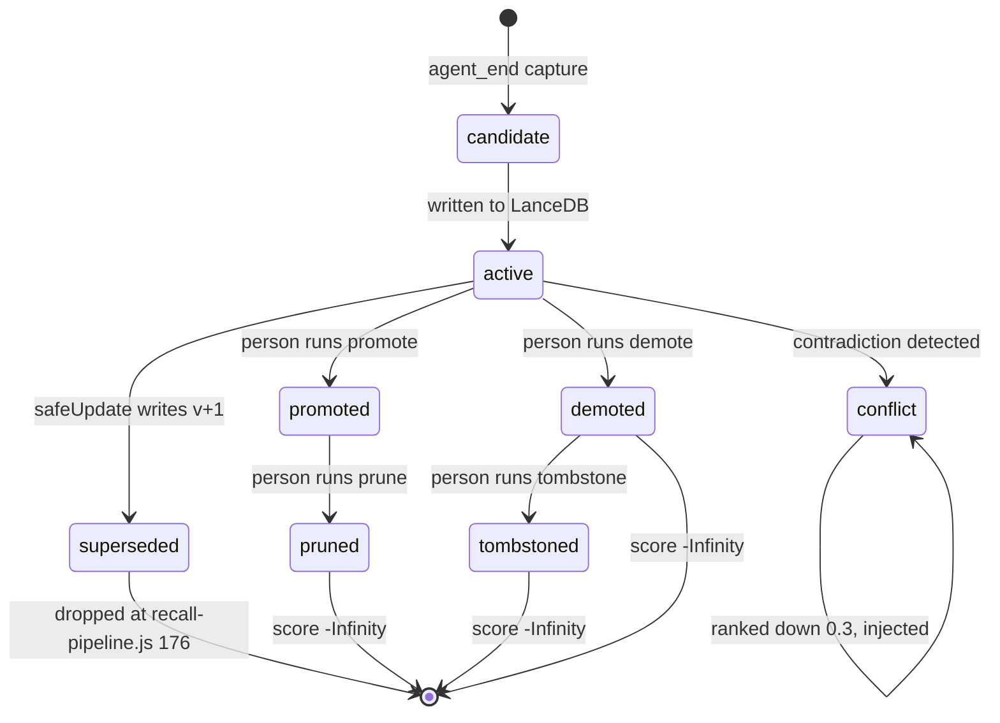

## 1. Executive Summary

PLUR1BUS is a memory plugin for OpenClaw, at release 7.16.10, and the first unusual thing about it is that its test suite is larger than the implementation it covers.

The second unusual thing is the ratio of care to surface. `openclaw.plugin.json` declares fifty-five top-level configuration groups, covering dreaming, emotional state, persona voice, an Obsidian vault bridge, skill mining, reminders, a semantic lens, conversation reactivation, and a proactive governor. Underneath that is a correction path — `lib/safe-update.js`, 509 lines — that is more disciplined than most of the dedicated memory systems in this atlas. A content change is refused unless the caller supplies both an update source and a quoted piece of evidence, the replacement row is written and made durable *before* the old row is marked superseded, and the whole transition is appended to a reconsolidation event log keyed by an idempotency hash.

The most interesting single line in the repository is `safe-update.js:440`. Before a content change is accepted, the new embedding is compared against the old one and the update is rejected if the cosine distance exceeds 0.45 — a machine refusing to let a "correction" quietly replace a memory with something that means something else. It is a genuinely novel gate.

The one caller outside the automated conflict apply, the user-facing `/correct` command at `index.js:9881`, passes `skipDriftGate: true` — deliberately, with the reasoning written at the call site. The gate throws rather than degrades, a large correction is exactly what a user typing `/correct` intends, and the confirmation dialog shows the old and new text in full before anything is written. The measured drift is recorded on the reconsolidation event either way. A gate that is off by argument is a different thing from a gate that is off by accident, and this is the first.

Where it is strongest: scope. `checkAccess` (`lib/acl-middleware.js:103`) denies by default, denies on a missing owner, denies on a conflicting ownership tuple, and is applied as a filter on the read path in three places. The tests assert the denials rather than the permissions.

Doubt acts in two places and is held back in a third **on a measurement rather
than an omission**. `scoreNeoRecallItem` returns `-Infinity` for `demoted`
alongside the deletion states, so a record a person has demoted cannot reach
the prompt at all; the claim-level epistemic status does the same for
`invalidated` at all three read layers (`recall-pipeline.js:180`,
`neo-arch.js:1484`, and the SQL clause at `db-adapter.js:601`). `conflict` is a
ranking penalty, and the comment that keeps it one is the interesting part —
the detector is *"an unvalidated LLM"*, a live probe on 16 August 2026 found
4,017 newest-revision records carrying `conflict` (2,505 on a single agent)
*"with no resolve path that clears the status"*, and a twenty-row sample was not
pairwise contradiction.

Hard-filtering on that signal would have withheld
thousands of records on a flag the system cannot yet clear. The distinction the
code draws — withhold on a state a person set, rank on a state a model guessed —
is the right one, and it is drawn with the numbers in the source.

Two mechanisms this atlas looks for are present and unusually well-tested. A claim carries a **real-world validity window** — `validFrom`/`validUntil` on the row, tracked separately from `createdAt`/`updatedAt` and queryable as-of through a `validAt` recall parameter, so "where did he work in 2025" is a different query from "what did we record in 2025". And a **value-keyed tombstone** survives a `/forget`: a content fingerprint is written to a durable append-only registry and checked before every card write that adds new text, so the forgotten sentence cannot be silently re-stored.

The weak joint is the log that explains corrections. Each reconsolidation event carries the source, the quoted evidence and the measured drift, and it is written through the same JSONL append as the turn journal, which caps every file at its newest 5,000 lines (`lib/neo-arch.js:2265-2285`); the daily consolidation rewrites it again. The append-only record of mutations is a different file, `destructive-ops.jsonl`, which logs deletions, trust transitions and curation decisions and is never rewritten.

## 2. Mental Model

There are two stores and they hold different kinds of thing.

**LanceDB cards** are the memories proper — one table per agent, a row per card. A card's life is short to describe: it is `active`, or it has been superseded by a newer version that names it in `previousVersion`. Retrieval is unforgiving about this. `lib/recall-pipeline.js:176` drops any entry whose status is set and is not `active`, so a superseded card is not ranked down, it is gone from the read path.

**Neo records** are the JSONL layer — turn journal, memory candidates, behaviour cards, graph edges, dream diary, episodes — and they carry the epistemics. Each record has a `status` from `NEO_STATUSES` (`lib/neo-arch.js:65`):

```js
["candidate", "active", "promoted", "demoted", "conflict", "pruned", "tombstoned"]
```

and an `origin.trustLevel` from `NEO_TRUST_LEVELS` (`lib/neo-arch.js:55`), running `untrusted → user_asserted → assistant_asserted → tool_observed → validated → curated`.

What moves a record between states is a person. `/plur1bus memory promote|demote|prune|tombstone <id>` (`index.js:9026-9036`) requires authorization, calls `transitionRecordStatus`, and appends the transitioned record back to the JSONL. There is no automatic promoter; a candidate becomes promoted because someone typed the command.

The consequence of each state is where the design divides. `scoreNeoRecallItem`
returns `-Infinity` for `pruned`, `tombstoned` and `demoted` — three states
genuinely withheld, and the third is there because a person set it. `conflict`
stays in the arithmetic below on the reasoning quoted in section 1. Everything
between is arithmetic:

```js
const trustBoost = ({ curated: 0.3, validated: 0.25, user_asserted: 0.18,
  tool_observed: 0.18, assistant_asserted: -0.2, untrusted: -0.3 })[item.origin?.trustLevel] ?? 0;
…
const penalties = (item.origin?.role === "assistant" ? 0.2 : 0)
  + (item.status === "demoted" ? 0.35 : 0)
  + (item.status === "conflict" ? 0.3 : 0)
  + (item.stale === true ? 0.15 : 0);
```

**The exits from `conflict` are authorized and narrow, which is the right shape
for a status a model assigns.** Two subcommands sit behind the same
authorization check as `promote`/`demote`/`prune`/`tombstone`
(`isDestructiveAction`, `index.js:7271-7285`). `/plur1bus curation resolve <id> keep|drop`
(`lib/curation-resolve.js`, dispatched at `index.js:8847`) moves one record and
appends a `curation.resolve` event. `/plur1bus curation drop-injected`
(`lib/drop-injected-conflicts.js`, `index.js:8865`) is the bulk form, and it is
bounded twice rather than trusted: `previewDropInjected` shows the set before
`applyDropInjected` touches it, and the apply path refuses any record whose
`status !== "conflict"` or whose text does not satisfy `isInjectedContextText`
(`:104`), so the bulk verb cannot reach a record the narrow predicate does not
already describe. Neither auto-resolves: a `conflict` a person never looks at
stays a penalty forever, which is the honest cost of leaving an unvalidated
detector's output in the ranking rather than in a filter.

So the neo statuses split three ways: the deletion states and `demoted`
withhold, `conflict` and the trust ladder rank, and the split tracks who or
what set the flag. A record a person demoted is gone from the read path; a
record an LLM detector flagged as contradicting another is ranked down and can
reach the prompt, carrying its status in the rendered line, which is the
difference between a model that can weigh the flag and one that cannot see it.

The exception lives on a different axis. Alongside the neo status is a claim-level **epistemic status** (`lib/epistemic-status.js`) — `untrusted → observed → corroborated → trusted → disputed → invalidated`, explicitly orthogonal to *who* asserted a memory (`origin.trustLevel`) and to its numeric `confidence`. Most of its values are a ranking boost (`trusted +0.25 … disputed −0.4`), but `invalidated` is a hard filter, dropped on the read path at `recall-pipeline.js:180`, given `-Infinity` at `neo-arch.js:1484`, and excluded in SQL at `db-adapter.js:601` (`epistemicStatus != 'invalidated'`). It withholds rather than ranks, as `demoted` does on the neo axis, and the transitions into `trusted` and `invalidated` require an authorized actor, so a memory cannot promote or condemn itself. A conservative merge rule (`combineEpistemicStatusForMerge`) takes the lower of two inputs, so a weakly-trusted memory cannot launder its way up by being merged with a trusted one.

**Which copy of a record the scorer sees is itself a design decision here, and it is the one that makes the rest of the vocabulary mean anything.** The JSONL stores are append-only event logs: `transitionRecordStatus` appends a fresh line under the same id rather than replacing the old one, so a record that has moved to `demoted` exists on disk twice, once in each state. `routeNeoRecall` (`lib/neo-arch.js:1530`) deduplicates by id and keeps the **newest revision**, ordered by `updatedAt` — the field a transition sets — while preserving first-appearance order so the `itemIndex` tiebreak below stays stable.

The helper that dates a revision, `neoRevisionTimeMs` (`:1523`), carries a note on why the existing `recordTimeMs` will not serve: it reads `startTime`/`createdAt`, which are identical across every revision of one record, so it cannot tell two revisions apart. An undated record sorts to `-Infinity` so any dated revision beats it and the comparison never lands on `NaN`.

Read against an append-only store, that is not a detail. Keeping the first line seen means scoring the record as it was *before* the transition, which would apply the `active` arithmetic to a record a person had just demoted — and a status penalty computed against the wrong copy is not a weakened penalty, it is no penalty. `tests/neo-status-transition-dedupe.test.js` fixes the arithmetic to a number: `active=0.371` against `demoted=-0.116` at a live `minScore` of `0.08`, so the two copies fall on opposite sides of the admission threshold.

The rendered line carries the status the penalty was computed from. `formatNeoRecallContext` emits `lane`, `category`, `trust`, `id`, `score` and `status` on each `<memory-record>`, which matters because the memory prompt supplement tells the model to prefer `active` and `promoted` over conflicting cards — an instruction that can only be followed if the distinction is in the payload.

One state transition is not epistemic at all and is worth naming here because it protects the whole loop. Text that PLUR1BUS itself injected into a prompt — recall blocks, temporal context, status reminders, cron output — is matched against a marker list and refused as a capture candidate (`isInjectedContextText`, `lib/neo-arch.js:194`, applied at `neo-arch.js:1229` and `:1276`). Without it, recall output becomes next turn's memory, which the comment above the marker list dates to a performance analysis on 29 May 2026.



## 3. Architecture

An OpenClaw plugin, loaded from `index.js`, requiring Node 24.16 or later (`package.json` `engines`) and a running OpenClaw gateway. Nothing else has to be stood up: LanceDB is embedded, the neo store is JSONL on disk, and the caches use the `node:sqlite` module built into Node rather than a dependency.

- **`index.js`** (13,646 lines) — plugin entry, hook registration, chat commands, and the wiring between every subsystem below.
- **`lib/`** (275 files, 81,669 lines) — `obsidian-control-room.js` (3,954), `neo-arch.js` (3,500), `obsidian-bridge.js` (2,360) and `recall-pipeline.js` (2,158) dominate; `safe-update.js`, `acl-middleware.js`, `memory-history.js` and `contradiction-detector.js` carry the correction path.
- **`lib/jobs/`** — fifteen background jobs: daily consolidation, garbage collection, conflict resolution, skill mining, critical-push classification, memory compaction, reflection.
- **`lib/dreaming/`** — `light-dream.js`, `rem-dream.js`, `dream-narrative.js`.
- **`lib/setup/feature-cron-plan.js`**, **`scripts/setup-feature-crons.mjs`** — cron registration through the host's public plugin API; see below.
- **`lib/providers/local-model-artifacts.js`** — the pinned local model artifacts.
- **`bench/`** — a LOCOMO and LongMemEval harness over `lib/recall-pipeline.js` with committed results; see section 10.

**Storage.** LanceDB tables per agent under `{baseDbPath}/{agentId}/` (`lib/db-adapter.js`), so agent isolation is a directory boundary before it is a query filter. Alongside: eleven JSONL files and four JSON files per workspace in the neo store, an optional SQLite embedding cache and LLM result cache, and an optional Obsidian vault the bridge keeps in sync as Markdown. Every neo JSONL file goes through one append, `appendJsonl` (`lib/neo-arch.js:2265`), which caps the file at the newest `NEO_MAX_RECORDS` lines — default 5,000, never below 500 (`:2159`) — once it passes 2 MB, and the daily consolidation's `pruneAll` (`:1934`, called from `lib/jobs/daily-consolidation.js:448`) rewrites each file again, dropping injected-context lines and capping.

**Retrieval stack.** Vector search over LanceDB with a lexical fallback when the embedder is not ready, graph hydration of neighbouring cards (`hydrateGraphResults`, `recall-pipeline.js:998`), and two additive passes — a precomputed semantic lens and conversation reactivation — that append to a recall result and, per `AGENTS.md`, must never replace it. Both are off by default and both carry a 50 ms hard timeout.

**Embeddings** come from OpenAI or an optional local `@huggingface/transformers`. A key is not required to store a memory: the adapter falls back to text search when embedding fails. Every text handed to a local Jina model is cut at `embedding.local.maxTokens`, default 512 and bounded to 32–8,192 (`lib/providers/embedding-local-transformers.js:17`, `:426-430`, pinned by `tests/jina-v5-nano-embedding.test.js:179`, `:205-211`), and the cap is part of the shared model pool's identity.

The reason is in the comment above the check and in the changelog for 7.11.1. Both pinned Jina models accept 8,192 tokens, and the ONNX runtime holds the attention working set of a batch's longest text times the batch size and never returns it. In the 7.11.0 lab run one 15,000-character card drove the v3 process to 41 GB and the kernel's OOM killer at card 808 in a run of 1,031 cards, and a single batch of the eight longest cards took the nano model to +30 GB and 117 s. At 512 tokens the same batch costs +0.6 GB and 5 s on nano, +1.1 GB and 22 s on v3. Until 7.11.1 on 5 September 2026 no cap existed, so an installation with long cards and a local Jina embedder could be killed by its own embedding cron.

### Deployment and ergonomics

Install is `npm install` into an OpenClaw installation, and this is where an operator should look before anything else. `package.json` declares:

```json
"postinstall": "node scripts/setup-feature-crons.mjs || true"
```

That script registers the plugin's feature crons and nothing else in the host. It probes OpenClaw's public plugin capabilities — `registerGatewayMethod`, `registerCli` and `openclaw/plugin-sdk/gateway-runtime` — and builds native `cron add` invocations against the host's own dispatcher (`lib/setup/feature-cron-plan.js`); a capability that is missing leaves the job unregistered rather than patched in, and the header states the install contract — it *"must NEVER fail an install"* and exits 0 whatever happens. Three committed tests pin the absence of a host patch: `tests/cron-plugin-direct-dispatch-wiring.test.js` asserts the source does not name the dispatch patch or `PLUR1BUS_SKIP_HOST_PATCH` and that neither `patches/apply-memory-patches.sh` nor `patches/` exists (`:13-14`), `tests/host-patch-skip.test.js` asserts the flag is gone, and `tests/release-750-compat.test.js` asserts `package.json`'s `files` excludes `patches/`. The patch itself was removed in release 7.5.0 on 3 September 2026 and its directory deleted two days later.

Local inference is pinned rather than resolved. `lib/providers/local-model-artifacts.js` freezes each model — E5, Jina v3, the Jina and BGE rerankers, and Jina v5 Text Nano — at an immutable Hugging Face revision with every artifact's path, size and SHA-256, checked before Transformers.js sees a file; the two Jina profiles carry `license: "CC-BY-NC-4.0"` and `assertPinnedModelLicenseAccepted` refuses to load them without an explicit operator acceptance.

BGE is the wizard's recommended reranker, and Jina v5 Text Nano is the embedding the wizard and the shell installer propose first for new installs, each with the lab test's reasoning written into the README. A non-interactive or dry run that cannot confirm the CC BY-NC licence falls back to E5 rather than aborting or accepting it silently (`scripts/install-memory-system.sh:772-774`, `PLUR1BUS_ACCEPT_NONCOMMERCIAL_LICENSE=1` to accept). Jina v3 stays selectable for existing installs, and the dashboard's dimension planner shows a migration notice to any install whose current model is not the recommended one (`lib/setup/control-ui-plugin-runtime.js:863-864`).

The store is human-readable and repairable by hand: JSONL and Markdown for everything except the LanceDB tables, which is a real operational advantage when a background job has done something unexpected. `scripts/repair-installed-plugin.mjs` and `lib/memory-doctor.js` exist for when it has.

## 4. Essential Implementation Paths

### Capture — `index.js:10495`

`api.on("agent_end", …)` hands the turn to `runtimeScheduler.enqueueCapture(agentId, …)` (`index.js:10553`) with an abort signal. Capture is per-agent queued and runs after the turn ends, so the model's reply is never waiting on it. Background turns are flagged and treated differently, which is what stops a cron-triggered agent run from writing memories about itself.

A capture with four or more sentences can be split before it is stored (`lib/memory-chunking.js`): structured text by rule, eight or more unstructured sentences sentence by sentence with no model call (`planChunks`, `lib/memory-chunking.js:190-204`), four to seven unstructured sentences left whole on the reasoning in the file header that cutting five sentences about one topic is worse than keeping them. Splitting is on unless `captureChunking` is `false`, and by default the whole original row is kept beside its parts (`index.js:10817-10821`). The parts are separate rows linked by `chunkGroupId`, and recall admits at most two rows of one group into a result (`DEFAULT_MAX_PER_GROUP`, `lib/recall-pipeline.js`), so a single long message cannot occupy the result list.

### Correction — `lib/safe-update.js:320`

The most carefully built path in the repository, in order:

1. **Refuse non-active rows.** A superseded memory cannot be updated; the chain only grows at the leaf.
2. **Validate the ownership tuple** before any read or write, requiring the binding that the row's own scope demands.
3. **Demand evidence.** `validateUpdatePatch` throws unless a text or summary change carries both `evidence.updateSource` and `evidence.updateEvidence`.
4. **Check idempotency** — a SHA-256 over id, source, evidence and the patched fields, looked up in the reconsolidation event log, so a retried correction is a no-op rather than a second version.
5. **Demand a new vector.** A text change without `patch.vector` throws: *"The embedding must reflect the new content."* This closes the failure where a corrected memory keeps ranking under the old text's query.
6. **Gate on semantic drift** (`safe-update.js:438-440`) — cosine distance over 0.45 is rejected outright.
7. **Store the new version first, supersede second** (`:456`, then `db.update` with the supersede patch). The comment at `:451-455` is worth reading in full: storing first means a crash leaves both versions active — "a recoverable fork, never a loss" — whereas superseding first would point the old row at an id that was never written.
8. **Rewrite graph edges** onto the new id, then **append the event** with the action, the source, the evidence, the confidence and the measured drift.

The idempotency lookup in step 4 reads the newest 1,000 events of that file (`isIdempotent`, `lib/safe-update.js:281-287`), so a retry of a correction older than that window is written as a second version; the file's own cap (section 3) sits above that window and does not narrow it.

### The drift gate's two callers — `index.js:9881` and `lib/jobs/apply-conflict-resolution.js`

`/correct <old> to <new>` runs a confirmation token exchange, then calls `safeUpdate` with `updateSource: "telegram:/correct"`, an evidence string, and `skipDriftGate: true` — the one place in the tree outside a test where the flag is set.

The reasoning sits at the call site rather than in a commit message: `/correct` is a nonce-confirmed user action, the confirmation dialog shows old and new text in the clear, so high semantic drift there is intended and consented to, and the gate would block a legitimate large correction with an exception rather than a warning. The drift is computed and written onto the reconsolidation event as `semanticDrift` either way, so switching the gate off costs the measurement nothing.

The gate does fire on the other caller, which is the automated path it was written for. `applyConflictViaSafeUpdate` (`lib/jobs/apply-conflict-resolution.js:17`) refuses outright unless `opts.confirm === true`, then calls `safeUpdate` **without** the skip flag; when the gate throws *"Semantic drift too high"* the apply catches it and returns `{ok: false, reason: "review_only"}` rather than writing (`:35`). So a conflict resolution the detector rated high-confidence cannot rewrite a card that has drifted too far from what it replaces — it is downgraded to something a person must look at. That is the shape a drift threshold wants: skipped where a human has confirmed the exact text, enforced where a job proposes one. Consolidation and dreaming do not call `safeUpdate` at all, so the gate guards the conflict path and not those.

The confirmation dialog is the part worth copying. Target resolution is fuzzy — candidates are resolved without a minimum score, and "unambiguous" means only that the top match beats the second by more than 0.15 — while `safeUpdate` replaces the entire text. A prompt naming an 80-character title cannot tell a user which memory they are about to overwrite, so it renders the stored text and the replacement at 300 characters each. The same value carries into provenance: `payload.oldText` holds the stored content being replaced rather than the search term that found it, and `updateEvidence` builds its evidence line from that.

### Scope — `lib/acl-middleware.js:103`

`checkAccess(ctx, memory)` returns `{allowed, reason}` and denies with a stable reason code on: no context, no memory, an unknown scope value, a requester with no agent id, an invalid or conflicting ownership tuple, a private row with no owner, a workspace row with no workspace, and a user row whose principal is not a `user:v1:<sha256>` string. Every path that is not an explicit match is a denial.

It is applied on the read path at `lib/db-adapter.js:565`, `:665` and `:685` (query, search, get), at `lib/recall-pipeline.js:263` — where a call with no context gets `DENY_ALL_RECALL_ACL_CONTEXT` (`:261`) rather than everything — in the shared-memory pool, the wiki command, both dream passes, and the Telegram query and edit commands. `filterMemoriesByAcl` (`acl-middleware.js:226`) is the batch form, with optional violation logging to `acl-audit.jsonl`. The model's `memory_recall` tool takes a query, a limit, a full-text flag and a `validAt` instant (`index.js:11486-11497`); no argument names a scope, an agent or a workspace.

Note that two scope vocabularies coexist: the ACL's `agent-private | workspace | user` and the neo store's `agent_private | workspace_shared | global_user`, reconciled by `normalizeNeoScope`. Neo records are filtered by `isNeoRecordAccessible` (`lib/neo-arch.js:1398`) rather than by `checkAccess`.

Derived records — dreams, episodes, graph edges and patterns — carry a scope on the row and are mostly read without one. Each append stamps a `visibility` from the writer's binding or the record's own agent and workspace fields (`stampDerivedVisibility`, `lib/neo-arch.js:1420`, wired at `:1849-1878`); the light dream builds one directly at `lib/dreaming/light-dream.js:474`, the REM-dream pattern writer at `lib/dreaming/rem-dream.js:1204`. Each of the four readers takes an optional requester filtered through `isDerivedRecordAccessible` (`:1452`), which shows an unstamped legacy row only to its owning agent and denies a foreign one (`tests/derived-record-scope.test.js`). The filter runs only when a requester is passed. The REM-dream pattern read passes one (`lib/dreaming/rem-dream.js:1221`); the graph-edge and episode reads in `index.js`, the edge rewrite in `lib/safe-update.js:247`, reactivation (`lib/conversation-reactivation-recall.js:923`) and the pattern match on the recall path (`index.js:12887`) pass none and read the workspace's whole file.

The dream reader shows the failure direction of a fail-closed ACL, and it is worth recording because it is the opposite of a leak. The REM-dream candidate loader built its scope partition as `user` or `workspace` only — never `agent-private` — so every agent-private candidate was rejected by the partition match. On stores where the week's candidates were all agent-private (measured at 70/70 and 49/49 on two live agents), the job permanently reported `too_few_memories` and did nothing: a correct filter handed the wrong partition produces zero output rather than an exposure. `buildRemPartitions` (`lib/dreaming/rem-dream.js`) runs every sensible partition, `agent-private` first, with per-partition dedup and vault files; `tests/rem-dream-acl-partition.test.js` asserts the workspace-only partition returns null candidates against the same LanceDB table. The per-card ACL also covers the `/critical` review surface (`lib/critical-review.js`).

### Status transitions, and a dedupe key that had to be designed

The neo store is append-only JSONL with an id index, and appends are deduplicated. That creates an obvious hazard: `transitionRecordStatus` (`lib/neo-arch.js:1372`) returns the same record with a new status, the *same id* and a fresh `updatedAt`, so an id-keyed dedupe would silently swallow every promotion. It does not, and the reason is three small key functions at `lib/neo-arch.js:2305-2330`:

```js
function appendDedupeId(record) {
  if (!record || typeof record !== "object" || !record.id) return "";
  if (record.updatedAt || record.embeddingUpdatedAt) return "";
  return String(record.id);
}

function recordStatusTransitionDedupeKey(record) {
  if (!record || typeof record !== "object" || !record.id || !record.updatedAt) return "";
  const status = normalizeNeoStatus(record.status, "");
  if (!status || status === "candidate") return "";
  return `status:${record.id}:${status}:${record.updatedAt}`;
}

function appendCandidateContentDedupeKey(record) {
  if (!record || typeof record !== "object") return "";
  const statusKey = recordStatusTransitionDedupeKey(record);
  if (statusKey) return statusKey;
  const key = recordDedupKey(record);
  if (!key) return appendDedupeId(record);
  return `content:${stableHash("candidate-content", key)}`;
}
```

Which key applies depends on the file. Turns, reactions and behaviour cards use `appendDedupeId`, the default in `appendJsonlDedupe` (`:2334`): a fresh record is keyed by bare id, and a record carrying `updatedAt` gets no key and always appends, so a transitioned behaviour card is never swallowed. The candidates file passes `appendCandidateContentDedupeKey` (`:1828`), and that is where the promote, demote, prune and tombstone commands write (`index.js:9035-9036`). A transition there is keyed on id, new status and `updatedAt`; a record in `candidate` is keyed on a hash of its normalized statement (`recordDedupKey`, `:1655`), so a second capture of the same sentence is dropped while a transition is never mistaken for one. The residual gap is millisecond-wide: two transitions to the same status within the same `updatedAt` collapse into one.

### Recall

`lib/recall-pipeline.js` runs lifecycle filtering, ACL filtering, namespace merge with canonical-content dedupe, Jaccard dedupe at 0.78 with the per-message group cap, graph hydration and reranking, emitting a decision trace throughout (`lib/recall-decision-trace.js`) and a retrieval ledger entry per query. The final cap to `topN` runs after the reranker rather than before it, so the reranker can promote a row from below the cut; the comment at the cap records the measurement behind the move — on 80 benchmark questions whose evidence had been missed, capping after the rerank found 65 and capping before found 11. Importance is not a ranking term: `applyImportance` is fixed to `false` and importance reaches the score only through the half-life it sets on `memoryStrength`. `/memory <query> --explain` renders the trace back to the user, so "why was this memory shown" is answerable without reading logs.

### Tests covering the behaviour

`tests/crr-status-filter.test.js` is the sharpest one: it constructs a superseded and an active memory with identical text, runs the reactivation selector, and asserts the superseded one is absent from the block that gets injected into the prompt. The header names the regression it locks — reactivation reached the semantic lens without a status filter, so a corrected memory could resurface as current evidence.

## 5. Memory Data Model

A LanceDB card, from `buildUpdateEntry` (`lib/safe-update.js:91`), carries roughly fifty fields. The ones that matter:

- **Identity and lineage** — `id`, `versionNumber`, `previousVersion`, `supersededBy`, `status`, `versionCreatedAt`, `chunkGroupId`.
- **Provenance** — `sourceTurnId`, `sourceMessageRole`, `sourceTimestamp`, `sourceUrl`, `evidenceQuote`, `updateSource`, `updateEvidence`, `reconsolidationConfidence`. This is typed provenance in columns, not a metadata blob, and it is the part most systems in this atlas skip.
- **Ownership** — `agentId`, `storedBy`, `workspaceId`, `workspaceKey`, `scope`, `ownerUserId`.
- **Dynamics** — `importance`, `importanceStatus`, `memoryStrength`, `halfLifeDays`, `lastStrengthenedAt`, `retrievalCount`, `lastRetrievedAt`, `replayCount`, `memoryClass`, `neverForget`, `coreMemoryScore`.
- **Affect** — `emotionalValence`, `emotionalIntensity`, `emotionalDominant`, `moodContextAtCapture`.

`neverForget` and `memoryClass: "core"` are honoured by the garbage collector (`lib/garbage-collector.js:86-88`), which is a small thing that many decay implementations forget: a decay curve with no pin will eventually reach the memories the user cared most about.

Two fields are value-keyed in the way the atlas asks for.

**A validity window.** `validFrom` and `validUntil` (`lib/db-adapter.js:485`) record when a claim was true in the world, `0` meaning "no known bound" rather than the epoch. They are separate from `createdAt`/`updatedAt`, and the file header states the separation outright: they are *"the REAL-WORLD validity window of a claim … independent of and orthogonal to … System Time."*

Recall threads an optional `validAt` instant through every chokepoint — `isEntryValidAt` does a left-inclusive/right-exclusive `validFrom <= validAt < validUntil`, pushed down to the vector store as SQL — and the `memory_recall` tool exposes it directly (*"restrict recall to facts valid at this specific point in time"*). The writer is the model's `memory_store` tool, whose `validFrom` and `validUntil` arguments are described as dates the user stated or clearly implied (`index.js:11663`). Historical facts are sibling rows with disjoint windows, not edits to a version chain, so validity time and record time are two different questions. Validity is caller-supplied only, never guessed from text: a vague phrase resolves to `0`/unknown rather than a fabricated date.

**A rejected-value tombstone.** `/forget` soft-deletes the row (`tombstoneCard`, `db-adapter.js:741` — `status="deleted"`, `epistemicStatus="invalidated"`) and writes a durable tombstone keyed on a **content fingerprint**, a SHA-256 of the NFKC-normalized text and never the plaintext (`contentFingerprint`, `lib/tombstone.js:69`), to an append-only registry that survives restore, migration and re-embedding.

`findBlockingTombstoneForCapture` runs as step zero of both capture paths (`index.js:6827`, `:11732`), and `assertCardWriteAllowed` (`lib/tombstone-write-guard.js`) runs the same check in `MemoryDB.store` and `MemoryDB.update` (`index.js:1844`, `:2190`), the adapter's `updateCard` (`db-adapter.js:790`), the compaction merge (`lib/jobs/memory-compaction.js:909`), the light-dream rewrite (`lib/dreaming/light-dream.js:159`) and the auto-capture script; corrupt or unreadable registry lines fail closed. This is the value-keyed mechanism the [rejected-value tombstone](../../patterns/rejected-value-tombstone/) pattern describes, and it supersedes the record-keyed `tombstoned` neo status as the thing that keeps a forgotten value gone.

What is absent:

- **A requester on the derived-record reads.** Dreams, episodes, graph edges and patterns carry a stamped `visibility`, but only the REM-dream pattern read passes a requester to the filter; the others read the workspace's whole file (section 4).

## 6. Retrieval Mechanics

Automatic injection on the turn, plus explicit `/memory` and `plur1bus_recall` tool access.

Ranking blends vector similarity, lexical overlap, memory strength, emotional and epistemic terms, category lane matching, and the trust and status arithmetic quoted in section 2, followed by a reranker. Results are deduplicated twice — by canonical content key across namespaces, then by Jaccard similarity at 0.78 with at most two rows from one split message — which matters in a system that keeps every version of a memory, because a v3 and a v4 of the same fact are near-identical text.

Two additive passes sit after primary recall and are architecturally constrained rather than merely documented: the semantic lens reads a precomputed index and appends community, bridge and faded memories; conversation reactivation appends a `<memory-reactivation>` block on an idle gap or after compaction. Both cap their output (three memories, one faded, three open threads), both time out at 50 ms, both fall back to the unmodified base recall, and neither writes anything.

The failure mode to watch is over-recall by construction. Base recall, plus graph hydration of neighbours, plus lens, plus reactivation, plus temporal context, plus emotional state, plus persona voice all target the same prompt, and they share one aggregate cap.

The auto-recall hook hands its blocks to `applyGlobalInjectBudget` (`lib/inject-budget.js:201`, called at `index.js:13465`) with `recall.globalInjectMaxChars`, default 17,000 characters. Persona voice, mood, reactions, dream echo, open threads, contradiction disclosure, memories and reactivation travel as one droppable block, trimmed first and at a `</memory-record>` boundary so no record is cut mid-element; the start notice and the neo lanes are trimmed after it. The time, temporal-continuity and reminder blocks are marked not droppable and pass whatever their size. The memories text also carries its own cap, `recall.memoriesMaxChars`, default 12,000 (`index.js:13205`). Three other returns bypass the aggregate cap: a prompt under five characters or a dream-pass prompt returns the neo lanes alone (`index.js:12562`, `:12570`), the recall error path returns the neo lanes and the start notice (`:13480`), and the hook used when auto-recall is off joins its nudges unbudgeted (`:13593`).

`lib/temporal-provenance.js` is the interesting counterweight and is unusual enough to name. It classifies a recalled memory by age and by whether its content is *operational* — cron, systemctl, deploy, gateway, migration — and by destructive keywords, then decides whether the agent must verify live before acting on it. A memory that a cron job is disabled is treated as a fact about the past rather than the present after fifteen minutes. That is the right shape for the class of memory that gets an agent into trouble.

The guard is only as good as the timestamp reaching it, and the timestamp is produced by the mapping layer rather than by the store. Canonical hits from `KNOWLEDGE.md` carry no `createdAt` of their own and take the file's mtime as their age, and they are marked `authoritative` and exempted from the operational guard on the reasoning that a canonical document is the reference something else is verified *against*. Semantic-lens hits copy `createdAt`, `updatedAt` and `lastRetrievedAt` off the underlying entry, and the reactivation block renders age and freshness rather than omitting them. `parseMemoryTimestamp` discards a value outside the representable `Date` range the way it discards a missing one, which keeps `buildTemporalProvenance` from throwing a `RangeError` and taking the whole recall rendering with it — the age label is therefore always `unknown` or `<n>[mhd] ago`, which is what the reactivation renderer assumes.

## 7. Write Mechanics

Writes are created by the `agent_end` capture, by explicit tool and command use, by the Obsidian bridge importing vault edits, and by background jobs.

**Conflict handling** is split. `lib/contradiction-detector.js` asks an injected LLM whether two interpretation overlays of the same memory are mutually incompatible and persists findings to `contradictions.jsonl`; `lib/memory-text-contradiction.js` and `lib/jobs/conflict-resolver.js` cover the card text. The output is a `conflict` status and a listing under `/plur1bus curation conflicts` — a queue for a person, not a resolution.

**Malicious input** is filtered at capture. `PROMPT_INJECTION_RE` (`lib/neo-arch.js:106`) matches the familiar overrides plus chat-template delimiters, and a turn marked `quality.promptInjectionSuspected` is excluded from the recallable set at `neo-arch.js:1276`. The injected-context marker list discussed in section 2 closes the self-capture loop. `lib/relevant-memory-context.js` prepends a recall safety preamble telling the model that memory content is data.

**What gets logged where.** A correction through `safeUpdate` appends to `reconsolidation-events.jsonl` in the neo store, which is capped and rewritten (section 3). Deletions, trust transitions (`index.js:2446`), validity closes (`:2488`), curation resolutions (`:8854`), injected-conflict drops (`:8925`), conflict applies and overlay changes append to `.adaptive-learning/destructive-ops.jsonl` through `appendDestructiveOpLog` (`lib/sql-safety.js:192`), an `appendFileSync` that nothing in `lib/`, `index.js` or `scripts/` rewrites; `scripts/repair-tombstones.mjs` reads it to reconstruct tombstones. A `/forget` fails if its line in that file cannot be written.

### Operational cost

- **The write path is deferred.** Capture runs after `agent_end` through a per-agent scheduler; the agent never blocks on extraction.
- **The lag before a memory is retrievable** is capture-queue depth plus an embedding round-trip, and it is not measured anywhere in the repository. Embeddings are queued through `embedding-queue.jsonl` and drained by a cron, so a memory can be lexically retrievable before it is vector-retrievable — an interval nothing bounds.
- **Background passes rewrite broad slices of the store.** Daily consolidation, memory compaction, memory-dynamics maintenance, GC, skill mining, REM dreaming (weekly) and light dreaming each read and write in bulk, and their token bill scales with the corpus rather than with the day's traffic. Most default off; `scripts/setup-feature-crons.mjs` registers only those explicitly enabled.
- **Read-path injection is bounded in aggregate on the main return.** The 17,000-character budget covers every droppable block, and three blocks and three early returns sit outside it (section 6). All of it is injected as a per-turn prefix, which will invalidate a provider's prompt-prefix cache on every turn in which any of it changes.

## 8. Agent Integration

The plugin registers commands (`/memory`, `/forget`, `/correct`, `/state`, `/enable`, `/disable`, and a `/plur1bus` namespace covering curation, memory, behaviour, dreaming, skills, reminders and critical review), an `agent_end` hook, gateway start/stop lifecycle hooks, and tools for explicit recall.

The model has more agency than the command list suggests, and this is why the report carries no `human_review` mark. Promotion, demotion and pruning *are* authorized human commands: `isDestructiveAction` (`index.js:7271`) routes them through `checkAuth(..., { destructive: true })`, which under `isAuthorized` (`lib/security.js:89`) demands a `userId` on the allowlist, or — with no allowlist configured — a private 1:1 chat, refusing groups and unknown chat kinds. That is a real actor check on the channel, and none of those verbs appears on the model's tool surface.

Tombstoning does. `api.registerTool` (`index.js:11474`) declares the model's tools, and one of them is `memory_forget` (`index.js:11911`), which resolves a card by id or query and calls `tombstoneMemoryWithAudit` — no confirmation token, no nonce, no chat. It is scope-checked (`checkAccess` on every hit, with a deliberately identical *"No matching memory found"* for a denial so the error is not an existence oracle) but not actor-checked. The only gate is `security.allowModelDestructiveMemoryOps`, read as `!== false` (`index.js:11477`) and so **on unless explicitly disabled**; `tests/config-audit.test.js:440` pins that default. The refusal text the flag unlocks states the problem exactly: *"model-facing tool calls do not carry a user-bound authorization context."* The repository's own July security scan reached the same finding, and it is open at this pin.

The second tool, `knowledge_update` (`index.js:12054`), drains the knowledge-promotion queue the capture path fills. `trackKnowledgePending` (`index.js:4039`) queues a memory for curation into `KNOWLEDGE.md`; once three are waiting, `<knowledge-update-reminder>` is injected into the model's own prompt (`index.js:3276-3285`) telling it to call the tool. A queue whose only drain is the producer, prompted by the producer's own context, is not a review.

The critical-review surface is a notification with an acknowledgement ledger, and it has three doors for a person. `/plur1bus critical accept all`, `reject all` and several references in one command work every pending review in the authorised scope. A quoted reply to a push — *"accept all"*, *"alle ablehnen"* — is answered on the host's `before_dispatch` and `before_agent_reply` hooks before the agent sees it (`answerQuotedCriticalReply`, `index.js:10145`, registered at `:10246`), with the references taken from the quoted push's fixed header and the same destructive authorisation as the command.

Each card can also arrive as its own Telegram message with Accept and Reject buttons (`lib/critical-buttons.js`, on unless `criticalPush.buttons` is `false`). The handler (`index.js:10187-10234`) refuses a group, a sender the host has not authorised, a click outside the direct chat with that sender, and a click arriving through a bot other than the one bound to the card's agent, then runs the same authorised command. A reject never deletes: `markCriticalRejected` (`lib/db-adapter.js:1159`) sets `confirmed = 1, type = "note"`. Dream narratives are never classified or pushed: the classifier query excludes `origin` or `memoryClass` `dream` in SQL and again in code (`db-adapter.js:952-958`, `:986`), counting them as `skippedDreams` (`lib/jobs/critical-classifier.js:150`), after a light dream about a person reached that person's critical push as a relationship fact.

**What the review does not do is hold anything back.** `confirmed` is written by `markConfirmed`, `markCriticalAccepted` and `markCriticalRejected` (`lib/db-adapter.js:1117`, `:1136`, `:1159`) and read by two functions, `findUnconfirmedCritical` and `findPendingCriticalReviews` (`:1049`, `:1192`), both of which build a pending list. No recall, injection, scoring or dream path consults it; `lib/recall-pipeline.js:150` carries the column through and nothing downstream branches on it. An unconfirmed critical card is recalled like any other.

And the queue drains itself: the daily job the cron plan registers as `auto-accept-stale` under the same `criticalPush` switch that creates the cards (`lib/setup/feature-cron-plan.js:63-77`, `:331-336`) calls `expireStaleCriticals` (`lib/jobs/auto-accept-stale-criticals.js:73`, dispatched at `index.js:7755-7761`), which passes every card unconfirmed for 24 hours to `markCriticalRejected`. A label nobody confirmed lapses to a plain note rather than being accepted, which is the safer default; it is a decision made by a clock, and the card was recallable throughout. The older `autoAcceptStale` is kept, marked deprecated, and has no caller.

The operator dashboard is read-only unless `controlUi.writeActions` is set — `off` by default, `reranker` for a runtime switch, `all` for the embedding target and the re-embedding migration — with a single-use form token per page load and a nonce-bound CSP (`lib/setup/control-ui-write.js`). Light and REM dream narratives are written into the workspace `DREAMS.md` inside the host's managed block and announced as a `memory.dream.completed` event (`lib/dreaming/dream-diary.js`).

The Obsidian bridge is the second integration and the more unusual one. Memory is mirrored into a vault as Markdown, a person edits or annotates it there, and the bridge syncs changes back — under an explicit stance stated at the top of `lib/obsidian-control-room.js`: PLUR1BUS stays authoritative, vault text is untrusted input, and apply never mutates memory without explicit approval plus immediate revalidation. Deleting a vault file does not delete a memory; it raises an `approval_required_tombstone` action (`lib/obsidian-bridge.js:1553`). The vault carries human edits *into* memory, which is the opposite direction from a gate on what the machine writes.

A write into a vault needs more than the bridge's approval flow: `lib/obsidian-vault-authority.js` binds a confirmation receipt to the agent, the workspace pool and a SHA-256 of the vault's real path under `<baseDbPath>/.plur1bus-authority/obsidian-vaults/…`, and `obsidianServiceMutationPolicy` (`index.js:7002`) requires that receipt plus an action confirmation, with scheduled discovery carrying an explicit plan.

Adapting this to another agent host would be substantial work. The plugin is written against OpenClaw's plugin API, its cron dispatch, its agent workspace resolution and its command registration.

## 9. Reliability, Safety, and Trust

Strengths:

- **Correction demands evidence** — a source and a quote — and refuses a text change without a matching new embedding.
- **Write ordering is reasoned about explicitly**, with the crash window named in a comment and resolved in favour of a recoverable fork.
- **Idempotent corrections** via a hash checked against the newest 1,000 events of the log.
- **An append-only destructive-operation log** for deletions, trust transitions, validity closes and curation decisions, which a `/forget` refuses to proceed without.
- **A fail-closed ACL** on the read path, whose tests assert denials, and a recall pipeline that denies everything when it is handed no context.
- **Recall output cannot become capture input**, closing a feedback loop the project traces to a dated performance analysis.
- **Prompt-injection suspicion excludes a turn from recall**, rather than only logging it.
- **Age-conditioned action guards** for operational memories.
- **Pins survive decay** — `neverForget` and `memoryClass: core` are honoured by the GC.
- **A repairable store** — JSONL and Markdown, plus a doctor and a repair script.
- **The scorer reads the newest revision of an append-only record**, so a status a person set is the status the ranking arithmetic uses.
- **A correction dialog that shows what it will overwrite**, at 300 characters of old and new text, against a target resolved by fuzzy match.
- **A validity window** separate from record time, queryable as-of, so a corrected fact preserves the period the old value was in force rather than erasing it.
- **A value-keyed tombstone** that blocks re-storing a forgotten sentence at every card writer that adds new text, keyed on a content fingerprint and never the plaintext, and gated on a binding audit — `/forget` fails if the audit record cannot be written.
- **One doubt state that withholds.** The epistemic `invalidated` status is a hard filter at all three read layers, and transitions into `trusted`/`invalidated` require an authorized actor, so a memory cannot condemn or promote itself.
- **One aggregate injection budget**, trimmed at record boundaries so a cut never leaves half an element in the prompt.
- **A direct chat resolves to an identity-bound context.** `resolveSessionOwnerMemoryContext` (`lib/memory-request-context.js:744`) turns a direct-chat session key into the user, channel, account and conversation principal the chat commands see, while main, heartbeat, cron and group sessions keep the agent-and-workspace context; shared workspace and user pools are named from host configuration and never expose the user identifier.
- **Pinned model artifacts** — revision, size and SHA-256 per file, and a licence acceptance gate on the CC BY-NC models.

Gaps:

- **Contradiction does not withhold.** `conflict` and the trust ladder are ranking arithmetic — `conflict` a 0.3 penalty at `lib/neo-arch.js:1503` — so a memory the system records as contradicted can reach the prompt labelled with its status, moving the decision to the model. `demoted` and the epistemic `invalidated` state withhold; the status that flags *contradiction* does not.
- **The correction evidence is capped.** `reconsolidation-events.jsonl` holds the source, quote, confidence and drift of every correction, and `appendJsonl` keeps its newest 5,000 lines while the daily consolidation rewrites it; the ledger that answers "why does the system believe this" for a corrected card forgets its oldest answers. The uncapped `destructive-ops.jsonl` does not record corrections.
- **The drift gate is skipped on the confirmed human correction and enforced on the automated conflict apply**, where exceeding it downgrades the write to a review rather than blocking with an exception.
- **Derived records are read unscoped by most callers.** Dreams, episodes, graph edges and patterns carry a `visibility` and their readers accept a requester, but only the REM-dream pattern read passes one; the pattern match on the recall path (`index.js:12887`) reads the workspace's whole file.
- **A tombstoned card reached a push.** Until release 7.9.2 on 5 September 2026 the classify-recent cron treated rows removed by `memory_forget` — `type` `memory`, `status` `deleted` — as fresh candidates, typed them and named them in a critical push, while the review path read only active rows and could not resolve the references. `findRecentUnclassified` (`lib/db-adapter.js:933`) pushes an active-status clause into the LanceDB query and `runClassifier` reports what it skipped as `skippedInactive` (`lib/jobs/critical-classifier.js:116-144`), with `tests/critical-classifier-double-push.test.js` covering it. The tombstone held at the capture chokepoints and leaked at a read path nobody had listed, which is the shape a value-keyed tombstone's remaining risk takes.
- **Merging is proposal-only, and nothing acts on the proposals.** With `merging.autoApply` at its default `false`, `executeActions` (`lib/jobs/memory-compaction.js:1104`) executes nothing and calls `persistProposals` (`:994`), which appends one `{proposedAt, actions, aclBindings, status: "pending"}` line per run to `.adaptive-learning/merge-proposals.jsonl` (`:1002`). Searching the tree for that filename finds the writer, the backup and restore scripts that copy it, three tests that assert the file was written, the README, a migration note and an audit artifact — no reader that applies or reviews a proposal. The documented intent, *"never auto-applies"*, is met; the unstated half is that the duplicates the daily job detects are never merged by anything, and the ledger grows.
- **The model can tombstone without a person.** `memory_forget` is a declared tool with no confirmation exchange, enabled unless `security.allowModelDestructiveMemoryOps` is set to exactly `false`, and the refusal text behind that flag names the reason it should not be: model-facing tool calls carry no user-bound authorization context. The detail is in section 8.
- **`postinstall` cannot fail by contract**, and what it does is bounded to registering crons through the host's public API.
- **A prompt-facing value can be produced by four different mapping paths**, and correctness has to be established at each one rather than at the store.
- **The feature surface is the risk.** Fifty-five config groups, fifteen background jobs and two dream passes over one memory store means the number of paths that can write to a card is large, and only one of them goes through `safeUpdate`.

## 10. Tests, Evals, and Benchmarks

The memory tests need no framework: `npm test` is `node --check` on selected modules followed by `node --test` over `tests/` and `test/`, and the regression files import only node builtins and in-tree modules, so they run without the `@lancedb/lancedb` install. For this reading nothing was installed or run; the behaviour was read from the source and its committed tests. The last executed run, three such files with a negative control on a scratch copy, is recorded in the History entry of 11 August 2026.

509 test files under `tests/` and `test/` — larger than the implementation, and the largest are the subsystems the marks rest on: `valid-time.test.js` (1,721 lines), `epistemic-status.test.js` (974), `tombstone.test.js` (509), and a family of `tombstone-*` files covering torn writes, the registry cache, scope, query recovery, bulk writers and the forget scripts.

What is covered, by name: ACL call-site adapters and ownership binding, shared-memory recall and the share store, sensitive-read authorization, `safe-update` data loss, the DB adapter's `updateCard` data loss, dedupe and status-filter regressions, contradiction detection across four files. Beside those: the embedding cache, the LLM result cache, cron bootstrap and direct dispatch, GC's `neverForget` guard, the injection budget (`tests/inject-budget.test.js`), the neo cap's rewrite behaviour (`tests/neo-cap-rewrite-thrash.test.js`), Obsidian command gating, vault confirmation, review authority, and zero-mutation guarantees.

The negative assertions are real and specific. `tests/crr-status-filter.test.js` asserts a superseded memory must not reach the reactivation block; `semantic-lens-status-filter.test.js` asserts an `invalidated` memory is not surfaced by the lens while a trusted one is, so it proves discrimination rather than blanket suppression. `tombstone-e2e.test.js` asserts a re-store after `/forget` returns `tombstone_blocked` and that `/forget` *fails* if its binding audit cannot be written; `correct-tombstone-guard.test.js` asserts a tombstoned card is not revived by a correction (`updateCard` call count 0). `tombstone-bulk-writers.test.js` runs eight cases against the compaction merge, the auto-capture script, `MemoryDB.store` and the light-dream rewrite, each asserting that forgotten text produces no `table.add` while a same-text light-dream replay does.

`tombstone.test.js` asserts no plaintext lands in the tombstone and that only a *committed* tombstone blocks — a failed or merely attempted one does not. `tests/b13-acl-callsite-adapters.test.js` asserts an unbound private row, a conflicting ownership tuple, and a raw user id in place of a canonical principal all fail closed; `tests/gc-neverforget-guard.test.js` asserts pinned memories are not archived. On the bitemporal side, `valid-time.test.js` pins the right-exclusive boundary, the BigInt-zero open-window sentinel, and that `createdAt`/`updatedAt` are never read as validity bounds.

Retrieval quality has a harness and committed numbers. `bench/` (1,014 lines) drives `lib/recall-pipeline.js` directly against its own LanceDB stores built from LOCOMO and LongMemEval, never through the gateway and never against a production store. The datasets and stores are not committed (`bench/.gitignore`), the answer and judge models need an API key, and the harness sits outside `npm test`. Five result files are committed: four LOCOMO runs of 1,986 questions each and one LongMemEval run of 500.

The README scores categories 1–4 only and reports, besides answer accuracy, an evidence rate — whether recall returned the right memory — which is independent of the answer model. Recounting the lines of `bench/results/locomo-topn15-prod.jsonl` gives 61.4% judged accuracy and a 91.1% evidence rate over categories 1–4, within a point of the README's 60.9% and 91.3%; 36 category 1–4 lines carry no yes-or-no verdict, which is where the counting rules can differ. The README states its own comparability limit: a retrieval budget of 15 against the top-k 200 other vendors report. `bench/findings/2026-09-20-harness-defer-final-cap.md` records the defect the harness found in itself, a cap applied before the reranker that understated every run before 20 September 2026.

The harness never touches the neo lane: `scoreNeoRecallItem`, `routeNeoRecall` and `neo-arch` appear nowhere under `bench/`. The seven weights in the neo scorer are validated by nothing in the repository; the LanceDB pipeline's ranking is measured end to end. `tests/recall-golden-set-*.test.js` are deterministic regressions over mocked distances that pin the pipeline's arithmetic, not its quality. No paper about the system and no citation file exists in the tree; the README's one arXiv link (`README.md:1400`) is to the jina-reranker-v3 paper, cited for a reranker table. The documentation is a 108 KB README, a 318 KB changelog, and a 97 KB `how-to-memory-perfect.md`.

Three tests pin the absence of the host patch and one pins the classifier's tombstone respect, and they are the right shape — each asserts an absence against the source or the package manifest with a positive control beside it: `tests/cron-plugin-direct-dispatch-wiring.test.js`, `tests/host-patch-skip.test.js`, `tests/release-750-compat.test.js` and `tests/critical-classifier-double-push.test.js`.

`tests/neo-status-transition-dedupe.test.js` is worth reading for its shape as much as its subject: it pins the arithmetic to numbers — `active=0.371` against `demoted=-0.116` at a live `minScore` of `0.08` — so the assertion is about which side of the admission threshold each copy falls on, not about an ordering that a weight change would silently invert.

What is not asserted: that the reconsolidation log survives its own cap. `tests/neo-cap-rewrite-thrash.test.js` tests the cap's I/O behaviour on a generic file, and no test names `reconsolidation-events.jsonl` beside the cap.

## 11. For Your Own Build

### Steal

- **Require evidence for a content change.** A source and a quote, validated at the function boundary, turns "the model decided to update this" into a record you can audit later. It costs two required arguments.
- **Require a new embedding with new text.** A corrected memory that keeps its old vector ranks under the old query forever, and nothing about it looks wrong.
- **Store the replacement before superseding the original**, and write down why. The crash window is real, the comment at `safe-update.js:451-455` is the artifact, and the resulting failure — both versions active — is one a person can fix.
- **Key an idempotency hash on the correction, not the record**, so a retried correction cannot fork a version chain.
- **Make recall output unrecapturable.** Marker-match your own injected blocks and refuse them as candidates. The failure this prevents is a store that inflates on its own output.
- **Condition action on the age of the specific memory.** For operational facts — a service state, a deploy, a cron — "recalled and recent" is a different authorization than "recalled".
- **Design the append-key before making a log append-only.** A status change carries the same id as the record it changes; an id-keyed dedupe would eat it silently.
- **Put the tombstone check in the writer, not the caller.** A guard inside `store` and `update` covers a background pass nobody has written yet; a guard at two capture call sites covers two call sites.
- **Pin memories out of decay.** A `neverForget` flag the GC honours costs one condition and saves the memories a decay curve is worst at keeping.

### Avoid

- **Discrete trust states wired to a score.** If `conflict` is a 0.3 penalty, the system cannot refuse to act on a contradiction — it can only be slightly less enthusiastic. Decide which states filter and which rank, and make the filtering ones filter.
- **One append helper for journals and ledgers.** A bounded-growth rule written so the turn journal cannot fill a disk also caps the file that holds every correction's evidence. Give an audit log its own writer, one with no cap.
- **A safety gate with no live caller.** A threshold every caller disables is one nobody is maintaining, and it reads as protection in the schema. The resolution worth copying is the one here: keep the skip where a human confirmed the exact replacement text, enforce it where a job proposes one, and convert the exceeded gate into a review outcome instead of an exception the caller has to catch.
- **Deduplicating an append-only log by first appearance.** If a state change appends rather than replaces, the first copy is the pre-change one, and every consumer that keeps it is reading the record as it was before the decision. Pick the newest revision by a field the transition actually sets, and check that the field differs between revisions before relying on it.
- **Instructing a model to weigh a distinction your renderer omits.** A prompt supplement that says *prefer active over conflicting* needs the status in the payload; otherwise it is an instruction the model has no way to follow and no way to report it cannot.
- **A review queue nothing reads.** A `confirmed` flag that no recall path consults, drained by a daily job, records acknowledgement and withholds nothing. If unconfirmed should mean unused, the read path has to say so.

### Fit

This suits one specific reader: someone running OpenClaw for themselves or a small team, who wants a memory that grows and is willing to operate it. The feature surface assumes a maintainer who enjoys the surface — dreaming, emotional state, persona voice and an Obsidian vault are not incidental extras, they are most of the product, and someone who wants only "the agent remembers what I told it" will be configuring their way out of features for a while. Defaults help: most of the elaborate machinery ships off.

Walk away if you need multi-tenant guarantees. The read-path ACL is good, but most readers of derived records pass no requester, background jobs write across the store, and the failure mode of a scope gap is unrecoverable. Walk away if you need a complete correction history: the evidence for each correction lives in a capped file. Walk away if you cannot accept a `postinstall` that registers crons in your host and cannot fail by contract.

The part worth taking whatever you are building is `lib/safe-update.js`. It is 509 lines, has one dependency on the rest of the system, and is the most complete answer in this atlas to "what does it take to change a memory without losing the old one".

## 12. Open Questions

- What is the lag between capture and vector-retrievability under a real embedding cron? Nothing in the tree measures it.
- Do the seven weights in `scoreNeoRecallItem` come from measurement or from judgement? The benchmark harness does not reach them.
- How large do the non-droppable time, temporal-continuity and reminder blocks grow, and does anything bound them outside the aggregate budget?
- Do the row copiers — the re-embedding backend (`lib/reembedding/lance-backend.js:474`) and `scripts/dedupe-memory-ids.mjs` — ever copy a row whose text a later `/forget` fingerprinted? Both add rows without consulting the tombstone guard.
- Which other read paths besides classify-recent touch cards without the active-status clause? The 7.9.2 fix listed one; nothing in the tree enumerates the rest.
- How many other prompt-facing fields are produced by more than one mapping path, and is there a check that all of them agree?

## Appendix: File Index

- Correction and versioning: `lib/safe-update.js`, `lib/memory-history.js`, `lib/memory-merge-safety.js`.
- Scope and access: `lib/acl-middleware.js`, `lib/memory-request-context.js`, `lib/security.js`, `lib/sql-safety.js`.
- Epistemic states, neo store, injection guards, the JSONL cap: `lib/neo-arch.js`, `lib/epistemic-status.js`.
- Validity time (bitemporal): `lib/valid-time.js`, `validFrom`/`validUntil` columns in `lib/db-adapter.js`, `validAt` recall parameter in `index.js`.
- Rejected-value tombstone: `lib/tombstone.js`, `lib/tombstone-write-guard.js`, `lib/registry-lock.js`, `scripts/reapply-tombstones.mjs`, `scripts/repair-tombstones.mjs`.
- Audit logs: `lib/sql-safety.js` (`destructive-ops.jsonl`), `lib/safe-update.js` and `lib/neo-arch.js` (`reconsolidation-events.jsonl`), `lib/jobs/daily-consolidation.js` (the prune).
- Retrieval: `lib/recall-pipeline.js`, `lib/recall-decision-trace.js`, `lib/semantic-lens-index.js`, `lib/conversation-reactivation-recall.js`, `lib/relevant-memory-context.js`, `lib/inject-budget.js`, `lib/memory-chunking.js`.
- Storage adapter: `lib/db-adapter.js`, `lib/multi-namespace-pool.js`, `lib/shared-memory.js`.
- Contradiction and overlays: `lib/contradiction-detector.js`, `lib/memory-text-contradiction.js`, `lib/interpretation-overlay.js`, `lib/overlay-generator.js`.
- Decay, GC and dynamics: `lib/memory-dynamics.js`, `lib/garbage-collector.js`, `lib/temporal-provenance.js`.
- Human surfaces: `lib/obsidian-control-room.js`, `lib/obsidian-bridge.js`, `lib/obsidian-mutation-policy.js`, `lib/obsidian-review-authority.js`, `lib/critical-review.js`, `lib/critical-buttons.js`, `lib/telegram-commands/`.
- Background work: `lib/jobs/`, `lib/dreaming/`, `lib/runtime-scheduler.js`.
- Cron registration through the host's public API: `scripts/setup-feature-crons.mjs`, `lib/setup/feature-cron-plan.js`; no `patches/` directory exists, and `tests/cron-plugin-direct-dispatch-wiring.test.js` asserts it.
- Critical review: `lib/critical-review.js`, `lib/critical-reply-intent.js`, `lib/critical-buttons.js`, `lib/jobs/critical-classifier.js`, `lib/jobs/auto-accept-stale-criticals.js`.
- Benchmark: `bench/run.mjs`, `bench/lib/common.mjs`, `bench/README.md`, `bench/results/`.
- Local model pinning: `lib/providers/local-model-artifacts.js`. Dashboard writes: `lib/setup/control-ui-write.js`. Vault authority: `lib/obsidian-vault-authority.js`. Dream diary: `lib/dreaming/dream-diary.js`.
- Tests cited: `tests/crr-status-filter.test.js`, `tests/b13-acl-callsite-adapters.test.js`, `tests/gc-neverforget-guard.test.js`, `tests/safe-update-dataloss.test.js`, `tests/valid-time.test.js`, `tests/tombstone-e2e.test.js`, `tests/tombstone-bulk-writers.test.js`, `tests/correct-tombstone-guard.test.js`, `tests/semantic-lens-status-filter.test.js`, `tests/derived-record-scope.test.js`, `tests/rem-dream-acl-partition.test.js`, `tests/epistemic-status.test.js`, `tests/inject-budget.test.js`, `tests/neo-cap-rewrite-thrash.test.js`, `tests/cron-plugin-direct-dispatch-wiring.test.js`, `tests/host-patch-skip.test.js`, `tests/release-750-compat.test.js`, `tests/critical-classifier-double-push.test.js`.

### Recorded searches

Run at the tree root of the pinned checkout with `git grep`.

- `git grep -nE 'globalInjectMaxChars' -- index.js openclaw.plugin.json` — `index.js:13474`, the budget's one reader, and the schema entry at `openclaw.plugin.json:1334`.
- `git grep -nE 'prependContext' -- index.js lib` — six hits; one return goes through `applyGlobalInjectBudget` (`index.js:13465`), and the early, error and auto-recall-off returns at `:12562`, `:12570`, `:13480` and `:13593` do not.
- `git grep -nE 'reconsolidation-events|reconsolidationEvents' -- lib index.js scripts` — the path, the `appendJsonl` writer at `lib/neo-arch.js:1880`, a tail reader at `:1913`, and the `pruneAll` target at `:1946`; no uncapped writer.
- `git grep -nE 'pruneAll\(' -- index.js lib scripts` — `lib/jobs/daily-consolidation.js:448` only.
- `git grep -n 'destructive-ops' -- lib index.js scripts` — the `appendFileSync` writer at `lib/sql-safety.js:197`, a writability probe in `lib/wiki-command.js`, and the reader `scripts/repair-tombstones.mjs`; nothing rewrites, truncates or renames it.
- `git grep -nE '[.?]confirmed([^A-Za-z_]|$)' -- lib index.js` — the two pending-list builders at `lib/db-adapter.js:1049` and `:1192`; every other hit copies or normalises the value.
- `git grep -nE 'autoAcceptStale|expireStaleCriticals' -- index.js lib scripts` — `autoAcceptStale` has its definition and no caller; `expireStaleCriticals` is imported at `index.js:208`.
- `git grep -nE 'read(Dreams|Episodes|GraphEdges|Patterns)\(' -- index.js lib scripts` — twelve calls; only `lib/dreaming/rem-dream.js:1221` passes a requester.
- `git grep -nE 'assertCardWriteAllowed' -- lib index.js scripts` — `index.js:1844`, `:2190`, `lib/db-adapter.js:790`, `lib/jobs/memory-compaction.js:909`, `lib/dreaming/light-dream.js:159`, `scripts/auto-capture-lancedb.mjs:690`.
- `git grep -nE '(table|tbl|Table)\??\.add\(' -- lib index.js scripts` — every add of new text sits behind the guard; `lib/reembedding/lance-backend.js:474` and `scripts/dedupe-memory-ids.mjs:326` copy existing rows without it.
- `git grep -nE 'scoreNeoRecallItem|routeNeoRecall|neo-arch' -- bench` — no match; the harness drives the LanceDB pipeline only.
- `git grep -nE 'skipDriftGate' -- index.js lib` — the setter at `index.js:9881` and the definition in `lib/safe-update.js`.
- `git grep -nE 'allowModelDestructiveMemoryOps' -- index.js` — `index.js:11477`, read as `!== false`.
- `git grep -n 'merge-proposals' -- .` — the writer, two snapshot scripts, the README, a migration note, three tests and an audit artifact; no reader that applies a proposal.
- `git grep -niE 'arxiv|bibtex|@article|@misc|doi\.org' -- . ':!docs/**/node_modules/**' ':!package-lock.json'` — `README.md:1400`, the jina-reranker-v3 paper; no paper about the system and no `CITATION` file.
- `git grep -niE 'anthropic|machine learning|not (be )?used (for|to)' -- LICENSE` — no match; the MIT text carries no rider.

## History

**2026-10-15** — [`cf4bc88e2ff7b01d5ff61112230dfbc123a7cda6`](https://github.com/Cyb3rb1ade/openclaw-plur1bus-memory/commit/cf4bc88e2ff7b01d5ff61112230dfbc123a7cda6) — re-pinned at tag v7.16.10, 139 commits on. `main` is 492 commits past the tag, and releases after 7.18.4 are cut on a side branch, so the released tag is the pin. Screened first: no auto-run surface, one build-time execution point, one unpinned surface, nothing inside the cooldown; nothing installed or run. Changed upstream: a LOCOMO and LongMemEval harness with committed results ([section 10](#10-tests-evals-and-benchmarks)); unconfirmed critical cards lapse to notes instead of being accepted, with Telegram buttons and dreams excluded ([section 8](#8-agent-integration)); importance left the ranking; long messages are split. Six marks stand; `audit_log` rests on `destructive-ops.jsonl`, because the reconsolidation log it cited is capped. Six claims wrong at the old pin are corrected and listed under known limitations, and stale anchors in `index.js` and `lib/safe-update.js` are re-mapped.

**2026-10-01** — [`c381fd57fd80df193bc615f405704132dd89884e`](https://github.com/Cyb3rb1ade/openclaw-plur1bus-memory/commit/c381fd57fd80df193bc615f405704132dd89884e) — audited at the same commit; six marks stand. The dedupe section said a candidate is never deduplicated: `appendCandidateContentDedupeKey` (`lib/neo-arch.js:2322`) keys a candidate by a hash of its statement and a transition by id, status and `updatedAt`, and the section now quotes it with the bare-id `appendDedupeId` default. The derived-record passages cited a comment, absent at this pin, saying dreams, episodes, edges and patterns carry no scope; they are stamped with a `visibility` and filtered only when a caller passes a requester, which most do not. The diagram still showed `demoted` as ranked and injected, against the `-Infinity` the scorer returns. Anchors in `neo-arch.js` and `recall-pipeline.js` re-mapped; the Fit paragraph no longer describes the removed host patch. Read, not run.

**2026-09-25** — [`c381fd57fd80df193bc615f405704132dd89884e`](https://github.com/Cyb3rb1ade/openclaw-plur1bus-memory/commit/c381fd57fd80df193bc615f405704132dd89884e) — census re-measured at the same commit from a depth-1 fetch, read and never run. `package.json` and `openclaw.plugin.json` both declare 7.12.61. `index.js` counts 13,306 lines; `lib/` holds 263 files and 78,217 lines; `lib/safe-update.js` counts 480. The tree at this pin holds 472 `*.test.js` files, 459 under `tests/` and 13 under `test/`; the trees API gives 436 at `6317fd9`, where section 10's figure and the file index's 254 `lib/` files came from. The summary, section 10, the file index and section 11 carried figures from earlier pins and now state these. No mark moved.

**2026-09-19** — re-pinned to [`c381fd57fd80df193bc615f405704132dd89884e`](https://github.com/Cyb3rb1ade/openclaw-plur1bus-memory/commit/c381fd57fd80df193bc615f405704132dd89884e), release 7.12.61, eight commits on. **`human_review` is withdrawn; six marks stand.** The previous record read *"`/correct` and `/forget` require a confirmation token bound to the resolved target, the `/critical` review surface carries a per-card ACL, and an Obsidian vault mirrors cards for review outside the chat."* Each clause is true of the chat surface and none of them survives the producer test, which asks whether a memory waits in a state until an actor the producing agent cannot be resolves it. The confirmation token guards the chat commands; the model's own `memory_forget` tool (`index.js:11574`) tombstones a card with no token, gated only by `security.allowModelDestructiveMemoryOps`, which is read as `!== false` and pinned to `true` by `tests/config-audit.test.js:424` — and the block message the flag unlocks says why that matters. The `/critical` ACL is real, but `confirmed` is read by one function that builds the pending list and by no read path, so nothing is withheld while it is pending, and `autoAcceptStale` confirms every card older than 24 hours on a daily cron the shipped plan registers under the same switch. The Obsidian vault carries human edits *into* memory, which is the opposite direction from a review gate. Found in the same pass and now in section 9: `merge-proposals.jsonl` is written by the compaction job and read by nothing in the repository, so proposal-only merging means the detected duplicates are never merged. The destructive-command actor check in `lib/security.js:89` is unusually good and is described rather than marked. Line anchors re-mapped across `index.js` (12,418 to 13,306 lines) and `lib/db-adapter.js`. Screened again before reading: six files, no auto-run surface, one build-time execution point, three dependency files inside the cooldown, an agent-addressed instruction file recorded as data. Nothing installed, built or run.

**2026-09-16** — [`75e1c4c6c47710a8767e588de0161f1c62cca799`](https://github.com/Cyb3rb1ade/openclaw-plur1bus-memory/commit/75e1c4c6c47710a8767e588de0161f1c62cca799) — re-read at a commit dated 12 September 2026, 82 commits past the previous pin, at release 7.12.57. All seven marks re-tested and unchanged, and the files they rest on are unchanged with them: `lib/epistemic-status.js`, `lib/tombstone.js`, `lib/valid-time.js` and `lib/acl-middleware.js` are byte-identical to the previous pin, so the six-value status with its actor-tiered transition matrix, the content-fingerprint tombstone consulted at capture, the validity axis and the ACL gate all stand as described. The growth is storage plumbing rather than mechanism: `lib/neo-arch.js` gained about a thousand lines of vector sidecar — a versioned index, float32 buffers, batched and lazily-attached reads — alongside stale temp-file cleanup and persisted cap-recheck state. Screened before reading: six files scanned, no auto-run surface, one build-time execution point, one unpinned dependency surface and three dependency files inside the seven-day cooldown. An agent-addressed instruction file was recorded as data. Nothing was installed, built or run.

**2026-09-07** — [`6317fd99e253889fc25976fc20624dd5597381a4`](https://github.com/Cyb3rb1ade/openclaw-plur1bus-memory/commit/6317fd99e253889fc25976fc20624dd5597381a4) — re-pinned six commits on, release 7.12.1. The range is the scoped-embedding IPC owner election on macOS (`lib/providers/scoped-embedding-ipc.js`), two macOS CI workflows, two audit notes and their tests; no file under the recall, correction, tombstone, ACL or reconsolidation paths changed. Seven marks stand on the same evidence. Screened before reading: no auto-run surface, two manifests inside the seven-day cooldown, nothing installed or run.

**2026-09-06** — [`6025dbb2143770ddaf20eed891f1c7705cfe3a0e`](https://github.com/Cyb3rb1ade/openclaw-plur1bus-memory/commit/6025dbb2143770ddaf20eed891f1c7705cfe3a0e) — re-pinned at the head of `main`, three commits past 7.11.0, prompted by the maintainer's [comment on the same issue](https://github.com/neoneye/agent-memory-atlas/issues/20#issuecomment-5554841303). Screened again: the same `postinstall`, both manifests inside the seven-day cooldown, one unpinned surface behind the lockfile, an `AGENTS.md` treated as data; nothing installed or run. **The rewritten history, accounted for.** The maintainer states that on 5 September 2026 every branch and tag was rewritten with `git filter-branch --msg-filter` to strip commit trailers carrying session links, that every hash changed, and that the trees are identical commit for commit. Checked from here: the previous pin `3479373f87dc8f70d460d09ddeb20ffb83355231` can be fetched from GitHub by its full hash, its tree is `dd8c73c8f0211977e1643c5aae8c26b879d42311`, and so is the tree of `533fa93a77c7e71b69b772916de3f3811fdf2a12`, the commit `v7.4.0` points at — the code this report read on 17 and 18 August is byte-for-byte the code under the new hash, and that commit's own message is unchanged, its hash differing only because its ancestors' messages do. No commit message on `main` carries a session trailer. Three commits since the pin, all dated 5 September: 7.11.1 caps every text sent to a local Jina model at 512 tokens after a lab run in which an uncapped 15,000-character card drove the v3 process to 41 GB and the OOM killer — a defect present at 7.11.0 and at every pin before it, described in section 3 with the numbers from the changelog; 7.12.0 makes Jina v5 Text Nano the installer's first proposal for new installs with an E5 fallback when a non-interactive run cannot accept the licence, and adds a migration notice to the dashboard; and `6025dbb2` deletes `patches/apply-memory-patches.sh` and its directory, turning the wiring test's *does not run a host patch* into *no patch script exists*. Marks unchanged at seven; `index.js` and `lib/` outside the provider and setup files are untouched, so every line citation in the body holds.

**2026-09-05** — [`399bfba7fc81d0becf35794f4895992bf54bc33f`](https://github.com/Cyb3rb1ade/openclaw-plur1bus-memory/commit/399bfba7fc81d0becf35794f4895992bf54bc33f) — re-pinned at release 7.11.0, prompted by the maintainer's request in [neoneye/agent-memory-atlas#20](https://github.com/neoneye/agent-memory-atlas/issues/20) for 7.10.0 (`b4138df52781b6d51bc2baa0659e67325dbd5fa9`); the head of `main` is one release on, adding the pinned Jina v5 Text Nano artifacts. **The previous pin no longer resolves from the default branch:** `git cat-file -t 3479373f87dc8f70d460d09ddeb20ffb83355231` fails in a fresh clone, GitHub still serves the commit, and the `v7.4.0` tag now points at `533fa93a77c7e71b69b772916de3f3811fdf2a12`, dated two hours after it — the history was rewritten below the tag, so the commit count between pins cannot be stated. Screened again: the same `postinstall`, both manifests inside the seven-day cooldown, four floating ranges behind the lockfile, an `AGENTS.md` treated as data; nothing installed or run, and every claim below was read from the source and its committed tests rather than from the issue. Marks unchanged at seven. Every line citation in the body was re-verified and re-mapped, because `index.js` grew from 10,867 to 12,418 lines. Corrected as stale rather than wrong: the host patch and its skip flag were removed in 7.5.0, and the three tests that pin the removal are named in section 3; the configuration count is fifty; the matrix's *"drift gate still has no live caller"* contradicted the 17 August entry below and is rewritten. New and described: the classify-recent cron's leak of tombstoned cards into critical pushes, fixed in 7.9.2; the bulk and quoted-reply forms of critical review claimed on the host's dispatch hooks; identity-bound context for direct chats; pinned local model artifacts with a licence gate; the dashboard's opt-in write actions; vault confirmation receipts; dream narratives on the host page. Each row of the issue's table was checked against the file it names and held; the two *"still true"* lines — `conflict` at 0.3 (`lib/neo-arch.js:1483`) and `/correct` skipping the gate (`index.js:8995`) — hold too.

**2026-08-18** — [`3479373f87dc8f70d460d09ddeb20ffb83355231`](https://github.com/Cyb3rb1ade/openclaw-plur1bus-memory/commit/3479373f87dc8f70d460d09ddeb20ffb83355231) — same pin, three mechanisms added after a re-read prompted by the upstream author. The authorized exits from `conflict` were missing from this report: `/plur1bus curation resolve` and `/plur1bus curation drop-injected` sit behind the same authorization gate as the status transitions (`index.js:6853`), and the bulk form is doubly bounded — a preview before the apply, and a refusal of any record that is not `status === "conflict"` and does not satisfy `isInjectedContextText` (`lib/drop-injected-conflicts.js:104`). Derived dream records stamp a `visibility` and `rem-dream.js` hands its reader a requester triple, which the scoping row now says. Each was read at this pin against `index.js` and `lib/`, not taken from the report of it.

**2026-08-17** — [`3479373f87dc8f70d460d09ddeb20ffb83355231`](https://github.com/Cyb3rb1ade/openclaw-plur1bus-memory/commit/3479373f87dc8f70d460d09ddeb20ffb83355231) — re-pinned at release 7.4.0, 49 commits past the previous pin. Screened again: the same `postinstall` host patch, both manifests inside the seven-day cooldown, four floating ranges behind the lockfile; nothing installed or run, and the new behaviour was read from the source and its committed tests. Marks unchanged at all seven and now carrying evidence records. **Two published criticisms are corrected, both in the direction that understated the system.**

- **The drift gate has a live caller.** This report said a threshold whose only caller disabled it had no live consumer. `lib/jobs/apply-conflict-resolution.js` now calls `safeUpdate` without `skipDriftGate` behind a `confirm === true` check, catches the *"Semantic drift too high"* throw, and returns `review_only` instead of writing — so the automated conflict apply is gated where the confirmed human correction is not. `/correct` keeps the skip, and `index.js:8995` is the only non-test `skipDriftGate` left.
- **`demoted` withholds.** The report recorded the neo doubt states as ranking penalties rather than filters. `scoreNeoRecallItem` now returns `-Infinity` for `demoted` alongside `pruned` and `tombstoned`, pinned by `tests/neo-demoted-withhold.test.js` — *"excludes demoted at -Infinity and keeps conflict finite"*. `conflict` is deliberately left finite, and the reason is written at the call site with its numbers: the detector is *"an unvalidated LLM"*, a 16 August 2026 live probe found 4,017 newest-revision records carrying `conflict` (2,505 on one agent) *"with no resolve path that clears the status"*, and a twenty-row sample was not pairwise contradiction. The split the code now draws — withhold on a state a person set, rank on a state a model guessed — is a better answer than closing both.

Also new: `PLUR1BUS_SKIP_HOST_PATCH=1` is honoured by `scripts/setup-feature-crons.mjs` and `scripts/install-memory-system.sh`, with its own test, so the install can complete *"without writing into the OpenClaw dist tree"* — the patch is still the default, and the objection now has a switch rather than a fork. A global injection budget lands at `index.js:12249` (`recall.globalInjectMaxChars`, default 17,000 characters across the joined prompt block). Tombstone coverage extends across the bulk writers, with `tests/tombstone-bulk-writers.test.js` and `tests/light-dream-injection-guard.test.js` asserting that a dream rewrite cannot resurrect forgotten text. `index.js` is 10,867 lines, `lib/` 61,178, across 361 test files.

**One fact about the repository is worth recording plainly.** `docs/superpowers/specs/2026-08-17-atlas-remaining-gaps-design.md` is a design document titled *"Remaining Atlas Gaps"* that cites this report by URL and by pin (`b550a2d8`, v7.3.0) as its input, lists what a prior pull request closed — including *"Neo `demoted` ranked instead of withholding"* — and plans eight further workstreams against it, one of which is to *"document the Atlas objection at the patch callsite"*. Every claim above was verified against the code and its tests rather than against that document.

**2026-08-15** — [`b550a2d84f607da28438b39d86f1edd04e0951ff`](https://github.com/Cyb3rb1ade/openclaw-plur1bus-memory/commit/b550a2d84f607da28438b39d86f1edd04e0951ff) — re-pinned at release 7.3.0 ("audit fixes, epistemic status, bi-temporal memory"). Screened again before reading: the same `postinstall` host patch, both manifests inside the seven-day cooldown, four floating ranges with the lockfile present; nothing was installed or run, and the new behaviour was read from the source and its committed tests. Three new load-bearing modules close two gaps and add a hard-filtering trust state:

- **Bi-temporal memory** (`lib/valid-time.js`, columns at `db-adapter.js:404`) adds a real-world validity window (`validFrom`/`validUntil`) separate from record time, queryable as-of through a `validAt` recall parameter, with validity caller-supplied rather than guessed. That earns `bitemporal`.
- **A value-keyed tombstone** (`lib/tombstone.js`) writes a content-fingerprint denial record on `/forget` — SHA-256 of the normalized text, never the plaintext — to an append-only registry that survives restore, migration and re-embedding, checked as step zero of every capture (`index.js:6411`, `:10667`) and gated on a binding audit. That earns `tombstone` and supersedes the record-keyed `tombstoned` neo status. [`d25e101ff8bfee80b6cefe043912ceab6f88b847`](https://github.com/Cyb3rb1ade/openclaw-plur1bus-memory/commit/d25e101ff8bfee80b6cefe043912ceab6f88b847) stops a correction from reviving a tombstoned card.
- **A claim-level epistemic status** (`lib/epistemic-status.js`) whose `invalidated` value hard-filters on the read path (`recall-pipeline.js:157`, `neo-arch.js:1464`, `db-adapter.js:562`) — the first doubt-adjacent state in the system that withholds rather than ranks. Transitions into `trusted`/`invalidated` require an authorized actor, and a conservative merge rule refuses to launder a weak memory up to a higher tier.

Two scope fixes land in the same release. [`09a5254ca5d0e398525fc4f5bdabd0e130fcf56a`](https://github.com/Cyb3rb1ade/openclaw-plur1bus-memory/commit/09a5254ca5d0e398525fc4f5bdabd0e130fcf56a) repairs the REM-dream candidate loader, whose scope partition was built as `user`/`workspace` only and so rejected every agent-private candidate — measured disabling the dream job entirely on two live agents (70/70 and 49/49 candidates agent-private); `buildRemPartitions` now runs `agent-private` first. [`90ced8cbfb8fc68484018455b12062448efa9c99`](https://github.com/Cyb3rb1ade/openclaw-plur1bus-memory/commit/90ced8cbfb8fc68484018455b12062448efa9c99) adds a per-card ACL to the `/critical` review surface (`lib/critical-review.js`), which had gated only on a destructive-channel check. `index.js` is 10,289 lines, `lib/` 57,345, across 339 test files. No paper or citation file exists in the tree.

**2026-08-11** — [`3efedcd4179f6e5594229b7a52f2ca8a6e234d9a`](https://github.com/Cyb3rb1ade/openclaw-plur1bus-memory/commit/3efedcd4179f6e5594229b7a52f2ca8a6e234d9a) — second reading the same day, at release 7.2.6, twelve commits past the first pin. Screened again before reading: 0 auto-run surfaces, the same `postinstall`, both manifests inside the cooldown; nothing was installed. Three regression files were executed with `node --test` and pass (27 tests); restoring `lib/neo-arch.js` from the previous pin on a scratch copy fails 5 of 7 in the dedup file.

**A published claim was wrong, and wrong in the system's favour.** This report stated that a record marked `conflict` or `demoted` was ranked down by 0.3 and injected anyway. The penalty was not being applied at all. The JSONL stores are append-only, so `transitionRecordStatus` appends a second line under the same id; `routeNeoRecall` deduplicated by first appearance and therefore scored the pre-transition copy, with its `active` status. [`20cf0fe79c03d13a9d4ce18e9e9a807a76232b9e`](https://github.com/Cyb3rb1ade/openclaw-plur1bus-memory/commit/20cf0fe79c03d13a9d4ce18e9e9a807a76232b9e) changes the deduplication to keep the newest revision by `updatedAt`, preserving first-appearance order so the tiebreak stays stable. The error in this report was one of mechanism rather than of outcome — the observable behaviour was as described — and it came from reading the scorer without reading what the scorer is handed.

The same commit renders `status` on each `<memory-record>` line, closing a gap this report did not find: the memory prompt supplement instructs the model to prefer `active` and `promoted` over conflicting cards, and the template emitted lane, category, trust, id and score but not status, so the instruction asked for a distinction the payload did not carry. The reading that would have caught it is one this report did not perform — checking every distinction a prompt instruction demands against the fields the renderer actually emits.

It also corrects `/correct`. The confirmation dialog named an 80-character title while `safeUpdate` replaced the full text against a fuzzily-resolved target, and `payload.oldText` carried the user's search term rather than the stored content, so `updateEvidence` recorded the query instead of the value it replaced. Both are fixed, and `skipDriftGate` is retained with its rationale written at the call site. That answers the open question this report carried about why the gate is disabled.

[`35852e8e5db32e588456d50643c2b10d55e15509`](https://github.com/Cyb3rb1ade/openclaw-plur1bus-memory/commit/35852e8e5db32e588456d50643c2b10d55e15509) repairs the timestamps the operational guard depends on: canonical `KNOWLEDGE.md` hits carried no age and, containing operational keywords, permanently demanded live verification; they now take the file mtime and are marked `authoritative` and exempt. A probe over the live namespaces is recorded in that commit as 25,550 rows with none missing `createdAt`, placing the defect in the read path's mapping layer rather than in the store.

The unreferenced `plur1bus/` directory described in the previous entry is deleted. Its `index.js` imported `./lib/categorize.js`, which never existed inside that directory, so the copy could not have run.

**2026-08-11** — [`241aac282e20c40819bdfffef0f9ce7115abd936`](https://github.com/Cyb3rb1ade/openclaw-plur1bus-memory/commit/241aac282e20c40819bdfffef0f9ce7115abd936) — first reading, at release 7.2.3. Screened before reading: 0 auto-run surfaces, 1 build-time exec (`postinstall` runs `scripts/setup-feature-crons.mjs`, which patches the host OpenClaw dist directory), 1 unpinned manifest, and both `package.json` and `package-lock.json` changed inside the seven-day cooldown; nothing was installed and nothing was executed.
