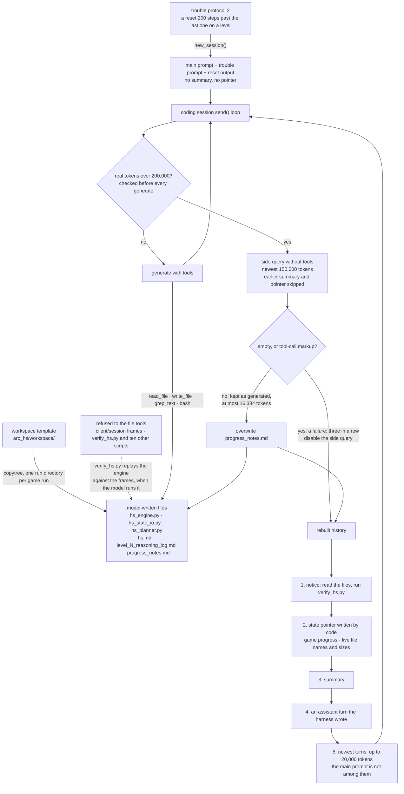

## 1. Executive Summary

Polyphony ARC is Mininglamp AI's ARC-AGI-3 harness, and what it keeps is a
workspace. Each game gets a fresh copy of a template folder, and the model grows
a small Python program in it — engine, state reconstruction, planner, with a
prose model in `hs.md` — that a harness-owned verifier replays against the
frames the game returned. When the conversation reaches 200,000 tokens the
harness asks the model for a handoff, rebuilds the context around it and keeps
the newest turns. Nothing carries into the next game.

Two lines in `arc_hs/hs_compaction.py` carry the design. The
summary is bounded and its stakes are stated to the writer: *"Under 2500 words.
This is the next instance's only memory of your thinking."* And the successor is
told to defer to disk. Code renders a block headed *"System-recovered state
(mechanical, not an LLM summary — trust this over memory)"* with a file listing
headed *"On-disk files (authoritative; re-read before trusting memory):"*.

What code enforces is narrower than what the prompt states. The 2,500 words are
prompt text; code holds the summary to the 16,384-token generation cap and
rejects one that is tool-call markup. Nothing makes the successor read a file,
and the listing names five files the model wrote itself, one of them the
previous summary. The rebuilt context drops the main prompt that defines the
workspace, and each summary is written without sight of the one before it.

The published result is 19.8% RHAE on ARC-AGI-3 Public Demo at $115, from the
community leaderboard. Its scorecard was published on 2 July 2026, before the
repository's only commit, under a tag the committed launcher does not set, and
no result is committed to the tree.

**No marks.** The precedence rule is prompt text, and unlike [Tycho](../tycho/)
nothing at the memory boundary can fail.

## 2. Mental Model

There are two memories here, with different standing.

The workspace is the durable one and the checkable one. `hs_engine.py`,
`hs_state_io.py` and `hs_planner.py` are code, and `verify_hs.py` replays them
against the recorded frames under `client/session/`, which the model's file
tools refuse to write. `hs.md`, the reasoning logs and the level reports beside
them are prose the main prompt requires and nothing reads.

The summary is the volatile one: prose the model writes about its own recent
window, read by the next window of the same session. The design ranks the two
correctly — files over prose — and states the ranking in the context it hands
over.

A compaction is a lossy write, and the harness treats it as one on the writer's
side: the model is told the budget and what the words are for, which is a
different instruction from *summarise the conversation*. On the reader's side
the ranking has no teeth. No code runs the verifier after a compaction, compares
the summary with the files, or checks that the successor opened anything.

## 3. Architecture

## 4. Essential Implementation Paths

**The trigger is measured in real tokens.** `count_tokens` encodes the history
with the Qwen tokenizer, charges every image a flat 1,700 and falls back to
characters over three (`arc_hs/hs_compaction.py:168-187`). `maybe_compact` runs
before every generation (`arc_hs/coding_session.py:307`); it compacts above
200,000 tokens and halves the kept tail above 215,000 (`hs_compaction.py:52-53`,
`:284`, `:298-301`). The docstring says why the meter matters: a
characters-over-four estimate under-counted grid frames about fourfold and the
run hit the context wall at 229,377 (`:8-13`).

**The summary request names what gets lost.** `LAYER3_PROMPT` asks for seven
sections — file state and the last verifier result, confirmed rules, the active
hypothesis, ruled-out directions, coordinates already clicked with their effect,
game progress and the exact next step — and ends *"Be concise but COMPLETE on
dims 2/4/5 (those are what gets lost). Under 2500 words."* (`:79-117`).

**Each summary is written from one window.** The writer is handed the newest
150,000 tokens of history (`:334`), and `select_recent_turns` skips every earlier
summary, notice and pointer on the way (`:208-214`). The summary at the second
compaction is therefore not written from the first: what survives two
compactions is what the model put in a file or re-read into its recent turns.

**Acceptance is a markup check and a cap.** `_run_layer3` strips think tags,
treats as a failure an empty reply or one that opens with a tool call or carries
two or more tool-call markers, and truncates past 20,000 tokens (`:329-361`,
`:336-356`). The side query runs under the session's 16,384-token generation cap
(`coding_session.py:74`, `:183`, `:218-223`), so that truncation cannot fire, and
nothing in `arc_hs/` reads the response's stop reason, so a summary cut off at
the cap is kept as if complete. Three consecutive failures disable the side
query (`hs_compaction.py:62`, `:285-286`); the counter resets only on a success
(`:357`), so for that session every later compaction runs without a summary.

**What the successor receives, in order** (`:303-316`): the compaction notice;
the state pointer; the summary under the `[[WM_COMPACT_SUMMARY]]` prefix; an
assistant turn the harness wrote — *"Understood — I just compacted. I will read
progress_notes.md, hs.md and the latest reasoning log, run verify_hs.py…"*; and
the newest turns up to 20,000 tokens, with no leading orphan tool result
(`:191-223`).

**The authoritative listing is five fixed names.** `layer2_state_pointer` reads
game progress from the recorded frames through `session_inspector`, then lists
whichever of `hs.md`, `hs_engine.py`, `hs_state_io.py`, `hs_planner.py` and
`progress_notes.md` exist, with byte sizes, and the last reasoning log by name
(`:227-256`). Every listed file is model-written. The pointer is rendered before
the new summary is saved (`:287` against `:290-296`), so from the second
compaction on it lists the previous summary's file and size. The name sort is
lexicographic, so at level 10 the "latest" log is level 9's (`:253-255`). The
frames the harness protects are not listed; the notice reaches them by telling
the model to run `verify_hs.py`.

**The main prompt drops out.** No message has the system role, and the
41,383-byte main prompt is the first user message of the session
(`arc_hs/agent.py:217-225`), so a 20,000-token tail never reaches it. After a
compaction the continuation prompt's *"Follow the original prompt carefully"*
(`arc_hs/prompts/protocols/continuation_l2.txt:1`) points at text no longer in
context. A copy of the prompt is on disk as `main_prompt.md`, differing in three
paragraphs from the one sent, and is not in the listing.

**The other fresh start carries nothing.** `trouble_protocol2` calls
`new_session()`, which empties the history (`coding_session.py:227-228`), and
sends the main prompt, a trouble prompt and the reset output (`agent.py:383-403`).
It fires at a reset more than 200 steps past the last one on that level
(`:417-420`). The docstring says the saved summary *"survives
trouble_protocol2's new_session"* (`hs_compaction.py:29`); the file survives, and
no prompt in that path, or anywhere in `arc_hs/prompts/`, names
`progress_notes.md`.

**The comments record two failures.** The first is the meter above. The second
is per-turn trimming of old tool outputs, which rewrote the middle of history
every turn, *"destroyed prefix-cache hits"* and *"deleted the agent's WORKING
MEMORY (which cells it clicked + what each did, which hypotheses it ruled
out)"* — and a run without compaction *"reached further than the per-turn
Layer-1 runs"* (`:15-23`, restated at `:276`). One per-request rewrite remains
below the session: the model adapter replaces every image but the newest twelve
with a placeholder on the wire (`compat/qwen_policy.py:46-51`, `:125-153`,
`:269-272`), while `count_tokens` still charges all of them.

## 5. Memory Data Model

The workspace has the shape the main prompt demands: `hs.md`, the three
Heuristic System modules, optional per-level planners, `level_N_reasoning_log.md`
and `level_N_report.md` (`arc_hs/prompts/main_prompt.md:73-82`). Nothing
enforces it, and the template ships the modules as placeholders.

The summary is Markdown under a prefix and a `_meta` tag that exist so the next
compaction can drop it (`hs_compaction.py:64-66`, `:303-310`). There is no field
for confidence, provenance, time, scope or a rejected conclusion; the ruled-out
directions the prompt asks for are prose, and nothing keys or consults them.

This places the summary at the same point as [Retrodict](../retrodict/) — the
memory contract is a prompt — with one difference in content. Retrodict asks the
model to mark each point *checked against the log* or *still assumed*; Polyphony
asks for a bounded summary and states which artifact wins a disagreement.
Neither is read by code. Retrodict's version says more.

## 6. Retrieval Mechanics

There is no index and no query. The rebuilt history is the successor's whole
context, and after that the model reads its own files with `read_file`,
`grep_text` and `list_dir`.

Tool results enter the history cut at 12,000 characters of JSON
(`coding_session.py:66`, `:331-333`). A summary written to the 2,500 words the
prompt allows can exceed that, so one `read_file` of `progress_notes.md` may come
back cut off unless the model pages with `offset`.

The read tools are not confined to the workspace. `_resolve` accepts an absolute
path and `_read_file`, `_grep` and `_list_dir` check nothing (`:458-484`,
`:510-543`), unlike the write tools (`:617-636`). A swarm runs games in sibling
run directories, so a model can open another game's files; no prompt asks it to.

## 7. Write Mechanics

The model writes the workspace through `write_file`, `edit_file` and `bash`. The
file tools refuse anything under `client/session/` and eleven top-level tooling
scripts (`coding_session.py:617-636`). The bash guard is lexical: it blocks
`rm`, `mv`, `shred`, `truncate`, `unlink` and file redirects that name those
paths or `client.py` (`:545-615`), so an interpreter one-liner that deletes the
same directory passes it.

The strace sandbox adds nothing to that boundary. The session passes its work
directory as both workspace and run root (`:416-420`), and the sandbox allows
every write under the workspace (`compat/sandbox.py:459-477`); the README's
competition command sets `WM_NO_SANDBOX=1` in any case. `client/client.py`, the
program that writes the recorded frames, is outside the file tools' protected
set, which matches top-level names only (`coding_session.py:629-635`).

The summary is written once per compaction, over `progress_notes.md`, with any
error swallowed (`hs_compaction.py:290-296`). Nothing diffs it against the file
it replaces.

## 8. Agent Integration

`run_swarm.py` queues games and `Swarm` runs N at once, each in a fresh run
directory named for the game, a sequence number, the worker and the batch, with a
copy of the template (`arc_hs/swarm.py:241-252`); `ensure_fresh_run_paths`
refuses an existing directory (`agent.py:90-96`). Nothing reads an earlier run
directory or the `swarm_report_*.json` the swarm writes (`swarm.py:383-397`), so
no memory crosses games or runs. Per-iteration git snapshots of the workspace
exist behind `HS_GIT_SNAPSHOT=1` and are off by default (`agent.py:227-240`).

The vendored tree under `vendor/arc/` is the ARC-AGI SDK (4,121 lines), its game
engine (2,342) and 26 game environment files for 25 games (72,572). A search of
the SDK and engine for memory, summary, compaction, persistence and embedding
terms returns nothing.

## 9. Reliability, Safety, and Trust

One agent per game, one workspace, no other principal: scope, audit and review
have no consumer here, and their absence is not a defect.

The defect is where the precedence rule stops being code. Code writes the state
pointer, refuses the frames to the file tools and ships a verifier that replays
the engine against every recorded attempt (`arc_hs/workspace/verify_hs.py:88-153`).
Prompt text is all that makes the successor read the files, run the verifier,
or prefer either to the summary. The prose files — `hs.md`, the reasoning logs,
`progress_notes.md` — are checked by nothing, and they are what carries the
ruled-out directions and the clicked coordinates. The verifier is as strong as
the model's restraint: `apply_render_overrides`, which the model writes, patches
the rendered frame before comparison and earns only a printed warning
(`verify_hs.py:26-40`).

What a compaction leaves behind is partial. `agent.log` in the run directory
appends a JSON line for each assistant turn (first 2,000 characters), each bash
call (command 500, stdout 1,500, stderr 800) and each compaction with tokens
before and after and turns kept (`coding_session.py:323-324`, `:427-430`,
`hs_compaction.py:318-326`). File-tool results and the summary text are not
logged, and the log sits in the workspace, where the write tools do not refuse
it.

**Each mark fails its producer test.** No memory carries a status, and the
`_meta` tag that keeps an old summary out of the next window marks a message
kind, not a belief, so `trust_state` is withheld. The ruled-out directions are
prose that no write consults, so there is no `tombstone`. There is no scope key:
the run directory bounds the write tools only, and the read tools take any
absolute path, so `scope_enforced` is withheld. `agent.log` is truncated and the
model can overwrite it, so it is not an `audit_log`. Nothing waits for a person —
`--retry-error-handling-manual` is accepted by `CodingSession` and read nowhere
(`coding_session.py:150`) — so there is no `human_review`. Nothing records when a
rule held, so nothing is `bitemporal`, and with no tests there is no
`negative_eval`.

The absence of tests matters more than the marks it costs. The memory behaviour
is emergent from prompt text, published with a benchmark claim and without a
committed assertion about the compaction path.

## 10. Tests, Evals, and Benchmarks

There is no test directory, no CI configuration and no test function outside the
vendored tree. `arc_hs/workspace/test_timeout.py` is a hand-run `main()` that
checks a timeout helper inside the agent's template. Nothing was run for this
reading.

No result is committed to the tree. The figures come from two pages. The
[community leaderboard](https://arcprize.org/leaderboard/community) lists
*Polyphony Agent - ARC* at **19.8%** on ARC-AGI-3 Public Demo for **$115**, dated
7 July 2026, linking this repository and
[the scorecard](https://arcprize.org/scorecards/d0895597-2bb5-4191-9b7b-ec97917da1aa).
The scorecard shows 19.80%, the tags `v11.2-swarm` and `agent`, 21 environments,
59/157 levels and 6,838 actions, published 2 July 2026 at 22:20 UTC (rendered as
3 July 00:20 in a Europe/Copenhagen browser). I recomputed its per-environment
table: the mean is 19.8029, the levels and actions match, two games finish
`WIN` at 100.00 (`lp85-305b61c3`, `tu93-0768757b`) and ten score below 5.

The scorecard predates the repository's only commit, 6 July 2026 at 09:20 UTC,
by three and a half days, and the committed launcher opens scorecards tagged
`polyphony` (`arc_hs/swarm.py:158`), to which the SDK adds `agent`. The scored
run was not opened by `swarm.py` as committed, and which code it ran is not
recorded. Offline mode cannot replay it either: nine scored games are vendored
at the version scored and twelve at another.

Two qualifications belong beside the number. The metric is RHAE — relative human
action efficiency — so 19.80% is not a completion rate, and 59/157 levels is the
closer thing to one. And the run covers **21 environments where
[Tycho](../tycho/) and [Retrodict](../retrodict/) cover 25**: `ft09`, `r11l`,
`sb26` and `sc25` are absent here, so the three numbers are not means over the
same set. The leaderboard hosts but does not check these: only ARC-AGI-1 and
ARC-AGI-2 semi-private results are run and verified by ARC Prize, and
*"everything else is scored on a public set and self-reported."*

## 11. For Your Own Build

**Tell the summariser what the summary is for.** *"This is the next instance's
only memory of your thinking"* changes what a model chooses to keep, at no
implementation cost.

**Write the pointer in code and say so.** A block headed *"mechanical, not an
LLM summary"* gives the successor something the summariser could not have
distorted. List the evidence in it, not only the files the model wrote.

**Carry the instructions across the boundary.** A tail-keeping compaction
drops the opening message, which here is the task definition. Pin it, or
re-send it with the handoff.

**Give the summariser the previous summary.** Skipping old summaries keeps them
from nesting; it also makes every handoff a summary of one window.

**Leave the failure in the comment.** *"No per-turn trimming (that destroyed
prefix cache + working memory)"* is why the next person will not reintroduce it.

## 12. Open Questions

**What does a real handoff summary look like?** None is committed, so whether
the 2,500-word bound is honoured, how often the side query fails, and what a
compaction drops are unmeasured.

**Which code produced the scorecard?** It was opened under `v11.2-swarm` before
the commit that is public, and nothing in the tree records that version.

## Appendix: File Index

| Path | What it holds |
| --- | --- |
| `arc_hs/hs_compaction.py` | The trigger, the summary prompt, acceptance, the state pointer, the rebuild, the design comments |
| `arc_hs/coding_session.py` | The tool loop, the generation cap, the read and write tools, the bash guard, the log |
| `arc_hs/agent.py` | The protocols, the main prompt's placement, the trouble protocol's `new_session` |
| `arc_hs/swarm.py`, `arc_hs/run_swarm.py` | One run directory per game, the scorecard tag, the swarm report |
| `arc_hs/workspace/` | The template copied per game: `verify_hs.py`, the placeholder modules, `client/client.py` |
| `arc_hs/prompts/` | The main prompt and the protocol and refinement prompts |
| `compat/qwen_policy.py`, `compat/sandbox.py` | The model adapter with image pruning; the strace sandbox |
| `vendor/arc/` | ARC-AGI SDK, engine and game environment files, searched for memory terms |

### Recorded searches

Checked with `/usr/bin/git` against the checkout at the pinned revision, from the
tree root. Line counts: `git ls-files -z -- '*.py' ':!vendor' | xargs -0 cat | wc -l`
gives 6,542, and the same over `arc_hs/*.py`, `compat`, `vendor/*.py` and
`vendor/arc/environment_files/*.py` gives 5,599, 943, 79,035 and 72,572.

- `git ls-files | grep -i -E '(^|/)(tests?|spec)(/|_)|_test\.py$|conftest|pytest|\.github|tox\.ini|setup\.cfg|pyproject'` — one match, `arc_hs/workspace/test_timeout.py`.
- `git grep -n -E 'def test_|import (unittest|pytest)|^\s*assert ' -- ':!vendor'` — no match; `git grep -l -E 'def test_' -- vendor` — no match.
- `git grep -n -I -E '19\.8|\$115|v11|d0895597|leaderboard|RHAE|scorecards/' -- ':!vendor'` — the scorecard URL template at `arc_hs/swarm.py:212` and two `.v11_` temp-file prefixes in `compat/sandbox.py`; no result.
- `git grep -n -E 'tags=' -- arc_hs` — one match, `swarm.py:158`, `tags=["polyphony"]`.
- `git grep -n -E 'progress_notes' -- arc_hs compat` — four matches, all in `hs_compaction.py` (`:29`, `:228`, `:293`, `:313`); none in a prompt.
- `git grep -n -E 'main_prompt' -- arc_hs/agent.py arc_hs/hs_compaction.py arc_hs/coding_session.py` — `agent.py:158`, `:219` and `:393` only.
- `git grep -n -E 'role.: .system|"system"' -- arc_hs compat` — no match.
- `git grep -n -E 'stop_reason|finish_reason' -- arc_hs` — only `swarm.py`'s unrelated `_stop_reason`.
- `git grep -n -E 'LAYER3_MAX_OUTPUT_TOKENS|GEN_MAX_TOKENS|max_tokens' -- arc_hs compat` — the 16,384 cap at `coding_session.py:74` passed at `:183`, the 20,000 truncation at `hs_compaction.py:61` and `:355-356`.
- `git grep -n -E 'swarm_report|run_root|swarm_runs|copytree|\.glob\(|rglob|iterdir|read_text|json\.load' -- arc_hs compat ':!arc_hs/workspace'` — no reader of an earlier run directory or swarm report.
- `git grep -n -i -E 'memory|summar|compact|handoff|sqlite|pickle|embedding' -- vendor/arc/arc_agi vendor/arc/arcengine` — no match.
- `git grep -n -i -E 'arxiv|bibtex|@article|@misc|citation|doi\.org'` — no match; the README links a blog post on Heuristic Learning, and no paper for this system.

## History

**2026-10-18** — [`9bb384c25d1bc95501cb08a124af7871c9ea24eb`](https://github.com/Mininglamp-AI/polyphony-arc-3/commit/9bb384c25d1bc95501cb08a124af7871c9ea24eb) — same commit, nothing moved upstream; an audit of the report's own claims, seven of which were wrong at this pin. The summary is held to the 16,384-token generation cap and refused when it is tool-call markup, not stored as returned. The successor also gets a code-written state pointer and up to 20,000 tokens of its newest turns, and loses the main prompt. Both quoted comments describe one failure; the token meter was the other. Ten games score below 5, not eleven; the scorecard was published 2 July 2026, before the commit. A truncated log of every turn survives a compaction, and `arc_hs/` is 5,599 lines. Evidence in [section 4](#4-essential-implementation-paths) and [section 10](#10-tests-evals-and-benchmarks). No marks.

**2026-09-18** — re-read at the same commit; nothing upstream has moved. One
matrix correction, in the direction the report's own risk line already points.
*"Under 2500 words"* lives inside the prompt string at `hs_compaction.py:114`
and nothing measures the result: there is no truncation, no length check and no
validation of the handoff anywhere in `arc_hs/`. The body already called the cap
*"a prompt-engineering choice rather than a mechanism"*; the `write` field said
the harness *"bounds its length"*, which it does not. Re-verified alongside it:
there is still no test directory — the single `test_*.py` in the tree,
`arc_hs/workspace/test_timeout.py`, is a hand-run `main()` checking a timeout
helper inside the agent's own tool directory, not a test of the memory path. No
marks; the report carries none.

**2026-08-28** — [`9bb384c25d1bc95501cb08a124af7871c9ea24eb`](https://github.com/Mininglamp-AI/polyphony-arc-3/commit/9bb384c25d1bc95501cb08a124af7871c9ea24eb) — same commit, second reading, covering the published scorecard: 19.80% on ARC-AGI-3 Public Demo at $115, 2 of 21 environments won, 59/157 levels, 6,838 actions, recomputing from its own per-environment table. The run covers 21 environments where the two harnesses this report compares against cover 25, so the three means are not over the same set. Sections 1 and 10 now carry the result, which the first reading described only as "a benchmark claim". Marks unchanged at none.

**2026-08-27** — [`9bb384c25d1bc95501cb08a124af7871c9ea24eb`](https://github.com/Mininglamp-AI/polyphony-arc-3/commit/9bb384c25d1bc95501cb08a124af7871c9ea24eb) — first reading, MIT, 6,542 lines of harness code beside 79,035 vendored, a single commit dated 6 July 2026, no tests directory. Screened before reading: no auto-run surface, no execution surface, one unpinned dependency surface. Nothing was installed and nothing was run. No marks. The whole memory mechanism is a compaction that asks the model for a handoff summary under 2,500 words and hands the successor that summary beside a file listing headed as authoritative. `trust_state` is withheld: the files-outrank-memory rule is prompt text with nothing reading it, and no memory carries a status field. `tombstone`, `bitemporal`, `scope_enforced`, `audit_log` and `human_review` are absent, and `negative_eval` cannot be earned — there are no tests. The reading covers the harness's own code; the vendored tree was not read.
