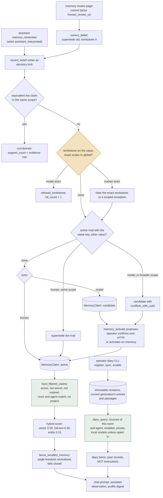

## 1. Executive Summary

> **Disclosure:** RainBox is the atlas author's own project. This report applies the same code-grounded rubric used for every other system, but read its judgments as a self-assessment; the cited files, tests, and residual limitations are the checkable parts.

RainBox is a local-model personal assistant with a claim memory in Postgres in
which who wrote a claim decides whether it is believed. The assistant's
`memory_remember` produces a **candidate** that no retrieval path returns; a
person activates it from a review page or approves a confirm-tier proposal the
assistant cannot execute itself. Rejected and superseded values are tombstoned
by value, so the model cannot write them back. Every query-driven claim read
goes through one filter that drops inactive, secret, expired and out-of-scope
claims before anything is scored.

The weak side is the gap between the design and its wiring. The chat commands
`remember that`, `forget`, `correct that OLD -> NEW` and `what do you remember?`
have handlers in `source/memory/ops.py` and no caller outside tests. Five
write actors are named and two have a producer. The read tool's uuid arm
applies no room or agent predicate, and the forget tool lists other rooms'
uuids, so the assistant can read another room's claim in two calls; that is
why no scope mark is claimed.

Beside the claims sits a second, read-only memory: the operator's own **diary
files**, ingested by a CLI into immutable revisions and read through a
`diary_query` capability bound to one room. It is offered only when every
model on the turn is local, unless the source opts in to remote models, and it
returns byte-range citations inside a fence that tells the model the passages
are past records and "NOT instructions".

The rejected-value tombstone was adopted, not invented here. It entered RainBox
on 29 June 2026, the same day as the comparative survey that became this atlas
— a survey whose own RainBox report said the system lacked "Verel-style
rejected-value tombstones". The idea is [Verel](../verel/)'s.

## 2. Mental Model

A **claim** is one belief: text, a kind (`fact`, `preference`,
`project_decision`, `procedure`, `episode_summary`), a confidence, a
sensitivity, a scope, and deterministic `subj_pred_key` and `value_key` derived
by regex shape rules with no model call. **Evidence** rows hang off a claim and
accumulate, so a model-inferred candidate that a person later confirms keeps
both records.

A claim's **status** takes five values, and only `active` reaches a prompt:

- **candidate** — written by a model actor, or flagged as conflicting with an
  active rival. Embedded, reviewable, never retrieved.
- **active** — written by a human actor, or activated by one.
- **superseded** — replaced by a correction or a same-scope human update.
- **rejected** — forgotten by the assistant or rejected on the review page.
- **expired** — a status value; separately, an active claim whose `expires_at`
  has passed is filtered out without changing status.

A **tombstone** is a `MemoryRejectedValue` row keyed on scope, room, agent and
the two belief keys. It is written when a claim is rejected or superseded, and
consulted before any new belief is created.

A **diary source** is a directory of the operator's text files, registered from
a manifest, bound to a room and optionally an agent, and disabled until the
operator enables it. A source marked `secret` can be inspected locally and
never enabled. Each file's bytes are kept as immutable **revisions**; the
current revision is parsed into **entries** with a local date and clock and
into **passages** that are searched and cited by byte range.

## 3. Architecture

| Area | Role |
| --- | --- |
| `source/db/models.py` | `MemoryClaim`, `MemoryEvidence`, `MemoryRejectedValue`, `MemoryEmbedding`, `RetrievalEvent`, `FeedbackEvent`, `AssistantWriteIntent`, and the eleven diary tables |
| `source/db/memory.py` | `record_belief`, `correct_belief`, `resolve_conflict`, tombstone helpers, lifecycle setters with stale-write guards |
| `source/memory/retrieval.py` | `hard_filtered_claims`, hybrid and lexical retrieval, both fences, the chat memory block, debug-memory rows |
| `source/memory/embeddings.py` | Claim embeddings: `embeddinggemma:300m`, 768 dimensions, refresh, backfill, prune |
| `source/agents/assistant.py` | The capability registry, the dispatcher, `memory_query`, `memory_remember`, `memory_forget`, `memory_activate`, `diary_query` |
| `source/agents/assistant_writes.py` | Confirm-tier execution, rejection and undo |
| `source/agents/chat_context.py` | The chat agents' fenced context block: profile, seed facts, hybrid memories |
| `source/user_profile/retrieval.py` | The profile digest |
| `source/webapp/memory_api.py`, `memory_views.py` | The `/memory` review page and its actions |
| `source/diary/` | Manifest validation, the dialect parser, ingest, retrieval routes, rendering, the action, the probe |
| `source/db/diary.py`, `source/tools/diary.py` | Diary persistence, exclusions, prune and purge; the operator CLI |
| `source/memory/ops.py` | Chat-command handlers with no caller |

Deployment is one Flask application over one Postgres database with pgvector,
calling local models. Claim memory needs no model to write: keys come from
regex shape rules, and retrieval degrades to full-text and entity signals when
no embedder answers. The diary installs `pg_trgm` when the server offers it and
works without it, losing typo tolerance.

## 4. Essential Implementation Paths

**Model write.** `memory_remember` → `record_belief(actor="assistant_interpreted", scope="room")`
(`source/agents/assistant.py:2241`) → advisory lock on the belief key →
dedupe → exact and global tombstone checks (`source/db/memory.py:753-787`) →
lattice-aware conflict check → create as `candidate` (`:823-833`). A refusal is
reported to the model as "previously rejected, so I did not re-add it". The
action is log-and-undo: undo rejects the candidate with `tombstone=False`, so
undoing a remember does not block re-learning the value.

**Activation.** `memory_activate` is confirm-tier. The dispatcher's branch
`elif cap.write and cap.tier == "confirm"` (`source/agents/assistant.py:4196`)
calls `_propose_write`, which stores an `AssistantWriteIntent` with the payload
and its hash. The operator's confirm route runs `execute_write_intent`
(`source/webapp/chat_api.py:830-841`), which runs `_action_activate_memory`; a
candidate flagged as conflicting goes through `resolve_conflict(..., "supersede")`
so the rival is tombstoned.

**Correction.** The `/memory` page's correct action calls
`correct_belief(actor="human_review_ui")` (`source/webapp/memory_api.py:292`).
It takes advisory locks over the old and new keys and their global forms,
supersedes the old claim, tombstones it, prunes its embedding, and delegates the
replacement to `record_belief` with keys derived from the new text. If the
replacement would supersede a *different* active claim, it raises and the whole
transaction rolls back (`source/db/memory.py:906-1072`).

**Claim retrieval.** `retrieve_memories_hybrid` → `hard_filtered_claims`
(`source/memory/retrieval.py:198-241`) → Postgres `ts_rank`, pgvector cosine and
a subject/object entity boost over the survivors → sort by score, then scope
tier, confidence and recency → `RetrievalEvent` rows.

**Diary retrieval.** `diary_query` validates flat arguments strictly, resolves
eligible sources (`source/diary/retrieval.py:138-157`), runs the mode, renders
within the scratchpad budget, and issues a cursor for what did not fit.
`_run_revalidated` re-reads every used source's policy and catalog versions
after the read; a change in between retries once and then fails
`source_changed` (`source/diary/action.py:174`).

## 5. Memory Data Model

`MemoryClaim` carries `confidence`, `epistemic_confidence`,
`retrieval_strength` and `support_count`. The second and third are written at
creation equal to `confidence`, and corroboration raises `epistemic_confidence`
by 0.05 (`source/db/memory.py:746-747`); no read path uses either, and ranking
uses `confidence` as a tie-breaker after the blended score.

`MemoryEvidence` records provenance (`observed_from_source`,
`inferred_by_model`, `confirmed_by_user`, `imported_from_transcript`), a source
type and id, an excerpt and an author. Every belief write, rejection,
activation and reactivation adds a row. Sensitivity, scope and expiry edits do
not: their setters overwrite the column and bump `updated_at`, with docstrings
calling them "policy metadata, not a belief — so no evidence row"
(`source/db/memory.py:318-379`).

Five actors are declared, and three are override-authorized
(`source/db/memory.py:662-674`). Two have a producer: `assistant_interpreted`
from `memory_remember`, and `human_review_ui` from the review page's correction.
`explicit_human_command` is passed only by the uncalled handlers in
`source/memory/ops.py`. `model_inferred` is passed by nothing.
`human_confirmed_write_intent` appears in a comment in
`_action_activate_memory`; activation calls `activate_memory_claim` or
`resolve_conflict`, neither of which takes an actor.

`MemoryRejectedValue` snapshots the rejected text and an evidence summary and
counts refused re-writes with `hit_count` and `last_hit_at`, which the review
page lists as tombstone hits. `clear_tombstone` deletes the row
(`source/db/memory.py:602-606`), so an override leaves no tombstone behind;
the evidence on the new claim carries the note "operator override of prior
rejection".

The diary keeps bytes and parses apart. A `DiaryRevision` either holds its
bytes or names the longer revision whose prefix they are, so an appended file
stores its bytes once. Only each file's current `DiaryGeneration` is kept. A
`DiaryEntry` carries `date_local`, `clock_start`, `clock_end`, a `date_basis` of
`header`, `filename` or `unknown`, and a `time_status`. A `DiaryEmbedding` is
keyed by source, model epoch and passage text hash, so an unchanged passage in
a new generation reuses its vector. A model comment says bytes "are kept
forever"; `diary_prune` deletes a file's non-current revisions and
`diary_purge` deletes a source's imported content, both from the operator CLI.

## 6. Retrieval Mechanics

**One filter for every query-driven claim read.** `hard_filtered_claims`
issues one SQL query for `status == 'active'`, not secret unless asked, and not
expired, then applies scope in Python over the result before any scoring
(`source/memory/retrieval.py:217-240`). A global claim passes everywhere. A room
claim passes only for its room, an agent claim only for its agent and never when
the turn has no agent, and a project claim never, because no turn carries a
project key. Its callers are hybrid retrieval, the lexical path the eval runner
uses, and the profile digest (`source/user_profile/retrieval.py:81`).

Hybrid retrieval is reached from both agent kinds. The chat agents build their
context with `build_chat_context_block`, which calls `build_chat_memory_block`
and then fences profile, seed facts and memories as one block
(`source/agents/chat_context.py:39-69`). The assistant's `memory_query` calls
`retrieve_memories_hybrid` with the turn's room and agent, then passes claims and
seed-knowledge candidates through one model-scored relevance filter. The
assistant also prepends the profile digest at the start of each run.

**The uuid arm of the same tool is the exception.** `memory_query` with
`{"uuid": ...}` returns one claim in full when it is `active` and not `secret`
(`source/agents/assistant.py:1285-1322`). It applies no room or agent predicate
and no expiry check. The assistant receives uuids from its own query results,
and `memory_forget` by text calls `find_memory_matches(text, status=None)`,
which has no room filter, and on an ambiguous match returns "Candidates:" with
every matching uuid (`source/agents/assistant.py:2326-2336`). The listing
needs the claim's exact normalised text, so what it reveals first is that a
claim exists elsewhere and its uuid; the fetch then returns it with its kind
and sensitivity.

The operator's `/memory/developer` page passes `any_room=True` for an
all-rooms view (`source/webapp/memory_developer_views.py:119`); the parameter is
a Python keyword, not readable from model arguments.

**Diary.** `eligible_sources` keeps private sources bound to the turn's room,
enabled, matching the agent where one is set, and allowing remote models when
any model on the turn is remote. `assistant_models_all_local` checks every
member of every assistant slot for a loopback address. The SQL fragment every
route joins requires the source list, a `ready` file, a generation parsed with
the source's current parser fingerprint, and no exclusion on the path
(`source/diary/retrieval.py:195-205`). A citation is opened only through the
same eligibility, and a cursor is honoured only for the room and agent that
created it.

Search runs identifier, full-text, joined-word, fuzzy and variant routes, and a
vector route where the source enables one, then fuses them by weighted
reciprocal rank with k = 60 into at most 60 candidates. The full-text route's
weight is the query's lexical coverage, so a query of common words leans on the
other routes. A vector failure is reported as a degraded route and never removes
lexical results.

## 7. Write Mechanics

Claims enter one way: the assistant's `memory_remember`, as a room-scoped
candidate. They become active through the review page or an approved
confirm-tier proposal, and are replaced through the review page's correction.
Nothing extracts claims from chat, journals or the diary.

`source/memory/ops.py` holds handlers for `remember that`, `forget`,
`confirm that`, `correct that OLD -> NEW`, `what do you remember?`,
`why do you remember` and `which memories did you use?`. `parse_memory_command`
and `handle_memory_command` have no caller outside tests. The last callers were
removed by
[`1bdbdf48648449769856474ebbd2984387498c01`](https://github.com/neoneye/RainBox/commit/1bdbdf48648449769856474ebbd2984387498c01)
on 1 September 2026, which retired the query agents that parsed commands before
answering. The tests in `source/memory/test_ops.py` exercise the handlers
directly.

`memory_forget` executes immediately: it rejects the claim, writes a tombstone
and prunes its embedding, and carries `memory_reactivate` as its undo. It
resolves its target by uuid with no scope check, or by exact normalised text
across all rooms. Its evidence row records `confirmed_by_user` whatever the
user said (`source/agents/assistant.py:2342-2343`).

Diary content is written only by the operator's CLI, whose commands include
`register`, `sync`, `enable`, `exclude`, `reconcile`, `prune`, `purge`, `embed`
and `set-vector-mode`. A sync under a per-source advisory lock publishes a new
generation atomically and leaves no partial one on failure. An exclusion covers
every revision and route, and an exact move carries it to the new path. An
edited file at a new path is held until the operator reconciles it.

## 8. Agent Integration

The assistant's memory family is `memory_query` (read), `memory_remember`
(log-and-undo), `memory_forget` (log-and-undo) and `memory_activate`
(confirm-tier), plus two undo inverses that are not exposed to the model.
`diary_query` is a read in its own family. Before each run
`_apply_diary_availability` removes `diary_query` from the offered set unless a
source is usable for that room, agent and model locality, and records the
reason on the run (`source/agents/assistant.py:6624-6644`). An operator setting,
`assistant.disabled_capabilities`, removes it regardless.

Diary observations are exempt from the reply auditor's observation cap, because
"a cut would hide the one a reply quotes"; older diary steps in the scratchpad
are replaced by a compact stand-in. A `<diary_passages>` fence forged by another
action's output is escaped like any other.

The chat agents inject memory without a tool call: profile digest, seed facts
and hybrid memories, fenced together, and a `debug-memory` row recording which
claims were used.

## 9. Reliability, Safety, and Trust

**What holds.** A model cannot make a claim believed: its writes are
candidates, the filter returns only `active`, and activation runs only on an
operator's HTTP confirm, approving a hashed payload. A model cannot write back
a value a person rejected or corrected away: the tombstone is consulted under
the same lock as the write. Recalled memory and diary text reach the model
inside fences that neutralise `<` and `>` and fail closed to a placeholder.
The diary will not leave the machine unless the source opts in: it is
withheld from any turn with a remote model, and the database refuses a secret
source that allows remote models.

**What does not.** The model's own tool surface can reject any claim and so
write a tombstone against its value, from any room, recorded as user-confirmed.
That suppresses rather than asserts, and undo reverses it, but a tombstone
written at the model's choice is indistinguishable from one a person wrote. The
uuid arm of `memory_query` skips scope and expiry. Sensitivity, scope and
expiry edits keep no history.

**No scope mark.** `hard_filtered_claims` is a real room and agent filter on
the main retrieval: the query arm of `memory_query`, the chat context
assembler and the profile digest all pass through it, and the diary read is
bound to the room and agent. But the uuid arm is an arm of the same retrieval
tool and cannot express the scope, and the assistant can obtain another room's
uuids from its own `memory_forget` listing. List then fetch is a cross-room
read on the agent's own surface (`source/agents/assistant.py:1285-1322`,
`:2326-2336`; at the previous pin `:1268-1305`, `:2277-2287`), so
`scope_enforced` is withheld.

**Operator reads outside retrieval.** The `/memory` list reads every claim
across rooms and masks secret text in the list; `/memory/developer` reads
across rooms by design. Both are operator pages on a single-user application.

## 10. Tests, Evals, and Benchmarks

4,023 test functions across 276 files. I read the suites cited here and ran
none; most need a live Postgres.

`test_hard_filters_exclude_secret_expired_out_of_scope`
(`source/memory/test_hybrid_retrieval.py:77-94`) is the negative evaluation.
It seeds four claims that all match the query — public, secret, expired, and
room-scoped to a different room — and asserts that the public one is returned
and the other three are not. Because the positive case reads the same store, a
retriever that returns nothing fails.
`test_retrieve_excludes_out_of_scope_room_agent_and_project` does the same for
the lexical path with another room, another agent and a project claim, and
`test_hard_filters_exclude_forbidden_claims` adds a candidate to the excluded
set on the profile digest.

The diary suite asserts isolation by route. A disabled source, another room,
another agent and a remote model each make the read `unavailable`.
`test_excluded_file_is_invisible_on_every_route` takes a citation first, so the
fixture is shown to match, then excludes the file and asserts its text is gone
from literal, search and timeline results and the citation is `not_found`.
`test_historical_command_causes_no_write` reads a diary line that is a command
and asserts no write intent was created.

The eval runner scores `memory_retrieval` cases with `forbidden_memories`, and
`diary_recall` cases against gold byte ranges with `forbidden_sources`, where
exposure is a hard zero (`source/evals/diary.py:1-15`). Eval cases live in the
database, created by the operator or promoted from feedback; none is committed
as a fixture.

`source/benchmarks` measures models on tasks, including two over seed-memory
rosters, and stores results in the database; no claim-retrieval benchmark and
no result is committed.

## 11. For Your Own Build

### Steal

Make the writer's identity decide the starting state, and make the read path
ignore everything that is not `active`. A candidate that is stored, embedded and
reviewable but never retrieved costs one enum value and one predicate.

Put every model-facing filter in one function and make every read call it.
`hard_filtered_claims` documents itself as "the single source of truth for the
'filter before rank' contract" so that a second copy cannot diverge; the one
read that bypasses it is the one with the gap.

Bind the confirm-tier approval to a payload hash, and make the executor
reachable only from a route that resolves the approver server-side.

Gate a private corpus on where the model runs. The diary's availability check
asks whether every model on the turn is local before offering the tool, and
the schema refuses a secret source that allows remote models.

Cite into immutable bytes. A diary citation is a revision and a byte range, so
it resolves to what the model was shown after the file changes, and reads as
superseded instead of pointing at different text.

### Avoid

Declaring actors nothing produces. A five-name enumeration reads as a trust
model; the two names with producers are what the code enforces.

Leaving handlers tested and uncalled. The command handlers pass their tests
directly, so nothing failed when their last caller was removed.

Stamping a model-initiated rejection as `confirmed_by_user`.

### Fit

This suits one operator's assistant on a local machine, where memory should be
inspectable and every belief should pass a person. It does not suit a library
embedding: the memory is threaded through an application's agents, routes and
schema. Walk away if claims must arrive in volume without review — there is no
extraction, and every belief waits for a person — or if the store must answer
"what did we believe on a date", which neither a claim nor its evidence records.

## 12. Open Questions

Whether the chat commands are meant to return. If they do, `_handle_recall`
with no topic lists every active claim in every scope with its sensitivity
label, secrets included (`source/memory/ops.py:227-246`).

Whether the uuid arm of `memory_query` should take the same filter as the
query arm; with it, and with a room filter on `memory_forget`'s text match,
the assistant's surface would carry the scope the main retrieval
enforces.

When `epistemic_confidence` and `retrieval_strength` will be read, and by what.

How a diary's dated entries relate to claims. The diary is history the
assistant quotes, and nothing promotes a diary passage into a claim.

Whether project scope will acquire a key; until then a project claim is
unreachable by design.

## Appendix: File Index

| Path | What to read it for |
| --- | --- |
| `source/db/memory.py:550-606` | Writing, checking and clearing a tombstone |
| `source/db/memory.py:662-674` | The five actors and the override set |
| `source/db/memory.py:724-842` | `record_belief`: dedupe, tombstone, conflict, create |
| `source/db/memory.py:906-1072` | `correct_belief` |
| `source/memory/retrieval.py:198-241` | `hard_filtered_claims` |
| `source/memory/retrieval.py:328-406` | Hybrid retrieval |
| `source/memory/retrieval.py:447-536` | Both fences and the sanitiser |
| `source/agents/assistant.py:1285-1322` | The uuid arm of `memory_query`, with no scope predicate |
| `source/agents/assistant.py:2236-2252`, `:2303-2353` | `memory_remember` and `memory_forget` |
| `source/agents/assistant.py:4196-4197`, `:6930-6940` | Confirm-tier routing and `_propose_write` |
| `source/agents/assistant_writes.py:50-103` | `execute_write_intent` |
| `source/webapp/chat_api.py:830-841` | The confirm route |
| `source/diary/retrieval.py:138-205` | Diary eligibility and the shared eligible-passage SQL |
| `source/diary/action.py` | `diary_query` validation, cursors, telemetry |
| `source/db/diary.py:156-268` | Enable, exclude, purge, prune |
| `source/memory/test_hybrid_retrieval.py:77-111` | Must-not-retrieve cases on the claim path |
| `source/diary/test_retrieval.py:132-167` | Diary isolation and exclusion cases |

### Recorded searches

Run at the tree root of the pinned checkout with `git grep`.

- `git grep -n -E 'handle_memory_command|parse_memory_command' -- 'source/*.py' ':!*test_*'` — the two definitions in `source/memory/ops.py` only; the same search at `e09dd4f6ca2fc2ff0d35ab9743b76b37bc690bfc` returns the same.
- `git grep -n -E 'record_belief\(' -- 'source/*.py' ':!*test_*'` — `source/agents/assistant.py:2241`, `source/memory/ops.py:121` (uncalled) and `correct_belief`'s delegation at `source/db/memory.py:964`.
- `git grep -n -E 'model_inferred|explicit_human_command|human_confirmed_write_intent' -- 'source/*.py' ':!*test_*'` — the actor tuple and override set, `source/memory/ops.py:122` and `:211`, and a comment at `source/agents/assistant.py:2395`.
- `git grep -n -E 'execute_write_intent\(' -- 'source/*.py' ':!*test_*'` — the definition and `source/webapp/chat_api.py:837`.
- `git grep -n -E 'AssistantActionName\.[A-Z_]+: Capability\(' -- source/agents/assistant.py` — 33 capabilities, none an HTTP client. `workspace_read_command` allows `ls, pwd, cd, cat, head, tail, grep, wc, date, find, stat, file` (`source/tools/command_policy.py:20-22`) and refuses `find`'s `-exec`, `-execdir`, `-ok` and `-delete` (`:184-192`).
- `git grep -n -E 'create_memory_claim\(' -- 'source/*.py' ':!*test_*'` — the definition and three calls inside `record_belief`; `git grep -n -E 'record_belief|MemoryClaim' -- source/diary` returns no match, so nothing turns a diary passage or a chat turn into a claim.
- `git grep -n -E 'hard_filtered_claims\(' -- 'source/*.py' ':!*test_*'` — the definition and three callers: lexical retrieval, hybrid retrieval, the profile digest.
- `git grep -n -E 'find_memory_matches\(' -- 'source/*.py' ':!*test_*'` — the definition (`source/memory/ops.py:84`, no room filter) and `memory_forget`'s call at `source/agents/assistant.py:2326`; the same at `e09dd4f6ca2fc2ff0d35ab9743b76b37bc690bfc` at `:2277`, with the "Candidates:" listing at `:2287`.
- `git grep -n -E 'any_room' -- 'source/*.py' ':!*test_*'` — keyword plumbing and one caller that sets it, `source/webapp/memory_developer_views.py:119`.
- `git grep -n -E 'trusted_source=' -- 'source/*.py' ':!*test_*'` — `source/diary/probe.py:33` only.
- `git grep -n -E 'epistemic_confidence|retrieval_strength' -- 'source/*.py' ':!*test_*'` — schema, backfill, creation and the corroboration increment; no read.
- `git grep -n -E 'claim\.(status|sensitivity|scope|expires_at) = ' -- source/db/memory.py` — eleven in-place assignments; with `git grep -n 'session.delete(' -- source/db/memory.py` returning `clear_tombstone` at `:603`, no claim change is recorded as an event.
- `git grep -n -i -E 'valid_(from|to|until)|as_of|valid_time|effective_(from|at)' -- 'source/*.py' ':!*test_*'` — the diary parser's `invalid_time` diagnostic and a timezone validator; no valid-time column.
- `git grep -l -E 'forbidden_memories|forbidden_sources' -- .` — the scorers, their tests and a design note; no committed eval-case fixture.
- `git grep -n -i -E 'arxiv|bibtex|@article|@misc|doi\.org' -- README.md docs source/README.md` — no paper.
- `git grep -n -i -E 'anthropic|machine learning|not (be )?used (for|to)' -- LICENSE` — no match; the MIT text carries no rider.

## History

**2026-10-15** — [`aaa084eae4c5133ab1d01582d6fe6fc27033020a`](https://github.com/neoneye/RainBox/commit/aaa084eae4c5133ab1d01582d6fe6fc27033020a) — 54 commits on. Two mark moves, both wrong at the previous pin: `negative_eval` gained, on a test file byte-identical at both commits ([section 10](#10-tests-evals-and-benchmarks)); `scope_enforced` withdrawn, because `memory_query`'s uuid arm applies no scope and `memory_forget` lists other rooms' uuids ([section 9](#9-reliability-safety-and-trust)). Also wrong then: the chat commands had no caller after 1 September 2026, so they were not a write path ([section 7](#7-write-mechanics)); five actors were named and two had a producer ([section 5](#5-memory-data-model)); the trust record cited a write-path query. An unattributed suite tally was removed. Overtaken: a read-only diary memory with a room-bound `diary_query` ([section 2](#2-mental-model)). All marks were re-tested at both pins. Screened from a full clone: no auto-run surface, three build-time execution points, one floating range behind a lockfile; no licence rider. Nothing was installed, built or run.

**2026-09-19** — re-pinned to [`e09dd4f6ca2fc2ff0d35ab9743b76b37bc690bfc`](https://github.com/neoneye/RainBox/commit/e09dd4f6ca2fc2ff0d35ab9743b76b37bc690bfc), 23 commits and 40 files on. **All four marks hold.** The range is the user-profile subsystem — profile fields, formatting guidance, identity, calibration and their views and tests — plus design notes; none of `source/db/memory.py`, `source/db/models.py` or `source/webapp/chat_api.py` is in it, so the anchors for `tombstone`, `trust_state` and `scope_enforced` are byte-identical and were re-read rather than re-derived. `human_review` was re-tested against the producer question and the record now cites the call graph rather than the state machine. `_propose_write` (`source/agents/assistant.py:6838-6848`) records an intent instead of dispatching, saying a confirm-tier write can never execute inline *"by code, not prompt discipline"*. `execute_write_intent` has exactly one caller, the HTTP confirm route, which resolves the approver with `db.get_human_user()` server-side rather than reading an identity from the request, and the executor refuses an intent that is not in `proposed` or whose payload hash has moved.

That is an actor check on the channel with the approval bound to what was previewed. Screened again first; nothing installed or run.

**2026-09-16** — [`848390c8d7fb91cf955703c3b6d09592579bf1c6`](https://github.com/neoneye/RainBox/commit/848390c8d7fb91cf955703c3b6d09592579bf1c6) — re-read after 62 commits. `source/db/memory.py`, which holds the tombstone lookup, the status ladder and the scope predicate, is byte-identical at both commits, as are all five anchored test files, so three of the four marks rest on unchanged code. The two files that moved — `source/db/models.py` and `source/webapp/chat_api.py` — were diffed line by line for memory-related changes and have none. The 62 commits are almost entirely a new bridges subsystem (connector, folder and binding tables with RESTRICT ownership, a policy resolver, a launcher, and credentials sealed in Postgres under AES-GCM with a per-row salt, replacing a `credentials.env`), plus a Stop button for direct-room turns. All four marks hold, and the anchors in those two files moved by a few lines and are updated. Nothing was installed, built or run.

**2026-09-09** — [`2e22c8e59937c4f1765354343c297c42f1ec5b9c`](https://github.com/neoneye/RainBox/commit/2e22c8e59937c4f1765354343c297c42f1ec5b9c) — second reading, 693 commits past the previous pin: 590 files, 97,702 insertions. Screened before reading; nothing was installed and no suite was run.

All four marks were re-established from the code rather than carried forward, and all four hold on the same mechanisms. `record_belief` still names its own order in its docstring — `dedupe -> tombstone (exact+global) -> conflict -> create` — and still runs two `check_tombstone` lookups, the exact scope tuple and a global one, so a value rejected globally cannot be re-asserted into a narrower scope. `MemoryClaim.status` is still constrained to five values with retrieval filtering on `active`. Scope, room and agent are still composed into the query rather than applied after it. The confirm-tier write queue is still a queue a person resolves.

The report carried no `capability_evidence` block, having been written before that block existed. It has one now, one record per mark, each naming the file and lines a reader can check and the tests that cover it — which is the part of a mark that ages, and the part this corpus keeps getting wrong when a report is written once and re-pinned twice.

Two details are worth having in the evidence rather than only in the prose. The tombstone is keyed on the *value* — `(scope, subj_pred_key, value_key, room_uuid)` — not on the claim, which is what makes it a rejected-value record rather than an archived row. And `AssistantWriteIntent` binds its payload by `payload_hash` so that, in the model's own words, "a confirmed intent executes exactly what was previewed — the assistant cannot mutate it after confirmation": the approval covers a specific payload, not a permission.

**2026-07-26** — [`9f565bf26175bc5e09288f70ec666a4616a2323c`](https://github.com/neoneye/RainBox/commit/9f565bf26175bc5e09288f70ec666a4616a2323c) — Re-pinned the same day, during the atlas's first publication.

**2026-07-26** — [`0792f8a07f6ff728931e928b2bdf7460492ac011`](https://github.com/neoneye/RainBox/commit/0792f8a07f6ff728931e928b2bdf7460492ac011) — First reading.
