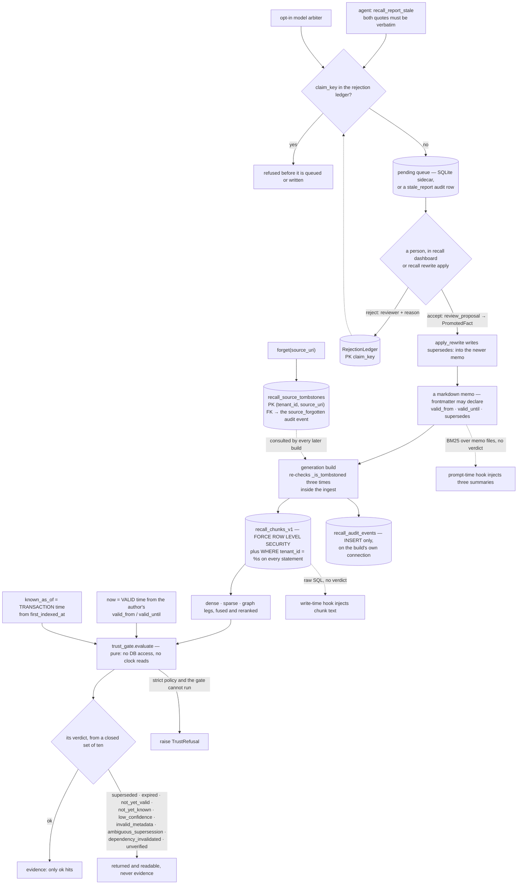

## 1. Executive Summary

RE-call is retrieval-backed agent memory on the caller's own PostgreSQL that
judges every hit before it can be used: one closed vocabulary of ten verdicts,
of which only `ok` becomes evidence, with a strict mode that refuses instead of
answering. The care around its own test data is what sets it apart, and the
review path is sound in both directions: a person decides, and a claim a person
rejected stays rejected. The weak side is the injection hooks, which put memo
text in front of the model without the verdict.

**The licence is AGPL-3.0-only**, with a separate commercial licence for closed
products and for a hosted service run without publishing its source. Release
0.14.0 and every commit published under PolyForm Noncommercial 1.0.0 are also
granted under the AGPL by a statement dated 5 October 2026
(`LICENSE_GRANT_AGPL.md`), and 0.13.x and earlier keep Apache-2.0 or MIT.
Contributions come in under a CLA.

The pitch is a distinction rather than a feature:

> "Plain vector search returns nearby text. RE-call also asks whether that text
> is current, supported, and trustworthy enough for the query. A superseded
> claim comes back marked `superseded`; a result that does not clear the
> calibrated trust gate becomes `ABSTAIN` with a reason."

**The single best passage in the tree is about the project's own test data.** The
off-topic query pool — subjects a search must abstain on — was written as Python
literals, and RE-call is a system people point at code corpora, including its
own:

> "These subjects are DATA, and as Python literals they were also CORPUS.
> `offtopic_subjects_absent_from` keeps a subject only when none of its content
> words appear anywhere in the corpus under test, so a code corpus that includes
> recall's own tree ingested this very list and then disqualified every one of
> its 25 subjects."

It was measured, not assumed. Against a repository-rooted corpus no subject
survived; a third-party corpus of the same size kept eleven, "so the failure
was recall dogfooding itself, not the pool being too small"
(`recall/eval/synthetic.py:75-100`). The pool moved to JSON, which the
wizard's `**/*.py` and `**/*.md` globs do not match. The distinctive words are
never written in prose, because naming one re-contaminates the pool, and the
author records breaking that rule twice while fixing it.

**A rejected claim is keyed on the claim, not on a row.** An agent holding the
MCP server can report that one memo replaces another; the report is queued, and
a person accepts or rejects it in a local dashboard or at the CLI. A rejection
goes into a ledger keyed on a hash of the relation and both memo names, and the
agent's report tool, the dashboard queue and the rewriter all consult it. The
same claim cannot be raised again by the agent or by the opt-in model arbiter
(`recall/stale_reports.py:224-232`, `recall/rewrite.py:775-776`).

**The preregistration habit is visible in what remains public.**
`docs/preregistrations/` holds 69 dated documents, 15 August to 26 September
2026, each stating what was about to be measured. Commit
[`6161946cbc77d7100655f2955354da834af95b78`](https://github.com/GiulioDER/RE-call/commit/6161946cbc77d7100655f2955354da834af95b78)
on 26 September 2026 moved 792 files of run traces and experiment records,
every amendment and `-result.md` among them, to the maintainer's private
archive. They remain reachable in history, which is where the pairing of a
hypothesis with its separately dated outcome can be read.

All seven capabilities are present. The two places to weigh against them are
the hooks and a development mode that serves results the gate never judged,
stamped `unverified` so they cannot pass as judged ones.

## 2. Mental Model

A **memory** is a markdown memo the user or an agent wrote, chunked into a
generation. Its author can declare `valid_from`, `valid_until` and
`supersedes:` in frontmatter, and those declarations are what the gate reads.

A **hit** carries a **verdict**, a member of a closed set, each value defined
against the one it would be confused with. Only `ok` becomes evidence; the rest
are returned and readable.

A memory **stops being guidance** in five ways:

- **Superseded.** A newer memo declares `supersedes:` naming it. The edge is
  dated by when the superseding memo was written, so a replay of an earlier
  instant sees the memory as current.
- **Expired or not yet valid.** Its declared validity window does not contain
  the evaluation instant.
- **Not yet known.** Under `known_as_of`, its first write is after that
  instant.
- **Withheld by the gate.** Below the calibrated threshold it is
  `low_confidence`; under a strict policy a gate that cannot run raises
  `TrustRefusal` instead of answering.
- **Erased.** `forget(source_uri)` deletes its chunks from every generation and
  writes a permanent per-source tombstone.

A **claim** — "B supersedes A" — has an identity independent of any proposal:
`claim_key` over the relation and both memo stems. A claim reaches the corpus
only when a person accepts it, and a claim a person rejects is refused at every
later write of it.

A **tenant** is a predicate on every statement with a forced Postgres
row-level-security policy behind it.

## 3. Architecture

| Area | Role |
| --- | --- |
| `recall/trust_gate.py` | The gate: two time axes, the verdicts, supersession rewinding |
| `recall/trust.py`, `recall/trust_verdicts.py` | Calibration loading, strict refusal, the single definition of `ok` |
| `recall/types.py` | The verdict vocabulary, each value argued against its neighbour |
| `recall/generations.py`, `recall/generation_store.py` | Builds, the audit events, `forget()` and the tombstone re-checks |
| `recall/migrations/sql/` | Forced RLS, the audit table, the tombstone table, the fact ledger |
| `recall/rewrite.py` | Claim keys, the rejection ledger, the rewriter that declares `supersedes:` |
| `recall/stale_reports.py`, `recall_mcp/stale_reports_api.py` | The agent-report queue, local and server-side |
| `recall/dashboard/` | The local review page and its token-guarded server |
| `recall/promotion.py` | The review gate a proposal cannot go around |
| `recall_hooks/` | Claude Code hooks, including the two that inject memory text |
| `recall/eval/`, `docs/preregistrations/` | The negative sets, and what was written down first |

### Deployment and ergonomics

A PostgreSQL with pgvector is required for anything beyond the hooks; `recall
setup` and `recall quickstart` provision it, and Docker compose files ship. The
corpus is the user's markdown, so it is readable and repairable by hand, and
the rejection ledger and stale-report queue are SQLite files in a `.recall/`
directory beside it. The MCP server runs over stdio by default and over
authenticated HTTP for several tenants, where it refuses to start under a role
that bypasses row-level security (`recall_mcp/server.py:682-700`). An embedder
is required to index; a hashing embedder exists for tests.

## 4. Essential Implementation Paths

**Judging a hit.** `trust_gate._verdict` (`recall/trust_gate.py:137-204`) reads
the declared window through `validity_bounds` (`recall/frontmatter.py:737-748`),
checks `first_indexed_at` against `known_as_of` before supersession, resolves
the successor through `resolve_successor`, and falls through to the threshold.
`evaluate` (`:210-250`) states the two axes in its docstring.

**Building evidence.** `recall/evidence.py:390` keeps only `ok` hits, and
`recall/trust.py:353-360` turns any dependency failure into
`TrustRefusal(DEPENDENCY_UNAVAILABLE)` under a `# BROAD-CATCH: fail-closed`.

**Reporting and deciding a supersession.** `recall_report_stale`
(`recall_mcp/server.py:2185-2229`) calls the stale-report queue, which checks
both quotes verbatim, confines both paths to the corpus root, and consults the
rejection ledger at `recall/stale_reports.py:224-232`. The dashboard's queue
merges agent reports, cached arbiter proposals and server-side `stale_report`
rows by claim key and drops rejected and already-declared ones
(`recall/dashboard/review.py:381-385`). Accepting runs the promotion chain and
`apply_rewrite` (`:401-450`); rejecting writes the ledger (`:447`).

**Refusing a rejected claim.** `RejectionLedger` (`recall/rewrite.py:245-330`)
is keyed on `claim_key` (`:219-232`); `apply_rewrite` checks it before reading
the memo (`:775-776`), and `recall rewrite plan` marks rejected proposals
(`recall/cli_commands/extract_rewrite.py:372`).

**Erasing a source.** `forget` (`recall/generations.py:1822-1961`) deletes the
chunks and writes the `source_forgotten` event (`:1852-1856`) and the tombstone
(`:1865`) in one transaction. Every build calls `_is_tombstoned` (`:599-604`)
at `:1230`, `:1288` and `:1326`, for the reason given at
`recall/generation_store.py:82-88`.

**Injecting at prompt time.** `user_prompt_submit` ranks `load_memos` with BM25
and renders three summaries (`recall_hooks/prompt_time.py:246-327`,
`:378-407`).

## 5. Memory Data Model

Source documents are chunked into `recall_chunks_v1`, or the legacy table a
store is configured with, with declared validity, lineage and supersession in
metadata, all under a tenant policy. `AtomicFact` is a structured claim —
namespace, subject, predicate, object, context, `valid_from`, `valid_until` —
appended as events to `recall_fact_ledger_events` and projected to current state
at an instant (`recall/fact_ledger.py:587-602`). Generations version the corpus:
a build produces one, promotion makes it active, rollback returns to an earlier
one, and a garbage collector removes retired ones.

The rejection ledger's row is `(claim_key, reviewer_id, reason, rejected_at)`.
The stale-report queue's row carries the claim key, both memo names, both
quotes, the reporting client, a count, and a status of `pending`, `accepted` or
`rejected`. The server-side `stale_report` audit row carries quote fingerprints
rather than text, because "the audit ledger is outside the reach of `forget`".

## 6. Retrieval Mechanics

Dense, sparse and graph legs are fused and reranked, then every surviving hit is
judged by `evaluate`. Calibration supplies the threshold and carries its own
certification status, so the system can tell a threshold it fitted from one it
never had; without a certified one, development mode stamps every hit
`unverified`.

The hooks are a separate read path. The write-time hook runs one raw SQL query
against the active generation with an explicit tenant predicate and injects
chunk text with its `ts_rank` (`recall_hooks/write_time.py:205-229`). The
prompt-time hook reads the memo files from the Claude Code project memory
directory and injects up to three summaries, each stamped with the dates the
memo states about itself. It does so under the instruction "If one of these
already settles the question, say so and follow it"
(`recall_hooks/prompt_time.py:399`). Neither hook reads a verdict or a
`supersedes:` declaration, and both are on by default.

## 7. Write Mechanics

A build reads a manifest, skips tombstoned URIs, writes chunks, and appends its
lifecycle events on the same connection. The corpus fingerprint is computed from
the manifest minus the tombstoned set, so a build whose only change is an
erasure is a distinct generation. `recall_apply_fact` writes a structured fact
directly, behind a deterministic controller that accepts only evidence-card ids
from `recall_evidence` and refuses an unsupported claim or a contradiction
without supersession. Supersession edges take the review path.

## 8. Agent Integration

A CLI, an MCP server registered as `io.github.GiulioDER/re-call` with
twenty-four tools and a `RECALL_MCP_TOOLS` subset switch, a Codex plugin,
Claude Code hooks at five events, a local dashboard, desktop packaging and
Docker compose files. `recall_report_use` lets the agent record whether memory
helped, made no difference or misled a task, as an audit row that changes
nothing in search. Several preregistrations measure the integration itself —
hook ordering, in-process against MCP transport, and tool-definition context
cost.

## 9. Reliability, Safety, and Trust

**The review gate is kept off the model's own surface, and the project says
why.** The MCP server registers `recall_rewrite_plan` and no apply twin, and the
docstring states the rule: *"There is deliberately no `recall_rewrite_apply`.
The MCP client is the model, so letting it supply a reviewer id and an audit
note would make the named human gate a formality it satisfies by typing a
string: the gate becomes a field, not a person."*

The agent's verb is a report, and its docstring says what the report cannot
do: "nothing in memory changes until they accept it". The dashboard that accepts it binds 127.0.0.1, refuses a
foreign `Host` header, and requires a per-launch token and a CSRF field
(`recall/dashboard/server.py:8-12`, `:496-514`, `:579`). The reviewer is a name
typed into that form or passed to `--reviewer`, not an authenticated principal.

`recall_apply_fact` is a different kind of write. Its inputs exclude trust
verdicts, timestamps, approval fields and writer identity, which are
"server-owned and cannot be supplied here", and the fact is applied when the
deterministic controller accepts the cited evidence; no person is involved.

**The trust gate governs evidence, not injection.** Strict mode refuses; the
evidence builder admits only `ok`. The hooks put memo text into the prompt
without consulting either, so a memo the gate would mark `superseded` can reach
the model through the prompt-time hook with an instruction to follow it.

**Tenant isolation is two guards.** The project's own account in
`recall/pool.py:38-52` is that RLS backstops a forgotten predicate and the
predicate backstops a GUC that was never set, and that a superuser or
`BYPASSRLS` role ignores the policy. `check_rls_effective` reports which case a
connection is in, and authenticated multi-tenant serving refuses the bypass.

The configured gaps are a development mode that serves `unverified` results, a
`generation_promoted_unsafe_development` path, and a decision ledger that is off
unless enabled and best-effort when it is. The mutation audit is not optional;
it commits with the build.

## 10. Tests, Evals, and Benchmarks

7,303 test functions in 624 files, 109 of them gated on a live Postgres; none
were run for this reading. The tenancy test is the committed must-not-retrieve
case (`tests/test_tenancy_retrieval.py:70-87`), the trusted-search tests pin
supersession and expiry end to end (`tests/test_trusted_search.py:24-47`), and
the generation suite covers erasure during a build and tombstones surviving
rollback and garbage collection. Evaluation suites cover LoCoMo, LongMemEval,
BEIR and synthetic corpora, with abstention scored as its own axis and a
near-miss set scored as a false-confidence rate.

## 11. For Your Own Build

### Steal

Key a rejection on the claim, and consult it at every writer. A claim key over
the relation and normalised names makes the agent's report, the model's
proposal and the human's rewrite refuse the same thing.

Give the agent a report verb instead of an apply verb, and require verbatim
quotes so the reviewer decides on text in front of them.

Check whether your evaluation data is inside your corpus. If your system indexes
code and your negative examples are Python literals, they are corpus, and the
failure is silent.

Re-check your tombstones inside the ingest, not only at the start of it.

Define each status against the one it will be confused with, and say so in the
type.

### Avoid

An injection hook that bypasses the gate the search path enforces. A hook is
the read path the model sees most often, and a verdict that only the search
tool honours leaves the stale memo one prompt away.

A reviewer field that is a typed string, where the deployment can bind it to a
login.

### Fit

This suits a team or a person who keeps decisions and research notes as
markdown, runs a PostgreSQL, and wants a memory that refuses rather than guesses
and records why. Walk away if no database can be stood up, or if the hooks'
injection must honour supersession.

## 12. Open Questions

Whether the hooks should read verdicts. The write-time hook has the database in
hand and the prompt-time hook has the frontmatter; either could drop a
superseded memo.

Whether the degraded path should be reachable in a packaged install at all. Both
escape hatches are named and audited; the first-best would be that a deployment
cannot serve an unjudged result.

Whether `reviewer_id` should be bound to an authenticated identity, given that
the dashboard holds a per-launch token.

Whether a claim key should survive a memo rename. Both the rejection ledger and
the source tombstone are keyed on names, so renaming a file reopens a rejected
claim and re-admits an erased source under its new path.

## Appendix: File Index

| Path | What to read it for |
| --- | --- |
| `recall/types.py:53-79` | A status vocabulary where each value argues against its neighbour |
| `recall/trust_gate.py:137-250` | Two time axes that compose, and the replay bug that shaped them |
| `recall/rewrite.py:219-330` | A rejection keyed on the claim, with its error contract |
| `recall/stale_reports.py:1-30` | An agent report that changes nothing until a person accepts it |
| `recall/dashboard/review.py:1-32` | One queue over three sources, closed the same way |
| `recall/eval/synthetic.py:75-100` | Your own repository contaminating your own negative set |
| `recall/generations.py:599-604`, `:1230` | A tombstone check placed where the race is |
| `recall/pool.py:38-52` | What RLS protects against and what it does not |
| `recall_hooks/prompt_time.py:378-407` | An injection with dates and no verdict |
| `tests/test_tenancy_retrieval.py:70-87` | A must-not-retrieve case and its control in one assertion |

### Recorded searches

Run at the tree root of the pinned checkout with `git grep`, and at the
previous pin `1157360f1e0704a06548d93a4f4797c415c722f9` where noted.

- `git grep -nE 'recall_source_tombstones|_is_tombstoned|tombstoned_sources' -- ':!tests' ':!docs'` — the migration, `recall/schema.py:41` and `recall/generations.py` only, at both pins; no reader outside the generation path.
- `git grep -nE 'class RejectionLedger|_rejected_claims|rejected_claims|is_rejected' -- recall recall_mcp` — `recall/rewrite.py`, `recall/cli_commands/extract_rewrite.py`, `recall/stale_reports.py`, `recall/dashboard/review.py` and `recall/dashboard/activity.py`; at the previous pin `recall/rewrite.py`, `recall/cli.py` and `recall/cli_commands/extract_rewrite.py`.
- `git grep -nE 'rejected_claims' -- 'recall*' | grep -iE 'delete|update'` — no match; nothing removes a rejection.
- `git grep -nE '^\s+name="recall_' -- recall_mcp/server.py` — twenty-four tools; no `apply`, `approve`, `accept` or `reject` verb. `recall_calibration_publish` carries the admin scope and `recall_forget` erases; neither resolves a review.
- `git grep -niE '(UPDATE|DELETE FROM|TRUNCATE)\s+recall_audit_events' -- 'recall*' ':!tests'` — no match at either pin; the only DELETE is the operator example in `docs/DECISION_LEDGER.md:135`.
- `git grep -nE 'recall_audit_events' -- 'recall*' ':!tests' ':!*.sql'` — INSERTs in `recall/generations.py`, `recall/store.py` and `recall/calibration_v2.py`, and SELECTs in `recall/dashboard/db.py`.
- `git grep -niE 'supersed|verdict' -- recall_hooks/prompt_time.py recall_hooks/write_time.py` — no match at either pin.
- `git grep -nE 'set_config|current_setting' -- recall_hooks` — no match; the write-time hook sets no GUC.
- `git grep -nE 'known_as_of' -- recall_mcp 'recall/*.py'` — `recall_mcp/graph_expansion.py`, `recall_mcp/retrieval.py`, `recall/store.py`, `recall/reasoning.py`, `recall/types.py` and the trust gate; `recall_search` exposes no time argument.
- `git grep -nE 'review_proposal|promote_accepted_proposal' -- recall` — `recall/cli_commands/extract_rewrite.py:447-450` and `recall/dashboard/review.py:405-406` besides the definitions.
- `git grep -nE '"license"' -- '*.json'` — `.claude-plugin/marketplace.json:21` declares `Apache-2.0`; both plugin manifests declare `AGPL-3.0-only`.
- `git grep -niE 'anthropic|machine learning|not (be )?used (for|to)' -- LICENSE LICENSE_GRANT_AGPL.md COMMERCIAL_LICENSE.md NOTICE` — no match; no rider.

## History

**2026-10-15** — [`ab4d37de84681a630c46589d4986aeb843bb2e35`](https://github.com/GiulioDER/RE-call/commit/ab4d37de84681a630c46589d4986aeb843bb2e35) — 232 commits on. Screened first; nothing installed or run. The licence moved to AGPL-3.0-only on 5 October 2026, with a grant extending it to the PolyForm-era commits. `not_entailed` left the vocabulary with the entailment judge, leaving ten verdicts, and the gate moved to `recall/trust_gate.py`. An agent report verb, a local review dashboard and an opt-in model arbiter arrived, all closed through the claim-keyed rejection ledger, on which `tombstone` is re-grounded ([section 4](#4-essential-implementation-paths)). `negative_eval` is re-grounded on the tenancy test, since the distractor set is scored as a rate. The public preregistrations went from 188 to 69, with amendments and results moved to a private archive. Four claims were wrong at the previous pin and are listed in the [known limitations](../../appendix/#known-limitations). All seven marks held at both pins.

**2026-09-19** — re-pinned to [`1157360f1e0704a06548d93a4f4797c415c722f9`](https://github.com/GiulioDER/RE-call/commit/1157360f1e0704a06548d93a4f4797c415c722f9), 29 commits and 184 files on. **All seven marks re-tested and held**, and `human_review` is re-grounded on the thing that actually settles the producer test. The structural gate is unchanged — `_require_review_fields` (`recall/promotion.py:200-210`) still raises without a reviewer identity, a review timestamp and a non-blank audit note, and `recall/rewrite.py:26` still records that a downstream function cannot take an unreviewed proposal because only `promote_accepted_proposal` produces a `PromotedFact`. What the record now cites beside it is the absence: the MCP server registers `recall_rewrite_plan` and no apply twin, and its docstring states the rule this atlas's rubric arrived at independently. It reads: *"letting it supply a reviewer id and an audit note would make the named human gate a formality it satisfies by typing a string: the gate becomes a field, not a person."*

`recall_apply_fact` repeats it as an input property, with approval fields and writer identity server-owned. Quoted in section 9, and re-call is added to the rubric's list of what passing looks like. The stated limit is unchanged: on the CLI path `reviewer_id` is a supplied string, so the mechanism is stronger than the attribution it records, and section 12 still asks whether it should be bound to an authenticated principal. Screened again first; nothing installed or run.

**2026-09-16** — [`1994fd256820df7970eac1f1d588a1961da16edf`](https://github.com/GiulioDER/RE-call/commit/1994fd256820df7970eac1f1d588a1961da16edf) — first reading, at a commit dated 16 September 2026. Screened before opening, from a shallow clone: fifteen files scanned, three auto-run surfaces, three build-time execution points (`recall/setup.py`, which executes at install time, `tests/conftest.py`, which runs on pytest collection, and the `Makefile` default target), one unpinned dependency surface and three dependency files inside the seven-day cooldown. `uv.lock` is present. A `hooks/pre-commit` payload sits in the tree uninstalled and inert. `AGENTS.md` and `CLAUDE.md` are addressed to a reading agent and were recorded as data. Nothing was installed, built or run, so every claim here is read from source rather than observed.
