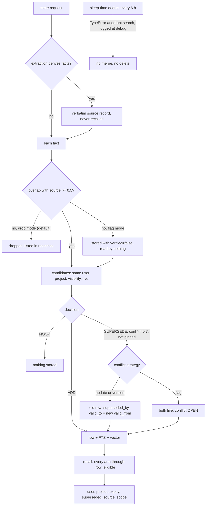

## 1. Executive Summary

Remembra is a self-hostable memory server for agents, a FastAPI process over
SQLite and Qdrant with a hosted cloud in front of it. A store runs LLM
extraction into atomic facts, drops facts its source text does not support,
and decides per fact whether to add it, skip it as a duplicate, or supersede an
older memory. Its README leads with Relay: session hooks that build a handoff
from git and the agent's transcript when a coding session ends, and inject a
brief into the next session of any vendor.

What is notable is the discipline on the main paths. Every recall arm hands its
candidates to one function that re-checks the SQLite row for user, project,
expiry, supersession, scope and source-record status. Supersession marks rather
than deletes and is undone if the store fails part-way. What is weak sits at
the edges of that discipline. The sleep-time dedup pass, enabled by default,
calls the vector store with keyword names it does not accept and logs the
failure at debug level, so it does nothing. A grounding verdict is written into
metadata and read by nothing.

Four findings shape the rest of this report.

- **The background dedup pass is dead, and its tests cannot see it.**
  `_dedup_pass` calls `self.qdrant.search(embedding=..., threshold=...)`, while
  `QdrantStore.search` takes `query_vector` and `score_threshold`
  (`src/remembra/services/sleep_time.py:345-350`,
  `src/remembra/storage/qdrant.py:454-466`). The `TypeError` lands in an
  `except` that logs at debug. The suite's fake accepts `**_`, and its
  consolidator returns `UPDATE`, a label the production consolidator never
  emits.
- **Valid time is real on edges and the write clock on memories.** Entity
  relationships carry dates the extractor read from the text, queryable as of a
  point in time. A memory row's `valid_from` is always `now` and its `valid_to`
  is the moment a newer memory superseded it.
- **The trust signals label and do not gate.** `metadata.verified` is written
  only under the non-default `grounding_action=flag` and no reader exists. A
  `flag` conflict strategy keeps both memories live. The injection score
  withholds handoff text below a threshold, a ranking-style number rather than
  a state.
- **The committed benchmark is invalid by the project's own account.** The
  March 2026 LoCoMo run scored a wrong date as correct. The README says the
  judge counted every INCORRECT verdict as correct, and commit `a19fb29f` fixed
  the runner without a new run.

Four marks: `bitemporal` on relationship edges, `scope_enforced`, `audit_log`
and `negative_eval`. `trust_state`, `human_review` and `tombstone` are withheld,
for reasons given in sections 5, 7 and 9.

## 2. Mental Model

A memory is one atomic fact. When extraction derives facts from a store
request, the request's verbatim text becomes a separate source record
(`memory_type='source'`) that recall never returns, and each fact carries a
`metadata.source_id` receipt pointing at it
(`src/remembra/services/memory.py:591-653`, `:862-969`). A relay handoff is a
memory too, stored atomically with `memory_type='handoff'` and a `relay`
metadata block.

A fact becomes a belief by surviving two gates on the write path. The first is
grounding: content-word overlap between the fact and its source must reach
`fact_verification_threshold` (0.5), and under the default
`grounding_action='drop'` a fact below it is not stored
(`src/remembra/services/memory.py:1355-1381`). If every derived fact fails, the
verbatim content is stored instead. The second is consolidation. Candidates are
live memories of the same user, project and visibility bucket, and the decider
returns `ADD`, `NOOP` or `SUPERSEDE`. A supersession under confidence 0.7, or
against a pinned memory, is downgraded to `ADD`
(`src/remembra/services/memory.py:1212-1250`).

A memory stops being a belief in four ways. Supersession sets `superseded_by`,
`superseded_at` and `valid_to` on the old row, which then drops out of recall
unless `include_superseded` or `as_of` is passed
(`src/remembra/storage/database.py:1556-1582`). Expiry hides a row at read time.
Forget deletes it outright. Under the `flag` conflict strategy nothing stops
being a belief: the new fact links `conflicts_with` and both stay live
(`src/remembra/services/memory.py:1466-1472`).

Who moves memories between states: the store pipeline on every write, the
caller through supersede, PATCH and forget, and a background worker that is
meant to merge duplicates. Memory is treated as ground truth once stored; no
state on a row withholds it from being acted on.



## 3. Architecture

One Python package, `src/remembra`, runs as a FastAPI server
(`src/remembra/main.py`). SQLite through `aiosqlite` holds memory rows, an FTS5
table, entities, relationships, conflicts, the audit log, accounts and billing
state (`src/remembra/storage/database.py`). Qdrant holds one point per memory
with a payload carrying user, project, expiry, scope prefixes and validity
fields, optionally encrypted (`src/remembra/storage/qdrant.py:35-103`).
Embeddings come from OpenAI by default, or Azure, Cohere, Ollama, Voyage or
Jina. Extraction, consolidation and entity resolution call an LLM; a
cross-encoder reranker loads `ms-marco-MiniLM-L-6-v2` when enabled.

Around the core sit an MCP server whose tools wrap a REST client
(`src/remembra/mcp/server.py`), Python and TypeScript SDKs, a React dashboard,
and `remembra-relay`, a CLI that installs session hooks for five coding agents,
plus Cursor behind `--include-unverified` (`src/remembra/relay/`). Crew mode adds a separate SQLite database of claims,
zones, tasks and a hash-chained event log for coordinating agents in one
repository (`src/remembra/crew/`). It is the largest subsystem and is
coordination state rather than memory.

Background work runs in process: an enrichment queue for entity resolution, a
pending-embedding retry worker, and a sleep-time worker scheduled every six
hours when `sleep_time_enabled` is true, which it is by default
(`src/remembra/config.py:695-706`, `src/remembra/main.py:446-470`).

### Deployment and ergonomics

The quickstart compose file starts Remembra, Qdrant and Ollama with
authentication off and local embeddings, so it runs offline with no API key.
When the extraction call fails, the store keeps the text as fallback facts and
marks them for the reprocess job. Production builds use `Dockerfile.cloud`. The relay client
installs with `pipx` and needs a Remembra API key and server URL. The SQLite
file is inspectable by hand; the vectors are not, and `storage/reconcile.py`
and `storage/reindex.py` exist to repair drift between the two stores.

## 4. Essential Implementation Paths

**Capture.** `POST /api/v1/memories` sanitizes the content, resolves the
project, and calls `MemoryService.store`
(`src/remembra/api/v1/memories.py:294-424`). `store` sets one time budget, and
on any hard failure `_rollback_store` unmarks supersessions and deletes the
rows, FTS entries and vectors it created
(`src/remembra/services/memory.py:702-778`). With `async_enrichment` on, the
source record is acknowledged first and facts are extracted in a background
task.

**Extraction and grounding.** `_extract_and_store_facts` runs
`extractor.extract_detailed` within the budget and falls back to the verbatim
content (`src/remembra/services/memory.py:862-969`). `_store_single_fact`
grounds, embeds, finds candidates, decides, and writes the row and FTS entry in
one SQLite transaction before upserting the vector
(`src/remembra/services/memory.py:1322-1599`).

**Consolidation.** `_consolidation_candidates` searches Qdrant with user and
project filters, then drops rows of another user, project, visibility, space or
team, superseded rows, source records and expired rows
(`src/remembra/services/memory.py:1144-1197`). `_decide` short-circuits an exact
duplicate, then asks the LLM consolidator or, in Jev enforce mode, an external
classifier (`src/remembra/services/memory.py:1601-1680`).

**Retrieval.** `recall` embeds the query and runs the semantic, keyword,
recent-pool and graph arms, re-checking each candidate with `_row_eligible`
(`src/remembra/services/memory.py:1893-1931`, `:1999-2263`). It then dedupes
status memories per key, scores unscored hits by cosine, reranks, ranks, drops
near-duplicates, and builds context from exactly the returned set.

**Context injection.** Recall's context goes through `ContextOptimizer`, capped
at 4,000 tokens by default and 800 in slim mode. The relay brief is assembled
by `RelayService.brief` from the newest substantive handoff, recent handoffs,
the inbox and linked projects, scrubbed and policed
(`src/remembra/services/relay.py:1181-1279`).

**Correction and deletion.** `supersede` creates a new memory and marks the old
(`src/remembra/services/memory.py:2728-2858`). `update` rewrites a row in place
and re-embeds it (`:2596-2726`). `forget` deletes by id, entity, project or
account from Qdrant, FTS and SQLite (`:2860-2971`).

**Relay.** `RelayService.close_session` redacts secrets, renders the handoff,
stores it with `skip_extraction=True` and `source='agent_generated'`, and
supersedes the earlier handoff for the same `(agent_id, session_id)`
(`src/remembra/services/relay.py:503-742`).

**Background.** `SleepTimeWorker._consolidate_user` runs dedup, entity
resolution, importance rescoring, decay cleanup and community detection
(`src/remembra/services/sleep_time.py:196-237`).

## 5. Memory Data Model

The `memories` table began with user, project, content, facts, metadata,
timestamps, expiry and access counters, and migrations added provenance
(`source`, `trust_score`, `checksum`), visibility (`visibility`, `space_id`,
`team_id`), `memory_type`, `scope`, `supersedes`, `contradicts`, `importance`,
`pinned`, `superseded_by`, `superseded_at`, `valid_from` and `valid_to`
(`src/remembra/storage/database.py:644-667`, `:1063-1096`, `:270-285`).
`archived_memories` is a cold tier with an archive reason; `memory_feedback`
holds helpful and unhelpful signals the ranker can weight.

**Validity.** Migration 3 calls itself *"bi-temporal, minimal"* and defines
`valid_from` as when the fact became true. Both write paths set it to the
store's own clock (`src/remembra/services/memory.py:1487`, `:1077`), and
`mark_memory_superseded` sets `valid_to` to the new memory's `valid_from`. No
store request field carries a different date, so on memory rows valid time and
record time are the same clock.

**Relationships** carry the second clock
(`src/remembra/storage/database.py:772-797`). The entity prompt asks the model
to extract when a relationship started and ended, with examples like *"Alice
used to work at Meta from 2019 to 2022"*
(`src/remembra/extraction/entities.py:84-94`). The dates reach the row through
`_process_entities_for_memory`, and `created_at` stays the recording time
(`src/remembra/services/memory.py:1782-1799`). `get_entity_relationships`
filters with `is_valid_at(as_of)`, served by `GET
/api/v1/entities/relationship-search` and the `relationships_at` MCP tool.
That is what earns `bitemporal`, and only for edges.

The edge model has two unwired pieces. `supersede_relationship` and
`find_contradicting_relationships`, which would close a `WORKS_AT` edge when a
new one appears, have no caller in `src`. A later "now works at Google" leaves
the Meta edge current unless the sentence stated an end date. The as-of filter
also never reads `created_at`, so the system cannot answer what it believed on
a past date.

**Scope.** `user_id` and `project_id` are columns on memories, FTS rows,
entities and pending embeddings, and fields in the Qdrant payload. `scope` is a
colon-separated prefix matched on the read path. Visibility and spaces add
sharing: a memory shared into a space is readable by space members, and
`recall_across_spaces` scores those rows with no user filter by design
(`src/remembra/services/memory.py:2480-2594`).

**Trust fields.** `trust_score` is the sanitizer's injection score at write
time. `metadata.verified` and `grounding_score` record the grounding verdict
when a fact was kept despite failing. `memory_conflicts` has
`open`, `resolved` and `dismissed`, but that status belongs to the conflict
record, not to either memory (`src/remembra/extraction/conflicts.py:105-131`).
None of these is a discrete state on the memory that withholds it, which is
why `trust_state` is withheld.

## 6. Retrieval Mechanics

The semantic arm pushes user, project, expiry and plaintext metadata filters
into Qdrant and pages until it has twice the requested limit of eligible rows
or exhausts a cap (`src/remembra/services/memory.py:1959-1993`). The keyword
arm queries FTS5 with the same user and project and excludes superseded rows in
SQL. The graph arm runs only when a project is given, matching entity names as
whole words with guards against one-letter and untyped acronym entities. A
query classified as `debug` intent also pulls the newest rows into the pool, so
"what was I just working on" finds a handoff phrased differently.

`_row_eligible` is the decision point. It rejects another user, another project
when one is set, an excluded id, a source record, an expired row, a superseded
row unless asked, a row outside the scope prefix, and a metadata mismatch. Under
`as_of` it applies the validity window instead
(`src/remembra/services/memory.py:1893-1931`). Its docstring calls it the
*"single source-of-truth gate for every recall path"*, and the four arms call
it.

Ranking has four presets. `balanced` weights semantic similarity at 0.6,
recency 0.15, entity overlap 0.15 and keyword 0.1; `debug` moves recency to
0.45 (`src/remembra/retrieval/ranking.py:26-100`). An intent router picks the
mode from rules and optionally an LLM. Status memories keep only the newest
value per `status_key`, and results above a similarity threshold to a
higher-ranked result are dropped as near-duplicates.

Failure modes the code anticipates: an embedding outage degrades recall to
keyword and graph and says so (`degraded='keyword_only'`); a reranker
threshold can delete candidates below an absolute logit. One it does not
address is the cross-project default: an unrestricted key that omits
`project_id` gets every project's memories, and the handoff queries drop their
project clause the same way when none is resolved
(`src/remembra/services/agent_session.py:309-313`).

## 7. Write Mechanics

Writes happen on the hot path through the API, the SDKs and MCP
`store_memory`, through `ingest_conversation`, which extracts from a transcript
and calls `store_fact`, and through relay closes. The extractor returns atomic
facts; the grounding check is a deterministic content-word overlap, optionally
overridden by the Jev classifier in enforce mode. Consolidation never rewrites
an existing memory: the old one is marked, the new fact is stored verbatim as
extracted.

Corrections from a caller go through two different verbs. `supersede` keeps
history. `update`, which the MCP `update_memory` tool calls through `PATCH`,
overwrites content in place and re-links entities, and the tool's docstring
steers status values to `store_status` instead because that keeps history.
Forget is a hard delete and leaves nothing keyed on the value, so the same
sentence stored again is extracted and stored again. That is why `tombstone` is
withheld.

The sleep-time worker's dedup pass is the one place written to rewrite and
delete. `_dedup_pass` embeds each recent ordinary note, searches for neighbours,
and on `UPDATE` would overwrite the kept memory's content and hard-delete the
other, on `NOOP` delete the current one
(`src/remembra/services/sleep_time.py:315-400`, `:638-666`). Three things stop
it. The search call passes `embedding=` and `threshold=` to a method whose
parameters are `query_vector` and `score_threshold`, so every call raises
`TypeError`. The handler logs at debug and moves on. And
`ConsolidationAction.UPDATE` is a legacy label the consolidator normalises to
`SUPERSEDE` (`src/remembra/extraction/consolidator.py:78-92`). Had the call
worked, it also passed no `project_id`, so it would have merged across projects.

### Operational cost

The default store blocks on one extraction call, one embedding per fact and a
consolidation call per fact with candidates, within
`store_time_budget_seconds`. A memory is retrievable as soon as the call
returns, by keyword at once and by vector unless the embedding was deferred to
the retry queue. With `async_enrichment` the call returns after one embed of
the source record, and facts appear when the background task finishes. Relay
handoffs cost one embedding and no LLM call. Entity resolution runs after the
response. The sleep-time worker reads at most 500 memories per user changed in
the last 24 hours or since its last run, not the whole store. On the read path
the relay brief is capped near 6,000 characters and recall context at 4,000
tokens.

## 8. Agent Integration

The MCP server exposes `store_memory`, `recall_memories`, `forget_memories`,
`update_memory`, `list_memories`, `timeline`, `relationships_at`,
`search_entities`, `store_status`, `session_brief`, `close_session`, an inbox,
spaces and the Crew tools (`src/remembra/mcp/server.py:302-2235`). Every tool
calls the REST API with the configured key, so the server's scoping and audit
apply. Read results are wrapped in an untrusted-data block that stored content
cannot close (`src/remembra/mcp/server.py:223-231`).

Relay is the automatic half. Hooks for Claude Code, Codex, Gemini CLI, Qwen
Code and Kimi Code run `remembra-relay brief` at session start and
`remembra-relay close` at the end (`src/remembra/relay/adapters/`). The close
reads branch, commits, changed files and unpushed commits from git and, for
Claude Code and Codex, test runs from the transcript. It sends facts marked
`relay-cli:git+transcript`; a close through MCP `close_session` is recorded as
`agent-declared`. The brief checks the agent's summary against the facts and
says when it contradicts them. A project is identified by its git remote, so
one repository on two machines shares a trail.

Adapting this to another agent means writing an adapter in
`src/remembra/relay/adapters/` or calling the two MCP tools; the memory API is
an ordinary REST service.

## 9. Reliability, Safety, and Trust

**Provenance.** The source record and `source_id` receipt make every derived
fact traceable to the exact text it came from, the strongest provenance
mechanism in the tree. Handoffs record whether facts came from git, from git
and the transcript, or from the agent's declaration, and whether the agent's
identity was proven by a scoped key.

**Injection.** Content passes a sanitizer that scores it; at brief time
`assess_text` takes the lower of the stored and current score, and a handoff
below the threshold has its text replaced with a withheld note naming the id
(`src/remembra/relay/handoff.py:703-730`, `:1600-1638`). That is a filter on a
float computed per read, not a stored state.

**Grounding verdicts.** Under `grounding_action='flag'` a fact failing the
overlap check is stored with `verified=false`. `git grep` finds no reader of
the key in `src`. The `fact_verification_threshold` description says
below-threshold facts *"are stored but flagged verified=false"*, which is true
only in the non-default mode; by default they are dropped.

**Conflicts.** Each consolidation supersession writes a `memory_conflicts` row,
`resolved` under `update` and `version`, `open` under `flag`. Resolving or
dismissing one updates the conflict record and changes neither memory
(`src/remembra/extraction/conflicts.py:236-288`). Nothing waits on the queue
and no MCP tool names it, so it is a log a person can read, not a review gate.
That is why `human_review` is withheld.

**Audit.** `audit_log` is append-only in practice: one insert path, no
`UPDATE` or `DELETE` in `src`, and account erasure deletes only the erased
account's rows before writing a receipt
(`src/remembra/storage/database.py:3563-3593`,
`src/remembra/account/erasure.py:253-262`, `:605-620`). Coverage is the generic
memory and ingest routes plus decay deletions. Relay closes, status upserts and
checkpoints write no row. Rows hold ids, not content.

**Consistency.** SQLite is the source of truth and is written first in one
transaction with the FTS entry and any pending-embedding job; the vector
follows. Every recall candidate is re-read from SQLite, so a stale Qdrant
payload cannot leak an expired or superseded row. Entity creation runs under a
per-user `asyncio.Lock`, which holds within one process.

**Deletion.** Forget removes the Qdrant point, the FTS row and the SQLite row,
and an entity forget removes entities no remaining memory mentions. Forgetting
one derived fact leaves its source record, which recall never returns and which
holds the same text.

## 10. Tests, Evals, and Benchmarks

The suite is large: 314 test files, many driving the HTTP app through a
security harness or `MemoryService` through `tests/_ret_harness.py`, which
uses a temp SQLite file and Qdrant's in-process engine with a controllable fake
embedder. The retrieval cases there are written to fail. The expired-memory
regression asserts the semantic result equals exactly the live memory, then
checks FTS, raw vector search and filter-only recall separately
(`tests/test_ret_scoping_filters.py:47-73`). The project case asserts the
result is exactly the same-project memory while a same-named entity exists in
another project (`:143-163`). The filter-only case asserts a retired memory is
absent and its live replacement returned (`:303-320`). These earn
`negative_eval`.

Two tests pass without exercising what they name.
`tests/test_supersession_recall.py` tests `filter_active_memory_ids`, which no
product path calls. The sleep-time suite's `FakeQdrant.search(self, **_)`
accepts any keyword, so the dedup tests pass on a call the real store rejects
(`tests/test_sleep_time_retention.py:52-53`, `:269-283`). The real-store case
at `:300-345` gives three rows one embedding and a consolidator that answers
`UPDATE`, then asserts every point survives the default run. That assertion
holds because the dedup search raises.

The LoCoMo runner is committed with one result file from 7 March 2026: a single
conversation, 199 questions, 76.38% overall, every non-adversarial
question correct and every adversarial one wrong. The overall figure recomputes
from the per-question rows (152 correct). The first row's prediction is raw
recall context naming 2 October 2023 against a gold answer of 7 May 2023,
scored correct. README line 271 and `docs/benchmarks.md` call the run invalid,
and commit `a19fb29f` fixed the verdict parser on 16 July 2026. The fidelity
benchmark's table cites a run whose per-item results were removed with the
corpus they came from. No paper accompanies the project; the only arXiv
reference is to Mem0's paper in `ARCHITECTURE.md`.

Missing tests worth having: a forgotten memory absent from recall, a
`verified=false` fact's treatment, a cross-project relationship as-of query,
and the sleep-time pass against the real `QdrantStore`.

## 11. For Your Own Build

### Steal

- **One eligibility function for every retrieval arm, reading the row of
  record.** Pushing filters into the vector store is an optimisation; the
  decision is made once, from SQLite, for semantic, keyword, graph and recency
  candidates alike.
- **A journal for the store, rolled back as a unit.** Record every row created
  and every supersession made during one request, and undo them in reverse on
  failure, so a half-finished store leaves neither orphan vectors nor retired
  memories without a successor.
- **Keep the verbatim source beside every derived fact.** A receipt id on each
  fact turns extraction drift from invisible into checkable.
- **Build the handoff from evidence, and grade the agent's summary against
  it.** Git and the transcript say what was committed and pushed; the summary
  is shown as unverified or contradicted, never as the record.

### Avoid

- **Test fakes that accept any keyword.** `search(self, **_)` cannot catch a
  renamed parameter; a fake should share the real signature, or one test
  should run the path against the real adapter.
- **A broad except at debug level around the body of a background loop.** A
  pass that fails on every item and reports zero work looks the same as a pass
  with nothing to do.
- **A trust field with no reader.** A `verified=false` that nothing filters or
  labels reads as a safeguard in the docs and changes no answer.
- **Calling write time "valid from".** If no input can carry a different date,
  the second clock is the first one renamed.

### Fit

Remembra suits a team that wants a Mem0-shaped service it can host, with
stronger guarantees on the paths that run on every request: scoped recall,
supersession with history, and provenance to the source text. Relay is the
better-built product and the reason to look; a team running several coding
agents across machines gets git-grounded handoffs without adopting the memory
API's extraction pipeline at all. Walk away if corrections must be reviewable
before they take effect, or if the background consolidation is part of why you
would adopt it. Operators carry an LLM bill on every memory store outside Relay, two stores to
keep in sync, and a 143,000-line codebase maintained by one author.

## 12. Open Questions

- Whether the hosted service runs with `sleep_time_enabled` and what its logs
  show at debug level for `dedup_memory_failed`.
- How often the extractor returns relationship dates on real input, and how
  many current edges a stale `WORKS_AT` leaves behind.
- Whether any deployment sets `grounding_action=flag`, and what a reader of the
  dashboard sees for an unverified fact.
- The recall quality of the fixed LoCoMo runner, which has not been run.
- How Crew mode's hash-chained event log relates to memory correction, if at
  all; it was read only far enough to place it outside memory.

## Appendix: File Index

- **Storage and schema:** `src/remembra/storage/database.py`,
  `src/remembra/storage/qdrant.py`, `src/remembra/models/memory.py`,
  `src/remembra/extraction/conflicts.py`
- **Write path:** `src/remembra/services/memory.py` (`store`,
  `_extract_and_store_facts`, `_store_single_fact`, `_decide`),
  `src/remembra/extraction/consolidator.py`,
  `src/remembra/extraction/entities.py`
- **Retrieval:** `src/remembra/services/memory.py` (`recall`,
  `_row_eligible`, `_semantic_candidates`), `src/remembra/retrieval/ranking.py`,
  `src/remembra/retrieval/graph.py`, `src/remembra/retrieval/intent.py`
- **Context and relay:** `src/remembra/services/relay.py`,
  `src/remembra/services/agent_session.py`, `src/remembra/relay/handoff.py`
- **Background:** `src/remembra/services/sleep_time.py`,
  `src/remembra/services/reprocess.py`, `src/remembra/storage/pending_embeddings.py`
- **API and MCP:** `src/remembra/api/v1/memories.py`,
  `src/remembra/api/v1/entities.py`, `src/remembra/mcp/server.py`,
  `src/remembra/auth/middleware.py`, `src/remembra/security/audit.py`
- **Tests and benchmarks:** `tests/_ret_harness.py`,
  `tests/test_ret_scoping_filters.py`, `tests/test_sleep_time_retention.py`,
  `tests/test_supersession_recall.py`, `tests/test_extraction_hardening.py`,
  `benchmarks/locomo_runner.py`, `benchmarks/results_20260307_040346.json`

### Recorded searches

Run from the repository root at the pinned commit.

```sh
# tombstone withheld: no value-keyed rejection record outside Crew's event-log pruning
git grep -n -i -E 'tombstone' -- src ':!src/remembra/crew'
# returns only a comment in src/remembra/account/erasure.py:437

# verified has a writer and no reader
git grep -n -E "\[.verified.\]|get\(.verified.\)" -- src
# returns src/remembra/services/memory.py:1433 (the writer) and an unrelated OAuth email check

# relationship contradiction helpers have no caller
git grep -n -E 'supersede_relationship|find_contradicting_relationships' -- src
# returns only the two definitions in src/remembra/storage/database.py

# the function tests/test_supersession_recall.py exercises has no product caller
git grep -n -E 'filter_active_memory_ids' -- src
# returns only the definition at src/remembra/storage/database.py:1594

# nothing rewrites or deletes an audit row
git grep -n -i -E '(DELETE FROM|UPDATE) audit_log' -- src
# returns nothing; erasure deletes the account's rows through a TableRule

# memory valid_from is the store clock
git grep -n -E 'valid_from=' -- src/remembra/services/memory.py
# returns valid_from=now at :1077 and :1487, and two readers

# the three qdrant.search callers; sleep_time passes embedding= and threshold=
git grep -n -E 'qdrant\.search\(' -- src

# no conflict verb on the MCP surface
git grep -n -i -E 'conflict' -- src/remembra/mcp/server.py
# returns nothing

# relay close and agent-session routes write no audit row
git grep -n -i -E 'audit' -- src/remembra/services/relay.py src/remembra/api/v1/agent_session.py
# returns nothing
```

## History

**2026-10-15** — [`49ae5f546ef9488e744b12b36e0f6a8d3db6ed69`](https://github.com/remembra-ai/remembra/commit/49ae5f546ef9488e744b12b36e0f6a8d3db6ed69) — first reading, at the head of `main`, a commit dated 11 October 2026. MIT with no rider. Screened from a full clone before reading: two auto-run surfaces (`hooks/` holding inert pre-commit and pre-push payloads, and `server.json`, an MCP registry manifest launching a PyPI package through `uvx`), three build-time execution points (`sdk/typescript/package.json` `prepublishOnly`, two `conftest.py` files), `uv.lock` inside the seven-day cooldown, and six unpinned surfaces. Nothing was installed, built or run; the LoCoMo summary was recomputed from its committed per-question rows.
