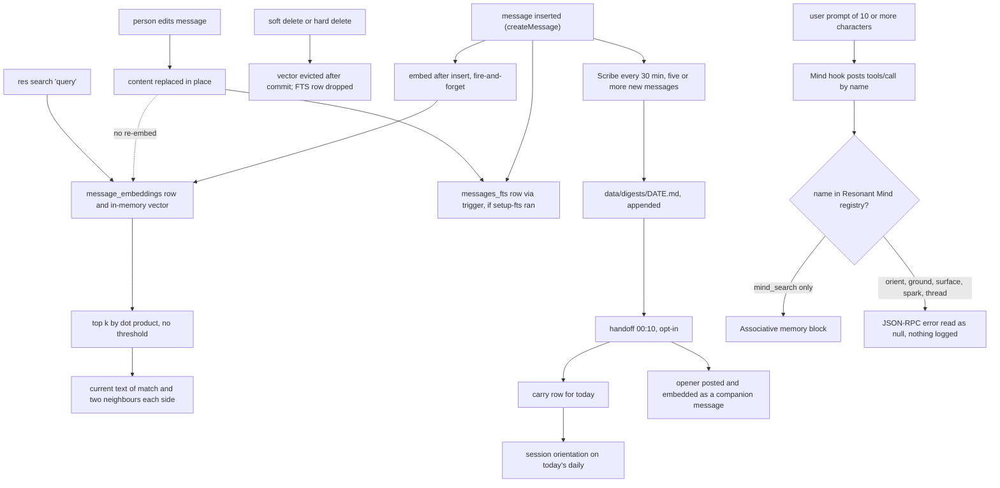

## 1. Executive Summary

Resonant is a self-hosted, single-user companion built on the Claude Agent
SDK, and its memory is its own conversation archive. Every message lands in
one SQLite file with a local MiniLM embedding beside it, and the model finds
old conversations by meaning through a Bash CLI it is shown at session start.
A Haiku pass digests the day every 30 minutes, and an opt-in Sonnet pass turns
the previous day into a carry paragraph for the next. What is notable is that recall
needs no service: embedding and search run in-process over a vector array
loaded at boot, and every delete path evicts the vector after its transaction
commits. What is weak is correction, and the seam with its own memory
provider. An edited message keeps the embedding of its old text, and the hooks
that call Resonant Mind name tools that store does not register.

Resonant and [Resonant Mind](../resonant-mind/) come from the same
organisation, and Resonant neither embeds, vendors nor reimplements the Mind's
store. It is an optional client. A URL in `integrations.mind_cloud.mcp_url`,
or the first `.mcp.json` server whose name contains `mind`, receives JSON-RPC
`tools/call` posts from two hooks (`packages/backend/src/services/hooks.ts:156-218`).
The settings card puts the boundary in its own words: Resonant "is the window,
never the container" (`packages/frontend/src/components/settings/MindSection.tsx:137-139`).
Without a Mind every mechanism below works unchanged. With one, the Mind's
observations are injected beside the archive and nothing reconciles the two.

The client and the server have drifted. At the Resonant Mind commit the atlas
pins, `9a08410`, and at its head of 4 October 2026, `dbee319`, the registry
holds `mind_search` and holds `ritual_orient` and `ritual_ground` "renamed
from mind_orient / mind_ground" (`src/mcp/registry.ts:77-82` there). The
session prefetch calls `mind_orient` and `mind_ground`, and the per-prompt
hook calls `mind_surface`, `mind_spark` and `mind_thread` beside `mind_search`
(`hooks.ts:248-258`, `:1846-1851`). Each unknown name is a JSON-RPC error that
`callMindTool` turns into `null` without a log line. The calls also send only a
`Content-Type` header, while the Mind accepts a Bearer or Basic key or a secret
connector path, so only a URL carrying that path is authorised at all.

Resonant is Apache-2.0 with a NOTICE crediting Codependent AI. The Mind it is
built to call carries a non-commercial source-available licence, so the pair as
documented is not uniformly permissive. The repository moved from
`codependentai/resonant` to `nekyialabs/resonant` at `f09255e`; the README's
release badge names the old address.

## 2. Mental Model

The memory is the transcript. A message is never a belief, a candidate or a
fact: it is what someone said in a thread, stored the moment it was said, and
everything else in the store is derived from it or written beside it. Writing
is automatic, retrieval is the agent's choice through `res search`, and
injection is the application's, through an orientation block the runtime
prepends.

A message moves through four states. It is **live** from insert. A person may
**edit** it through the UI, which replaces `content` and copies the first
original into `original_content` with `COALESCE`, so a second edit loses the
first replacement (`packages/backend/src/services/db.ts:902-909`). A **soft
delete** sets `deleted_at` and leaves the text in the row, and every read path
filters on it. A **hard delete** removes the row, by regenerate, which deletes
the stale companion turn and everything after it, or by deleting the thread.

Five derived layers sit around the archive, and none of them follows a message
through those states:

- the **embedding**, computed once after insert and never recomputed;
- **digest blocks**, Markdown written by a Haiku "Scribe" and appended to a
  dated file, never revised;
- the **carry**, one key-value row holding a paragraph and the date it is
  valid for, overwritten each night;
- **presence and context slots** (`context.companion.*`, `context.card.*`),
  overwritten in place by the agent or the user;
- **`companion_actions`**, an append-only diary of what the agent did, never
  pruned.

Correction belongs to the user. The edit and delete routes sit behind the
session-cookie middleware (`packages/backend/src/routes/api.ts:1323`,
`:2048-2090`), and the agent's CLI has no verb that edits or deletes a message.
The agent runs with `permissionMode: 'bypassPermissions'` and `Bash`, though
(`packages/backend/src/services/agent.ts:642-643`), and the write gate guards
only the `Write` and `Edit` tools, so the database file is within its reach.



## 3. Architecture

Resonant is one Node.js process: an Express server with a WebSocket hub, a
React frontend built with Vite, and a shared types package. The agent is the
Claude Agent SDK's in-process `query()` loop with `claude-sonnet-4-6` as the
default model, 30 turns at most, and session resume through
`threads.current_session_id` (`agent.ts:638-674`). Everything durable is in
`data/`: `resonant.db` under better-sqlite3, uploaded files, and the digest
directory.

Embeddings come from `sentence-transformers/all-MiniLM-L6-v2` through
`@huggingface/transformers`, mean-pooled and normalised to 384 dimensions,
loaded lazily on first use with `revision: 'main'`
(`packages/backend/src/services/embeddings.ts:6-38`). `loadVectorCache` reads
every live embedding into one `Float32Array` at boot (`server.ts:63`,
`vector-cache.ts:51-86`), and search never touches SQLite for vectors. The
cache grows geometrically by a factor of 1.5 and removes by swap
(`vector-cache.ts:35-48`, `:118-131`). Full-text search is an FTS5 table that
`scripts/setup-fts.mjs` creates once, with insert, update and delete triggers
on `messages`; without it, keyword search falls back to `LIKE`
(`db.ts:1050-1170`).

Background work runs inside the same process. The orchestrator starts the
Scribe on a 30-minute interval (`packages/backend/src/services/orchestrator.ts:610-621`),
the handoff runs on a croner schedule at `10 0 * * *` in the configured
timezone (`packages/backend/src/services/handoff.ts:65`, `:548-561`), and an
embedding backfill loop runs when the agent starts it through
`res backfill start`. Loopback routes under `/api/internal/*` serve the CLI,
guarded by a token file beside the database (`tools/res.mjs:33-47`).

### Deployment and ergonomics

- **What has to be running:** Node 20 to 24 and the single process. No
  database server, no vector service, no queue.
- **Credentials:** a Claude Code login or an Anthropic API key for the agent,
  the Scribe and the handoff. Storing and embedding a message need neither.
- **Offline:** search and storage run locally once the MiniLM weights are
  cached. The first embedding downloads them from Hugging Face at a floating
  `main` revision.
- **First run:** `npm install`, copy `resonant.example.yaml` and `.env.example`,
  set `APP_PASSWORD` (the server refuses to serve without one), `npm run build`,
  `npm start`. Keyword search needs `node scripts/setup-fts.mjs` once.
- **Repair by hand:** plain SQLite and Markdown. Backups are the `data/`
  directory with its WAL sidecars plus four gitignored config files.

## 4. Essential Implementation Paths

**Capture.** Messages enter from the WebSocket handler (`ws.ts:611`), the
agent's reply (`agent.ts:1162`), Discord and Telegram (`discord/index.ts:264`,
`telegram/index.ts:392`), autonomous wakes (`orchestrator.ts:1077`) and the
handoff opener (`handoff.ts:451`). All go through `createMessage`, which takes
`MAX(sequence)+1` for the thread, inserts, and for a non-system text message
over 10 characters calls `embedMessageAsync` without awaiting it
(`db.ts:773-824`). `saveEmbedding` upserts the blob and updates the cache only
if the message is live (`db.ts:1176-1202`).

**Extraction.** `runDigest` reads the daily thread's text messages after a
`(digest.last_thread_id, digest.last_sequence)` bookmark, skips below five,
sends them to `claude-haiku-4-5` with no tools and `persistSession: false`, and
appends the reply to `data/digests/<date>.md` (`packages/backend/src/services/digest.ts:93-127`,
`:182-274`). The prompt asks for topics, quotes, decisions, open items, ideas,
dates, projects and an emotional arc. `runHandoff` reads the previous day's daily and
its digest, asks `claude-sonnet-4-6` for an `opener` and a `carry` as one JSON
object, stores the carry under `handoff_carry` with today's date, and posts the
opener into today's daily (`handoff.ts:130-176`, `:395-470`).

**Retrieval.** `res search "query"` posts to `/api/internal/search-semantic`
(`tools/res.mjs:304-319`). The route embeds the query, calls `searchVectors`
with up to 50 results, then for each hit reads two messages either side with
`getMessageContext` and looks up the SDK session it fell in
(`api.ts:1147-1213`). `searchVectors` applies the optional filters in the loop
and keeps a sorted top k (`vector-cache.ts:150-191`). The UI's `/api/search`
calls `searchMessages`, FTS5 first and `LIKE` on any failure (`db.ts:1113-1170`).

**Context assembly.** On a session's first message `agent.ts` prepends
`buildOrientationContext(ctx, 'session')` and `prefetchMindContext()` inside a
`[Context]` block; every later turn gets the `'turn'` form, one `[env]` line
(`agent.ts:707-736`). The session form carries the House Outlook digest, the
carry, the delta since the thread's last turn, recent companion actions, life
status, skills, the CLI reference, the context card, the companion's presence
and recent reactions, each under a named cap (`hooks.ts:1313-1707`).
`UserPromptSubmit` adds the Mind block per prompt (`hooks.ts:1812-1880`).

**Update, delete, forget.** `PATCH /api/messages/:id` calls `editMessage`
(`api.ts:2048-2071`). `DELETE /api/messages/:id` calls `softDeleteMessage`,
which evicts the cached vector and keeps the embedding row
(`api.ts:2074-2090`, `db.ts:911-919`). Regenerate calls `deleteMessagesFrom`,
and thread deletion calls `deleteThread`, which deletes triggers, timers,
canvases, outbound rows, audit rows, session history, embeddings and messages
in one transaction and evicts afterwards (`db.ts:605-646`, `:947-973`).

**Schema.** `packages/backend/migrations/001_init.sql` holds threads, messages,
session history, the tool audit log, config and canvases; `db.ts:24-319` adds
sections, `message_embeddings`, `companion_actions`, auth preferences and the
usage log as idempotent migrations.

**Tests.** Section 10.

## 5. Memory Data Model

`messages` carries `thread_id`, a per-thread `sequence` with a unique index,
`role` in `companion | user | system`, `content`, `content_type`, `platform`,
JSON `metadata`, `reply_to_id`, `edited_at`, `deleted_at`, `original_content`
and three delivery stamps (`001_init.sql:17-38`). `message_embeddings` is keyed
by `message_id` with a foreign key, so a hard delete must remove the vector
first, which both delete paths do (`db.ts:226-233`). Daily thread ids are
`daily-YYYY-MM-DD` in the configured timezone.

The other stores are thin. `config` is a key-value table holding the carry,
the digest bookmark, presence slots, the context card, tone snapshots
(`session.tone.<thread>`), per-thread last-turn stamps and every Mind cache key.
`companion_actions` holds `kind`, `summary` and `created_at`
(`db.ts:309-316`). Digests are files, outside the database and outside every
delete path.

Time is the write clock throughout. `created_at` is insert time and
`edited_at` overwrites; nothing records when something said was true. There is
no scope key on any row: the only partition is the thread, and nothing on the
read path requires one.

Command Center tables (`002_command_center.sql`) hold care entries, tasks,
cycles, pets, lists, expenses and `scratchpad_notes` that the agent writes
through `cc_*` MCP tools (`packages/backend/src/routes/cc-mcp.ts:22-140`). Their
status line reaches orientation through `fetchLifeStatus` (`hooks.ts:271-290`).
They are a planner the agent maintains, not a store it recalls from.

## 6. Retrieval Mechanics

Recall is tool-mediated and purely semantic. The model is told in its session
orientation that `res search "semantic query"` searches all threads by meaning
and that `--thread`, `--role`, `--after` and `--before` narrow it
(`hooks.ts:1558-1562`). There is no query rewriting, no lexical arm on the
agent's path, no reranking and no similarity floor: `searchVectors` returns the
top k by dot product whatever the scores (`vector-cache.ts:160-189`). The
response reports similarity to three decimals, so the model can judge a weak
match only by reading the number.

The thread filter never arrives. The CLI builds its body key by stripping the
dashes from the flag, so `--thread` becomes `thread`
(`tools/res.mjs:309-315`); the route reads `threadId` (`api.ts:1150`). A
thread-scoped search returns hits from every thread with no error, while
`--role`, `--after` and `--before` match their keys and work.

Each hit comes back with its current text and two live messages either side,
cut at 500 characters (`api.ts:1167-1201`). The neighbours carry no role filter.
A non-owner Discord message is stored as `role: 'system'` and never embedded
(`discord/index.ts:262-277`, `db.ts:811-813`), but the companion's embedded
reply beside it is, so a stranger's words reach the owner's recall as context
around a match.

Automatic injection is bounded and placed after the system prompt. The
session block is prepended to the user's first message, and every later turn
adds one `[env]` line, so the system prompt and `CLAUDE.md` identity stay
unchanged between turns (`agent.ts:631-636`, `:734-736`). Section caps run from
400 to 1,200 characters and trim at a line boundary with a marker
(`hooks.ts:232-240`). The Mind block adds up to about 1,550 characters per
prompt, cached for ten seconds on an identical prompt (`hooks.ts:261-262`,
`:1859-1862`).

The `/mind` room and the observatory read Mind caches that nothing in this tree
writes. `mind.weather.latest`, `mind.night.latest` and `mind.surface.latest`
are read by two routes and the `[env]` line (`api.ts:956-1015`,
`hooks.ts:1346`). The frontend store names a proxy at
`backend/src/routes/mind-observatory.ts` as landed, and that file is not in the
tree. Both degrade to empty by design.

## 7. Write Mechanics

Every message is a write. Insert is synchronous and the embedding is not: the
message is visible and keyword-searchable at once, and semantically searchable
50 to 200 milliseconds later by the code's own estimate (`db.ts:750-768`). A
failed embed is counted and logged at the first and every 25th failure, and the
backfill reads messages with no embedding row through a `LEFT JOIN`, so a lost
embed is recoverable (`db.ts:811-822`, `:1226-1243`).

Edits are where the derived layers fall behind. `editMessage` updates `content`
and the FTS trigger replaces the indexed text, but no path recomputes the
vector (`db.ts:902-909`, `scripts/setup-fts.mjs:62-67`). `saveEmbedding` has
two callers, the insert path and the backfill, and the backfill selects only
messages without a vector. An edited message is therefore found by the meaning
of what it used to say, and returned with what it says after the edit.

The Scribe's daily rollover repeats itself. When the bookmark's thread differs
from today's, `runDigest` flushes the old thread's tail into the previous day's file,
then resets its local sequence and reads today's messages
(`digest.ts:202-213`). If today has fewer than five, it returns before writing
the bookmark (`digest.ts:215-218`, `:267-268`). The next tick, 30 minutes on,
sees the old thread id again and flushes the same tail again, with another
Haiku call and another appended block, until today reaches five messages.
The fix it ships in, `006bf3a`, made the bookmark thread-aware and added the
flush.

Model-written text enters as ordinary text. The handoff opener is a companion
message with `metadata.source: 'handoff'`, embedded like any other
(`handoff.ts:448-466`); search results carry no metadata, so recall cannot tell
it from something the companion said. The handoff prompt forbids inventing
moods or events and asks for less when the day was thin (`handoff.ts:180-215`),
which is a request to the model, not a check.

### Operational cost

- **Blocking:** no LLM call sits on the turn's write path. The Scribe and
  handoff run on timers and skip while the interactive agent is busy.
- **Lag:** a message is semantically retrievable within a fraction of a second;
  a digest block appears within 30 minutes once five messages accumulate.
- **Whole-store passes:** none. The Scribe reads only the messages after its
  bookmark and the handoff reads one day.
- **Read path:** the session block is bounded by its section caps; the per-turn
  cost is one line plus up to about 1,550 characters of Mind text when a Mind
  answers. A search scans every vector in memory: 384 multiply-adds per message.

## 8. Agent Integration

The agent's memory affordances are a Bash CLI, not tools. `tools/res.mjs` wraps
loopback HTTP calls and reads the live thread id from `.resonant-thread` in the
agent's working directory, which `agent.ts` writes per turn
(`tools/res.mjs:49-79`, `agent.ts:694-699`). The command list is printed once
per session inside the orientation block (`hooks.ts:1548-1613`). `search` and
`backfill` touch the archive; `orb`, `note`, `face` and `context` write
presence slots; `routine`, `timer`, `impulse` and `watch` write the
orchestrator's tables.

MCP servers listed in `.mcp.json` are passed to the SDK with their headers and
`strictMcpConfig: true` (`agent.ts:84-98`, `:664-668`). So the agent can hold
Resonant Mind's full tool surface directly, authenticated, while the hooks
reach the same server by URL alone: the `.mcp.json` fallback in
`getMindMcpUrl` keeps `.url` and drops `.headers` (`hooks.ts:168-180`). A
`PostToolUse` hook appends thread id, mode and time as context after any
`mind_write` or `memory_write` call (`hooks.ts:1048-1058`).

Three Mind switches exist and the hooks read none of them. The Preferences
toggle `integrations.mind_cloud.enabled` is read and written only by the
preferences route (`api.ts:1392-1394`, `:1484-1487`). The Settings card stores
`mind.enabled`, `mind.url` and `mind.api_key` in the config table, and the
backend reads `mind.enabled` only to gate the cache readers, and never reads
`mind.url` or `mind.api_key` (`api.ts:3126`). The hooks run whenever a URL
resolves. The `.mcp.json` fallback matches any server name containing `mind`
(`hooks.ts:175`), and from then on each user prompt of ten characters or more is
posted to it.

Compaction is mostly avoided rather than handled: the interactive loop resumes
one SDK session per thread, and session-mode context is injected once. When
compaction does fire, `PreCompact` adds a system message with the channel, the
thread and a keyword-derived emotional arc, plus the last persisted tone
snapshot (`hooks.ts:1103-1150`, `:754-778`). `SessionStart` and `SessionEnd`
hooks exist and are registered behind a constant `false`, because the V1 loop
never fires them (`hooks.ts:1893-1915`).

## 9. Reliability, Safety, and Trust

**Provenance.** A message knows its thread, role, platform and, for Discord,
the sender's ids in metadata. Digest blocks and the carry know only their date;
neither records which messages it was written from. The handoff reads the
digest under the heading "pre-summarized — lean on this" (`handoff.ts:228`), so
an error in a Scribe block is carried into the next day's context.

**Deletion.** A soft delete removes a message from search immediately, and the
text stays in the row, in `original_content` if edited, in any digest already
written and in the carry. A thread delete hard-deletes rows and vectors and
leaves the digest files, the carry and any Mind observations untouched; no
path in `digest.ts` or `handoff.ts` removes a file. Forgetting stops at the
SQLite boundary.

**Injection.** Everything the agent searches is conversation, some of it from
Discord and Telegram users other than the owner. Their messages are excluded
from embedding by role and included as neighbours, and nothing marks them as
another speaker's words in the search output beyond `role: 'system'`.

**Concurrency.** better-sqlite3 is synchronous, so writes serialise in the one
process. Sequence numbers come from `MAX(sequence)+1` with a unique index, safe
in one process and racy across two. The cache mirrors the table by evicting
after each delete commits, and `saveEmbedding` refuses to cache a soft-deleted
message (`db.ts:1186-1201`).

**Access.** The server refuses to serve without a password, the CLI's routes
need a loopback token, and Discord non-owner batches are deferred while the
owner is active. The agent itself runs with permissions bypassed: a regex list
blocks a handful of destructive shell patterns (`hooks.ts:61-73`), `DELETE FROM`
is not among them, and the file write gate covers only the `Write` and `Edit`
tools (`hooks.ts:898-1001`).

**Uncertainty.** None is represented. A digest's emotional arc, a carry
paragraph and a verbatim quote enter context with the same standing.

## 10. Tests, Evals, and Benchmarks

I read the suite and ran nothing. Vitest runs on Ubuntu and Windows in CI
after a build and typecheck (`.github/workflows/ci.yml`). The 103 cases cover
trigger conditions (32), thread, message, reaction, canvas, timer and config
CRUD (30), destructive-shell patterns, emotional markers and write prefixes
(26), cron and wake-prompt parsing (9), identity rendering (2) and a frontend
attachment helper (4).

No case reaches retrieval. `db.test.ts` mocks both `embeddings.js` and
`vector-cache.js`, and creates messages with the content `'short'` so the embed
path never fires (`packages/backend/src/services/db.test.ts:3-13`, `:65-75`).
The embedding case writes a vector twice and asserts nothing, ending on the
comment "Should not throw" (`db.test.ts:393-406`). The thread-delete case
asserts the thread, messages and canvas are gone, with no embedding to check.
Digest, handoff, FTS, search and the Mind hooks have no test; `runDigest`
appears in the suite only as a mock (`orchestrator.test.ts:17`).

Tests I would want first:

- an edited message must not be returned for its old meaning;
- a `--thread` search must return no hit from another thread, beside a hit
  from the named one;
- a soft-deleted message must leave both search paths, with a live control
  present;
- the rollover must append the previous day's tail once across two ticks;
- each Mind tool name must exist in the registry of the Mind version the docs
  name.

No paper or benchmark is committed; the search is in the appendix.

## 11. For Your Own Build

### Steal

- **Keep the whole vector set in one contiguous array** for a single-user
  store of tens of thousands of messages. A dot-product loop over 384-dimension
  vectors needs no index, no service and no warm-up beyond one boot read.
- **Evict from the cache after the commit, not before.** If the transaction
  throws, the cache matches the unchanged table; a restart and a live process
  then agree on what is searchable.
- **Make the backfill select by absence.** A `LEFT JOIN ... IS NULL` over
  messages and vectors turns every lost fire-and-forget embed into deferred
  work instead of a silent hole.
- **Inject the rich context once per session and a single line per turn.** The
  system prompt stays fixed and mutable state is not restated into every turn.

### Avoid

- **Deriving a vector at insert and never again.** Any edit path needs a
  re-embed, or the vector must be keyed on a content hash so a stale one is
  detectable.
- **A cursor advanced only on the main path.** A flush that runs before a
  guard which can return early must advance the cursor itself, or it repeats
  on every tick.
- **Calling a provider by hard-coded tool names with no handshake.** A
  `tools/list` at startup, checked against the names the hooks need, turns a
  rename upstream into one warning instead of permanent silence.
- **Building a CLI body from flag names.** A key derived by string surgery
  diverges from the route's key without an error; name the wire field once.

### Fit

Resonant suits one person who wants a companion that remembers conversations
on their own machine and who will read what it writes about them. The archive
is honest, local and cheap, and that alone covers most of what such a person
means by memory. It does not suit anyone who needs a correction to hold:
edits leave the old meaning searchable, deletes leave digests and the carry,
and no state says a remembered thing turned out false. Anyone planning to
pair it with Resonant Mind should expect to repair the hook names, or to rely
on the agent calling the Mind's tools itself.

## 12. Open Questions

- Which Mind server the hook names were written against; the code calls it "the
  reference app", and no such server is in this tree or in Resonant Mind at
  either pin read.
- Whether the "10-min sync" that the Settings card says fills the Mind caches
  exists in a deployment and was left out of the open-source cut.
- How large real archives get, and where the full scan and the boot-time load
  of every vector stop being acceptable.
- Whether users in practice run `setup-fts.mjs`; without it, edits and deletes
  are honoured by a `LIKE` query alone.

## Appendix: File Index

- **Storage and schema:** `packages/backend/migrations/001_init.sql`,
  `packages/backend/migrations/002_command_center.sql`,
  `packages/backend/src/services/db.ts`, `scripts/setup-fts.mjs`.
- **Write path:** `packages/backend/src/services/db.ts` (`createMessage`,
  `embedMessageAsync`, `saveEmbedding`), `packages/backend/src/services/embeddings.ts`,
  `packages/backend/src/services/ws.ts`, `packages/backend/src/services/agent.ts`.
- **Extraction:** `packages/backend/src/services/digest.ts`,
  `packages/backend/src/services/handoff.ts`.
- **Retrieval:** `tools/res.mjs`, `packages/backend/src/routes/api.ts`
  (`/internal/search-semantic`, `/search`), `packages/backend/src/services/vector-cache.ts`.
- **Context assembly:** `packages/backend/src/services/hooks.ts`
  (`buildOrientationContext`, `buildUserPromptSubmit`, `prefetchMindContext`,
  `buildPreCompact`), `packages/backend/src/services/agent.ts`.
- **Background:** `packages/backend/src/services/orchestrator.ts`.
- **Mind client and UI:** `packages/backend/src/services/hooks.ts:144-258`,
  `packages/frontend/src/components/settings/MindSection.tsx`,
  `packages/frontend/src/store/observatory.ts`.
- **Tests:** `packages/backend/src/services/*.test.ts`,
  `packages/backend/src/identity/identity.test.ts`,
  `packages/frontend/src/components/Composer.test.ts`, `.github/workflows/ci.yml`.

### Recorded searches

Run from the clone root at the pin unless a URL is given.

```sh
# Every writer of an embedding: the insert path and the two backfill loops, no edit path
git grep -nE "saveEmbedding\(|embedMessageAsync\(" -- packages/backend/src ':!*.test.ts'

# The CLI's search body keys versus the route's destructured keys
git grep -nE "flags = \['--thread'|replace\('--', ''\)" -- tools/res.mjs
git grep -nE "const \{ query, threadId, role, after, before" -- packages/backend/src/routes/api.ts

# No writer of the Mind cache keys the /mind room and [env] line read (empty)
git grep -nE "setConfig\(['\"\`]mind\." -- .

# mind.api_key and mind.url have no backend reader beyond redaction
git grep -nE "mind\.api_key|mind_api_key|mind\.url" -- packages/backend

# The hooks never read mind_cloud.enabled (empty)
git grep -nE "mind_cloud\??\.enabled" -- packages/backend/src/services

# The Mind client sends no Authorization header (only Content-Type lines)
git grep -nE "Authorization|headers" -- packages/backend/src/services/hooks.ts

# The observatory proxy the frontend store names is absent from the backend
git ls-files | /usr/bin/grep -iE "observatory"

# No test reaches search, digest, handoff, edit or soft delete (one mock line)
git grep -nE "searchVectors|searchMessages|search-semantic|runDigest|runHandoff|getCarryFor|editMessage|softDeleteMessage" -- '*.test.ts'

# Neither digest.ts nor handoff.ts removes a file (empty)
git grep -nE "unlinkSync|rmSync|unlink\(" -- packages/backend/src/services/digest.ts packages/backend/src/services/handoff.ts

# Resonant does not vendor or depend on Resonant Mind (two UI hint strings only; 0 in the lockfile)
git grep -niE "resonant-mind|resonant_mind" -- . ':!package-lock.json'
/usr/bin/grep -c resonant-mind package-lock.json

# No paper or citation (empty)
git grep -niE "arxiv|bibtex|@article|doi\.org|CITATION" -- . ':!package-lock.json'

# Resonant Mind's registry at the atlas pin and at its 4 October 2026 head
curl -sf https://raw.githubusercontent.com/nekyialabs/resonant-mind/9a08410b538f9dc56119ee34e8de044aef867e51/src/mcp/registry.ts | /usr/bin/grep -nE '^\s+(mind_|ritual_)[a-z_]+:'
curl -sf https://raw.githubusercontent.com/nekyialabs/resonant-mind/dbee319d2291450c61c6c484d1ec22a8e87338a3/src/mcp/registry.ts | /usr/bin/grep -nE '^\s+(mind_|ritual_)[a-z_]+:'
curl -sf https://raw.githubusercontent.com/nekyialabs/resonant-mind/9a08410b538f9dc56119ee34e8de044aef867e51/src/mcp/protocol.ts | /usr/bin/grep -nE 'Unknown tool'
curl -sf https://raw.githubusercontent.com/nekyialabs/resonant-mind/9a08410b538f9dc56119ee34e8de044aef867e51/src/http/auth.ts | /usr/bin/grep -nE 'Bearer|Basic|MCP_CONNECTOR_SECRET'
```

## History

**2026-10-15** — [`4f59e10796eff2dfe0fdbbc18573c944c5bf03e8`](https://github.com/nekyialabs/resonant/commit/4f59e10796eff2dfe0fdbbc18573c944c5bf03e8) —
first reading, at the head of `main`, the merge of 11 October 2026. Screened
from a full clone before reading: no auto-run surface, no build-time execution
point, nothing inside the cooldown, and three workspace manifests without a
lockfile beside them against the root `package-lock.json`, unchanged for 98
days; no agent-instruction files. Resonant Mind's registry, protocol and auth
files were fetched at `9a08410` and `dbee319` to check the client against the
server. Nothing was installed, built or run. No marks.
