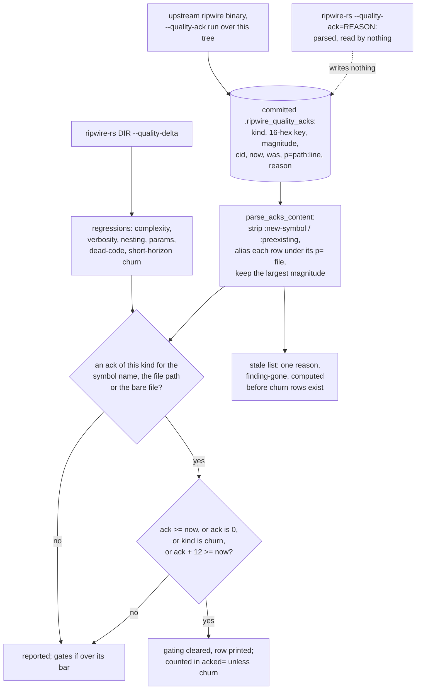

## 1. Executive Summary

ripwire-rs is an independent Rust port of [ripwire](../ripwire/), a
code-context engine and pre-commit quality gate for coding agents, and the
memory it carries is the original's: a committed ledger of accepted quality
findings and a field-notes file. It reads the original's ledger format, which
makes its suppression rule comparable line by line with the contract it ports.
The comparison is the finding. The port's test accepts more than the
original's, matches on files rather than symbols, and the binary writes no ack
and surfaces no note.

The licence is Apache-2.0, and the `NOTICE` names the project an independent
port and rewrite of redhat-et/ripwire by a different author, carrying derived
documentation and agent skills. As with the original, the call graph, ranking
and lenses are a code index and out of scope. This report reads only the
port's handling of `.ripwire_quality_acks` and `.ripwire_notes`, against the
[ripwire report](../ripwire/) pinned at `e54b688`.

**The original's ratchet is one comparison; the port's is four.** The original
suppresses a finding only while `r.now <= ackNow`, on a kind token qualified by
origin so that a zero magnitude cannot become *"a permanent blank check"*
(`src/quality.h:4815-4817`, `:5127-5170`, `:6021-6024` at `e54b688`). The port's
test is this (`src/gate/quality_delta.rs:38-43`):

```rust
let check_val = |ack_val: u32| -> bool {
    ack_val >= now_val
        || ack_val == 0
        || kind == "short-horizon-churn"
        || ack_val.saturating_add(12) >= now_val
};
```

The first clause is the original's. The second is the case the original's guard
exists to prevent. The third accepts short-horizon churn at any count, and the
fourth accepts any finding up to twelve points worse than the acked magnitude,
which subsumes the first. The parser also strips the `:new-symbol` and
`:preexisting` suffix the original added to keep zero-magnitude acks apart
(`:71`), so an ack on a never-gating new-symbol row matches a gating
preexisting finding of the same kind.

**The match is on the file a row names, not on the symbol.** Nothing in the
port computes the original's 16-hex key, an FNV-1a hash over path, scope and
name. The parser aliases each row under its `p=` path, with and without the
line (`:76-83`), and `apply_quality_acks` looks a regression up by symbol name,
file path and bare file (`:309-313`). One accepted complexity finding therefore
covers every function in that file, up to the highest magnitude acked there plus
twelve. In the original, `p=` is a locator and *"the hash key is still the only
identity"* (`src/quality.h:6438-6439` at upstream `d4325a8`).

**The ledger is the original's output.** The port declares `--quality-ack` and
`--ack-only` (`src/cli/args.rs:219-224`), and nothing reads either field. The
committed file's three header lines are byte-identical to the writer in
redhat-et/ripwire v0.6.5 (`src/quality.h:6739-6741` at `3fcd515`), the release
the port's CI installs. The file was first committed on 10 October 2026, before
the port had a quality delta to read it. Its rows cite the port's own Rust
paths, so they come from a run of the C++ binary over this tree, a command no
script here records.

**Notes are a raw append and a raw listing.** `--note-add` appends its argument
as one line to `.ripwire_notes` in the process's working directory rather than
the analysed root, with no target, date, sanitising or lock. `--notes` prints
each line as a `text=` attribute, escaping only the double quote
(`src/cli/queries.rs:166-184`). The original's note is a target, a date and a
text, resolved through the read verbs' resolver, surfaced beside its symbol and
listed with a dangling flag. None of that is implemented, and no `.ripwire_notes`
is committed.

**No mark.** The original's `negative_eval` rests on a dangling note asserted
absent from two populated retrievals, and on an ack that must not survive a
rewrite. The port's one ack test asserts a suppression at a magnitude below the
ack (`src/gate/quality_delta.rs:714-741`) and passes under every clause above.
No case asserts that a worsened finding re-reports.

**Two memory-adjacent verbs print fixed text.** `--doctor` writes `checks="9"
passed="9"`, and `--handoff` writes a packet naming branch `main`, zero changed
files and `src/main.rs`, as literals on their only code path
(`src/cli/queries.rs:186-198`). The shipped handoff skill describes that packet
as verified disk truth carrying committed notes on the touched files. The
parity harness behind the *"1:1 DOM parity"* commit subjects compares root tags,
schema attributes and attribute-name sets, and checks values for only two
commands, neither of them these (`scripts/validate-parity.py:246-291`), so a
literal passes it.

## 2. Mental Model

A memory here is the same two things as in the original, with less attached to
each.

An **ack**, as the port reads it, is a floor on a kind and a file. Its row was
written by another program, and the port keeps three of its fields: the kind
with its origin suffix removed, the magnitude, and the `p=` path. Several rows
for one kind and file collapse to the largest magnitude (`:55-59`). A finding
of that kind anywhere in that file is accepted while it stays within twelve
points of that magnitude, and at any size when the magnitude is zero or the
kind is churn.

A **note** is a line of text. With no target it cannot ride along with a
symbol, with no date it cannot be ordered or aged, and with no status it cannot
be marked wrong.

Neither has a state to move between. A row stops applying when somebody deletes
it by hand, which is what commit `f233e5a` did to three rows, and the port's only
act on either store is to append a note.



## 3. Architecture

A single Rust binary. `build.rs` compiles tree-sitter grammars from a vendored
directory, `gix` reads git history in-process, and `ripwire-rs mcp` serves the
tools over stdio. Everything this report covers is in
`src/gate/quality_delta.rs` and `src/cli/queries.rs`, with the flags in
`src/cli/args.rs`, the MCP wiring in `src/mcp/dispatch.rs` and
`src/mcp/retrieval.rs`, and the skills under `skills/`, which `build.rs` embeds
into the binary (`build.rs:121-149`).

### Deployment and ergonomics

- **What has to run:** the binary.
- **Fully local and offline:** yes; no model is called anywhere on the memory
  path.
- **Hand-repairable:** both stores are plain text, and the ledger is committed,
  so a bad row is a revert away.
- **Install:** a Homebrew tap, `cargo install`, or `make install`. `cargo build`
  also copies the man page into `~/.local/share/man/man1` and
  `/opt/homebrew/share/man/man1` as a side effect (`build.rs:63-75`).

## 4. Essential Implementation Paths

- **Read the ledger.** `evaluate_quality_delta` joins the analysed root with
  `.ripwire_quality_acks` and parses it when present
  (`src/gate/quality_delta.rs:613-620`). `parse_acks_content` (`:61-93`) keeps
  lines starting `ack` with at least four tokens, cuts the kind at its first
  `:`, parses the magnitude with a fallback of 0 on a malformed value, which
  the zero clause then honours at any size, and registers the row under its key, its `p=` path and its `p=` path with the
  line.
- **Apply it.** `apply_quality_acks` (`:306-321`) asks `is_acknowledged` three
  times per regression and clears `is_gating` on a hit; it counts only rows
  that were gating. `is_acknowledged` (`:37-52`) falls back to the key's last
  `::` segment when the full key misses.
- **Apply it again for churn.** Churn regressions are computed after the first
  pass, so `evaluate_quality_delta` re-applies the ledger to them and discards
  the count (`:628-633`).
- **List stale rows.** `collect_stale_acks` (`:323-348`) marks a row stale
  when no regression of its kind matches its key or a prefix of its path, with
  the single reason `finding-gone` and a fallback path of `src/lib.rs:1` for a
  row with none. It runs inside `compute_quality_delta_with_acks` (`:384-389`),
  before the churn regressions exist.
- **Render the header.** The report header prints `renames`,
  `rename_window_commits`, `acked_by_rename` and `acked_by_content` as the
  literal `0` (`:130`); the original computes them from its identity heal.
- **Add and list notes.** `execute_note_append` and `execute_notes_display`
  (`src/cli/queries.rs:166-184`), reached only from
  `execute_session_tools_query` (`:186-208`), which receives no root.
- **Recall.** `call_memory_recall` (`src/mcp/retrieval.rs:336-381`) scores
  ingested files whose path ends `.md` or contains `doc` or `notes`.

## 5. Memory Data Model

An **ack row** as committed: `ack <kind> <16-hex key> <magnitude>` followed by
named tokens and a reason to end of line. The ledger holds 542 rows. Every row
carries `p=` and 470 carry `cid=`; none carries `by=` or `prov=`. Short-horizon churn accounts for 272 rows across 51 files, dead-code for
96, duplication for 66, verbosity for 52, params for 30 and complexity for 23.
Magnitude 0 appears on 96 rows. The rows name 67 distinct paths, and 49 rows
name three that do not exist at the pin: `src/cli.rs`, `src/ingest.rs` and
`src/resolve.rs`.

The port's delta produces no duplication or clone kind, so the 67 rows of those
kinds can only reach the stale list. The port reads nothing from `cid`, `now` or `was`.

A **note**: one line, stored as typed.

**Temporal:** none. A note has no date, and an ack's magnitude is the only
number the port reads from it. `bitemporal` withheld.

**Trust:** none. `StaleAck` carries one reason against the original's three —
target gone, finding gone, foreign scope (`src/quality.h:6082-6089` at
`e54b688`) — and the port's reason is disclosure only. `trust_state` withheld.

**Scoping:** none. `by=` is not parsed, and `--scope` (`src/cli/args.rs:228-230`)
has no reader. `scope_enforced` withheld.

## 6. Retrieval Mechanics

Acks are consulted, not retrieved. Each regression is looked up under its kind
by three strings — the symbol's last name segment, the file path and the bare
file — and any hit at any of the four clauses clears its gating. The acked row
stays in the report with `gating="0"`, which a reader can see; the original
removes suppressed rows and discloses a count.

The `acked=` header counts rows whose gating was cleared in the first pass.
Churn suppression happens in the second pass, whose count is discarded, so a
churn finding the ledger hides is in no header total.

Notes are not retrieved by any verb but `--notes`. The original attaches a note
to the symbol or file it names whenever a map or expansion emits that target.

`memory_recall`, advertised as *"Most relevant memory notes / docs for a task,
full text"* (`src/mcp/schema.rs:226-227`), scores ingested Markdown and doc
paths by term presence and returns the first 20 lines of each. `.ripwire_notes`
has no extension, so the crawler classifies it `Lang::Unknown` and never ingests
it (`src/crawler.rs:84-95`). The original's verb of the same name misses its
notes store in the same way.

**Failure modes.** A file with one churn ack hides churn on every function in
it, at any count. A file with one zero-magnitude dead-code ack hides dead-code
findings there at any size. A row naming a moved file stops matching anything
and lands on the stale list, where it stays.

## 7. Write Mechanics

**Acks are not written by the port.** `--quality-ack[=REASON]`, `--ack-only`
and `--allow-dirty` are clap fields with no reader
(`src/cli/args.rs:219-227`). A command that passes them runs whatever else it
names and leaves the ledger untouched. The original's writer refuses a
reason-less ack without the delta, refuses an `--ack-only` selection outside
the scope under review, and publishes atomically under a lock; none of that has
a counterpart here.

**Notes are appended raw.** `execute_note_append` opens `.ripwire_notes` with
`create(true).append(true)` relative to the working directory and writes the
argument and a newline (`src/cli/queries.rs:177-184`). An argument containing a
newline becomes several notes. Pointing the tool at another repository reads
and writes the notes file in the caller's directory, the failure the original
fixed for its ledger by root-qualifying the path.

**The baseline is written carefully.** `write_baseline_file` writes a
temporary file, syncs it and renames it over `.ripwire_quality_baseline`
(`src/gate/baseline.rs:206-213`), which is the discipline neither memory file
gets.

### Operational cost

- One file read and a linear parse per quality delta; nothing blocks on a
  model.
- No lag: a row takes effect on the next run after it is in the file.
- Nothing runs in the background and nothing rewrites either store.

## 8. Agent Integration

The MCP `quality_delta` tool calls the same `evaluate_quality_delta`
(`src/mcp/dispatch.rs:253-254`), so an agent on MCP gets the ledger applied
and has no tool to change it. `memory_recall` is the only tool named for
memory, and it reads documentation.

The skills carry the original's instructions over a binary that does not
implement them. `ripwire-rs-quality-bar` tells the agent to record a trade-off
with `--quality-ack`, narrow it with `--ack-only`, scope it with `--scope` and
prune with `--show-stale` (`skills/ripwire-rs-quality-bar/SKILL.md:191-221`).
`ripwire-rs-orient` says notes *"surface on their own"* beside `--for` and
`--expand` output and are listed with `dangling="1"`
(`skills/ripwire-rs-orient/SKILL.md:196-203`). `ripwire-rs-handoff` describes
`--handoff` as carrying committed notes on the touched files
(`skills/ripwire-rs-handoff/SKILL.md:114-126`). An agent following the
quality-bar skill sees the finding it meant to accept keep gating, with
nothing on stdout or stderr saying why.

## 9. Reliability, Safety, and Trust

**Negative evaluation — withheld.** The one ack case seeds a nesting
regression from 2 to 7 and an ack at 10, and asserts gating drops to zero
(`src/gate/quality_delta.rs:714-741`). That is a positive case: 7 is below 10,
so the original's test passes it too, and so would a filter that suppressed
everything. The ack it uses matches through the `p=src/math.rs:1` alias, since
its 16-hex key names nothing the port produces. The notes test calls `--notes`
and discards the result (`tests/test_cli_and_mcp.rs:670-672`), and the
`memory_recall` test checks the tool is listed (`tests/test_mcp_33_tools.rs:34`).

**Human review — withheld.** Nothing waits for anyone. The port has no writer
for the ledger, a row takes effect when it is in the file, and the rows here
were produced by the upstream binary outside the port. The committed file makes
a change in what is suppressed visible in `git diff`, which is git's review and
not a surface in the tool.

**Tombstone — withheld,** for the original's reasons and one more: the port
does not compute the content-keyed half at all, and its effective key is a file.

**Audit log — withheld.** The notes file is opened in append mode, but it is the
store, not a record of mutations to one, and no verb edits or deletes a note.

**Format compatibility is the port's real asset.** Because the ledger's syntax
is shared, a team moving from the C++ binary keeps its record of accepted debt
and the reasons written for it. What the port does not keep is what those rows
meant: each was accepted at a magnitude for one symbol, and the port reads it
as a floor plus twelve for a file.

**The widening landed in three commits.** The zero-magnitude clause is in the
first ack reader (`2c9db2f`, 11 October 2026), the file-level lookup was added
in `d7b7dad` on 12 October, and the churn and twelve-point clauses arrived in
`a4e4ed8` on 13 October, whose subject reads *"achieve 1:1 DOM parity and
wall/CPU/RSS superiority across all 67 commands"*. That commit's body does not
mention the ack test.

## 10. Tests, Evals, and Benchmarks

158 Rust test functions: 115 in-file unit tests across 51 source files and 43
in 12 integration files. CI runs format and clippy checks, the tests under
coverage with a CRAP ceiling of 30, and a parity job
(`.github/workflows/ci.yml:103-124`). `make all`, which `AGENTS.md` requires
before finishing, includes a `quality` step that runs the port's own
`--quality-delta` over its tree and falls back to the upstream binary only when
no port binary is found (`Makefile:78-87`), so the widened test gates the
port's own development.

The parity job downloads the upstream v0.6.5 release and runs 67 commands
through both binaries over the port's tree. It compares the root tag, the
`schema` attribute, the set of root attribute names minus a 104-entry optional
list, and the attribute names of the first child of each shared tag
(`scripts/validate-parity.py:246-291`). Values are compared for two commands
only: the dead-code count, which fails only when the port's is more than
five times the upstream's and more than 50 higher, and the token-budget size. An exit-code difference on `--quality-delta` passes when
either stdout is empty (`:339-348`), and an upstream run over four seconds
passes the port when its output parses and carries a `schema` attribute
(`:330-338`). The optional list includes the four rescue attributes the port
prints as zero (`:30-33`).

For the memory layer this means the parity claim is a claim about shape. No
`acked=` or `stale=` value is compared, and with no `.ripwire_notes` in the tree
the notes listing is compared empty. Nothing was run for this report.

No paper describes the project. The one arXiv citation in the tree is for the
slicing algorithm, outside the memory layer.

## 11. For Your Own Build

### Steal

- **Read your predecessor's store format.** A rewrite that parses the old
  ledger keeps the reasons people wrote for accepting debt, which are the part
  that cannot be regenerated.
- **Leave a suppressed finding visible.** Printing an acked row with its
  gating cleared lets a reader see what the ledger is hiding without asking for
  a second listing.

### Avoid

- **Widening a ratchet with tolerances.** Each added clause is a blank check
  for some shape of finding: a tolerance for small regressions, a zero for
  findings without a magnitude, a kind exemption for churn. The original's
  single comparison is the contract; anything more is a different contract.
- **Matching on a field the writer meant as a locator.** `p=` was written to
  answer "which file"; keying suppression on it turns a symbol-level acceptance
  into a file-level one.
- **Computing a stale list before every finding exists.** A disclosure computed
  from half the regressions contradicts the suppression computed from all of
  them.
- **Shipping instructions for verbs the binary lacks.** A skill that tells an
  agent to record a trade-off, when the flag writes nothing, produces an agent
  that believes it has.

### Fit

The port fits a team that wants the code-index verbs in Rust and keeps the C++
binary, or hand edits, as the only writer of its ledger. It does not fit anyone
who wants the original's ack semantics: a ledger read through this test
suppresses more than the people who wrote it agreed to. As agent memory the
notes half is a text file the agent can append to and list, and nothing more.

## 12. Open Questions

- Is the twelve-point tolerance meant to absorb differences between the C++ and
  Rust complexity measures? The commit that added it does not say, and no test
  or comment names the number.
- Will `--quality-ack` get a writer, and in which key — the original's hash, or
  the file the port matches on?
- Did the parity job pass on `--notes`? The port's root element carries a
  `schema` attribute the upstream `<ctx>` lacks, which the harness compares;
  running the job would answer.
- Will notes resolve against the analysed root rather than the working
  directory?

## Appendix: File Index

| Path | Lines | What it holds |
| --- | --- | --- |
| `src/gate/quality_delta.rs` | 783 | The ack record (14-34), `is_acknowledged` (37-52), the max-merge alias (55-59), `parse_acks_content` (61-93), the header literals (130), `apply_quality_acks` (306-321), `collect_stale_acks` (323-348), the ledger read (613-620), the churn re-application (628-633), the one ack test (714-741) |
| `src/cli/queries.rs` | 977 | `execute_notes_display` and `execute_note_append` (166-184), the `--doctor` and `--handoff` literals (186-198) |
| `src/cli/args.rs` | 827 | `--quality-ack`, `--ack-only`, `--allow-dirty`, `--scope` (219-230), `--notes` and `--note-add` (644-649) |
| `src/gate/baseline.rs` | 255 | The atomic baseline writer (206-213) |
| `src/mcp/retrieval.rs`, `src/mcp/schema.rs` | — | `call_memory_recall` (retrieval.rs:336-381) and its description (schema.rs:226-227) |
| `src/crawler.rs` | — | The extension check that keeps the notes dotfile out of the index (84-95) |
| `.ripwire_quality_acks` | 545 | The committed ledger: three header lines and 542 rows |
| `scripts/validate-parity.py` | 394 | The 67-command structural comparison |
| `.github/workflows/ci.yml` | — | The parity job against upstream v0.6.5 (103-124) |
| `skills/ripwire-rs-quality-bar/SKILL.md`, `skills/ripwire-rs-orient/SKILL.md`, `skills/ripwire-rs-handoff/SKILL.md` | — | Instructions for ack writing, note surfacing and handoff contents |

### Recorded searches

Checked against the checkout at the pinned revision, from the tree root.

- `git grep -n -w -E 'quality_ack|ack_only|allow_dirty' -- src tests` — the three declarations at `src/cli/args.rs:221-227` and nothing else.
- `git grep -n -E 'safety\.scope|args\.scope|ws\.scope|cli\.scope' -- src` — no match; the `--scope` field has no reader.
- `git grep -n -E 'DEFAULT_ACKS_FILE|ripwire_quality_acks' -- src` — the constant, a doc comment and one read at `src/gate/quality_delta.rs:613`; no write.
- `git grep -n -E 'ripwire quality acks v1|PROVENANCE: now=' HEAD -- src` — no match; the header text is not in the port's source.
- `cmp` of the ledger's first three lines against `src/quality.h:6739-6741` at upstream `3fcd515` (v0.6.5), with the C++ string syntax removed — identical.
- `git log --reverse -S'ripwire_quality_acks' -- src` — first `2c9db2f`, 11 October 2026; the ledger itself is in `a18ae78`, 10 October 2026.
- `git grep -n -E 'fnv1a|0xcbf29ce484222325' -- src` — `src/clones/token_stream.rs` only; no ack key is computed.
- `git grep -n -i -E 'heal|remap|rescue|acked_by' -- src/gate` — the literal header at `src/gate/quality_delta.rs:130` only.
- `git grep -n -E '\bby=' -- src` — one comment in `src/serialize/html_vis.js`; `by=` is not parsed.
- `git grep -n -E 'show-stale|show_stale|stale_by_kind|scoped-out' -- src` — no match.
- `git grep -n -E 'dangling' -- src` — PageRank only.
- `git grep -n -E 'ripwire_notes' -- src` — help text in `src/cli/args.rs` and the two notes functions in `src/cli/queries.rs`.
- `git grep -n -E 'quality_ack|is_acknowledged|parse_acks|ripwire_notes|note_add|\.notes' -- tests` — `tests/test_cli_and_mcp.rs:670` and `:673`, setting and clearing `ws.notes` around a discarded call.
- `git grep -n -i -E 'doctor|handoff' -- src` — the flag declarations and `src/cli/queries.rs:187-197`.
- `git ls-files | grep ripwire_notes` — no match.
- `git grep -l -i -E 'arxiv|bibtex|CITATION' -- .` — the slicing citation in `docs/ALGORITHMS.md`, `www/docs.html` and two skill files; no `CITATION.cff`.

## History

**2026-10-14** — [`5eba075534d8009b86b201f8574ac1c0a9ad82e4`](https://github.com/casonadams/ripwire-rs/commit/5eba075534d8009b86b201f8574ac1c0a9ad82e4) — first reading, at the head of `main`, a commit of 14 October 2026. No mark. Screened before reading from a full clone: no auto-run surface, two build-time execution points (`Makefile`, `build.rs`), `Cargo.toml` and `Cargo.lock` inside the seven-day cooldown, no unpinned surface; `AGENTS.md` read as data. The original's pin `e54b688`, its v0.6.5 release and its `main` at `d4325a8` were fetched as objects into the same clone to compare the ack contract and the ledger header. Read with `git grep` and `sed`; nothing installed, built or run.
