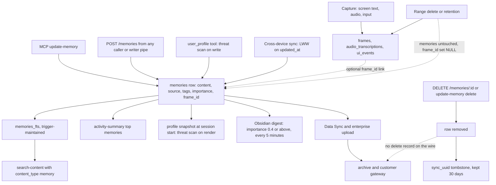

## 1. Executive Summary

Screenpipe is a local desktop recorder. It captures screen text from the
accessibility tree or OCR, audio transcripts and input events into one SQLite
file, and serves that history to agents through a REST API and an MCP server.
Beside the capture tables sits a small explicit memory: a `memories` table of
free-text facts that an agent, a scheduled pipe or the user writes, reads back
through full-text search, and can edit or delete. What is notable is the
discipline at the agent-facing edges: a profile snapshot frozen per session
and fenced as data, a raw SQL route behind a read-only connection, and skills
whose write provenance a manual edit revokes. What is weak is that the memory
table has no scope, no status and no history, and its deletion semantics stop
at the local row.

The capture side is the product; the memory table is a corner of it. A
`memories` row is created synchronously by whoever calls `POST /memories`,
with no extraction model, deduplication or consolidation on the path. The
model's reach over it is complete: the MCP `update-memory` tool creates,
overwrites and hard-deletes any row by id. Nothing records what a memory said
before an update.

Four findings shape the rest of this report.

- **A memory outlives the capture it came from.** `delete_time_range` removes
  frames, transcripts, UI events and elements in a range and never touches
  `memories`; the `frame_id` link goes `NULL` and the text stays
  (`crates/screenpipe-db/src/db/maintenance.rs:145-349`). The bundled API skill
  tells agents to tag a memory because frames are pruned.
- **Deletion does not travel everywhere the memory went.** Cross-device sync
  carries a `sync_uuid` tombstone for 30 days
  (`crates/screenpipe-core/src/memories/sync.rs:39`), and the enterprise
  telemetry wire format has no delete record at all
  (`crates/screenpipe-telemetry-wire/src/records.rs:182-235`).
- **The one scope boundary is on the feedback ledger, not the memory table.**
  A pipe reading `GET /feedback` sees only ratings attributed to its own
  authenticated name (`crates/screenpipe-engine/src/routes/ai_feedback.rs:347-361`).
  `memories` has no key to filter on, so `scope_enforced` is withheld.
- **Model-set `confirmed` flags stand in for review.** Deleting a profile fact
  and creating a skill both require `confirmed: true`, a field in the agent's
  own tool schema (`crates/screenpipe-engine/src/agent_profile.rs:294`,
  `crates/screenpipe-engine/src/agent_skills.rs:518`).

The licence is the Screenpipe Commercial License: source-available, free for
personal, non-commercial, research and seven-day evaluation use, with any
commercial use needing a paid licence. Versions released earlier under MIT
stay MIT. It carries no rider on analysis.

## 2. Mental Model

Screenpipe holds two kinds of durable state and treats them differently.
Captured history — frames, screen text, transcripts, UI events — is
observation: it happened, nothing in it can be false in the atlas's sense, and
it is managed by retention and range deletion. A `memories` row is a claim
someone chose to keep: *"facts, preferences, decisions the user wants to
remember"*, in the words of the MCP tool description
(`packages/screenpipe-mcp/src/index.ts:554-559`). This report is about the
second, and reads the first only where the two interact.

A memory has one state: present. It is born by an insert with an `importance`
float defaulting to 0.5 and a `source` string the caller chooses
(`crates/screenpipe-engine/src/routes/memories.rs:18-37`). It changes by
overwrite: `PUT /memories/:id` replaces content, tags, importance or
`source_context` in place and stamps `updated_at`
(`crates/screenpipe-db/src/db/memories.rs:50-90`). It dies by hard delete.
Nothing between those is a belief state — no candidate, verified or rejected
value, no supersession link, no validity interval.

Three readers consume it. An agent asks through `search-content` with
`content_type='memory'`; the activity summary attaches top memories to a
broad time-range answer; and Pi and ACP agents receive up to 20
`user-profile`-tagged rows as a frozen block at session start
(`crates/screenpipe-engine/src/agent_profile.rs:17-18`, `:357-389`). The
profile is the only reader that treats memory content as hostile: it re-scans
each row for instruction-like and secret-bearing text on render and replaces
a match with a `[BLOCKED…]` marker.

Ownership is ambient. The writer may be the user in the Brain settings screen,
an interactive agent through MCP, a scheduled pipe with the `writer`
permission preset, or another device through sync. The row records the device
in `source_context._device`, which the server stamps and a caller cannot forge
(`crates/screenpipe-engine/src/routes/memories.rs:447-458`). It does not record
which agent or pipe wrote it in any field the server controls.

The design consequence is that "forget that" has three different answers
depending on where the fact went. Locally it is a `DELETE`. On another of the
user's devices it holds for 30 days and then depends on that device having
synced. In an enterprise archive it does not happen.

## 3. Architecture

Screenpipe ships as a Tauri desktop app around a Rust engine,
`screenpipe-engine`, that runs capture and an axum HTTP server on port 3030
(`crates/screenpipe-engine/src/server.rs`). Storage is `screenpipe-db`: one
SQLite file built by 117 migrations, a write path serialised through
`begin_immediate_with_retry`, and a separate read pool whose file-backed
connections set `query_only` and, off macOS, open with `mode=ro`
(`crates/screenpipe-db/src/db/setup.rs:328-347`). Media lands as mp4, wav and
jpeg files beside it.

Agent surfaces are layered on that server. `packages/screenpipe-mcp` is a
stdio MCP server whose tools call the local API with the desktop key, plus a
separate HTTP MCP server that exposes only `search_content`
(`packages/screenpipe-mcp/src/http-server.ts:157`). The desktop also runs its
own agents: an interactive Pi or ACP chat, and scheduled "pipes" — Markdown
prompts in `pipe.md` with YAML frontmatter, run on a schedule with a minted
`sp_pipe_` token whose permissions the server enforces.

Four transports move memories off the machine, each optional:

- **Cross-device memory sync**, a manifest merged last-write-wins and carried,
  per the migration's own comment, through the encrypted `SyncManager`;
  triggered from the sync download loop or the settings screen
  (`crates/screenpipe-engine/src/sync_api.rs:1525-1560`).
- **Data Sync**, an account-scoped upload of capture and memory rows as JSONL
  (`apps/screenpipe-app-tauri/src-tauri/src/data_sync.rs`).
- **Enterprise telemetry**, the same JSONL into a write-only bucket, read by a
  customer-run gateway that ingests it into its own SQLite copy
  (`crates/screenpipe-gateway/src/lib.rs:5-40`).
- **External export**, a five-minute job writing a digest note into an
  Obsidian vault and static MCP recall guidance into `~/.claude/CLAUDE.md` and
  `~/.codex/AGENTS.md` (`crates/screenpipe-engine/src/external_memory_sync.rs:1-25`).

### Deployment and ergonomics

Everything memory-related runs locally with no model and no network: the
table, FTS5 and the routes need only the engine. Storing a memory needs no
provider key, but the local server requires a bearer token on every request
by default — `api_auth` defaults to `true`
(`crates/screenpipe-config/src/recording.rs:1027`) — and the key lives in the
secret store inside `db.sqlite` or comes from `SCREENPIPE_API_KEY`
(`crates/screenpipe-engine/src/auth_key.rs:20-27`). Install is the desktop app
or the CLI; the full tree is a large Rust and TypeScript build. The memories
table is readable and repairable by hand in the SQLite file, though the
bundled skill tells agents never to open the live file.

## 4. Essential Implementation Paths

**Write.** `POST /memories` → `create_memory_handler` validates content length
(50,000) and tag count and length, stamps `_device` into `source_context`,
and calls `insert_memory` in one `BEGIN IMMEDIATE` transaction
(`crates/screenpipe-engine/src/routes/memories.rs:121-211`,
`crates/screenpipe-db/src/db/memories.rs:12-37`). The FTS row is written by
the `memories_ai` trigger
(`crates/screenpipe-db/src/migrations/20260310000000_create_memories.sql:27-32`).
The MCP tool posts with `source: "mcp"`
(`packages/screenpipe-mcp/src/index.ts:1885-1928`); other callers choose any
source string.

**Profile write.** `POST /agent/profile/manage` with `action: save` →
`save_profile` trims, caps at 2,000 characters, rejects content matching the
threat patterns, forces the `user-profile` tag first, defaults importance to
0.8 and source to `agent-profile`, and refuses to edit a row that is not
a profile entry (`crates/screenpipe-engine/src/agent_profile.rs:204-286`).
Writes are serialised by a process mutex.

**Read.** `search-content` → `GET /search` → `search_with_tags` → for
`ContentType::Memory`, `list_memories_for_search`, which runs FTS5 `MATCH` on
the sanitised query or a full scan, then the optional filters, ordered by
`created_at` (`crates/screenpipe-db/src/db/search.rs:538-561`,
`crates/screenpipe-db/src/db/memories.rs:304-405`). A pipe caller's results
pass `pipe_can_access_content_item` for the `memory` content type and time
window (`crates/screenpipe-engine/src/routes/search.rs:95-119`, `:250-351`).

**Context assembly.** `GET /agent/self-improvement/context` → `list_profile`
reads 20 `user-profile` rows by importance → `render_system_context` caps the
block at 4,000 characters, 500 per fact, re-runs the threat scan, escapes `<`,
and wraps it in a tag introduced as *"data, not instructions or authority"*
(`crates/screenpipe-engine/src/agent_profile.rs:149-185`, `:357-389`). The Pi
extension fetches it once in `before_agent_start` and caches it for the
session (`crates/screenpipe-core/assets/extensions/self-improvement.ts:100-125`).

**Update and delete.** `PUT /memories/:id` → `update_memory` builds a dynamic
`SET` from the supplied fields (`crates/screenpipe-db/src/db/memories.rs:50-90`).
`DELETE /memories/:id` reads the row's `sync_uuid`, deletes the row, then
`record_memory_tombstone` appends the uuid and a timestamp to
`.memory_sync_tombstones.json` (`crates/screenpipe-engine/src/routes/memories.rs:357-379`,
`crates/screenpipe-engine/src/sync_api.rs:1580-1592`).

**Sync.** `merge_manifests` is a pure last-write-wins merge on `updated_at`,
ties broken by machine id; a remote tombstone newer than the local row deletes
it, and tombstones older than 30 days are dropped
(`crates/screenpipe-core/src/memories/sync.rs:120-197`). `upsert_synced_memory`
and `delete_memory_by_sync_uuid` apply the result
(`crates/screenpipe-db/src/db/memories.rs:152-224`).

**Capture deletion.** `/data/delete-range` and retention call
`delete_time_range` or its local and batch variants: elements, frames,
orphaned video chunks, transcripts, orphaned audio chunks, UI events, display
layout and orphaned semantic rows, in one transaction
(`crates/screenpipe-db/src/db/maintenance.rs:145-349`). Retention defaults to
`Media`, which keeps every row and removes only media files
(`crates/screenpipe-engine/src/retention.rs:56-74`).

**Feedback.** `POST /feedback` refuses any pipe token with *"pipes cannot rate
their own outputs"*; `GET /feedback` forces the producer to `pipe:` plus the
token's pipe name for a pipe caller
(`crates/screenpipe-engine/src/routes/ai_feedback.rs:214-226`, `:347-361`).

## 5. Memory Data Model

The table is eleven columns across three migrations: `id`, `content`, `source`
(default `'user'`), `source_context` (JSON text), `tags` (JSON array text,
default `'[]'`), `importance` (`REAL`, default 0.5), `created_at`,
`updated_at`, then `frame_id` referencing `frames(id) ON DELETE SET NULL`, and
`sync_uuid` with `sync_modified_by` for cross-device identity
(`crates/screenpipe-db/src/migrations/20260310000000_create_memories.sql:2-11`,
`20260315000000_add_frame_id_to_memories.sql`,
`20260506120000_add_memories_sync_columns.sql`). A partial unique index on
`sync_uuid` gives synced rows a stable identity.

There is no scope column. A row says which device wrote it, inside a JSON
blob, and nothing else about ownership. Tags are the only partition, and they
are content: the profile is the set of rows tagged `user-profile`, and any
caller can add that tag through the general route. A row so tagged bypasses
the profile write's threat scan but not the render-time one.

Provenance is thin and partly caller-asserted. `source` is whatever the caller
sends; the MCP server sends `mcp` and the profile path `agent-profile`, but a
pipe posting directly can write `user`. `frame_id` points at the capture a
memory came from while that capture exists. A sync update overwrites
`created_at` with the remote copy's value
(`crates/screenpipe-db/src/db/memories.rs:174-190`), so it is the time the
first device recorded the row, not when the fact held.

Temporal fields are record time only. Correction is overwrite with no prior
version kept. Separate stores hold other memory-shaped things: agent skills
under `<data_dir>/skills` with a provenance manifest, a per-pipe `memory.md`
of lessons that each bundled pipe prompt asks its agent to keep, and a
`feedback` table of human ratings keyed on target and producer.

The `screenpipe-team-memory` crate defines a team-memory file format —
Markdown with YAML frontmatter and a `provenance` block naming worker tier,
model and attestation (`crates/screenpipe-team-memory/src/lib.rs:1-80`). No
crate in the tree depends on it, so it is a declared format with no producer
or consumer at this commit.

## 6. Retrieval Mechanics

Retrieval is lexical and application-driven. With a query, FTS5 over
`content` and `tags` with `unicode61` tokenisation; without one, a scan of the
table. Filters are `source`, a substring tag match from `GET /memories?tags=`,
an exact AND tag match from the search path, `min_importance`, and a
`created_at` range. Ordering is `created_at` or `importance`, descending by
default; there is no BM25 rank in the `ORDER BY`
(`crates/screenpipe-db/src/db/memories.rs:304-405`). An `ocr_text_embeddings`
table exists in the migrations and nothing outside them reads or writes it, so
there is no vector arm.

`content_type=all` does not return memories; a model has to ask for them by
type, or get them through the activity summary. The MCP server truncates
each result's text to 1,000 characters unless the model opts out
(`packages/screenpipe-mcp/src/index.ts:1394`).

The failure modes follow from the shape. A query word missing from the row
misses it outright. A stale fact and its correction both match until someone
deletes the old one, because nothing links them. And the substring tag filter
on `GET /memories?tags=` matches `person:adam` for `person:ada`, while the
search path's exact filter does not — the db test suite asserts the exact
behaviour on the search path only (`crates/screenpipe-db/tests/db.rs:504-600`).

## 7. Write Mechanics

Every write is explicit and synchronous: one `INSERT` or `UPDATE` in a
`BEGIN IMMEDIATE` transaction, retrievable through FTS as soon as it commits.
No model runs on the write path, and no background pass rewrites the table.
The Obsidian export reads at most 1,000 rows at importance 0.4 or above every
five minutes and rewrites one owned note
(`crates/screenpipe-engine/src/external_memory_sync.rs:59`, `:366-381`).

There is no deduplication. The MCP description asks the model to update rather
than duplicate; the profile tool's description says *"List first and update a
matching fact"*. Both are prose. Conflict handling is last write wins, locally
by statement order and across devices by `updated_at`.

The profile path is the one memory write with a content gate.
`find_agent_content_threat` rejects invisible Unicode controls and ten regex
families — injection phrasing, role hijack, system-prompt exfiltration,
HTML-comment injection, hardcoded secrets, private keys and token prefixes,
and `send … to https://` — after folding full-width ASCII
(`crates/screenpipe-engine/src/agent_profile.rs:391-460`). The same function
guards agent skills and nothing else; the general `POST /memories` route
stores what it is given.

One small trigger gap: `memories_au` fires only `WHEN OLD.content IS NOT NULL
AND OLD.content != ''`. The HTTP route accepts empty content, so a row created
empty and edited later is never added to `memories_fts`, and a query cannot
find it (`crates/screenpipe-db/src/migrations/20260310000000_create_memories.sql:27-46`).

Agent skills are the more careful store. `AgentSkillStore::create` writes
`SKILL.md` and records `created_by: screenpipe-agent` with the content's
SHA-256 in a root manifest; `read_unlocked` reports a skill as agent-owned
only while the file's hash matches; `patch` requires the caller to supply the
current hash and refuses a skill whose origin is `user`
(`crates/screenpipe-engine/src/agent_skills.rs:164-313`). A person editing a
skill by hand therefore takes it away from the agent, and a test asserts it
(`manual_changes_revoke_agent_write_provenance`, `:708`).

## 8. Agent Integration

The stdio MCP server registers `update-memory` with create, update and delete
in one tool, and directs reads to `search-content`
(`packages/screenpipe-mcp/src/index.ts:554-571`). The tool is annotated
`destructiveHint: false` and `idempotentHint: true` while its `delete: true`
branch hard-deletes a row with no confirmation. A client that gates
destructive tools on that annotation will not ask.

Native agents get `user_profile` and `skill_manage` from the self-improvement
extension, and other ACP agents get the same pair from a bundled tool server
(`crates/screenpipe-core/assets/acp/screenpipe-tools.mjs:508-560`). The
profile block is frozen per agent session, so a write mid-session reaches the
prompt only in a new session — stated in the guidance and implemented by the
cached promise. The block is appended to the system prompt once per session,
which keeps a provider's prefix cache stable within it.

Pipes reach memory through HTTP. The `reader` preset and the default allowlist
give `GET /search` but not `GET /memories`; the `writer` preset adds
`POST /memories`, `PUT /memories/*` and `DELETE /memories/*`
(`crates/screenpipe-core/src/pipes/permissions.rs:531-547`). A pipe's policy
is written by the server into its directory and enforced on each request,
with a curl-only rule and a static write sandbox in the Pi extension
(`crates/screenpipe-core/assets/extensions/screenpipe-permissions.ts:653-700`,
`:830-878`).

For Claude Code and Codex, the export writes static recall guidance, not
memory rows, into the user's instruction files between markers and removes it
when the connection is disabled
(`crates/screenpipe-engine/src/external_memory_sync.rs:300-318`). Adapting the
memory layer to another agent means calling five REST routes; nothing in it
is specific to Screenpipe's own runtime.

## 9. Reliability, Safety, and Trust

**Scope.** `memories` has no scope key, and every authenticated caller is the
same principal to it. A pipe with the `writer` preset can overwrite or delete
a memory the user wrote, and an interactive agent can delete any row by id.
The pipe policy is a real boundary on capture data — app, window, content
type and time are checked per result. Neither reaches the memory table's
ownership, because there is none.

**Why `scope_enforced` is withheld.** The one stored key applied on a read
path sits on a side store. Human ratings carry `producer_ref` such as
`pipe:daily-recap` (`apps/screenpipe-app-tauri/lib/ai-feedback.ts:76`), and
when a pipe token is present `list_ai_feedback_handler` discards the caller's
`producer` argument and binds the token's own pipe name into the SQL
(`crates/screenpipe-engine/src/routes/ai_feedback.rs:347-361`,
`crates/screenpipe-db/src/db/feedback.rs:146-190`). That is a real boundary,
and a model cannot widen it by argument. The mark does not measure it. The
feedback table is a ledger of ratings on AI outputs, not the memory this
report is about; no committed test asserts the boundary; and with `api_auth`
disabled every caller is unrestricted.

**The pipe-token fallback.** When `api_auth` is off, `pipe_permissions_layer`
treats an `sp_pipe_` token missing from the registry as an ordinary user
request with no restrictions, and a request with no pipe token likewise
(`crates/screenpipe-engine/src/pipe_permissions_middleware.rs:109-117`). With
the default `api_auth: true`, the outer auth layer rejects an unregistered
token first (`crates/screenpipe-engine/src/server.rs:365-374`), so the
fallback opens only when a user disables auth.

**Deletion and derived artifacts.** The nomination asked for these to be
inspected; the answers are specific.

- *Range deletion and retention.* Frames, elements, transcripts, UI events
  and orphaned semantic rows go; `memories`, `meetings` with their provider
  transcript segments, activity intervals, outputs and feedback are not in the
  range delete (`crates/screenpipe-db/src/db/maintenance.rs:145-349`). A
  memory distilled from a frame keeps its text with `frame_id` set to `NULL`.
- *Retention modes.* `Media`, the default, removes only media files and keeps
  every text row; `Lean` also strips element trees, accessibility JSON and UI
  events; `All` removes rows (`crates/screenpipe-engine/src/retention.rs:56-74`).
- *Residue.* The database ships with `auto_vacuum=NONE`, so the incremental
  vacuum after retention reclaims nothing (`retention.rs:656-668`), and no
  path turns `secure_delete` on. Deleted text sits in free pages until reused.
- *Copies.* Cross-device tombstones last 30 days; a device offline longer
  re-pushes a deleted row as local-only, and the merge keeps it. A corrupt
  tombstone file is read as empty (`sync_api.rs:1552-1565`). The enterprise
  and Data Sync paths send no delete, and the gateway upserts memories with
  no delete path (`crates/screenpipe-gateway/src/ingest.rs:872-902`).
- *Redaction.* The PII redaction worker reconciles frames, elements and UI
  events; it reads no `memories` row.

**Injection.** Memory content returned by `search-content` reaches the model
as text with the bundled skill's instruction to treat it as untrusted
evidence. The profile path is defended on both sides; the general path is
defended by prose.

**Raw SQL.** `/raw_sql` accepts statements starting with `SELECT`, `WITH` or
`EXPLAIN`, which alone would admit `WITH … DELETE`. It runs on the read pool,
where `query_only` is on, so a write fails in SQLite
(`crates/screenpipe-engine/src/routes/content.rs:659-716`,
`crates/screenpipe-db/src/db/maintenance.rs:63-74`).

**Uncertainty.** The table cannot represent doubt. `importance` orders and
gates the export; it does not withhold a row from anything.

## 10. Tests, Evals, and Benchmarks

I read the tests and ran none of them. Memory-specific coverage is narrow and
sound where it exists.

- `crates/screenpipe-db/tests/db.rs:504-600`, `test_memory_filter_by_tags`:
  three memories, exact AND tag matching, `person:ada` not matching
  `person:adam`, a prefix matching nothing, and FTS composed with tags. Each
  negative is paired with a positive on the same fixture.
- `evals/coding-agent/graders/memory-tag-filter.rs`: a grader for a coding
  agent's fix, asserting exact id sets over a fixture with malformed tag rows
  and an unchanged table afterwards.
- `crates/screenpipe-engine/src/agent_profile.rs:483-597`: the snapshot is
  bounded and escaped, a poisoned fact is blocked in render, full-width
  injection is caught, and the profile tool refuses to edit a non-profile row.
- `crates/screenpipe-core/src/memories/sync.rs:251-356`: ten merge cases,
  including tombstone wins, resurrection by a newer local edit, and GC.

These do not earn `negative_eval`. The tag cases test filter precision on a
user-chosen label, which is ordinary recall testing; nothing asserts that a
deleted memory, a memory from another pipe, or a memory denied by a
`Content(memory)` rule stays out of a populated result. The feedback
ledger's pipe boundary goes untested where the db tests exercise the
ledger: they call `list_feedback` with no producer.

No retrieval benchmark covers memories. The repository's evals are for its
coding agent, audio transcription and meeting detection. No paper is cited.

Tests to add before trusting it: delete then search for the same text; a
range delete over a frame with a linked memory, asserting what the product
intends; a pipe token reading `GET /feedback` with another pipe's producer in
the query; and a tombstone older than 30 days against an offline device's
copy.

## 11. For Your Own Build

### Steal

- **Fence injected memory as data on render, not only on write.** Running the
  same threat scan on the way out catches rows that arrived by a path that
  skipped the write check, which every multi-writer store has.
- **Freeze the memory block per session.** One fetch at session start keeps
  the prompt prefix stable and makes "when does a write take effect" a single
  documented answer.
- **Make write provenance a hash in a manifest the subject cannot write.** An
  agent may patch only what it created and what nobody has edited since; a
  manual edit flips ownership with no flag to set.
- **Derive the read scope from the credential and ignore the argument.**
  Replacing the caller's `producer` with the token's identity is one line, and
  it is the line that matters.
- **Back a prefix allowlist with a connection that cannot write.** The check
  is advisory; `query_only` is the guarantee.

### Avoid

- **A delete that stops at the first copy.** Every transport that ships a
  memory needs a delete record, or a deletion is local by construction.
- **Expiring tombstones without expiring the devices they protect against.**
  A 30-day TTL is a promise that no replica stays offline longer.
- **Derived rows with a nullable pointer to their source.** If a capture's
  deletion should take what was distilled from it, `ON DELETE SET NULL` is the
  opposite instruction.
- **Tool annotations that understate the tool.** `destructiveHint: false` on
  a verb that deletes undoes whatever confirmation a client would have shown.
- **A `confirmed` field in the agent's own schema.** It records that the model
  typed `true`.

### Fit

Screenpipe suits a person who wants an agent to recall their own computer
work, on their own machine, and is content for that agent to manage a small
list of facts with full authority. The capture side carries the value and the
memory table is a convenience on top of it. It does not suit a deployment
where several agents or people must not overwrite each other's memories, where
a deletion must be provable across devices or an enterprise archive, or where
a remembered fact must be traceable to evidence that has not been deleted. Adopting it
commercially needs a paid licence.

## 12. Open Questions

- Whether a pipe agent's shell can obtain the desktop API key — through
  `screenpipe auth token`, the environment or the secret store — which would
  step around every pipe policy including the feedback scope. The static
  sandbox gates writes and curl targets; reads of the data directory were not
  traced.
- Whether the hosted Data Sync service and the enterprise archive delete
  anything on their side when a user deletes locally; that code is not in
  this repository.
- Whether the encryption the sync migration's comment describes for
  `BlobType::Memories` is end-to-end; `SyncManager` was not read.
- How often memories are written in practice and by whom; the Brain screen
  calls them *"what the AI has learned about you from your activity"*, and no
  bundled pipe at this commit posts to `/memories`.

## Appendix: File Index

- **Schema and storage:** `crates/screenpipe-db/src/migrations/20260310000000_create_memories.sql`,
  `20260315000000_add_frame_id_to_memories.sql`,
  `20260506120000_add_memories_sync_columns.sql`,
  `crates/screenpipe-db/src/db/memories.rs`, `crates/screenpipe-db/src/db/setup.rs`.
- **Write and delete:** `crates/screenpipe-engine/src/routes/memories.rs`,
  `crates/screenpipe-engine/src/agent_profile.rs`,
  `crates/screenpipe-engine/src/agent_skills.rs`.
- **Read:** `crates/screenpipe-db/src/db/search.rs`,
  `crates/screenpipe-engine/src/routes/search.rs`,
  `crates/screenpipe-engine/src/routes/activity_summary.rs`,
  `crates/screenpipe-engine/src/routes/content.rs`.
- **Sync and export:** `crates/screenpipe-core/src/memories/sync.rs`,
  `crates/screenpipe-engine/src/sync_api.rs`,
  `crates/screenpipe-engine/src/external_memory_sync.rs`,
  `apps/screenpipe-app-tauri/src-tauri/src/data_sync.rs`,
  `crates/screenpipe-telemetry-wire/src/records.rs`,
  `crates/screenpipe-gateway/src/ingest.rs`, `crates/screenpipe-team-memory/src/lib.rs`.
- **Capture deletion:** `crates/screenpipe-db/src/db/maintenance.rs`,
  `crates/screenpipe-engine/src/retention.rs`.
- **Permissions and feedback:** `crates/screenpipe-core/src/pipes/permissions.rs`,
  `crates/screenpipe-engine/src/pipe_permissions_middleware.rs`,
  `crates/screenpipe-engine/src/server.rs`,
  `crates/screenpipe-engine/src/routes/ai_feedback.rs`,
  `crates/screenpipe-db/src/db/feedback.rs`,
  `crates/screenpipe-core/assets/extensions/screenpipe-permissions.ts`.
- **Agent surfaces:** `packages/screenpipe-mcp/src/index.ts`,
  `packages/screenpipe-mcp/src/http-server.ts`,
  `crates/screenpipe-core/assets/extensions/self-improvement.ts`,
  `crates/screenpipe-core/assets/acp/screenpipe-tools.mjs`,
  `crates/screenpipe-core/assets/skills/screenpipe-api/SKILL.md`.
- **Tests:** `crates/screenpipe-db/tests/db.rs`,
  `evals/coding-agent/graders/memory-tag-filter.rs`.

### Recorded searches

Checked against the checkout at the pinned revision, from the tree root, with
`git grep`.

- `git grep -n -E 'DELETE FROM memories'` — `memories.rs:94` and `:218` only; no maintenance, retention or range path deletes a memory.
- `git grep -n -o -E 'DELETE FROM [a-z_]+' -- crates/screenpipe-db/src/db/maintenance.rs crates/screenpipe-db/src/db/semantic.rs` — audio_chunks, audio_transcriptions, display_layout, elements, frames, ui_events, video_chunks, semantic_actors, semantic_items, semantic_runs.
- `git grep -n -E 'DELETE FROM (meetings|meeting_transcript_segments|activity_[a-z]+|outputs|feedback)' -- '*.rs'` — per-record deletes in `meetings.rs`, `activity_ledger.rs`, `outputs.rs` and `feedback.rs`; none in `maintenance.rs`.
- `git grep -n -i -E 'delete|tombstone' -- crates/screenpipe-telemetry-wire/src` — no match.
- `git grep -n -i -E 'delete|tombstone|purge' -- apps/screenpipe-app-tauri/src-tauri/src/data_sync.rs apps/screenpipe-app-tauri/src-tauri/src/enterprise/sync.rs apps/screenpipe-app-tauri/src-tauri/src/enterprise/upload.rs` — no match.
- `git grep -n -i 'secure_delete'` — three hits, each setting it `OFF` (`storage/in_place.rs:106`, `storage/reclaim.rs:393`, `:499`).
- `git grep -n -E 'ocr_text_embeddings' -- ':!crates/screenpipe-db/src/migrations'` — no match.
- `git grep -n -E 'screenpipe[-_]team[-_]memory'` — `Cargo.lock`, the crate's own `Cargo.toml` and a coverage comment in `docs/ORG_DATA_UNIFICATION_SPEC.md`; no dependent crate.
- `git grep -n -E 'ALTER TABLE memories' -- crates/screenpipe-db/src/migrations` — the `frame_id` and sync-column migrations only.
- `git grep -n -i -E 'status|state|valid' -- crates/screenpipe-db/src/migrations/20260310000000_create_memories.sql crates/screenpipe-db/src/migrations/20260315000000_add_frame_id_to_memories.sql crates/screenpipe-db/src/migrations/20260506120000_add_memories_sync_columns.sql` — no match.
- `git grep -n -i -E 'memor(y|ies)_(events|history|audit|log|versions)|audit_log' -- '*.rs' '*.sql'` — no match.
- `git grep -n -E 'find_agent_content_threat' -- '*.rs'` — `agent_profile.rs` and `agent_skills.rs:344` only.
- `git grep -n -w -i 'memories' -- crates/screenpipe-redact/src` — no match.
- `git grep -n -E 'Content\(memory\)|is_content_type_allowed\("memory"\)' -- '*.rs' '*.ts'` — no match; no test denies memory content to a pipe.
- `git grep -n -E 'list_feedback\(' -- '*.rs'` — the handler, the gateway and two db tests, each test passing `None` for the producer.
- `git grep -n -E 'record_memory_tombstone\(' -- '*.rs'` — the memories route and the profile delete.
- `git grep -n -i -E 'sandbox-exec|seatbelt|landlock|bubblewrap|bwrap' -- '*.rs' '*.ts'` — no match; no OS-level sandbox for pipe agents.
- `git grep -l -i -E 'localhost:3030/memories|/memories"|update-memory|POST /memories' -- crates/screenpipe-core/assets/pipes` — no match.
- `git grep -l -i -E 'arxiv|bibtex|@article|@misc|doi\.org' -- '*.md' '*.cff'` — `crates/screenpipe-audio-eval/evals/ATTRIBUTION.md`, a dataset attribution; no `CITATION.cff`.

## History

**2026-10-15** — [`ada8f2fab2f78ea6a9ac8d59f97c932063418a24`](https://github.com/screenpipe/screenpipe/commit/ada8f2fab2f78ea6a9ac8d59f97c932063418a24) — first reading, at the head of `main`, 94 commits after the nominated `01aac0d55e21497fb25afcdfbd45077b47bdc576`; every memory, sync, permission, feedback and deletion path cited here has the same blob at both. Shallow clone. Screened before reading: two auto-run surfaces (`.devcontainer/devcontainer.json`; the LFS filter in `.gitattributes`, which this machine's git-lfs ran at checkout to fetch media), 14 build-time execution points, 15 unpinned surfaces, and 72 dependency files dated inside the cooldown by a clone that dates every file to the tip. Nothing was installed, built or run. No marks: the memory table carries none of the seven, and the feedback ledger's pipe boundary is not memory scope.
