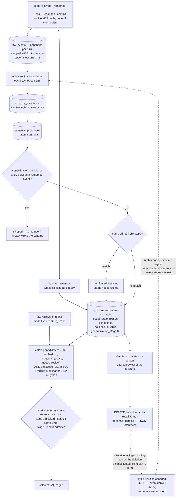

## 1. Executive Summary

Slowave is a local memory layer for coding agents built on a claim that most of
this corpus does not make: the memory core performs no LLM call at all. Ingest,
consolidation and recall are geometric — embeddings from local ONNX encoders,
clustering into latent prototypes, symbolic schemas formed over them, and
retrieval by hybrid search. The agent supplies judgement; the store supplies
memory.

It is AGPL-3.0-or-later, with a separate commercial licence offered in
`COMMERCIAL.md` and contributions taken under a CLA. The screen found one
auto-run surface (`server.json`, which declares version 0.20.3 against a
package at 0.22.2) and flagged five files for inspection as possible execution
points: the `Makefile`; the client-setup module, matched by its filename, which
runs only as the explicitly invoked `slowave setup`; and three pytest
`conftest.py` files, which execute when the tests are collected. It found one unpinned dependency surface with a lockfile beside it, and
`pyproject.toml` changed on 13 October 2026, inside the seven-day cooldown, so
nothing was installed, built or run.

**Cross-scope reach is earned, not granted.** Every schema carries a scope, the
store's candidate queries filter on it in SQL, and the widening rule lives in
the predicate rather than in the callers: a row is admitted when its scope
matches, when it is unscoped, when it sits in `('global', 'user')`, or when its
`generalization_stage` has reached 2. The working-memory gate then holds the
stricter line the MCP tools ask for, blocking stage 0 and admitting stage 1 only
within the same scope kind. `recall` routes its direct candidates and its
graph-expansion neighbours through one `_cross_scope_gate` — the drift this
atlas most often finds between exactly those two paths.

**The event store is the spine, and the rebuild treats it as the only truth.**
`raw_events` is appended per turn and stamped with the `logic_version` under
which it was ingested. On startup the engine compares the configured
`current_logic_version` with the store's checkpoint and, when they differ,
deletes every derived table, `schemas` among them, and replays and
re-consolidates from `raw_events` with no action from the user
(`core/engine.py:199-202`, `core/services/rebuild.py:67-81`, `:223-224`,
`:292-293`). The log is not append-only: a repeated `commit` overwrites the
session's `task_complete` event (`ops.py:1524`), and the procedure delete
strips the procedure from that event (`dashboard/app.py:2000`).

**A rebuild drops what an agent remembered.** `slowave_remember` appends a
raw event and writes its schema directly (`core/engine.py:714`). Consolidation
skips any prototype whose sampled episodes trace only to remember events,
because `remember()` *"already created the first-class schema
synchronously"* (`core/consolidation.py:171-186`, `:536-550`). The rebuild's
only schema writer is that consolidation pass. So a memory the agent stored on
purpose, in a session whose embeddable events were all remember events, is not
re-formed when an upgrade changes the logic version. On the schemas that are
re-formed, a `stale` or `archived` status is gone, because it lived only on the
deleted row. No committed test seeds a remembered memory before a rebuild.

**A rebuild restores what a person deleted.** Removal is a person's act at the
local dashboard: the five MCP tools are activate, recall, remember, feedback and
commit, and no verb reaches a delete. `_schema_delete_preview_conn` counts the
evidence links, prototype links, relations, co-activations and retrieval
evidence that point at the schema, so the confirmation names what else is about
to go. The delete then removes the row and scrubs the recall items, the
feedback events naming it as target or replacement, and the JSON references
that mention it, in one transaction (`dashboard/app.py:1890-1910`). It leaves
the `raw_events` and episodes the schema was consolidated from, records nothing,
and keys on the schema id rather than the claim. A consolidated schema a person
removed can therefore re-form on the next rebuild, as the same proposition can
from a later session.

**Procedures are erased less thoroughly than schemas.** The procedure delete
strips the payload from its raw event and scrubs its references, and does not
touch `procedure_search_documents` or `procedure_search_fts`, the derived
projection
[`04e16015d350b98a1425d7d6911d32cac3abeaaa`](https://github.com/slowave-ai/slowave/commit/04e16015d350b98a1425d7d6911d32cac3abeaaa)
added on 24 September 2026. The summary, step text and originating query stay
in both tables (`dashboard/app.py:1988-2016`,
`symbolic/procedure_search.py:167-214`). No read path serves the orphan,
because retrieval iterates procedures loaded from `raw_events`, and the Home
procedure count reads that same loader. The Home activity chart counts the
projection rows by completion time, orphans included
(`dashboard/app.py:686-688`).

The migration that removed forget and unforget says what it replaced:

> "Forget/unforget was removed in favour of explicit hard deletion. Preserve
> previously suppressed schemas by restoring their recorded prior state before
> removing the obsolete audit table."

`sqlite_db.py:310-325` restores every schema whose status is `forgotten` to the
status it held before — defaulting to `active` where the log has no row for it —
and then drops the log table. A store upgraded across this boundary returns to
ordinary retrieval the memories a person had suppressed.

**What it has is event time, and not validity time.** `slowave_remember` takes
an optional `occurred_at`, an RFC 3339 source-event time distinct from the write
clock that sets the raw event's `ts`. It is kept on single-event episodes,
prefixed onto returned evidence, and used to rank episodes against a past
anchor the temporal probe estimates from the query. Nothing records when a
claim stopped being true, and no read filters as of a past state, so
`bitemporal` is withheld.

## 2. Mental Model

Three layers, and the arrow only points one way — except for the agent's own
explicit memories, which enter at the top.

At the bottom, **raw events**: what was said, appended, embedded, stamped with
the version of the code that ingested it and, when the agent supplies one, the
time the source event happened. Ingest only appends; the in-place rewrites are a
repeated commit and the procedure delete, both about procedures.

In the middle, the **latent layer**: episodes grouped from events, clustered
into semantic prototypes that are centroids rather than sentences. This is where
similarity lives.

At the top, the **symbolic layer**: schemas, which are the claims an agent
actually reads. A schema has content text, a scope, a lifecycle status, evidence
links back down to episodes and raw events, and a generalization stage recording
how far its usefulness has been shown to travel. Most schemas are consolidated
from prototypes. A remembered schema is written straight from the
`slowave_remember` call, and consolidation deliberately leaves its episodes
alone.

The project treats everything above the event store as derived: change the
logic, bump the version, replay. That holds for consolidated schemas. A
remembered schema is not derived by the replay, so the replay does not bring
it back.

Correction runs through feedback rather than editing. The agent reports that a
retrieved memory was used, was irrelevant, or has gone stale — and a stale
report can name the replacement. Accepted feedback rows are the ledger
salience and confidence are recomputed from. The store applies the lifecycle;
it does not judge the claim. The source says so: contradiction and
supersession are *"client-owned history and are never inferred by this store or
by consolidation."*

Removal is the one thing the agent's tools cannot ask for. A person opens the
dashboard, looks at a specific schema, sees a count of what points at it, and
deletes it. What the pass that runs afterwards knows about that decision is
nothing.

**That is a permission boundary, and it is not `human_review`.** The five MCP
tools are activate, recall, remember, feedback and commit, and none of them
removes anything. What the mark asks for is different: a memory that waits in a
state until a person resolves it. Nothing here waits.

The one status that reads like a review queue, `needs_review`, is admitted by
the broad retrieval profile, the consolidation merge check, pattern completion,
the learning projection and the store's candidate queries, and written by
nothing in the tree. `update_status` is called three times, all from feedback,
and all three write `stale`. The dashboard's schema-health panel counts
`needs_review` rows (`dashboard/app.py:890`), which is structurally zero. A
different field is surfaced under the same word: `ops.py:1312` maps the API's
`needs_review` key to `s.is_labile`, which the schema's own comment calls
*"distinct from the unrelated status='needs_review'"*.



## 3. Architecture

Five subsystems under one package. `storage` is a single `schema.sql` of 720
lines and a SQLite wrapper. `latent` holds the episodic and semantic stores, the
graph manager, the replay engine, salience, temporal handling, a transition
model and a VSA module. `symbolic` holds the encoder, two ONNX encoders — the
formation encoder and a multilingual retrieval encoder — the 2,156-line schema
store, procedural memory with its derived search projection, and the raw log.
`core` holds the engine, the context and working-memory gate, consolidation,
feedback, scope, continuity, graph health, activation selection and the hybrid
and baseline selectors, and a `services/` layer splitting ingest, retrieval,
retrieval access, feedback, feedback events, the learning projection,
consolidation, pattern completion and rebuild. Above them, an MCP server with
five tools, a CLI, and a dashboard.

The database is the design document. `schema.sql` carries the arguments as well
as the DDL. It says why a stale reason is kept beside the status rather than
inside it, and why `schema_coactivation` is separate from `schema_relations`:
usage-based versus content-based. It says why the logic version is on the event
rather than the schema, and that the facet blobs *"support topical relation
diagnostics and replay inspection; they do not determine semantic truth"*.

The surface is wide for work dated 8 June to 14 October 2026: 33 tables, a
dashboard of over 4,000 lines, a CLI of over 2,000, and a client-setup module of
2,366 lines. `slowave setup` writes configuration for eight client keys and
installs daemon, worker and backup user services. It runs when invoked: the
build backend is plain setuptools with no install hook, so pip and pipx
installation do not run `slowave setup`. The Homebrew formula in the tree is the exception,
calling `slowave setup` from its `post_install` (`Formula/slowave.rb:21-25`);
the tap the install guide names is a different repository, `mrsalty/slowave`,
which this reading did not open. The multilingual encoder is fetched from
Hugging Face at a pinned revision on a cache miss
(`symbolic/retrieval_encoder.py`). Read the setup module before running it,
because it edits files outside the project.

## 4. Essential Implementation Paths

- **Ingest.** The MCP tools append to `raw_events` with an embedding and the
  current `logic_version` → episodes are grouped with their provenance in
  `episode_text`, carrying an `occurred_at` only when the episode holds a single
  event that has one (`core/services/ingest.py:109-111`, `:176-188`) →
  prototypes are formed or updated in the latent store.
- **Remember.** `engine.remember` appends a `remember:<type>` event and calls
  `schemas.create` with the content, scope, `confidence=1.0` and
  `salience=1.4` (`core/engine.py:650-760`).
- **Consolidate.** `core/consolidation.py:180` skips a prototype whose sampled
  episodes are all remember events → `:282` looks up
  `find_by_primary_prototype` and reinforces any match in place, its status
  neither read nor changed → otherwise `:300` checks the nearest active neighbour against
  the 0.92 near-duplicate cosine → only then is a new schema written.
- **Activate and recall over MCP.** Both tools call `ops` with
  `mode="strict_scope"` and `relevant_set=True` (`mcp/tools.py:1700-1713`,
  `:1892-1903`) → `relevant_catalog` at `core/services/retrieval.py:837`
  gathers FTS and embedding candidates per cue, scope- and status-filtered in
  SQL, and unions the multilingual channel (`:452-493`) → every candidate
  passes `working_memory_gate.eligible` → coverage selection picks the set.
- **Recall with full evidence.** `recall` at `:1427` computes the status set
  from the mode (`:1558-1563`) → drops anything outside it → applies
  `_cross_scope_gate` (`:1574`) → expands along `schema_relations` through the
  same gate (`:1649`).
- **Context reinstatement.** At session start `ops.activate` may add up to
  five same-scope memories from `eng.context`, which reads `status='active'`
  for the exact scope, and `_select_context_reinstatement` re-checks both
  (`ops.py:368-384`, `core/services/retrieval.py:1763-1765`).
- **Delete.** `dashboard/app.py:1812` previews what a removal will take →
  `:1890` deletes the recall items, the feedback events naming the schema as
  target or replacement, the JSON references, and then the row.
- **Procedures.** `ops.commit` stores a procedure in the `task_complete` raw
  event and calls `backfill_procedure_search` (`ops.py:1540`), which upserts
  an applicability text and a strategy text into `procedure_search_documents`
  and `procedure_search_fts` → activate and recall load procedures for the
  exact scope and rank them by fusion → the dashboard delete at
  `dashboard/app.py:1988` strips the payload and leaves both projection rows.
- **Rebuild.** `RebuildService.try_claim` takes an optimistic lease on a
  `logic_versions` row; `run` deletes the derived tables, re-forms episodes for
  every session, replays and consolidates.

## 5. Memory Data Model

Thirty-three tables in `schema.sql`, three FTS5 indexes beside them, and a
fourth FTS5 index created at startup by `sqlite_db.py`. The ones that carry the
report:

**`schemas`** — the durable claim (`storage/schema.sql:167-206`). Content text,
facets and tags as JSON, a scope id and kind, a status defaulting to `active`,
and a `stale_reason` drawn from contradicted / superseded / outdated /
unsupported / withdrawn. Beside them: a confidence and a salience, an embedding
with optional packed facet axes and strengths, the supporting episode ids, an
`is_labile` flag, a `generalization_stage` from 0 to 3, first-formed and
last-updated stamps, and the logic version it was formed under.

**`schema_evidence`** — a normalised link from a schema to an episode or raw
event with a quote and a weight. Provenance is a join, not a blob.

**`schema_relations` and `schema_coactivation`** — content-based and usage-based
edges, deliberately separate. The store writes only the symmetric `relates_to`
relation itself: contradiction and supersession are client-owned. Co-activation
weights are rebuilt from the recall and feedback ledgers when those change and
decayed on a seven-day half-life otherwise
(`core/services/consolidation.py:180-265`).

**`raw_events` and `logic_versions`** — the replay spine, with the version stamp
and any `occurred_at` on the event and the lease on the version.

**`feedback_events`** — the retrieval it belongs to, the target kind and id, an
optional replacement target, an assessment, a relevance, a stale reason, an
effect and a contribution, a coverage, an accepted-or-rejected status, a
`refines_event_id` and a `mutation_mode` of shadow or active. Salience and
confidence are a deterministic function of its latest accepted active rows,
applied as an absolute target through `learning_projection_state`
(`core/services/learning_projection.py`). Rows cascade away with their
retrieval, and the dashboard delete removes the ones naming a deleted schema.

**`retrieval_decisions` and `retrieval_candidate_decisions`** — per retrieval
and policy version, the task needs, the encoder and config hash, and for every
candidate whether it was eligible, its dense, lexical and applicability
categories, and whether it was selected, rejected or suppressed with a reason
code (`storage/schema.sql:381-431`). The comment calls it an *"internal
policy-decision audit trail"*; it records reads, not mutations.

**`procedure_search_documents` and `procedure_search_fts`** — a derived,
advisory projection of each procedure (`storage/schema.sql:592-606`), rebuilt
on startup and after each commit by an upsert over `task_complete` events that
still carry a procedure. No code deletes from either table, so a row outlives
the procedure it was built from.

**What is missing is validity time.** The temporal columns record when a row
was formed, updated, touched or ingested, and when the source event behind a
raw event happened. There is no interval describing when a claim was true in
the world, and no as-of filter on any read.

## 6. Retrieval Mechanics

The MCP read is a declarative catalog. Each cue — the whole task plus any
explicit needs — runs an FTS search and an embedding search in the store, both
filtered on status and scope in SQL before `LIMIT`, so a small scope is not
starved out of the window. A multilingual dense channel, part of the default
path since
[`9b5867e7b3e3c2b9cdf80fe3640a42abdbabd068`](https://github.com/slowave-ai/slowave/commit/9b5867e7b3e3c2b9cdf80fe3640a42abdbabd068),
loads every schema and applies the same scope rule in Python. Every candidate
then passes the working-memory gate, which in `strict_scope` admits `active`
only and applies the stage ladder, and a selector chooses for coverage of the
needs.

The stage ladder has three expressions here: the store's SQL predicate, the
gate's `_eligible`, and `recall`'s `_cross_scope_gate`, whose docstring says it
*"mirrors WorkingMemoryGate._eligible's stage-graduated rule exactly"*. They
agree on admission. They differ on price: the 0.70 multiplier and the 0.30
floor for a stage-2 schema from another scope are applied by
`_cross_scope_gate` and the gate's activation, and the catalog uses neither, so
on the path the MCP tools deliver from a stage-2 schema competes at its full
score.

`recall` with full evidence runs the older pipeline as well. Status is applied
by mode — `active` by default and under `strict_scope`, plus `needs_review` for
a broad profile, plus `stale` only in debug — and `archived` by none.
Relation expansion follows `schema_relations` through the same status check and
the same `_cross_scope_gate`. Episodes are ranked partly by how close their
source-event time, or their write time where they have none, is to an anchor
the temporal probe reads from the query, such as "last month"
(`latent/retrieval.py:329-341`). That is a ranking nudge, not a filter.

Beside the relation graph, `schema_coactivation` records that two schemas were
recalled together, kept apart from the content signal so a pair often useful
together does not become a pair the system believes is topically related.

The whole path runs without an LLM call. The scoring is embeddings, BM25,
salience, confidence and graph weight; the encoders are local ONNX.

Procedures take a separate path. They are loaded for the exact scope, with no
generalization ladder, scored by cosine against an applicability text and a
strategy text, and fused with the FTS rank by reciprocal rank, weighted 2:1:1.
A procedure is admitted when its applicability cosine reaches 0.60 or the FTS
match is specific, and a context facet that disagrees with the caller's rejects
it (`symbolic/procedural_memory.py:423-520`).

Admission decides whether a procedure can appear; its record orders the ones
admitted. Each helped report adds 0.03, up to 0.09, and each harmed report
subtracts 0.06, up to 0.18, so one harm outweighs one help at a tie. A verified
success adds 0.015, a partially verified one half that, and a failed source
subtracts 0.03 (`symbolic/procedural_memory.py:20-26`, `:520-546`). The
docstring states the order of operations: reuse evidence applies only after
admission, so it cannot surface an irrelevant procedure. A failed procedure is
kept and returned with a caveat calling it *"cautionary evidence, not
recommended guidance"* (`:326`).

## 7. Write Mechanics

The agent writes; the store maintains. `slowave_remember` is the explicit path:
it appends a raw event and writes a schema at once, with full confidence and a
salience of 1.4. The ordinary path is a session: `activate` opens it, `recall`
asks, feedback reports what helped, `commit` closes it. Every turn lands in
`raw_events`, and the consolidated layer can be discarded and rebuilt from it.
The remembered layer cannot, as section 1 sets out.

Consolidation has to decide whether the thing it is forming already exists. It
asks two questions in order. The same primary prototype means the same engram,
so the schema is reinforced in place — *"one schema per primary prototype"*.
Reinforcement raises salience, capped at 20, replaces confidence and merges the
supporting episodes and evidence; it neither reads nor writes the status
(`symbolic/schema_store.py:607-666`). A `stale` or `archived` schema that
matches therefore absorbs the re-derived claim and stays withheld, neither
duplicated nor revived. The comment above the call says a match *"reactivates"*
the engram (`core/consolidation.py:278-281`); the update does not. Failing
that, a nearest active neighbour at or above 0.92 cosine is strengthened
instead of copied. Otherwise a new schema is formed, classified and related.

`dedup_exact` handles the other duplicate case: exact normalised duplicates are
marked `archived` with their salience dropped to 0.05 and related to the
canonical row.

Reinforcement is bounded by a shared `SALIENCE_CEILING`, used by both
`reinforce()` and `adjust_feedback_state()` so the two paths cap identically.
The learning projection goes further: rather than incrementing a tally it
recomputes a schema's learning effect from the feedback ledger and applies it
as an absolute value, so a refined feedback row replaces its contribution
instead of stacking on it.

**Unused memory fades.** Every consolidation pass ends with `decay_unused`
(`symbolic/schema_store.py:1891-1960`, called from
`core/services/consolidation.py:112`). An `active` schema formed more than 30
days ago and never recalled, its recurrence count still zero, loses 0.15
salience per pass, floored at 0.01, and is flagged labile once it falls below
0.30. Schemas written by `slowave_remember` carry the `source_kind`
`explicit_remember` (`core/engine.py:718-719`) and are skipped. Decay lowers
rank and changes no status, so it withholds nothing.

## 8. Agent Integration

Five MCP tools — `slowave_activate`, `slowave_recall`, `slowave_remember`,
`slowave_feedback`, `slowave_commit` — and a `slowave setup` that detects and
configures Claude Code, Copilot CLI, Codex, Cursor, Cline, Windsurf and Devin
Desktop, OpenCode and Claude Desktop, with a `--dry-run` first. Published on
PyPI with a Homebrew formula; no API key required for anything. A pip install
leaves configuration to that command; the in-tree formula runs it from
`post_install`.

The tool set encodes the intended rhythm rather than exposing the store. There
is no MCP verb for deleting, none for editing a schema's status directly, and
none for the dashboard's lifecycle operations. The tools fix the retrieval mode
to `strict_scope`, so an agent cannot widen its own read. Activation results
are frozen into a paged catalog, and feedback is accepted only for targets a
retrieval exposed.

The dashboard is the human half: a local web application with a Cytoscape graph
view over memories, retrievals, feedback, procedures and system activity, and
the delete controls with their preview. Its only write routes are the two
deletes, enabled by default and taken as a bare POST with no token and no
Origin check (`dashboard/app.py:246-260`). It warns when bound beyond
localhost. Anything that can reach the port while it runs can issue a delete: a
shell the agent holds, or a page in the user's browser where the browser's
own private-network rules allow it.

The dashboard also measures memory through its own ledgers. Per memory it
shows exposures, uses, the use rate, and reports of irrelevant, stale and wrong
(`dashboard/app.py:1180-1192`). Per retrieval kind it counts what was exposed,
assessed, used and left unassessed, and how many memories and procedures the
agent reported using in two or more distinct task sessions
(`dashboard/metrics.py:162-186`); a procedure's own originating session and
sessions before it existed do not count. Per session it shows whether
feedback came back (`dashboard/app.py:3215`), and per tool response an
estimated token overhead, characters divided by four where no estimate was
stored (`dashboard/metrics.py:236-244`). Each figure is a delivery count or the
agent's own report, so it shows whether memory was used, not whether a task
went better.

## 9. Reliability, Safety, and Trust

**Tombstone — withheld, on a deliberate design choice.** Removal is a hard
delete keyed on the schema id. Nothing survives it to be consulted on a later
write: the row is gone, the rows naming it are scrubbed, and consolidation's
identity key is the primary prototype of whatever it is forming now. The same
proposition re-derived from a later session, or re-formed from the retained
`raw_events` by the rebuild that follows a logic-version change, is a new
schema with nothing in the store positioned to intercept it ([section
1](#1-executive-summary) sets out both directions of the rebuild). The trade
runs the other way too: no deletion record is kept, though the deleted content
stays in `raw_events` and in any retained backup. The procedure-search rows a procedure delete leaves behind are
not a tombstone either: they are keyed on `proc_<session_id>`, and no write
path consults them.

**Recovery is a snapshot.** `slowave backup` takes an online SQLite `.backup()`
copy, gzips it and keeps the last seven, or `SLOWAVE_BACKUP_KEEP`
(`cli/backup.py:29-31`, `:71`, `:97-130`), and setup installs a daily launchd or
systemd timer that runs it (`cli/setup.py:2195`, `:2208-2221`). `slowave
restore` takes one such file, asks for confirmation, stops the registered
services, keeps the current database as `slowave.db.bak`, clears the WAL
sidecars and swaps the file (`cli/backup.py:237-312`). A restore returns the
whole store to the snapshot's moment; a deleted schema stays in the retained
snapshots until rotation removes them.

**Trust state — awarded.** Four statuses, filtered in the store's SQL, in the
gate, in `recall` and in the context assembler, with `is_labile` kept
explicitly distinct from `needs_review`. The weak seams are the write, where an
unrecognised value becomes `active`, and the rebuild, which forgets every
status.

**Scope enforced — awarded, in the graduated form.** Every read path the MCP
tools reach carries the predicate, and the tools fix the strict mode. The
generalization ladder is the part to steal: a memory earns the right to cross a
boundary by demonstrating it travels.

**Audit log — withheld.** No table records mutations to the memory. The schema
holds a `raw_events` log, an append-only `consolidation_debug` trace, a
retrieval-decision trail and the feedback ledger. The first is the evidence the
memory is built from, the second and third are diagnostics of builds and reads,
and the fourth is a feedback log, which the rubric excludes by name. The
feedback ledger comes closest — salience and confidence are a function of it,
and a stale transition is caused by one of its rows — but it cascades away with
its retrieval and the dashboard delete removes rows from it, and
`update_status` writes nothing beside the status it overwrites.

**Human review — withheld.** The MCP tool list keeps removal off the agent's
tools. That is a permission over a destructive act, which the rubric excludes by
name. No memory waits in a state for a person to resolve: `needs_review` is
admitted by several read paths and written by none.

**Negative evaluation — awarded.** The gold contract requires the required set
and forbids the forbidden and history-only sets in one evaluation, over the real
MCP stdio boundary, and the mutation tests require each launch-critical negative
case to fail when its guard is removed.

**Bitemporal — withheld.** `occurred_at` is a genuine second clock on events,
supplied by the agent and kept apart from the write time. It is not a validity
interval on a claim: a schema carries no time at which it became or stopped
being true, and the only read that consults event time ranks by it.

**Two things a reader should weigh.** `slowave setup` writes configuration
into the detected clients and installs user services, run by hand after a pip
install and from `post_install` by the in-tree Homebrew formula; and
`pyproject.toml` changed on 13 October 2026, inside the seven-day cooldown on
15 October. And the licence is AGPL-3.0-or-later with a commercial
licence offered separately and a CLA in the tree.

## 10. Tests, Evals, and Benchmarks

1,172 test functions in 123 files, and 41,784 lines of test against 39,363 of
source, split into trees that mean different things: `unit` for the rules,
`regression` for bugs that have happened, `acceptance` for end-to-end memory
lifecycles through a real MCP stdio client, `retrieval_quality` for the gold
contracts, and `benchmarks` for the harnesses.

**The gold contract is the reusable artifact.** `RetrievalGold` carries
`required_contents`, `forbidden_contents`, `historical_only_contents`,
`optional_contents`, an `expected_empty` flag and a `max_items` budget, and
`evaluate` returns a boolean `passed` that requires all of: nothing required
missing, nothing forbidden found, nothing history-only found, and the budget
respected. Seven acceptance cases pair a required and a forbidden content over
one populated store, so neither half can pass alone.

**The negative cases are tested for being load-bearing.**
`test_launch_critical_retrieval_mutation_fails_its_behavioral_contract` runs
each target in a child pytest against an acceptance server with one regression
injected: the scope dropped from activate and recall, a stale row appended to
the response, the relevance floor lowered to -1, the activation budget lifted.
It passes only if the target fails (`tests/acceptance/mcp_harness.py:27-52`,
`tests/acceptance/server.py:116-200`). A mutation registry that the shipped
server never loads is the strongest form of the claim that a must-not test is
not passing on emptiness.

**The regression tests document their own bugs.** `test_scope_rejection_filter`
opens with the date and the mechanism: an exact-match check against a bare
`"scope_mismatch"` string the gate never produces *"let every scope-rejected
candidate through, which is what fed the cross-scope co-activation leak"*.

**The benchmark page is careful about what it measured.** The headline is
binary LLM-judge evidence containment — 71.84% on LoCoMo across 1,534 answerable
questions in categories one to four, 65.20% on a LongMemEval oracle
configuration over all 500 questions — with the judge model and temperature
named. The page says outright of the oracle run *"this is not a
distractor-retrieval test"*, analyses the weak categories rather than burying
them, and states that the raw records behind the figures are not in the public
repository. The tree does hold run output under `data/runs`, dated 9 June to 9
July 2026 and last changed on 14 July; the headline figures first appear in
the docs on 1 September.

**The rebuild and the procedure delete are the untested seams.**
`test_rebuild.py` seeds sessions of `user_message` events and asserts counts and
determinism; no test remembers a fact, rebuilds, and recalls it.
`test_procedure_hard_delete_removes_embedded_definition_and_references` asserts
on the raw event, the recall items and the snapshot JSON, and on neither
projection table (`tests/unit/test_dashboard_delete.py:141-188`).

No paper: a search of the README and `docs/` for `arxiv`, `bibtex`,
`CITATION.cff` and a DOI returns nothing.

## 11. For Your Own Build

### Steal

- **Show the collateral before the confirmation.** The delete preview counts the
  evidence links, prototype links, relations, co-activations and retrieval
  evidence that point at the row, so a person deciding sees what else the
  deletion takes.
- **Scrub the references in the same transaction as the row.** The delete clears
  the recall items, the feedback events naming the schema as target *or* as
  replacement, and the JSON fields mentioning it, then removes the schema.
- **Keep removal and mode off the agent's tool surface.** Five verbs that write
  and read and none that deletes, with the strict retrieval mode fixed by the
  server rather than offered as an argument.
- **Let a memory earn its way out of its scope.** Four stages with a hard block
  at the bottom, a same-kind restriction and a score floor in the middle, and a
  discount before admission at stage two, beats a global flag somebody set at
  write time.
- **Mutate the guard and require the test to fail.** A registry of named
  regressions, loaded only by the acceptance server, turns "the scope test
  passes" into "the scope test fails without the scope filter".
- **Recompute learning from the ledger.** Salience and confidence as a function
  of the latest accepted feedback per retrieval make a corrected report replace
  its effect rather than add to it.
- **Express retrieval requirements as data.** Required, forbidden, history-only,
  optional, a budget and an expected-empty flag, with `passed` requiring all of
  them.

### Avoid

- **A rebuild that knows only one write path.** If some rows are derived and
  some are written directly, a wipe-and-replay has to replay both, or carry the
  direct ones across; and whatever status a row held has to live somewhere the
  replay reads.
- **A rule restated where its price is not.** The catalog admits a stage-2
  schema from another scope by the same rule as `recall`, without the discount
  and floor `recall` attaches to it.
- **A destructive local route with no token.** A localhost POST is reachable by
  every process on the machine, and a browser page can try one too.
- **A derived projection the delete path was not told about.** A delete that
  enumerates tables by hand needs a test that fails when a new table can hold
  the deleted text.

### Fit

Slowave suits someone running several coding agents against the same projects
who wants one local store, no API key for memory operations, and a per-project
boundary that holds by default. Read it for the generalization ladder, the
delete preview, the mutation-tested gold contract and the feedback-derived
learning projection whatever you end up building. Weigh four things before
adopting. The AGPL comes with a commercial-licence path. `slowave setup`
writes client configuration and user services, and the in-tree Homebrew
formula runs it on install. The rebuild will not carry explicitly remembered memories across
a logic-version change. And the surface grew fast between 8 June and 14 October
2026 — wait out the dependency cooldown, and read `slowave/cli/setup.py` before
running it.

## 12. Open Questions

- What should a rebuild carry across? A run of `slowave rebuild --force` over
  a store holding one remembered fact would settle whether remembered memories
  are lost in practice; a `stale` mark and the feedback behind it are keyed on
  the old row id; and nothing records that a person removed a claim whose
  `raw_events` remain.
- Should the catalog apply the stage-2 discount? The rule is the same on every
  path; the price is paid on two of three.
- Should the procedure delete reach the projection? The startup backfill
  rebuilds rows only for events that still carry a procedure, so it never
  removes one.
- Is a validity interval planned? Event time answers "when did this happen";
  nothing answers "what did we believe in July".

## Appendix: File Index

| Path | Lines | What it holds |
| --- | --- | --- |
| `slowave/storage/schema.sql` | 720 | Thirty-three tables with their design commentary: `raw_events` and `logic_versions` (115-151), `schemas` (167-206), `schema_evidence` (208), `schema_relations` and `schema_coactivation` (236-275), the retrieval-decision trail (381-431), `feedback_events` (517-548), `procedure_search_documents` (592-606), `scope_registry` (663) |
| `slowave/symbolic/schema_store.py` | 2156 | `VALID_STATUS` (30-35), `update_status` with its fold-to-stale and its coercion to `active` (691-716), `list` with no default status (1495-1518), the generalization sweep's status predicate (1045), the prototype lookup's (1485), and the status and scope predicates on the lexical and embedding candidate queries (1581-1585, 1648-1652), `dedup_exact` (1758), `reinforce_schema` (607-666), `decay_unused` (1891-1960) |
| `slowave/core/consolidation.py` | 623 | The remember-only skip (171-186, 536-550), the primary-prototype lookup that reinforces without reading or changing status (278-293), the near-duplicate guard over active rows (296-320) |
| `slowave/core/services/retrieval.py` | 2054 | The multilingual channel (452-493), `relevant_catalog` (837), `recall` with its mode-gated status sets (1427, 1558-1569), `context` (1763-1765), `_cross_scope_gate` (1773-1820) and its call sites (1574, 1649) |
| `slowave/core/context.py` | 1227 | `WorkingMemoryGate._eligible`: status by mode and the `strict_scope` stage wall (668-717) |
| `slowave/core/services/rebuild.py` | 342 | The derived-table list (67-81), the wipe (223-224), the replay and consolidation that follow (292-293) |
| `slowave/core/engine.py` | — | The startup rebuild check (199-202), `remember` writing its schema directly (650-760) |
| `slowave/core/services/feedback.py` | 1194 | The three `update_status` calls, all writing `stale` (854, 879, 1151) |
| `slowave/core/services/learning_projection.py` | 333 | Salience and confidence recomputed from the feedback ledger |
| `slowave/dashboard/app.py` | 4388 | The two write routes (246-260), the activity chart's projection count (686-688), the `needs_review` counter (890), the schema delete preview (1812) and delete (1890-1910), the procedure delete that leaves the projection (1988-2016) |
| `slowave/storage/sqlite_db.py` | 459 | The migration that restores every `forgotten` schema and drops the audit table (310-325), the startup that creates `procedure_search_fts` and backfills the projection (443-453) |
| `slowave/symbolic/procedure_search.py` | 366 | The procedure-search projection: backfill and upsert (66-214), scoped loads and FTS search (220-280) |
| `slowave/symbolic/procedural_memory.py` | 925 | `load_procedures` for the exact scope (287), `retrieve_procedures` with its fusion and admission floor (423-520) |
| `slowave/ops.py` | 1646 | `_select_context_reinstatement` (368-403), `activate` (475), `recall` (1038), the API's `needs_review` key mapped to `is_labile` (1312), `commit` (1401) and its backfill (1540) |
| `slowave/mcp/tools.py` | 2487 | The five tools at 1572, 1786, 1969, 2147 and 2354, the read tools fixing `strict_scope` |
| `slowave/cli/setup.py` | 2366 | Client detection and configuration, run by `slowave setup`; the daily backup timers (2195, 2208-2221) |
| `slowave/cli/backup.py` | — | Snapshot, rotation (31, 71, 97-130) and `restore` (237-312) |
| `Formula/slowave.rb` | — | The Homebrew formula whose `post_install` runs `slowave setup` (21-25) |
| `tests/retrieval_quality/contracts.py` | 139 | `RetrievalGold` (18-29) and `evaluate` with its `passed` conjunction (94-122) |
| `tests/acceptance/test_memory_lifecycle.py` | 1065 | `hard_negative` (360), `scope_twins` (392), the stale transition (431), the mutation cases (963-989) |
| `tests/acceptance/server.py` | 271 | The acceptance-only mutation registry (116-200) |
| `tests/unit/test_dashboard_delete.py` | 226 | The schema preview-and-cascade case (68), the procedure delete case that asserts on no projection table (141), the migration case (191) |
| `tests/unit/test_rebuild.py` | — | Rebuild claim, determinism and idempotence over `user_message` sessions |
| `docs/benchmarks.md` | 197 | LoCoMo and LongMemEval oracle figures with the judge named and the oracle caveat stated |

### Recorded searches

Run from the repository root with `git grep`.

```sh
git grep -n -E 'valid_from|valid_to|valid_until|valid_at|as_of|asof|invalid_at|effective_(from|at)' -- slowave ':!slowave/dashboard/static'   # nothing: no validity interval
git grep -n -E 'occurred_at' -- slowave/mcp/tools.py slowave/core/services/ingest.py slowave/latent/retrieval.py   # the event-time clock: parsed, kept on single-event episodes, used in ranking
git grep -n -i -E 'arxiv|bibtex|@article|@misc|citation\.cff|doi\.org' -- README.md docs   # nothing: no paper
git grep -n -E "'forgotten'" -- 'slowave/*.py'                   # only the migration that removes the status
git grep -n -E 'DELETE FROM schemas' -- 'slowave/*.py'           # one site: the dashboard delete
git grep -n -i -E 'CREATE TABLE[^(]*(audit|history|mutation|_log)' -- slowave   # nothing: no mutation-log table
git grep -n -E 'update_status\(|SET status' -- 'slowave/*.py'    # three feedback calls writing stale, the legacy migrations, dedup's archived; none writes needs_review
git grep -n -E 'DELETE FROM procedure_search' -- slowave          # only the FTS refresh inside the upsert
git grep -n -E 'procedure_search' -- slowave/dashboard/app.py     # reads only: the activity chart and the earliest timestamp
git grep -n -E 'UPDATE raw_events|UPDATE \{table\}|DELETE FROM (raw_events|sessions)' -- slowave   # the commit rewrite, the procedure delete, the JSON scrubber, and a failed-activation compensation
git grep -n -E 'UPDATE feedback_events|DELETE FROM feedback_events' -- slowave   # a coverage downgrade and the two dashboard deletes
git grep -n -E '_episodes_all_explicit_remember' -- slowave       # the skip in consolidation; the rebuild has no other schema writer
git grep -n -E '@mcp\.tool\(name=' -- slowave/mcp                   # five tools: activate, recall, remember, feedback, commit
git grep -n -E 'mode="strict_scope"' -- slowave/mcp/tools.py      # both MCP read tools fix the mode
git grep -n -i -E 'csrf|authorization|origin' -- slowave/dashboard/app.py   # nothing: the delete routes check no token or Origin
```

## History

**2026-10-15** — [`23c951420944009ce8cea8762fa4d4a30eff810d`](https://github.com/slowave-ai/slowave/commit/23c951420944009ce8cea8762fa4d4a30eff810d), same pin. Corrected: consolidation's reinforcement in place leaves a schema's status unchanged, so a stale schema is not reactivated ([section 7](#7-write-mechanics)). `slowave setup` runs when invoked: pip and pipx installation do not run it, and the in-tree Homebrew formula runs it from `post_install`. The screen's five flagged files are inspection candidates, not build hooks. The dashboard's cross-task figure counts reported use in distinct sessions, not delivery, and a deletion leaves its content in `raw_events` and backups. Added: salience decay of unrecalled schemas, procedure ranking by recorded outcome, the dashboard's feedback measurements, and daily backup with restore. The rebuild and deletion account is stated once, in section 1. No mark moved.

**2026-10-15** — [`23c951420944009ce8cea8762fa4d4a30eff810d`](https://github.com/slowave-ai/slowave/commit/23c951420944009ce8cea8762fa4d4a30eff810d), version 0.22.2, 43 commits past the previous pin. Three marks stand, each re-verified at both pins. Upstream: the MCP tools deliver from a declarative catalog with a multilingual channel and without the stage-2 discount ([section 6](#6-retrieval-mechanics)); a retrieval-decision trail; a feedback-derived learning projection; Copilot CLI setup; procedure admission on the applicability cosine alone; the Home procedure count reading raw events. Wrong at the previous pin: `occurred_at` is an event-time clock, so not every timestamp was a record time; the rebuild does not re-form remembered schemas, so the derived layers could not always be rebuilt; and seven cases, not three, paired required with forbidden content. Screened first: one auto-run surface, five build-time execution points, one unpinned surface, `pyproject.toml` inside the cooldown. Nothing installed, built or run.

**2026-09-29** — [`00b5a1d7594fef3261a6bc1786e46cceebcd9d49`](https://github.com/slowave-ai/slowave/commit/00b5a1d7594fef3261a6bc1786e46cceebcd9d49), same pin. The report led with deletion as if it were an agent-facing risk; it is a person's act at the local dashboard that none of the five MCP tools reaches, and [section 1](#1-executive-summary) opens with the memory core, the scope rule and the event log. Added: the automatic rebuild on a logic-version change deletes `schemas` and re-consolidates from the `raw_events` a schema delete leaves in place, with no record of the deletion to consult, so a removed memory can return after an upgrade. No mark moved.

**2026-09-28** — [`00b5a1d7594fef3261a6bc1786e46cceebcd9d49`](https://github.com/slowave-ai/slowave/commit/00b5a1d7594fef3261a6bc1786e46cceebcd9d49), version 0.20.4, 17 commits past the previous pin; 15 are README edits. The schema store, retrieval, consolidation, feedback and MCP tools are unchanged; three marks stand. New: a procedure-search projection that the procedure delete leaves in place ([section 9](#9-reliability-safety-and-trust)). Corrected from the previous pin: section 9 still called `human_review` awarded after its withdrawal; `needs_review` has far more than eleven appearances, all reads; the trust-state test cited was a ranking test; `raw_events` is not append-only, since two procedure paths rewrite it; the census gave two contributors (one author, three names), 28 tables and 623 schema lines (27 and 606). `LICENSE`, `COMMERCIAL.md` and `CLA.md` are byte-identical to the pin. Screened first: one auto-run surface, five build-time execution points, one unpinned surface, `pyproject.toml` inside the cooldown. Nothing installed, built or run.

**2026-09-19** — re-read at the same pin [`8d538b370c37243a39e19e52e4a5fdb35c9527b5`](https://github.com/slowave-ai/slowave/commit/8d538b370c37243a39e19e52e4a5fdb35c9527b5), still the tip. **`human_review` is withdrawn; three marks stand.** Nothing upstream moved, so this is a correction. The evidence the mark rested on is accurate and stays in section 4: five MCP tools, none of which removes anything, and a delete preview that names the collateral before a person confirms. That is a permission boundary over a destructive act, not a state a memory waits in. The state that would have been one is `needs_review`, and it has no writer: eleven appearances outside the tests, every one a read, `update_status` called three times and writing `stale` each time — including from the very config flag whose docstring claims it sets `needs_review`. The dashboard's review counter is therefore structurally zero, and `ops.py:801` publishes a different field, `is_labile`, under the same key, which the schema comment explicitly separates from it. Recorded as a qualification on `trust_state` too, which now rests on `stale` and `archived`. Screened again first; nothing installed or run.

**2026-09-16** — [`8d538b370c37243a39e19e52e4a5fdb35c9527b5`](https://github.com/slowave-ai/slowave/commit/8d538b370c37243a39e19e52e4a5fdb35c9527b5) — re-read at a commit dated 14 September 2026, twelve commits past the previous pin. Forget and unforget were removed in favour of explicit hard deletion: `forgotten` is gone from `VALID_STATUS`, both consolidation guards that protected a forgotten schema were deleted, and a migration restores every previously forgotten schema to its prior status before dropping `schema_forget_log`. The tombstone and mutation-audit marks are withdrawn, the code they rested on being gone; trust state, scope enforcement, human review and negative evaluation are re-tested and hold, with human review re-grounded on the delete preview and the absence of any delete verb among the five MCP tools. Screened before reading: one auto-run surface, five build-time execution points, one unpinned dependency surface and two dependency files inside the seven-day cooldown, with `uv.lock` present. Nothing was installed, built or run.

**2026-09-10** — [`281d5cc7682680931ff8d4b3c46040cc6b57096d`](https://github.com/slowave-ai/slowave/commit/281d5cc7682680931ff8d4b3c46040cc6b57096d) — first reading, at the head of `main`, a commit from the day of the reading. Screened before reading: no auto-run surface, two dependency manifests changed the same day and so inside the seven-day cooldown, five build-time execution paths — the install-time client-setup module and three pytest collection hooks — and one unpinned dependency surface; nothing was installed, built or run, and the read was made from a full clone. Six marks. The reading covered the SQL schema and its commentary, the schema store's lifecycle and forget paths, consolidation's duplicate and forgotten guards, the retrieval service's status and scope gating, the feedback event model, the MCP tool surface, and the acceptance and retrieval-quality test contracts; the latent subsystem's replay, salience and transition modules, the procedural memory, the dashboard implementation and the benchmark harnesses were read as context rather than as subject.
