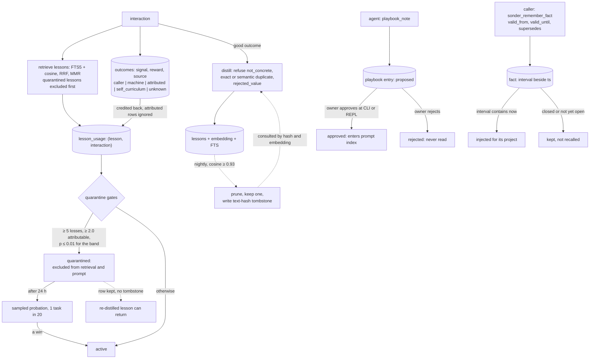

## 1. Executive Summary

Sonder Runtime is a self-modifying terminal agent whose memory credits the
outcome of each interaction back to the lessons retrieved for it, and
quarantines a lesson only when its run of losses is improbable for its own
retrieval-frequency band and it is individually answerable for them. The
weak side is the read surface around that loop: an agent tool searches every
project's facts and interactions, and machine-graded outcomes drive the
quarantine at full weight.

Most of the runtime is out of this atlas's scope: a code-rewriting loop
(`selfmod.py`), a training pipeline, an NPU broker, multi-agent lanes. What is
in scope is a stdlib-only SQLite adapter (`sonder_runtime/adapters/memory_store.py`)
holding interactions, the outcomes credited to them, the lessons distilled
from them, project facts and preferences, plus a Markdown store of
owner-reviewed playbooks beside it.

The quarantine is careful in the places this idea is usually done badly:

- **Blame is split across co-retrieved lessons.** A failing task writes its
  reward onto every lesson retrieved for it, so each loss row counts as
  `1/cohort` and the gate needs 2.0 attributable losses
  (`retriever.py:54`, `:319`). `test_one_failure_cluster_no_longer_quarantines_its_whole_cohort`
  pins it.
- **A loss run is judged against the lesson's own base rate.** Seven
  frequency bands carry measured loss rates from 50.62% down to 1.24%, and the
  run must be improbable at p ≤ 0.01 for the lesson's band (`retriever.py:73-89`).
  The band test computes an explicit `p=0.006`.
- **Quarantine has a route back.** After 24 hours a quarantined lesson is
  admitted on a deterministic one-in-twenty sample of tasks, and a win lifts the
  quarantine on evidence rather than on the seven-day timer (`retriever.py:99-100`, `:494`).

The whole apparatus rests on **who judged the outcome**. `outcomes.source` is
`NOT NULL` with deliberately no default and a closed vocabulary — `caller`,
`machine`, `attributed`, `self_curriculum`, `unknown` (`memory_store.py:73`).
The quarantine excludes heuristically `attributed` evidence and counts
`machine` evidence fully, by design: a test is named
`test_directly_graded_machine_evidence_still_drives_the_gate`. The ranking
tiebreak prefers the caller's population wherever a caller has judged.

Two further mechanisms sit beside the lessons. **Playbooks** are
agent-written notes that wait as `proposed` until the owner approves them at
the CLI or REPL, and only approved entries reach the prompt. **Facts** carry an
optional validity interval the caller asserts, separate from the write time,
and a successor closes its predecessor's interval.

The rejected-value story is half-closed. Near-duplicate pruning writes a
content-hashed tombstone that distillation refuses to re-derive, but quarantine
suppresses a lesson without one, so a lesson quarantined as harmful and then
re-distilled from a fresh interaction can return.

## 2. Mental Model

A memory is a **lesson**, and its life is governed by the outcomes of the
interactions that retrieve it.

```text
interaction happens   -> interactions row (task, retrieved_ctx, response, project, project_explicit)
outcome lands         -> outcomes row (signal, reward, source)  -- source NOT NULL, closed vocabulary
distillation claims   -> lesson_distillations: claimed -> stored | no_lesson | cancelled
                         refusing not_concrete, exact_duplicate, semantic_duplicate, rejected_value
lesson stored         -> lessons row + embedding + lessons_fts
lesson retrieved      -> lesson_usage row links (lesson, interaction)
outcome credited      -> lesson_usage.reward and outcome_source filled in
losses accumulate     -> quarantine when floor, attribution and band test all agree
quarantine            -> excluded before ranking; after 24 h sampled probation; a win exits
pruned as duplicate   -> row deleted, lesson_tombstones row keyed on the text hash
```

Lessons are the procedural layer, and four other durable kinds sit beside them.

- **Facts** are asserted, not earned: `sonder_remember_fact` stores a project
  fact that is injected into every call for that project. A fact may carry
  `valid_from` and `valid_until`, and `supersedes=<id>` closes the earlier
  fact's interval as the new one is stored. A fact outside its interval is kept
  and not recalled.
- **Preferences** carry `confidence`, `evidence_count`, `enabled` and a
  `revision` under `UNIQUE(scope, key)`; a disabled preference is filtered out
  of reads.
- **Playbook entries** are owner-curated notes in Markdown. The agent proposes
  one with `playbook_note`; it stays `proposed` until the owner approves or
  rejects it; only `approved` entries enter the system-prompt index or a topic
  read.
- **Session summaries** condense a conversation per project.

How a lesson stops being believed has three paths, and they differ in what
they remember:

- **Quarantine** — excluded from retrieval because the outcomes credited to it
  went bad, statistically and answerably. Reversible by a probation win. The
  row is kept and no rejected value is recorded.
- **Near-duplicate pruning** — deleted because another lesson says the same
  thing (cosine ≥ 0.93), keeping one representative and writing a
  `lesson_tombstones` row that distillation consults by hash and by embedding.
- **Age-decay ranking** — demoted over a 30-day default half-life blended with
  usage evidence; not exclusion.

A fact stops being believed when its interval closes, either by the
`valid_until` it was written with or by a successor; it can also be deleted by
exact id and project. A playbook entry stops being believed when the owner
rejects or supersedes it.



## 3. Architecture

One local SQLite database is the spine. `sonder_runtime/adapters/memory_store.py`
defines `interactions`, `outcomes`, `lessons` with `lessons_fts`,
`lesson_tombstones`, `lesson_usage`, `lesson_distillations`, `facts`,
`preferences`, `refinement_history`, `sessions`, `session_project_summaries`,
`tasks` with `task_events` and `task_deps`, an `outbox_events` table, and the
authoritative-fact journal tables. The adapter needs no third-party package: it
imports the standard library (`sqlite3`, `array`, `hashlib`, `math` among others)
and sibling modules of `sonder_runtime`. Embeddings are BLOBs stamped
with `embedding_model`, `embedding_revision` and `embedding_dim`, and retrieval
skips a stored vector from a different space rather than scoring it zero.

The memory logic sits in small modules wired to the adapter:

- **`retriever.py`** (670 lines) — hybrid lesson retrieval, MMR selection and
  the quarantine decision (`lesson_quarantine`, `band_loss_rate`,
  `attributable_losses`, `_usage_boost`).
- **`reflection.py`** (520) — distillation and the tombstone refusal; its
  prompts load from editable files under `prompts/` through `prompt_store`.
- **`lesson_decay.py`** (342) — pure age-decay and usage ranking, and
  `detect_contradictions`, which `memory_quality.contradiction_findings` wires
  to the store as a report-only finding.
- **`lesson_pruner.py`** (327) — embedding-cluster near-duplicate removal that
  tombstones each loser after revalidating both vectors under a write lock.
- **`memory_quality.py`** (707) — a read-only auditor for vague lessons,
  duplicates, contradictions and playbook quality.
- **`sonder_runtime/adapters/playbook_store.py`** (405) with
  `playbook_review.py`, `domain/memory/playbooks.py` and
  `application/memory/playbook_context.py` — the playbook store, its approval
  rules and its prompt selection.
- **`sonder_runtime/domain/memory/fact_validity.py`** — the validity interval
  and the predicate every current-fact read uses.
- **`sonder_runtime/adapters/persistence/sqlite/authoritative_memory.py`** and
  **`memory_replication.py`** — an opt-in authoritative fact source with an
  ordered journal.

The root `memory_store.py` is a compatibility alias that replaces itself in
`sys.modules` with the adapter. `sonder_runtime/application/memory/strategy_memory.py`
indexes content-free strategy history from sealed runtime attempts into the
same database; it is peripheral to the lesson loop and not read further here.

### Deployment and ergonomics

- **One SQLite file, no services.** The adapter needs nothing beyond the
  standard library; embeddings come from a local model through `embeddings.py`.
- **The store is inspectable** with any SQLite client, and `store_integrity.py`,
  `sonder_doctor.py` and `memory_quality.py` are shipped audit tools;
  `connect_read_only` opens a `mode=ro` URI so an inspector cannot migrate it.
- **Playbooks are plain Markdown** under the state home, parsed strictly: a
  block with a forged nested entry or an unknown status is skipped.
- **Concurrency is handled for a local store**: claim tokens with owner pid
  and identity on session turns and distillation, and abandoned-claim recovery
  guarded by process-liveness checks.
- **Hosted accounts do not use this memory.** An account-backed HTTP request
  passes `augment=False`, so it neither injects nor trains the lesson store,
  and the global memory tools are refused at the HTTP boundary
  (`sonder_runtime/interfaces/http/serve.py:1593`, `:7647`).

The screen of this checkout found no auto-run surface, two build-time
execution points (`conftest.py` and `tests/conftest.py`), two unpinned
requirement files (`requirements-dev.txt`, `requirements-train.txt`) and no
dependency surface inside the cooldown. The licence is Apache-2.0 with no
rider. Nothing was installed or run; the code was read and cross-checked
against its committed tests.

## 4. Essential Implementation Paths

- **Write / distill** — `reflection.maybe_add_lesson` and the
  `lesson_distillations` state machine: claim an interaction, extract a lesson
  through `reflection_distill`, refuse `not_concrete` (`reflection.py:328`),
  `exact_duplicate` (`:428`), a tombstoned text (`:430`) and a tombstoned
  embedding (`:446`, via `is_tombstoned_duplicate` at `:146`).
- **Credit** — `memory_store.record_outcome_row` (`memory_store.py:965`)
  requires a `source`; `lesson_usage` rows for the interaction receive the
  reward and `outcome_source`. `lesson_usage_history` (`:2347`) drops
  `attributed` rows from quarantine evidence.
- **Retrieve lessons** — `retriever.retrieve_with_ids` (`retriever.py:576`):
  compute `quarantined`, over-fetch FTS hits by that many, rank compatible
  vectors with `exclude_ids=quarantined` (`:612`), fuse by RRF with a bounded
  `_usage_boost`, keep candidates clearing 0.62 (0.70 without two content-word
  anchors), then `memory_rerank.mmr_rerank` at lambda 0.5.
- **Quarantine** — `retriever.lesson_quarantine` (`:391`) with
  `QUARANTINE_MIN_LOSSES = 5`, `QUARANTINE_REPEAT_TASK_MIN_LOSSES = 6`,
  `QUARANTINE_MIN_DISTINCT_TASKS = 2`, `QUARANTINE_MAX_AVG_REWARD = -0.5`,
  `QUARANTINE_MIN_ATTRIBUTABLE_LOSSES = 2.0`, `QUARANTINE_BAND_ALPHA = 0.01`,
  probation after 24 hours at one in twenty, cooldown seven days.
- **Assemble the prompt** — `server.py:4191` reads `facts_for_project(conn,
  project)`, newest first; recall reads `good_interaction_candidate_page`
  with `i.project=? AND i.project_explicit=1` (`memory_store.py:3389-3402`);
  the approved playbook index enters the system prompt (`server.py:2446`).
- **Facts** — `sonder_remember_fact` (`server.py:14438`) parses validity
  through `fact_write_inputs`, refuses a duplicate within the project
  (`find_duplicate_fact_in`, `memory_store.py:3586`) and calls
  `MemoryRepositoryAdapter.add_fact`, which routes to the authoritative source
  when one is composed and to `memory_store.add_fact` (`:3624`) otherwise.
  `sonder_forget_fact` deletes by exact id and project after a matching
  `confirm`.
- **Playbooks** — `playbook_note` (`sonder_runtime/bootstrap/playbooks.py:93`)
  writes a `proposed` entry and records a pending ledger item; the owner's
  `approve` runs `approve_pending` then `PlaybookStore.review`
  (`playbook_store.py:291`) with the content digest.
- **Prune** — `lesson_pruner.prune` from `scripts/nightly_self_improve.py:544`
  with `dry_run=False`; `apply_plan` (`lesson_pruner.py:246`) revalidates both
  vectors under `BEGIN IMMEDIATE` and calls `memory_store.tombstone_lesson`
  (`memory_store.py:2271`).
- **Search** — `memory_search` (`server.py:16651`), an MCP tool and an agent
  tool, reads lessons by FTS and facts, preferences, sessions and interactions
  by `LIKE` over the whole database.

## 5. Memory Data Model

The schema is where the epistemic care shows, and several columns carry a
comment naming the failure they prevent.

`outcomes.source` is the sharpest: `NOT NULL` with **no default**, a closed
`CHECK` vocabulary, and a comment stating why —

> a default is how the original defect would come back, because a writer that
> forgot would keep filing rows under a meaning it never chose.

The system cannot record an outcome without saying who judged it.
`lesson_usage.outcome_source` is nullable because a usage row exists before any
outcome credits it, and the evidence query keeps `NULL` rows on purpose so the
gate does not lose its pre-column history.

`lesson_tombstones` is the rejected-value record: primary key the normalized
text's SHA-256, carrying embedding and vector provenance, and by an explicit
comment never the text. `reason` admits only `near_duplicate_pruned`.
Deleting a source interaction purges the tombstones derived from it
(`memory_store.py:733`). It is kept distinct from privacy deletion:
`delete_lesson` erases, `tombstone_lesson` rejects a value and remembers,
content-free, that it did.

`facts` gained `valid_from`, `valid_to` and `superseded_by` beside `ts`, as
fixed-width UTC text so SQL compares them as strings. The columns are additive
and unbackfilled, so a legacy fact has no interval and stays current. Valid
time comes from the caller and must carry a timezone; `ts` is the write clock.
Closing a predecessor overwrites its `valid_to` and sets `superseded_by`, and
the `UPDATE` re-checks `superseded_by IS NULL`, so a fact gains at most one
successor (`memory_store.py:3674-3703`). When the correction was recorded is
recoverable only from the successor's `ts`.

`preferences` carries `scope TEXT DEFAULT 'global'`, `confidence`,
`evidence_count`, `enabled` and `revision`. Production writes go through
`upsert_preference` (`memory_store.py:3771`), which overwrites the text and
bumps `revision`, and `set_preference_enabled` (`:3974`). `refinement_history`
is append-only by trigger and has a writer, `refinement_transactions.apply_preference_refinement`,
with no caller outside its tests; the repository's own landscape note calls it
"fully built with no production route", and the grep agrees.

Playbook entries are Markdown blocks whose metadata lines carry `id`, `date`,
`category`, `status`, `tainted` and a JSON `provenance`, followed by Body,
Evidence and Triggers. The parser drops a block whose status is outside the
four values or that nests a second entry header.

**Scoping** has three different keys. Interactions, facts and sessions carry
`project`, with `project_explicit` on interactions so a migrated row with a
plausible project string is not recalled into it. Preferences carry `scope`.
Tasks carry `account_scope`, an opaque digest derived from the authenticated
HTTP principal. Lessons and playbooks carry none: procedural knowledge is meant
to cross projects.

The project filter is applied on prompt assembly and not on search.
`facts_for_project`, the interaction recall page and `find_duplicate_fact_in`
take one project, and the last says why in its docstring: *"scoping is a
privacy boundary, not a convenience filter."* `memory_search`
(`server.py:16651`) takes a query and a limit and reads `facts`, `preferences`,
`sessions` and `interactions` with no project or scope predicate. It is on
`REPOSITORY_READ_ONLY_TOOLS` (`server.py:17285`) and
`_PROJECT_BOUND_AGENT_TOOLS` (`:19501`), and `_agent_dispatch` routes it
(`:18516`). An agent working in one project can therefore read another
project's facts and transcripts in one call, and `scope_enforced` is not
awarded. The hosted HTTP surface refuses this tool to accounts, on the stated
ground that direct MCP and local-open deployments belong to one operator.

## 6. Retrieval Mechanics

Lesson retrieval is hybrid and outcome-filtered. The task is embedded and
scored by cosine against every stored vector in the same embedding space,
FTS5 supplies lexical candidates, and the two lists are fused by reciprocal
rank with a bounded tiebreak from outcome history. A fused candidate must clear
0.62 cosine, or 0.70 when it shares fewer than two content words with the task;
the comment cites a reproduced cross-domain false positive at 0.650211. MMR at
lambda 0.5 then picks the final `k`. **Quarantined lessons are removed before
any of this**: the same set is excluded from the vector ranking and filtered
out of the over-fetched FTS hits.

The quarantine decision is evidence-gated, not score-gated: a lesson is
dropped for a documented run of bad outcomes it is answerable for, not for low
similarity, so retrieval quality and lesson trust are separate axes. The tiebreak
(`_usage_boost`) reads the caller's mean wherever a caller has judged the
lesson and the execution mean only otherwise, capped at ±0.01, because a
blended mean let eight self-graded passes outrank a caller's rejection.

The base-rate test needs evidence, so a new lesson cannot be quarantined and a
rarely retrieved one accumulates evidence slowly. That is the right direction
to fail, and it gives a harmful new lesson a grace period proportional to how
often it is used.

Fact retrieval is a filter, not a ranking: every current fact of the project is
a candidate for the bounded facts block, newest first, round-robin with
preference facts. Playbook selection matches topic triggers against the task and
reads up to twelve approved entries within a byte budget.

`memory_search` is the exception to every filter above. It returns FTS lesson
hits through `get_lesson_text` without the quarantine set, so a quarantined
lesson reaches the agent through its own tool, and it returns other projects'
rows as section 5 describes. It does apply the current-fact predicate.

## 7. Write Mechanics

Writes are two-phase and idempotent. An interaction is recorded
synchronously; distillation runs through the `lesson_distillations` state
machine, which claims the interaction with a token and owner identity,
extracts a candidate, and lands in a terminal state with a `result_reason`.
The refusals are the interesting part: `not_concrete` rejects a platitude
before it is stored, `exact_duplicate` and `semantic_duplicate` reject a
restatement, and `rejected_value` rejects a pruned value. The refusal is
recorded against the interaction.

Outcome crediting is the write that powers everything downstream. When an
outcome lands it is attached to the interaction and propagated to the
`lesson_usage` rows for every lesson retrieved, with its source. The store
knows not just that a lesson exists but which interactions used it, how they
turned out, and who judged.

Facts are written on the hot path by `sonder_remember_fact`. Validity input
that names no entity, decision or provenance goes to the legacy store with an
interval; input that does is an authoritative claim and needs the configured
source. A superseded statement can be re-asserted later as a new fact, because
duplicate detection reads current facts only, and a test asserts it.

Playbook notes are written as `proposed` with redaction applied first; an
exact duplicate of any existing entry body in the topic, whatever its status,
is refused, and a near-duplicate is marked. A rejected body therefore cannot be
re-proposed verbatim while the rejected entry exists.

Background work is a nightly job (`scripts/nightly_self_improve.py`): drain
distillation, backfill embeddings, prune near-duplicates. The pruner loads the
newest 1,024 lessons and compares only those (`lesson_pruner.py:26`, `:29`), so
a duplicate pair older than that window is never examined. Quarantine and decay
are computed at read time and cost one ordered scan of `lesson_usage` per
retrieval.

### Operational cost

Distillation is one model call per qualifying interaction — a good outcome,
or a failure with a readable error for a pitfall — deferred through the claim
state machine, with the nightly job draining what is left. Retrieval embeds the task and scans all lesson vectors in the same space
in Python; the prompt carries at most `k` lessons, a bounded facts block and
the approved playbook index, which is frozen per session so it does not move
under a provider's prefix cache.

### An outbox in the memory schema, one layer from the live path

Every memory database carries an `outbox_events` table under
`UNIQUE(aggregate_type, aggregate_id, sequence)`. Its only writer is
`OutcomeService.record`, which records an outcome and appends an
`outcome.recorded` event in one unit of work. The one production constructor
of that service is `MemoryFacade.record` (`sonder_runtime/application/memory/facade.py:63`),
and nothing calls it; the running system records outcomes through
`uow.memory.record_outcome` in `server.py`. A reader who queries
`outbox_events` on a working deployment finds it empty.

The event is built with `sequence=0` hardcoded
(`sonder_runtime/application/memory/outcome_service.py:76`) and inserted with no
conflict clause. An interaction can receive more than one outcome, so the
second outcome for the same interaction would raise inside the transaction
and roll back the outcome with it, once a caller routes through the service.

## 8. Agent Integration

The memory adapter is importable, and the runtime drives it from a REPL, a
headless service, an HTTP server and an MCP surface. The agent's leverage over
lessons is outcome-mediated: it has no `save_lesson` or `forget_lesson` tool;
it acts, an outcome is recorded, and distillation and quarantine decide what
becomes and stays a lesson.

Two memories are written by tool. `sonder_remember_fact` takes text, a project
and optional validity, and `sonder_forget_fact` deletes by exact id after an
exact `confirm`. `playbook_note` proposes an entry, and `playbook_read` returns
approved entries for one topic.

**Playbook review is the one human gate.** The producer is the agent, through
`playbook_note` on MCP or the local agent's tool list. The entry's taint comes
from a context variable, not an argument, and the module says why: *"they are
not public tool arguments that a model could use to self-approve a note."*
`approval_status` returns `proposed` for any tainted note in every approval
mode, including `auto` (`sonder_runtime/domain/memory/playbooks.py:215-220`).

The resolvers are out of the agent's reach:

- the `sonder playbooks approve` CLI and the REPL's `/playbooks approve`, typed
  by the operator, which issue and consume a ledger approval bound to the
  entry's content digest and then set `approved`;
- `permission_approve`, which issues a one-shot approval only for the
  in-process console object, a developer-role token, or
  `SONDER_ALLOW_PERMISSION_EDITS=1` (`server.py:9163-9185`), and which the agent
  loop refuses as a system-operator tool (`server.py:18259`,
  `sonder_runtime/bootstrap/generic_agent_dispatch.py:30`);
- the playbook directory itself, which the control-plane inventory owns so file
  tools cannot write an approved entry into it (`control_plane_paths.py:358`).

`human_review` is awarded on that store. Two limits are stated rather than
counted against it. An agent with a general shell tool could invoke the CLI as
a subprocess, as with any CLI-gated review. And an operator who sets
`SONDER_ALLOW_PERMISSION_EDITS=1` lets a direct MCP client issue the ledger
approval that the next `/playbooks list` reconciles.

Lessons have no review surface; the quarantine that governs them is
statistical and automatic. The `contribute.py` and `pull_community.py` flow
exchanges code modules, not memories.

## 9. Reliability, Safety, and Trust

**Provenance is the strongest work here.** Every outcome records who judged
it, enforced by schema, and a test guards that no production `INSERT INTO
outcomes` omits the column. The provenance is used in two different ways.
Heuristically attributed evidence is dropped from the quarantine evidence and
can never ground a distillation. Machine-graded evidence — the code
gate running a reply's own code — counts toward quarantine fully, and the test
docstring explains the line is "NOT machine-versus-human". So a store fed only
machine-graded outcomes is a store grading itself, however carefully the
attribution is set.

**The quarantine's two statistical guards separate it from the naive
version.** It asks whether the run is improbable for the lesson's own
retrieval band, so a rarely used lesson is not punished for the difficulty of
the tasks retrieval sent it, and whether the lesson is individually answerable,
so a cohort that always fails together does not let each member count the
shared failure. Both are tested with worked probabilities.

### The mutation journal is opt-in

With `[memory_replication] enabled = true`, `compose_memory_unit_of_work`
(`sonder_runtime/bootstrap/app.py:187`) gives every live unit of work an
`SQLiteAuthoritativeFactSource` for one project scope. Each fact write or
delete then appends an ordered `memory_replication_log` row — source, epoch,
sequence, kind, id, version, `upsert` or `delete`, payload, digest — in the
same SQLite transaction as the fact, and a failed append rolls the fact back.
Legacy `add_fact` and `delete_fact` refuse the activated project, so the fact
cannot be changed around the journal. Nothing in production updates or
deletes log rows; `prune_before` exists and only tests call it. `audit_log` is
awarded on this journal.

It covers facts in one configured project, and the default configuration
leaves it off. Lessons, preferences and playbooks have no mutation journal: a
lesson is pruned with only a content-free tombstone left, a preference is
overwritten in place, and a playbook entry's status is rewritten in its file.
`refinement_history`, with its append-only triggers, would cover preferences
and has no production writer.

### Residual risks

- `memory_search` crosses projects and ignores quarantine (section 5).
- `memory_export` dumps lessons, facts, preferences and optionally interactions
  across projects to the caller; the agent loop refuses it as an operator tool.
- Quarantine writes no rejected-value record, so a quarantined lesson
  re-distilled from a fresh interaction can return.
- The pruner's newest-1,024 window leaves older duplicates unpruned.
- There is no encryption of the local database; it is as private as the disk.

## 10. Tests, Evals, and Benchmarks

The suite is large and aimed at the mechanisms this report cares about.
`tests/test_retriever.py` pins the quarantine:
`test_quarantine_judges_a_lesson_against_its_own_frequency_band` (with an
explicit `p=0.006`), `test_positive_outcome_rehabilitates_quarantined_lesson`,
`test_quarantine_reaches_probation_and_a_win_is_the_exit` and
`test_quarantine_still_fires_on_an_unambiguously_harmful_lesson`.
`tests/test_learning_health.py:466` and `:498` add the shared-blame cases.

The must-not-retrieve cases are the strong kind, each with a returned control
in the same populated store. `test_prompt_and_trace_omit_quarantined_lesson`
(`tests/test_orchestrator_memory.py:94`) asserts a neutral lesson reaches the
prompt and trace while the quarantined one reaches neither.
`test_retrieve_excludes_repeated_unanimous_failure_lesson`
(`tests/test_retriever.py:305`) asserts the healthy lesson is returned on both
paths and the failing one is not. `test_remember_fact_supersedes_and_recall_drops_the_old_fact`
(`tests/test_fact_validity.py:314`) asserts the successor is in the injected
prompt and in `memory_search` while the superseded fact is in neither, and
`:331` asserts an expired fact is stored and not injected.
`test_a_default_note_is_proposed_and_never_reaches_the_prompt_index`
(`tests/test_playbook_safety_gates.py:57`) has no returned control.

The tombstone has tests of its own: `tests/test_reflection.py:197` refuses a
pruned value by exact text and `:216` a reworded one whose embedding matches;
`tests/test_lesson_pruner.py` asserts tombstones carry no text, that a refreshed
embedding blocks a planned deletion, and that a large corpus is pruned in the
newest window. These are write refusals rather than retrieval omissions.

Nothing asserts that `memory_search` keeps another project out, and nothing
could pass: the function takes no project. An end-to-end retrieval benchmark
is also missing. `tune_min_sim.py` calibrated the 0.62 floor on 22 positive and
15 noise probes, and the band rates are measured from the live store in
comments, but no committed run characterises the loop's effect on outcomes.

## 11. For Your Own Build

### Steal

**Credit outcomes back to the memories that were retrieved, and record who
judged the outcome.** The `interaction → outcome(source) → lesson_usage` chain
is the loop most lesson stores omit, and a `source` column enforced `NOT NULL`
with a closed vocabulary is what lets later math tell a caller's judgement
from the machine's.

**Before suppressing a memory for bad outcomes, check the base rate and the
attribution.** A run of losses is evidence only if it is improbable for how
often the memory is used, and only the memory's own share of each failure
counts.

**Make suppression reversible with a sampled probation.** A quarantined memory
that gets a deterministic fraction of traffic can earn its way back on
evidence; a permanently excluded one cannot.

**Keep review state out of the agent's arguments.** Sonder's playbook taint is
a context variable that only the owner's REPL path sets, so no tool argument
can mark a note trusted, and the approval is bound to a content digest checked
again under the write lock.

**Tombstone a rejected value without keeping the value.** A normalized-text
hash plus the embedding, consulted by exact and semantic match, rejects
re-derivation while staying privacy-safe and distinct from erasure.

**Give asserted facts a validity interval and an explicit successor.**
Supersession by id rather than inference, closing the old interval exactly at
the new one's start, keeps "what was true" queryable without a resolver.

### Avoid

**Do not let a search tool bypass the scope the prompt assembler applies.**
Sonder filters facts and recalls by project when it builds a prompt, and its
`memory_search` returns every project's rows to the same agent.

**Do not let outcome provenance be optional.** A nullable-with-default
`source` is how a machine-graded outcome becomes indistinguishable from a
caller-graded one.

**Do not ship an audit table without a writer.** `refinement_history` has
triggers, version checks and a rollback path, and preferences change through
an upsert that never touches it.

**Do not suppress without a rejected-value record if re-derivation is
likely.** Pruning tombstones and quarantine does not, so the harmful lesson is
the one that can come back.

**Do not bound a maintenance sweep newest-first without a cursor.** The
pruner's window never reaches the older half of a large store.

### Fit

This suits a builder of a self-improving agent that accumulates procedural
lessons and can observe outcomes; the quarantine's statistical guards are
worth lifting whole into a different store. It fits a single machine and one
local SQLite file, used by one operator.

Walk away if you cannot produce a trustworthy outcome signal, since
machine-graded outcomes drive the gate at full weight. Walk away if projects
must be isolated from the agent itself, since `memory_search` reads across
them, or if you need a mutation audit on lessons or preferences. Treat the
surrounding runtime as out of scope: the memory adapter, the retriever and the
playbook store are the parts worth adopting.

## 12. Open Questions

- What fraction of outcomes on real traffic carry `caller` provenance versus
  `machine` or `unknown`? The improvement report shows the buckets separately,
  and no committed run reports the ratio.
- Does the same tombstone check ever run against *quarantined* lessons? At this
  pin it does not; `reason` admits only `near_duplicate_pruned`.
- Are the quarantine constants — five losses, two distinct tasks, 24-hour
  probation, one in twenty — tuned against outcomes, or chosen? The band rates
  are measured; the gates are defended in comments.
- Is `memory_search` meant to cross projects on the local surface, or is the
  missing predicate an omission? The HTTP layer refuses it to accounts as
  global; nothing on the local surface says why it should be.
- Will `refinement_transactions` be routed into the preference writes, and
  will replication be enabled by default?

## Appendix: File Index

**Store and schema**

- `sonder_runtime/adapters/memory_store.py` — schema, distillation state
  machine, outcome crediting, `outcomes.source` enforcement, the
  `lesson_tombstones` registry, fact validity and supersession, preferences,
  recall candidate pages.
- `sonder_runtime/domain/memory/fact_validity.py` — `FactValidity`,
  `CURRENT_FACT_PREDICATE`, `fact_write_inputs`.
- `sonder_runtime/adapters/memory_repository.py` — routes fact writes to the
  legacy store or the authoritative source.
- `sonder_runtime/adapters/persistence/sqlite/authoritative_memory.py`,
  `memory_replication.py`, `sonder_runtime/bootstrap/app.py` — the opt-in fact
  journal and its composition.
- `memory_store.py` — root alias for the adapter.

**Retrieval and trust**

- `retriever.py` — hybrid retrieval, MMR, `lesson_quarantine`,
  `band_loss_rate`, `attributable_losses`, `_usage_boost`.
- `lesson_decay.py` — age-decay ranking and `detect_contradictions`.
- `sonder_runtime/adapters/memory_rerank.py` — MMR selection.
- `server.py` — prompt assembly (`:4191`), `sonder_remember_fact`,
  `memory_search`, `memory_export`, `permission_approve`, agent tool lists.

**Curation**

- `reflection.py` — distillation and the tombstone refusals
  (`is_tombstoned_duplicate`).
- `lesson_pruner.py`, `scripts/nightly_self_improve.py` — near-duplicate
  pruning and its nightly caller.
- `memory_quality.py` — vague, duplicate, contradiction and playbook findings.

**Playbooks**

- `sonder_runtime/adapters/playbook_store.py`, `playbook_review.py`,
  `sonder_runtime/domain/memory/playbooks.py`,
  `sonder_runtime/bootstrap/playbooks.py`,
  `sonder_runtime/application/memory/playbook_context.py`,
  `sonder_runtime/interfaces/cli/playbooks.py`.

**Unwired**

- `refinement_transactions.py` — preference apply and rollback journal, no
  production caller.
- `sonder_runtime/application/memory/outcome_service.py`, `facade.py` — the
  outbox producer, no production caller.

**Tests**

- `tests/test_retriever.py` — quarantine base rate, probation, rehabilitation,
  exclusion.
- `tests/test_learning_health.py` — shared-blame cohort cases.
- `tests/test_outcome_source.py` — provenance populations and the gate.
- `tests/test_orchestrator_memory.py` — quarantined lesson omitted from prompt
  and trace.
- `tests/test_reflection.py`, `tests/test_lesson_pruner.py` — tombstone
  refusals and pruning.
- `tests/test_fact_validity.py` — intervals, supersession, exclusion.
- `tests/test_playbook_safety_gates.py`, `test_playbook_surfaces.py`,
  `test_playbook_control_plane.py` — playbook approval.
- `tests/test_authoritative_memory_source.py` — journal composition and
  rollback.

### Recorded searches

Run from a clone at the pin with `git grep`, which reads tracked files
regardless of `.gitignore`.

- Callers of the preference journal:
  `git grep -n -E 'apply_preference_refinement|rollback_preference_refinement|INSERT INTO refinement_history' -- ':!tests'`
  returns the definitions in `refinement_transactions.py` only.
- Writers of preferences:
  `git grep -n -i -E '(INSERT( OR [A-Z]+)? INTO|UPDATE|DELETE FROM)[[:space:]]+preferences\b' -- ':!tests' ':!docs'`
  returns `memory_store.py:3775`, `:3977`, the projection's replay, and
  `refinement_transactions.py`.
- Deletes of the fact journal:
  `git grep -n -i -E '(DELETE FROM|UPDATE)[[:space:]]+memory_replication_log'`
  returns `memory_replication.py:677`, inside `prune_before`;
  `git grep -n prune_before` finds callers in `tests/` only.
- Project predicate in `memory_search`: `sed -n 16651,16700p server.py` shows
  the FTS call and four SQL queries; no WHERE clause names `project` or `scope`.
- Tombstone writers:
  `git grep -n -E 'INSERT (OR [A-Z]+ )?INTO lesson_tombstones' -- ':!tests'`
  returns `memory_store.py:2288` only, inside `tombstone_lesson`.
- Playbook approval reach:
  `git grep -n -E 'approve_pending|\.review\(|note_context\(' -- ':!tests' ':!docs'`
  returns the CLI, the REPL bootstrap in `sonder_runtime/__main__.py`, the
  store's own supersession, and the reconcile path.
- Outbox producer:
  `git grep -n -E 'OutcomeService\(|\.memory\.record\(' -- ':!tests'`
  returns `facade.py:63` only, and `git grep -n 'facade\.record\b'` returns
  nothing.

## History

**2026-10-15** — [`ad7e59d45fb3792c638e690e9aeb02773fc5ccc0`](https://github.com/Krilliac/Sonder-runtime/commit/ad7e59d45fb3792c638e690e9aeb02773fc5ccc0) — 707 commits on. `scope_enforced` is withdrawn, wrong at 1a41a88: `memory_search` reads every project's facts, sessions and interactions ([section 5](#5-memory-data-model)). `bitemporal` is gained on fact validity intervals ([`0ada6adde6b74b98e33582acf5872551dc4c60b2`](https://github.com/Krilliac/Sonder-runtime/commit/0ada6adde6b74b98e33582acf5872551dc4c60b2)) and `human_review` on owner-approved playbooks ([`7da8c7cd995af92660721c22a9633191dab79a5d`](https://github.com/Krilliac/Sonder-runtime/commit/7da8c7cd995af92660721c22a9633191dab79a5d)), in [section 8](#8-agent-integration). `audit_log` was wrong at 1a41a88, since `refinement_history` has no production writer at either pin; it holds on the opt-in fact journal ([section 9](#9-reliability-safety-and-trust)). Also wrong then: account scope on preferences, caller-over-machine quarantine weighting, the outbox constructor, four module locations. The quarantine moved one line. Screened from a full clone: no auto-run surface, two `conftest.py` execution points, two unpinned requirement files, nothing inside the cooldown; Apache-2.0, no rider. Nothing was installed, built or run.

**2026-09-19** — [`1a41a88d2442302421e1cf8c0893ca3edef537ee`](https://github.com/Krilliac/Sonder-runtime/commit/1a41a88d2442302421e1cf8c0893ca3edef537ee) — `trust_state` re-tested at an unchanged pin against the narrowed line, which asks whether a state decides membership or order. This one decides membership and never touches order: `quarantined_lessons` is computed from the usage statistics and its result is passed to the ranker as `exclude_ids` (`retriever.py:242`, `:247`), so a quarantined lesson is dropped before scoring rather than pushed down it. The state is derived per call rather than stored on the row, which this atlas usually treats as disqualifying — the distinction that matters is what it is derived *from* and what it does. Here it is derived from durable outcome records and it excludes, where the cases the atlas withholds derive a belief and then rank with it.

The three gates are now in the record because the third is the part worth copying. Beyond a raw loss floor and a blame-adjusted volume that stops co-failing lessons claiming the same failures as independent evidence, the run of losses must be improbable for the base loss rate of the lesson's own retrieval-frequency band — so a rarely-retrieved lesson is not punished for the unusual tasks that retrieval sends it. A quarantine with a stated null hypothesis rather than a threshold. Evidence is scoped to the epoch since the last grounded success, so a lesson can recover and can also relapse, and probation gives it a production path back to a win. Re-read from a fresh clone; nothing was installed and no suite was run.

**2026-09-16** — [`1a41a88d2442302421e1cf8c0893ca3edef537ee`](https://github.com/Krilliac/Sonder-runtime/commit/1a41a88d2442302421e1cf8c0893ca3edef537ee) — re-pinned after 1 commit. It touches fifteen files and none of them is anchored here: the change isolates nightly workspace paths, retires a stale CI recovery workflow, and adjusts the runtime payload and system-profile ownership. `retriever.py`, `grounded_extraction.py`, `adapters/memory_store.py` and all five cited test files are byte-identical, so every anchor, line number and quotation in this report is exact at the new pin and all five marks stand on unchanged code. Nothing was installed, built or run.

**2026-09-13** — [`cd40b944bb029e20ae0c480a5a4ed9c9d9c6a190`](https://github.com/Krilliac/Sonder-runtime/commit/cd40b944bb029e20ae0c480a5a4ed9c9d9c6a190) — 333 commits and about 163,000 added lines past the previous pin, and **the mechanism this report is named for is byte-identical**: `retriever.py` and `reflection.py` are unchanged, and `band_loss_rate` (:309), `_attribution` (:372) and `lesson_quarantine` (:390) all resolve to the same line numbers they were cited at. All five marks re-verified at the new pin.

What arrived is beside the store rather than inside it: a bounded ordered journal for authoritative fact mutations that commits in the same SQLite transaction as the fact, with a committed test that the fact is rolled back when the journal rejects. Beside it sit a pure retention-eligibility gate that touches no database, and a write-path duplicate check scoped to one project, whose call site and helper docstring both state that matching across projects would leak. The `audit_log` and `scope_enforced` records are extended to name these as second subsystems. The row-level `tombstoned` column on `memory_authoritative_fact_state` does not extend the `tombstone` mark, which is earned on the lesson text.

One near-miss worth recording as method: `find_duplicate_fact` has no caller outside its own test, which reads as a declared-and-unwired mechanism until a whole-tree grep finds the write path calling the sibling `find_duplicate_fact_in` at `server.py:13495`. Two variants exist because some callers hold a repository and some a connection; only one is wired, and the mechanism is live.

**2026-08-22** — [`eb93f60d8380b096a6fefbf34c053fb20dccde4f`](https://github.com/Krilliac/Sonder-runtime/commit/eb93f60d8380b096a6fefbf34c053fb20dccde4f) — re-pinned 474 commits and +146,315 lines on. Screened again: no auto-run surface, two build-time execution points, two unpinned surfaces; nothing was installed and nothing was run. Marks unchanged at `trust_state`, `scope_enforced`, `audit_log`, `negative_eval` and `tombstone`.

**The memory layer is the part that did not move.** Across the files this report's appendix names, the diff is thirteen insertions and sixty-five deletions, and most of that is a package reorganisation — the root shims resolve into `sonder_runtime.adapters`, and `mmr_rerank.py` became `sonder_runtime/adapters/memory_rerank.py`, corrected in the appendix. Every quarantine, attribution, base-rate and tombstone mechanism this report describes is byte-identical, so the marks stand without re-derivation. The growth is in the runtime: HTTP fanout, A2A discovery, resumable streams, receipts on artifacts, and CI portability.

Two substantive changes. `RECALL_CANDIDATE_TIME_LIMIT_S` moves from 0.5 to 1.0 with the reasoning committed beside it and the honest note that the deadline is a backstop — *"the row and byte caps remain the primary work bound"*. And migration revision 5 adds a transactional outbox to the memory schema, described in section 8: the table ships on every install, the producer sits on a service the running system does not call, and the event it would write hardcodes a sequence number that a second outcome for the same interaction would collide with.

**2026-08-15** — [`53a6ac550488f9fd9d59dea61fb4bcea85a6dc03`](https://github.com/Krilliac/Sonder-runtime/commit/53a6ac550488f9fd9d59dea61fb4bcea85a6dc03) — re-pinned at HEAD, around fifty commits past the first reading. Screened again before reading: no auto-run surface, two build-time `conftest.py` points, two unpinned dev/train ranges, nothing inside the cooldown; nothing was installed or run. [`ec351a477e325b9c66eca17df8f3a5d612d063d7`](https://github.com/Krilliac/Sonder-runtime/commit/ec351a477e325b9c66eca17df8f3a5d612d063d7) added a `lesson_tombstones` table keyed on a pruned lesson's normalized-text SHA-256 plus its embedding — content-free by an explicit comment — and `reflection.py` now refuses a re-distillation matching one by exact hash or by embedding (`result: rejected_value`); the near-duplicate pruner writes a tombstone as it deletes. That earns `tombstone` and closes the re-derivation gap for the pruning path, leaving quarantine as the one suppression that still keeps a row without a rejected-value record.

[`e33c604468d0da2561477b29c6f694c9cfd3c4ff`](https://github.com/Krilliac/Sonder-runtime/commit/e33c604468d0da2561477b29c6f694c9cfd3c4ff) added a project-scoped `delete_fact`, and [`03455668e4b4718a833cb78a138020d64b892970`](https://github.com/Krilliac/Sonder-runtime/commit/03455668e4b4718a833cb78a138020d64b892970) surfaces `legacy/unknown` outcome provenance as its own bucket in the improvement report rather than folding it into a blended rate. `memory_store.py` is 3,632 lines; the tree is ~259,800 lines of Python across 743 files, 362 test files.

**2026-08-14** — [`2a11324cbb131c76572724ac1fe47362a4aedf83`](https://github.com/Krilliac/Sonder-runtime/commit/2a11324cbb131c76572724ac1fe47362a4aedf83) — first reading. Screened before opening: no auto-run surfaces, no dependency surfaces inside the cooldown, two build-time execution points (`conftest.py`), two unpinned dev/train requirement ranges. Nothing was installed or run; the quarantine's base-rate and attribution guards, the outcome-provenance enforcement, and the retrieval exclusion were read from `retriever.py`, `memory_store.py` and `lesson_decay.py` and cross-checked against the committed tests named above.
