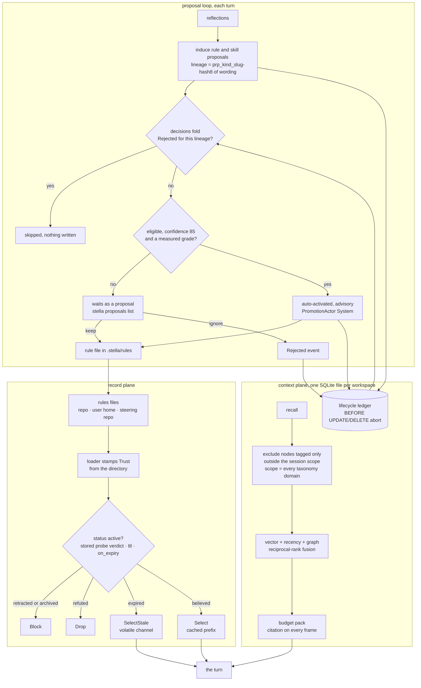

## 1. Executive Summary

Stella is a terminal coding agent in Rust with two memory planes. The **record
plane** holds policy: rule files that steer the prompt, each carrying a truth
axis that a sweep re-probes before the record may steer, with a refuted claim
dropped and an expired one demoted out of the cached prefix. The **context
plane** is one SQLite file per workspace holding a property graph, an embedding
index and episodic memory, beside an append-only ledger whose immutability is a
database trigger. The weak side is two mechanisms the code describes most
carefully: the domain scope recall receives is the whole taxonomy, and the
world-time axis has no producer other than a scan clock.

Its own header calls the context plane the single door between the engine and
everything the agent knows that is not in the prompt.

**Append-only is a database trigger, not a rule.** The lifecycle ledger's
migration installs `BEFORE UPDATE` and `BEFORE DELETE` triggers that abort, and
the module says why in one sentence: the guarantee then holds against every
writer *"including a future one that has forgotten this module exists."*

**Authority is stamped from the filesystem.** A record's `origin`, `truth.basis`
and `verified_by` are fields inside the file being judged. The trust tier is set
by the loader from which directory the file was read out of, and nothing in the
file can change it. The default is the lower tier, with a test asserting that a
forgotten stamp fails toward the restrictive answer.

**A committed claim is re-checked before it can steer.** The truth sweep's own
motivating case is a `CLAUDE.md` that says *"we use Node 20"* while `.nvmrc`
has said `22` for months. A refuted claim is dropped from the block; a merely
expired one is demoted into the volatile channel, where the reason can be said
without putting a clock into the byte-stable cached prefix.

**A declined proposal stays declined.** Rules and skills are induced from the
agent's reflections, and each proposal's lineage is a hash of its wording.
`stella proposals ignore` appends a `Rejected` event to the ledger, and the next
induction drops that lineage before it writes anything.

**The scope and the second time axis are thinner than their names.** Recall
excludes nodes tagged only with out-of-scope domains, and the one production
caller passes every domain in the workspace taxonomy as the scope. Edges carry
`valid_from` and `valid_to`; no production writer sets the first, and the
second is the clock of the scan that noticed a file had gone.

## 2. Mental Model

Two planes, and it is worth keeping them apart.

**The context plane** is the graph: nodes, edges, embeddings, episodes. It
answers *what do we know*. A node is upserted by identity and its content is
overwritten in place. Forgetting one writes a `superseded_at` marker that every
candidate reader filters on, and a later upsert of the same node clears it.

**The record plane** is policy: rule files and record files, merged into one
order and rendered into the prompt. It answers *what should steer this turn*.
Records carry a truth axis, get probed on a cadence, and are dispositioned
before rendering.

**The proposal loop joins them.** Each turn's reflections are mined into skill
and rule proposals and appended to the ledger. A skill that clears the
distinct-task bar is written as a file. A rule is written only on a person's
Keep, or by auto-activation at confidence 85 with an environment-measured grade,
and always as advisory. A Keep, an Ignore and an auto-activation are each an
immutable event, and the loop reads them back by lineage.

The design constraint that shapes the record plane is prompt caching. The
`must`/`should` records ride a byte-stable cached prefix built once per session,
so nothing turn-varying may enter it. That is why a stale record is moved to the
volatile channel rather than annotated in place, and why staleness is a separate
derived selection-health value rather than a record status.

## 3. Architecture

A Cargo workspace of thirty crates. The memory paths are `stella-context` (the
store, recall and the ledger), `stella-records` (record parsing, the truth sweep,
rendering and trust), `stella-learn` (the miner) and the memory, proposals and
context modules of `stella-cli`, which wire them into a session. The TUI, the
fleet, the autonomy loop, plugins and model adapters touch memory only through
those paths.

Policy records arrive from three places. The user's `~/.stella/rules` loads at
user trust. The repository's `.claude/rules` and `.stella/rules` load at project
trust, and only when the session's authority policy allows project prompts. The
third is the `steering/` folder of an Oxagen steering repository, recognised by
a `governance/v1` or `workspace/v1` marker and gated by the same project check.

A steering record loads at project trust and keeps the `id` and `hash` Oxagen
assigned. It skips the one-sentence and compound-claim checks, because its
statement is a Markdown body, and it carries no truth block. A record targeting
tools, skills, a toolbelt or other repositories is withheld rather than
broadened.

Schema v14 adds two read-only views, `export_memories_v1` and
`export_memory_uses_v1`, for other programs on the same machine. The first lists
each memory's live revision while its mirror node is live. The second lists the
ledger's `context_use` rows for memory nodes, with the row id as a resumable
cursor.

## 4. Essential Implementation Paths

- **The plane's contract:** `crates/stella-context/src/lib.rs`.
- **Store and schema:** `crates/stella-context/src/store.rs`,
  `store/schema.rs`, `store/node.rs`, `store/edge.rs`.
- **Ledger:** `crates/stella-context/src/store/ledger.rs`.
- **Write-back:** `crates/stella-context/src/writeback.rs`.
- **Recall and scope:** `crates/stella-context/src/retrieval.rs`,
  `retrieval/scope.rs`, `store/domain.rs`, and the caller in
  `crates/stella-cli/src/contextgraph.rs`.
- **Truth sweep and rendering:** `crates/stella-records/src/records/sweep.rs`,
  `registry.rs`, `render.rs`, `trust.rs`.
- **Proposal loop:** `crates/stella-cli/src/memory/learning.rs`,
  `crates/stella-cli/src/proposals_cmd.rs`,
  `crates/stella-records/src/context_record/lifecycle.rs`.

## 5. Memory Data Model

Nodes carry a typed kind — file, symbol, concept, fact, episode, person,
artifact, task, memory — and an unknown stored kind reads back as `concept`
rather than failing. A node's public id is a hash of its kind and natural key,
so an upsert of the same identity lands on the same row and overwrites its
content.

Edges carry four time columns: `valid_from` and `valid_to` for world time,
`recorded_at` and `superseded_at` for belief time. Nodes carry the same four;
two are never written, and the row type deliberately does not project them.
The schema comment says so: fact history is recoverable, node content history
is not.

The world-time columns on edges have one live writer. `FactAssertion` documents
`valid_from` as world time that may precede recording, and its only production
constructor, `record_taxonomy`, leaves both bounds empty on a multivalued
`covers_path` fact. Anchors to files are written with both bounds empty.
`valid_to` is set by the anchor scan, at mount and from
`stella memory validate --end-stale`, to the scan's own clock when a file is
found missing. The correction path closes every live single-valued belief at the
new fact's `valid_from` or at now, and no production fact reaches it.

On the record side, `RecordStatus` is the stored canonical field — active,
retracted, archived — while `EffectiveStatus` is derived at query time from the
historical prefix, adding superseded and expired, and is excluded from the
record hash because it is a projection rather than state.

A proposal record carries the miner's candidate id, a title, a body, its
supporting observations, a provenance grade derived from them, a score and a
confidence. Its lineage is `prp_<kind>_<candidate_id>`, namespaced by kind so
declining a rule does not decline the skill mined from the same lesson.

`EpisodeOutcome` carries an `Unverified` value: the episode ran to completion
and nothing proved it. Not `Success`, because episodes are recalled into later
sessions as grounding; not `Failure`, because nothing found the work wrong.

## 6. Retrieval Mechanics

Recall fuses vector, recency and graph-adjacency channels by reciprocal rank,
deduplicates by content hash, and packs to the caller's token budget. Every
frame must carry a human citation label, and a frame built without one is a
`MissingCitation` error; assembly reports what it dropped; weak coverage falls
back to bounded lexical search, labelled as such.

**Scope is an exclusion set built by anti-join.** `node_ids_excluded_by_scope`
returns every live node that carries a domain tag and none in scope, and recall
removes them before ranking. Untagged nodes stay candidates. The production
caller, `ScopedStore::query`, builds the scope with `session:
self.domains.names()`, so the session scope is every domain in
`.stella/domains.toml`. Node tags come from that taxonomy, so the filter
excludes only a node tagged with a domain since removed from it. The per-query
scope, derived from the files the goal names, ranks by overlap and serves as
admission evidence when it is a proper subset of the session; it never
excludes.

Live recall passes `valid_at = now`, so an anchor whose world validity the scan
ended stops feeding graph adjacency. An `as_of` query reads belief time only.

Point-in-time recall and suppression both apply before the budget. A suppressed
node is filtered at the SQL boundary; quarantine, which is derived from
untruthful-citation counts and stored nowhere, arrives as an excluded-id set
applied where candidate metadata is assembled.

Policy records reach the prompt by a separate path. `assemble_system_prompt`
renders the registry's cached channel, and each turn renders the volatile
channel; both go through `channel_of`, which drops any record whose disposition
is not selected. The workspace's `.stella/memories/` files are appended to the
same prompt when project prompts are allowed, with no disposition.

## 7. Write Mechanics

Every write batch is one transaction. Vectors are keyed by content hash and
embedder fingerprint together: identical content is never re-embedded, and
retrieval never mixes fingerprints.

Upserting a node clears its `superseded_at`, and the comment states the intent:
writing a node is the claim that it holds, so re-learning a forgotten memory
lifts the marker exactly as `restore_node` would.

The single-valued fact path closes every live belief for a subject and
predicate, not only the newest; the comment records the bug it replaced, an
`ORDER BY id DESC LIMIT 1` that left older beliefs open. No production caller
asserts a single-valued fact.

Compaction reclaims only derived index entries whose owner is gone, because
deleting them cannot change what `facts_as_of` answers; edges, memory revisions
and superseded node rows are named exclusions.

The proposal loop writes to the ledger before it writes a file. A proposal is
appended whether or not it is eligible. A rule file lands only in a workspace
whose prompts the session may write, and an auto-activation is refused by the
provenance gate when its only evidence is mined reflection.

## 8. Agent Integration

A terminal agent with its own TUI, an MCP crate, a plugin system with a consent
prompt and a verification ladder, an autonomy layer, a fleet layer and an
observatory. The agent's tools are a shell, file tools confined to the
workspace, one search, a task board, delegation, a scratch state plane, an
environment probe, a question tool and forge tools.

None of those tools writes a proposal decision or a promotion. The review and
governance verbs are CLI subcommands — `stella proposals list`, `keep`, `edit`,
`ignore` and `retract`, and `stella context promote` and `govern` — and the
shell tool can reach them.

## 9. Reliability, Safety, and Trust

**Trust state — awarded.** A stored `status` and a stored probe verdict each
decide whether a record reaches the prompt, and the renderer removes the
unselected ones rather than annotating them. The split between *refuted* and
*expired* is the part worth copying: one has been measured against the world and
lost, the other has gone unchecked, and they get opposite defaults.

**Tombstone — awarded**, on the proposal loop rather than the context plane. A
declined proposal's lineage is a hash of its wording, the decline is a ledger
event, and both halves of induction skip it before anything is written. The
codebase also calls `supersede_node` a tombstone; that marker is keyed on the
row, and an upsert of the same node lifts it.

**Audit log — awarded.** Triggers, not convention; content-derived ids so a
replay is a no-op; a different hash under the same id raised as an error. The
ledger records proposals and decisions, not context-plane node edits.

**Human review — awarded.** A rule proposal below the auto-activation bar waits
until a person keeps it, and blocking enforcement waits for a grant the loop
cannot write: `PromotionEventRecord::new` refuses blocking from a system actor
or an auto-activation. The agent's declared tools carry no review verb. The
limit is the shell: `stella proposals keep` and `stella context promote` are
reachable through it, and record `$USER` or an `--approver` flag unverified.

**Negative eval — awarded.** The assertion that an excluded id is absent from
the dropped list too distinguishes a filter applied before ranking from one
applied after.

**Bi-temporal — withheld.** Edges carry both axes and the neighbour query
applies both in one predicate. The world axis has no producer that records when
a fact became true: `valid_from` is never set by a production caller, and
`valid_to` is the scan clock at the moment a missing file was noticed. That is
an observation time.

**Scope enforced — withheld.** The exclusion is real code applied during
retrieval, and the scope it receives is the entire taxonomy, so no stored scope
key narrows what a session reads. Workspace isolation is a separate SQLite file
per workspace, a path rather than a key.

## 10. Tests, Evals, and Benchmarks

No paper on arXiv and no `CITATION.cff`. `docs/papers/` holds four
project-written analyses of the architecture; none measures memory.

Tests live beside the code as Rust unit modules, with integration suites per
crate. I ran none of them for this reading.

The recall suite is the one to read. The docstring on each case names the
defect it prevents — suppression running after the budget, so a one-frame recall
returned zero frames; a point-in-time parameter that *"looked honored and was
not"*. The proposal guarantees in `memory/learning/guarantees.rs` pin the
tombstone from both sides: a declined proposal is not written back by a later
session over the same log, and a later Keep lets it promote.

`bench/evidence/tb21-hh10-20260731/` commits a Terminal-Bench 2.1 head-to-head
over 89 tasks, one attempt each: Stella at a 65.17% pass@1 and a Claude Code
arm at 49.44%, on the same host and model, with per-trial rows, a score file and
a preregistration. It measures the coding agent end to end, not memory.

Undocumented public items in `stella-context` fail the build under
`clippy -D warnings`, and the append-only guarantee is checked by the database
rather than by a test.

## 11. For Your Own Build

### Steal

- **Enforce append-only in the storage engine.** A `BEFORE UPDATE` trigger that
  aborts costs one migration and survives every future writer.
- **Stamp authority from something the artefact cannot write.** A record's own
  `origin` field is worth exactly as much as the trust you already extend to
  whoever wrote the file.
- **Separate refuted from expired.** Dropping every claim whose owner went on
  holiday makes a time-to-live a foot-gun; keeping a measured-and-lost claim
  with a warning attached is the harm rather than the mitigation.
- **Key a decline on the proposal's wording and read it before writing.** A
  decline stored on a record nobody re-reads comes back the next turn.
- **Apply suppression before the budget.** Filtering after ranking spends a slot
  on a row you then throw away.

### Avoid

- **A scope whose only caller passes everything.** Check what the production
  caller hands the filter, not what the filter does with a narrower value.
- **A world-time column whose only writer is a scan clock.** "When did we
  notice" and "when did it stop being true" are different questions, and the
  column answers the first.
- **Review verbs reachable from the agent's own shell.** A CLI that records
  `$USER` as the actor is a person's door only when the agent has no shell.

### Fit

A worked example of policy memory whose claims expire, get re-probed and change
what the agent sees, and of a proposal loop that remembers what a person
declined. It is not a template for scoped retrieval or valid-time history.

## 12. Open Questions

- The session scope is every taxonomy domain. Is a narrower session scope — a
  sub-agent's or a worktree's domains — intended, and would it come from the
  caller or from the taxonomy?
- `FactAssertion::valid_from` is documented as world time that may precede
  recording. Which writer is meant to supply it — the taxonomy, a git-history
  provider, or the model?
- Node content is overwritten in place while the valid-time columns for it exist
  and are deliberately unprojected. Is node versioning a planned step?
- The decline key is the representative wording's hash. Is re-clustering under a
  different representative expected to re-surface a declined lesson?

## Appendix: File Index

| Path | What to read it for |
| --- | --- |
| `crates/stella-context/src/store/ledger.rs:1-58` | Append-only by trigger, and why a replay is a no-op |
| `crates/stella-context/src/store/schema.rs:394-401` | The two triggers |
| `crates/stella-context/src/store/edge.rs:26-52`, `:191-230` | Both time axes in one predicate; close versus end world validity |
| `crates/stella-context/src/writeback.rs:199-243`, `:1014-1098` | `FactAssertion` and the single-valued correction |
| `crates/stella-cli/src/memory/anchor_scan.rs:166-185`, `:236-250` | The only writer of `valid_to` |
| `crates/stella-context/src/retrieval/scope.rs:21-59` | The two scopes and why they are separate |
| `crates/stella-context/src/store/domain.rs:103-143` | The exclusion anti-join |
| `crates/stella-cli/src/contextgraph.rs:150-168` | The session scope the production caller passes |
| `crates/stella-records/src/records/sweep.rs:1-37`, `:225-276` | Refuted versus expired, and the disposition |
| `crates/stella-records/src/records/registry.rs:353-375`, `:553-574` | Status and retirement to `Block` |
| `crates/stella-records/src/records/trust.rs:1-90` | The directory-stamped tier |
| `crates/stella-records/src/ingest/steering.rs:586-628` | Steering records: project trust, no truth block |
| `crates/stella-cli/src/memory/learning.rs:1104-1190`, `:1296-1318` | Decline consulted; auto-activation gate |
| `crates/stella-cli/src/proposals_cmd.rs:1-31`, `:254-262`, `:400-430` | The review surface and the decisions fold |
| `crates/stella-cli/src/memory/learning/guarantees.rs:767-840` | The decline tests |
| `crates/stella-context/src/retrieval/tests/recall.rs:453-594` | The must-not-retrieve cases |

### Recorded searches

Run at the tree root of the pinned checkout with `/usr/bin/git grep`.

- `git grep -n 'session: self.domains.names()' -- crates/stella-cli/src/contextgraph.rs` — `:160`, the same line at both pins.
- `git grep -n -E 'RecallScope \{' -- '*.rs' ':!*tests*'` — the struct, its impl, and one construction at `contextgraph.rs:159`.
- `git grep -n 'FactAssertion::new' -- '*.rs' ':!crates/stella-context/src/**' ':!*tests*'` — one hit, `crates/stella-cli/src/memory.rs:1164`, multivalued with no validity.
- `git grep -n -E 'end_anchor_validity\(' -- crates/stella-cli/src ':!*tests*'` — `anchor_scan.rs:178` and `:242`, both passing `SystemClock.now_rfc3339()`.
- `git grep -n -E 'UPDATE context_records|DELETE FROM context_records|DROP TRIGGER' -- '*.rs'` — three test files asserting the triggers refuse; no production statement.
- `git grep -n 'PromotionAction::Rejected' -- crates/stella-cli/src/memory/learning.rs` — `:1121` and `:1176`, the skills and rules halves.
- `git grep -n -i -E 'proposals?_|"proposals?"|proposals_cmd|PromotionEvent' -- crates/stella-tools/src crates/stella-mcp/src crates/stella-serve/src crates/stella-engine/src` — no match.
- `git grep -n -E 'stella (context|proposals)' -- crates/stella-tools/src` — no match; the shell tool does not guard the review verbs.
- `git grep -n -i -E 'arxiv|bibtex|@article|@misc|doi\.org' -- README.md` — no match; `git ls-files | grep -i citation` lists no `CITATION.cff`.
- `git ls-files bench/evidence | grep -E 'results\.md$|score\.json$'` — the `tb21-hh10-20260731` run and its comparator.
- `git grep -n -i -E 'anthropic|machine learning|not (be )?used (for|to)' -- LICENSE LICENSING.md` — no match; no rider.

## History

**2026-10-15** — [`111aff2c257495f04a4ab5fd1b5465b4ddf8ed34`](https://github.com/macanderson/stella/commit/111aff2c257495f04a4ab5fd1b5465b4ddf8ed34) — 152 commits on, version 0.9.494. Steering-repository records and two export views arrived ([section 3](#3-architecture)); no other memory path moved. Three marks were wrong at the first pin: `tombstone` was earned by the proposal decline ([section 9](#9-reliability-safety-and-trust)), `bitemporal` rested on a world axis whose only writer is a scan clock ([section 5](#5-memory-data-model)), and `scope_enforced` on a filter whose only caller passes the whole taxonomy ([section 6](#6-retrieval-mechanics)). Also wrong then: no committed benchmark result, and no paper ([section 10](#10-tests-evals-and-benchmarks)). Screened from a full clone: three auto-run surfaces, seven build-time execution points, floating ranges in the website package, seven manifests inside the cooldown, two agent instruction files read as data. Nothing was installed, built or run.

**2026-09-19** — [`e5faf774aaa3bd67c819ec3a6c4e72ac5366c25a`](https://github.com/macanderson/stella/commit/e5faf774aaa3bd67c819ec3a6c4e72ac5366c25a) — first reading, at the head of `main`. Screened with `scripts/screen_repo.py` before anything was read: three auto-run surfaces (committed git hooks and an agent harness's hook scripts and settings), seven build-time execution paths including a Cargo build script, a web postinstall and four pytest conftest files, floating ranges in the website package, and an `AGENTS.md` and a `CLAUDE.md` addressed to a reading agent, read as data throughout. Every manifest reported inside the seven-day cooldown, which is an artefact of a `--depth 1` clone dating every file to the tip; `Cargo.lock` is committed. Nothing was installed, built or run. Dual-licensed AGPL-3.0-only or commercial, with the "or any later version" clause deliberately not granted and no rider restricting analysis. Six marks.

The reading covered the context plane end to end — schema and both time axes, the node and edge writers, the ledger and its triggers, write-back and supersession, recall with its scope exclusion and budget, compaction's stated bound — and the record plane's loader trust tier, ingest gate, truth sweep, registry and renderer, plus the recall and trust test suites. The TUI, fleet, autonomy, plugin and model crates were read only where they touched those paths. `tombstone` is withheld and the reason is a vocabulary difference worth recording: this codebase uses the word for a reversible node-suppression marker keyed on the row, and the atlas reserves it for a durable record of a rejected value keyed on the value.
