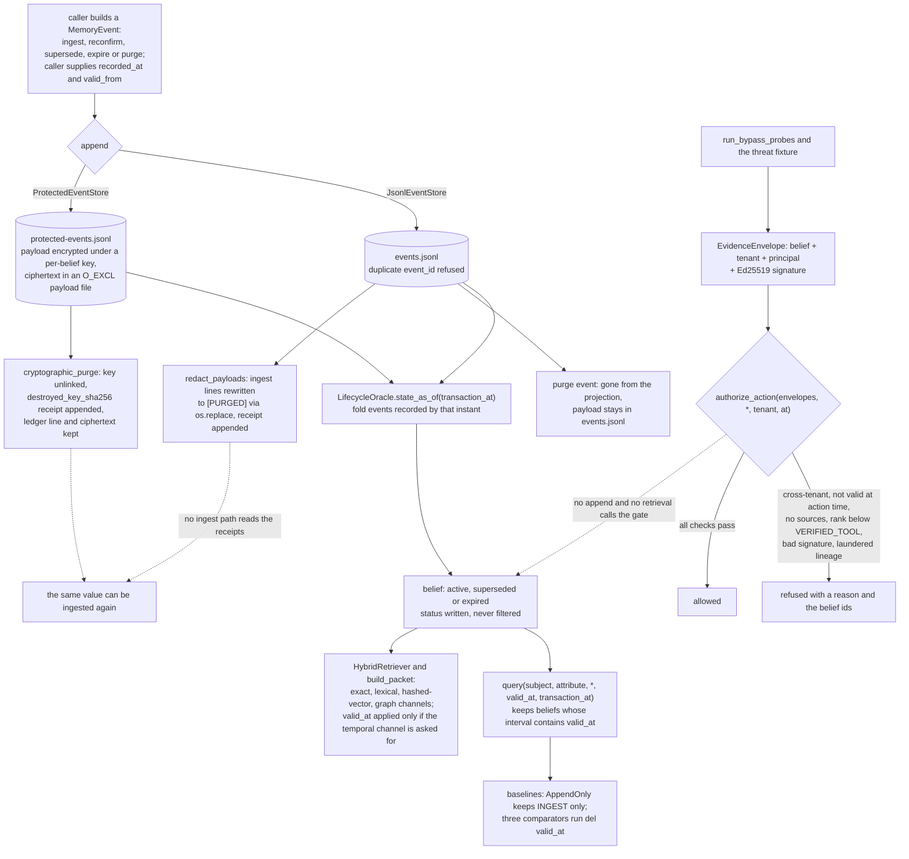

## 1. Executive Summary

Temvera is the artifact behind an ICDE 2027 Experimental, Analysis and Benchmark
paper, and carries a small reference substrate: a lifecycle-event ledger
replayed at a transaction instant and queried at a valid instant, plus a second
store that erases a belief by destroying its key. Its notable habit is
committing the case that fails — a bypass probe meant to succeed, held by a test
as the only one — and rechecking every printed figure against sealed runs. Its
weakness is wiring: authority ranks, signed envelopes and tenants feed action
gates that no store write and no retrieval path calls.

The paper's title states the thesis:

> *Temporal Fields Are Not Temporal Correctness: Measuring Bitemporal and
> Deletion Semantics in Deployed Agent Memory.*

It replays deterministic histories into Mem0, LangMem, Graphiti, Cognee and
Hindsight and scores them against the substrate's oracle, which an independent
SQLite implementation cross-checks. The abstract claims "no novelty for
bitemporal modelling or forgetting evaluation"; the contribution is measurement
(`paper/abstract.txt`).

**The bypass that works is published.** `run_bypass_probes` returns four
adversarial results, each carrying whether it activated and whether that was
expected (`src/temvera/bypass.py:51-56`):

```python
BypassResult("compromised_trusted_signer", compromised_allowed, True),
BypassResult("cross_tenant_replay", cross_allowed, False),
BypassResult("signed_claim_tamper", tampered_allowed, False),
BypassResult("expired_signature_replay", expired_allowed, False),
```

Three must not activate. The fourth does, because a policy anchored on a
signer's public key cannot survive that key being stolen, and the module
docstring calls it "expected trust-root failure". `tests/test_bypass.py:7-12`
asserts that exactly one probe activated and that it is the declared one, so a
newly working bypass fails the suite and the admission cannot be removed quietly
either. The probes exercise the action gate, not retrieval.

**Verification is decoupled from regeneration.** "Every number the paper reports
is an aggregation over sealed per-case transcripts, so the whole paper can be
checked without an API key, a database server, or a dataset download." The
README points `temvera verify-artifacts` at the accepted-runs manifest, which
lists 44 runs, and `scripts/verify_paper_claims.py` pairs each printed figure
with a recomputation that "fails if either half moves". The README's own counts
lag the tree: it says 30 sealed runs against that manifest, and it says 87
printed figures where `REPRODUCING.md` says 82 claims.

**Bitemporality is an interface.** The `QuerySystem` protocol makes both
instants mandatory — `query(subject, attribute, *, valid_at, transaction_at)` —
and each baseline is defined by the axis it discards
(`src/temvera/evaluation.py:15-115`). `AppendOnlyBaseline` keeps only `INGEST`
events, so it "[i]gnore[s] revision, expiry, and purge operations"; the
recent-context, BM25 and last-write-wins comparators accept `valid_at` and run
`del valid_at` before answering.

## 2. Mental Model

A **belief** is not stored; it is replayed. `LifecycleOracle.state_as_of`
sorts the events recorded by a transaction instant and folds them into a dict of
beliefs (`src/temvera/oracle.py:28-80`).

An **ingest** creates a belief and fixes its authority. **Reconfirm** moves
`last_confirmed_at`. **Supersede** closes the target's valid interval at the
successor's `valid_from` and marks it `superseded`. **Expire** closes the
interval and marks it `expired`. **Purge** deletes the belief from the replayed
state. No event changes a belief's authority.

The statuses are labels. `superseded` and `expired` are written by the replay
and rendered into the Markdown projection; no read filters on them
(`src/temvera/oracle.py:66`, `:75`, `src/temvera/store.py:279`). What keeps a
superseded belief out of a current answer is its closed valid interval, tested
by `valid_at`.

**Authority** is who asserted the claim — `SYSTEM`, `VERIFIED_TOOL`, `USER`,
`EXTERNAL` or `INFERRED`, ranked 4 down to 0 — and it decides whether evidence
may authorise an action, not whether a belief is returned
(`src/temvera/security.py:10-16`).

**Erasure** has three strengths. A purge event hides the belief and leaves its
payload in the plain ledger. `redact_payloads` overwrites that payload. The
protected store destroys the key and keeps the ciphertext.



## 3. Architecture

| Area | Role |
| --- | --- |
| `src/temvera/model.py` | `MemoryEvent`, `Belief`, the operation and authority enums |
| `src/temvera/oracle.py`, `sqlite_oracle.py` | Replay semantics, and an independent SQL implementation of them |
| `src/temvera/store.py` | The plain JSONL ledger, rebuild, verify, redaction, the Git commit adapter |
| `src/temvera/protected_store.py` | Per-belief encryption and erasure by key destruction |
| `src/temvera/index.py`, `hybrid.py`, `retrieval.py` | Exact, lexical, hashed-vector and graph channels, fusion, the packet |
| `src/temvera/governance.py`, `security.py`, `bypass.py` | Signed envelopes, authority ranking, lineage laundering, the probes |
| `src/temvera/evaluation.py` | The query protocol, the baselines and the metrics |
| `src/temvera/*_adapter.py`, `external_*.py`, `lme_bitemporal.py` | The measured systems and the real-data runner |
| `experiments/`, `scripts/` | Sealed runs, and the scripts that recheck the paper from them |

### Deployment and ergonomics

The substrate is a library with no dependencies beyond the standard library;
`cryptography` is an optional extra for the protected store and the signed
envelopes. Nothing runs as a service. The store is a directory of JSONL and
Markdown that a person can read and repair by hand, and `GitTransactionAdapter`
commits a rebuilt projection when asked, describing Git as "an audit layer, not
canonical state" (`src/temvera/store.py:244-266`). The harness half needs an
OpenAI key, a Neo4j 5.26 server and a second interpreter for LangMem to
regenerate runs, and none of them to verify the sealed ones. CPython 3.11 or
newer is required.

## 4. Essential Implementation Paths

**Write.** `JsonlEventStore.append` reads the whole ledger, refuses a duplicate
`event_id`, appends one JSON line and `fsync`s (`src/temvera/store.py:24-35`).
`ProtectedEventStore.append` does the same after encrypting an ingest payload
(`src/temvera/protected_store.py:30-62`). `MemoryEvent.__post_init__` is the
only validation: ingest needs subject, attribute, value and `valid_from`, and
every timestamp must be timezone-aware (`src/temvera/model.py:43-57`).

**Replay and query.** `LifecycleOracle.state_as_of` and `query`
(`src/temvera/oracle.py:28-103`); `SqliteBitemporalOracle.state_as_of` computes
the same state with correlated subqueries (`src/temvera/sqlite_oracle.py:71-138`).

**Retrieval channels.** `HybridRetriever.retrieve` and `rankings`
(`src/temvera/hybrid.py:29-91`), `LexicalIndex.search`
(`src/temvera/index.py:47-54`), `build_packet` (`src/temvera/retrieval.py:28-36`).

**Projection.** `rebuild(transaction_at)` writes one Markdown file per belief and
lexical, vector and graph snapshots; `verify_rebuild` runs it twice and compares
bytes (`src/temvera/store.py:55-93`).

**Delete.** The purge event (`src/temvera/oracle.py:77-79`), `redact_payloads`
and `recover_redactions` (`src/temvera/store.py:109-195`), `cryptographic_purge`
and `recover_crypto_purge` (`src/temvera/protected_store.py:101-153`).

**Governance.** `GovernedMemoryPolicy.ingest` and `authorize_action`
(`src/temvera/governance.py:57-97`), `ProvenanceGate.evaluate` and
`laundering_detected` (`src/temvera/security.py:26-41`, `:67-83`). Their callers
are `bypass.py` and `threats.py`, reached from the `bypass-report`,
`security-smoke` and `governance-smoke` CLI verbs.

## 5. Memory Data Model

`MemoryEvent` carries `event_id`, an `Operation`, `belief_id`, `recorded_at`,
the payload fields, `valid_from`, `valid_to`, a `target_id` for supersession,
`sources`, `derived_from` and an `Authority` defaulting to `EXTERNAL`
(`src/temvera/model.py:27-41`). `Belief` adds `last_confirmed_at`, `status` and
`superseded_by` (`:83-97`). There is no scope field on either, and no column for
one in the SQLite schema (`src/temvera/sqlite_oracle.py:14-34`).

`EvidenceEnvelope` wraps a belief with `tenant`, `principal` and a signature
(`src/temvera/governance.py:15-20`). The signature covers the belief, tenant and
principal together, so relabelling evidence for another tenant breaks it
(`:110-117`). No store persists an envelope.

The protected ledger replaces the payload fields with `[ENCRYPTED]` and adds
`payload_ref` and `payload_sha256`; `load` checks the digest before decrypting
(`src/temvera/protected_store.py:50-57`, `:76-97`).

## 6. Retrieval Mechanics

Two read paths share the replayed state and differ on time.

The oracle path is exact match on subject and attribute plus the valid-interval
test, at a transaction instant the caller names (`src/temvera/oracle.py:82-103`).
This is what the paper scores the external systems against.

The hybrid path takes a materialised state and fuses exact, lexical,
hashed-vector and one-hop graph rankings by reciprocal rank, filtering on
`valid_at` only when `"temporal"` is among the requested channels
(`src/temvera/hybrid.py:47-52`). The channel ablation removes it on purpose.
`build_packet` searches a `LexicalIndex` with neither instant and returns each
hit's sources, authority and interval without a status
(`src/temvera/retrieval.py:28-47`). Because `rebuild` indexes every belief in the
replayed state, the snapshots on disk include superseded and expired ones.

Fusion weights can be calibrated on a development split
(`src/temvera/fusion.py:62`), as an experiment. The README's "calibrated fusion
and reranking" describes the research program: the only reranker in `src/` is
the one Graphiti's adapter configures (`src/temvera/graphiti_adapter.py:80`).

## 7. Write Mechanics

Writes are synchronous appends of events a caller constructs. Revision and
expiry are new events, so the projection changes and the event history does
not. No model is called on the substrate's write path.

No policy runs on the append. `GovernedMemoryPolicy.ingest` rejects a
`SYSTEM` or `VERIFIED_TOOL` claim without a valid signature and returns
`quarantined=True` for anything ranked below `VERIFIED_TOOL`
(`src/temvera/governance.py:57-67`). The decision is returned to the caller, the
threat fixture counts it, and nothing stores it.

Both clocks are the caller's. `append` does not stamp `recorded_at`, so
transaction time is what the writer asserts it to be; the generator sets it
zero to three days after `valid_from` (`src/temvera/generator.py:72-73`).

### Operational cost

`append` reads and parses the whole ledger to check for a duplicate id, so each
write costs time linear in the history, and `state_as_of` replays every event on
each query. Both are acceptable for a reference oracle and are the first things
a deployment would replace.

## 8. Agent Integration

A `temvera` CLI exposes the substrate (`generate`, `inspect`, `benchmark`) and
the harness: one verb per external system, sealing and verifying runs, the
purge-residual scan, the probes and the artifact package
(`src/temvera/cli.py`). There is no server and no MCP surface. An agent would
use this as a library, and the README describes the API as provisional.

## 9. Reliability, Safety, and Trust

**The gates refuse, with reasons, and refuse only actions.** `authorize_action`
returns one of seven refusals in a fixed order — no evidence, cross-tenant
evidence, not valid at action time, missing source provenance, insufficient
authority, invalid signature, untrusted derivation lineage — each with the
sorted belief ids (`src/temvera/governance.py:69-97`). `AUTHORITY_RANK` appears
in four comparisons: three refusals, in the provenance gate, the action gate and
the laundering walk, and the ingest quarantine flag
(`src/temvera/security.py:37`, `src/temvera/governance.py:87`,
`src/temvera/security.py:80`, `src/temvera/governance.py:64`). It is never a
multiplier. `laundering_detected` walks the whole derivation graph,
refuses when any ancestor ranks below the belief, and refuses when an ancestor
is missing (`src/temvera/security.py:67-83`).

**None of it is on a memory path.** The gates are called from `bypass.py` and
`threats.py` only. Authority is fixed at ingest, since no event operation
replaces it, and no read consults it. The tenant lives on the envelope, which no
store persists, and no query, retriever or packet takes one. So the store has
no trust state that withholds a belief and no scope that bounds a read; the
action gate is a separate, tested component a deployment would have to wire in.

**Deletion is documented with care and stops at the record.** The plain ledger
keeps a purged payload, and the project's purge-residual scan reports that as
"documented limitation: JSONL tombstones but does not erase (D-005)"
(`src/temvera/purge_residual.py:104`). `redact_payloads` overwrites the payload
in `events.jsonl` with a prepared/applied journal and a receipt carrying the
original line's SHA-256, and its docstring says it "cannot erase copies already
committed to Git or external backups" (`src/temvera/store.py:109-173`). The
protected store destroys the key instead; the architecture notes call it
experimental, and its only callers are tests (`docs/architecture.md:116`).
Either receipt file is read only to
de-duplicate receipts and by the residual scan, so a value erased by either path
can be ingested again as a new belief with nothing to contradict it.

**The two oracles disagree on one history no test builds.** After a purge,
`LifecycleOracle` deletes the belief id from state, so a later ingest under the
same id is accepted; `SqliteBitemporalOracle` excludes every ingest of an id
that has a purge recorded by the instant (`src/temvera/oracle.py:36-37`, `:77-79`,
`src/temvera/sqlite_oracle.py:95-98`). This is by reading; the generated
histories the cross-check uses never reuse an id.

## 10. Tests, Evals, and Benchmarks

The suite is deterministic and collected by pytest; I ran none of it. The
must-not-return cases are on the oracle: a superseded belief absent from the
current answer and present in the historical one
(`tests/test_lifecycle.py:56-100`), a belief invisible before its transaction
instant (`:22-54`), and purged and derived beliefs absent from a later state
(`:143-152`). The oracle's stale-use rate is pinned at zero on a case where the
append-only baseline over the same events returns the stale id
(`tests/test_evaluation.py:23-63`). `tests/test_forgeteval.py:4-16` asserts the
same shape through the public ForgetEval contract.

Deletion is tested for residue rather than for recall: no plaintext in the
protected ledger, `[PURGED]` after key destruction, crash recovery for both
erasure paths, and `residual_occurrences` returning nothing after redaction
(`tests/test_protected_store.py:31-80`, `tests/test_store.py:44-101`). Nothing
tests that an erased value is refused on re-ingest, which matches the code.

The harness side carries 44 accepted sealed runs, a lifecycle benchmark the
README calls "a harness identifiability check, not a performance or novelty
result", a real-data runner that turns LongMemEval's knowledge-update split into
supersessions with human-confirmed old values (`src/temvera/lme_bitemporal.py`),
and scale sweeps for Mem0 and Graphiti at 8, 32 and 128 entities. None of the
verification scripts were executed for this reading, so the artifact claims are
read from the repository, not reproduced.

## 11. For Your Own Build

### Steal

Publish the probe that works. A security suite in which every attack fails has
not been pushed far enough, and an expected-limitation flag with an exact
assertion behind it keeps the admission from being deleted.

Make both instants mandatory in the query signature. A required `transaction_at`
forces every baseline to say which axis it ignores, in a statement a reader can
point at.

Keep payload and metadata in separate files and erase by destroying a
per-record key. The ledger stays append-only and auditable after erasure.

### Avoid

A gate that is a library function beside the store rather than a step inside
it. Every check here is correct and tested, and none of them can stop a write or
a read until a caller wires it in.

A status that is rendered and not filtered. `superseded` and `expired` are
visible in the projection and ignored by every index built from it.

A deletion receipt nothing consults on write. It proves the erasure happened and
cannot stop the value coming back.

### Fit

Read it for its measurement method and for the protected store's erasure
design. It is a deterministic reference with linear-time appends and full
replays, intended to define correct answers for the paper, and nothing in it is
meant to be deployed as an agent's memory.

## 12. Open Questions

Whether the action gate is meant to sit on the ingest path. The paper draft
describes "[s]igned, tenant-scoped ingestion quarantine"
(`docs/paper-draft.md:123`), and the code returns the quarantine decision
without storing it.

Whether the oracle divergence on a re-ingested purged id is intended, and which
semantics the paper's scoring assumes.

Whether the deletion receipts should be consulted on ingest, given a paper about
deletion semantics.

## Appendix: File Index

| Path | What to read it for |
| --- | --- |
| `src/temvera/oracle.py:28-103` | Replay at a transaction instant and query at a valid instant |
| `src/temvera/sqlite_oracle.py:71-138` | The same semantics in SQL, and its purge rule |
| `src/temvera/evaluation.py:15-115` | Two mandatory instants, and baselines that discard one |
| `src/temvera/hybrid.py:29-91` | Fused channels and the optional temporal filter |
| `src/temvera/store.py:24-195` | Append, rebuild, redaction and its recovery |
| `src/temvera/protected_store.py:15-153` | Encrypted payloads and erasure by key destruction |
| `src/temvera/governance.py:57-97` | The ingest decision and seven action refusals |
| `src/temvera/security.py:67-83` | The laundering walk that fails closed |
| `src/temvera/bypass.py:21-56`, `tests/test_bypass.py:7-12` | Four probes and the assertion on the one that succeeds |
| `tests/test_lifecycle.py:22-152`, `tests/test_evaluation.py:23-63` | The must-not-return cases |
| `docs/architecture.md:106-129` | The project's own account of the purge boundary |

### Recorded searches

Run with `git grep` at the tree root of the pinned checkout, and at `75243a3dbc3dfeda3613fb69e940c774f5ff4e5b` with the same results.

- `git grep -n -E 'AUTHORITY_RANK\[' -- src` — `governance.py:64`, `:87-88`, `security.py:37`, `:69`, `:80`; four comparisons, each a refusal or the quarantine flag.
- `git grep -n -E 'replace\([^)]*authority' -- src` — no match; no event changes a belief's authority.
- `git grep -n -E '\.status([^_[:alnum:]]|$)|status=' -- src` — `oracle.py:66`, `:75` and `sqlite_oracle.py:135` write it; `store.py:279` renders it; no filter.
- `git grep -n -i 'quarantin' -- src` — `governance.py:26`, `:64`, `:67` and the counter in `threats.py`; never persisted.
- `git grep -n -i 'tenant' -- src ':!src/temvera/governance.py' ':!src/temvera/bypass.py' ':!src/temvera/threats.py'` — no match; no store, query, retriever or packet takes a tenant.
- `git grep -n -E 'authorize_action\(|GovernedMemoryPolicy\(|ProvenanceGate\(' -- src` — definitions, `bypass.py` and `threats.py` only.
- `git grep -n -E 'redact_payloads|cryptographic_purge' -- src scripts` — the two definitions; callers are tests only.
- `git grep -n -E 'deletion-receipts|receipt_path' -- src` — receipt writers, their de-duplication reads and `residual_occurrences`; no ingest-path reader.
- `git grep -n -E 'os\.replace\(' -- src/temvera/store.py src/temvera/protected_store.py` — `store.py:169` replaces the ledger; `store.py:206` and `protected_store.py:164` replace journals.
- `git grep -n 'del valid_at' -- src` — `evaluation.py:48`, `:74`, `:109`.
- `git grep -n -i 'rerank' -- src` — `graphiti_adapter.py:61`, `:80` only.
- `git grep -n -i -E 'mcp|fastapi|flask|http\.server|uvicorn' -- src scripts` — no match.
- `git grep -n -i -E 'approv|pending' -- src` — a fixture value in `bypass.py:64` and loop variables; no review state.
- `git grep -n -i -E 'arxiv|bibtex|@article|@misc|doi' -- README.md CITATION.cff` — no match; no published paper is cited.
- `git grep -n -i -E 'anthropic|machine learning|not (be )?used (for|to)' -- LICENSE` — no match; the Apache-2.0 text carries no rider.

## History

**2026-10-15** — [`81cde831d3f1b874550b1dfdeb42b1261578a0fd`](https://github.com/suanlab/temvera/commit/81cde831d3f1b874550b1dfdeb42b1261578a0fd) — 16 commits on, all in the paper harness: the manuscript retargeted from PVLDB to ICDE 2027, a LongMemEval real-data runner, Mem0 and Graphiti scale sweeps, 44 accepted runs where there were 30. No substrate file changed. Two marks withdrawn, both wrong at the first pin: `trust_state`, since authority is fixed at ingest and read only by action gates no read path calls, and `scope_enforced`, since no store keeps a tenant and no read takes one ([section 9](#9-reliability-safety-and-trust)). `audit_log` rests on the protected store, because `redact_payloads` rewrites the plain ledger; `negative_eval` rests on oracle cases, not the probes ([section 10](#10-tests-evals-and-benchmarks)). Screened from a full clone: four files, no auto-run or build-time execution, one unpinned surface, none inside the cooldown, `AGENTS.md` and `CLAUDE.md` read as data. Nothing was installed, built or run.

**2026-09-19** — [`75243a3dbc3dfeda3613fb69e940c774f5ff4e5b`](https://github.com/suanlab/temvera/commit/75243a3dbc3dfeda3613fb69e940c774f5ff4e5b) — `trust_state` re-tested at an unchanged pin against the narrowed line, and this is the cleanest answer to it in the corpus so far. `AUTHORITY_RANK` appears in exactly three comparisons and every one of them refuses: the provenance gate (`src/temvera/security.py:36-40`), the governance quarantine (`src/temvera/governance.py:64`), and the laundering check (`security.py:80`). It is never multiplied into a score anywhere in the tree, so the filtering half and the ranking half are not merely separated — the ranking half does not exist. The laundering check is worth quoting because it answers a question this atlas raises repeatedly, whether a derived memory can acquire an authority its inputs never had. `laundering_detected` (`:67-83`) walks the whole derivation graph, refuses when any ancestor ranks below the belief itself, and refuses when an ancestor is missing — failing closed on an incomplete lineage rather than assuming the best — under a docstring that states the rule in one line: high-authority derivatives cannot erase lower-authority ancestry. Each refusal carries its reason and the belief ids, so a rejection is explainable rather than an empty result. Re-read from a fresh clone; nothing was installed and no suite was run.

**2026-09-16** — [`75243a3dbc3dfeda3613fb69e940c774f5ff4e5b`](https://github.com/suanlab/temvera/commit/75243a3dbc3dfeda3613fb69e940c774f5ff4e5b) — first reading, at a commit dated 13 September 2026. Screened before opening, from a shallow clone: four files scanned, no auto-run surfaces, no build-time execution points, one unpinned dependency surface and one dependency file inside the seven-day cooldown. `AGENTS.md` and `CLAUDE.md` are addressed to a reading agent and were recorded as data. Nothing was installed, built or run, and none of the paper's verification scripts were executed, so the artifact claims described here are read from the repository rather than reproduced.
