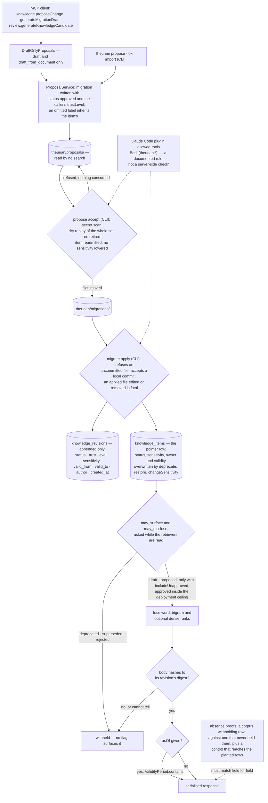

## 1. Executive Summary

Theurian is a local record of engineering decisions served to agents over MCP.
Knowledge enters only as a migration file applied by `theurian migrate apply`,
and every read asks one status-and-sensitivity question before anything is
ranked. Its absence proofs build the corpus that never held a withheld record
and require the same answer on the wire. The weak side is approval: an agent's
proposal is written with `status: approved`, and the shipped Claude Code plugin
grants the agent the commands that land and apply it.

It describes itself as "the engineering record your AI agents consult", and its
pitch is one line: "Stop your AI from re-proposing what your team rejected in
March."

**Agents propose, and approval is a convention.** Three MCP tools are
write-intent — `knowledge.proposeChange`, `knowledge.generateMigrationDraft` and
`review.generateKnowledgeCandidate` — and `system.capabilities` reports
`writeTools: true` beside a note that no MCP tool writes approved knowledge
(`packages/theurian-core/src/theurian/mcp/tools.py:3338`). That note is
accurate: the tools hold a facade whose only methods are the two draft entries,
so none can call `accept`. The README states what that leaves:

> "there is no approval command and no approver field anywhere in this
> codebase, **and nothing in the code checks that the merge happened**:
> `migrate apply` refuses an uncommitted migration by default
> (`--allow-uncommitted` restores the old behaviour), but a local commit on a
> local branch passes, so it enforces the commit and not the merge."

The drafted migration carries `status: approved` because "the file applies only
once a human has merged it" (`application/proposal_service.py:4938-4958`), and
the plugin's `/theurian:propose` and `/theurian:migrate` grant
`Bash(theurian:*)`. That is why no human-review mark is claimed
([section 8](#8-agent-integration)).

**The absence proofs test side channels.** `knowledge.search` is asked one
query against a project whose index holds a withheld document and a control
that never held it, and every published value must match. `review.search` gets
the same treatment on the serialised response, across three deployments:

> "*a corpus that held the withheld records and a corpus that never did must
> answer identically* — and here, identically **on the wire**, refusals
> included."

The third deployment is the positive control. Without it, the module says, "an
equality is satisfied by a build that wrote nothing, a query that matched
nothing and a corpus whose plant was unreachable".

The same reasoning places the visibility check before ranking. A SQL validity
filter that compared ISO-8601 timestamps as text was deleted, leaving one
comparison in Python. Accepting a proposal replays the whole migration set
and refuses one that would readmit a retired item or lower a sensitivity.

Five marks. Status is stored and the retired statuses are unreachable by any
flag (trust state). Every canonical read is bound to one project's state file
and predicate (scope enforced). An authored validity window is read with
`asOf`, apart from the migration's creation and apply times (bitemporal).
Applied migrations are frozen by checksum over an append-only revision table
(audit log). Both search tools carry must-not-retrieve proofs with positive
controls (negative evaluation).

## 2. Mental Model

A **decision** is a knowledge item whose current revision a migration put
there. Revisions are never edited; a correction is a new revision naming the
one it expects to replace.

An item's **status** is one of `draft`, `proposed`, `approved`, `deprecated`,
`superseded` or `rejected`. Default retrieval returns `approved` only;
`includeUnapproved` adds `draft` and `proposed`; nothing returns the three
retired statuses, because "a rejected revision is where the secret that caused
the rejection still lives" (`domain/enums.py:222-282`). `createItem` starts an
item at `draft`, an `upsertRevision` lands its revision's status,
`deprecateItem` retires it and `restoreItem` returns it to `approved`.

A **proposal** is a draft migration in `.theurian/proposals/`, outside the
store and outside every search. It becomes a decision when `propose accept`
moves it into `.theurian/migrations/` and `migrate apply` runs it. The project
intends a merged pull request between those two steps; the code checks for a
commit.

A **withheld row** must leave no trace in any number a caller is handed, not
only be absent from the list.

**Valid** and **recorded** are separate: `validFrom`/`validTo` are what the
migration author asserts, `createdAt` is when the migration was written, and
`applied_at` is when this store applied it. `asOf` asks about the first.

## 3. Architecture

| Area | Role |
| --- | --- |
| `domain/` | Items, revisions, validity, the status and sensitivity enums with `may_surface` and `may_disclose` |
| `application/migration_engine.py` | Plans and applies migrations, freezes applied files by checksum |
| `application/proposal_service.py`, `draft_only_proposals.py` | Drafting, the accept checks, the facade the MCP tools hold |
| `application/visibility.py`, `retrieval_service.py` | The visibility question and the ranking that asks it |
| `application/withdrawal_purge.py` | Rebuilds the published index when a row is withdrawn |
| `application/okf_import.py`, `okf_export.py` | Bundle interchange; import drafts proposals, export walks the status gate |
| `infrastructure/sqlite/` | Canonical store, index store, purge, review search store |
| `mcp/tools.py`, `mcp/search.py` | Ten MCP tools, the published-index path and the substring fallback |
| `plugins/claude-code`, `plugins/codex` | Slash commands, a session-start health check, Codex wiring |
| `tools/eval/` | The retrieval-evaluation harness and its committed baseline |

### Deployment and ergonomics

One Python 3.13 package and a loopback daemon behind a bearer token at mode
0600; no API key, no account, no network for the store. The embedder is
deterministic hashed character trigrams, so the dense arm needs no model. The
source of truth is plain YAML and Markdown under `.theurian/` in the
repository, reviewable in a pull request. Everything in `.theurian/state/` is
derived and rebuilt by `migrate apply` and `index build`, so a damaged store is
repaired by deleting it, while a hand-edited applied migration stops the next
apply.

## 4. Essential Implementation Paths

**Proposal.** `knowledge.proposeChange` → `_draft_only_proposals` builds a
`DraftOnlyProposals` around a caller-scoped item lookup
(`mcp/tools.py:1909-1960`) → `ProposalService.draft` refuses a draft for a
retired item (`proposal_service.py:4884`), inherits omitted labels from the
item, and writes a migration with `status: approved` (`:4958`).
`generateMigrationDraft` admits ten operation kinds and refuses `createItem`
and `upsertRevision` (to `proposeChange`) and `changeSensitivity` and
`restoreItem` (to the CLI) (`:340-380`).

**Accept.** `propose accept` (`cli/propose_commands.py:375`) scans everything
it would land for secrets, replays the migration set with the proposal against
a throwaway store, and refuses if `readmitted_items` or
`lowered_sensitivities` is non-empty (`application/item_labels.py:99-157`) or
a landed migration would overwrite what the proposal sets
(`proposal_service.py:4713`).

**Apply.** `MigrationEngine.plan` compares each applied migration's checksum
and refuses a removed one (`migration_engine.py:177-240`);
`_apply_operation` dispatches the fourteen operation kinds (`:484-580`).

**Search.** `knowledge.search` → `hybrid_answer` locates the published index,
standing aside a build whose purge failed or whose sensitivity flavour
disagrees with the grant (`mcp/search.py:352-420`) →
`RetrievalService.search` widens each retriever until `CANDIDATE_DEPTH`
(50) rows survive `CanonicalVisibility.cleared`, then applies `at_moment`
(`retrieval_service.py:232`, `:597`; `visibility.py:164-323`). With no usable
index, `_scan` reads `list_items_by_status` over the statuses `may_surface`
admits (`mcp/search.py:1026-1128`).

**Withdrawal.** A migration that retires an item, rejects a revision in place
or reclassifies its sensitivity triggers `withdrawal_purge`, which writes a new
index without the rows and swaps the pointer
(`application/migration_engine.py:772-800`,
`application/withdrawal_purge.py:1-30`).

## 5. Memory Data Model

`knowledge_revisions` carries title, body, its SHA-256, kind, namespace,
status, trust level, sensitivity, owner, tenant, ACL group, labels, scope
paths, a validity window, author, `created_at` and `source_commit`
(`infrastructure/sqlite/schema.py:242-266`). `created_at` is the migration
file's `createdAt` (`migration_engine.py:661`). `source_commit` is declared,
read and never written: the engine's one construction of a revision does not
pass it (`:638-662`), so commit provenance lives in source anchors.

`knowledge_items` is the pointer, and the schema comment calls
`current_revision_id` "the one thing that moves". `put_item` updates status,
sensitivity, owner, trust level and the validity window on conflict as well
(`store.py:1272-1283`), which `deprecateItem`, `restoreItem` and
`changeSensitivity` use (`migration_engine.py:500-556`). An item's status
history is therefore in its migrations, not in its revisions.

`tenant_id` and `acl_group` are NOT NULL with defaults `local` and `default`.
No read filters on either; the tenant is compared once, against the grant, as a
constant (`mcp/tools.py:1707`). There is no value-keyed rejection record: a
`rejected` status sits on an item, and the accept floor is keyed on item ids.

## 6. Retrieval Mechanics

Two lexical arms and one vector arm are fused by reciprocal rank with
`k = 60`: an FTS5 word index (`unicode61`), an FTS5 trigram index for CJK and
partial words, and an optional dense arm over hashed character trigrams
(`infrastructure/sqlite/index_schema.py:254-296`, `domain/ranking.py:220`). A
RAPTOR summary forest is built only with `--raptor`. Results are trimmed to a
2,000-token default budget and report `droppedForBudget`.

Visibility runs inside the depth loop. The module puts the reason in one line:
"Asking it late is what made a withheld document able to occupy a candidate
slot, and every number computed from those slots — `count`, `usedTokens`,
`fusedScore`, `droppedForBudget` — move with it." Each request uses one read
session, "because the whole point of one session per request is that two rows
in one answer cannot be judged against two states" (`visibility.py:1-21`).

`asOf` is applied after the depth loop, not inside it, so a caller cannot use
a chosen moment to tune how many rows the loop discards
(`visibility.py:58-80`). It filters the current revision by its validity
window; it does not return the revision that was current at that moment, and
passing a state hash back to query an earlier state is not implemented
(README, FR-R7).

## 7. Write Mechanics

Nothing extracts memory. A person writes a migration, or runs `theurian
propose`, or an agent calls a proposal tool; each produces files that `migrate
apply` turns into rows. The write blocks on validation of the whole migration
set and does not index: `index build` is a separate command. Agent proposals
carry no `validFrom`, so their validity starts at apply time. Proposals
generated from review threads and OKF imports are written at trust level
`inferred`. `knowledge.proposeChange` accepts any `trustLevel` the caller
passes, `authoritative` included.

## 8. Agent Integration

The MCP surface is seven read tools — `knowledge.search`, `knowledge.get`,
`knowledge.status`, `project.list`, `review.findings`, `review.search`,
`system.capabilities` — and the three proposal tools. No MCP tool accepts or
applies.

The Claude Code plugin is slash commands and one `SessionStart` hook that
probes the daemon and prints warnings; it injects no knowledge
(`plugins/claude-code/scripts/session-start.sh:1-27`). `/theurian:propose` and
`/theurian:migrate` both declare `allowed-tools: Bash(theurian:*)`, and the
propose command says what that grants:

> "Containment here is a documented rule, not a server-side check.
> `allowed-tools` grants and removes nothing … so `Bash(theurian:*)`
> auto-approves *every* `theurian` invocation, `theurian migrate apply` (a
> canonical write) and `theurian propose accept` … included."

Its rules tell the agent to run `accept` only "when the user has agreed" and
never to run `migrate apply` for them. `/theurian:migrate` tells the agent to
summarise pending migrations, ask the user to confirm, then run `theurian
migrate apply --json` (`commands/migrate.md:20-26`). Neither CLI command checks
for an interactive terminal or records who ran it. The agent that drafts a
proposal can therefore accept, commit and apply it under the same grant, which
is the reason the human-review mark is withheld.

## 9. Reliability, Safety, and Trust

The content-identity gate re-reads each row that clears status and sensitivity
and withholds it if the served body does not hash to its revision's digest,
or if the digest cannot be computed: "a check that cannot be performed is not a
check that passes" (`visibility.py:495-523`).

A withdrawal purge runs after the write commits and builds a new index rather
than editing the published one; a build whose purge failed is refused outright
before any other gate (`mcp/search.py:410-420`). Sensitivity is a deployment
ceiling, default `internal`, held in the operator's data directory rather than
in the repository, because "a committed ceiling would make *raising* the
ceiling a contributor-authored access-control change"
(`application/authorization.py:1-30`).

Proposal labels are guarded at three points: an omitted label is copied from
the item, `accept` refuses a replay that readmits or loosens, and `migrate
apply` reports every loosening as a `permissiveMoves` row. The trust level an
agent declares is not guarded at any of them.

## 10. Tests, Evals, and Benchmarks

I read the suites and the evaluation baseline; I ran nothing. Tests are about
3.6 lines for every line of shipped source, and the two `review.search`
absence-proof modules are 2,390 of those lines.

`test_a_withheld_document_changes_nothing_a_caller_can_see` is the
negative evaluation on `knowledge.search`: five parameter sets, two writing
systems, `probe["count"] > 0` so that two empty answers cannot pass, and an
exact set of the two fields allowed to differ
(`tests/integration/test_mcp_tools.py:6095`). Its positive control,
`test_the_depth_probe_reaches_the_withheld_document_inside_the_candidate_depth`,
proves the withheld document is in the index and ranks inside the depth read
(`:5879`).

`test_review_search_tool_absence_proof.py` repeats the property at the
`review.search` response. Its header lists the eight stages between a store hit
and the wire and says "the gap between the two is not rhetorical". Beside the
battery sit `test_a_withheld_record_never_costs_a_visible_one_its_slot_in_the_response`,
`test_a_visible_records_bytes_do_not_move_when_its_neighbour_is_withheld` and
`test_the_page_boundary_bit_does_not_move_with_a_withheld_record` (`:1046-1196`).

`tools/eval/` holds a frozen corpus of the project's own decision records — 33
items, 26 judged queries — and a committed baseline that a test regenerates and
byte-compares. The baseline records Recall@1 of 0.629, Recall@10 of 0.955 and
MRR of 0.824, with a superseded-knowledge error rate of 0.0. A RAPTOR arm on the
same corpus moved Recall@1 by −0.148 and MRR by −0.098, and the forest stays
opt-in. The baseline also records that with `includeUnapproved` most queries
answer differently over the full and clean corpora, and files it as a channel
of a request parameter on a one-principal core rather than a disclosure.

## 11. For Your Own Build

### Steal

Prove absence by comparison with the corpus that never held the record, on the
response a caller receives, with a control that proves the fixture reaches the
record. Assert the exact set of fields allowed to differ, so a field that stops
moving is noticed too.

Ask whether a row may be shown while candidates are gathered. Every count,
score and budget figure downstream inherits the answer.

Keep one comparison for each rule. Two validity checks that disagree across
UTC offsets is one too many; deleting the SQL one was the fix.

Replay the whole change set before accepting a change, and refuse on the end
state: an item readmitted from a retired status, a sensitivity lowered, a
later migration overwriting what this one sets.

### Avoid

Stamping a draft with the state it should earn. A proposal written as
`approved` is one unchecked step from approved knowledge, and the label in the
file says the review already happened.

Granting the agent the command that lands its own proposal and relying on the
command's prose to hold it back.

Declaring provenance columns nothing writes. `source_commit` on every revision
reads as an answer to "which commit was this decided at".

### Fit

This suits a team that reviews design decisions in pull requests and wants
agents to cite them with status and provenance, on one machine, with no model
and no network. It assumes the team's merge discipline is the approval, and a
reader who needs the code to enforce that should walk away or add a CI check
that applies only from the default branch. It is not a memory an agent writes
during work; it is a record people curate, and agents can propose to.

## 12. Open Questions

Whether the merge check will be made. T-15 records it as a residual, and the
README says the review "is a workflow convention rather than a check Theurian
makes".

Whether `knowledge.proposeChange` is meant to accept `authoritative`. Review
candidates and OKF imports are fixed at `inferred`; the direct proposal tool is
not.

Whether `source_commit` is meant to be filled from the migration's commit, or
retired from the schema.

What the tenant and ACL-group columns are for, given that no read filters on
either and the tenant is checked as a constant.

## Appendix: File Index

| Path | What to read it for |
| --- | --- |
| `README.md` | The governance claim and its own disclaimer |
| `packages/theurian-core/src/theurian/domain/enums.py:213-300` | The status gate, its call sites, and the sensitivity axis kept apart |
| `packages/theurian-core/src/theurian/application/visibility.py:1-525` | Why the question is asked early, `at_moment`, the content-identity gate |
| `packages/theurian-core/src/theurian/application/migration_engine.py:1-10`, `:177-240`, `:484-800` | Frozen migrations, the operation dispatch, the validity default, the purge trigger |
| `packages/theurian-core/src/theurian/infrastructure/sqlite/schema.py:207-300` | Immutable revisions, the mutable pointer, a foreign key that lied |
| `packages/theurian-core/src/theurian/infrastructure/sqlite/store.py:628-760` | The removed SQL validity filter, the status-filtered read |
| `packages/theurian-core/src/theurian/application/draft_only_proposals.py` | The facade the proposal tools hold |
| `packages/theurian-core/src/theurian/application/proposal_service.py:340-380`, `:4884-4975` | Admitted operation kinds, the retired-item refusal, `status: approved` |
| `packages/theurian-core/src/theurian/cli/propose_commands.py:375-470` | What `accept` checks before it moves files |
| `packages/theurian-core/src/theurian/mcp/tools.py:3187-3500` | `system.capabilities` and the three proposal tools |
| `plugins/claude-code/commands/propose.md`, `migrate.md` | The `Bash(theurian:*)` grant and the instructions around it |
| `packages/theurian-core/tests/integration/test_mcp_tools.py:5879`, `:6095` | The `knowledge.search` absence proof and its control |
| `packages/theurian-core/tests/integration/test_review_search_tool_absence_proof.py` | Three deployments on the wire |
| `tools/eval/baseline/README.md` | The committed retrieval baseline and the RAPTOR comparison |

### Recorded searches

Run at the tree root of the pinned checkout with `git grep`.

- `git grep -nE '"writeTools": (True|False)' -- packages/theurian-core/src` — `mcp/tools.py:3338`, `True`; at `6c64a6baca90a57601730a8ea1d592519163efa2` `:3324`, `True`; at `e5f3abe1a44099d5198aa5aa74c99dab05dc9922` `:3003`, `False`.
- `git grep -nE 'name="[a-z]+\.[a-zA-Z]+"' -- packages/theurian-core/src/theurian/mcp/tools.py` — ten tools; none accepts or applies.
- `git grep -nE '"status": KnowledgeStatus\.APPROVED\.value' -- packages/theurian-core/src` — `application/proposal_service.py:4958` only.
- `git grep -niE 'approver|def approve|command\("approve' -- packages/theurian-core/src` — no match.
- `git grep -n 'isatty' -- packages/theurian-core/src` — no match.
- `git grep -nE 'allowed-tools' -- plugins/claude-code/commands/propose.md plugins/claude-code/commands/migrate.md` — both grant `Bash(theurian:*)`.
- `git grep -nE 'source_commit=' -- packages/theurian-core/src` — `domain/knowledge.py:254`, the factory forwarding its own argument, and `infrastructure/sqlite/store.py:1742`, deserialisation; the engine's construction at `migration_engine.py:638` passes none.
- `git grep -nE 'KnowledgeRevision(\.create)?\(' -- packages/theurian-core/src` — `migration_engine.py:638` and `store.py:1716` only.
- `git grep -nE 'WHERE[^"]*(tenant_id|acl_group)' -- packages/theurian-core/src` — no match.
- `git grep -niE '(DELETE[[:space:]]+FROM|UPDATE[[:space:]]+[a-z_]+[[:space:]]+SET)' -- packages/theurian-core/src/theurian/infrastructure/sqlite/store.py` — projects, relations, aliases, evidence and specifications; none names `knowledge_revisions`.
- `git grep -nliE 'tombstone|blocklist|denylist' -- packages/theurian-core/src` — FTS5 delete tombstones in the index code and prose elsewhere; no value-keyed rejection record.
- `git grep -nliE 'openai|anthropic|chat/completions|messages\.create|litellm' -- packages/theurian-core/src` — `security/content_secrets.py` only, a credential-shape pattern; no model call on any write or read path.
- `git grep -nE '"(SessionStart|UserPromptSubmit|PreToolUse|PostToolUse|Stop)"' -- plugins` — `plugins/claude-code/hooks/hooks.json:3`, `SessionStart` only, running the health-check script.
- `git grep -niE 'anthropic|machine learning|not (be )?used (for|to)' -- LICENSE NOTICE` — no match; the Apache-2.0 text carries no rider.
- `git grep -niE 'arxiv' -- README.md docs NOTICE` — `NOTICE:28`, RAPTOR as a design influence; no paper of the project's own.

## History

**2026-10-15** — [`6c3c282701bb20bb6c044c539b9dbe4619c34b46`](https://github.com/theurian/theurian/commit/6c3c282701bb20bb6c044c539b9dbe4619c34b46) — 76 commits on, core 0.4.0 to 0.5.3. No mark moved. Wrong at the previous pin: the report called every MCP tool read-only with `writeTools: false`, when three proposal tools had shipped in [`e262b36e5b3302e68f2b6f3b55e39e664db24875`](https://github.com/theurian/theurian/commit/e262b36e5b3302e68f2b6f3b55e39e664db24875); `human_review` stays withheld on the plugin's grant ([section 8](#8-agent-integration)). Also wrong: `source_commit` has no writer, and the census described the first pin. Overtaken: a draft omitting a label re-labelled the item until [`7007565d1489a4afc1116fefeaecd2e138fc7426`](https://github.com/theurian/theurian/commit/7007565d1489a4afc1116fefeaecd2e138fc7426); the accept floor, OKF interchange and an evaluation baseline arrived ([section 10](#10-tests-evals-and-benchmarks)). Screened from a full clone: sixteen files, no auto-run surfaces, eight build-time execution points, one unpinned surface, three dependency files inside the cooldown. Nothing was installed, built or run.

**2026-09-19** — [`6c64a6baca90a57601730a8ea1d592519163efa2`](https://github.com/theurian/theurian/commit/6c64a6baca90a57601730a8ea1d592519163efa2) — `trust_state` re-tested and the module the mark rests on is unchanged in substance. Two things are added to the record, both from the same header. The visibility module describes itself as *one question — may this chunk be shown to this caller at all — asked once, in one place, by everything that ranks*, which is the single-admission-function arrangement this sweep has found working in MuninnDB and anda-db and missing in several others, stated here as the design rather than inferred from the code. And it gives a second reason for the per-request read session that the record did not carry: *two rows in one answer cannot be judged against two states*. Filtering early keeps a withheld row out of a candidate slot; evaluating against one session keeps an answer from mixing judgements made at two moments.

The two questions are also kept apart at the type level, which the record now names: `may_surface` takes a status and an include-unapproved flag (`domain/enums.py:222`), `may_disclose` takes a sensitivity and the set a caller may see (`:252`), and the store read takes both vocabularies as frozensets rather than one blended argument. Screened again first; nothing was installed and no suite was run.

**2026-09-16** — [`e5f3abe1a44099d5198aa5aa74c99dab05dc9922`](https://github.com/theurian/theurian/commit/e5f3abe1a44099d5198aa5aa74c99dab05dc9922) — first reading, at a commit dated 16 September 2026. Screened before opening, from a shallow clone: fourteen files scanned, no auto-run surfaces, seven build-time execution points, one unpinned surface and three dependency files inside the seven-day cooldown. Nothing was installed, built or run.
