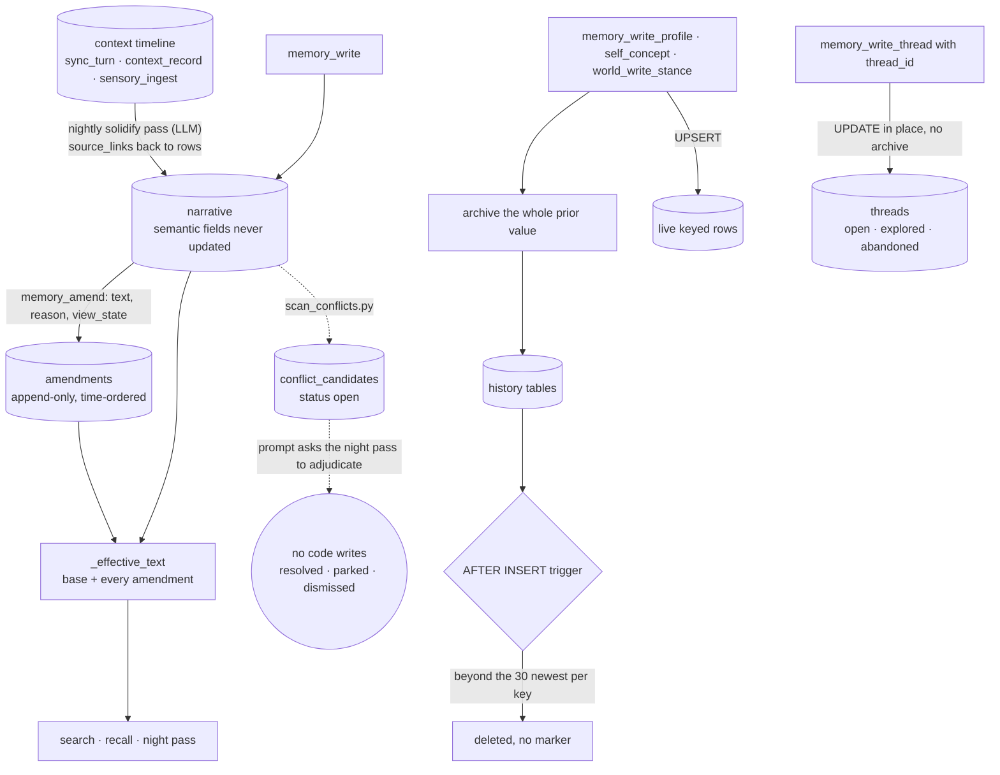

## 1. Executive Summary

Tideline (潮痕, "tide marks") is one agent's memory: an MCP server over SQLite
and a Hermes provider plugin that injects self-concept, current state, open
threads and recent high-weight memories at every session start. Its notable
decision is that a narrative is never edited — a correction is appended as an
amendment with a reason, shown as a layer and searchable on its own. Its weak
side is the keyed state around that core: profile, self-concept and
world-stance overwrites keep thirty prior values, thread edits keep none, and a
time-filtered search leaks out-of-window narratives through its keyword
fallback.

It is licensed **PolyForm Noncommercial 1.0.0**. Any commercial use is outside
the grant, which is the first fact for anyone evaluating it as a substrate.

**One mark, `negative_eval`.** The salience read port's fixture asserts that a
closed thread and expired or deactivated pins stay out of a populated result,
each beside a positive control ([section 10](#10-tests-evals-and-benchmarks)).
The other six are absent, and the amendment layer is the nearest miss
([section 9](#9-reliability-safety-and-trust)).

**The fixtures are tests.** Nine scripts under `tests/` record named checks
through a `check()` helper and exit 1 when any fails; the eight bare `assert`
statements are setup guards that the module under test exists. Nothing runs them: there is
no runner and no CI workflow (`tests/fixture_phase13_cooldown.py:236`).

The README addresses an agent rather than a person, and draws the distinction
the design is built on: *"carrying state is holding what those events left
behind, reshaped by everything since."*

## 2. Mental Model

A memory is one of five things, and they change in different ways.

- **A narrative** is a structured event record: a one-line gesture, its
  context, a free-text moment, a cognition direction (*"from X to Y"*), tags,
  related entities, links back to the raw context rows it came from, and four
  1-5 weight dimensions. Its semantic fields are never updated — the schema
  comment states it, *"条目不可变：narratives 永不 UPDATE 语义字段"*, and no
  statement in the tree does (`server.py:198-212`).
- **An amendment** is a correction or extension of one narrative: text, reason,
  timestamp and a `view_state` recording the target's last appearance in the
  attention log. Amendments stack in time order. One function composes the
  narrative plus its amendments into what the memory says now, and search,
  recall and the night pass all read through it (`server.py:973-1016`).
- **A keyed row** — a profile per entity and type, a self-concept field
  (`fact`, `terrain`, `self_reflection`), a world-stance page per entity — holds
  one live value, replaced by UPSERT after the old value is archived.
- **A thread** is a forward-looking question the night pass seeds. It moves
  from `open` to `explored` or `abandoned`, and its content is overwritten in
  place when it does.
- **The context timeline** is raw material: conversation turns, recorded
  context and sensory events. The nightly solidify pass turns it into
  narratives and links each back to its source rows.

Nothing dies. There is no delete tool, and no `DELETE` touches narratives,
amendments, context or snapshots. A narrative leaves the session-start block
when its normalised weight falls to 0.6 or below or it ages past seven days; it
stays searchable. A keyed value disappears only from the archive, when thirty
newer overwrites of the same key push it out.

Memory is the agent's own first-person state, not a set of claims with a
standing. A conflict scanner finds narrative pairs that look contradictory and
lists them in a side table; the solidify prompt asks the night pass to rewrite,
dismiss or park each one. Nothing in the tree records the outcome.

## 3. Architecture

Everything is one SQLite file at `MEMORY_MCP_DB`. `server.py` is the MCP stdio
server and owns the schema; three optional modules — `sensory_write.py`,
`salience_read.py` and `world_entities.py` — are imported if present, and the
server runs without them (`server.py:24-34`).

- **Injection** lives outside the server, in `plugins/tideline_provider.py`, a
  Hermes `MemoryProvider` with session-start, per-turn prefetch,
  pre-compression and session-end hooks. `kimi-code/hooks/tideline_hook.py`
  maps the same lifecycle onto Kimi Code hooks. An MCP-only client gets the
  tools and no injection.
- **Retrieval** is SQLite FTS5 with trigram tokenisation over narratives,
  amendments and context, plus cosine over JSON-encoded vectors from an HTTP
  embedding service, local `bge-m3` by default. An embedding cache keyed by
  text hash and model namespace holds at most 20,000 rows per namespace.
- **Background work** is three prompts the operator schedules in their own LLM
  runtime — `dream_solidify.md`, `dream_digest.md`, `dream_sleep.md` — and
  deterministic scripts under `scripts/` for scanning, clustering, graph
  building and weight refresh.
- **Ports** for external event sources: `sensory_ingest` writes events into the
  context timeline under a consent policy, and `moonshake_adapter.py` feeds
  Moonshake JSONL rows through it. Nothing in the tree calls the adapter.

### Deployment and ergonomics

The server needs Python 3.11 and `mcp`; the scripts add `jieba` and `numpy`.
Embeddings are optional, and without them search is keyword-only. The
`Dockerfile` installs `mcp>=1.0` unpinned and copies the server, plugins and
scripts. Automatic injection needs Hermes or Kimi Code. Absolute paths on the
author's machine sit in `prompts/dream_solidify.md`, `plugins/memory_mirror.py`,
`scripts/dream_scripts.py` and every fixture's run line, so an adopter rewrites
the night-pass prompt before it runs.

## 4. Essential Implementation Paths

**The amend path** — `server.py:1783-1834`. An empty amendment is refused and
so is one for a narrative that does not exist. The handler reads the target's
latest `attention_log` row into `view_state`, or records
`blindspot:从未被照亮` — never lit — when there is none. It commits the
amendment before minting its vector and rebuilding the trajectory, so a
downstream failure cannot report success over a rolled-back write.

**The effective text** — `server.py:973-1016`. `_amendments_for` is the single
source of amendment order, by `created_at` then `id`, and `_effective_text`
joins the base with every amendment or returns them as a list. The list form
exists because a multi-line amendment split after joining misattributed its
second line to the next amendment; a fixture pins the fix
(`tests/fixture_phase15_effective_wiring.py:143-151`).

**Archive before overwrite** — `server.py:61-75` and `:157-196`.
`_archive_if_overwritten` copies the prior `content` into `<table>_history`
before the UPSERT, and an `AFTER INSERT` trigger on each history table deletes
every row for that key outside the thirty newest. The helper catches
`sqlite3.OperationalError` and returns, so a failed archive lets the overwrite
proceed. `world_entities.py:88-117` repeats the design for stance pages.

**The search fallback** — `server.py:2292-2306`. The narrative LIKE fallback
matches five columns joined by `OR`, then appends `AND created_at >= ?` and
`AND created_at <= ?` with no parentheses. SQL binds `AND` tighter than `OR`,
so a `since` or `until` filter restricts only the `cognition_direction` clause;
a narrative matching in its content, gesture, context or moment returns from
any date. The amendment fallback a few lines later parenthesises its `OR`
(`:2332`), and so does the tag filter on `memory_recall` written in the same
commit (`:1893`).

**Session-start injection** — `plugins/tideline_provider.py:281-431`. In
order: every self-concept field; the latest snapshot; the five heaviest open
threads; up to three narratives from the last seven days with weight above 0.6,
one per tag; the most recent session's raw context chunks; the 25 largest topic
clusters; and every profile, in full for fixed or pinned entities and clipped
to 100 characters otherwise.

## 5. Memory Data Model

- `narratives` — structured fields above, `embedding` as JSON, `weight` and
  four integer dimensions. No status, no supersession pointer, no validity
  window and no confidence. `moment` is free text that search matches with
  `LIKE` and nothing parses as a time.
- `amendments` — `narrative_id`, `amendment`, `reason`, `created_at`,
  `view_state`. No `UPDATE` or `DELETE` on it outside a fixture.
- `amendment_vectors` — one vector per amendment with `text_hash` and
  `model_ns`; `amvec_cooldown` holds the global and per-amendment failure
  windows for minting them.
- `trajectories` — one row per amended narrative, events as JSON, `cast_state`
  `mech` or `llm`; a new amendment resets it to `mech`.
- `profiles` `UNIQUE(entity, ptype)`, `self_concept` `UNIQUE(field)`,
  `world_entities` `UNIQUE(entity)` — live keyed rows, each with a capped
  `_history` table of `old_content` and `archived_at`.
- `threads` — content, weights, `status` (`open`, `explored`, `abandoned`),
  `explored_at`.
- `snapshots` and `context` — append-only; `context.meta` carries the session,
  or for a sensory event its organ, modality, consent tier and action taken.
- `conflict_candidates` — a narrative pair, `confidence`, `reason`, `status`
  (`open`, `resolved`, `parked`, `dismissed`), created by
  `scripts/scan_conflicts.py:66-82`.
- `pin_registry` — `pin_text`, `weight`, `active`, `created_at`, `expires_at`,
  created by `salience_read.py` and inserted into only by a fixture.
- Derived tables: `attention_log` and `attention_stats` (retrieval hits),
  `topic_clusters`, `emb_clusters`, `graph_nodes`, `graph_edges`,
  `graph_cooccur`, `world_knock_log`, `ambient_feed`, `embedding_cache`.

## 6. Retrieval Mechanics

`memory_search` gathers candidates from six paths and keeps the best score per
narrative (`server.py:2250-2425`):

1. context, by FTS5 with a LIKE fallback;
2. narratives, by FTS5 over gesture, context, direction and tags, plus the
   five-column LIKE fallback;
3. amendments, by FTS5 or LIKE, mapped back to their narrative;
4. narrative vectors with cosine above 0.3;
5. amendment vectors in the query's model namespace, mapped back;
6. the 5,000 newest context vectors, top `limit`.

Keyword hits carry a 0.3 boost. Whichever path hit, the returned text is the
narrative with all its amendment layers. Narrative hits are logged to
`attention_log`, which is what `view_state` later reads.

Per turn, the provider's prefetch scores narratives by cosine above 0.25 and
falls back to full-corpus FTS5 when fewer than two pass
(`plugins/tideline_provider.py:478-497`). The session-start block is in
[section 4](#4-essential-implementation-paths).

`salience_context` is a separate read port for an external salience filter
(`salience_read.py:401-430`). It returns background material and no score:
self-concept, profile and cluster matches for an event's entities, the active
unexpired pins, a user-or-other split of named entities, a daily quota of
ambient headlines, and the latest snapshot with the open threads.

## 7. Write Mechanics

- **`memory_write`** inserts a narrative. Recurrence is computed from how many
  narratives share a tag, siblings' recurrence is recomputed, and weights are
  normalised across a window — derived fields, written by `UPDATE`.
- **`memory_amend`** appends, as in [section 4](#4-essential-implementation-paths).
- **Keyed writes** archive and UPSERT. `world_write_stance` refuses person-like
  entity types, an empty stance and an unknown delivery window
  (`world_entities.py:144-218`).
- **`memory_write_thread`** with a `thread_id` runs `UPDATE threads SET
  content=…` and archives nothing (`server.py:1960-1970`). The docstring of the
  empty-content guard lists thread updates among the overwrite writes that
  destroy data (`server.py:54-58`).
- **Context** arrives from `sync_turn` every turn, from `context_record`, from
  the session-end epilogue, and from `sensory_ingest`.
- **`sensory_ingest`** validates an envelope and decides by consent tier: below
  the floor it writes no row, between the floors it drops the raw sample
  reference and keeps the summary, and above both it keeps both
  (`sensory_write.py:108-190`). The default policy never keeps raw samples. The
  tool takes `policy` as an argument and passes it through, so a caller that
  supplies one sets its own floors (`server.py:2427-2432`).
- **The night pass** reads `scan_unindexed.py`'s report of context with no
  narrative and writes narratives with `source_links` through `memory_write`.
  For a conflict where a fact has expired, the solidify prompt asks it to
  rewrite the old entry through `memory_write`, which only inserts.

## 8. Agent Integration

Twenty-six MCP tools: narrative write, amend, recall and search; profile,
self-concept, thread and snapshot reads and writes; trajectory promotion for
the night pass; attention heatmap, soft clusters and entity graph; context
record, search and timeline; sensory ingest and orphan check; the salience
port; and four world-stance tools.

`docs/who-can-use.txt` matches install depth to intent: everything for an agent
owner, server and scripts for a framework builder, the server alone to try it,
and *"当智能笔记本用"* — use it as a smart notebook — for structured search
alone. It prices each tier in tokens, down to zero for the bare server.

## 9. Reliability, Safety, and Trust

**`negative_eval` is the one mark**, on the salience port; the evidence and its
limits are in [section 10](#10-tests-evals-and-benchmarks).

**`audit_log` is the nearest miss.** The amendment table is append-only in
product code and records each change to a narrative with a reason, a time and
what the writer last saw. It is the memory's content rather than a record of
mutations to it: every read composes it into the effective text. It also covers
one kind of change. Keyed overwrites leave a capped archive a trigger prunes,
thread edits and weight recomputation leave nothing, and nothing records who
wrote what.

**The rest are absent.**

- *Tombstone*: a refused sensory event writes no row, and the person-type
  refusal is a rule on entity types, not a record of a rejected value.
- *Trust state*: thread status is the lifecycle of a question, not a judgement
  on a belief. Conflict-candidate status sits on a pair in a side table and no
  code writes anything but `open`.
- *Bi-temporal validity*: `moment` is unparsed text, and a pin has one clock,
  `created_at` as its start.
- *Scope*: no scope key on any read.
- *Human review*: the stance tool's docstring says only the agent should call
  it, in its grooming window, which is a request to the model; the conflict
  list is adjudicated by the night pass.

**Fields with one side wired.** `pin_registry` has a reader and no product
writer. `deliver_window` is validated and stored, and no read filters on it.

**The time filter.** A `since` search through the narrative LIKE fallback is
bounded on one column of five ([section 4](#4-essential-implementation-paths)).
A reader asking what was said last week gets older narratives whenever the word
is in their gesture or content.

**Screening.** `screen_repo.py` found no manifest, hook or agent file of a kind
it parses and reported the tree as unscreened rather than clean. I read it by
hand: a `Dockerfile` with one unpinned install, Kimi Code hooks that run only
once a user registers them, prompts with machine-specific paths, no CI
directory, and no `subprocess`, `os.system`, `eval` or `exec` in the Python. I
installed nothing and ran nothing.

## 10. Tests, Evals, and Benchmarks

Nine scripts under `tests/`, named `fixture_phase12` through `fixture_phase20`,
1,887 lines and 169 `check()` call sites. Each records pass or fail by name and
exits 1 on any failure. There is no runner, no `pytest` configuration and no
`.github/workflows`, so the suite runs when someone runs each script.

**The negative cases** are in `tests/fixture_phase19_salience_read.py`. V8b
seeds an open and a closed thread and requires `now_state` to hold exactly the
open one (`:115-116`, `:265-266`). V4a requires an inactive pin to be absent
(`:172`). V4d requires an expired pin absent and an unexpired one present, V4e
requires a pin expiring exactly at the fixed now to be absent, and V4f repeats
the expiry case on the production path with `now=None` (`:196-205`). The
fixture builds its own copy of the schema, seeds the closed thread as `done` —
a status the write tool cannot produce — and tests pins that nothing in
production writes.

**One check records its own earlier failure.** The comment above V4e says the
previous version was vacuous: no row expired exactly at the fixed now, so it
held for `>` and `>=` alike (`:185`). The commit that added the boundary row
says the check was then re-verified by changing `>` to `>=` and watching it
fail (`09fd7eb`).

**The provider fixture skips in a fresh clone.** It loads the plugin from a
path on the author's machine unless `TIDELINE_PROVIDER_PATH` is set, and exits
0 with `SKIP` when the file is absent
(`tests/fixture_phase16_provider_traj.py:19-23`).

The cooldown fixture carries five numbered rules in its header and 22 checks
against them (`tests/fixture_phase13_cooldown.py:4-11`). No fixture passes
`since` or `until` to a search or edits a thread. Phase 18 exercises the
consent-policy argument, as a feature: its custom policies admit raw samples
(`tests/fixture_phase18_sensory_write.py:173`, `:216`). No benchmark, no eval
harness and no paper are in the repository.

## 11. For Your Own Build

### Steal

- **Never edit a memory; stack corrections on it.** An amendment with a reason
  and a time keeps the wrong reading visible and searchable, and one function
  composing the effective text keeps every consumer consistent.
- **Record what the writer was looking at.** `view_state` on each amendment
  stores the target's last retrieval, or that it was never retrieved, so a later
  reader can see a correction made without looking at the original.
- **Archive before overwrite, and cap the archive in a trigger.** The bound
  then holds for every writer, including ones written later.
- **Write down when a check was vacuous, then mutate the code to prove the fix
  bites.** Phase 19's boundary row is the pattern.
- **Publish the smallest worthwhile configuration.** Four tiers priced in
  tokens tell a reader what to install before they read anything else.

### Avoid

- **Appending `AND` to an unparenthesised `OR` chain.** The tag filter in the
  same commit got the parentheses; the search filter did not.
- **An overwrite path the guard names and the archive skips.** Thread edits are
  the one keyed overwrite with no history.
- **A safety default the caller can replace in the same call.** A consent
  policy taken as a tool argument is a suggestion to the caller.
- **A capped history with no marker.** At the thirty-first overwrite the oldest
  value is gone and nothing says it existed.

### Fit

Take the amendment layer for any store where memories are wrong sometimes and
the history of the wrong reading matters. Take the whole system only for one
agent, for noncommercial use, and with the search filter and a test runner
added.

## 12. Open Questions

- Should keyed overwrites become amendments too, so profile and self-concept
  history is uncapped like narrative history?
- What writes `resolved`, `parked` and `dismissed` on a conflict candidate — a
  tool not yet in the tree, or direct SQL from the night pass?
- Is `pin_registry` meant to have a write tool, and `deliver_window` a reader?
- Was thirty chosen from observed rollback depth?
- Will the fixtures get a runner, and would the provider fixture then point at
  `plugins/tideline_provider.py` instead of skipping?

## Appendix: File Index

| Path | What it holds |
| --- | --- |
| `server.py` | the MCP server, schema, amend and archive paths, hybrid search |
| `plugins/tideline_provider.py` | session-start injection, per-turn prefetch, compression and session-end hooks |
| `plugins/session_epilogue.py`, `plugins/memory_mirror.py` | session-end narrative and context writers |
| `kimi-code/hooks/tideline_hook.py` | the provider lifecycle as Kimi Code hooks |
| `salience_read.py` | the salience read port, `pin_registry`, `ambient_feed` |
| `sensory_write.py`, `moonshake_adapter.py` | the consent-gated event port and a Moonshake feed for it |
| `world_entities.py` | world-stance pages, their capped history, knock log and grooming hints |
| `prompts/dream_solidify.md`, `dream_digest.md`, `dream_sleep.md` | the nightly LLM passes |
| `scripts/scan_conflicts.py`, `scan_unindexed.py`, `dream_scripts.py`, `build_entity_graph.py`, `refresh_recurrence.py`, `soft_clusters.py` | deterministic between-session passes |
| `tests/fixture_phase12..20*.py` | nine fixture scripts, 169 named checks |
| `docs/who-can-use.txt` | the four-tier install guide, in Chinese |
| `LICENSE` | PolyForm Noncommercial 1.0.0 |

### Repository history

Every commit from the first was rewritten to replace personal names and
nicknames with pseudonyms in comments, fixtures, the README, two default name
lists and author fields. Author dates and messages were kept. The pre-rewrite
commit [`76490fe2c422f1213e735e63c289fef5ae8044f6`](https://github.com/ennisaaaaaaaa-stack/tideline-memory/commit/76490fe2c422f1213e735e63c289fef5ae8044f6)
is fetchable by full sha from upstream and from the archive fork; its rewritten
twin [`0d88e72cb0201aa7e687168a8e859ba77abe5893`](https://github.com/ennisaaaaaaaa-stack/tideline-memory/commit/0d88e72cb0201aa7e687168a8e859ba77abe5893)
differs from it in 11 files, 54 lines each way, all of them names.

### Recorded searches

Run from the root of a full clone at the pinned commit, with `git grep`, which
does not honour `.gitignore`.

| Claim | Command | Result at this pin |
| --- | --- | --- |
| Fixtures exit non-zero on a failed check | `git grep -n -E 'sys\.exit' -- tests` | `sys.exit(1)` or `sys.exit(0 if passed == total else 1)` in all nine; phase16 also exits 0 at `:23` when the plugin path is absent |
| 169 named checks | `git grep -c -E '^\s*check\(' -- tests` | 5, 22, 28, 10, 12, 7, 36, 33, 16 |
| No CI and no runner | `git ls-files \| grep -E '^\.github\|pytest\|tox\|Makefile\|pyproject'` | Nothing |
| No delete of memory content | `git grep -n -E 'DELETE FROM (narratives\|amendments\|context\|snapshots)' -- '*.py'` | Nothing; FTS `AFTER DELETE` triggers only |
| Narratives' semantic fields are not updated | `git grep -n -E 'UPDATE narratives' -- '*.py'` | `weight`, `recurrence`, the four weight dimensions, `source_links`, and `embedding` in a fixture |
| Amendments are not updated or deleted in product code | `git grep -n -E '(UPDATE\|DELETE FROM) amendments' -- '*.py'` | One `UPDATE` in `tests/fixture_phase13_cooldown.py:113` |
| Thread edits are not archived | `git grep -n '_archive_if_overwritten' -- '*.py'` | Called for `profiles` and `self_concept` only, `server.py:1915`, `:1929` |
| The narrative LIKE fallback is unparenthesised | read `server.py:2292-2303` | Five `OR` clauses, then `AND created_at >= ?` appended |
| Conflict status never leaves open | `git grep -n -E "UPDATE conflict_candidates\|'(resolved\|parked\|dismissed)'" -- '*.py'` | Nothing; the values appear only in a schema comment and in `prompts/dream_solidify.md:84-85` |
| `pin_registry` has no product writer | `git grep -n 'INSERT INTO pin_registry'` | `tests/fixture_phase19_salience_read.py` only |
| `deliver_window` has no reader that filters | `git grep -n -E 'deliver_window' -- '*.py' ':!tests'` | Schema, validation and write in `world_entities.py`; tool schema in `server.py` |
| `moment` is never parsed | `git grep -n -E '\bmoment\b' -- '*.py' ':!tests'` | Schema, write, display and a `LIKE` clause |
| No fixture covers the time filter or a thread edit | `git grep -n -E 'since\|until\|memory_write_thread\|thread_id' -- tests` | Nothing |
| No writer identity on any memory row | `git grep -n -i -E '\b(actor\|author\|writer\|agent_id\|written_by\|created_by)\b' -- server.py` | Nothing |
| Nothing calls the Moonshake adapter | `git grep -n -E 'moonshake_adapter\|ingest_rows' -- ':!moonshake_adapter.py'` | Nothing |
| No epistemic vocabulary | `git grep -l -i -E 'tombstone\|supersede\|decay' -- '*.py'` | Nothing |
| No execution of strings | `git grep -n -E 'subprocess\|os\.system\|eval\(\|exec\(' -- '*.py'` | Nothing |
| The rewrite changed names only | `git diff --stat 76490fe2c422f1213e735e63c289fef5ae8044f6 0d88e72cb0201aa7e687168a8e859ba77abe5893` | 11 files, 54 insertions, 54 deletions |
| The screen could not see the execution surface | `python3 scripts/screen_repo.py <tree>` | "NOTHING SCANNED", read by hand |

## History

**2026-10-15** — [`07fbd67808016d3a27d15d4ada671adfc59ff5bc`](https://github.com/ennisaaaaaaaa-stack/tideline-memory/commit/07fbd67808016d3a27d15d4ada671adfc59ff5bc) — the upstream rewrote its whole history to pseudonymise names, leaving the old pin off the branch; its twin differs only in names ([Repository history](#repository-history)). Eleven commits followed: amendment `view_state`, the sensory and salience ports, world-stance pages and a Moonshake adapter. **`negative_eval` awarded** on the salience fixture ([section 10](#10-tests-evals-and-benchmarks)). Four claims were wrong at the old pin: the fixtures exit 1 on 77 named checks rather than asserting only a path; the latest snapshot and recent narratives are injected; context and threads are not keyed rows; and amendments are an append-only layer under immutable narratives. A search time-filter defect arrived on 2026-09-25 ([section 4](#4-essential-implementation-paths)). Screened by hand again; nothing installed or run.

**2026-09-20** — [`76490fe2c422f1213e735e63c289fef5ae8044f6`](https://github.com/ennisaaaaaaaa-stack/tideline-memory/commit/76490fe2c422f1213e735e63c289fef5ae8044f6) — first reading, at 30 files. The screening script reported that it could not see an execution surface in this tree and returned "unscreened rather than clean", so the tree was read by hand: a Dockerfile, Python scripts, hooks under `kimi-code/`, and no CI directory. Nothing was installed and nothing was run. **PolyForm Noncommercial 1.0.0** — commercial use is outside the grant, which is the first thing a reader evaluating this should know. No marks: nothing records a rejected value, nothing carries an epistemic state, there is one clock, there is no scope key, nothing waits for a person, and the history tables are a rollback layer capped at thirty versions per key rather than an append-only record. The fixtures specify their intended semantics in unusually careful prose and contain four assertions between them, all of them the same check that `server.py` exists.
