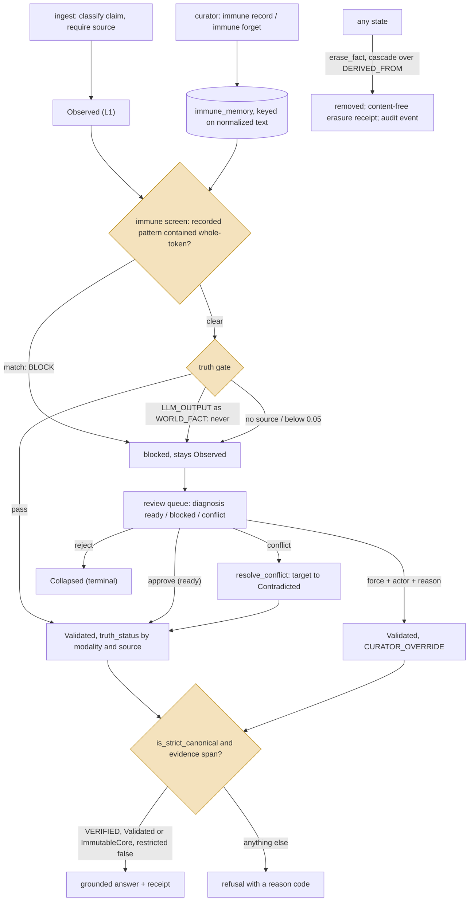
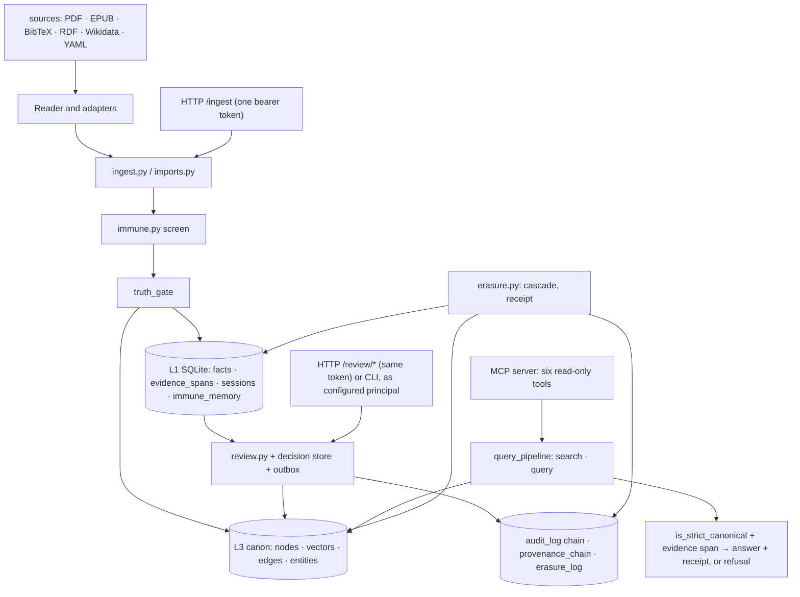

## 1. Executive Summary

Velantrim Crystal is a local-first **evidence and memory kernel** in Python
whose rule is that finding a fact and trusting it are separate code paths: a
truth gate that never admits model output as a world fact decides what enters
the canon, and only a `VERIFIED`, evidenced, unrestricted fact may ground an
answer. Its strongest parts are that gate and a grounding predicate that fails
closed on any missing field. Its weakest are that erasure and rejection are
unjoined records and that the bundled HTTP service trusts whoever may ingest to
also approve.

The front page states the rule as *"Discovery may propose what deserves
inspection. Authority is a separate decision path."* The project's
documentation leans the same way: an agent-facing router tells a reader not to
infer implementation from the narrative README, and a capability matrix lists
what is *not* implemented — a dedicated semantic reader, an ANN index, an NLI
filter, a PostgreSQL runtime. The licence is AGPL-3.0, which reaches a network
service built on it.

Five mechanisms earn five marks. **A fact has a state and a status.** It
enters as `Observed`; the truth gate (`core/truth_gate.py:23-91`) requires a
source, refuses a `WORLD_FACT` whose `source_status` is `LLM_OUTPUT` as a fixed
invariant no environment variable can lift, and applies a fixed confidence
floor of 0.05 to world facts and interpretations while letting subjective
claims through as experience. Admission moves it to `Validated`.
`Contradicted`, `Deprecated` and `Collapsed` are terminal. `is_strict_canonical`
(`core/canonical_view.py:160-243`) lets a fact ground an answer only when its
`truth_status` is exactly `VERIFIED` and consistent with its claim type and
source, its state is `Validated` or `ImmutableCore`, and its `restricted` bit
is exactly false.

**A curator decides.** The review queue lists `Observed` facts with a
diagnosis; `approve` refuses a `conflict` until `resolve_conflict` has been
called and overrides a blocked gate only with `force`, an actor and a reason;
`reject` collapses; each decision is staged under a compare-and-swap on the
fact's revision and projected to the canon through an outbox
(`core/review.py`, `core/review_decision_store.py`). The agent's MCP server is
read-only and carries none of these verbs.

**A rejected value is remembered.** The immune memory (`core/immune.py`) is a
table of claim patterns keyed on their normalized text, each with a type, a
severity and the actor who recorded it. `ingest`, the importer and the review
diagnosis screen every claim against it before the guardian and the truth
gate, and a claim that contains a recorded pattern whole-token is refused with
`Immune:` in the reason and stays `Observed` in L1. A curator records a pattern
from the CLI, and with strict and learn mode both on, the ingest path records a
contradicted claim itself. A force approval passes a blocked claim into
`Validated` stamped `CURATOR_OVERRIDE`, a status strict grounding refuses, so
the override admits the claim and never lets it answer.

**Every compliance event is chained.** `audit_log` rows seal
`seq|ts|event|fact_id|detail|prev_hash` in `entry_hash`, a checkpoint row pins
the head so a deleted suffix shows, and an HMAC signs entries when a key is
configured (`core/audit.py:73-160`).

**Exclusion is tested on populated reads**: a graph walk returns its seed and
skips a neighbour whose L1 record is terminal, a search at `k=1` skips a
restricted exact match for the unrestricted near-duplicate, and a typed review
listing omits a restricted pending fact beside an ordinary one.

The boundary of the `tombstone` mark runs between two records that look alike.
Erasure (`core/erasure.py:66-201`) is physical — L1, graph, evidence, sessions —
cascades over `DERIVED_FROM` edges, refuses Ring Zero, is idempotent, and writes
a content-free `erasure_log` row with a `content_hash` that no write path reads.
That row is a deletion receipt: it proves that something was removed and cannot
say what may not return. The immune memory is keyed on the value and read
before admission, and it is the one the mark asks for. The two are not joined:
erasing a claim does not record its pattern, and recording a pattern does not
erase the facts that match it.

Two marks are withheld on definitions. There is no validity interval, and
there is no scope key: a `restricted` bit and a session-wide restriction
implement a processing restriction, not a partition.

## 2. Mental Model

A memory is a **fact with a state**, and the states are the design. A claim is
evidence until the gate admits it; it is canon once admitted; it is an answer
only while it is `VERIFIED`, evidenced and unrestricted.

Truth status is a second axis: `VERIFIED`, `USER_CLAIMED`, `HYPOTHESIS`,
`SUBJECTIVE`, `UNVERIFIED`, `CURATOR_OVERRIDE`, assigned by modality and source
(`core/pipeline.py:872-894`). A world fact from an `EXTERNAL`, `DERIVED` or
`OBSERVED` source becomes `VERIFIED`; a user's own report becomes
`USER_CLAIMED`. A fact can be `Validated` and not `VERIFIED`, and
`is_strict_canonical` requires both independently rather than inferring one
from the other.

Belief ends four ways. A curator rejects a pending fact to `Collapsed`. A
contradiction resolved against a canonical fact moves it to `Contradicted`, and
supersession continues to `Deprecated`. A restriction withholds a fact from
every read without changing its state. Erasure removes it.

The highlighted nodes are the whole argument: the immune screen refuses what
has been judged wrong before, the gate cannot be configured to trust the model,
and the grounding predicate refuses everything it cannot confirm. Everything
downstream exists so that the answer path never has to ask whether something
merely looked relevant.

## 3. Architecture

Python 3.11+, standard-library-first by the project's own description. The
parts of `core/` this report reads:

- `memory.py` — the L1 schema: `facts`, `evidence_spans`, `import_sessions`,
  `review_sessions`, `erasure_log`, `audit_log`, `provenance_chain`,
  `chain_checkpoints`, `immune_memory`, the L3 outbox; `ESM_STATES` and the
  transition matrix; `l3_secondary_sync_admissible`.
- `truth_gate.py`, `canonical_view.py`, `pipeline.py` (`retrieve`, the
  guardian, `generate_answer`, the outbox drain), `query_pipeline.py` (the
  read-only `search` and `query`).
- `review.py`, `review_decision_store.py`, `review_projection.py`,
  `conflict_decision.py`, `contradiction.py`, `contradiction_report.py`,
  `curator_auth.py`, `curator_runtime.py`.
- `audit.py`, `provenance_chain.py`, `erasure.py`, `compliance.py`.
- `immune.py` — the rejected-pattern memory.
- `evidence.py` (spans, verification, grounding validity), `provenance.py`.
- `l3_graph.py` — the canon: nodes, vectors, edges, entities, mentions;
  `postgresql_migration*.py` written and inactive.
- `reader_*.py` — the Reader: source identity, structure, passes, proposition
  extraction, relations, long context, cross-document links, lexical
  candidate discovery.
- `api.py` (FastAPI), `api_ingest_policy.py`, `cli.py`, `mcp_server.py`,
  `adapters/`.

### Deployment and ergonomics

- **What has to run:** Python and SQLite; the FastAPI service is optional; a
  Docker image ships. The L3 backend selects LadybugDB when that package is
  installed and on-disk SQLite otherwise (`core/l3_graph.py:1062-1075`); Neo4j
  is selectable. The PostgreSQL path exists as a migration marked inactive and
  not authorized.
- **Fully local and offline:** yes; embeddings are optional, and without an
  indexed embedder fingerprint the read path falls back to a bounded lexical
  pass with a `reindex_required` reason code.
- **API key:** every guarded HTTP route returns 401 without
  `VELANTRIM_API_TOKEN` unless `VELANTRIM_API_ALLOW_UNAUTH_LOCAL=1` is set.
- **Hand-repairable:** the store is SQLite with a documented schema, the
  audit chain is verifiable with a command, and a receipt can be re-verified.
- **Install:** `pip install -e .`; the CI runs a Ring Zero mutation gate and a
  `--cov-fail-under=100` line-coverage gate (`.github/workflows/ci.yml`).

## 4. Essential Implementation Paths

**Ingest.** `core/ingest.py:158-372` classifies the utterance
(`classify_claim`), resolves a `fact_id` from the exact-normalized claim
(`_resolve_auto_fact`, `ing:` plus 12 hex of an MD5), and returns early on an
exact repeat of a `Validated` fact as an occurrence. It then stores the claim
as `Observed`, screens it against the immune memory, returns `accepted: False`
with an `Immune:` reason on a match (262-267), and runs the guardian and the
truth gate. On a pass it transitions to `Validated`, sets the `truth_status`
by modality and source, and merges into L3 (311-329); on refusal the fact
stays `Observed` with the reason. In strict mode a contradiction of the canon
also blocks, and with learning on the blocked utterance is recorded as a
threat by the ingest path itself (292-302). The importer
(`core/imports.py:78-79`) screens the same way; `knowledge.ingest_file` and
`write_voluntary` (`core/volition.py:84`) route through `ingest`.

**Immune memory.** `core/immune.py:85-122`: `record_threat` normalizes the
pattern, derives `pattern_id` from the normalized text, upserts the
`immune_memory` row with `threat_type`, `severity` and `actor`, and appends a
content-free `immune_threat_recorded` audit event; re-recording the same
pattern refreshes type and severity and keeps the hit count. `forget_threat`
(124-134) deletes the row and appends `immune_threat_forgotten`.
`match_threat` (154-175) pads the normalized claim and every recorded pattern
with spaces and tests containment, so `car` never matches `scary`, and returns
the highest-severity match at or above `VELANTRIM_IMMUNE_BLOCK_SEVERITY`
(default 0.5). `screen` (178-235) returns `BLOCK` with the matched entry and
registers the hit. The CLI exposes `immune record`, `immune forget`,
`immune screen` and `immune report` (`core/cli.py:377-388`).

**The gate.** `core/truth_gate.py:23-91`: no facts is a refusal, and so is a fact
without `source`. A `WORLD_FACT` with `source_status ==
"LLM_OUTPUT"` is a refusal the docstring calls a Ring Zero invariant that *"no
environment variable, runtime mode or caller option can disable"*. Subjective
claim types pass without an evidentiary bar; world facts and interpretations
need `confidence >= DEFAULT_MIN_CONFIDENCE`, fixed at 0.05 under the version
string `truth-gate-v1-fixed-0.05`. `tests/test_truth_gate.py:142-152` sets
`ENABLE_TRUTH_POLICY` to six values and checks the refusal holds.

**Read.** `core/query_pipeline.py:195-243`: with no indexed embedder, a bounded
lexical pass; otherwise `pipeline.retrieve` (`core/pipeline.py:445-700`), a
cosine leg over admitted memory and the opt-in demo seed, a lexical leg and a
graph walk, fused by reciprocal rank. `_l1_terminal_state_blocks` and
`_l1_restricted_blocks` (347-374) let a terminal or restricted L1 record win
over a stale L3 copy, and `_may_propagate_activation` and
`_may_seed_vector_hit` (375-440) refuse to walk through such a node.

`_resolve_canonical_fact` (`core/query_pipeline.py:167-192`) rebuilds each hit
from the L3 node and the L1 row. `search_result` keeps only facts whose
`restricted` is exactly `False` (274-277). `query` drops a `VERIFIED` fact
that has no replayable evidence span (341-356), then hands the rest to
`generate_answer`, whose `project_canonical` keeps only strict-canonical
facts. Every outcome carries a reason code rather than an empty list that
looks like a result. HTTP `/ask` and the CLI `ask` both call `query`;
`pipeline.run`, the variant that admits and writes, is called by
`core/eval.py` alone, which the CLI `eval` command runs.

**Review.** `core/review.py:84-470`: `pending` attaches a diagnosis per item
(`ready`, `blocked`, `conflict`), where `_diagnose` (122-156) runs the immune
screen first and then the guardian and the gate. `approve` (196) applies the
rules in section 1, a force approval writing `truth_status`
`CURATOR_OVERRIDE` and the event `review_force_approve`. `reject` (461) moves
a fact to `Collapsed` through `transition_esm` with a compare-and-swap;
`resolve_conflict` (389) re-runs the diagnosis and refuses a blocked claim;
sessions sit at 535-648. `review_decision_store.stage_review_decision`
(165-345) writes the decision, its audit event and the projection intent in
one SQLite transaction; a graph backend failure leaves a durable
`projection_status` rather than a lost decision, and `drain_projections`
retries. The projection refuses a participant that has an erasure row
(`core/review_projection.py:28`).

**Curator identity.** `core/curator_runtime.py:49-160` builds one principal
from `VELANTRIM_CURATOR_ACTOR`, `_ROLES` and `_SCOPES`, authorizes the action
against the role's capabilities and a `fact:` scope
(`core/curator_auth.py:117-152`), and passes the principal's id to `review` as
the actor. HTTP derives the principal after the same bearer-token check
`/ingest` uses (`core/api.py:79-106`); unauthenticated local mode substitutes a
synthetic ADMIN with scope `fact:*`.

**Audit.** `core/audit.py:73-160`: `append_event` under `BEGIN IMMEDIATE`, tail
and checkpoint read inside the lock, the entry hash sealed over the previous
hash, an optional HMAC; `verify_audit_log` walks the chain and the checkpoint.

**Erase.** `core/erasure.py:66-201` refuses `IMMUTABLE_FACT_IDS`, then
deletes evidence, import-session entries and the normalized ingest mapping
first, so an orphan with nothing else left is erased too. A fact never stored
and never erased is a no-op with no receipt, because fabricating an erasure
record for data that never existed would be its own Article 30 defect.
Otherwise it removes L1, the L3 node and edges, mentions and outbox entries;
cascades over `DERIVED_FROM` with cycle protection when asked; writes the
receipt, the audit event and a provenance-chain entry; and returns
`erased_now=False` on a repeat.

**Restrict.** `core/compliance.py:48-60`: `restrict_processing` sets the bit;
`session-restrict` and `session-erase` (`core/cli.py:212-215`) apply it or
erasure to a whole import session.

## 5. Memory Data Model

The `facts` table (`core/memory.py:165-178`):

| Column | Role |
| --- | --- |
| `fact_id` | stable id from the exact-normalized claim on the auto-id path |
| `claim`, `source` | the text and where it came from; both required to ground |
| `confidence` | 0–1, gated for world facts and interpretations |
| `epistemic_state` | `Observed`, `Hypothesized`, `Supported`, `Validated`, `Contradicted`, `Deprecated`, `Collapsed`, `ImmutableCore` |
| `claim_type` | `WORLD_FACT`, interpretation, or a subjective type |
| `source_status` | `UNKNOWN`, `USER_REPORTED`, `LLM_OUTPUT`, or an independent source |
| `significance` | a second 0–1, for ranking |
| `restricted` | the processing-restriction bit, deny-dominant when unknown |

`truth_status` lives on the L3 node and is recombined with the L1 row at read
time. A `revision` column, added by migration, carries the compare-and-swap.
`store_fact` passes `claim` and `metadata` through `crypto.encrypt`, which is
the identity unless at-rest encryption is enabled.

The `immune_memory` table (`core/memory.py:199-208`): `pattern_id` (a hash of
the normalized pattern, the primary key), `pattern` as normalized text,
`threat_type`, `severity`, `recorded_at`, `actor`, `hits`, `last_hit_at`.

Beside it: `evidence_spans` binding a `fact_id` to a byte range and a hash of
a source, verified by `verify_evidence`; `erasure_log` keyed on `fact_id` with
`erased_at`, `reason`, `actor`, `content_hash`; `audit_log`; `provenance_chain`,
a per-fact hash chain written by erasure; `chain_checkpoints`;
`review_sessions`; `import_sessions`.

**Temporal:** `created_at` and `updated_at`; no validity interval.
`bitemporal` withheld.

**Trust:** the state and the status, both read. `trust_state` earned.

**Scoping:** none by principal. Curator principals carry `fact:` scopes, which
authorize review writes and filter no read. `scope_enforced` withheld.

**Tombstone:** the `immune_memory` row, keyed on the normalized value and
read by `ingest`, `imports` and the review diagnosis before the gate. The
erasure record is not it: its `content_hash` is read by no write path. Its
`fact_id` is read by the review projection, which refuses to project a
decision about an erased id; on the auto-id path that id is derived from the
claim, but `ingest` reads no erasure row, so a re-ingested erased claim the
gate passes is admitted. `tombstone` earned on the immune memory, with its
limits in section 9.

## 6. Retrieval Mechanics

Two surfaces share one retriever. `pipeline.retrieve` is the working recall: a
cosine leg over embeddings, a lexical leg, and a graph walk that spreads
activation through neighbours, decays per hop and never passes through a
terminal or restricted node or along a truth-maintenance edge, with L1
winning over a stale L3 copy. It fetches three times `k` from the vector
index so that restricted rows cannot starve the top-k. `query_pipeline.search`
and `query` are the read-only public surface: they resolve hits to canonical
facts, drop anything not `restricted == False`, and never write. A store with
no indexed embedder answers from a bounded lexical pass and says so in the
result.

Grounding is stricter than retrieval. An answer may cite a fact only when
`is_strict_canonical` holds and, for a `VERIFIED` fact,
`has_valid_evidence_for_grounding` finds a replayable span; the documentation's
own line is `same fact_id != same claim`, and a `VERIFIED` fact whose evidence
has gone stale loses current standing without losing its history.

The MCP `search` tool returns non-canonical facts with their `truth_status` and
`epistemic_state` attached, so the agent can see a `USER_CLAIMED` fact and its
label; `get_fact` returns any unrestricted fact by id in any state.

**Failure modes:** the lexical pass is deterministic and bounded by design,
and the semantic reader is declared not implemented, so recall on paraphrase
depends on the optional embeddings; a store with many terminal facts pays the
L1 lookup per hit.

## 7. Write Mechanics

**Gated, not extracted.** A claim is classified by regex and stored as typed
by the caller; nothing summarises. `consolidate()` decays confidence and has
no caller outside its own module. The immune screen and the gate are the
write mechanic. Crystal lets a feeling in as a feeling without letting it
become a world fact, and refuses to let its own output be promoted by any
switch: `write_voluntary`, the system's self-authored write, goes through
`ingest` pinned to `USER_REPORTED`, so a world fact it writes is
`USER_CLAIMED` at best.

**Source status is declared.** The gate trusts `source_status`. On HTTP an
unprivileged caller may send only `USER_REPORTED` or `LLM_OUTPUT`, and
`EXTERNAL`, `DERIVED` or `OBSERVED` need import mode, evidence references and
`VELANTRIM_API_PRIVILEGED_INGEST=1` (`core/api_ingest_policy.py`); on the
Python path the label is whatever the caller passes.

**Conflicts.** `core/contradiction.py` classifies a pair of claims by polarity,
numbers and content overlap; a `conflict` diagnosis blocks `approve` until
`resolve_conflict` records a decision with metadata on the losing candidate
(`conflict_decision.py`).

**Concurrency.** Every decision is a compare-and-swap on the fact's
`revision`; a CAS miss aborts without touching L3
(`test_approve_aborts_on_cas_miss_without_l3_merge`). A secondary L3 sync —
restriction, reconciliation — merges a `Validated` fact only when its graph
node exists, with an explicit exception for outbox recovery and supersession
(`core/memory.py:60-88`).

**Malicious input:** a claim is text; the gate checks provenance and
confidence, not content. Ring Zero facts cannot be erased or overwritten.

### Operational cost

- A write is one SQLite transaction plus a graph merge; the outbox absorbs a
  graph failure.
- A fact is retrievable immediately by the lexical leg; the vector leg after
  `reindex_embeddings`.
- No background pass rewrites the store.
- The answer path returns a receipt with the grounding facts and a
  verification route (`/receipt`, `/verify-receipt`).

## 8. Agent Integration

The agent-facing surface is a deliberately read-only MCP server.
`core/mcp_server.py` (279 lines, stdio JSON-RPC) exposes `search`,
`memory_report`, `get_fact`, `fact_history`, `find_conflicts` and
`verify_receipt`; none calls a writer, so an agent over MCP can read canon,
inspect a fact's lifecycle, classify a claim against the store and verify a
receipt, and cannot ingest or approve (`tests/test_mcp_server.py`, 20 cases).

The HTTP service is the write and curation surface. A client calls `/ingest`
and `/ask`, receives a receipt it can re-verify, and reads
`/evidence/{fact_id}`; a curator works `/review/queue`, `/review/approve`,
`/review/reject` and the conflict routes, plus the CLI `immune` commands. The
service maps one bearer token to one configured principal, in the words of
`docs/security/CURATOR_WRITE_AUTH.md` "one bearer token mapped to one curator
principal". A deployment that gives an agent the token for `/ingest` therefore
gives it `/review/approve` too; separating the two means running the review
routes behind a different host or authentication dependency, which the
project's ADR-018 names as host work.

`core/curator_runtime.py` is not a machine curator: it is the bundled write
bridge from an authenticated principal to `core.review`, deriving the audit
actor from the principal and checking its role, capabilities and candidate and
target scopes before any mutation. The agent-facing documentation
(`docs/ai/README.md`) is a router with a source-of-truth order that ranks live
GitHub, tests and CI above the prose, and a lifecycle overlay it tells a reader
not to trust past its date.

The pipeline and the truth gate each carry a comment reading *"Known
limitation[s] (not scheduled — Crystal V1 is freeze/stability with no
automatic next milestone)"*, naming a full ESM transition matrix and Laplace
confidence among them. A gap stated as unscheduled is easier to evaluate than
one stated as next.

## 9. Reliability, Safety, and Trust

**What holds.** The gate's one invariant is not configurable; canonical
grounding fails closed on a missing, malformed or inconsistent field; a
restricted bit is deny-dominant and wins over a stale graph. Decisions are
atomic with their audit event; the audit chain has a checkpoint and nothing in
production rewrites or prunes it; erasure is idempotent, cascades over derived
facts and refuses Ring Zero. A recorded pattern blocks on sight across ingest,
import and review, and recording or forgetting one is audited
(`tests/test_immune.py`). A force approval needs the ADMIN role on HTTP, an
actor and a reason, is audited, and yields `CURATOR_OVERRIDE`, which cannot
ground a strict answer (`tests/test_force_override_audit.py:147-154`).

**Where the tombstone stops.** The immune memory is empty until someone
writes to it, and erasure does not: an erased claim is remembered as a hash in
`erasure_log` and as nothing in `immune_memory`, so a claim erased for being
wrong returns unless a curator also recorded its pattern. In the other
direction, erasing a fact leaves any recorded pattern that quotes it in the
immune table as normalized text, which `crypto.encrypt` never touches.
`immune forget` removes a pattern. Containment is whole-token, so a paraphrase
of a recorded pattern is not caught. A blocked claim is kept as an `Observed`
row in L1 rather than refused at the store. `reconcile.supersede` admits
through the gate without the immune screen; it has no caller in `core/`.

**Where the review boundary stops.** The MCP server holds no verb. The HTTP
service holds them behind the same credential as ingest, and in unauthenticated
local mode behind none, every caller acting as the synthetic `api-curator`
admin. The Python `review.approve` takes `actor` as a string.

**What is withheld, and why.** `bitemporal`: no validity interval.
`scope_enforced`: restriction is per fact and per session, and the curator's
`fact:` scopes authorize writes, not reads.

**What is convention.** The audit `detail` is content-free by contract, not by
schema. `approve` writes the curator's free-text `note`, and a force approval
its `reason`, into it (`core/review.py:284-298`), so a curator who quotes a
claim has written personal data into an append-only table. The Reader's
authorization flags in the manifest are documentation, enforced by the
project's own review process.

## 10. Tests, Evals, and Benchmarks

The suites that carry the marks: `test_canonical_view.py` (39),
`test_review.py` (40), `test_review_decision_hardening.py` (5),
`test_review_decision_outbox.py` (16), `test_review_resumable.py`,
`test_audit.py` (21), `test_erasure.py` (22), `test_truth_gate.py` (17),
`test_immune.py` (18), `test_force_override_audit.py` (13), `test_evidence.py`
(30), `test_bounded_legacy_retrieval.py` (17), `test_pipeline.py` (134),
`test_query_pipeline.py` (17), `test_contradiction.py` (15),
`test_api_curator_principal.py`, `test_mcp_server.py` (20) and
`test_l3_sync_admissibility.py` (10). `TEST_REPORT.md` records nine CI jobs,
including the Ring Zero mutation gate, and 2,244 collected tests at an earlier
checkpoint.

The must-not cases that carry `negative_eval` each seed a store, assert a
returned control and assert an absence: `tests/test_pipeline.py:593-613`
returns the seed and excludes a neighbour whose L1 record is `Collapsed`;
`:684-707` excludes a restricted exact match at `k=1` and returns the
unrestricted near-duplicate; `tests/test_review.py:90-106` omits a restricted
pending fact from a typed listing and returns the ordinary one.
`test_graph_walk_excludes_stale_terminal_vector_hit_and_its_neighbor`
(`tests/test_pipeline.py:801-820`) and
`test_restricted_record_never_leaks_from_legacy_search`
(`tests/test_bounded_legacy_retrieval.py:181-191`) assert absences with no
returned control.

Evaluation artifacts are committed under `eval/` with preregistrations and
results for the Reader's retrieval comparators and an NLI neutral filter, and
`docs/IMPLEMENTATION_STATUS.md` says which of those milestones authorize
nothing. No agent-memory benchmark applies; the claims are about admission,
not recall quality. I ran no test for this reading.

## 11. For Your Own Build

### Steal

- **Make the model-output rule an invariant, not a setting.** One `if` that
  no configuration reaches is worth more than a policy file.
- **Ground on a pure predicate that fails closed.** `is_strict_canonical`
  never infers verification from confidence or state, cross-checks a
  `VERIFIED` label against the policy that could have produced it, and rejects
  any missing field; it is testable in isolation and is tested thirty-nine
  ways.
- **Give an override its own status.** A force approval in Crystal admits the
  claim as `CURATOR_OVERRIDE`, which the grounding predicate refuses, so an
  override is visible and never silently becomes evidence.
- **Stage the decision with its audit event and its projection intent in one
  transaction,** and let the graph fail separately with a durable status.
- **Checkpoint the audit chain head.** A hash chain alone cannot see a
  truncated tail.
- **Cascade erasure over derivation edges.** Derived personal data should not
  outlive its source.
- **Screen against the rejected patterns before the gate, on every admitting
  path.** Crystal calls the same `screen` from ingest, import and review.

### Avoid

- **An erasure that does not tell the rejection memory.** Crystal keeps both
  records and joins neither to the other; if a claim is erased because it was
  wrong, record its pattern too, or say that it may return.
- **One credential for writing and approving.** The bundled HTTP mapping makes
  the ingest token the curator token; give the reviewer a credential the
  writer does not hold.
- **Treating a restriction bit as a scope.** It withholds one fact from
  everyone; it partitions nothing.

### Fit

Crystal fits a team whose memory must answer *where did this come from and
may we say it* before *what is relevant* — compliance-shaped assistants,
research memory with sources, anything where a wrong confident answer costs
more than a refusal. It is not a conversational memory and does not claim to
be: there is no conversational extractor and no scope key; the Reader has
source and session foundations and a proposition extractor, and a dedicated
autonomous or semantic reader is declared not implemented.

## 12. Open Questions

- **Will erasure feed the immune memory, or clear it?** An erasure with a
  reason of *wrong* carries the normalized claim that `record_threat` would
  need, and an erasure for privacy would want any pattern quoting the claim
  gone; the two tables have no edge between them.
- **Does a force approval of an immune-blocked claim reach the pattern's
  hit count or its actor?** The override is audited on the fact; whether the
  pattern learns that it was overridden is not visible in the tests.
- **When the PostgreSQL runtime is authorized,** does row-level restriction
  follow the `restricted` bit or stay in application code?

## Appendix: File Index

- `core/memory.py` — `ESM_STATES` and transitions (26-59),
  `l3_secondary_sync_admissible` (60-88), `facts` (165-178), `immune_memory`
  (199-208), `erasure_log` (292-298), `audit_log` (309-318),
  `provenance_chain` (330-344), `chain_checkpoints` (364-370), `store_fact`
  (688), `transition_esm` (987), `get_tombstone` (1184)
- `core/truth_gate.py` — `truth_gate` (23-91)
- `core/canonical_view.py` — `is_strict_canonical` (160-243),
  `project_canonical` (245)
- `core/pipeline.py` — `_l1_terminal_state_blocks` (347), `_l1_restricted_blocks`
  (362), `retrieve` (445), `guardian` (850), `_truth_status_for` (872),
  `generate_answer` (910), `drain_l3_outbox` (1144), `run` (1181)
- `core/query_pipeline.py` — `_resolve_canonical_fact` (167),
  `_retrieve_read_only` (195), `search_result` (254-288), `query` (295)
- `core/ingest.py` — `classify_claim` (65), `_resolve_auto_fact` (102),
  `ingest` (158); `core/ingest_identity.py` — `normalized_ingest_id`
- `core/review.py` — `pending` (84), `_diagnose` (122), `approve` (196),
  `resolve_conflict` (389), `reject` (461), sessions (535-648)
- `core/review_decision_store.py` — `stage_review_decision` (165),
  `mark_projection_result` (369); `core/review_projection.py` — the erasure
  check (28)
- `core/curator_runtime.py` — `principal_from_environment` (49),
  `approve_as_principal` (101); `core/curator_auth.py` —
  `authorize_review_action` (128); `core/api.py` — `_require_curator_principal`
  (98), `/ingest` (145), `/review/approve` (218)
- `core/audit.py` — `append_event` (73), `audit_log` (140), `verify_audit_log` (152)
- `core/erasure.py` — `record_derivation` (57), `erase_fact` (66), `is_erased`
  (204), `erasure_log` (209)
- `core/immune.py` — `record_threat` (85), `forget_threat` (124),
  `match_threat` (154), `screen` (178), `immunity_report` (236);
  `core/cli.py` — the `immune` commands (377-388)
- `core/compliance.py` — `restrict_processing` (48); `core/cli.py` —
  `session-restrict`, `session-erase` (212-215)
- `core/reconcile.py` — `_sync_l3` (52), `supersede` (249);
  `core/volition.py` — `write_voluntary` (84)
- `core/evidence.py` — `attach_evidence` (65), `verify_evidence` (163),
  `valid_evidence_for_grounding` (254), `has_valid_evidence_for_grounding` (289)
- `core/contradiction.py` — `classify` (125); `core/conflict_decision.py`
- `core/l3_graph.py` — the canon schema (363-395), `get_l3_graph` (1062)
- `core/mcp_server.py` — the six read-only tools (19-85);
  `core/refusal_reasons.py` — the reason codes (195-206)
- `core/api_ingest_policy.py` — `resolve_api_ingest`
- `docs/IMPLEMENTATION_STATUS.md`, `docs/ai/README.md`,
  `docs/security/CURATOR_WRITE_AUTH.md`, `TEST_REPORT.md`

### Recorded searches

Run from the clone root at the pin with `git grep`, which reads committed
files regardless of `.gitignore`.

- `git grep -n -E 'get_tombstone|get_tombstones|content_hash' -- core/ingest.py core/pipeline.py core/imports.py`
  — no hit; neither the erasure hash nor the erasure row is read on ingest.
- `git grep -n -E 'immune\.' -- core/ingest.py core/imports.py core/review.py core/cli.py`
  — the screen at `ingest.py:262`, `imports.py:78` and `review.py:127`; the
  writers at `cli.py:380` and `ingest.py:296`.
- `git grep -n -E 'transition_esm\([^)]*"Validated"' -- core` — four
  admissions: `ingest.py:311` and `conflict_decision.py:170`, both behind the
  screen; `pipeline.py:1303`, inside `run`, whose one caller is `eval.py:243`;
  and `reconcile.py:285`, inside `supersede`, which has no caller in `core/`.
- `git grep -n -E 'record_threat|immune' -- core/erasure.py` — no hit;
  erasure does not write to the immune memory.
- `git grep -n -i -E '(DELETE[[:space:]]+FROM|UPDATE)[[:space:]]+audit_log' -- core`
  — no hit; the only `UPDATE` beside the chain is the checkpoint head.
- `git grep -n -i -E 'valid_from|valid_until|valid_time|effective_from|t_valid' -- '*.py'`
  — no temporal field; the hits are `digest_valid` and test names.
- `git grep -n -E 'tenant|principal|user_id' -- core/memory.py` — no scope
  column on `facts`.
- `git grep -n -E 'ingest|approve|reject|erase_fact|record_threat|store_fact|transition_esm' -- core/mcp_server.py`
  — no hit; the six `_tool_` handlers call no writer.
- `git grep -n -E 'consolidate\(' -- '*.py' ':!tests'` — the definition and
  one comment in `core/volition.py`; no caller.
- `git grep -n -E 'supersede\(' -- '*.py' ':!tests'` — the definition and two
  comments; no caller.
- `git grep -n -E 'append_event|audit\.' -- core/ingest.py` — no hit; a gate
  admission writes no audit event.
- `git grep -n -E 'crypto' -- core/immune.py` — no hit; the immune pattern is
  stored as normalized text.
- `git grep -n -E 'content_hash' -- core ':!core/erasure.py' ':!core/memory.py'`
  — no hit; nothing outside the writer and its accessor reads the erasure hash.

## History

**2026-10-15** — [`692e05e319d1a789752fe797235798d4380e60d4`](https://github.com/velantrian/velantrim-exocortex-crystal/commit/692e05e319d1a789752fe797235798d4380e60d4) — 21 commits on, six touching code or tests. All five marks hold. Upstream, secondary L3 sync refuses a caller-labelled `Validated` fact with no graph node ([section 7](#7-write-mechanics)). Wrong at the previous pin: the `human_review` record called the HTTP actor caller-supplied, when it was principal-derived, and missed that the token `/ingest` accepts also authorizes `/review/approve` ([section 8](#8-agent-integration)). The cited graph-walk case asserted no returned result, so `negative_eval` is re-grounded on cases with a control ([section 10](#10-tests-evals-and-benchmarks)). Added: force approvals are `CURATOR_OVERRIDE`, and erasure leaves a recorded pattern behind ([section 9](#9-reliability-safety-and-trust)). Screened from a full clone: no auto-run surface, one build-time execution point, two unpinned surfaces, nothing inside the cooldown, `AGENTS.md` read as data. Nothing was installed, built or run.

**2026-09-19** — re-read at the same pin [`3ed3a53ee9b8445a5f2ebf16046f782a3095555e`](https://github.com/velantrian/velantrim-exocortex-crystal/commit/3ed3a53ee9b8445a5f2ebf16046f782a3095555e), still the tip. **All five marks hold**, and `human_review` is re-grounded on the boundary rather than the queue. The queue was never in doubt: `pending`, `approve`, `reject` and `resolve_conflict` are all there, each decision staged with a compare-and-swap on the fact's revision and projected through an outbox. What the old record did not check is where the agent stands relative to it. The shipped MCP server describes itself on its second line as *"minimal, READ-ONLY"*, and its registry is six tools — `search`, `memory_report`, `get_fact`, `fact_history`, `find_conflicts`, `verify_receipt` — none of which writes. So the producing agent can read the queue, including `find_conflicts`, and has no verb that resolves anything. The limit is now stated in the record too: on the Python and HTTP paths `actor` is a caller-supplied string and `force=True` overrides a blocked gate, so the attribution is only as good as the caller — the boundary is the read-only surface, not the label. Screened again first; nothing installed or run.

**2026-09-16** — [`3ed3a53ee9b8445a5f2ebf16046f782a3095555e`](https://github.com/velantrian/velantrim-exocortex-crystal/commit/3ed3a53ee9b8445a5f2ebf16046f782a3095555e) — re-read at a commit dated 2026-09-13, 11 commits past the previous pin. All five marks re-tested and held. The change is to what the source promises rather than to what it does: the `TODO` markers in the pipeline and the truth gate became *"[k]nown limitation[s] (not scheduled — Crystal V1 is freeze/stability with no automatic next milestone)"*, so a reader is no longer told a gap is temporary when nothing is scheduled to close it. Screened before reading: no auto-run surface, one build-time execution point, two unpinned dependency surfaces and none inside the seven-day cooldown. Nothing was installed, built or run.

**2026-09-08** — [`df4a651a2b4dd06df486e65cdbdcfe1090743135`](https://github.com/velantrian/velantrim-exocortex-crystal/commit/df4a651a2b4dd06df486e65cdbdcfe1090743135) — re-read after the author's comments on [issue #473](https://github.com/velantrian/velantrim-exocortex-crystal/issues/473), which named `core/immune.py` as a persistent value-keyed rejection mechanism and asked where the atlas draws the tombstone boundary. One commit since the first pin, documentation only; every finding verified at both. `tombstone` awarded on the immune memory: a durable table keyed on the normalized claim, written by a curator or by the strict ingest path, and consulted before the gate by ingest, import and the review diagnosis, with its limits stated in section 9. The erasure receipt is unchanged and is not the tombstone. The `curator_runtime` open question is answered by its docstring and removed; the Fit paragraph names the Reader foundations that exist.

**2026-09-07** — [`7509be14c274cdc83e8e00287f46a78f8ee33696`](https://github.com/velantrian/velantrim-exocortex-crystal/commit/7509be14c274cdc83e8e00287f46a78f8ee33696) — first reading. Screened before reading: no auto-run surface, one build-time execution point, two unpinned surfaces, nothing installed or run.
