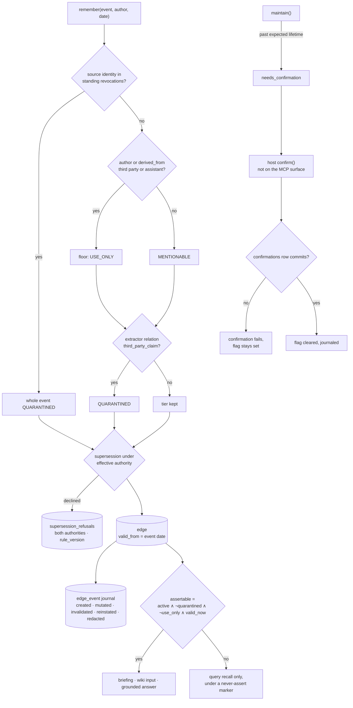

## 1. Executive Summary

Veracium is a Python memory library over one SQLite file, written spec-first
by one author, where content from a third-party channel cannot become an
asserted fact. A host-only confirmation commits its audit row or fails, and
every edge write is journaled with its full state. The weak side is time and
correction: the validity date is when a statement was made, and the
revocation that keeps a source out is keyed on the source, not on any value.

It is the library released alongside *Ground Truth First: A Longitudinal
Evaluation Instrument for Agent Memory, and the Tenure Crossover in
Memory-Architecture Rankings*
([arXiv:2607.21962](https://arxiv.org/abs/2607.21962), Quentin Spencer, 24 July
2026). It carries five marks: `trust_state`, `scope_enforced`, `audit_log`,
`human_review` and `negative_eval`.

- **The audit record is a precondition.** `confirm_edge` is the only path that
  clears `needs_confirmation`, and it writes the `confirmations` row inside the
  same transaction under a stated contract: *"if the record cannot commit, the
  whole confirmation fails and the flag stays set"* (`src/veracium/store/base.py:429-443`).
- **Nothing from a third-party channel is assertable.** Ingest floors an event
  authored by, or derived from, a third party to `USE_ONLY`; the extractor's
  `third_party_claim` relation becomes `QUARANTINED`. Both fail the
  `assertable` gate, which the briefing and the wiki compiler filter on
  (`src/veracium/ingest.py:189-208`).
- **Refusals are durable.** `supersession_refusals` records the corrections
  the system declined: prior edge, incoming edge, both effective authorities
  and the `rule_version` that refused (`src/veracium/store/schema_version.py:211-216`).

The cost is in section 9: adopting this means adopting a specification
apparatus of 43 numbered specs, and a store that opens on one qualified SQLite
build.

## 2. Mental Model

A memory is an edge, and four of its fields decide whether it may be stated:
whether it is `active`, its disclosure tier, and whether `valid_from` has
arrived. `assertable` is the conjunction —
`active and not quarantined and not use_only and valid_now` — and it is what
the session briefing, the wiki compiler and the answer gate consult
(`src/veracium/schema.py:828-844`).

**A memory is born in a tier set by its channel and its extractor.** The
author and declared content source are the floor: `THIRD_PARTY` or
`ASSISTANT` anywhere in them yields `USE_ONLY`, may shape behaviour, never
volunteered. The extractor's prompt routes a third party's claim about the
user to the relation `third_party_claim`, which becomes `QUARANTINED`. A claim
the extractor misroutes lands `USE_ONLY` instead: unassertable as well, but
eligible to shape behaviour. An event from a source whose identity stands
revoked is `QUARANTINED` whole, edges and episode, before anything is written.

**It stops counting by invalidation with a reason.** `invalidated_at` and
`invalidation_reason` retire an edge — `superseded`, `lapsed`, `decayed`,
`disputed`, `corrected`, `absorbed_duplicate`, `revoked_source` or
`redacted` — and the row stays for history. Nothing in the tree deletes an edge except per-user erasure.

**A durable edge can go stale.** `maintain` sets `needs_confirmation` on one
past its expected lifetime. It stays assertable, rendered with a "possibly
stale" warning, and only the host's `confirm` clears the flag.

**Time is the statement's time.** `valid_from` is the event date the caller
passes, which ingest documents as *"when a statement was made, not what it is
about"*. It equals `observed_at` at birth. A correction stamps the prior's
`invalidated_at` with the correction's own event date. The store's own clock
appears only in the journal (`src/veracium/ingest.py:86-137`).

## 3. Architecture

One SQLite file and a Python package. The schema is a **declared registry**:
sixteen versions, each object a `SchemaObject` with a kind, a name, DDL held
byte-identical to what SQLite stores in `sqlite_master.sql`, and a policy of
`REQUIRED` or `REBUILDABLE`. Only an index may be rebuildable, because
*"Repairing a table would destroy data; repairing a trigger or view silently
changes behaviour"* (`src/veracium/store/schema_version.py:61-64`, `:733`).
Migrations run under a durable operation record, and the evidence files that
qualify a runtime ship as package data.

The memory tables are `edges`, `episodes`, `edge_event`, `episode_event`,
`confirmations`, `request_registry`, `supersession_refusals`,
`supersession_operations`, `source_revocations`, `contribution_ledger`,
`consolidation_ops`, `edge_embedding`, `policy_receipt`, `redactions`,
`write_counter` and `wiki`, each keyed by `user_id`. Three singletons — `store_identity`,
`store_epoch`, `act_counter` — carry no user.

### Deployment and ergonomics

The store opens only on SQLite 3.45.1 as packaged by Ubuntu 24.04. The README
states that on any other build *"it refuses to create a store AND refuses to
open an existing one"*, and `sqlite_runtimes.json` lists one runtime.
`pyproject.toml` requires Python 3.14 or newer. Together these make the first
run a matter of finding a Python 3.14 linked against that one library build.

Writing anything needs an LLM: `remember` extracts triples through a
`Complete` callable, and the MCP server expects `ANTHROPIC_API_KEY`. An
embedder is optional. Reads of the store and the briefing are LLM-free. The
file is ordinary SQLite with JSON in the `edges.json` column, inspectable by
hand; `veracium why` prints one edge's whole biography from the journal,
confirmations, contributions and refusals (`src/veracium/why.py:114-233`).

## 4. Essential Implementation Paths

**Write.** `Memory.remember` (`src/veracium/__init__.py:551`) normalises the
event date through `_event_dt`, which refuses a malformed or future date rather
than falling back to now. `ingest_event` reads the standing revocation set
once per event, so *"the whole event gets one verdict"*, then extracts and
builds edges with `valid_from=when` (`src/veracium/ingest.py:339-352`,
`:797`). Each edge passes through `_build_supersession_plan`, which the store
applies atomically with a compare-and-swap fingerprint
(`src/veracium/graph.py:402-460`).

**Journal.** Every function that writes `edges` is listed in
`EDGE_WRITE_SITE_RULINGS` with its event ruling, and a test derives the
population by regex and refuses an unlisted site. Each calls
`_journal_edge_write` inside its transaction, which decides the kind from the
write and appends the full JSON state
(`src/veracium/store/sqlite.py:143-173`, `:308-380`).

**Read.** `recall` scores the user's edges lexically, keeps every edge off the
user node eligible, optionally fuses an embedding lane, adds episodes and the
wiki, and renders within a token budget in a frozen priority order
(`src/veracium/__init__.py:821-925`, `src/veracium/graph.py:733-767`). With no
query it builds a briefing that skips every non-assertable edge
(`src/veracium/proactive.py:168-189`). `answer` runs recall and an abstention
gate over the grounded partition only.

**Confirm.** `confirm_edge` verifies ownership and assertability, clears the
flag, advances `observed_at` and `confidence`, writes a confirmation episode,
journals the edge and inserts the `confirmations` row, idempotent on
`(user_id, correlation_id)` (`src/veracium/store/sqlite.py:751-845`).

**Revoke.** `revoke_source` appends a `revoke` or `lift` row to
`source_revocations` keyed on a source identity digest, and the sweep retires,
recomputes or reinstates what that source contributed
(`src/veracium/store/revocation.py:306`). The Memory API exposes no wrapper;
outside tests, its one caller is `selfcheck.py`.

**Redact.** `redact` replaces one record's content carriers with a marker in
one transaction, sets every prior journal state for that edge to the marker,
appends a `redacted` event and writes an attestation row
(`src/veracium/store/sqlite.py:3095-3266`). Its receipt carries no content
digest, sets `receipts_complete=False`, and names the derived records that may
still carry the content.

## 5. Memory Data Model

An `Edge` carries `subject`/`relation`/`object`, a `note`, a `Volatility`, a
`Provenance` (author, evidence ref, `observed_at`, disclosure, confidence,
source id, origin), `valid_from`, `invalidated_at`, `invalidation_reason`,
`supersedes`, `original_relation`, `needs_confirmation`, `ungrounded`, an
agreement record and outcome aggregates (`src/veracium/schema.py:712-760`).

**Why a memory stopped counting is a field.** The invalidation reasons form a
closed registry, so *lapsed* is distinguishable from *disputed* and from
*absorbed_duplicate*; `redacted` may be written only by a redaction.

**The time fields are three clocks with two producers.** `valid_from` and
`observed_at` both come from the caller's event date at ingest; `observed_at`
then advances on confirmation. `edge_event.recorded_at` is minted by the store
and never accepted from a caller (`src/veracium/store/edge_events.py:37-50`).
Two docstrings describe `observed_at` as when Veracium recorded a fact
(`src/veracium/__init__.py:1803-1815`, `src/veracium/graph.py:763-766`). The
code sets it from the caller's date, and spec 0029 calls it *"observation
metadata, not transaction time"*.

**Source identity is a pair, not content.** `identity_digest` is SHA-256 over
a framed `(origin, source_id)`, where `source_id` is a host-chosen id for a
mailbox or connector (`src/veracium/source_identity.py:1-63`). Revocation,
contribution ledgers and import notices join on it.

**Serialization is a contract.** `original_relation` and `agreement` are
omitted from every dump when `None`, so an unaffected edge's JSON stays
byte-identical to its shape before those fields existed; the code calls a serialized `None`
something that *"breaks every byte contract"*.

## 6. Retrieval Mechanics

Retrieval is lexical token scoring over the user's edges — subject, relation,
object and note — with every edge off the user node eligible and relevance
deciding what survives the cap, recency on `observed_at` as tiebreak. An
embedding lane runs when the host supplies an `Embed` callable, scoped before
top-k and checked against a content digest so a stale vector is skipped
(`src/veracium/store/sqlite.py:3416-3440`). A host `PolicyLane` can add a
third ranked lane whose firing writes a durable receipt.

The rendered context partitions grounded from unverified. On a query,
quarantined and use-only edges appear under a never-assert marker. The
briefing volunteers only assertable, mentionable edges. A supplied `principal`
restricts every carrier to what the visibility relation admits, renders
cross-scope material as unassertable testimony and drops the wiki. With
`as_of`, recall answers from the valid-time interval, which section 5 notes is
the statement-date interval.

## 7. Write Mechanics

Writes are synchronous: `remember` blocks on an LLM extraction, then on a
journaled transaction. The extractor copies dates from a supplied calendar
and is told to emit third-party assertions only as `third_party_claim`. After
extraction, ingest refuses or flags what it cannot ground: an object whose
specifics are not in the event text is `ungrounded`, and a flagged triple from
an event that is not user-effective is refused and counted.

Supersession applies only when the incoming edge's effective authority is at
least the prior's. When it is not, the prior stays active, both are visible as
a contest, and a refusal row is written. Reinforcement stores the restatement
untouched and does not renew the prior, so restating a stale fact does not
clear its flag.

Consolidation is fenced: `consolidation_ops` holds an operation id, a fence, a
state, an owner, a lease and its expiry, so a crashed run is recovered by
takeover. Writes from a revoked source are admitted quarantined rather than
refused.

## 8. Agent Integration

The MCP server serves six tools — `remember`, `recall`, `answer`, `maintain`,
`record_procedure`, `describe_procedures` — over a user fixed at construction
(`src/veracium/mcp_server.py:374-509`). The host sets a capability once:
unset, every event is third-party class and a model-supplied `author` can only
restrict; `direct` means the deployment vouches for the model's authorship
labels. The source id is the deployment's, never a tool argument. Correction,
dispute, confirmation, redaction, export and erasure are library calls a host
makes; `examples/claude_code_hooks/` shows capture and briefing hooks.

## 9. Reliability, Safety, and Trust

**Injection resistance is structural, with one model-dependent label.** No
path from a third-party channel reaches the assertable set, and the MCP
`author` argument cannot raise trust under the default capability. Which
unassertable tier a third-party claim lands in is the extractor's call.

**The audit trail is strong and has one in-place rewrite.** The journal and
the confirmations table are append-only except for redaction, which tombstones
prior journal states and a confirmation's request digest, and per-user
erasure, which deletes them (`src/veracium/store/sqlite.py:3145-3188`,
`:3293-3321`). A test pins exactly those two writers
(`tests/test_0029_carrier.py:142-163`).

**Correction is record-keyed.** `dispute` and `correct` retire an edge by id;
supersession reads only active edges; redaction attests a record by id and
refuses a write that would reintroduce the marker. Nothing records a rejected
value that a later extraction consults. Source revocation stops a source, not
a value: the same value from another source, or restated by the user, is
admitted normally.

**Valid time is the statement's time.** A fact said in June about March
carries `valid_from` June unless the host backdates the event. An `as_of`
read therefore answers *what had been said by T*, and the journal answers
*what the store held at T*.

**The apparatus is larger than the mechanism.** Comments cite spec sections
and review rounds inline, and the 43 numbered specifications run to 54,073
lines of Markdown beside 29,201 lines of source. What
an adopter takes on is a governance model with a store attached, and the
single qualified SQLite build is the first part of it they will meet.

**The benchmark that ranks it first is the same author's.** The paper
introduces the instrument and Veracium together; section 10 says what makes
the comparison readable.

## 10. Tests, Evals, and Benchmarks

I ran nothing. Test files are named for the specs they discharge, so the suite
reads as a conformance record. `negative_eval` rests on three committed cases,
each beside a positive read of the same populated store:
`tests/test_0003_supersession_contested.py:87-104`,
`tests/test_0020_read_surfaces.py:271-302` and `:459-485`. All use a fake
LLM. The principal cases assert scope within one user. The per-user partition
is checked by `check_isolation` in the robustness harness
(`tests/robustness/invariants.py:220-227`), which drives a scripted run.

`tests/test_0023_non_revival.py` holds seven cases: five assert that a revoked
source does not reinforce, renew, supersede, merge as a duplicate or enter
consolidation, and two are controls. They assert write effects, not
retrieval.

### The paper

*Ground Truth First* emits facts with validity intervals, volatility classes
and source channels before any text exists, renders chat and email from
per-event manifests, and instantiates questions mechanically so gold answers
are, in its words, *"script-valid by construction"*. Its headline is that rankings invert with
history length: a budgeted curated-map memory leads at three weeks and falls
by nine as evicted content is lost, while a provenance-typed graph rises.

It runs a no-memory control and a full-history baseline that *"ties or exceeds
the best memory system at the short horizon"*, the same finding this atlas
records from
[FP-AMB](../../benchmarks/#a-benchmark-whose-baseline-wins-and-the-category-that-cannot-fail)'s
TF-IDF baseline. The corpus generator and harness ship under `bench/`; the
published means are in the paper and no artifact here recomputes them.

## 11. For Your Own Build

### Steal

Make the audit record a precondition. One transaction that clears the flag
and inserts the record, failing whole, removes the gap where an audit trail
goes quiet under stress.

Journal every row write through one choke point, and test the population. A
regex over the store's own source that refuses an unlisted writer keeps the
journal complete as the store grows.

Floor trust by channel before any model runs. Received email that can never
become assertable needs no classifier to be right.

Record the corrections you refuse, with the rule version, so a later rule
change can be judged against what the old rule declined.

Return what a deletion cannot vouch for. A redaction receipt that names the
derived records that may still hold the content is honest about propagated
copies.

### Avoid

Calling a statement date a validity date. If the extractor can read "since
March" from the text, a separate field for it is the difference between when
something was said and when it became true.

Keying a correction on the record or the source and expecting it to stop a
value. Re-extraction mints a new record, and the user is a source too.

Docstrings that describe a caller-supplied field as the store's clock; the
journal's `recorded_at` is that clock, and the two answer different questions.

### Fit

This suits an application whose memory must explain itself to someone — a
user asking why it said something, a reviewer of corrections — and which
ingests text other people wrote. It assumes a host that authenticates users,
runs `maintain`, confirms through its own UI, and can run on the qualified
SQLite build. Walk away if you need a small library, a rejected value to stay
rejected, or valid time distinct from when a fact was said.

## 12. Open Questions

Whether a host-facing `revoke_source` will join the Memory API; the sweep and
its vectors are complete, and the one non-test caller is the self-check.

Whether the extractor will ever populate a valid time from content. Spec 0029
describes the store before its journal as *"bi-temporal in VALID time only"*,
and the journal added the transaction axis, not a content-derived valid one.

Whether the single qualified SQLite build widens, which decides whether a
store moved between machines stays openable.

Whether the tenure crossover reproduces off this synthetic corpus.

## Appendix: File Index

| Path | What to read it for |
| --- | --- |
| `src/veracium/schema.py:90-152`, `:712-844` | Disclosure tiers, confirmation types, `Edge`, `assertable` |
| `src/veracium/ingest.py:86-208`, `:339-352`, `:797` | The event-date rule, the disclosure floor, the once-per-event revocation read |
| `src/veracium/graph.py:402-460`, `:733-767` | Supersession planning, lexical subgraph retrieval |
| `src/veracium/proactive.py:168-189` | The briefing's assertable gate |
| `src/veracium/compile.py:146-155` | The wiki compiler's input filter |
| `src/veracium/store/sqlite.py:143-173`, `:308-380` | Edge write sites and the journal choke point |
| `src/veracium/store/sqlite.py:751-845` | `confirm_edge` |
| `src/veracium/store/sqlite.py:3095-3321` | Redaction and erasure |
| `src/veracium/store/base.py:429-443` | The confirmation contract |
| `src/veracium/store/schema_version.py` | The declared registry at version 16 |
| `src/veracium/source_identity.py` | The source identity digest |
| `src/veracium/store/revocation.py`, `revocation_sweep.py` | Revocation and the pure sweep |
| `src/veracium/mcp_server.py:374-509` | The six tools and the host capability |
| `tests/test_0029_carrier.py` | Journal completeness and append-only |
| `tests/test_confirm_contract_0008.py` | Atomic, idempotent, host-only confirmation |
| `tests/test_0003_supersession_contested.py`, `tests/test_0020_read_surfaces.py` | The must-not-appear cases |

### Recorded searches

Run at the tree root of the pinned checkout with `git grep`.

- `git grep -n -E 'valid_from[[:space:]]*=' -- src ':!*evidence*'` — `ingest.py:797` and `__init__.py:2104` take `when`, the event date; `procedures.py:171` takes `when or utcnow()`; `graph.py:505` keeps the earlier of two; the rest reconstruct or recompute. No producer reads a time from content.
- `git grep -n -E 'DELETE FROM|UPDATE [a-z_]+ SET' -- src ':!*evidence*'` — the `edge_event` and `confirmations` writers are `_redact_in_txn` (`sqlite.py:3145`, `:3184`) and `forget_user` (`:3314`, `:3318`); no `DELETE FROM edges` appears, and `forget_user` reaches `edges` through `_ERASE_TABLES`.
- `git grep -n -i -E 'prune|retention|vacuum|purge' -- src ':!*evidence*'` — prose and the unused `prune` table entries in `scope_linkage.py`; no retention prune.
- `git grep -n -i -E 'tombstone|blocklist|denylist|rejected value|re-?assert' -- src ':!*evidence*'` — redaction's journal tombstone, telemetry consent, and a gate comment; nothing keyed on a value.
- `git grep -n -E 'def (revoke|lift)|revoke_source' -- src` — the function in `store/revocation.py` and its calls in `selfcheck.py`; no Memory method.
- `git grep -n -E 'needs_confirmation[[:space:]]*=[^=]|needs_confirmation=' -- src ':!*evidence*'` — two setters to True and one to False, in `confirm_edge`.
- `git grep -n -E '\.(confirm|confirm_edge|confirm_notice|redact|correct)\(' -- ':!tests' ':!specs' ':!*.md'` — the Memory methods' own store calls; no CLI or hook caller.
- `git grep -n 'include_quarantined=False' -- src` — `compile.py:152`, the wiki compiler.
- `git grep -n -E 'QUARANTINE_RELATION|third_party_claim' -- src/veracium/ingest.py src/veracium/prompts.py` — the relation is the extractor's output, checked at `ingest.py:197`.
- `git grep -n -i -E 'anthropic|not (be )?used (for|to)' -- LICENSE` — no match; the MIT text carries no rider.

## History

**2026-10-15** — [`c31bd9f086a35ef361fcf62b1515c04d996c8013`](https://github.com/veracium-ai/Veracium/commit/c31bd9f086a35ef361fcf62b1515c04d996c8013) — 299 commits on, schema version 14 to 16. Added: targeted redaction, imported redaction notices awaiting a host confirmation, a request registry, a Python 3.14 floor. Two marks withdrawn, both wrong at the earlier pin: `tombstone`, because source revocation is keyed on `(origin, source_id)`, not content ([section 5](#5-memory-data-model)); `bitemporal`, because `valid_from` is the event date, equal to `observed_at` at birth ([section 2](#2-mental-model)). `audit_log` re-anchored on the edge journal. Also wrong then: a three-condition `assertable`, channel-born quarantine, cross-user test cases, fifteen schema versions, and a census carried from an earlier pin. Screened from a full clone: four files, one auto-run manifest, `tests/conftest.py`, `pyproject.toml` unpinned and inside the cooldown. Nothing was installed, built or run.

**2026-09-19** — re-pinned to [`1d33f0197696ba36903a5f1f3ca9d204e6016fc3`](https://github.com/veracium-ai/Veracium/commit/1d33f0197696ba36903a5f1f3ca9d204e6016fc3), 43 commits and 82 files on. **All seven marks hold**, and `human_review` is re-grounded on the part of the design that answers the producer test rather than on the enum. The closed `ConfirmationActor` is still there and still explains itself — the field used to be free-form and *"a host could smuggle prose past the constraints on the other fields"*. But a closed enum a caller supplies would not be enough on its own, and the code says so first: *"Both fields are audit metadata and grant NOTHING — authority comes from the protected `confirm()` call path, not from any label"*. That path is `ConfirmationCallPath.HOST_API`, documented as never model-reachable, and the claim checks out against the surface: the MCP server declares `remember`, `recall`, `answer`, `maintain`, `record_procedure` and `describe_procedures`, and no confirm verb. A system that anticipates the "approver is just a string" failure and puts the authority somewhere else is the shape this mark is for. Screened again first; nothing installed or run.

**2026-09-16** — [`6b8d757530865194c5ad4ffc50783994b7eb8f0c`](https://github.com/veracium-ai/Veracium/commit/6b8d757530865194c5ad4ffc50783994b7eb8f0c) — re-read at a commit dated 16 September 2026, 330 commits past the previous pin. All seven marks re-tested against their mechanisms and held; every anchor moved, and the source grew from 17,707 lines to 25,593 against 62,104 lines of test. The substantive addition is quarantine-at-birth (specs/0023 §4a): a standing-revoked source's writes land `QUARANTINED` rather than being refused, decided by one standing-state read per event before any record is written, recorded with `quarantined_at_birth` and the revocation digest, and not revisited when the revocation is later lifted. The non-revival family grew from six paths to seven. Screened before reading, from a full clone: four files scanned, one auto-run surface, one build-time execution point, one unpinned dependency surface and one dependency file inside the seven-day cooldown. Nothing was installed, built or run, and no benchmark was reproduced.

**2026-08-30** — [`b4da91e3fca1b4507926bb83c592ee3b2989ce8f`](https://github.com/veracium-ai/Veracium/commit/b4da91e3fca1b4507926bb83c592ee3b2989ce8f) — first reading, MIT, 17,707 lines under `src/` and 39,168 across 104 test files, 1,067 commits since 11 July 2026, released alongside [arXiv:2607.21962](https://arxiv.org/abs/2607.21962). Screened before reading: one auto-run surface (`server.json`, a registry manifest), one build-time execution surface (`tests/conftest.py`), one unpinned surface and one manifest inside the seven-day cooldown. Nothing was installed and nothing was run. **All seven marks.** `tombstone` rests on `source_revocations` being keyed on a content `identity_digest`, appended rather than mutated, and consulted by `ingest` so a re-ingested revoked source is born quarantined. `audit_log` on `confirmations` being a precondition for the transition rather than a record of it; `human_review` on `confirm_edge` with a closed `ConfirmationActor`. `trust_state` on the quarantine/needs-confirmation/use-only trio behind a derived `assertable`; `bitemporal` on `valid_from`/`invalidated_at` beside `observed_at`; `scope_enforced` on `user_id` NOT NULL everywhere with a pure reference implementation of the read surface; `negative_eval` on the recall-context absences and the six non-revival paths. The reading covers the schema, the store contracts, ingest, the revocation sweep and the tests; the wiki curation, the portability layer, the MCP surface and the benchmark harness under `bench/` were not traced, and no published number was recomputed.
