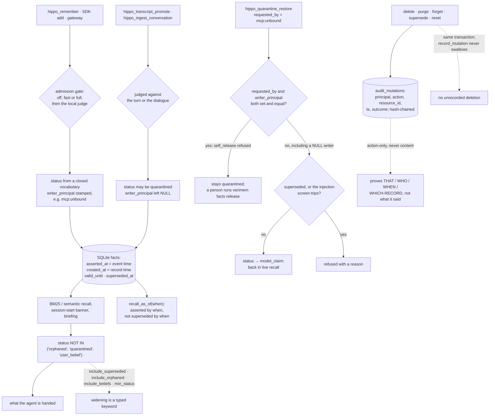

## 1. Executive Summary

Verimem is a SQLite memory for agents whose writes pass an admission gate with a
local judge model, whose recall SQL withholds three stored statuses, and whose
hash-chained mutation log refuses to remember what it deleted. It also keeps an
event time beside the record time and reads both. The weak side is the agent's
own tool surface: two MCP write doors mint facts with no writer label, so the
rule that a writer cannot release its own quarantine does not reach them, and
scope is an argument the agent may leave out.

It describes itself as "**[v]erified memory for AI agents**", in Python,
dual-licensed AGPL-3.0 with a paid commercial option, with versions 0.3.x and
earlier released under MIT. Its promise is a conjunction:

> "Every write passes an admission gate, every read carries provenance, and a
> claim the source **openly contradicts** does not come back as truth."

**The mechanism worth carrying away is what the audit log refuses to store.**
Most projects that reach for a tamper-evident chain put the content in it, and
then discover that an immutable record of what was deleted is itself a copy of
what was deleted. `mutation_audit.py` argues the other way:

> "ACTION-ONLY, never content (F1/F8): storing WHAT was deleted — even as a
> hash, brute-forceable on short text — inside an immutable chain makes GDPR
> Art.17 erasure a logical contradiction. The chain proves THAT/WHO/WHEN/
> WHICH-RECORD, not what the record said."

Every destructive operation — delete, purge, forget, supersede, reset — appends
one row "INSIDE THE SAME TRANSACTION as the mutation itself", and
`record_mutation` "never swallows", so a failure to record propagates instead of
leaving an unrecorded deletion. Both decisions are attributed to "two
independent adversarial reviews (GLM-5.2 + deepseek, convergent findings)", with
the finding ids each one answers.

**The status vocabulary withholds rather than ranks.** The store accepts a
closed set — `verified`, `model_claim`, `provisional`, `legacy_unverified`,
`orphaned`, `quarantined`, `user_belief` — and the curated view carries
`status NOT IN ('orphaned', 'quarantined', 'user_belief')`. Every route back to
the withheld material is a named opt-in on `recall`: `include_superseded`,
`include_orphaned`, `include_beliefs`, `min_status`. The session-start banner
and the proactive briefing apply the same three exclusions before they put
recent facts into a prompt, and committed tests assert the exclusion on a
populated store with a positive control beside it.

**Time has two axes.** The schema documents `asserted_at` as the event time,
when the fact was said or was true, and sets it apart from `created_at`, the
transaction time at which the store learned it. Callers supply it, and NULL
means unknown rather than the write clock. `recall_as_of` returns what was
asserted by an instant and not yet superseded by it, which answers "what did we
believe then about then".

**The route out of quarantine checks a label, and two write doors carry none.**
`SemanticMemory.libera_dalla_quarantena` refuses when the requesting principal
equals the stored `writer_principal`, and the MCP server stamps `mcp:unbound` on
its main writes and on every restore request, so a fact written through
`hippo_remember` cannot be released through `hippo_quarantine_restore`. The code
comments credit the rule to this atlas ("Atlas, 29/09"). The refusal runs only
when both labels are non-empty (`verimem/semantic.py:5826`).
`hippo_transcript_promote` and `hippo_ingest_conversation` build their facts
without a writer label, both can store a fact as `quarantined`, and the
restore tool then releases it to the agent that wrote it. The README states the
other limit itself: "These are labels, not authenticated identities." Four
marks: `trust_state`, `bitemporal`, `audit_log`, `negative_eval`.

**The project corrects its own documentation in public.** The README's first
box carries a correction, the version the old claim was true of, the function
that was reachable only from `warmup`, the test that "records the measurement
and the fix", and the admission that matters: "*The fix shipped; the text did
not follow it. Corrected here.*"

## 2. Mental Model

A **fact** is a proposition with a status, and the status decides whether an
agent is handed it.

A **status** is a stored verdict. `orphaned`, `quarantined` and `user_belief`
keep a fact out of recall and out of both context assemblers.

A **widening** is a named keyword the caller had to type.

A **quarantine** is reversible, and only quarantine is: a restore refuses an
orphaned or superseded row.

A **release** is refused to the principal the store recorded as the writer, and
granted when the store recorded none.

An **event time** is when the fact was said or true; the **record time** is when
the store learned it; a **supersession** retires a fact in record time.

An **audit row** proves that a deletion happened and cannot tell you what was
deleted.

## 3. Architecture

| Area | Role |
| --- | --- |
| `verimem/admission_gate.py`, `verimem/anti_confab_gate.py` | The validation tiers, and what earns each status |
| `verimem/semantic.py` | The fact store: schema, recall, keyword search, quarantine and release |
| `verimem/bm25_rank.py` | The clause that keeps three statuses out of ranked recall |
| `verimem/temporal_context.py` | Time-travel recall over event time and supersession |
| `verimem/mutation_audit.py` | A hash-chained, action-only, fail-closed mutation record |
| `verimem/review_queue.py` | Queue depth, and a declared limit about measuring it |
| `verimem/mcp_server.py` | The agent's tool surface, and the label it stamps |
| `verimem/gateway.py` | A REST gateway with one database file per API key |
| `verimem/scope.py`, `verimem/agent_scope.py` | Topic-prefix multi-tenancy, and its accepted caveat |
| `hooks/hippo_session_start.py` | The banner that puts recent facts into a new session |

### Deployment and ergonomics

Everything runs locally on SQLite. The first gated write fetches the judge model
— 711 MB by the README's figure — and the README measures a cold first call at
85.7 seconds before explaining how to move that cost to `verimem warmup`. A
shared daemon can hold the judge for several writers; without it a CLI write is
"judged in process in ~22 s", the README's own measurement with the model
installed. No API key is needed to store a fact. The MCP server is registered as
`io.github.aureliocpr-ctrl/verimem` and launched with `uvx`; the gateway is a
FastAPI app served by `verimem gateway serve`, binding loopback by default.

## 4. Essential Implementation Paths

`verimem/mutation_audit.py:1-25` — the whole argument for what an audit chain
must not contain.

`verimem/bm25_rank.py:25-26`, `:42` — the withholding clause, with and without
retired rows.

`verimem/semantic.py:4077-4090` — a recall signature where every widening is
named.

`verimem/semantic.py:761-770` and `verimem/temporal_context.py:276-289` — event
time beside record time, and the read that composes them.

`verimem/semantic.py:5796-5849` — the release from quarantine, with its three
refusals and the condition that the writer label be present.

`verimem/semantic.py:5764-5770` — an un-quarantine that refuses to un-orphan.

`verimem/review_queue.py:1-16` — why an unmeasured queue is a dishonest
abstention.

`verimem/scope.py:1-14` — the scope convention, and the collision it accepts.

## 5. Memory Data Model

A fact carries a proposition, a status from the closed vocabulary, a writer role
and a `writer_principal`, grounding evidence (`grounding_score` and
`grounding_span`), a confidence tier, and three times: `created_at` for when the
store learned it, `asserted_at` for when it was said or true, and an optional
`valid_until`. A retirement sets `superseded_by` and `superseded_at`. Episodes
carry task traces, skills and outcomes beside the facts.

The writer label is stamped by the surface, never read from tool arguments: the
MCP server's comment calls a client-supplied value "a spoof attempt". The SDK
stamps `sdk:local`, the CLI `cli:local` plus an optional `VERIMEM_ACTOR`
suffix, and MCP `mcp:unbound`. Facts that the transcript-promotion and
conversation-ingest paths build carry no label.

Ids differ by door. MCP's `hippo_remember` derives the id from a hash of the
proposition and topic, and the upsert leaves `superseded_by` untouched, so an
identical re-assertion lands on the retired row. The SDK and the extraction
paths mint random ids.

## 6. Retrieval Mechanics

BM25 and semantic recall over the curated view, with the status filter compiled
into both the appended predicate and a standalone filter string so the two
cannot drift. The cold-encode fallback delegates to `search_facts` and forwards
the opt-ins. A set of analysis and cleanup tools reads `list_facts()` without
the filter on purpose; the briefing passes `hide_low_trust=True`.

`search_facts(as_of=...)` puts `COALESCE(asserted_at, created_at) <= ?` into the
SQL and counts how many rows that excluded, and `recall_as_of` keeps the facts
asserted by the instant and not yet superseded by it. The SDK's `search`
defaults `as_of="auto"`, routing a query with a retrospective anchor to the
time-travel path.

Scope is applied when asked for. `hippo_facts_recall`, `hippo_facts_search` and
`hippo_facts_list` read `user_id`, `agent_id` and `run_id` from the tool
arguments, narrow by `topic LIKE '<prefix>%'` and post-filter with
`matches_scope`. Without those arguments the read is unscoped, and a docstring
in the server says a multi-tenant deployment "must NOT treat scope as a hard
security boundary". The session-start banner reads the eight most recent facts
with the status filter and no scope predicate.

## 7. Write Mechanics

`validate="fast"` is the default tier: pure substring detectors, "cold execution
<< 1 ms". `full` adds claim validation against the agent's semantic memory at a
measured mean of about 13 ms. `off` exists and is labelled what it is — "[p]ure
escape hatch for migrations, replays, deliberate writes." Behind the detectors a
local NLI judge scores the claim against the supplied source; a write it does
not support is stored `quarantined` rather than dropped, and the receipt says
which layer held it and why.

The write path is synchronous. Conversation ingest extracts atomic facts with
the agent's own LLM and judges each one against the dialogue; transcript
promotion judges an agent-supplied proposition against the verbatim turn.

## 8. Agent Integration

A CLI, an MCP server exposing every tool unless `ENGRAM_MCP_TOOLS_PREFIX`
narrows it, an SDK client, a REST gateway whose module docstring derives the
tenant from the presented key and never from a request field, Docker compose
files, a Claude Code plugin manifest and hook bundles. The gateway's restore
route, the SDK's `Memory.restore` and the bulk `verimem facts
requalify-quarantined --apply` carry no writer comparison; the commit that added
the rule says the SDK and HTTP restores "stay outside this request".

## 9. Reliability, Safety, and Trust

The strong parts are the fail-closed audit, the withholding statuses applied to
every read that feeds a prompt, the reversible-but-narrow restore, and a
documentation habit that publishes corrections and limits rather than quietly
fixing them.

The weak parts sit on the agent's own surface. The writer-label rule covers the
MCP writes that stamp a label and none of the ones that do not, so the
quarantine an agent's transcript promotion or conversation ingest produces is a
quarantine the same agent can lift. Scope is an optional argument. A single
release from quarantine leaves the audit chain untouched: `restore_fact` emits
observability and flow events, while the bulk requalify path records a `restore`
row. Nothing is keyed on a rejected value.

## 10. Tests, Evals, and Benchmarks

9,024 test functions in 1,766 files, with 322 files touching quarantine, plus an
acceptance job that installs the wheel in a clean virtualenv, runs `verimem
warmup`, and checks eight promises from the user's side with no skips. Row 8
writes the README's confabulation example from the SDK and asserts the held
sentence comes back from none of the SDK, the CLI and the MCP recall tool while
the supported one comes back from all three. The unit suite carries the
must-not-retrieve cases on the cold path, the belief opt-in and the briefing,
each with a positive control. `docs/stato-reale/banchi/` holds the benchmark
scripts the README cites. I ran none of it.

## 11. For Your Own Build

### Steal

Decide what your audit chain is allowed to contain before you build it. An
immutable record of content is a second copy you cannot delete, and the argument
in `mutation_audit.py` states that trade in four lines.

Write the audit row inside the mutation's transaction and let a failure
propagate. An audit that can fail silently is wrong exactly when it matters.

Name every widening. A recall signature where `include_orphaned` has to be typed
is one where the default is defensible and the exception is visible in the
caller's code. Apply the same filter to whatever assembles context at session
start.

Keep event time in its own nullable column and let NULL mean unknown. The schema
comment records why: storing the event time in `created_at` hid most of a
back-dated store from recall.

### Avoid

A self-release rule that compares two labels and passes when one is missing.
Every door that writes has to stamp the label, or the rule needs to refuse when
the writer is unknown.

### Fit

A single-operator deployment that wants to know why it believes something, and
can keep the agent's MCP surface narrowed with `ENGRAM_MCP_TOOLS_PREFIX`. Not a
multi-tenant library where the tenant boundary has to hold against the caller.

## 12. Open Questions

Whether the release rule should refuse an unlabelled writer, or the promotion
and ingest paths should stamp the surface label as `hippo_remember` does.

Whether scope should move into the store. Everything else here is enforced where
it cannot be forgotten; scope depends on the caller passing it, and the
session-start banner does not.

## Appendix: File Index

| Path | What to read it for |
| --- | --- |
| `verimem/mutation_audit.py:1-25` | What an immutable chain must not be allowed to remember |
| `verimem/bm25_rank.py:25-26`, `:42` | A status filter written twice so it cannot drift |
| `verimem/semantic.py:4077-4090` | Widening as a named keyword rather than a default |
| `verimem/semantic.py:761-770`, `:5489` | Event time, and the as-of clause that reads it |
| `verimem/temporal_context.py:276-289` | Time travel over event time and supersession |
| `verimem/semantic.py:5796-5849` | The release from quarantine and its refusals |
| `verimem/mcp_server.py:997`, `:3632-3655`, `:8553-8578`, `:8580-8602`, `:15220-15231` | The stamped label, the restore tool, and the two doors that leave the label empty |
| `verimem/transcript_promote.py:95-125`, `verimem/conversation_ingest.py:520-548` | Facts built without `writer_principal`, stored `quarantined` when the judge declines |
| `hooks/hippo_session_start.py:63-96` | The banner's status filter, and its missing scope predicate |
| `verimem/review_queue.py:1-16` | Why "held for review" becomes "silently dropped" |
| `verimem/scope.py:1-14` | Multi-tenancy as a string convention, with its collision declared |
| `tests/test_recall_include_orphaned_coldpath.py`, `tests/test_include_beliefs.py`, `tests/test_briefing_no_low_trust_facts.py` | Must-not-retrieve cases with positive controls |

### Recorded searches

Run in the checkout at the pin with `git grep -n -E`, over the whole tree.

- Writers of the self-release label: `writer_principal|_MCP_PRINCIPAL\s*=` over `verimem/*.py`. `_build_fact` is called twice in the MCP server, both stamped; `transcript_promote.py` and `conversation_ingest.py` construct `Fact(...)` with no `writer_principal`, and the dataclass default is `None` (`verimem/semantic.py:1664`).
- Other routes out of quarantine: `restore_fact\(|libera_dalla_quarantena\(|requalif` and `UPDATE facts` followed by `status`. Callers are the release method, the CLI, the gateway and SDK restore, source-trust rehabilitation of rows it demoted itself, and the CLI-only bulk requalify. No MCP tool reaches requalify.
- Value-keyed rejection: `tombstone|audit.revealed|denylist|blocklist|forgotten_` and every `CREATE TABLE IF NOT EXISTS` name. `mark_false` in `verimem/source_trust.py` records an audited-false (key, value) pair used only to score collusion between sources; no write path consults it.
- Mutations of the audit table: `(UPDATE|DELETE FROM|DROP TABLE|TRUNCATE)\s+(IF EXISTS\s+)?audit_mutations` outside `tests/` returns nothing at this pin.
- Scope on context assembly: `user_id|agent_id|scope` in `hooks/hippo_session_start.py` returns nothing.

## History

**2026-10-15** — [`2635d28d6bba4674760804b9e7ed36966bab4ae5`](https://github.com/aureliocpr-ctrl/verimem/commit/2635d28d6bba4674760804b9e7ed36966bab4ae5), 95 commits on. **`bitemporal` and `negative_eval` are added; both were present at the previous pin** — the event-time column, its as-of clause and the must-not-retrieve tests are there unchanged, and the appendix's Known Limitations records the error. [`cfd538d12ccd2415beb3426a3c805d70bbbf582d`](https://github.com/aureliocpr-ctrl/verimem/commit/cfd538d12ccd2415beb3426a3c805d70bbbf582d) added the rule that a writer cannot release its own quarantine; `human_review` stays withheld because two MCP write doors leave the label empty (section 1). The scope reason is restated: the MCP fact tools apply scope when asked, and the banner never does. Screened first: five auto-run surfaces, three build-time execution points, nothing in the cooldown, no licence rider. Nothing installed or run.

**2026-09-19** — re-pinned to [`068baf45bcbe3c578ad530ed8c02287de3c60b77`](https://github.com/aureliocpr-ctrl/verimem/commit/068baf45bcbe3c578ad530ed8c02287de3c60b77), 20 commits and 135 files on. **`human_review` is withdrawn; two marks stand.** The re-admission path is unchanged and is still described in section 1, because the thinking behind it is good — a reversible quarantine, a restore that refuses orphaned and superseded rows, and a dry-run default on the requalify command. Its queue depth is measured under a comment naming exactly the failure mode this atlas keeps finding: *"A queue nobody measures is a queue nobody drains."*

What the mark needs is that the producer cannot clear it, and here it can. `hippo_quarantine_restore` is one of the declared MCP tools and its own description is *"Rescue a wrongly-blocked fact: un-quarantine `fact_id` back into live recall"*. Its guards are content guards — superseded refused, proposition and topic re-screened for injection — which are worth having and say nothing about who is asking. The CLI path adds two more of the shapes the rubric names: `--apply` is a caller boolean, and `--principal` defaults to `$VERIMEM_ACTOR`, an environment string nothing verifies. `trust_state` and `audit_log` re-verified. Screened again first; nothing installed or run.

**2026-09-16** — [`ef7de72459c9d12a1f4a22af4362a1b4a47c8fa8`](https://github.com/aureliocpr-ctrl/verimem/commit/ef7de72459c9d12a1f4a22af4362a1b4a47c8fa8) — first reading, at a commit dated 13 September 2026. Screened before opening, from a shallow clone: five auto-run surfaces, two build-time execution points, two unpinned dependency surfaces and two dependency files inside the seven-day cooldown. `CLAUDE.md` is addressed to a reading agent and was recorded as data. Dual-licensed AGPL-3.0 with a paid commercial option; the licensing file carries no rider restricting who may read or analyse the code. Nothing was installed, built or run, no judge model was fetched, and none of the benchmark figures quoted here were reproduced — they are the project's own measurements, read from its documentation.
