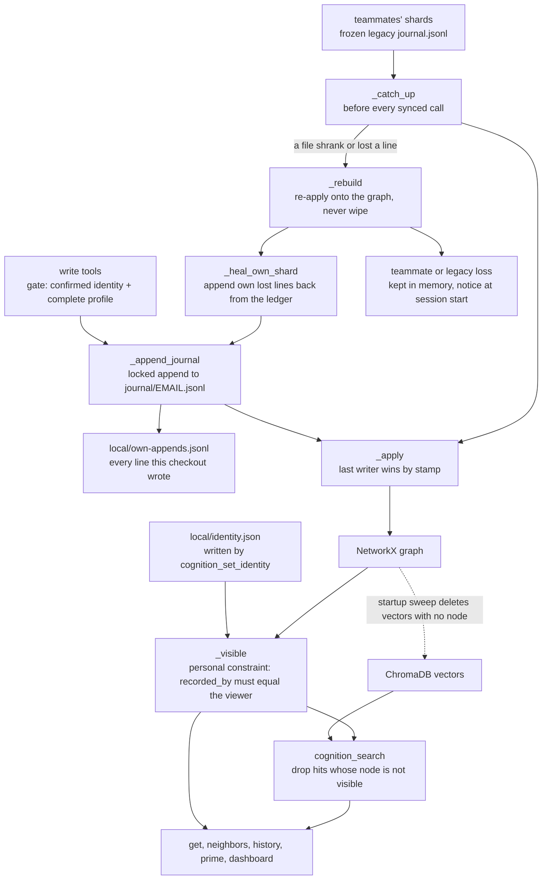

## 1. Executive Summary

Vibe Cognition is a local MCP server that records why a codebase is the way it
is, as typed nodes in a graph that a team shares through version control. Every
change is appended to a JSONL journal file before the in-memory graph moves,
each person appends only to their own file, and the graph and its ChromaDB
index are both rebuilt from those files. Replay is append-only, so a journal
file that a `git checkout` rolls back cannot shrink the graph. The weak side
is identity: a constraint can be personal, and its owner is whoever the agent
last confirmed with `cognition_set_identity`.

It runs as a plugin for Claude Code and as an adapter for the Codex CLI. Its
README says in the first paragraph that after a one-time model download the
only network call is an optional daily version check.

**The journal is the store.** `_append_journal` writes one stamped line to the
writer's shard under a cross-process lock, then applies that line through the
same comparison replay uses, so a process's view always equals a rebuild from
the same bytes (`src/vibe_cognition/cognition/storage.py:1315-1335`). A
deletion is an appended line, `{"id": ..., "removed_by": ...}`. The MCP path
passes the confirmed identity. The dashboard passes `"dashboard"`, and its
docstring says why: the dashboard "has no per-user identity (deliberately:
token-gated, single local user), so the surface tag is the honest attribution"
(`src/vibe_cognition/dashboard/api.py:233-256`).

**A rollback is repaired, not obeyed.** Each line a checkout appends is also
recorded in a machine-local ledger bound to that machine, account and folder.
When a file loses lines, the checkout appends its own lines back, and holds a
teammate's lost lines in memory with a standing notice. The single command
that gives those up, `accept-disk`, writes an incident node naming what it
drops before dropping anything. Its docstring states why there is no gate: "It
is not gated technically -- an agent can run it, and a token echoed from the
session-start text would only look like a gate, since the agent reads that
text too" (`src/vibe_cognition/cognition/journal_cli.py:55-92`).

**Personal constraints are hidden on every read path from everyone but one
identity, and the agent chooses the identity.** The filter is thorough and a
committed test checks it across eleven read surfaces.
`cognition_set_identity(name, email)` writes `.cognition/local/identity.json`
with any valid address the agent passes, and the next read is filtered for
that address (`src/vibe_cognition/tools/cognition_tools.py:3383-3491`). The
README is explicit that this "is visibility, not secrecy".

## 2. Mental Model

Twelve node types, each with a correction strategy chosen for what it
represents. The enum comments carry the reasoning
(`src/vibe_cognition/cognition/models.py:14-42`):

- **`workflow`** is "versioned by supersession: an update is a NEW workflow node
  linked via SUPERSEDES". Documents version the same way.
- **`task`** has "a mutable lifecycle (status/owner/parent) carried in metadata
  and edited in place", through appended `update_node` lines.
- **`constraint`** carries a scope, `personal` by default for new records or
  `project`, which decides who can read it
  (`src/vibe_cognition/cognition/scope.py:20-38`).
- **`person`** remains a legal node type for older graphs. People are committed
  profile files, `.cognition/people/EMAIL.profile.jsonl`, append-only with a
  last-write-wins fold, and a startup migration copies any legacy person node
  into one (`src/vibe_cognition/cognition/profiles.py`,
  `src/vibe_cognition/cognition/person_migration.py`).

Edges are typed: `led_to`, `supersedes`, `contradicts`, `relates_to`,
`resolved_by`, `part_of`. Curation subagents write most of them, each with a
reason and a curation session id.

The left column is the write. The dotted edge and the right column are what
make a deletion and a personal scope hold on the vector side.

## 3. Architecture

A project's `.cognition/` directory holds the frozen legacy `journal.jsonl`,
one shard per person under `journal/`, profile and environment-fact delta files
under `people/`, document text sidecars, and a ChromaDB store. Machine-local
state lives under `local/`, which one ignore entry covers: the confirmed
identity, the own-append ledger and the loss notices
(`src/vibe_cognition/cognition/local_paths.py`). Everything else is meant to be
committed, and `git_hygiene.py` maintains the ignore entries and a
`merge=union` attribute on startup.

Each Claude Code session runs its own server process, and the session-start
hook runs a separate one for the digest. Appends take an exclusive file lock
(`src/vibe_cognition/cognition/journal_io.py`); reads take none. Before every
synced operation the store catches up from a per-file offset and checks a hash
of the bytes it has read, so a file that was replaced, shrank or lost a line
triggers a rebuild rather than a silent skip
(`src/vibe_cognition/cognition/storage.py:1442-1469`, `:1557-1634`).

Lines from different files are ordered by stamp, not arrival: a shard line is
`(1, at, file name, sha256 of the line)` and a legacy line `(0, "", "", index)`
(`src/vibe_cognition/cognition/journal_shards.py:1-23`). Each attribute, add,
removal and edge keeps the stamp that set it, so the graph is the same whatever
order the files are read in.

The rebuild re-applies every file onto the graph it has and resets only the
per-file offsets (`storage.py:1339-1359`). Only `_hard_reset`, which
`accept-disk` alone calls, forgets the graph (`:1361-1371`). The `graph`
property is "an UNSYNCED view — it does not trigger journal catch-up", and its
docstring points callers at the synced methods.

## 4. Essential Implementation Paths

**Write** — a tool resolves the confirmed identity through the write gate,
builds a `CognitionNode` with a server-stamped `recorded_by`, and calls
`add_node` (`storage.py:532`) → `_append_journal` (`:1315`) → `_apply` (`:2031`).

**Delete** — `delete_cognition_node` captures incident edges and calls
`remove_node` (`storage.py:615`), which appends the tombstone. It then purges
the node's vector and chunk vectors, and reclaims document sidecars no twin
still uses (`src/vibe_cognition/cognition/operations.py:20-110`).

**Replay** — `_catch_up` (`storage.py:1557`) scans every file. An append or an
insert is consumed in place; a lost line sends it to `_rebuild` (`:1636`),
which re-applies every file and then runs `_heal_own_shard` (`:1795`).

**Read** — every public read filters through `_visible` (`storage.py:1211`) or
`_visible_nodes` (`:1218`). Search drops a vector hit through
`search_hit_is_live`, which calls the same check
(`src/vibe_cognition/tools/cognition_tools.py:891`).

**Embedding repair** — replayed node ids queue in `_replayed_node_ids` and are
embedded at the next search (`cognition_tools.py:966-1000`). The startup sync
deletes any vector whose node is not in the graph
(`src/vibe_cognition/server.py:336`, `:347-380`).

## 5. Memory Data Model

A `CognitionNode` has a type, summary, detail, context list, references,
severity, timestamp, free-text `author` and a metadata dict. Its id is the first
12 hex characters of `sha256(f"{node_type}:{summary}:{timestamp}")`, salted
with `#n` on collision when minted (`models.py:106-120`, `storage.py:532-570`).
The timestamp is the write clock.

Provenance is in metadata. `recorded_by` is the server-resolved identity, and
`from_agent` is a boolean the tool caller supplies, `True` by default. Edges
carry `source` (`deterministic`, `manual`, `batch`, `curate-skill` and others),
an optional `reason` and a `curation_session`.

The edge enum records a retirement in place: `duplicate_of` is "RETIRED
(WP-14, decision 7b9db5a8d675)", noted as never reachable, so old journals stay
explicable. `SENIORITY_LEVELS` is a closed four-value tuple "pinned by Colton —
not up for relitigation", exported so that search weighting "imports this
constant rather than re-declaring the vocabulary".

## 6. Retrieval Mechanics

`cognition_search` embeds the query locally, runs a ChromaDB vector search
with adaptive widening, and formats hits through `_format_search_results`
(`cognition_tools.py:830-960`). A hit is dropped unless its node is visible to
the current viewer, and chunk hits collapse to one result per node. A
penalty-only weight applies: 0.85 for `from_agent`, and a seniority factor from
the author's profile. Every hit carries `conflicted` and `superseded_by`,
computed from `contradicts` and `supersedes` edges, and neither changes the
ranking.

Structural reads cover type, recency, a case-insensitive substring over context
fields, chains along `led_to`, and neighbours along any edge type. The
session-start digest built by `prime.py` shows only the head of a `supersedes`
chain for constraints, workflows and documents
(`src/vibe_cognition/cognition/prime.py:405-460`).

**Scope.** The project directory is the outer boundary.
`cognition_load_project(path)` attaches another project read-only, after which
read tools take a `project` argument, including `"*"` for search
(`cognition_tools.py:5526-5571`). Within a project, a constraint whose metadata
says `personal` is visible only when its `recorded_by` email equals the
viewer's confirmed email (`scope.py:34-38`, `storage.py:1178-1222`). Every
storage read applies it, and search applies it through the live-hit check.
Prime, the dashboard and the curation worklist read through storage. Only two
maintenance CLIs open the store with `show_all_scopes=True`.

The viewer is `identity.json`, and the agent writes it. `cognition_set_identity`
accepts any syntactically valid address and writes the pointer before the
profile (`cognition_tools.py:3488-3491`). If that address already has a complete
profile, the agent reads and writes as that person from the next call. The
tool's docstring says every value "MUST come from the human"; nothing checks it.

## 7. Write Mechanics

Writes are synchronous and refused until the checkout has a confirmed identity
and a complete profile: name, email, role, seniority, and `reports_to`, where
`"nobody"` is a valid answer (`src/vibe_cognition/cognition/identity.py:1-30`).
A git or SVN identity is offered as a suggestion; the gate passes only a
confirmed one (`identity.py:353`).

Journal-first ordering means a failed append changes nothing, and a crash after
the append loses nothing, because the next catch-up replays the line. The
append does not advance the replay offset, so a process re-reads and
re-applies its own line idempotently.

`remove_node` stamps a tombstone keyed on the node id, and replay skips any
older add for that id. Nothing is keyed on the removed content: a new node with
the same summary has a new id. The nearest thing is on the roster, where
`profile_removed` is keyed on the email and a person returns only when every
required field is written after it
(`src/vibe_cognition/cognition/profiles.py:170-191`).

Curation runs as subagents launched by `/vibe-curate`. Edge writes,
`cognition_mark_curated` and `cognition_flag_constraint_scope` require a token
from `cognition_begin_curation`, which any agent on the server can call. Its
docstring calls the token "friction plus audit, not an access control: the
server cannot see who is calling" (`cognition_tools.py:4783-4830`).

## 8. Agent Integration

The Claude Code plugin declares the MCP server in `.claude-plugin/plugin.json`
and registers two `SessionStart` hooks (`hooks/hooks.json`). One installs
dependencies, migrates an old per-project MCP entry and injects the digest; the
other re-injects the standing instructions after a compaction. The Codex
adapter under `adapters/codex/` ships its own manifest, hooks, skills and agent
roles.

The tool surface is about forty tools. The general `cognition_record` refuses
`person`, and people go through `cognition_register_person`,
`cognition_update_person` and `cognition_set_identity`, which write profiles.
`cognition_record` takes `from_agent` and, for constraints, `scope`.

A token-gated dashboard reads through the same storage and deletes with
`removed_by="dashboard"`. The line lands in the confirmed person's shard, so
the file names the person.

## 9. Reliability, Safety, and Trust

**Audit log — awarded.** The journal files are the record, appended through one
locked writer and never rewritten by a production path. `accept-disk` drops
retained entries from memory, not lines from files, and records an incident
node first. `resolve_journal.py`, run by hand after an SVN conflict, rewrites
the conflicted file as both sides' lines, each once, dropping only lines that
are not JSON objects. The people files are separate append-only delta logs.

**Negative eval — awarded.** `tests/test_personal_constraints.py` asserts that
a teammate cannot reach a personal constraint through eleven read surfaces,
including `cognition_search` for its exact summary over a real Chroma
collection, while the owner and a project constraint stay reachable.

**Scope enforced — withheld.** The personal-constraint filter is a stored key
applied on every read path. The viewer it compares against is a file the
agent's own tool rewrites with any address, so a model-supplied argument lifts
the scope. `cognition_load_project` also reads any project path the agent
names.

**Trust state, bitemporal, tombstone, human review — withheld.** `conflicted`
and `superseded_by` are computed from edges and change no result, and prime's
head-only display is a supersession filter, not a stored status. The only time
is the write clock. Deletion is keyed on the node id, and the value-keyed
roster removal guards people, not memories. A scope-review flag waits for the
owner, but the flag is a single attribute written by `update_node` and
changes no node's visibility (`cognition_tools.py:1579-1611`). The owner's ruling is
`cognition_update_node`, which the agent holds.

**Bookkeeping.** `_replayed_node_ids` is drained by each search.
`_removed_node_ids` is documented as "Never drained" on the grounds that
deletions are rare; a re-add discards its entry and `accept-disk` resets it.
The per-file line-hash sets and the tombstone map grow with the journal.

## 10. Tests, Evals, and Benchmarks

**No paper.** The tree carries no retrieval-quality benchmark and no committed
result. It does carry three measurement scripts. `bench_wave1.py` and
`bench_wave3.py` time replay, prime and weighted search over a synthetic
fixture. `eval_conflict_lens.py` scores a curation analyzer's `contradicts`
proposals for precision against a hand-labelled fixture of 36 node pairs
(`tests/fixtures/conflict_lens_labeled_pairs.json`). The analyzer's
predictions are produced in a session by hand, and no results file is
committed.

**I ran none of the 1,645 test functions.** The screen found the plugin hooks
and `tests/conftest.py`, and nothing was installed.

What the suite pins, from reading it:

- `tests/test_wp_core_tail.py:48-59` asserts a failed append leaves no node. It
  patches `_append_journal` itself, and the graph is mutated inside that
  method after the append, so the test guards the callers rather than the
  order within it.
- `tests/test_append_only_replay.py` (21 functions) covers the reported
  incident, a cold start after a rollback, a deliberate deletion surviving a
  rebuild, a conflicted or mid-merge file being left alone, a ledger copied
  from another checkout being ignored, and `accept-disk` refusing when its
  audit cannot be written.
- `tests/test_personal_constraints.py` and `tests/test_scope_review.py`
  (25 functions together) cover scope, the owner-only ruling and the token
  refusals. The tests that call `cognition_set_identity` never record or read a
  personal constraint.

## 11. For Your Own Build

### Steal

- **Append to the journal before mutating the projection, and apply your own
  line through the replay path.** One code path means the live view and a
  rebuild cannot disagree (`storage.py:1315-1335`).
- **Treat a shorter log as damage, not as truth.** A deletion is an appended
  line, so a line that vanishes means the file was replaced. Rebuild onto what
  you have and say what is missing.
- **Keep a machine-local ledger of what this writer appended**, bound to the
  checkout, so a rollback can be repaired by the only party entitled to
  re-append those lines (`src/vibe_cognition/cognition/own_ledger.py`).
- **When a gate would be theatre, make the escape hatch leave a record.**
  `accept-disk` refuses to run if it cannot first write the audit node
  (`journal_cli.py:81-92`).
- **Give each writer its own file and order lines by stamp**, so a merge that
  interleaves lines cannot change any decision.
- **Put attribution on the tombstone, and be honest about what you know.** Use
  a surface tag where the surface cannot know the person.
- **Retire an enum value in place**, with the decision id, so old lines still
  replay.

### Avoid

- **Do not take the viewer's identity from a value the agent can set.** A scope
  keyed on `recorded_by` is only as strong as the writer of the viewer field,
  and here that writer is a tool with an `email` argument.
- **Do not let the producer mark its own provenance.** `from_agent` defaults to
  `True`, and an agent that passes `False` loses the search penalty.
- **Do not ship a memory whose claim is context quality with no measurement of
  it.** The invariant discipline is thorough and says nothing about whether
  recall finds the right decision.

### Fit

This suits a small team that keeps a coding agent's project knowledge in the
same repository as the code, on machines with no cloud dependency, including
teams on Subversion. The journal files are readable with `jq`, and the data
outlives the tool.

It is not a privacy boundary between teammates, and its own README says so.
`storage.py` is the file to read for log-and-projection memory with several
writers.

## 12. Open Questions

- **What happens to a journal that grows for a year?** A cold start replays
  every file, and no compaction or snapshot rotation exists; `snapshot_cli.py`
  copies the files and keeps them whole.
- **How large do the per-file line-hash sets get?** They hold one hash per line
  read for the life of the process, and rebuild bookkeeping depends on them.
- **What does an episode's removal leave behind?** `_apply_remove_node` removes
  the node and its incident edges, so its `part_of` children stay as nodes
  without the edge. Whether prime or curation treats them as orphans was not
  traced.

## Appendix: File Index

| Path | What to read it for |
| --- | --- |
| `src/vibe_cognition/cognition/storage.py:532-688` | The five mutating methods, each journal-first |
| `src/vibe_cognition/cognition/storage.py:1178-1222` | The viewer and the visibility filter on every read |
| `src/vibe_cognition/cognition/storage.py:1315-1335` | `_append_journal`: locked append, ledger record, apply |
| `src/vibe_cognition/cognition/storage.py:1339-1371` | Append-only reset and the one hard reset |
| `src/vibe_cognition/cognition/storage.py:1442-1673` | Per-file scan, catch-up and rebuild |
| `src/vibe_cognition/cognition/storage.py:1795-1987` | Healing the own shard, and `accept-disk` |
| `src/vibe_cognition/cognition/storage.py:2031-2186` | Stamp-ordered apply for nodes, removals and edges |
| `src/vibe_cognition/cognition/journal_shards.py` | Shard layout, stamps, the frozen legacy journal |
| `src/vibe_cognition/cognition/own_ledger.py` | The checkout-bound ledger of this writer's lines |
| `src/vibe_cognition/cognition/journal_cli.py:55-128` | `accept-disk` and its audit node |
| `src/vibe_cognition/cognition/scope.py` | Personal and project scope |
| `src/vibe_cognition/cognition/identity.py` | The write gate and the confirmed identity |
| `src/vibe_cognition/cognition/profiles.py` | Profiles, and removal keyed on the email |
| `src/vibe_cognition/cognition/resolve_journal.py` | Union rebuild of an SVN-conflicted file |
| `src/vibe_cognition/tools/cognition_tools.py:830-1000` | Search formatting, the live-hit drop, re-embedding |
| `src/vibe_cognition/tools/cognition_tools.py:3383-3520` | `cognition_set_identity` |
| `src/vibe_cognition/tools/cognition_tools.py:4783-4830` | The curation token |
| `src/vibe_cognition/tools/cognition_tools.py:5526-5571` | `cognition_load_project` |
| `src/vibe_cognition/server.py:336-380` | The startup sweep of orphan vectors |
| `src/vibe_cognition/cognition/operations.py:20-110` | Deletion across graph, vectors and sidecars |
| `src/vibe_cognition/dashboard/api.py:233-256` | Dashboard deletion and its attribution |
| `tests/test_personal_constraints.py` | The must-not-retrieve cases for personal scope |
| `tests/test_append_only_replay.py` | Rollback, repair and `accept-disk` |
| `scripts/eval_conflict_lens.py` | The conflict-analyzer precision scorer |

### Recorded searches

Run at the tree root of the pinned checkout with `git grep`, which reads
committed files whatever `.gitignore` says.

- `git grep -n -E "write_text|write_bytes|os\.replace|unlink\(|truncate|rmtree" -- 'src/*.py'` — no hit on a journal shard, the legacy journal or a people file; the writes are sidecars, flags, the identity pointer, the ledger prune (`own_ledger.py:125`) and the SVN union rebuild (`resolve_journal.py:125`).
- `git grep -n -E '_append_journal\(|append_journal_line\(' -- src` — six `_append_journal` calls in the mutating methods, plus the shard start line, the heal, the ledger, the known-ids log and the two people registries.
- `git grep -n -E 'show_all_scopes' -- src` — the constructor, `backfill_identity.py:580` and `remap_identity.py:201`; no tool.
- `git grep -n -E 'write_confirmed_identity' -- src` — the definition and one caller, `cognition_set_identity` at `cognition_tools.py:3491`; the definition checks only a non-blank name and a well-formed address (`identity.py:157-180`).
- `git grep -n -E 'visible_to|_visible\(|search_hit_is_live' -- src` — storage, `cognition_tools.py:891` and `dashboard/api.py:326`.
- `git grep -n -E '_node_tombstones\[' -- 'src/*.py'` — keyed on the node id at `storage.py:1278`, `:2105`, `:2143`.
- `git grep -n -iE 'valid_(from|to|until|at)|effective_(from|at)|occurred_at|event_time|as_of' -- 'src/*.py'` — no match; no valid time.
- `git grep -n -iE 'compact(ion)?|rotate|retention|prune' -- 'src/vibe_cognition/cognition/*.py'` — the ledger prune and comments; no journal compaction.
- `git grep -n -E 'pop_replayed_node_ids\(|_removed_node_ids\.(discard|remove|clear)|_removed_node_ids = set' -- 'src/*.py'` — the drain called from search at `cognition_tools.py:996`, the discard at `storage.py:2106` and the reset at `:1370`.
- `git grep -n -E '_reconcile_orphan_embeddings|_collection\.delete\(' -- 'src/*.py'` — the startup sweep at `server.py:336` and `:377`, and the per-node deletes at `embeddings/storage.py:295` and `:308`.
- `git grep -n -E 'scope=|SCOPE_PERSONAL|"personal"' -- $(git grep -l -E 'cognition_set_identity' -- tests)` — no match; no test that sets an identity touches a personal constraint.
- `git ls-files | grep -iE 'bench|eval|result|fixture|metric|locomo|longmemeval'` — the three scripts named in section 10 and one fixture; no results file.
- `git grep -n -iE 'arxiv|bibtex|@article|@misc|doi\.org' -- README.md docs` — no match, and no `CITATION.cff`; no paper.
- `git grep -n -iE 'anthropic|machine learning|not (be )?used (for|to)' -- LICENSE` — no match; the MIT text carries no rider.

## History

**2026-10-15** — [`e8684fdcd48c6859fffe97c9ceeb8aa7afb127c1`](https://github.com/haagndaazer/vibe-cognition/commit/e8684fdcd48c6859fffe97c9ceeb8aa7afb127c1) — six commits on, version 0.42.0 to 0.45.0. Replay became append-only, with a checkout-bound repair ledger and an audited `accept-disk` ([section 3](#3-architecture)); curation gained a scope review. `negative_eval` gained, earned at the previous pin on the personal-constraint tests ([section 10](#10-tests-evals-and-benchmarks)). Wrong at that pin: no scope key, orphaned vectors never removed, both bookkeeping sets undrained, no test of journal-first, no evaluation script, one shared `journal.jsonl`, person nodes edited in place, and the line anchors. `scope_enforced` stays withheld, on a new ground ([section 6](#6-retrieval-mechanics)). Screened from a full clone: three auto-run entries for the plugin manifest and its hooks, `tests/conftest.py`, no unpinned surfaces, `uv.lock` outside the cooldown, `CLAUDE.md` read as data. Nothing was installed, built or run.

**2026-09-17** — [`208e7d2ec8eb402edede7b8b255012b712007a66`](https://github.com/haagndaazer/vibe-cognition/commit/208e7d2ec8eb402edede7b8b255012b712007a66) — re-read after 37 commits. Both anchored files moved and the producer was re-counted rather than assumed: `_append_journal` is defined once and called from exactly six mutation sites, matching the add, update and remove paths the evidence record names, so every graph mutation still writes the journal. The mark holds. Nothing was installed, built or run.

**2026-09-09** — [`208e7d2ec8eb402edede7b8b255012b712007a66`](https://github.com/haagndaazer/vibe-cognition/commit/208e7d2ec8eb402edede7b8b255012b712007a66) — second reading, 51 commits on: 106 files, 9,653 insertions, of which the appendix paths take 61 lines. Screened before reading; nothing was installed and no suite was run.

The journal is unchanged and its anchors are re-derived: `_append_journal` moved from `:883` to `:942`, and its six call sites are now listed rather than left implicit, so a reader can check that every mutating method writes its own record instead of trusting a caller to.

A second durable store arrived, and it is why the mark's evidence record names two mechanisms. `set_env_fact`, `delete_env_fact` and `clear_env_facts` delegate to a `PeopleFactsRegistry` and do **not** call `_append_journal` — which looks like a gap until the module explains itself. It keeps its own append-only delta journal, deliberately: the main journal's `update_node` convention writes the entire metadata dict on every call, so accumulating per-fact history there would be quadratic, and the delta shape makes that structurally impossible rather than merely avoided. Two stores, two journals, one stated reason.

**2026-08-09** — [`7cee90c57ad934a76ed852132b4a8ef055f64f5b`](https://github.com/haagndaazer/vibe-cognition/commit/7cee90c57ad934a76ed852132b4a8ef055f64f5b) — first reading. Screened before reading; the tree was read, never installed, and no test was run.
