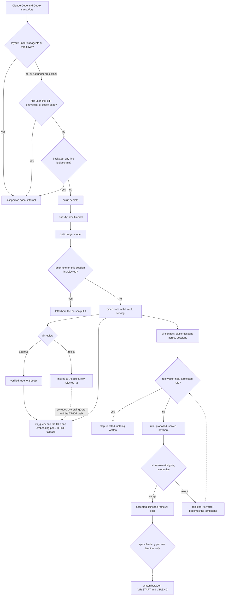

## 1. Executive Summary

vir reads Claude Code and Codex transcripts, decides which of them were
sessions a person drove, and distils those into typed markdown notes in an
Obsidian vault the user owns. Its careful part is the first decision: three
independent detectors keep subagent runs, workflow phases and headless SDK
agents out of memory, and each one states the false positive it guards
against. A second layer mines rules that recur across sessions and holds every
one in a queue that only a person drains.

The author's own measurement, in the README at the pin: of 1,386 transcripts
vir has read on his machine, 562 were subagent runs, workflow phases or
sidechains and were skipped, 361 held nothing durable, and 410 became notes.
That is two in five files written by tooling rather than by the person. A
memory system that mines an agent's own logs without this filter fills itself
with the agent's scaffolding describing itself. The second number is the
reason to keep any of it: Claude Code prunes transcripts after about 30 days,
and 396 of the author's distilled sessions exist only in the vault.

**The detection is three mechanisms.** `classifyTranscript` reads the on-disk
layout, so `subagents/agent-*.jsonl` below a session directory is a sidechain
and `subagents/workflows/wf_*/` is a workflow, with two guards in its comment:

> "The `subagents` marker must sit BELOW the encoded project dir — a project
> literally named "subagents" stays a session. Anything not under projectsDir
> is a session: never guess."

The second is the launch signature, with the signals it rejected named:

> "Keyed on entrypoint ONLY — promptSource reads "sdk" even on desktop-launched
> human sessions (the C23 serbeval trap), and turn count would kill
> single-prompt autonomous runs."

The third is a per-line `isSidechain` backstop in the parser, whose test
describes itself as the "backstop for the transcript filter". Codex has its
own pair: a thread whose `source` is an object is a sidechain, and a `codex
exec` thread is agent-internal (`src/sources/codex/source.ts:94-104`). Every
detector defaults to *session* when unsure, because a wrongly skipped session
may be work that exists nowhere else.

**Correction has two shapes, and only one of them is a gate.** A session note
is live from the moment it is written. A person reviews it afterwards, and a
rejection removes it from every read. A mined rule is not live until a person
accepts it, and a rule a person rejected is refused again when a later run
rediscovers it in other words.

## 2. Mental Model

Transcripts on disk are filtered for provenance, scrubbed for secrets,
classified by a small model, distilled by a larger one, deduplicated and
written into the vault. Retrieval reads one pool. Two human verbs sit beside
the pipeline: review, which judges notes after they serve, and the rule queue,
which holds what the connect pass proposes until a person decides.

## 3. Architecture

`src/pipeline/` is the engine: scanner, project decoding, parser, transcript
filter, tool-call filter, scrubber, distiller, article and PDF readers,
composer, writer, related links, period summaries, embedding sweep, lock and the
run loop. `src/sources/` puts Claude Code and Codex behind one registry
(`src/sources/registry.ts`), each source supplying its own scan, category and
agent-entrypoint rules.

Beside it sit `src/connect/` (the recurring-rule pass), `src/audit/` (a model
judging every note), `src/dedupe/`, `src/prune/`, `src/search/`, `src/state/`,
`src/mcp/`, `src/daemon/`, `src/cost/`, `src/lint/`, `src/diagnostics/` and
`src/claude/updater.ts`. Classification defaults to `claude-haiku-5-5` and
distillation to `claude-sonnet-5` (`src/config.ts:131-134`); a Claude Code
subscription or the Codex CLI can stand in for an API key.

`eval/` is a retrieval and note-quality harness that never ships. Its README
states the rule its own test enforces: queries, labels and run records carry
session content, so data lives in `~/.vir/eval/` and `eval/noLeak.test.ts`
fails if git tracks anything shaped like eval data.

`assets/Vir.app` is a committed, ad-hoc-signed universal binary for desktop
notifications, built by `native/notifier/build.sh` from an 88-line Swift file
and shipped in the npm package. The binary was not compared with its source for
this reading.

## 4. Essential Implementation Paths

**Provenance** — `src/pipeline/projects.ts` (the layout rules and the
never-guess comment `:92-99`, `classifyTranscript` `:102-117`, the entrypoint
signature and the C23 trap `:119-143`), `src/pipeline/parser.ts:47`, and
`src/sources/codex/source.ts:94-104`.

**Write** — `src/pipeline/writer.ts` (the sticky rejection `:128-133`, review
fields carried across a rewrite `:712-731`, the preserved Related section
`:203`, `:666-688`).

**Review** — `src/cli/review.ts` (`approveNote` `:125-134`, `rejectNote`
`:138-158`, `restoreRejected` `:163-196`), `src/cli/reviewJson.ts:91-117`,
`src/state/rejections.ts:19-37`, `src/state/db.ts:537-575`.

**Connect** — `src/connect/run.ts:90-240`, `src/connect/identity.ts:35-73`,
`src/cli/reviewInsights.ts:38-154`, `src/cli/syncClaude.ts:82-153`.

**Retrieve** — `src/search/retriever.ts` (`SKIP_DIRS` `:18`, the pool
`:194-204`, the boost `:60`, `:231`, `:411`, the rule status gate `:358`),
`src/mcp/server.ts` (six tools `:285-641`).

## 5. Memory Data Model

A session note is a markdown file with a category, topic, project, session
id, `date` (the session's start), a `confidence` float, themes, branches and,
once reviewed, `verified` with `reviewed_at` or `rejected_at`. The SQLite
`sessions` row holds the processed transcript's hash, the note content, the
embedding with its model and dimension, and two serving columns, `pruned_at`
and `rejected_at` (`src/state/db.ts:287`).

A rule is an `insights` row: `status` of `proposed`, `accepted` or `rejected`,
`promotion` of `none`, `promoted` or `declined`, a scope, the rule and why
text, member session ids and content hashes, cited evidence quotes, and a rule
embedding (`src/connect/types.ts:19-57`). The row is the source of truth and a
markdown file under `insights/rules/` mirrors it.

Identity is the session. A rewritten, retitled or merged note is found again
by the full session id in its frontmatter, never by its filename, because the
distiller retitles between runs (`src/pipeline/writer.ts:123-126`,
`:586-593`, `:641-657`). A rule's identity is its member session set, with
hash overlap breaking ties.

`date` is the session's start, and `firstSeen` and `lastSeen` on a rule are
evidence dates. Neither is a validity interval, and nothing records when a
note's claim stopped being true.

## 6. Retrieval Mechanics

`vir_query` and `vir query` embed the question and score one pool: session
notes, articles, topic pages, PDFs and accepted rules
(`src/search/retriever.ts:194-204`). Vectors from a different embedding model
are refused and counted in `excludedMismatched` rather than dropped silently,
and `degraded` separates an embedder that failed from a query that matched
nothing. A verified note takes 0.2 before the top-K slice, and the pool is
MMR-reranked with the user-facing diversity setting inverted at the call site
(`:246-249`). With no embedder, a TF-IDF index over the same files answers
instead.

Exclusion is carried by status on both arms. The embedding pool comes from
queries carrying `servingGate()`, and rules from `WHERE status = 'accepted'`.
The TF-IDF walk skips `summaries`, `.rejected` and `archived`, and indexes a
rule file only when its frontmatter `status` is `accepted`, read from the
frontmatter block alone so a body line cannot claim it
(`src/search/retriever.ts:329-340`, `:358`).

The MCP `verified_only` flag drops every unverified hit and over-fetches five
times the page, capped at 30, so the filter can fill it
(`src/mcp/server.ts:346`, `:358`). It is the caller's choice, and the default
serves unverified notes with the boost alone.

Two reads sit outside the gate. `vir_project_summary` and `vir_compose` return
cached pages written by past `vir summarize` and `vir compose` runs, and nothing regenerates a page
when a note it drew on is rejected. Composed topic pages are in the embedding
pool, so text from a rejected note can reach `vir_query` through a topic page
written before the rejection.

Scope is the vault. `project` is an optional query argument, which a caller
may omit, so `scope_enforced` is not earned. Retrieval is logged to
`~/.vir/queries.jsonl` with the hits, ranks, per-hit verified status and
method; the log rotates at five megabytes into one `.1` generation and leaves
a `queries.failed` marker when an append fails. It records what was asked,
not what changed.

## 7. Write Mechanics

Filter, scrub, classify, distil, dedupe, write.

**The scrubber names the innocent strings it must not eat.** The Anthropic-key
pattern carries a negative lookbehind because "a real key is preceded by
whitespace/quote/=/start, never by [A-Za-z0-9-]", so `"risk-ant-…"` is not
redacted. The OpenAI pattern has the same guard so
`"risk-management-strategy-2026-plan"` survives, and the bearer rule is
case-sensitive so "the bearer of bad news" survives too
(`src/pipeline/scrubber.ts:6-25`).

**A rejected note stays where the person put it.** When a re-distillation
reaches a session whose prior note sits in `.rejected/`, `write()` returns that
path and does nothing else (`src/pipeline/writer.ts:128-133`). The row keeps
its content and stays processed, so nothing is re-billed, and a later
`record()` of the same session leaves `rejected_at` in place
(`src/state/reject.test.ts:57-62`). This is keyed on the session: the same
lesson distilled from a different session is a new note.

**The connect pass writes only proposals.** `vir connect` collects the bold
items under each note's *What Was Learned*, embeds and clusters them at a
cosine of 0.85, and keeps clusters that recur across sessions. A model call
per candidate states the rule and quotes its evidence, and validation keeps
only quotes that appear in the source lessons. The row is built with
`status: "proposed"` by the code, not copied from the model's output
(`src/connect/run.ts:211-233`). The threshold was calibrated on the author's
vault, and `docs/connect-pass-eval-2026-10.md` records the calibration table
and the first run: one candidate, proposed, accepted.

**`sync-claude` writes into files it does not own.** vir's content goes
between `<!-- VIR:START -->` and `<!-- VIR:END -->` in CLAUDE.md and in any
AGENTS.md that exists, with the top five notes per category by confidence and
every promoted rule. A diff of additions and removals precedes the write.
`--force` skips that confirmation for notes; it does not promote a rule
(`src/cli/syncClaude.ts:85-110`, `:130-131`).

## 8. Agent Integration

`npm install -g @djolex999/vir-cli`, `vir init`, `vir run`, and `vir schedule
install` for the daemon. The agent reaches the vault three ways. The MCP
server registers `vir_query`, `vir_status`, `vir_recent_notes`,
`vir_recent_articles`, `vir_project_summary` and `vir_compose` against a
database opened read-only. A shipped skill (`skills/vir/SKILL.md`) tells an
agent to query, cite notes by slug, prefer the code when a note disagrees with
it, and never run the commands that write or spend. Plain files are the
fallback.

The Obsidian plugin is a separate repository that shells out to `vir query
--json`, `vir doctor --json` and `vir review --json`. The last carries the
review queue's approve, reject and restore actions
(`src/cli/reviewJson.ts:24-26`).

## 9. Reliability, Safety, and Trust

**Trust state is earned on both kinds of record.** A rejected note leaves
every serving read: the ten queries carrying `servingGate()`, the TF-IDF walk,
and the writer. A rule is served only once accepted. The upstream commit that
carried rejection into the database, `8a8e914`, gives the reason in its
changelog: *"SQL cannot see where a file is"*. Before it a rejected note kept
feeding `vir_recent_notes`, the CLAUDE.md candidates, summaries and dedupe,
and *"dropped out of search only by accident"*.

**Human review is earned on the rule queue, and the note review is the weaker
half.** A proposed rule waits in a state no read path serves until a person
accepts it in an interactive walk. Promotion into CLAUDE.md asks once per rule,
only on a terminal (`src/cli/syncClaude.ts:85`, `:97-110`), and the agent's
MCP surface has no verb that reaches either. A session note is different: it
serves on write, and review approves or withdraws it afterwards. The
non-interactive `vir review --json --approve` has no TTY or actor check, so
any process with a shell can stamp `verified: true`. The skill asks the agent
not to, in prose.

**The tombstone is earned on rules and absent on notes.** A rejected rule's
embedding is consulted on every later connect run, and a candidate within
0.85 cosine is skipped (`src/connect/identity.ts:58-64`). Three limits hold.
The check runs after the paid model call, because the candidate's rule text
exists only then. A failed embedding skips it, and the candidate is written as
`proposed`, where a person sees it again. A rejected note is keyed on its
session, so the same lesson from another session returns as a new note.

**A model can withhold, and only a person can admit.** `vir audit` asks a model
to judge each note keep, verify, merge or reject. Its rejects move notes into
`.rejected/` only under `--apply-rejects`, after a confirmation that `--yes`
skips, and each moved file is stamped `rejected_by: audit`. A note a person
verified is skipped (`src/audit/apply.ts:69-75`). Restoring a machine reject
stamps the note verified, so the audit never acts on it again
(`src/cli/review.ts:186-191`). The project's own vault notes record why the
audit is advisory: `vir audit` agreed with an Opus audit on 45–52% of
verdicts, and one prompt change moved 61 notes.

**Three failures of silence are recorded in the tree.** A distill error was
written to a log nobody read, and fourteen sessions lost in one `fetch failed`
window on 11 June 2026 were found after their transcripts were pruned;
`failureNotice` fires a desktop notification on any run that errored, and a
`doctor` row carries the standing count. A rewrite with no embedder rendered an
empty Related section that reads as a fact, so the writer carries the old
section forward instead (`src/pipeline/writer.ts:666-688`). Retitle debris
that only the TF-IDF walk could see is reported by `vir lint --strays`.

**Bitemporal, audit log, scope — not earned.** `log.md` appends one line per
note write and records no review, merge, prune or restore, and the user can
edit it. No field records when a claim stopped being true.

**The unaddressed risk is distillation fidelity.** Two model passes stand
between a transcript and a note, and the note is designed to outlive the
transcript. The repository commits a blind, human-graded A/B harness for the
distill prompt and an ablation eval for the audit's rejects. Both keep their
data and results in `~/.vir/eval/`, so no fidelity figure is in the tree.

## 10. Tests, Evals, and Benchmarks

**No paper; the eval harnesses are committed and their results are not.** The suite is vitest over
nearly every module, with test files named for the behaviour they protect:
`run.rewriteDryRun`, `run.retryBound`, `run.transcriptFilter`,
`run.prunedSkip`, `run.keepNote`.

The negative cases sit on two read paths.
`src/search/retriever.test.ts:394-429` writes three notes that all say
`widget` — live, rejected, archived — and asserts the live one is in the
TF-IDF index and the others are not; `:527-539` does the same for proposed,
rejected and accepted rules with an exact list. `src/state/reject.test.ts`
marks one session rejected and asserts that `listDistilled`, `getStats`,
`getEmbeddings` and the embedding targets return nothing, then asserts a
two-row store keeps only the unrejected topic (`:76-92`). No case asserts on
the output of `search()` itself.

The rule tombstone is tested at the unit and the run level. A vector match
with no session overlap returns `skip-rejected`, and a distant vector does not
(`src/connect/identity.test.ts:40-44`). A run over rewritten member notes
skips the rejected rule without a model call
(`src/connect/run.test.ts:165-175`). No run-level case covers the vector path.

`eval/` measures retrieval with nDCG@8, recall@8, MRR, a contamination rate
for agent-internal rows in the top eight, and a garbage-query hit rate, with
paired bootstrap intervals. `eval/distill/` runs a blind A/B of the distill
prompt with human grading, and `eval/usefulness/` asks whether removing the
audit's rejects makes answers to later sessions' questions worse. The harness
is committed and its results are not, by design.

I ran nothing.

## 11. For Your Own Build

### Steal

- **Measure how much of your transcript history is the user's.** On the
  author's machine, agent-internal runs were 562 among 1,386 transcripts.
  Ingesting them fills memory with tooling describing itself.
- **Detect provenance three ways and let them back each other up.** Layout, a
  launch signature, and a per-line flag as a backstop, with the backstop's test
  saying so in its name.
- **Write down the signals you rejected and why.** `promptSource` reads "sdk"
  for desktop-launched human sessions, and turn count would drop single-prompt
  autonomous runs.
- **Default to keeping when uncertain** when a wrongly skipped item may exist
  nowhere else.
- **Carry a rejection into the query, not the file's location.** A status the
  database cannot see leaves every SQL read serving the rejected row.
- **Match a rejected rule by meaning, not by row.** Store the rejected rule's
  embedding and compare the next candidate against it, so a rewording from new
  sessions does not slip through.
- **Let a model withhold and only a person admit.** The audit can move a note
  out; nothing the model writes can mark one verified or accept a rule.
- **Put the innocent string in the redaction comment.** A lookbehind with its
  counterexample named is a rule someone tested.
- **Delimit your content in a file you do not own**, and show additions and
  removals before writing.

### Avoid

- **Do not ship a non-interactive approve with no actor check** beside an agent
  that has a shell; the skill's prose is the only thing between the agent and
  `vir review --json --approve`.
- **Do not cache derived pages past the rejection of their sources.** A topic
  page composed before a rejection keeps the rejected text in the retrieval
  pool.
- **Do not leave fidelity results outside the artifact.** A committed harness
  with off-tree results tells a reader the method and not the answer.

### Fit

The right choice if you use Claude Code or Codex daily, keep an Obsidian vault,
and want sessions to survive their pruning window as searchable notes. The
retroactive first run is the moment of value; the connect pass is opt-in and
paid.

Read `src/pipeline/projects.ts` and `src/connect/identity.ts` even if you build
something else. The first decides which of your logs are yours; the second
shows a rejection that survives rewording.

## 12. Open Questions

- **How faithful are the distilled notes?** The harness exists; its results are
  in the author's home directory.
- **What was the C23 serbeval trap?** It is named in a comment as the reason
  for keying on `entrypoint` alone, and not written up.
- **Should an accepted rule follow its sources out?** `collectLessons` reads
  the category directories, so a rejected note's lessons feed no new rule, but
  a rule accepted before the rejection keeps citing it; `isStale` flags the rule on display
  only.
- **What happens to a note whose source transcript is pruned?** The note
  outlives it by design, and nothing records that the source is gone.

## Appendix: File Index

| Path | What to read it for |
| --- | --- |
| `src/pipeline/projects.ts:92-143` | The three layouts, the never-guess rule, the entrypoint signature and the C23 trap |
| `src/sources/codex/source.ts:94-104` | Codex sidechain and `codex exec` detection |
| `src/pipeline/parser.test.ts:123-166` | The backstop tests named as backstops |
| `src/pipeline/scrubber.ts:6-25` | Redaction rules with their counterexamples |
| `src/pipeline/writer.ts:128-133` | A rejected note left where the person put it |
| `src/cli/review.ts:125-196` | Approve, reject and restore |
| `src/cli/reviewJson.ts:91-117` | The non-interactive review actions for the plugin |
| `src/state/db.ts:537-575` | `servingGate`, `markRejected`, `clearRejected` |
| `src/state/rejections.ts:19-37` | Backfilling file rejections into the database |
| `src/search/retriever.ts:18`, `:194-249`, `:329-358` | The pool, the boost, MMR and the status gates |
| `src/mcp/server.ts:285-641` | The six read-only tools |
| `src/connect/run.ts:90-240` | Clustering, pre-call triage, the model call and the proposal write |
| `src/connect/identity.ts:35-73` | Session-set identity and the vector match on rejected rules |
| `src/cli/reviewInsights.ts:38-154` | Accept, reject and the interactive walk |
| `src/cli/syncClaude.ts:82-153` | Per-rule promotion on a terminal, and the marked blocks |
| `src/audit/apply.ts:53-90` | Machine rejects, marked, skipping verified notes |
| `src/state/reject.test.ts`, `src/search/retriever.test.ts:394-539` | The must-not-serve cases |
| `eval/README.md` | The retrieval, distill and usefulness harness and its data rule |
| `docs/connect-pass-eval-2026-10.md` | The connect threshold calibration and first run |

### Recorded searches

Run at the tree root of the pinned checkout with `git grep`.

- `git grep -n -E 'verified: "true"' -- 'src/*.ts' ':!*.test.ts'` — `src/cli/review.ts:132` (approve) and `:190` (restore of a machine reject).
- `git grep -n -E 'status: "accepted"' -- 'src/*.ts' ':!*.test.ts'` — `src/cli/reviewInsights.ts:39` only.
- `git grep -n -E 'registerTool\(' -- src ':!*.test.ts'` — six registrations in `src/mcp/server.ts`, none a review verb.
- `git grep -n -E 'isTTY' -- src/cli/review.ts src/cli/reviewJson.ts src/cli/reviewInsights.ts` — no match; the note review's JSON path has no terminal check.
- `git grep -n -E 'getInsightVectors\(' -- src ':!*.test.ts'` — the definition and one caller, `src/connect/run.ts:155`.
- `git grep -n -E 'servingGate\(\)' -- src/state/db.ts` — ten serving queries.
- `git grep -n 'REJECTED_DIR' -- src/pipeline/writer.ts` — the sticky check `:131`, the index scan `:568`, and the embedding-text read `:628`.
- `git grep -n -E 'valid_(from|to|at|until)|validFrom|validTo|as_of|asOf|effective_(from|at)' -- src ':!*.test.ts'` — no match.
- `git grep -n -E 'CREATE TABLE' -- src ':!*.test.ts'` — sessions, articles, topics, pdfs, insights, lesson_embeddings; no event table.
- `git grep -n -E 'appendLog\(' -- src ':!*.test.ts'` — four note-write call sites in `src/pipeline/writer.ts`; no review, merge, prune or restore caller.
- `git grep -n -i -E 'confidence' -- src/search ':!*.test.ts'` — no match; no retrieval read ranks or filters by it.
- `git grep -n -i -E 'arxiv|bibtex|@article|@misc|doi\.org' -- README.md docs CHANGELOG.md` — no match; no paper.
- `git grep -n -i -E 'anthropic|machine learning|not (be )?used (for|to)' -- LICENSE` — no match; the MIT text carries no rider.

## History

**2026-10-15** — [`e4f180bc096f317c938ef947ef88795c92c16cd1`](https://github.com/djolex999/vir/commit/e4f180bc096f317c938ef947ef88795c92c16cd1), version 0.27.0. Two marks gained. `tombstone` is new upstream: the connect pass matches rejected rules by embedding ([section 9](#9-reliability-safety-and-trust)). `negative_eval` was earned at every earlier pin, on a TF-IDF case present since the first ([section 10](#10-tests-evals-and-benchmarks)). `human_review` holds and rests on the rule queue. Overtaken: rejection reaches every database read since `8a8e914`, and Codex is a second source. Wrong at the earlier pin: the headline figures, the every-read claim, the write-path claim, the absent eval harness, the test-file count and section 5's "no status field"; the appendix records them. Screened from a full clone: no auto-run surface, `package.json` and `package-lock.json` inside the cooldown, one `prepublishOnly` hook, two unpinned surfaces; a committed notifier binary was found by hand. Nothing was installed, built or run.

**2026-09-19** — re-pinned to [`d6347c6928ff20095433958e9446efff4d4ffe66`](https://github.com/djolex999/vir/commit/d6347c6928ff20095433958e9446efff4d4ffe66), 21 commits and 132 files on. **Both marks hold.** The first reading was made on 2026-09-17, a day before the `human_review` wording narrowed, so the mark was re-tested against the current rubric and the record now names both ends of the boundary. `verified: "true"` is written in exactly one place in the tree — `src/cli/review.ts:102`, inside the CLI walk — and the MCP server registers `vir_query`, `vir_status`, `vir_recent_notes`, `vir_recent_articles`, `vir_project_summary` and `vir_compose`, none of which reviews anything. Two of them expose the verdict as a filter, described to the model as *"Return only human-verified notes (approved via `vir review`)"*, so the agent reads the state and has no verb that sets it. `trust_state` rests on the other half and is unaffected: `.rejected/` is in the retriever's `SKIP_DIRS`, so a rejected note is absent from every read rather than ranked lower — the filtering-versus-ranking line this atlas applied against CLIO's tier in the same sweep. Screened again first; nothing installed or run.

**2026-09-17** — [`0356783a96fa74fa67b328b7936e83aa0fc14481`](https://github.com/djolex999/vir/commit/0356783a96fa74fa67b328b7936e83aa0fc14481) — re-read after 27 commits, through v0.17.8. `src/cli/review.test.ts` and `src/search/retriever.ts` are byte-identical, so the rejection path behind both marks is exact; `review.ts`, `cli.ts` and `mcp/server.ts` moved and were re-derived, with `cli.ts` gaining the lint subcommand options. Both marks hold. The window is three separate failures of silence, all measured on the author's own vault and all written up in section 9: distill errors recorded correctly in a log nobody reads, found three months later with the source transcripts already deleted; a rewrite with no embedder rendering an empty Related section that is indistinguishable from a note with no relatives, which one pass with the local embedder down would have applied to every note; and retitle debris invisible to the embedding path but indexed by the lexical one, so a session is cited twice under two titles. Nothing was installed, built or run.

**2026-09-10** — [`0356783a96fa74fa67b328b7936e83aa0fc14481`](https://github.com/djolex999/vir/commit/0356783a96fa74fa67b328b7936e83aa0fc14481) — read again, 75 commits past the previous pin. `trust_state` is earned where it was not: `vir review` takes approve, edit or reject per note, a rejection stamps `rejected_at` and moves the file into `.rejected/`, and the retriever's `SKIP_DIRS` excludes that directory — so a person's refusal removes a note from every search while leaving it recoverable on disk. Approval stamps `verified: true`, which buys a 0.2 score boost applied before the top-K slice and becomes a hard filter under the MCP tool's `verified_only`. `tombstone` is withheld on a single missing lookup: nothing on the write path reads `.rejected/`, so re-running the pipeline over the same transcript re-derives the note. Retrieval gained MMR reranking, an `excludedMismatched` count for rows whose stored vector came from a superseded embedding model, a `degraded` flag separating an embedder failure from a clean miss, and a rotating query log with a failure marker. The absence claims were re-run and hold: no paper, no benchmark — the project has made that a stated position rather than an omission — no committed evaluation of distillation faithfulness, and `confidence` is still consulted by no read path. Test files went from 46 to 50. Screened before reading: no auto-run surface, three dependency manifests inside the seven-day cooldown, one build-time execution path and two unpinned surfaces; nothing was installed or run.

**2026-08-09** — [`49451ee8edf3747f81df6548411f0439c4378c6c`](https://github.com/djolex999/vir/commit/49451ee8edf3747f81df6548411f0439c4378c6c) — first reading. Screened before reading; the tree was read, never installed, and no pass was run. The 243-and-20 figures are the author's, reported from one machine.
