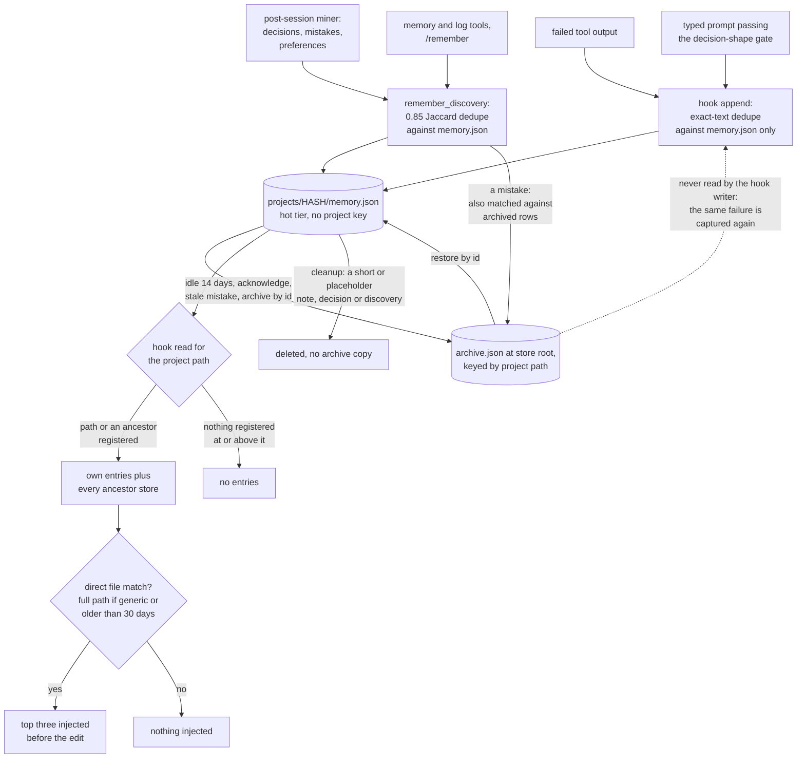

## 1. Executive Summary

windvane is a Claude Code plugin that watches a long session's context and
turns the session's own events into per-project memory. A failed tool call
becomes a *mistake*, a sentence the user types that reads as a choice becomes
a *decision*, and a background miner adds more from transcripts. Before each
edit the hook injects at most three memories, and only on a path-aware file
match. The weak point is the correction path: an acknowledged mistake is
archived, and the failed-tool hook, which writes most mistakes, never reads
the archive before writing the same text back.

**windvane continues `20alexl/claude-engram`.** That repository returns 404,
and its commit `a7903274531c2ca00659b03e173f0f0f2079333a` survives in the
archive fork
[`agent-memory-atlas-archive/20alexl--claude-engram`](https://github.com/agent-memory-atlas-archive/20alexl--claude-engram).
`20alexl/windvane` is a new repository, not a GitHub rename: its first commit,
on 4 October 2026, adds the whole tree at once and does not carry the
claude-engram history. Its 1.0.0 changelog entry says windvane *"supersedes
claude-engram: the same engine, rewritten as a Claude Code plugin"*.

The code agrees on the engine. The store layout (`manifest.json`,
`projects/HASH/memory.json`, a root `archive.json`), the `MemoryEntry` fields,
the hot reader's scorer and gate, and the miner moved over, with pydantic
replaced by dataclasses (`windvane/store.py:73-113`). The MCP server, the
Ollama-backed consolidation and reflection, and the writer of the injection
outcome weights did not; a test lists the dropped modules
(`tests/test_mining.py:941-946`). The rename is complete in code: `engram`
survives only in the store importer and the setup check.

The product leads with the context: a recorder drafts a checkpoint, the plugin
compacts at a step boundary, and the rules and the checkpoint ride inside the
compacted conversation and every subagent's prompt. This report covers the
memory store, the mined patterns that feed the same banner, and the checkpoint
ring where it injects.

The changelog entries for 1.0.2 and 1.0.3 name the atlas's claude-engram
report as the source of five fixes. One mark, `negative_eval`, on tests of
the hook readers and the banner. Section 9 names the six withheld.

## 2. Mental Model

A memory is a `MemoryEntry`: a content string with a category, a relevance
from 1 to 10, tags, related files and access statistics
(`windvane/store.py:73-113`). It becomes a belief the moment it is written;
there is no candidate state and no model judgement between capture and
injection. Five producers write:

- **Failed tools.** `_auto_log_detected_mistake` parses the error class,
  message and traceback files out of the output and appends a `mistake` at
  relevance 9, `source: auto-detected`
  (`windvane/events/post_tool.py:150-287`).
- **Typed prompts.** `_auto_capture_from_prompt` runs `capture_decision`,
  which requires the shape `looks_like_decision` defines — a declarative
  sentence with a deciding word, not a question, acknowledgement, count or
  paste — and appends a `decision` (`windvane/events/prompt.py:164-230`;
  `windvane/capture.py:252-264`, `:1039`).
- **The miner.** After a session it extracts decisions at confidence 0.6 or
  more, mistakes with an error type, and user corrections, and files each
  under the project whose files it names
  (`windvane/mining/extractors.py:1180-1235`).
- **The model.** `memory(remember)`, `memory(add_rule)`, `log(mistake)` and
  `log(decision)` (`windvane/tools.py:386-410`; `windvane/log.py:72-118`).
- **The person.** `/remember` files the selected transcript text as a
  decision through the same writer (`hooks/remember.ts`;
  `windvane/remember.py:52-59`). The default rule pack is seeded once per
  project.

A memory leaves the injected set in four ways. It is archived: idle 14 days,
a machine-written mistake 21 days old that never recurred, acknowledged, or
archived by id. It is deleted by id or by `forget`. Cleanup judges it broken.
Or relevance decay drops it, after age archiving has copied it to the archive.
Rules, lessons and mistakes never age out, and relevance 8 or more exempts any
entry (`windvane/archive.py:82-92`; `windvane/store.py:36-43`).

**The archive is a tier, not a verdict, and one writer consults it.**
`remember_discovery` matches a new mistake against the project's archived
entries at 0.85 Jaccard and leaves a match in the archive
(`windvane/store.py:876-887`). The failed-tool hook does not call it. It
appends through `_append_memory_entry`, which compares whole content strings
against `memory.json` alone (`windvane/events/common.py:1080-1160`, `:1123`).
The same failure on the next day writes the same `md5(content)[:12]` id back
into the hot file, and the pre-edit banner shows it again
(`windvane/events/post_tool.py:269`). This was read, not reproduced.

A second record kind sits beside the store: the **checkpoint**, a task state
the recorder drafts from the previous record, the transcript and the hook
state, and the model accepts with a bare `checkpoint(save)`
(`windvane/draft.py:1-35`). Checkpoints live in a per-project ring and are
restored after a compaction and at the next session start
(`windvane/checkpoints.py:1-29`).

## 3. Architecture

Everything is Python and JSON on the local machine, driven by two plugin
surfaces. `hooks/hooks.json` registers command hooks on twelve events, each
running `python -S windvane/daemon_client.py <event>`, a thin client that
forwards to the daemon or runs the handler in its own process
(`hooks/hooks.json`; `windvane/events/`). `hooks/register.ts` is a TypeScript
hooks module that runs inside Claude Code's plugin worker. It registers six
tools, slash commands, a pane and a status segment, rewrites `Agent` call
prompts, and trims and redacts tool results as rows are appended to the
session (`hooks/register.ts:1-36`; `hooks/door.ts:1-28`).

The six tools are `checkpoint`, `compact_now`, `memory`, `log`, `mine` and
`deps`; `memory` and `mine` bundle reads and writes behind an `operation` enum
(`hooks/tools.ts:72-190`). The module serves each call through the daemon's
`/tool` route, or through `python -m windvane.tools` when the daemon is down
(`hooks/tools.ts:225-306`).

A resident daemon binds a free port on `127.0.0.1`, mints a 32-byte token,
writes it to `daemon_token` at mode 0600, and refuses any request without it
on both its line protocol and its HTTP routes (`windvane/daemon.py:310-357`,
`:426`, `:529`). It runs hook events and tool calls in-process and serves
embeddings when the semantic extra is installed. It exits after 30 idle
minutes or when the package source changes (`windvane/daemon.py:1-9`).

The store lives under `WINDVANE_DIR`, default `~/.windvane`
(`windvane/config.py:80-87`). `manifest.json` maps each normalized project path
to an eight-character md5 prefix. `projects/HASH/` holds `memory.json`, the
embedding files, `patterns.json`, the checkpoint ring and the session index.
The cold tier is one `archive.json` at the store root, keyed by path
(`windvane/archive.py:1-23`, `:43-71`).

Three readers parse the same files. `MemoryStore` serves the tools and the
miner. `HotMemoryReader` and `windvane/storage.py` are dict readers for the
hooks, kept free of the store module's import cost
(`windvane/hot_reader.py:1-8`). `hooks/ring.ts` reads `memory.json` directly
for the pane (`hooks/ring.ts:110-147`).

**Concurrency is last-writer-wins with a merge.** Every write is a temp file
then `replace`. A `MemoryStore` that mutated a project on a stale base merges
by entry id before saving, and its docstring states the cost: it *"can
resurrect an entry the other writer deleted in the same instant"*
(`windvane/store.py:700-736`). The hook writer is a plain read-modify-write
with no merge (`windvane/events/common.py:1080-1133`).

Embeddings are optional: the `semantic` extra brings sentence-transformers,
loaded by the daemon. No hosted or local LLM is called anywhere in the tree.

### Deployment and ergonomics

Clone the repository, add it as a plugin marketplace, and install `windvane`
and optionally `windvane-keeper` (`docs/install.md:11-16`). Python 3.10 or
later on PATH, and no dependencies. The first interactive session offers to
run `pip install` for `sentence-transformers>=2.7.0` and `numpy>=1.24.0`, on
the person's yes (`hooks/setup.ts:16`, `:54-56`). No service and no API key
are needed to store anything. The store is pretty-printed JSON, readable and
repairable by hand. Once installed, the plugin captures every project a
session opens.

## 4. Essential Implementation Paths

**Hook capture.** `_append_memory_entry` registers an unknown project in the
manifest, loads `memory.json`, skips an exact-content duplicate and an
optional caller predicate, appends, and writes an embedding to
`embeddings_pending.json` for the next store load to merge
(`windvane/events/common.py:1080-1160`). Its callers are the prompt capture
(`windvane/events/prompt.py:214-228`) and the failed-tool capture
(`windvane/events/post_tool.py:271-284`).

**Store write.** `remember_discovery` creates the project and runs
`_is_duplicate` at Jaccard 0.85 over the hot entries; a hit bumps the existing
entry's access count and relevance. A mistake is then matched against the
archive. Otherwise it extracts tags and file references and appends
(`windvane/store.py:854-911`). `add_rule` dedupes against rules only
(`windvane/rules.py:279-318`).

**Miner write.** The post-session phase routes each extraction with `_target`,
skips a decision already filed at the destination, then calls
`remember_discovery` (`windvane/mining/extractors.py:1180-1235`).

**Pre-edit injection.** `_auto_run_pre_edit_check` loads the project through
`load_project_memory`, matches mistakes to the file name by regex with the
project's own first (full path for generic names), then calls
`get_contextual_memories` for scored entries
(`windvane/events/pre_tool.py:53-150`; `windvane/events/common.py:964-1060`).
The scorer and gate are `score_entry` and `score_loaded_entries`
(`windvane/hot_reader.py:172-307`).

**Session-start banner and subagent brief.** Rules with inheritance, past
mistakes ranked by `_mistake_scope`, the restored checkpoint, and
`_recurring_lines` over the mined `patterns.json`
(`windvane/events/session_start.py:192`; `windvane/storage.py:202-255`;
`windvane/events/common.py:1487-1530`). `hooks/agents.ts` asks
`python -m windvane.brief` for the rules block and each named file's
past-mistakes lines and prepends them to an `Agent` call's prompt
(`hooks/agents.ts:68-90`; `windvane/brief.py:1-18`).

**Tool read.** `memory(search)` calls `search_memories`: file and tag index
lookups plus word-set intersection, sorted by stored relevance, bumping access
counts on every hit (`windvane/tools.py:434-458`;
`windvane/store.py:1136-1182`). `recall`, `recent`, `list_rules`,
`list_mistakes` and `archive_search` are direct reads.

**Correction.** `modify_memory`, `delete_memory`, `promote_to_rule`,
`archive_memory` and `restore_from_archive` (`windvane/store.py:1208-1303`;
`windvane/archive.py:144-275`). `acknowledge_mistake` moves one mistake into
the archive (`windvane/tools.py:603-621`). `forget` calls `forget_project`,
which removes the project directory, its manifest row and its archived rows
(`windvane/store.py:973-996`).

**Maintenance.** `cleanup_memories` finds broken entries, near-duplicates
(Jaccard, then embeddings when available), archivable entries and decay, and
`_apply_cleanup` applies them (`windvane/archive.py:323-586`). The miner calls
it with `dry_run=False` and default decay after each post-session and
bootstrap run, then `archive_stale_mistakes` over every registered project
(`windvane/mining/background.py:524-556`). `consolidate_memories` lists tag
groups of ten or more and changes nothing (`windvane/archive.py:631-675`).

## 5. Memory Data Model

| Field | Notes |
| --- | --- |
| `id` | md5 of the content, first 12 hex characters; the store adds a counter suffix on collision in the target project, the hook writers do not (`windvane/store.py:629-644`) |
| `content` | free text; mined entries carry prefixes such as `MISTAKE: `, `DECISION: `, `USER PREFERENCE: ` |
| `category` | rule, mistake, decision, discovery, context, lesson, priority, note |
| `source` | `auto-detected`, `auto-prompt`, `session_mining`, `work_tracker`, `add_rule`, or none |
| `relevance` | 1-10; manual remember 5, auto-prompt 6, mined decisions 7, mined mistakes 8, auto-detected and logged mistakes 9, rules 9 |
| `tags`, `related_files` | extracted from content by regex, plus caller values |
| `created_at`, `last_accessed`, `access_count` | recency and frequency inputs to the scorer |
| `archived_at` | set when moved to the cold tier |
| `cluster_id` | set by cleanup when three or more entries share a tag |
| `detector` | rules only: a hand-written matcher on tool name, command, paths or input |

The containing `ProjectMemory` adds a summary, key files, recent searches, file
and tag indexes and clusters (`windvane/store.py:136-179`).

**Scope is the file.** Nothing on the entry names its project; the project is
whichever `memory.json` it sits in. Workspace inheritance is a read-time walk:
`HotMemoryReader.load_entries` and `load_project_memory` add every registered
ancestor's entries, and the loader marks them `_inherited` in memory only
(`windvane/hot_reader.py:364-388`; `windvane/storage.py:91-149`). A path with
nothing registered at or above it gets nothing; both readers say so in a
comment beside the walk, and a test asserts it
(`tests/test_config.py:727-748`). Rules inherit on the tool side through
`get_rules_with_inheritance` (`windvane/rules.py:343`). Other tool reads open
only the named project's file.

**The model may name the partition.** Every tool takes an optional
`project_path`. `_canonical` maps it to a repository root and falls back to
the session's own project only when the call names none
(`windvane/tools.py:231-238`). A call that names another registered path
reads, writes or forgets that project's store. The legacy single-file reader
in `load_project_memory` keeps a same-basename lookup, reached only for a
store whose manifest has no projects (`windvane/storage.py:189-192`).

**Checkpoint restore reads wider than memory.** A restore searches the
project's own ring, its descendant projects' rings, then its ancestors', and
the global ring only when none exists (`windvane/checkpoints.py:23-27`). No
temporal validity, no provenance beyond `source`, and no version history.

## 6. Retrieval Mechanics

**Hook injection is gated, not only ranked.** `score_entry` sums file match
0.35, tag overlap 0.20, recency 0.20 on a 30-day half-life, relevance 0.15 and
access frequency 0.10, plus 0.3 for rules, 0.25 for lessons and 0.2 for
mistakes (`windvane/hot_reader.py:20-27`, `:172-219`). `score_loaded_entries`
then admits a non-rule only when its path-aware file match clears a gate of
0.5 divided by an outcome weight bounded to 0.8-1.2. Past 30 days it also
needs a full-path match, unless it is a mistake. A rule rides along only when
it names the file or its directory, capped at one, and only beside a
file-relevant memory. With nothing file-relevant the hook injects nothing
(`:236-307`).

`_file_match_score` treats diverging paths with a shared basename as no match.
Generic names — `__init__.py`, `README.md`, `CLAUDE.md`, `pyproject.toml`,
`utils.py` and about forty more — score zero without a full-path signal
(`windvane/hot_reader.py:35-169`).

**The outcome weight has a reader and no writer.** `_memory_injection_weight`
reads `injection_weights.json` from the store (`windvane/hot_reader.py:222-234`).
No module in the package writes it, and a test asserts that the miner's phase
list carries no outcome weights (`tests/test_mining.py:950-955`). The store
importer copies the file from a claude-engram store, since its exclusion list
does not name it (`windvane/migrate.py:44-59`). An imported store therefore
keeps its last multiplier with nothing to update it.

**Tool search.** `search_memories` is word-set intersection with tag and file
index lookups, sorted by stored relevance (`windvane/store.py:1136-1182`).
`hybrid_search` and `vector_search` are in the store
(`windvane/store.py:1543-1603`), and no production path calls them; a
recorded search lists the callers. `docs/install.md:36` says that with the
semantic extra *"memory and session search use a small embedding model"*;
for the memory tool, the code does not.

**Past-session search.** `mine(search)` searches chunks of past transcripts,
including user messages, tool output and file reads, by keyword and, with
the extra, by embedding (`windvane/mining/search.py:1-17`, `:844`). The
changelog's measurement on 40 paraphrased queries has no committed queries or
result file.

**Mined patterns.** Recurring errors carry a `projects` list computed from the
edits of the sessions they occurred in. The banner shows one only when that
list intersects the session's project, or when the list is empty
(`windvane/events/common.py:1487-1530`). `mine(errors)` recomputes the same
list and prints every entry without applying it (`windvane/tools.py:759-768`).

## 7. Write Mechanics

Writes are hot-path and model-free on the hook side: a regex parse of an error,
a regex or semantic score over a prompt sentence, then the shape gate. The
semantic tier asks the daemon and falls back to regex while the model loads.
The miner runs detached after each session and on a live tick, and calls no
model.

**The hook writer does not read the archive.** The store's mistake check
covers the miner and `log(mistake)` (`windvane/store.py:876-887`;
`windvane/log.py:86-93`). `_append_memory_entry` checks only exact text in
`memory.json` (`windvane/events/common.py:1123`). Its failed-tool caller is
the source of every `auto-detected` mistake. The test of the archive check
calls `remember_discovery` and describes the second write as *"Logged again by
a hook or the miner"* (`tests/test_archive.py:189-213`); no test drives the
hook writer against an archived row.

**A recurring failure's files land on the last entry.**
`_auto_log_detected_mistake` returns the mistake text whether or not the append
wrote anything (`windvane/events/post_tool.py:271-287`).
`_auto_log_detected_mistake_with_files` then patches `entries[-1]` in
`memory.json` with the failure's related files (`:119-148`). When the mistake
was a duplicate, the last entry is whatever was appended before it, of any
category. Since `related_files` feeds the file-match gate, that entry then
injects on the failing files. This was read, not reproduced, and the same code
is in the claude-engram tree at the archived pin.

**Cleanup deletes on its own judgement.** `_is_broken_memory` flags empty text,
anything under 20 characters, a few truncation strings and placeholder endings
(`windvane/archive.py:503-526`). The broken pass skips lessons, rules and
mistakes (`:358-372`), and broken entries are removed without an archive copy
(`:561-563`). A 15-character note such as `Use uv, not pip` filed with
`memory(remember)` is deleted at the next session end. Entries touched by decay
and age archiving are archived before they leave the hot file.

**Tool- and agent-derived text is stored like the user's.** A traceback
message, a `(from user)` sentence and a mined preference all become memories.
Nothing but `source` and a prefix tells them apart, and the hook injects each
as a relevant memory for the file. The door redacts private keys, vendor keys
and literal secret values in tool results before the session row is stored,
which also keeps them out of the transcripts the miner reads
(`hooks/door.ts:1-28`).

### Operational cost

- Write: synchronous on the hook path, one JSON parse and rewrite of the
  project file per captured event, plus an optional local embedding. No LLM.
- Deferred: mined memories appear after the session-end miner finishes. The
  changelog records a live miner peaking at 5.4 GB before 1.0.15 and bounded
  re-reads from 1.0.16; those figures are the project's, not measured here.
- Background rewrite: every post-session run cleans the project it mined and
  sweeps stale mistakes across every registered project.
- Read: at most three memories and one rule per edit, a bounded banner at
  session start, and a rules-and-mistakes header on each subagent prompt.
  Injection arrives as hook output beside the tool call, after the cached
  prefix.

## 8. Agent Integration

The hooks do the work; the model need call nothing. Subagents get the rules
and the past mistakes for the files their prompt names, prepended by the hooks
module (`hooks/agents.ts:1-16`). After a compaction the rules and the
checkpoint are placed right after the summary, and a resume prompt continues
the work when windvane started the compaction.

The model holds every memory verb: `remember`, `add_rule`, `modify`, `delete`,
`promote`, `archive`, `restore`, `acknowledge_mistake`, `set_detector` and
`forget`, the last removing a project's whole store directory
(`hooks/tools.ts:72-104`). The tool handlers also accept arguments the schema
does not list, such as `category` and `relevance` on `remember` and `modify`,
because the module passes every argument through (`hooks/tools.ts:210-217`;
`windvane/tools.py:390-400`, `:511-520`).

The memory half depends on Claude Code's hook events, transcript format and
plugin runtime. `windvane-keeper` is a second plugin that watches a marker the
hooks module rewrites every ten seconds and reloads windvane by changing its
hidden `revision` option when the marker goes quiet
(`keeper/hooks/register.ts:1-20`).

## 9. Reliability, Safety, and Trust

**The boundary holds by path and is chosen by argument.** A physical partition
per project path with an ancestor walk is a real boundary on the hook paths,
and the readers return nothing for an unregistered path with no registered
ancestor. Workspace pooling is ranked, not excluded: `_mistake_scope` ranks a
sibling's pooled mistake last, and the pre-edit check shows the first three,
so a pooled sibling mistake naming the same file name fires anyway
(`windvane/storage.py:202-255`). On the tool side the model may name any
registered path.

**The daemon answers its owner.** The token file is mode 0600 and every
request is checked with `hmac.compare_digest` before any handler runs
(`windvane/daemon.py:310-357`); a test covers both protocols
(`tests/test_daemon.py:165-206`). Any process of the same user can read the
token, as it can read the store.

**Forget reaches the cold tier.** `forget_project` removes `projects/HASH/`,
the manifest row and the project's rows in `archive.json`
(`windvane/store.py:973-996`).

**Provenance.** Error text from any tool, including a command that printed a
file the agent read, becomes a relevance-9 mistake, and a recurring error is
replayed with its recorded fix. Nothing marks machine-captured text as
unverified when it is injected.

**Concurrency.** Hook writes can race the store's own saves. The store's merge
keeps both sides' additions and can resurrect a concurrent delete, as its
docstring says. The related-files patch is a second unmerged read-modify-write
on the same file.

Capability marks:

- `negative_eval` — awarded; evidence in section 10.
- `tombstone` — withheld. The archived-mistake check is a lookup on the
  value, and the store writer consults it. The archive is not a rejection
  record, though: it also holds entries archived for age and hygiene, and
  `restore` empties it. The failed-tool hook, the main mistake producer, does
  not consult it, and a deleted entry leaves nothing behind.
- `trust_state` — withheld. `archived_at` keeps an entry out of hook reads,
  but it marks a storage tier reached by age and hygiene as well as by
  acknowledgement, and `archive_search` returns the entry as a memory.
  Categories are types, and the decision gate is a write-time filter.
- `bitemporal` — withheld. `created_at`, `last_accessed` and `archived_at`
  record system time only.
- `scope_enforced` — withheld. `MemoryEntry` has no project key; the scope is
  which `memory.json` a row sits in, and on the tool path a model-supplied
  `project_path` picks the file. The one key-plus-predicate is `projects` on
  mined recurring errors: the banner filters on it, `mine(errors)` over the
  same data does not, and rows with an empty list pass.
- `audit_log` — withheld. No mutation record exists; `delete`, `forget` and
  cleanup remove rows with nothing left behind.
- `human_review` — withheld. No memory waits for anyone, and the agent holds
  every verb, including `promote` and `forget`. `/remember` lets a person
  author a decision; it does not gate one.

## 10. Tests, Evals, and Benchmarks

Nothing was installed, built or run for this report; what follows is from
reading the tests at the pin.

**Two suites.** 442 pytest functions in 23 files under `tests/`, and 79
TypeScript cases in 13 files under `tests/mod/` and `keeper/tests/` written
against Claude Code's plugin test kit. There is no CI configuration in the
tree, and no retrieval benchmark: the claude-engram bench scripts and their
README figures did not move over.

**The negative cases.**
`test_a_project_sharing_only_its_directory_name_is_another_project` registers
a workspace with a rule and an unrelated project also named `api` with a
mistake. It
asserts that both production readers return the workspace rule alone for
`ws/api`, and nothing for an unregistered `lone/api`
(`tests/test_config.py:727-748`).
`test_recurring_errors_are_scoped_to_the_sessions_project` asserts that one
sub-project's recurring error appears in its banner lines and another's does
not, then the reverse (`tests/test_hooks.py:382-407`).
`test_sub_projects_keep_their_memories_and_inherit_rules` requires FastAPI and
forbids React for a backend file, and the mirror
(`tests/test_store.py:377-390`); it runs on `score_and_rank`, which no
production path reaches.

**A negative half the positive half entails.**
`test_edit_reminders_need_a_file_match_for_rules_and_a_full_path_when_old`
asserts ids 1, 3 and 5 are injected and 2 and 4 are not, at `limit=3`
(`tests/test_config.py:662-679`). With three required ids in a result capped
at three, that exclusion cannot fail on its own. The next assertion, that a
far rule alone injects nothing, can.

**The fixes carry tests.** `tests/test_archive.py:189-237` asserts that an
archived mistake logged again through the store stays archived, that forget
drops archived rows, and that cleanup keeps a short rule and a short mistake.
`tests/test_daemon.py:165-206` asserts the token refusal on both protocols.

**Missing.** No test sends a failed tool through the hook writer after an
acknowledgement, checks which entry receives a recurring failure's files, or
names another project in a tool's `project_path`. No paper or citation block
is in the tree.

## 11. For Your Own Build

### Steal

- **Gate injection on direct relevance and be silent otherwise.** Ranking
  always returns something; a gate that returns nothing when nothing matches
  keeps a pre-edit injection from becoming noise.
- **Make file matching path-aware and distrust generic basenames.** A shared
  `__init__.py` or `README.md` is not evidence that two memories concern the
  same file.
- **One capture gate for every producer.** The prompt hook and the transcript
  miner share `looks_like_decision`, so a rule tightened once applies to live
  capture and backfill alike.
- **Archive, never delete, on every automatic path that is not a judgement of
  garbage.**
- **Merge by id on a stale save, and document what the merge can resurrect.**

### Avoid

- **A fix applied to one of two writers.** When two paths write the same kind
  of record, a check added to the shared store method does nothing for the
  path that writes the file directly. Grep for every writer of the file, not
  every caller of the method.
- **Patching "the entry just written" by position.** Return the id from the
  append and patch by id, or the patch lands on a neighbour whenever the
  append was skipped.
- **A validity heuristic that deletes.** A length floor for "broken" should
  archive.
- **A scope chosen by a tool argument.** Derive the partition from the session
  and refuse a different one, or the model can read and forget any project.

### Fit

This suits one developer on Claude Code who wants their own failures and stated
preferences to come back at the file they concern, with no service to run and
a store they can read, and who also wants the session's context managed. It
does not suit several people in one store, or anyone who must show that a
dismissed memory stays dismissed. The plugin captures every project a session
opens; a reader who works across client codebases should weigh that before
installing it.

## 12. Open Questions

- Does Claude Code ask before each plugin tool call, so that a `forget` or a
  `project_path` naming another project is visible to the person?
- How often does an acknowledged mistake return through the failed-tool hook
  in practice?
- Is the frozen `injection_weights.json` an imported store carries intended,
  or should the importer drop it?
- What does the transcript search measure on the changelog's 40 queries, and
  could those queries be committed?

## Appendix: File Index

- **Store and schema:** `windvane/store.py`, `windvane/archive.py`,
  `windvane/rules.py`.
- **Hook read path:** `windvane/hot_reader.py`, `windvane/storage.py`,
  `windvane/events/common.py` (`get_contextual_memories`, `_file_mistakes`,
  `_recurring_lines`), `windvane/events/pre_tool.py`,
  `windvane/events/session_start.py`, `windvane/brief.py`.
- **Hook write path:** `windvane/events/common.py` (`_append_memory_entry`),
  `windvane/events/post_tool.py`, `windvane/events/prompt.py`,
  `windvane/capture.py`.
- **Daemon:** `windvane/daemon.py`, `windvane/daemon_client.py`.
- **Miner:** `windvane/mining/background.py`,
  `windvane/mining/extractors.py`, `windvane/mining/patterns.py`,
  `windvane/mining/search.py`.
- **Plugin:** `.claude-plugin/plugin.json`, `hooks/hooks.json`,
  `hooks/register.ts`, `hooks/tools.ts`, `hooks/agents.ts`, `hooks/ring.ts`,
  `hooks/door.ts`, `keeper/hooks/register.ts`; `windvane/tools.py`.
- **Checkpoints:** `windvane/checkpoints.py`, `windvane/draft.py`.
- **Import:** `windvane/migrate.py`.
- **Tests:** `tests/test_config.py`, `tests/test_hooks.py`,
  `tests/test_store.py`, `tests/test_archive.py`, `tests/test_daemon.py`,
  `tests/test_mining.py`.

### Recorded searches

Run with `git grep` from the tree root at
`69dc824fc2cf0d59e093c4e7e4f2a7a4f2d17ad8`, and where stated also at the
claude-engram pin `a7903274531c2ca00659b03e173f0f0f2079333a` from the archive
fork.

- `git grep -n -i -E 'arxiv|bibtex|@article|@misc|doi\.org|CITATION' -- . ':!demo'` — no match, and no `CITATION.cff`.
- `git grep -n -i engram -- windvane hooks keeper` — 21 lines, all in `windvane/migrate.py` and `windvane/doctor.py`, the store importer.
- `git grep -n -i -E 'tombstone|blocklist|denylist|suppress(ed|ion)?_?(list|set|values)|rejected_values' -- .` — no match at either pin.
- `git grep -n -E 'valid_from|valid_to|valid_until|effective_at|invalid_at|valid_at' -- '*.py' '*.ts'` — one match at the new pin, in `demo/build_fixture.py`, a demo document's schema; none at the old pin.
- `git grep -n -E 'audit_log|mutation_log|events\.jsonl|memory_events|history\.jsonl|append-only' -- '*.py' '*.ts'` — comments about Claude Code's transcript file only, at both pins.
- `git grep -n -i -E 'approv(e|al)_|pending_review|review_queue|awaiting|needs_review|def approve' -- '*.py' '*.ts'` — decision-capture test cases about approval wording only, at both pins.
- `git grep -n -i archive -- windvane/events` — no match: no hook handler reads the archive.
- `git grep -n -E 'Path\(path\)\.name ==' -- windvane hooks` — `windvane/storage.py:191`, the legacy single-file branch.
- `git grep -n -E 'hybrid_search\(|vector_search\(' -- windvane hooks` — the definitions and `store.py:1588`, inside `hybrid_search`; no other caller.
- `git grep -n injection_weights -- windvane hooks` — `windvane/hot_reader.py:224`, `:230`, the reader; no writer.
- `git grep -n -E 'cleanup_memories\(|archive_stale_mistakes\(' -- windvane hooks` — the definitions and `windvane/mining/background.py:531`, `:550`.
- `git grep -n -E '_auto_log_detected_mistake|_append_memory_entry' -- tests` — no match.
- `git grep -n -i ollama -- windvane hooks` — no match.
- `ls -a | grep -E '^\.github$|^\.gitlab|^\.circleci'` — no CI configuration.

## History

**2026-10-15** — [`69dc824fc2cf0d59e093c4e7e4f2a7a4f2d17ad8`](https://github.com/20alexl/windvane/commit/69dc824fc2cf0d59e093c4e7e4f2a7a4f2d17ad8) — moved from `claude-engram`, which went private; the engine continues in `20alexl/windvane`, a new history, and the old pin was read from the archive fork ([section 1](#1-executive-summary)). Overtaken: the same-basename fallback, the open daemon, forget leaving archived rows and cleanup deleting short rules and mistakes are closed. The archived-mistake fix covers the store writer, not the failed-tool hook ([section 7](#7-write-mechanics)). Not named at the first reading, present at both pins: a recurring failure's files patched onto the last entry. `negative_eval` holds at both pins, on new tests at the new one. Screened: three auto-run findings (the plugin manifest, `hooks/`, `hooks/hooks.json`), `pyproject.toml` inside the cooldown and unpinned, `tests/conftest.py` as collection-time code, `CLAUDE.md` as data; the screen did not list `keeper/`, read by hand. Nothing was installed or run.

**2026-09-30** — [`a7903274531c2ca00659b03e173f0f0f2079333a`](https://github.com/agent-memory-atlas-archive/20alexl--claude-engram/commit/a7903274531c2ca00659b03e173f0f0f2079333a) — first reading, at the head of `main`, the 0.8.61 commit dated 27 September 2026. One mark, `negative_eval`. Screened before reading: no auto-run surface, no build-time execution point, one dependency file inside the cooldown (`pyproject.toml`; every file in a depth-1 clone dates to the tip), one unpinned surface (`pyproject.toml` with no lockfile), and `CLAUDE.md` recorded as data. Read with `grep` and `sed`; nothing installed, built or run.
