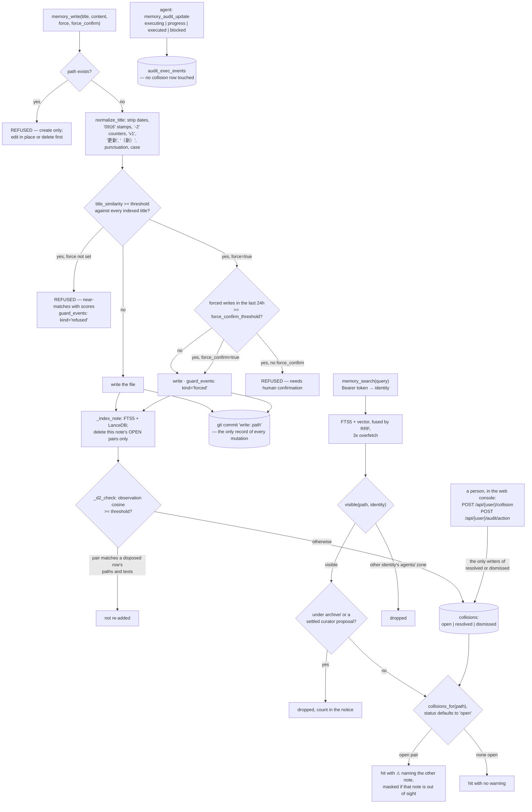

## 1. Executive Summary

yacmemo is a Markdown memory server whose write guard refuses a near-duplicate
title after normalising away the suffixes an evasion would add, and whose
collision warnings only a person can dismiss. One process on the machine that
holds the data speaks streamable HTTP to any MCP client, with a store root per
user and, inside each, a private zone per agent and device. The record is the
thin side: git is the only log covering every mutation, and the agent's audit
tool prints other identities' private paths and excerpts.

It describes itself as a personal memory layer with API-level consistency
guards — "markdown 为本、全本地、agent 无关" (Markdown-native, fully local,
agent-agnostic). Documentation and interface are in Chinese with an English
mirror; code comments are mixed.

**The duplicate guard anticipates its own evasion.** `memory_write` refuses a
title that is a near-duplicate of an existing note, and the comparison runs on
`normalize_title`, which first strips trailing dates, compact `0916` and
`20260916` stamps, `-2`-style counters, `v1`, `更新` ("updated") and `（新）`
("new"). The rename an agent would reach for to get a second copy in is the
transformation the normalizer collapses. The refusal names the near-matches
with their similarity scores and says to edit the existing note instead
(`yacmemo/detectors.py:13-48`, `yacmemo/store.py:438-470`).

The override is counted. `force=true` writes anyway and records a `forced`
event; when forced writes in the last 24 hours reach a configured threshold, a
second flag `force_confirm=true` becomes mandatory, under a comment naming the
intent — "human-confirm semantics, deterministic and fully counted in
guard_events". A bypass that is possible, counted and self-limiting is a
different object from one that is free.

**A person's verdict on a collision is the one state the agent cannot set.** A
collision carries `open`, `resolved` or `dismissed`, and the two writers of a
non-open value are console routes. The agent's own audit verb,
`memory_audit_update`, reports execution progress into a separate timeline and
touches no collision row. Search reads only open rows, so a dismissal removes
the warning from every later hit, and the dismissal survives edits, moves and
full rebuilds ([section 9](#9-reliability-safety-and-trust)).

**Contradictions are surfaced beside each other rather than resolved.** When
two notes collide, both are returned and the hit carries a warning naming the
other:

> "⚠ 与 [[other]] 疑似重复（score …）— 建议读两篇后用 memory_edit 合并"
> *(suspected duplicate of [[other]] — read both, then merge with memory_edit)*

Nothing on the read path decides which side wins. What MCP clients do not see
is narrower and is announced: notes under `archive/`, curator proposals marked
settled, and other identities' private zones, each dropped with a count in the
returned notice ([section 6](#6-retrieval-mechanics)).

**The scope boundary is one function, and two surfaces bypass it.**
`visible(rel, identity)` decides what an identity may see, and search, read,
list and the session-start context all call it. `memory_audit` does not: it
prints every open D2 pair with both paths and 60 characters of each
observation, whichever zone they sit in. The write guard's refusal names
near-match titles and paths from every zone the same way
([section 9](#9-reliability-safety-and-trust)).

The curator is the one generative component, and it states its limit in the
first line of its module — "periodic review -> proposal report. Never
auto-applies". A person adopts or dismisses each proposal item in the console;
the agent carries out adopted items with its ordinary tools and reports
progress with `memory_audit_update`.

## 2. Mental Model

A **note** is a Markdown file. Its **title** is its identity; its directory is
only filing, except under `agents/`, where the directory names its owner.

A **guard** is a refusal at the API, not a warning in a report.

A **collision** is a question the system asks and a person answers.

**Git** is the undo.

## 3. Architecture

| Area | Role |
| --- | --- |
| `store.py` | CRUD, the write guards, path containment, the topic registry, archive, audit and dispositions, git snapshots |
| `identity.py` | Token parsing and the `visible` and `writable` predicates |
| `detectors.py` | Title normalisation, D1 duplicate scan, D3 dangling links, observation parsing — no model |
| `index_db.py` | SQLite: notes, FTS, collisions, guard events, dispositions, the execution timeline, embedding cache |
| `search.py` | FTS5 trigram and vector, fused by RRF, then identity, archive and settled-proposal filters, then warnings |
| `vector.py`, `embedding.py` | LanceDB and the single embedding call |
| `curator.py` | The weekly LLM review that only proposes |
| `tools.py` | The 22 MCP tools and the identity resolution |
| `webui/app.py` | The console: notes, search, audit and dispositions, proposals, identities, users, usage, config |
| `usage.py` | The per-call log |

## 4. Essential Implementation Paths

`detectors.py:13-48` — the suffix patterns and the similarity function. Read
the patterns first; they are the design.

`store.py:403-491` — create-only, refusal, the confirmation ladder, and the
collision echo that hides another zone's path.

`search.py:67-129` and `:200-229` — the read path in order: fuse, filter by
identity, drop archived and settled, attach warnings.

`index_db.py:318-392` and `store.py:2296-2312` — how a disposition outlives
the re-index that every edit triggers.

## 5. Memory Data Model

A note is Markdown. The registry (`TOPICS.md`) names the long-term topics, each
with a card, a one-line status and tags, in active and archived sections;
`PROFILE.md` carries preferences injected ahead of context. `journal/`,
`archive/`, `curator/` and `agents/` are registration-free areas. Journal and
`agents/` notes are exempt from the title guard, since a daily log repeats its
own titles and every identity has a file called `必读` ("must read").

Under `agents/<agent>/`, two kinds of subdirectory exist: `shared/`, read and
written by that agent on every device, and `<device>/`, private to one
identity. Flat files at `agents/<agent>/` stay readable and refuse writes
(`yacmemo/identity.py:127-170`).

Observations are parsed from `- [category] text` lines. GFM task items
(`- [x]`) and wiki-link bullets (`- [[note]]`) are excluded, so a
checklist-heavy note or a link list does not manufacture collision noise
(`yacmemo/detectors.py:27-32`, `:85-102`).

## 6. Retrieval Mechanics

FTS5 trigram — which matters for Chinese, where word boundaries are not spaces
— and vector search, fused by reciprocal rank, with a `LIKE` scan for queries
shorter than three characters. Each channel fetches three times the limit when
a filter will follow, and truncation happens after filtering
(`yacmemo/search.py:67-129`).

Three filters run between fusion and truncation for an MCP caller. The
identity filter drops another identity's private zone. `_drop_archived` drops
anything under `archive/`. `_drop_settled_proposals` drops curator reports
carrying the settled marker. The last two append a count to the returned
notice, so the agent is told how many results it was not shown
(`yacmemo/search.py:107-163`). The console calls the same search with
`identity=None` and archive included, so only the settled-proposal filter
applies to it.

Archive is a location rather than a status: `archive_note` moves a note to
`archive/<topic>/`, `unarchive_note` moves it back, and both are agent tools
the docstrings reserve for an explicit user request. An archived note stays
readable by its exact path; a title lookup refuses it with the archive location
(`yacmemo/store.py:305-341`).

Warnings are attached per hit from open collisions only. When the other note is
archived or out of the caller's sight, the warning reports that a near-duplicate
exists and withholds its title and text (`yacmemo/search.py:200-229`).

## 7. Write Mechanics

`memory_write` creates only. An existing path is refused before the
near-duplicate check, with or without `force`, and the one route to rewriting a
note whole is `memory_delete` followed by a write. Until v0.3.12 (27 September
2026) the near-duplicate check excluded the target's own path, so a write to an
existing path replaced the note with no refusal (`yacmemo/store.py:420-436`).

`memory_edit` requires its anchor string to be unique in the file and raises
otherwise; `memory_edit_section` addresses a heading and ignores headings inside
code fences. Move refuses an existing target and a stale index row at the
target, and re-indexes from the embedding cache rather than re-embedding.

Writes into `agents/` pass `_require_agents_write`, which refuses a connection
with no token and any path outside the caller's `shared/` or `<device>/`
subtree (`yacmemo/store.py:1466-1487`).

## 8. Agent Integration

One URL per user, streamable HTTP, stateless sessions, nothing installed on the
client. The identity token travels as `Authorization: Bearer <device>_<agent>`,
an `X-Yacmemo-Token` header, or `YACMEMO_TOKEN` on stdio
(`yacmemo/tools.py:48-74`). For a person running several agents across several
machines against one memory, this is the least-friction shape available, and it
is why the guards live at the API: there is no client-side library to put them
in.

`memory_context` opens a session with the profile, the registry and active
topic cards, then the caller's agent-level and device-level `必读` files.
`integration_check` compares the client's recorded contract version with the
server's and returns the changelog between them, so an agent's local
instructions can be updated from the server.

The web console covers notes, search, a two-mode audit (deterministic rules,
and the curator's LLM review), per-issue dispositions, proposal rulings,
identities, users, the call log, health and configuration. It has no
authentication unless `[webui].password` is set; without one, its API refuses
a domain-name `Host` header to block DNS rebinding and requires a JSON body on
POST (`yacmemo/webui/app.py:222-262`).

## 9. Reliability, Safety, and Trust

**The collision verdict is a person's, and it lasts.** `resolve_collision` is
called by `POST /api/{user}/collision` and by `Store.record_audit_action`,
whose one caller is `POST /api/{user}/audit/action`
(`yacmemo/webui/app.py:763-807`). No tool, scheduler or detector reaches either.
Re-indexing a note deletes only its open pairs, and `_d2_check` skips any pair
whose paths and observation texts match a resolved or dismissed row, so the
re-index that every edit runs does not reopen a judged pair. `move` rewrites a
disposed row's paths, and `reindex` restores disposed rows under their original
ids so the disposition record keyed on that id stays attached
(`yacmemo/index_db.py:318-392`, `yacmemo/store.py:2218-2246`, `:2296-2312`).
Changed observation text is new evidence and is detected afresh.

**The agent's side of the audit is reporting, not ruling.**
`memory_audit_update(issue_id, event, note)` accepts four events —
`executing`, `progress`, `executed`, `blocked` — and appends them to
`audit_exec_events`. `audit()` appends `verified` only for an issue that
reported `executed` and is absent from the current scan, so claiming
completion closes nothing on its own (`yacmemo/store.py:1720-1745`,
`:1995-2037`). What the agent can do is make a collision stop existing — edit
until the observations differ — and the editing tool reports the cleared pairs
in its return message (`yacmemo/tools.py:287-288`, `:318-319`). The module
docstring states the rule: "collisions are annotated, never auto-resolved"
(`yacmemo/store.py:9`).

**Curator proposals have a weaker gate.** A person adopts or dismisses each
item in the console, recorded in `audit_actions` as `P:<file>:<index>`. The
agent is instructed to write `> 状态：已结案` ("status: settled") at the top of a
proposal file once it has dealt with every item. `_reconcile_proposals` then
records `executed` for each item without an event and not dismissed — including
items no one adopted — and search hides the settled file from MCP clients
(`yacmemo/store.py:2042-2080`, `yacmemo/agent_changes.py:191-195`).

**Identity scoping is a shared predicate with two leaks.** Search, read and
its related notes, list and the context assembler all call `visible`, and a
connection with no token sees no `agents/` path. `memory_audit` calls
`store.audit()` with no identity (`yacmemo/tools.py:381`), and D2 runs over
`agents/` notes like any others, so the tool prints another identity's private
paths with 60 characters of each colliding observation (`:410-413`). The write
guard compares a user-layer title against every indexed title, so its refusal
can name a private note's title and path (`yacmemo/store.py:440-452`). The
audit snapshot written to `journal/audit/` lists the same pairs by path and is
readable by every identity. The token itself is a deterministic string the
client supplies, so the boundary separates cooperating agents; it is not
authentication.

**Path containment has one entry point.** `_norm_rel` folds separators,
refuses drive letters and `..` segments, and ends with a resolved-path
containment assertion. Every path from a caller, a title, a topic card, an
audit file, a proposal file or an index row passes through it, and an index
row that fails is quarantined rather than read or deleted
(`yacmemo/store.py:209-274`, `:343-389`). Mutating methods and `read` and
`audit` run under one instance lock because the HTTP server runs sync tools in
a threadpool (`yacmemo/store.py:159-171`).

**Mutation audit is withheld.** The in-store records each cover a slice.
`guard_events` holds refusals and forced bypasses. `call_log` is written by the
MCP tool wrapper and by the console's save, create, delete and profile routes,
with a `before_hash` and an identity column (`yacmemo/usage.py:17-81`,
`yacmemo/webui/app.py:566-650`). The console's archive, unarchive, tag,
disposition and proposal routes write no row. And `_trim` deletes every row
outside the newest 20,000 once the table exceeds that size
(`yacmemo/usage.py:83-92`):

    DELETE FROM call_log WHERE id NOT IN
      (SELECT id FROM call_log ORDER BY ts DESC LIMIT ?)

The rubric asks for an append-only record of memory mutations, and a log that
discards its oldest rows is a bounded ring. Git commits every mutation and is
the complete history, outside the store. `audit_exec_events` is append-only and
records what the agent reported, not what changed.

The migration comment on `before_hash` names this atlas as the prompt for that
column, which makes the timeline checkable rather than implied
(`yacmemo/usage.py:54-55`). The README carries an AIGC labelling block in its
front matter — a content producer and propagation id, as Chinese regulation asks
for on AI-generated material.

## 10. Tests, Evals, and Benchmarks

351 test functions across 24 files under `tests/`, collected by pytest through
`testpaths = ["tests"]`, against a deterministic keyword-bucket embedding in
`tests/conftest.py`. The suite grew around three audits the project ran on its
own code, and the test docstrings name the defect each case pins.
`test_doc_truth.py` takes the tool list from a real in-process MCP handshake
and fails when the README, the docs or any docstring states a different count
or omits a tool.

**The negative cases are pytest cases on populated stores, with controls.**
`test_anonymous_search_never_sees_agents_zone` writes a public note and a
private one carrying the same observation. For an anonymous session and for a
second identity it asserts that no `agents/` path comes back and that the
public note's warning names neither the private note nor its text, while
`next(...)` requires the public note to be present. The same query with
`identity=None` must return the private one (`tests/test_search.py:161-180`).
`test_memory_search_hides_archive` asserts through the MCP tool that the
archived path is absent and the live one present
(`tests/test_mcp_payload.py:131-141`).

`test_search_scoped_by_identity` has one vacuous assertion: its first must-not
line names `agents/hermes/必读.md`, a path the test never writes, while the note
it wrote is `agents/hermes/shared/必读.md`. The second negative, run from
hermes's session against the teleagent note, has its positive control beside it
(`tests/test_identity.py:336-359`).

The disposition lifecycle is pinned by three cases: a dismissed pair kept
through `reindex` under its original id, through two successive edits, and
through a move (`tests/test_store.py:778-871`).

`scripts/eval_search.py` runs outside pytest. It measures recall at 3 per
channel on a seeded corpus and then three negative cases: a deleted note absent
from every channel, a dismissed pair asserted as `warned_before and not
_warned()`, and a second store that must not reach the first's content. The
second is skipped without an embedding endpoint
(`scripts/eval_search.py:163-204`). Nothing was installed or executed for this
reading.

## 11. For Your Own Build

### Steal

Normalise before you compare. A duplicate check that a trailing `-2` or a date
defeats is a check against typos, not against duplication, and the suffix list
in `detectors.py` is a dozen lines that turn one into the other.

Make the bypass count itself. `force` with a 24-hour counter and a second flag
above a threshold gives you an escape hatch that stays an escape hatch.

Key a dismissal on content, not on a row id. A verdict stored against the
pair's paths and texts survives the delete-and-redetect that every re-index
performs; one stored against an id evaporates on the next edit.

Write the scope rule once. `visible` is one function with a docstring saying it
is the only authority, and the case-folding argument in `in_agents_zone` —
fold for the reserved prefix, never for the owner segment — is the reasoning a
second copy would lose.

### Avoid

Running a maintenance report without the caller's scope. A tool that lists
every collision in the store crosses the boundary the search path enforces.

A settled marker the agent can write that closes items a person never ruled
on. If a ruling is the gate, the closing path needs the ruling.

Calling a self-asserted header an identity. It routes; it does not
authenticate.

### Fit

This suits one person running several agents on several machines against one
Markdown memory on a trusted LAN, who wants duplicates refused and
contradictions shown rather than resolved. Walk away if agents must be kept
apart against each other's will, if the store must keep its own mutation
history, or if the server is reachable from outside the LAN without a proxy in
front.

## 12. Open Questions

Whether a proposal can be applied from inside the system. The curator will
not, by design, and no route or command was found that executes one; the agent
carries out an adopted item with its ordinary tools.

Whether the same fact under two unrelated titles is detected. The write guard
is title-keyed; D2 works on observation lines only, so a body without
`- [category]` lines is invisible to it.

Whether `memory_audit` is meant to be identity-blind. Its D1 scan skips
`agents/` and its D2 listing does not, and no test asserts either way for the
audit output.

## Appendix: File Index

| Path | What to read it for |
| --- | --- |
| `yacmemo/detectors.py:13-48` | The suffix list and the similarity function |
| `yacmemo/store.py:403-491` | Create-only, refusal, the confirmation ladder, the masked collision echo |
| `yacmemo/identity.py:109-170` | The scope predicates and why only the prefix check folds case |
| `yacmemo/search.py:67-229` | Fuse, filter, drop with a count, then warn |
| `yacmemo/index_db.py:318-392` | Open-only deletion, path migration, the suppression key, restore |
| `yacmemo/store.py:1918-2037` | Human dispositions and the agent's execution reports |
| `yacmemo/tools.py:375-499` | `memory_audit` without an identity, and `memory_audit_update` |
| `yacmemo/curator.py:1-10` | A reviewer with no write power |
| `yacmemo/usage.py:17-92` | What the call log covers, and the trim |
| `tests/test_search.py:135-180` | Scope and archive cases with their controls |

### Recorded searches

Run at the tree root of the pinned checkout with `git grep`, and at
`4a12be944cd78edca28354feb2af14a11542bd83` where the entry says so.

- `git grep -n -E 'resolve_collision|record_audit_action|record_proposal_action' -- yacmemo ':!yacmemo/index_db.py'` — definitions and internal calls in `store.py`, and `webui/app.py:733`, `:772`, `:804`; no other caller. Same shape at the old pin.
- `git grep -n -i -E 'resolve|dismiss|approve|adopt' -- yacmemo/tools.py` — no match at either pin.
- `git grep -c -E '^    @tool\(\)' -- yacmemo/tools.py` — 22; at the old pin `@mcp.tool` counted 17.
- `git grep -n -E 'store\.audit\(' -- yacmemo/tools.py` — `tools.py:381`, with no identity argument.
- `git grep -n -E 'visible\(' -- yacmemo` — `search.py:111`, `:219`, `store.py:484`, `:498`, `:540`, `:560`, `:869`, `:1492`; none in `audit()` or `check_title_conflicts`.
- `git grep -n -E 'DELETE FROM (call_log|guard_events|audit_exec_events|audit_actions)' -- yacmemo` — `usage.py:90` (the trim) and `index_db.py:415` (blank disposition rows only).
- `git grep -n -i -E '\bvalid_(from|to|at|until)\b|\bas_of\b|effective_(at|from)|bitemporal|event_time' -- yacmemo` — no match.
- `git grep -n -E 'remove_collisions_involving\(rel\)' 4a12be944cd78edca28354feb2af14a11542bd83 -- yacmemo/store.py` — `store.py:1271` inside `_index_note`, a delete with no status condition, followed by `add_collision(... 'open')`.
- `git grep -n -E 'chat/completions' 4a12be944cd78edca28354feb2af14a11542bd83 -- yacmemo` — `curator.py:61`.
- `git ls-files | grep -i -E 'licen[cs]e|copying'` — no match at either pin; `pyproject.toml:7` carries `license = { text = "MIT" }`.
- `git grep -n -i -E 'arxiv|bibtex|@article|@misc|doi\.org|CITATION' -- README.md README.en.md docs` — no match; no paper.
- Python lines counted as `len(text.split('\n'))` per file and test functions as `^\s*(async\s+)?def test_` per file, which reproduces 11,695 lines and 146 functions at the old pin.

## History

**2026-10-15** — [`66fb7866172d2a1f9742dbb318d6dd0671e8ee7b`](https://github.com/yachen4ever/yacmemo/commit/66fb7866172d2a1f9742dbb318d6dd0671e8ee7b) — 62 commits on, v0.2.1 to v0.3.18. **`scope_enforced` gained**: an identity token filters every MCP read through one predicate, which `memory_audit` and the write guard's refusal bypass ([section 9](#9-reliability-safety-and-trust)). `human_review` and `negative_eval` hold, and pytest carries the scope and archive cases ([section 10](#10-tests-evals-and-benchmarks)). Wrong at the old pin: a dismissal reopened on the next edit of either note, the curator calls a generative model, the console recorded proposal rulings, console writes reached `call_log`, the store lock skipped `save` and `delete_note`, and section 4's anchors were a pin behind. Overtaken: archived notes hidden from MCP search, and a create-only `memory_write`. Screened from a full clone: no auto-run, two `conftest.py`, two unpinned surfaces, four dependency files in the cooldown. Nothing was installed, built or run.

**2026-09-20** — re-pinned to [`4a12be944cd78edca28354feb2af14a11542bd83`](https://github.com/yachen4ever/yacmemo/commit/4a12be944cd78edca28354feb2af14a11542bd83) (v0.2.1), one commit and 18 files past the previous pin, at the maintainer's request. Re-screened first: two build-time execution points, two unpinned surfaces, six files inside the seven-day cooldown and no auto-run surface; nothing was installed or run. **`negative_eval` is awarded**, on three cases added to `scripts/eval_search.py` — a deleted note absent from every channel, a dismissed collision that must not warn again, and a second store that must not reach the first one's content. The second carries its positive control in the same expression, which is what makes the set worth the mark; the limit is that this is a script `pytest` does not collect.

**`audit_log` stays withheld and the reason narrows from three objections to one.** The web console now writes to `call_log`, and rows carry a `before_hash` with a migration for existing databases — both gaps this report named at the previous pin, and the migration comment credits the atlas by name. What remains is `_trim`, which deletes every row beyond the newest 20,000 on each write, so the record is a bounded ring rather than append-only.

Two figures corrected earlier the same day at the previous pin are restated here for this one: seventeen tools rather than twenty-one, and 146 live test functions rather than 139 — the count the earlier reading carried, 95, was stale by two pins.

**2026-09-20** — same pin, three figures corrected and none of them load-bearing for a mark. `register_tools` declares **seventeen** tools, not twenty-one: the original count included the four helpers in `tools.py` alongside the seventeen `@mcp.tool` closures. The suite is **139** test functions rather than 95, with a further 148 under `legacy/v1_tests/` that the runner does not collect — the "thirteen files" in the same sentence was correct, which is why the error survived a reading. And the Python figure, 4,764 lines, predated the commits this report was re-pinned onto; it is 11,424 across 58 files.

All three are the same failure as the licence corrections made elsewhere in the corpus today: a re-pin re-derives the capability evidence, because the record forces it, and carries the counts and prose forward untouched. The `human_review` record is unaffected in substance and now reads on a firmer basis — seventeen tools, none of them a resolve or dismiss verb. A Recorded Searches appendix was added carrying all three counts.

**2026-09-19** — re-pinned to [`9b68276dbee9df61a57e515bfca3b58f419a07f7`](https://github.com/yachen4ever/yacmemo/commit/9b68276dbee9df61a57e515bfca3b58f419a07f7), 30 commits and 59 files on. **The mark holds**, and the record is re-anchored because `resolve_collision` gained a second caller in the range. It is not a weakening: `Store.record_audit_action` (`yacmemo/store.py:1059-1098`) writes a human's disposition into the audit snapshot and then syncs the collision row, and its own only caller is the console route at `yacmemo/webui/app.py:318`. So both paths to a disposition still originate in the web console, and no scheduler, detector or agent path reaches either.

Checked on the other side too, which the previous record did not: `register_tools` declares seventeen tools including `memory_audit`, which reports collisions, and no resolve or dismiss verb — the agent sees the queue and has nothing that empties it. The consumption end is unchanged: `Search._warnings_for` reads `collisions_for(path)` with `status` defaulting to `"open"`, so a disposition stops the warning appearing beside that note on every later search. One detail worth keeping from the range: a comment at the sync site records that the disposition table has no delete interface, measured on 2026-09-18, which is why the snapshot is written before the status is changed. Screened again first; nothing installed or run.

**2026-09-16** — [`2440aa563e1474d5a07b16d052373c28ed8a4a7c`](https://github.com/yachen4ever/yacmemo/commit/2440aa563e1474d5a07b16d052373c28ed8a4a7c) — first reading, at a commit dated 16 September 2026. Screened before opening, from a shallow clone: ten files scanned, no auto-run surfaces, two build-time execution points, two unpinned surfaces and five dependency files inside the seven-day cooldown. Nothing was installed, built or run.
