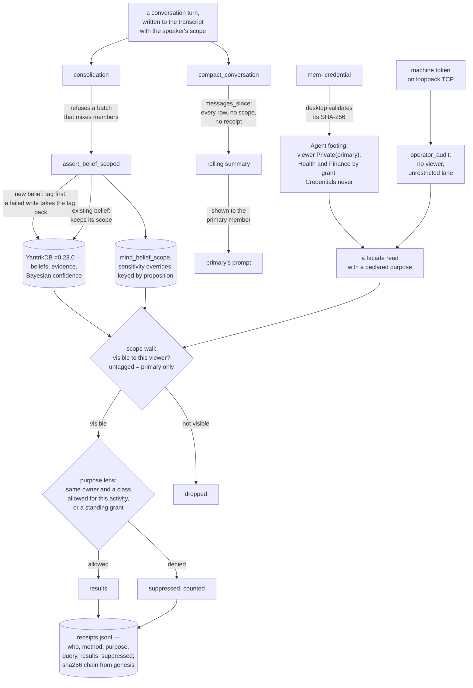

## 1. Executive Summary

yantrik-mind is a Rust companion that stores what it learns as typed beliefs
in the YantrikDB engine and adds a purpose gate of its own: every belief
carries an owner scope and a sensitivity class, and every facade read passes a
scope wall and then a default-deny purpose lens before a receipt is written.
The gate is well built and adversarially tested. Two paths go around it: the
MCP server's machine token reads under the unrestricted audit lane, and the
background compaction that writes the primary's rolling summary reads every
member's transcript with no wall and no receipt.

It describes itself as "[a] ground-up Rust AI companion built on the YantrikDB
typed-memory moat" that stores "*beliefs* — typed, revisable nodes with
Bayesian confidence scores, evidence trails, and contradiction edges". That
model belongs to the engine, described in [YantrikDB
Engine](../yantrikdb-engine/). This report is about what the companion puts
around it.

**Scope is a wall, and legacy rows fall on the safe side.** `Scope` is
`Shared` or `Private(person_id)`, and the type states its rule: a fact "from
one person must NEVER surface to another". An untagged row is private to the
primary member, "so pre-multi-user facts never leak to a later-added member".
A scoped assertion of a belief that exists keeps the scope it had; until
28 September 2026 it overwrote it.

**Sensitivity is default-deny, and the policy only narrows.** Four classes —
Ordinary, Health, Finance, Credentials — answer their owner in direct
conversation and never season background work without a standing grant, and
`Credentials` is outside every wildcard grant. `purpose_allows` is "[m]onotonic
toward denial: outside Audit/Maintenance, nothing about the activity or the
query text can widen access — only a standing grant can."

**Every facade read is receipted, the operator's included.** Operator reads
were once exempt as "the trusted owner path"; the receipts module removed the
exemption because "the operator's background lanes (dream/proactive/research/…)
are exactly the cross-subject reads a purpose audit exists to catch, so a
ledger blind to them would be theater." Each receipt is hash-chained and
counts what the gate suppressed.

**Other minds reach memory through a door the desktop keeps.** A
`mind-memory-mcp` server serves beliefs and flat memories to other agents. A
`mem-` credential is validated by the person's desktop over a socket, and the
caller reads as the person with ordinary facts by default, Health and Finance
by grant, and Credentials never.

**The machine token is the exception.** The same server accepts a per-machine
bearer token, and that caller reads as `operator_audit()` — every scope, every
class.

**The rolling summary is the leak.** `compact_conversation` reads the
transcript through `messages_since`, which has no scope, and writes the result
into the summary the primary's prompt carries. The consolidation lane beside it
reads the same table and refuses any batch that mixes members; compaction has
no such check.

## 2. Mental Model

A **belief** lives in the engine and is revised by evidence. This layer adds
two handling attributes keyed by the belief's proposition: a **scope** saying
whose it is, and a **sensitivity** saying what work may use it, taken from an
explicit override row or, failing that, from a deterministic classifier over
the text.

A **read** carries an `AccessContext`: a principal with a scope, the operator
with a purpose, or another mind with a validated footing. There is no way to
construct one without a declared purpose.

The **wall** runs in a fixed order: scope decides what may be seen, then the
purpose lens decides what this work may use. A suppression is counted.

A **receipt** is written for each facade read, chained to the one before it.

A belief stops being recalled when it is **forgotten**: the engine marks the
node tombstoned and this layer records a redacted, fingerprinted reason. A
later assertion of the same words creates a new belief; nothing consults the
tombstone. Status labels such as `contradicted` or `stale` are computed at read
time, not stored.

## 3. Architecture

| Area | Role |
| --- | --- |
| `Cargo.toml:28-71` | The engine pin at `=0.23.0`, and the reasons for each move |
| `crates/mind-types/src/memory.rs` | `Scope`, `AccessContext`, and the agent footing |
| `crates/mind-types/src/purpose.rs` | Sensitivity classes, grants and `purpose_allows` |
| `crates/mind-memory/src/lib.rs` | The memory actor, the scope and sensitivity tables, the wall, the facade and its tests |
| `crates/mind-memory/src/receipts.rs` | The hash-chained read ledger |
| `crates/mind-memory-mcp/` | The MCP server, its token and credential auth, and the desktop door |
| `crates/mind-conversation/` | Consolidation, compaction and the companion's turns |
| `deploy/yantrik-os/` | The two systemd units that take turns owning the memory file |

One process owns the memory file at a time. While Yantrik Mind runs, it serves
the MCP endpoint from its own handle; when another mind is active, the
standalone `yantrik-memory` binary serves the same file at the same address,
and the units declare `Conflicts=` with each other so they never overlap. The
reason is stated in the crate header: "a second one does not see the first
one's writes (proven 2026-09-16 — its recall misses them while its stats count
them)."

## 4. Essential Implementation Paths

`crates/mind-memory/src/lib.rs:5564-5604` — the wall: scope visibility, then
the purpose lens, returning the suppressed count.

`crates/mind-types/src/purpose.rs:391-418` — `purpose_allows`, the one policy
function.

`crates/mind-memory/src/lib.rs:744-771` — `assert_belief_scoped`: tag before
write, keep an existing belief's scope.

`crates/mind-memory-mcp/src/server.rs:20-28`, `:229-235` — the two callers and
the context each reads under.

`crates/mind-memory-mcp/src/door.rs:94-141` — validating a credential through
the desktop, failing closed.

`crates/mind-conversation/src/briefing.rs:297-379` — compaction, and the read
that goes around the wall.

## 5. Memory Data Model

The belief node — proposition, log-odds, evidence trail, confidence,
provenance — is the engine's. This layer keeps three things beside it, all in
the same SQLite file and all keyed by the belief's proposition text:
`mind_belief_scope` (`shared` or `private:<owner>`), a sensitivity override
table, and `mind_belief_evidence_version`, a per-belief monotonic counter that
drops an out-of-order or replayed evidence update instead of letting it
overwrite a fresher confidence.

Keying scope by text has a consequence the project found and fixed.
`find_belief` merges case and punctuation variants into one node, and until
[`f90464b3d8b0c8e91a3de62260980c90eea25ce2`](https://github.com/yantrikos/yantrik-mind/commit/f90464b3d8b0c8e91a3de62260980c90eea25ce2)
on 28 September 2026 a scoped assertion wrote the belief and then upserted its
tag. The commit message states the effect: "anyone saying the same statement
moved the whole belief -- confidence, evidence, history -- into their own
scope, including Private -> Shared. A failed tag was discarded, and write and
tag were two engine commands." `assert_belief_scoped` makes it one command: a
new belief is tagged before it is written and a failed write takes the tag
back; an existing belief keeps its scope (`lib.rs:744-771`).

Flat memories are engine records with a namespace, written by the MCP
`remember` tool with a server-stamped `written_by` that the caller's metadata
cannot impersonate. They have no scope tag, so the wall treats them as legacy
rows: visible to the primary and to an agent reading as the primary, never to
another member.

Forgetting a belief calls the engine's `tombstone_cognitive_node`, which sets a
flag on the node and its edges, and then records a row in
`mind_belief_tombstone_v2` keyed by a SHA-256 of the proposition with a
`ledger_safe` preview. The redaction exists because the v1 table kept the
full proposition: "forgetting 46 beliefs that contained a household safe code
wrote 46 fresh copies of that code into the deletion ledger." The node row
keeps its text under the flag, and the engine's oplog entry for each upsert
carries the label.

## 6. Retrieval Mechanics

Belief recall loads every belief and scores it: with the bundled embedder,
cosine similarity plus `0.1 * confidence`; without one, keyword overlap plus
confidence (`lib.rs:2835-2914`). `beliefs_matching_n` is a word match with
acronym handling. Flat-memory recall calls the engine's `recall` with graph
expansion off and the caller's optional namespace; `None` spans every
namespace, which is the engine's documented behaviour.

Each of these returns to the facade, which runs `wall` and writes a receipt.
`recent_messages` applies the same rule on the transcript by downgrading an
operator lane outside audit and maintenance to the scope its beneficiary could
see. `messages_since` does not: it is a raw `SELECT id, role, text FROM
mind_transcript WHERE id > ?1` with no scope and no receipt
(`lib.rs:4522-4544`), and its two callers are consolidation and compaction.

## 7. Write Mechanics

Consolidation reads a bounded transcript window, refuses it unless
`next_batch_is_primary_isolated` holds — "a mixed window must remain pending
rather than fuse two people's private contexts into primary memory"
(`crates/mind-conversation/src/lib.rs:6598-6612`) — and asks a model to extract
beliefs, goals, preferences, commitments and people, each belief asserted
through the engine's `assert_belief_evidence`. Every belief write passes
`gate_write`, which keeps marker-shaped secrets out entirely.

Over MCP, `remember` writes a flat memory and `believe` adds signed evidence to
a belief, unscoped and so primary-only on read. A mind repeating its own
assertion is not counted again (E.EVID1), and a mind may `forget` only what
it alone wrote, checked against the server-stamped authors.

## 8. Agent Integration

The companion runs over Telegram and a web console. Telegram mints a principal
for every sender, the owner included, so remote reads are filtered; the web
console and CLI dispatch use `operator_audit()`.

The MCP server exposes `remember`, `recall`, `believe`, `beliefs`, `explain`,
`forget`, `conflicts`, `relate` and `reflect`. It authenticates two kinds of
caller (`crates/mind-memory-mcp/src/lib.rs:155-178`):

- **Another mind**, presenting a `mem-` credential. The server sends only its
  SHA-256 to the desktop's `memory_validate`, accepts exactly a version-1
  answer for this person naming a mind, trusts it for at most five seconds,
  and clears every cached answer when the door fails. The footing reads as
  `Private(PRIMARY)` under the `Agent` activity, every tool but `forget`
  requires its named grant, and `purpose_allows` refuses Credentials to the
  `Agent` activity "whatever it was granted". On the person's unix socket this
  is the only caller accepted, and only from the person's uid.
- **The machine token**, a 32-byte value in a mode-0600 file beside the
  database, accepted on loopback TCP. It reads under `operator_audit()`
  (`server.rs:229-235`), which `purpose_allows` treats as unrestricted. The
  Yantrik OS unit for the mind sets `YM_MEMORY_SERVER=127.0.0.1:7440`, so the
  endpoint is up whenever the mind runs. The `Caller` comment gives it
  "the machine owner's full view, until the desktop's per-mind credentials
  are validated."

## 9. Reliability, Safety, and Trust

The gate is the part to trust. It is one wall in a fixed order, the policy
only narrows, a grant cannot widen a principal's view, suppressions are
counted into a chained ledger, and the red-team test reads as a specification.

Three things reach around it.

**Compaction.** `compact_conversation`
(`crates/mind-conversation/src/briefing.rs:297-379`) runs on every Telegram
tick (`crates/mind-core/src/telegram.rs:3101`), reads `messages_since` over the
whole transcript, and writes a `conversation_summary` profile value. The turn
builder shows that summary only when the viewer is the primary
(`crates/mind-conversation/src/lib.rs:12455-12469`), on the stated ground that
"[t]he rolling summary is distilled from the primary transcript". The read does
not select it: rows written with a member's `private:<owner>` scope by
`append_message_scoped` are in the window, so a registered member's private
lines can reach the primary's prompt, and no receipt records the read.
Consolidation, reading the same table, refuses a mixed window; compaction has
no equivalent check.

**The machine token.** Whoever can read the token file reads every member's
private beliefs and the Credentials class, receipted as `audit`. The
Credentials rule that the class "never seasons background work" and the agent
rule that another mind "never reads a credential" do not apply to it.

**The believe tool.** `believe` returns `belief_json` of the stored belief
without passing the wall (`server.rs:379-407`), and `assert_belief` finds the
node by proposition regardless of scope. An agent holding `believe` that
states someone else's private belief verbatim adds evidence to it and gets its
confidence and evidence count back.

Beyond the gate: `yantrik-ml`, `yantrik-os` and `yantrik-chat` are path
dependencies into `../yantrik-companion`, directly below the comment arguing
against path dependencies, and that comment's first line reads "pinned to
standalone yantrikdb 0.18.0" above `=0.23.0`. There is no licence file.
Committed run artefacts include `comm_smoke.db-wal`, `mind_smoke.db-wal`, their
`-shm` files, `grep.exe.stackdump` and two `__pycache__` files.

## 10. Tests, Evals, and Benchmarks

`purpose_gate_redteam_zero_unauthorized_hydrations` (`lib.rs:8451-8701`)
asserts that "purpose-incompatible facts that are PRESENT, VISIBLE (to the
operator capability), and HIGHLY RELEVANT … must produce ZERO unauthorized
hydrations across the cross-owner and sensitive-class corpora", across six
background lanes and four read methods, with positive controls.
`another_mind_reads_only_what_its_credential_opens` (`:9271-9332`) asserts the
exact visible set for each agent grant combination and that explain and
reflect hide what recall hides. `an_assertion_never_moves_a_beliefs_scope`
(`:9352-9390`) and `read_isolation_keeps_a_private_belief_from_another_member`
(`:9419-9512`) hold the scope wall against re-assertion and across members.
The MCP crate tests that each tool demands its grant, that an HTTP call with no
authenticated caller is refused, and that on the socket only the person's uid
with a vouched credential is served.

No test reads `messages_since`, compaction, or `recall_memories` under a member
scope, and none exercises the machine-token caller against a private or
Credentials row. `mind-evals` carries an immune ledger whose chain discipline
the receipts module mirrors. No test was run for this reading.

## 11. For Your Own Build

### Steal

Order the walls and never let the second widen the first. Scope decides what
may be seen; purpose decides what this work may use; a grant can open the
second and never the first.

Make the context unconstructible without a purpose. Every call site then names
what the read is for, and every receipt carries it.

Count suppressions in the receipt. A gate whose refusals are invisible cannot
be told from one that never fired.

Validate another agent's credential by hash against an authority you do not
control, trust the answer for seconds, and drop every cached answer when the
authority is unreachable.

When a scope is keyed by content, make the first writer's scope permanent. A
merge on normalised text otherwise hands a belief to whoever says it next.

### Avoid

A raw read in the same module as the wall. `messages_since` sits beside
`recent_messages`, which applies the rule, and the background lane that uses it
produces text for one person's prompt from everyone's lines.

A shared token that maps to the audit lane. Once a per-caller credential
exists, the machine-wide one is the path that bypasses everything it was built
to enforce.

Returning a write's result unfiltered. A write tool that echoes the stored row
is a read.

### Fit

This suits a household companion on one machine where several people talk to
the same mind and the main risk is one person's private facts reaching
another's conversation or a background job. It is a reference for purpose
limitation over a belief store. It is not a library: there is no licence, the
build needs a sibling checkout, and the memory API is internal to the
workspace.

## 12. Open Questions

Whether the machine token is meant to survive once per-mind credentials are
validated, or whether it will be narrowed to a principal or removed.

Whether compaction should read through `recent_messages` with the primary's
scope, as the turn builder's comment assumes it does.

Whether a tombstone should refuse a later assertion of the same proposition;
the fingerprint is computed and is read only by the migration and the listing.

## Appendix: File Index

| Path | What to read it for |
| --- | --- |
| `Cargo.toml:28-71` | An exact engine pin and the evidence for each move |
| `crates/mind-types/src/memory.rs:217-261` | `Scope` and the safe legacy default |
| `crates/mind-types/src/memory.rs:280-391` | `AccessContext`, the agent footing and `viewer()` |
| `crates/mind-types/src/purpose.rs:146-192` | Sensitivity classes and what each allows without a grant |
| `crates/mind-types/src/purpose.rs:391-418` | `purpose_allows` |
| `crates/mind-memory/src/lib.rs:744-771` | A scoped assertion that cannot move a belief |
| `crates/mind-memory/src/lib.rs:3865-3901` | `PurposeLens`: owner from the scope tag, class from override or classifier |
| `crates/mind-memory/src/lib.rs:4522-4544` | `messages_since`, the unwalled transcript read |
| `crates/mind-memory/src/lib.rs:5564-5604` | The wall |
| `crates/mind-memory/src/receipts.rs:1-16` | Why the operator lost its exemption |
| `crates/mind-memory/src/lib.rs:8451-8701` | The red-team test |
| `crates/mind-memory-mcp/src/server.rs:20-28`, `:229-235` | Two callers, two contexts |
| `crates/mind-memory-mcp/src/door.rs:94-141` | Credential validation through the desktop |
| `crates/mind-conversation/src/briefing.rs:297-379` | Compaction into the rolling summary |
| `crates/mind-conversation/src/lib.rs:6598-6612` | Consolidation's mixed-window refusal |

### Recorded searches

Run at the tree root of the pinned checkout with `/usr/bin/git grep`.

- `git grep -nE 'mind_belief_tombstone_v2' -- crates` — the table, its migration, `record_tombstone` and `list_tombstones`; no read by fingerprint outside the migration, so no write path consults it.
- `git grep -n 'self.receipt_read(' -- crates/mind-memory/src/lib.rs` — six call sites: `recall_memories`, `recall_typed`, `beliefs_matching`, `conflicts`, `explain_belief`, `recent_messages`; none in `messages_since`, `memory_curation_baseline` or `export`.
- `git grep -nE '\.messages_since\(' -- crates` — `crates/mind-conversation/src/briefing.rs:313` (compaction) and `crates/mind-conversation/src/lib.rs:6591` (consolidation).
- `git grep -nE 'expand_entities' -- crates/mind-memory/src` — one hit, `false`, in the pack recall; `recall_memories` passes `false` positionally; no graph traversal on a read path.
- `git grep -nE 'BeliefStatus::[A-Z][a-z]+' -- crates ':!*tests.rs'` — assignments only inside `reflect` and `hydrate_working_set`, computed from conflicts and decay at read time; no stored status column.
- `git grep -nE 'recall_as_of|event_time_min|valid_from|valid_to|valid_until' -- crates` — no match; no valid-time axis in this layer.
- `git grep -niE '"(approve|approved|pending_review|reject)"|fn approve' -- crates/mind-memory crates/mind-memory-mcp crates/mind-types` — no match; no review state.
- `git grep -niE 'licen[cs]e' -- '*.toml' README.md BUILD.md RELEASE_NOTES.md` — no match; `ls LICENSE*` finds nothing.

## History

**2026-10-12** — [`7fa2c04b791a795d7832ae9f23923b417d213a8d`](https://github.com/yantrikos/yantrik-mind/commit/7fa2c04b791a795d7832ae9f23923b417d213a8d) — 153 commits on, version 0.2.1. The engine pin moved to `=0.23.0` so Hermes can share the file, and an MCP server arrived with a credentialed agent footing and a machine token that reads under the audit lane ([section 8](#8-agent-integration)). Overtaken: a scoped assertion moved an existing belief between scopes until `f90464b` ([section 5](#5-memory-data-model)). Wrong then: a receipt for every read, when compaction read every member's transcript unwalled and unreceipted ([section 9](#9-reliability-safety-and-trust)); scope on the belief, when it was a side table the last assertion overwrote; and a delegated store with a graph arm. Both marks hold at both pins. Screened from a full clone: thirty files, one auto-run surface (`.codex/config.toml`, present at the earlier pin), two build-time execution points, nothing inside the cooldown. The engine was cloned at tag `v0.23.0`. Nothing was installed, built or run.

**2026-09-16** — [`97935b1e247167ac7d4fe192ec8a9a1966b26c49`](https://github.com/yantrikos/yantrik-mind/commit/97935b1e247167ac7d4fe192ec8a9a1966b26c49) — first reading, at a commit dated 8 September 2026. Screened before opening, from a shallow clone: twenty-seven files scanned, no auto-run surfaces, two build-time execution points, no unpinned dependency surfaces and nothing inside the seven-day cooldown, with `Cargo.lock` tracked and unchanged for eight days. Reviewed **without a licence file**, so nothing here should be taken as a statement about reuse terms. The belief engine it delegates to is a published crate rather than a checkout and was not cloned for this reading; its model is covered separately. Nothing was installed, built or run.
