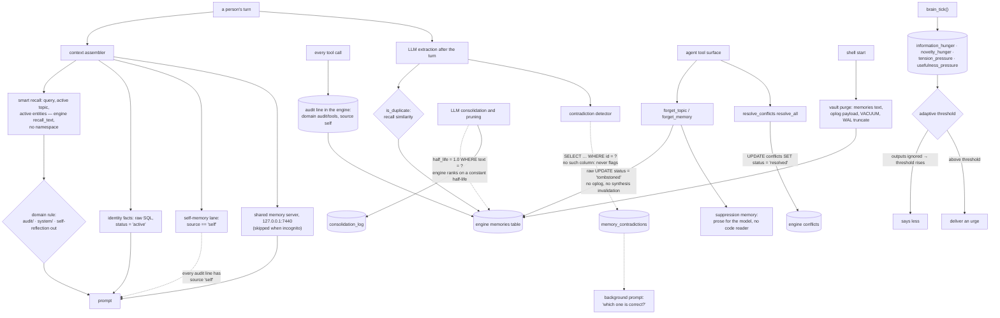

## 1. Executive Summary

Yantrik OS is a Rust desktop operating system whose shell is an agent, and
whose companion keeps memory in an embedded YantrikDB engine pinned to an
exact revision. What this repository adds on top of the engine is a full
memory layer: recall assembly, seventeen memory tools on the agent's own
surface, LLM-driven consolidation, and a client to the machine's shared
memory. That layer reaches the engine's tables by raw SQL as often as through
its API, and three of its removal paths do not do what their names say.

It describes itself as "[a]n AI-native desktop operating system where the AI
**is** the shell", built on Debian 13 and shipped as a live ISO. Every app
publishes its state and accepts actions over a unix socket, so "[a]nything a
person can do from the keyboard, an agent can do through the same path":
`yos describe shell`, `yos act shell open_app name=notes`.

**The cognition loop is the part worth copying.** Every observation is typed
as a prediction error, a tension, an opportunity or an uncertainty, and
uncertainty is the one that triggers fetching external information rather
than guessing. Four homeostatic drives "oscillate between satiation and
hunger", and one of them carries the best decision in the repository:

> "`usefulness_pressure`: rises when outputs are ignored, raises threshold
> (more selective, NOT more spammy)"

A proactive assistant that becomes quieter the more it is ignored inverts the
incentive almost every notification system encodes. The tick is arithmetic,
not a model call, and the cortex above it states that it "does NOT call the
LLM directly". The brain modules were moved out of a vendored copy of the
database because living there "made them look like database code. They are
not: they touch no YantrikDB type at all, only a plain
`rusqlite::Connection`."

**The memory layer says one thing and does another in three places.**
Consolidation asks a model whether a newer memory updates or merges with an
older one, and then "tombstones" the loser by setting `half_life = 1.0` on
every row with that exact text. The status stays `active`, and the pinned
engine ranks on a constant half-life rather than the stored one, so the
superseded memory is recalled beside its replacement. The contradiction
detector looks a candidate up by `memories.id`; the engine's table is keyed
`rid` and has no `id` column, so the lookup fails, the detector moves on, and
the background prompt asking the person which version is correct has
nothing to show. A repair module with an exclusion list for "Don't remember this" has
no production caller beyond creating its tables.

**Where it does remove, it goes around the engine.** `forget_topic` and
`forget_memory` set `consolidation_status = 'tombstoned'` with a raw UPDATE.
The engine's own forget does that inside a transaction that also deletes
chunk and entity rows, breaks record links, invalidates syntheses built on
the row and writes an oplog entry. The raw path does none of it.
`forget_topic` then records a "suppression memory" telling the model not to
bring the topic up; nothing in code reads it.

**Two mechanisms are well built.** The `recall` tool drops the
companion's own tool-audit lines, with a committed must-not-appear case on a
real engine, which is the report's one mark, `negative_eval`. It covers that
tool only: the self-memory lane of the context assembler and the
`introspect` tool admit rows by `source == "self"`, which every audit line
carries. And a startup purge overwrites vault tool output that had been
filed in plain text, in the memories table, in the oplog payload that
recorded it, and in the file, by VACUUM and WAL truncate.

## 2. Mental Model

A **pulse** is something that happened. An **entity** is what it was about.
A **signal** is why it might matter, and a **drive** is how badly the system
wants to say something. Being ignored lowers it.

A **memory** is an engine row the companion writes: a fact from a
conversation, a fact the model saved, or a line recording a tool call. All of
them share one namespace and one table, told apart by `domain` and `source`.

**Forgetting** is three different operations. Setting the engine's status
hides a row from recall. Setting `half_life` changes nothing recall reads.
Recording a suppression memory asks the model to behave.

## 3. Architecture

| Crate or path | Role |
| --- | --- |
| `crates/yantrik-companion` | The companion: context assembly, smart recall, learning, consolidation, lifecycle and repair modules, the shared-memory client, and eleven memory tools |
| `crates/yantrik-companion-tools` | The tool library, including six memory-hygiene tools |
| `crates/yantrik-companion-core` | The tool registry, the tool-call audit line, taint rules and the sanitizer |
| `crates/yantrik-brain` | The LLM-free loop: drives, detectors, curiosity, nightly consolidation |
| `crates/yantrik-companion-cortex` | Pulses, entity graph, baselines, patterns, reasoner |
| `crates/yantrik-ui` | The shell, its Memory screen reader and the per-mind memory grants |
| `crates/yantrik-mcp` | An MCP server over the engine; not a workspace member, and nothing builds it |
| `apps/`, `services/` | Application binaries and the services behind them |

### Deployment and ergonomics

The engine is a git dependency at revision
`9aa589921da244ba07358674986f0bf30f87a198` (version 0.23.1), recorded in
`Cargo.toml` and `Cargo.lock`. The manifest says why it is not a sibling
path: a local build "silently used whichever branch was checked out in the
neighbouring directory — which is how a public image shipped without a vault
fix that had been written two weeks earlier". The default feature set
carries a bundled 64-dimension embedder, so an in-memory store records and
recalls with no download.

## 4. Essential Implementation Paths

`crates/yantrik-companion/src/companion.rs:1807-1925` — the context assembler:
smart recall, identity facts, the self-memory lane, the shared-memory section.

`crates/yantrik-companion/src/memory_evolution.rs:173-266` — the domain rule
and smart recall.

`crates/yantrik-companion/src/memory_evolution.rs:381-530` and `:1386-1400` —
LLM consolidation and the half-life "tombstone".

`crates/yantrik-companion/src/tools/memory.rs:589-760` — `forget_topic`.

`crates/yantrik-companion-tools/src/memory_hygiene.rs:16-23`, `:323-366`,
`:472-584` — the hygiene tools, `forget_memory` and `resolve_conflicts`.

`crates/yantrik-companion/src/companion.rs:6354-6423` — the vault purge.

`crates/yantrik-brain/src/brain.rs:1-50` — the signal taxonomy, the drives
and the tick.

## 5. Memory Data Model

The unit is the engine's memory row. The companion writes `type`,
`importance`, `half_life`, `namespace` (always `default`), `certainty`,
`domain` and `source`. Domain separates kinds that share one table:
conversation facts, `identity`, `preference`, `audit/tools` for tool calls,
`system/*` for telemetry, `self-reflection` for the companion's notes on
itself.

The companion adds side tables in the same file. `memory_tiers` assigns an
importance tier and a half-life per row. `memory_lifecycle` holds a state per
row — observed, inferred, confirmed, reinforced, contradicted, stale,
archived, forgotten — with a scope and a privacy flag. `memory_contradictions`
pairs rows. `consolidation_log` records removals with a type and a reason.
`memory_exclusions`, `memory_boundaries` and `memory_repairs` belong to the
repair module.

**Most of the side state is written and never read to exclude anything.**
Lifecycle states change on registration and in a nightly pass, and the only
reader that filters on them, `active_ids_for_scope`
(`memory_lifecycle.rs:468`), has no caller outside its tests. The privacy
flag has no production setter. `MemoryRepair` is reached only through
`ensure_table`; `apply`, `add_exclusion` and `is_excluded` have no
production caller.

**`half_life` is written for a purpose the engine retired.** Tier assignment
and consolidation both write it. The pinned engine has ranked on
`RANKING_HALF_LIFE`, a constant, since its commit of 17 August 2026, because
reinforcement overwrites the stored value; the engine keeps the stored value
for an eviction routine nothing calls and a decay-trigger check in `think()`
(`base/scoring.rs:22-27`, `:60-83` in the engine).

`consolidation_log.original_rid` receives memory text from
`tombstone_memory`, and `replacement_rid` the newer of the two inputs rather
than the row consolidation records in their place.

## 6. Retrieval Mechanics

**Smart recall.** `smart_recall` (`memory_evolution.rs:193`) calls the
engine's `recall_text` up to three times — the query, the active
conversation topic, and recently mentioned entities — over-fetches, drops
excluded domains, deduplicates on the first 80 characters and caps the
total. `recall_text` passes no namespace, so every row in the file is a
candidate, and `include_consolidated` false, so the engine keeps only
`active` rows (engine `engine/mod.rs:3275-3295`).

**Three more lanes.** `recall_identity_facts` reads identity and
high-importance work rows by raw SQL with `consolidation_status = 'active'`.
The self-memory lane recalls `self: <query>` and keeps rows where
`r.source == "self" || r.domain == "self-reflection"` (`companion.rs:1838`,
`:2768`); every tool-audit line is recorded with source `self`
(`yantrik-companion-core/src/tools.rs:219-220`), so up to two audit lines
reach the prompt as the companion's self-observations. The shared-memory
section recalls from the Yantrik Mind server at `127.0.0.1:7440/mcp` and is
skipped in incognito.

**A program is not the person.** A turn asked for on the companion's socket
runs as incognito under an outside ceiling, and its prompt carries no smart
recall, no identity facts, no self-memories and no urges
(`companion.rs:2623-2639`, `:2738-2771`).

**The tools.** `recall` applies the domain rule. `introspect` returns rows by
the same source-or-domain test as the self-memory lane, so it returns audit
lines too, and so does the background pass that gathers self-reflections for
the companion's diary (`background.rs:495-505`). `review_memories` lists active rows by raw SQL. `forget_topic`
finds its targets by semantic recall and by `LOWER(text) LIKE '%topic%'`.

## 7. Write Mechanics

`remember` and `save_user_fact` skip a fact when the top recall result's
similarity reaches the dedup threshold (`learning.rs:425-432`). After each
turn an LLM extracts facts, writes them, assigns a tier, registers a
lifecycle row, and shares them with the machine's memory server in the
`default` namespace. Incognito blocks remembering, learning and audit
lines; the forget tools write regardless.

Every tool call becomes a memory: `Tool: name(args) → first 200 characters`,
domain `audit/tools`, source `self`. A tool that touches credentials is
recorded with its result withheld.

**Consolidation** (`memory_evolution.rs:381-530`) selects recent rows and
asks a model whether each pair is an update, a merge or two facts. Its
selection SQL reads `WHERE type = 'semantic' AND consolidation_status IS NULL
OR consolidation_status = 'active' AND created_at > ?1`; AND binds before OR,
so every active row from the last day qualifies whatever its type, audit
lines included. On update or merge it records a new row and calls
`tombstone_memory`, which runs `UPDATE memories SET half_life = 1.0 WHERE
text = ?1` and logs the action. Pruning's compression calls the same helper.

**Removal by the agent.** `forget_topic` tombstones matching rows, deletes
matching cortex entities with their relationships, baselines and patterns,
cancels matching scheduled tasks, and records the suppression memory.
`forget_memory` resolves a model-supplied rid prefix with `rid LIKE ?1 ||
'%' LIMIT 1`, tombstones the first match and logs it. `update_memory`
rewrites importance, domain or storage tier, so a model can move a row into
an excluded domain.

**Removal at start.** `purge_vault_audit_lines` (`companion.rs:1257`,
`:6363-6406`) overwrites audit lines from vault and browser-login tools with
a withheld line and tombstones them, rewrites every `text` field in the oplog
payloads that recorded them, and runs `VACUUM; PRAGMA
wal_checkpoint(TRUNCATE);`. The doc comment names the limit: "Backups taken
before it keep the lines."

## 8. Agent Integration

The uniform control path is the interesting piece for the desktop: every app
publishes state and accepts actions on the same socket, so an agent drives
the machine through the documented surface a person uses.

For memory, the companion's registry carries two groups. `memory`: remember,
recall, relate_entities, set_reminder, introspect, form_opinion,
create_inside_joke, check_bond, save_user_fact, forget_topic, brain_status.
`memory_hygiene`: memory_stats, review_memories, forget_memory,
update_memory, resolve_conflicts, purge_system_noise.

Other minds on the machine — the first-party Yantrik Mind, Hermes and other
harnesses — share memory through the Yantrik Mind server, which the
companion reaches with the server's bearer token from a file beside its
database. What each mind may recall is a per-mind grants file in
`~/.config/yantrik` that the shell answers the server about
(`yantrik-ui/src/memory_grants.rs`). Its header is candid that the grants
are advisory against a mind running as the person, and that the shell takes
out any widening it did not make itself except on the first read after it
starts. The filter itself lives in the server, which this atlas reads as
[Yantrik Mind](../yantrik-mind/).

`crates/yantrik-mcp` exposes the engine — remember, recall, forget,
resolve_conflict and more — over MCP. It is not listed in the workspace's
`members`, no crate depends on it, and no script builds it.

## 9. Reliability, Safety, and Trust

**Withheld, with the reason.**

- **Tombstone.** `forget_topic`'s suppression memory is keyed on the topic,
  and its only consumer is the model reading it. `memory_exclusions` and
  `is_excluded` are the right shape and have no production caller.
  `is_duplicate` consults recall, which excludes tombstoned rows, so a
  forgotten fact is re-admitted as new.
- **Trust state.** `consolidation_status` and the predicate that filters on
  it are the engine's, and that mark sits on
  [YantrikDB Engine](../yantrikdb-engine/). The companion's own lifecycle
  states have no read that excludes a row.
- **Scope enforced.** One namespace is written and none is passed on recall.
  The lifecycle scope has no reader. The grants are enforced in another
  repository. Excluding a socket program's turn from memory is a gate on the
  caller's class, not a stored scope key.
- **Audit log.** `consolidation_log` is insert-only and covers
  `forget_memory`, consolidation demotions and noise purges.
  `forget_topic`, `update_memory`, `resolve_conflicts` and the vault purge
  write nothing to it, and the raw UPDATEs bypass the engine's oplog. The
  vault purge rewrites oplog payloads in production.
- **Human review.** `resolve_conflicts` on the agent's own surface marks
  every open engine conflict resolved in one call. The companion's
  contradiction queue is never filled, and `resolve_contradiction` has no
  caller.
- **Bi-temporal.** No valid-time argument is passed and `recall_as_of` is
  not called.

`sanitize_response` redacts every case-insensitive occurrence of a list of
internal fragments from model output. The same file's
`detect_harmful_command` blocks shell patterns such as reading `id_rsa`
before a command runs.

## 10. Tests, Evals, and Benchmarks

4,575 Rust test functions and 1,013 Python test functions; CI runs
`cargo test --workspace`. I ran nothing and loaded no model.

The case behind the mark is
`recall_does_not_hand_the_audit_log_back_to_the_model`
(`tools/memory.rs:902-947`). Its comment dates the defect: on 24 September
`recall` returned "Tool: recall(query=…) → Found memories: - Tool:
recall(query=…)". It builds the store with the engine itself, not a
hand-made table, and asserts both directions on one query.

`memory_lifecycle.rs` carries `scope_filtering` and
`privacy_flag_excludes_from_recall`, each asserting an exclusion beside a
positive control, against `active_ids_for_scope`, which no production read
calls. `memory_reader.rs` asserts that the Memory screen leaves out audit and
consolidated rows, over a hand-made table. Nothing tests consolidation's
demotion, the contradiction detector against the engine's schema, or the
self-memory lane.

## 11. For Your Own Build

### Steal

Make being ignored raise the bar. One drive, one parenthesis — "more
selective, NOT more spammy" — and a proactive system stops training its user
to dismiss it.

Separate "insufficient data" from "nothing to say". Uncertainty as its own
signal type, wired to fetching rather than guessing, is the distinction most
assistants collapse.

Erase every copy. The vault purge rewrites the row, the log payload that
recorded the row, and the free pages, in that order, and says which copy it
cannot reach.

Give a program's request an empty memory. A turn that did not come from the
person gets no recall and leaves nothing behind.

### Avoid

Writing an engine's tables around its API. Each raw UPDATE here skipped
something the engine's own path did — the oplog, synthesis invalidation, the
status itself.

Demoting by a field the engine does not read. A score change that ranking
ignores is no change; retire by the status recall filters on, and test
through recall.

A filter applied on one lane. The audit-line rule guards two readers, and
the third admits the same rows by another column.

### Fit

A single-user desktop with no tenancy to enforce, where memory serves a
proactive companion and correction can be soft. Not a fit where a forgotten
fact must stay forgotten, or where the agent must not close its own
conflicts.

## 12. Open Questions

Whether any installed store has rows in `memory_contradictions`: the
detector's lookup fails on every call at this pin, and an older schema might
have differed.

How the shared memory's beliefs and the companion's own rows reconcile when
they disagree; the prompt carries both, labelled, and nothing compares them.

Whether the decay-trigger check in the engine's `think()` surfaces
consolidated-away rows, since `half_life = 1.0` on an important row is
exactly what it looks for.

## Appendix: File Index

| Path | What to read it for |
| --- | --- |
| `crates/yantrik-companion/src/companion.rs:1807-1925` | The context assembler and its four lanes |
| `crates/yantrik-companion/src/companion.rs:2623-2639` | A program's turn runs incognito with no memory |
| `crates/yantrik-companion/src/companion.rs:6354-6423` | The vault purge across memories, oplog and file |
| `crates/yantrik-companion/src/memory_evolution.rs:173-266` | The domain rule and smart recall |
| `crates/yantrik-companion/src/memory_evolution.rs:381-530` | LLM consolidation and its selection SQL |
| `crates/yantrik-companion/src/memory_evolution.rs:1386-1400` | The half-life tombstone |
| `crates/yantrik-companion/src/learning.rs:348-410` | The contradiction detector and its `id` lookup |
| `crates/yantrik-companion/src/tools/memory.rs:589-760` | `forget_topic` and the suppression memory |
| `crates/yantrik-companion/src/tools/memory.rs:902-947` | The must-not-appear case |
| `crates/yantrik-companion-tools/src/memory_hygiene.rs:323-584` | Forget by prefix, update, resolve all conflicts |
| `crates/yantrik-companion/src/memory_repair.rs:1-11` | The exclusion list nothing calls |
| `crates/yantrik-ui/src/memory_grants.rs:1-24` | Per-mind grants and their stated limits |
| `crates/yantrik-brain/src/brain.rs:1-50` | Four signals, four drives |
| `Cargo.toml:193-210` | The engine pinned to a revision, and why |

### Recorded searches

Run with `/usr/bin/git grep` at the pinned commit, and in the engine clone at
`9aa589921da244ba07358674986f0bf30f87a198`.

- `git grep -n -E 'topic_suppression|suppressed_topic' -- '*.rs'` — the writer in `tools/memory.rs` only.
- `git grep -n -E 'memory_repair|MemoryRepair|is_excluded\(|add_exclusion' -- '*.rs' ':!crates/yantrik-companion/src/memory_repair.rs'` — `ensure_table` in `companion.rs` and the module declaration.
- `git grep -n -E 'active_ids_for_scope|set_privacy|resolve_contradiction' -- '*.rs' ':!crates/yantrik-companion/src/memory_lifecycle.rs'` — no match.
- `git grep -n -E 'FROM memories WHERE id' -- '*.rs'` — `learning.rs:372`, `background.rs:244`, `:247`, `memory_hygiene.rs:534`, `:538`.
- In the engine: `git grep -n -i -E 'ALTER TABLE memories ADD' | grep -o -E 'ADD (COLUMN )?[a-z_]+' | sort -u` — no `id`; `schema.rs:32` declares `rid TEXT PRIMARY KEY`.
- In the engine: `git grep -n -E 'decay_score\(' -- crates/yantrikdb-core/src` — ranking uses `RANKING_HALF_LIFE`; the stored value reaches `storage.rs:293` (`evict`, no caller) and `triggers.rs:71`.
- `git grep -n -E 'consolidation_log' -- '*.rs'` — the table and three INSERTs; no UPDATE or DELETE.
- `git grep -n -E 'UPDATE oplog' -- '*.rs'` — `companion.rs:6400`, the vault purge.
- `git grep -n -E 'recall_as_of|event_time|valid_from' -- 'crates/*.rs' 'services/*.rs'` — a calendar parser and a comment; no valid-time use.
- `git grep -n -A8 -E '\.record_text\(' -- crates services` — 25 call sites, each passing `"default"` as the namespace; `recall_text` takes none.
- `git grep -n -E '"crates/yantrik-mcp"' -- Cargo.toml` — no match; `git grep -l 'yantrik-mcp' -- ':!crates/yantrik-mcp'` — `PR.md` only.
- `git grep -n -i -E 'anthropic|machine learning|additional restriction' -- LICENSE` — the GPL-3.0 text; no rider.

## History

**2026-10-15** — [`f063fcef907fecaa6bd27cbc6899d3aee5ac82e1`](https://github.com/yantrikos/yantrik-os/commit/f063fcef907fecaa6bd27cbc6899d3aee5ac82e1) — 1,436 commits on. The engine moved from a sibling path to a pinned revision, 0.23.1, read at that revision for this entry. A shared-memory client, per-mind grants, memory-free socket turns and the vault purge arrived. `negative_eval` gained on a new recall test ([section 10](#10-tests-evals-and-benchmarks)). Wrong at the first pin: the companion's memory layer was missed, including its own recall, its retirements and its log ([section 1](#1-executive-summary)), along with the test count, the MCP crate and the sanitizer table. Screened from a full clone: 116 files, no auto-run, 25 build-time execution points, one unpinned Python manifest, five dependency files inside the cooldown. Nothing was installed, built or run.

**2026-09-16** — [`ec2e424f594b7f8e801526273a5e31506615b1ad`](https://github.com/yantrikos/yantrik-os/commit/ec2e424f594b7f8e801526273a5e31506615b1ad) — first reading, at a commit dated 16 September 2026. Screened before opening, from a shallow clone: seventy-two files scanned, no auto-run surfaces, twenty build-time execution points, no unpinned surfaces and fifty-one dependency files inside the seven-day cooldown. Nothing was installed, built or run.
